## Was bleibt nach dem Ausschalten?

Ein Mikrocontroller wird ausgeschaltet und wieder eingeschaltet.

- Sein Programm startet erneut.
- Eine veränderte globale C-Variable hat wieder ihren Anfangswert.

Welche Information muss erhalten bleiben? Was kann Startsoftware wiederherstellen?

Zwei Minuten: Vermutung und Begründung sammeln.

::: notes
Nach dem vollständigen Trennen der Versorgung startet ein Mikrocontroller wieder dasselbe Programm. Eine während des Betriebs veränderte globale C-Variable besitzt anschließend erneut ihren vereinbarten Initialwert. Aus diesem vertrauten Verhalten folgt noch nicht, dass beide Inhalte auf dieselbe Weise gespeichert waren. Für den Einstiegsfall seien ein nichtflüchtiger Programmspeicher und gewöhnlicher flüchtiger Arbeitsspeicher angenommen; zusätzliche Sicherungsbatterien oder absichtliche Sicherungskopien gehören nicht zum Modell.

Naheliegend ist zunächst die Vorstellung, das Gerät habe einfach alles behalten. Eine andere Vermutung lautet, nach dem Ausschalten müsse jede Information verschwunden sein. Die Unterscheidung zwischen Programm und laufendem Zustand löst diesen scheinbaren Widerspruch: Die Firmware, die gerätenahe Software, kann dauerhaft gespeichert bleiben, während ihre veränderlichen Arbeitsdaten die Versorgung benötigen. Ein erneut vorhandener Anfangswert kann außerdem aus Startsoftware entstehen und muss kein erhaltener letzter Laufzeitwert sein. Die genaue Verbindung zu den C-Abschnitten und zum Startcode wird am Ende aufgebaut. Ein bloßer Reset ist dabei nicht mit vollständigem Spannungsverlust gleichzusetzen.

Mikrocomputertechnik 3 verbindet dazu den Rechenkern mit Speicher, Verbindungen und Peripherie. Die CPU, Central Processing Unit, führt Befehle aus; Peripherie ergänzt etwa Sensoranschlüsse und Timer. Der Lernweg führt von einer physikalischen Bitzelle über ihren Zugriff und ihre Organisation bis zu den Adressen der Software. So lässt sich erklären, weshalb ein Gerät verschiedene Speicher braucht und welche Aufgaben Hardware und Startsoftware jeweils übernehmen.
:::

## Das benötigen wir aus MCT1/2

- Binäre Werte, Byte und hexadezimale Adressen
- Logisches NOT und einfache Rückkopplung
- Spannung, Kondensator und gesteuerter Schalter als Grundideen
- C-Arrays und Zeiger; die Beispiele werden hier erklärt

::: notes
Für diesen Weg genügen die Grundlagen aus Mikrocomputertechnik 1 und 2. Ein Bit besitzt die logischen Werte null und eins, ein Byte umfasst acht Bit. Hexadezimale Zahlen verwenden die Basis sechzehn; eine Ziffer stellt vier Bit dar. In C kennzeichnet das Präfix `0x` einen Hexadezimalwert. Ein NOT-Gatter oder Inverter vertauscht null und eins. Diese digitalen Werte beschreiben zulässige Spannungsbereiche, obwohl die tatsächlichen Schaltungsknoten analoge Spannungen besitzen.

Ein Kondensator kann elektrische Ladung speichern. Ein Transistor wird zunächst als gesteuerter leitender oder gesperrter Pfad behandelt. Dieses qualitative Modell erklärt grundlegende Zusammenhänge, ohne bereits eine vollständige Halbleiterkennlinie oder konkrete Prozessparameter vorauszusetzen. Die beiden benötigten Transistorarten werden vor ihrem Einsatz unterschieden.

Auf der Softwareseite ist ein C-Array eine Folge von Elementen; ein Zeiger bezeichnet eine Adresse. Datentyp, Lebensdauer und gültiger Speicherbereich begrenzen, welche Zugriffe sinnvoll und zulässig sind. Mit diesen Kenntnissen lässt sich derselbe Datenwert sowohl als elektrischer Speicherzustand als auch als adressiertes C-Objekt betrachten. Das verbindende Werkzeug ist später der Linker: Er fügt übersetzte Programmteile zusammen und ordnet sie zu einer ausführbaren Anordnung. Caches, Interruptcontroller und atomare Operationen werden hierfür noch nicht vorausgesetzt.
:::

## Vier Schulstunden: Lernweg und Arbeitsphasen

| Stunde | Erklärung und Besprechung | Arbeitsphase |
|--------|---------------------------|--------------|
| 1 | System, Größen und Flash: 35 min | Aufgaben 1–2: 10 min |
| 2 | Inverter, 6T-SRAM, Lesen und Schreiben: 30 min | Aufgabe 3: 15 min |
| 3 | DRAM, Ladungsteilung und Organisation: 30 min | Aufgabe 4: 15 min |
| 4 | Puffer, Memory Map und Startup: 15 min | Aufgaben 5–6: 15 min; Quiz: 15 min |

::: notes
Vier Schulstunden umfassen hundertachtzig Minuten ohne zusätzliche Pausen. Davon entfallen hundertzehn Minuten auf Erklärung, Denkfragen und Lösungsbesprechung, fünfundfünfzig Minuten auf angeleitete Papierarbeit und fünfzehn Minuten auf das Quiz. Die fünf zusätzlichen Abschnittsübersichten ordnen den bestehenden Stoff; sie verlangen keine zusätzliche Unterrichtseinheit. Schaltungs- und Ladungsbilder benötigen dabei mehr gemeinsame Bearbeitung als kurze Orientierungen.

Die fünf Abschnitte verfolgen ein zusammenhängendes Problem. Zunächst müssen Datenwege und Größenordnungen stimmen. Danach erklärt nichtflüchtiger Speicher, wie ein Programm das Abschalten überstehen kann. SRAM, Static Random-Access Memory, hält einen Zustand durch Rückkopplung; seine klassische 6T-Zelle verwendet sechs Transistoren. DRAM, Dynamic Random-Access Memory, speichert dagegen Ladung und benötigt Auffrischung. Abschließend verbinden Speicherorganisation, Memory Map und Startup die Hardware mit dem C-Programm. Die Memory Map ordnet Adressbereiche Speicher und Geräten zu; Startup bezeichnet die Initialisierung beim Firmwarestart.

Damit werden Speicherwahl, SRAM-Lese- und Schreibfolgen, DRAM-Ladungsteilung sowie Adressgrenzen und Initialisierung erklärbar. Die Pflichtaufgaben sind auf Papier lösbar. Ihr längerer Zeitrichtwert gilt für vollständige selbstständige Bearbeitung. Das optionale Hostprogramm läuft auf dem Entwicklungsrechner und ergänzt Zahlen- und Pufferbeispiele. Es simuliert keine analogen Zellströme und benötigt keine erst später eingeführte MCT3-Plattform.
:::

## 1 · Datenwege und Maßstäbe {.section-divider}

Was muss zwischen Rechenkern und Speicher zusammenpassen?

::: {.section-route}
Datenwege → Nichtflüchtige Speicher → SRAM → DRAM → Software
:::

::: notes
Der Einstieg verbindet gespeicherte Information mit dem Verhalten eines Programms. Dazwischen liegt ein konkretes System: Werkzeuge erzeugen ein Programmabbild, und Prozessor, Speicher und Verbindungen müssen die benötigten Zugriffe ermöglichen. Eine Kapazitätsangabe allein beschreibt diesen Weg noch nicht.

Für die Einordnung werden deshalb Zellaufwand, Zugriffsports, Latenz und Bandbreite getrennt betrachtet. Die Speicherhierarchie kombiniert anschließend unterschiedliche Rollen, ohne daraus automatisch eine bestimmte Zelltechnologie abzuleiten. Mit dieser Grundlage lassen sich die beiden Erhaltungsfragen des Einstiegs auseinanderhalten: Welche Information muss ohne Versorgung verfügbar bleiben, und welche wird nur während des laufenden Programms benötigt?
:::

## Werkzeuge: Übersetzen, platzieren, ausführen

::: {.section-label}
1 / 5 · Datenwege und Maßstäbe
:::

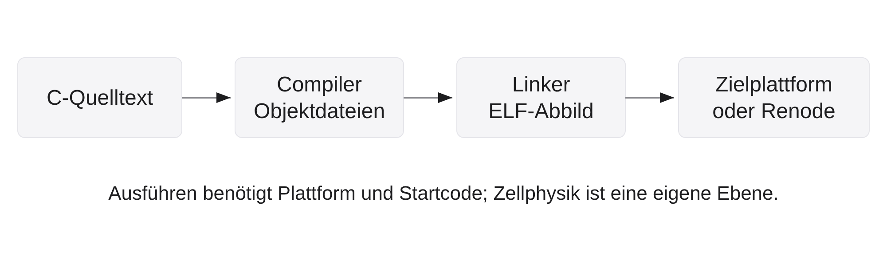{fig-alt="C-Quelltext wird übersetzt, Objektdateien werden gelinkt und eine ELF-Datei entsteht. Eine Zielplattform oder Renode verwendet diese Datei; funktionale Ausführung und Zellphysik sind unterschiedliche Ebenen."}

Das ausführbare Beispiel dieses Blatts nutzt den Host; RISC-V GCC und Renode sind Zielwerkzeuge.

::: notes
Bevor ein Programm Speicher nutzt, muss aus seinem Quelltext ein zur Zielplattform passendes Programmabbild entstehen. GCC, GNU Compiler Collection, ist eine Sammlung von Compilern; GNU bezeichnet das freie Softwaresystem und steht für GNU's Not Unix. Ein Compiler übersetzt C, ein Assembler die Maschinenbefehlsnotation. Der Linker verbindet die entstandenen Objektdateien und ordnet ihre Abschnitte an. ELF, Executable and Linkable Format, ist ein verbreitetes Format für solche Ergebnisse. Die Pfeile der Grafik verfolgen diese Werkzeugfolge; sie stellen noch keine ausgeführte Geräteinitialisierung dar.

Die im Kurs verwendete Befehlssatzfamilie heißt RISC-V; RISC steht für Reduced Instruction Set Computer. Eine entsprechende Toolchain übersetzt für dieses Ziel. Der Systemsimulator Renode benötigt zusätzlich eine konkrete Plattformbeschreibung und passende Firmware, um Prozessor, Speicher und Peripherie funktional auszuführen. Ein solches Ergebnis wäre ohne weiteres Modell weder eine Messung von Zelllatenzen noch von Transistorströmen.

Bare-Metal-Software arbeitet ohne Betriebssystem, benötigt aber dennoch Startcode und Hardwareinitialisierung. Das optionale C-Programm dieses Übungsblatts wird stattdessen mit Host-GCC für den Entwicklungsrechner übersetzt. Es prüft logische Flashregeln, Adressgrenzen, Initialisierungsdaten und einen Puffer, ohne erfundene Geräteadressen zu dereferenzieren. Programmdatei, ausführende Plattform und physikalisches Zellmodell bleiben dadurch klar getrennt. Als Nächstes wird eingeordnet, welche Speicher und Verbindungen eine solche Plattform bereitstellt.
:::

## Im SoC müssen Datenwege zusammenpassen {.compact-figure}

::: {.section-label}
1 / 5 · Datenwege und Maßstäbe
:::

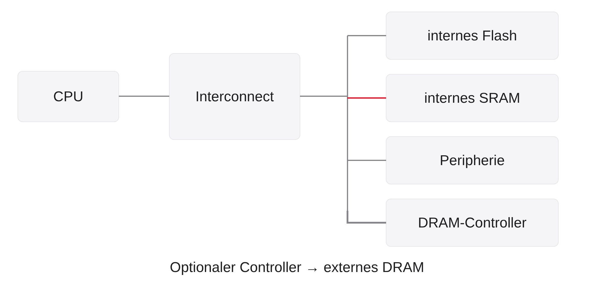{fig-alt="Ein Prozessor erreicht internes Flash, SRAM und Geräte über einen Interconnect. Ein DRAM-Controller kann zusätzlich externes DRAM anbinden. Nicht jeder Mikrocontroller braucht dieses externe Bauteil."}

Rechenkern, Speicherbaustein und Zugriffsweg sind verschiedene Bestandteile.

::: notes
Ein System-on-Chip, kurz SoC, integriert Rechenkern und weitere Funktionen auf einem Chip. Zwischen ihnen vermittelt ein Interconnect die Adressen, Daten und Steuersignale. Ein Controller setzt Anfragen in die jeweils passende Speicher- oder Geräteschnittstelle um. Im gezeichneten System erreicht der Prozessor internes Flash, SRAM und Peripherie; ein zusätzlicher Controller kann externen DRAM anbinden.

SRAM ist statischer Speicher mit wahlfreiem Zugriff und hält seine Daten bei anliegender Versorgung ohne regelmäßige Auffrischung. DRAM ist dynamischer wahlfreier Speicher, dessen gespeicherte Ladung aufgefrischt werden muss. Flash ist elektrisch programmierbar und nichtflüchtig. Ein kleiner Mikrocontroller kann bereits mit Flash und SRAM auskommen; für eine größere Kapazität kann ein System zusätzlichen DRAM verwenden. Die Bezeichnung SoC bedeutet deshalb nicht, dass sämtlicher Hauptspeicher auf demselben Die, dem Halbleiterstück, gefertigt sein muss.

Die grauen Leitungen kennzeichnen mögliche Zugriffswege. Rot hebt einen Speicherpfad hervor und ist keine Geschwindigkeitsmessung. Ein Prozessorregister, eine Bitzelle im Speicher und ein Peripherieregister am Bus sind verschiedene Strukturen. Welche davon eine Anfrage erreicht, bestimmt unter anderem die Adresszuordnung. Um diese Wege beurteilen zu können, müssen zunächst die Größen auseinandergehalten werden: Eine Kapazität in Byte ist weder eine Transistorzahl noch eine Zugriffsdauer.
:::

## Bytezahl, Bitzahl und Zellbauteile

::: {.section-label}
1 / 5 · Datenwege und Maßstäbe
:::

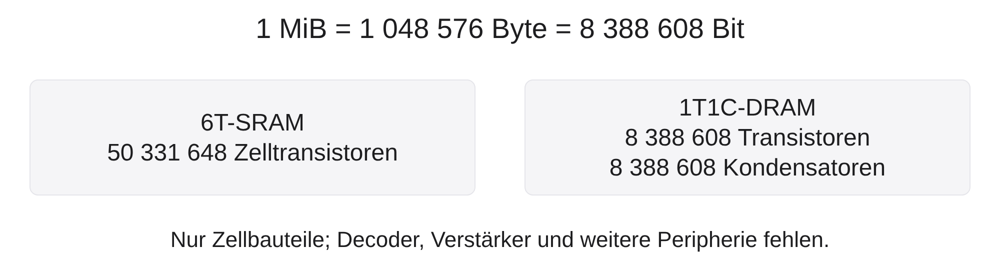{fig-alt="Ein MiB enthält 1 048 576 Byte und 8 388 608 Bit. Klassisches 6 T-SRAM benötigt 50 331 648 Zelltransistoren, 1 T 1 C-DRAM je 8 388 608 Transistoren und Kondensatoren. Peripherie ist nicht gezählt."}

$1\,\mathrm{MiB}=2^{20}\,\mathrm{Byte}$; $1\,\mathrm{MB}=10^6\,\mathrm{Byte}$.

::: notes
Kapazitätsangaben lassen sich in Speicherzellen umrechnen, wenn Einheit und Zellmodell feststehen. Ein MiB, Mebibyte, enthält $2^{20}$ Byte, ein dezimales MB dagegen $10^6$ Byte. Diese Einheiten sind nicht austauschbar. Mit acht Bit je Byte ergeben sich für ein MiB zunächst $1\,048\,576$ Byte und anschließend $8\,388\,608$ Bit.

Die klassische 6T-SRAM-Zelle benötigt sechs Transistoren für ein Bit. Für die betrachtete Kapazität sind damit $6\cdot8\,388\,608=50\,331\,648$ Zelltransistoren erforderlich. Das klassische 1T1C-DRAM verwendet je Bit einen Transistor und einen Kondensator; es enthält hier also jeweils $8\,388\,608$ dieser Bauteile. Die Abbildung stellt ausschließlich diese Zellzählungen gegenüber. Wie Rückkopplung beziehungsweise Ladung die Speicherfunktion erzeugen, wird danach schrittweise erklärt.

Decoder, Auswahlleitungen, Verstärker, Redundanz und weitere Peripherie sind in der Rechnung nicht enthalten. Hinzu kommen unterschiedliche Transistorgrößen und Kondensatorgeometrien. Die Bauteilzahl ist deshalb weder eine genaue Flächenrechnung noch ein unmittelbarer Nachweis für Leistungsaufnahme oder Geschwindigkeit. Sie macht vielmehr verständlich, warum verschiedene Zellkonzepte unterschiedliche Systemrollen erfüllen können. Selbst ein geeignetes Zellprinzip nützt allerdings wenig, wenn der Zugriffsweg die benötigten Anfragen nicht bedienen kann.
:::

## Gemeinsamer Adressraum ist nicht ein einziger Port

::: {.section-label}
1 / 5 · Datenwege und Maßstäbe
:::

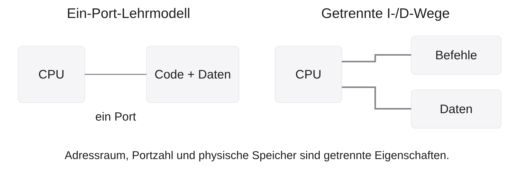{fig-alt="Ein gemeinsamer Port bedient Code und Daten. Daneben sind getrennte Befehls- und Datenwege dargestellt. Adressraum und Portzahl sind verschiedene Eigenschaften."}

Das einfache Ein-Port-Modell kann Fetch und Datenzugriff nicht gleichzeitig bedienen.

::: notes
Ein gemeinsamer Speicher und ein gemeinsam belegter Zugriffsport sind zwei unterschiedliche Eigenschaften. Das klassische Von-Neumann-Konzept verwendet gemeinsamen Speicher für Befehle und Daten. Der linke Teil der Abbildung ergänzt ein einfaches Modell mit genau einem physischen Port. Fetch, der Abruf eines Maschinenbefehls, und ein Daten-Load benötigen darin dieselbe begrenzte Ressource. Ein Load liest Daten, ein Store schreibt sie. Kann der Port nur eine Anfrage zugleich bedienen, entsteht ein Ressourcenkonflikt, der als Von-Neumann-Flaschenhals bezeichnet wird.

Harvard verwendet getrennte Befehls- und Datenspeicher mit getrennten Wegen. Rechts stehen I für Instructions, Befehle, und D für Data, Daten. Unter den angegebenen Modellannahmen lassen sich beide Anfragen unabhängig versorgen. Ein modifiziertes System kann nahe Wege ebenfalls trennen und darunter wieder gemeinsamen Speicher verwenden; diese zusätzliche Variante ist nicht separat eingezeichnet. Ein Cache hält nahe Kopien ausgewählter Speicherblöcke. Getrennte Befehls- und Datencaches werden in der Speicherhierarchie vertieft.

Die Leitungen zeigen Verbindungen und keine Pipelinezyklen. Aus einem gemeinsamen softwareseitigen Adressraum folgt nicht zwangsläufig ein einziger physischer Port. Deshalb wäre die Behauptung zu weitgehend, ein Prozessor mit Von-Neumann-Sicht könne grundsätzlich nie parallel lesen. Umgekehrt beseitigen zwei Wege nicht jede Wartezeit. Dazu müssen die Dauer einer Anfrage und die längerfristig übertragbare Datenmenge getrennt betrachtet werden.
:::

## Latenz und Bandbreite messen Verschiedenes

::: {.section-label}
1 / 5 · Datenwege und Maßstäbe
:::

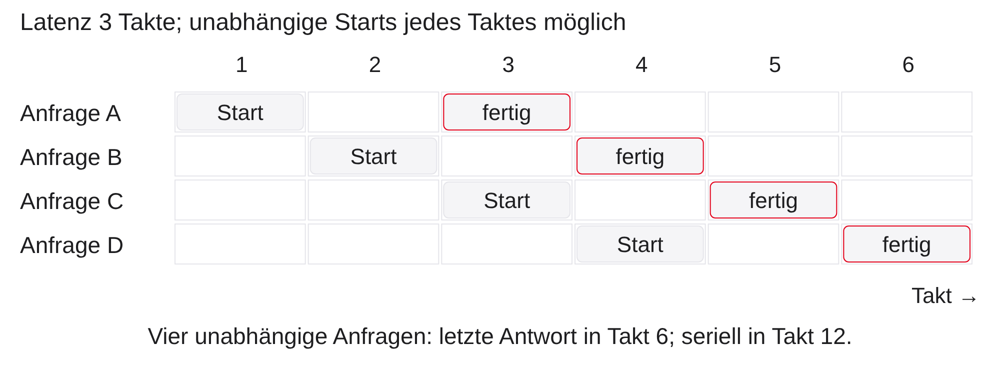{fig-alt="Vier unabhängige Anfragen mit Modelllatenz 3 Zeitschritten können seriell nach 3,6,9,12 oder mit Startabstand 1 nach 3,4,5,6 enden. Die einzelne Latenz bleibt 3."}

Memory Wall: benötigte Daten können die Rechnung begrenzen.

::: notes
Latenz ist die Dauer vom Beginn einer Anfrage bis zu ihrem Ergebnis. Bandbreite bezeichnet dagegen die übertragbare Datenmenge pro Zeit. Die Memory Wall, Speichergrenze, beschreibt eine Begrenzung der nutzbaren Rechenrate durch die Datenversorgung. Daraus folgt weder, dass jeder Zugriff gleich lange dauert, noch dass eine größere Datenrate automatisch die erste Antwort früher liefert.

Das Zeitbild macht den Unterschied mit vier unabhängigen Anfragen sichtbar. Jede benötigt drei abstrakte Zeitschritte. Ohne Überlappung enden die Anfragen nach drei, sechs, neun und zwölf Schritten. Erlaubt das Modell dagegen einen neuen Start je Schritt, beginnen sie in eins bis vier und enden jeweils am Schluss von drei bis sechs. Die einzelne Latenz bleibt drei, während der Abschluss aller vier Anfragen vorgezogen wird. Rot markiert die Ergebnisereignisse. Die Zahlen sind Lehrzeiten und keine Messwerte eines Speichers oder Prozessors.

Die verbesserte Folge setzt unabhängige Anfragen und passende Ressourcen voraus. Benötigt eine Rechnung erst den vorherigen Wert, kann sie nicht beliebig früh die davon abhängige Arbeit starten. Auch eine Leitung bietet keine unbegrenzte Datenrate. Die Kombination eines kleinen schnellen Speichers nahe am Prozessor mit größerem langsameren Speicher versucht, beide Anforderungen gemeinsam zu bedienen. Sie führt zur Speicherhierarchie, ohne die Zelltechnologien der beteiligten Ebenen gleichzusetzen.
:::

## Hierarchie: mehrere Speicher für mehrere Aufgaben

::: {.section-label}
1 / 5 · Datenwege und Maßstäbe
:::

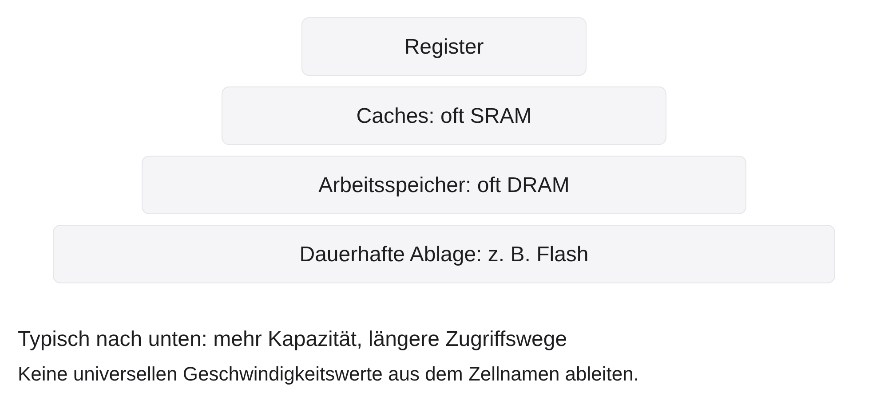{fig-alt="Register, nahe Cachekopien, Arbeitsspeicher und nichtflüchtiger Speicher stehen auf verschiedenen Ebenen. Nähe und Kapazität unterscheiden sich; Rolle und Zelltechnologie sind nicht dasselbe."}

Ein Cache ist eine Rolle; SRAM ist eine Zelltechnologie.

::: notes
Eine Speicherhierarchie verteilt Aufgaben auf Bereiche mit unterschiedlicher Nähe, Kapazität und Zugriffskosten. Register sind kleine direkt im Rechenkern benutzte Arbeitsplätze. Caches halten nahe Kopien ausgewählter Blöcke. Der Arbeitsspeicher enthält laufende Daten und gegebenenfalls Programme, während nichtflüchtiger Speicher Inhalte über das Abschalten hinaus bewahrt. Diese Rollen erklären, weshalb ein System mehrere Speicher statt eines einzigen universellen Bausteins verwendet.

Caches werden häufig mit SRAM gebaut, großer Hauptspeicher häufig mit DRAM. Ein kleiner Mikrocontroller kann seinen gesamten Arbeitsspeicher als SRAM ausführen. Ein Registerfile, also eine Sammlung von Prozessorregistern, muss dabei nicht dieselbe klassische 6T-Zelle wie ein Datencache benutzen. Eine Position in der Hierarchie ist daher keine verbindliche Aussage über die Zellbauart.

Die vertikale Anordnung der Grafik zeigt die Entfernung vom Rechenkern. Breitere untere Flächen veranschaulichen eine mögliche größere Kapazität; sie sind weder maßstäbliche Chipflächen noch allgemeine Geschwindigkeitszahlen. Ein Cache benötigt außerdem Regeln, welche Kopien er behält und wann sie gültig sind. Diese Organisationsfrage wird in der folgenden Vorlesung behandelt. Für die physikalische Grundlage sind zunächst zwei andere Fragen zu trennen: Bleibt die Information ohne Versorgung erhalten, und wie lässt sich eine gewünschte Stelle auswählen?
:::

## Flüchtig und wahlfrei sind unabhängige Eigenschaften

::: {.section-label}
1 / 5 · Datenwege und Maßstäbe
:::

| Eigenschaft | Bedeutung | Beispiel |
|-------------|-----------|----------|
| volatil | dauerhafter Erhalt benötigt Versorgung | SRAM, DRAM |
| nichtflüchtig | Erhalt ohne laufende Versorgung spezifiziert | Flash, ROM |
| wahlfrei lesbar | gewünschte Stelle gezielt auswählen | SRAM, speicherabbildbares NOR |
| seitenorientiert | Anfrage verarbeitet größere Einheit | rohes NAND |

`volatile` in C ist keine Bezeichnung der Zellphysik.

::: notes
Die Eigenschaften eines Speichers bilden keine einzige Skala. Volatil oder flüchtig bedeutet, dass Information ohne Versorgung nicht dauerhaft erhalten werden kann. SRAM und DRAM sind flüchtig. Nichtflüchtige Speicher wie Flash oder ROM, Read-Only Memory, bieten dagegen spezifizierte Datenerhaltung ohne laufende Versorgung. Das verspricht keine unbegrenzte Lebensdauer. Ebenso bedeutet Flüchtigkeit nicht, dass jede Zelle nach dem Abschalten augenblicklich einen definierten Nullwert annimmt.

Random Access, wahlfreier Zugriff, beschreibt eine andere Eigenschaft: Eine gewünschte Stelle lässt sich gezielt auswählen. Ein speicherabbildbarer NOR-Flashpfad kann wahlfreies Lesen anbieten und dennoch nichtflüchtig sein. NOR und NAND bezeichnen Flash-Zellorganisationen; ihre Namen stammen von NOT-OR beziehungsweise NOT-AND. Rohes NAND verarbeitet Seiten und Löschblöcke, ist aber kein Magnetband mit ausschließlich streng sequenzieller Auswahl.

Auch das C-Schlüsselwort `volatile` gehört zu einer anderen Ebene. Es betrifft Zugriffe nach Sprach- und Compilervertrag, etwa auf Geräteobjekte, und verändert nicht den physikalischen Datenerhalt. Zusätzlich können Lesen, Programmieren und Löschen verschiedene Granularitäten besitzen. Ein wahlfreies Lesen sagt deshalb noch nichts darüber aus, ob sich dasselbe Byte auch beliebig verändern lässt. Für die nichtflüchtigen Speicher werden im nächsten Abschnitt Erhaltung und Änderungsverfahren getrennt verfolgt.
:::

## 2 · Nichtflüchtige Speicher {.section-divider}

Wie lassen sich Information bewahren und Änderungen durchführen?

::: {.section-route}
Datenwege → Nichtflüchtige Speicher → SRAM → DRAM → Software
:::

::: notes
Der erneute Programmstart setzt voraus, dass ein geeignetes Programmabbild das Abschalten übersteht. Nichtflüchtigkeit beantwortet diese Erhaltungsfrage, legt aber noch nicht fest, wie ein Baustein gelesen, programmiert oder gelöscht wird. Diese Zugriffe müssen einzeln betrachtet werden.

Aus dem Zellprinzip wird verständlich, weshalb eine Flashänderung nicht jedem beliebigen Store entspricht. Die Organisation und der Controller bestimmen außerdem, ob gespeicherter Code direkt ausgeführt werden kann. Löschgranularität und Verschleiß vervollständigen die Auswahlfrage: Ein dauerhaft gespeichertes Programm und häufig veränderte Betriebsdaten können trotz derselben Erhaltungsanforderung unterschiedliche Verfahren benötigen.
:::

## ROM-Familie: Lesen und Ändern getrennt betrachten

::: {.section-label}
2 / 5 · Nichtflüchtige Speicher
:::

{fig-alt="Mask-ROM wird bei Fertigung festgelegt, PROM einmal programmiert, EPROM mit UV gelöscht, EEPROM elektrisch in kleinen Einheiten verändert und Flash elektrisch in größeren Blöcken gelöscht."}

Nichtflüchtig bedeutet nicht unveränderbar.

::: notes
Nichtflüchtiger Speicher kann auf sehr unterschiedliche Weise beschrieben werden. ROM steht für Read-Only Memory, Festwertspeicher. Mask-ROM wird bei der Herstellung festgelegt. PROM, Programmable ROM, lässt sich danach einmal programmieren. Bei klassischem EPROM, Erasable Programmable ROM, ermöglicht ein Fenster das Löschen durch ultraviolettes Licht. EEPROM bedeutet Electrically Erasable Programmable ROM und erlaubt elektrische Änderungen in vergleichsweise kleinen Einheiten. Flash ist ebenfalls elektrisch programmierbar, löscht jedoch größere Sektoren oder Blöcke.

Die Gegenüberstellung der Änderungsverfahren verwendet UV als Abkürzung für ultraviolett. Diese Kennzeichnung gehört zum entsprechenden historischen EPROM-Verfahren. Innerhalb einer Familie gibt es wiederum verschiedene Zell- und Schnittstellenvarianten. Aus dem Familiennamen lässt sich daher keine für alle Bausteine gültige Bytezahl eines Löschbereichs ableiten.

Programmcode kann aktualisierbar sein und trotzdem das Abschalten überstehen. Häufig veränderte Messwerte stellen dagegen andere Anforderungen als selten aktualisierte Firmware. Nichtflüchtigkeit beantwortet die Frage nach dem Datenerhalt; Programmierbarkeit und Löschgranularität beantworten die Frage nach einer Änderung. Ein verbreitetes Flash-Zellmodell verbindet beides, indem es Ladung in einer isolierten Struktur hält. Dadurch wird ein später auslesbares Transistorverhalten verändert.
:::

## Floating Gate: Ladung verändert die Schwellspannung

::: {.section-label}
2 / 5 · Nichtflüchtige Speicher
:::

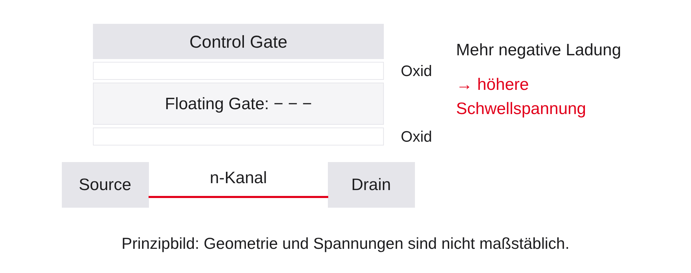{fig-alt="Schematischer Querschnitt mit Control Gate, isoliertem Floating Gate zwischen Oxidschichten sowie Source, Drain und n-Kanal. Mehr negative Gate-Ladung erhöht die Schwellspannung."}

Beispiel einer Flash-Zelltechnik; Charge-Trap-Flash verwendet eine andere Speicherstruktur.

::: notes
Ein Floating Gate ist ein elektrisch isoliertes leitendes Gate, das Ladung behalten kann. Das von außen angesteuerte Control Gate beeinflusst den Transistor, dessen leitfähiger Kanal zwischen Source und Drain liegt. Oxid isoliert die beteiligten Strukturen. Der gezeichnete Querschnitt verdeutlicht ihre räumliche Beziehung; die Schichtdicken sind schematisch und keine Prozessmaße.

Im gewählten n-Kanal-Modell erhöht zusätzliche negative Ladung am Floating Gate die Schwellspannung. Diese bezeichnet die Steuerspannung, ab der ausreichende Leitung einsetzt. Beim Lesen wird unter geeigneter Steuerspannung die Leitung beziehungsweise ihr Unterschied ausgewertet. Rot hebt den Kanal und die Wirkung der Ladungsänderung hervor, ohne einen gemessenen Strom darzustellen. Das isolierte Gate wird nicht über einen unmittelbar angeschlossenen Draht beschrieben; der Prozessor zählt beim Lesen auch keine einzelnen Elektronen.

Programmieren und Löschen verändern die Ladung unter besonderen, vom Baustein erzeugten Bedingungen. Mehrere unterscheidbare Schwellbereiche können mehrere Bits je Zelle ermöglichen; hier bleibt es bei einem binären Lehrmodell. Außerdem verwenden nicht alle Flashtechnologien ein leitendes Floating Gate: Charge Trap bezeichnet eine andere Ladungsfangstruktur. Für die Software ergibt sich aus diesen physikalischen Verfahren die nächste Frage: Welche Bitänderungen sind nach einem Löschvorgang zulässig, und welche größere Einheit muss gegebenenfalls erneut gelöscht werden?
:::

## Flash-Modell: Programmieren ist kein beliebiger Store

::: {.section-label}
2 / 5 · Nichtflüchtige Speicher
:::

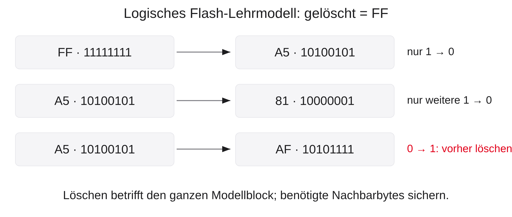{fig-alt="FF nach A 5 und A 5 nach 81 setzen nur Einsen auf null. A 5 nach AF benötigt null nach eins und damit vorheriges Löschen des ganzen Modellblocks."}

Gelöscht $=1$; Programmieren setzt ausgewählte Bits von $1$ nach $0$.

::: notes
Das binäre Flash-Lehrmodell kodiert den gelöschten Zustand mit Einsen. Es beschreibt keine allgemeine Kodierung sämtlicher Mehrbitzellen. Ein gelöschtes Byte `0xFF` enthält acht Einsen. Beim Programmieren nach `0xA5`, binär $10100101$, werden die erforderlichen Einsen auf null gesetzt. Der anschließende Wert `0x81`, $10000001$, benötigt nur weitere Eins-nach-null-Änderungen und ist im Modell ebenfalls zulässig.

Anders liegt der Fall bei A5 nach AF, $10101111$: Bereits vorhandene Nullen müssten wieder zu Einsen werden. Dafür ist zunächst ein Erase, also Löschen, nötig. Er wirkt auf einen größeren Block und nicht allein auf das Zielbyte. Die Grafik stellt deshalb zwei erlaubte Bitänderungen einer Änderung mit vorherigem Löschbedarf gegenüber. Der ganze Modellblock erhält beim Löschen wieder FF. Soll ein weiterer Wert aus diesem Block erhalten bleiben, muss er vorher gesichert und anschließend erneut programmiert werden.

Die Betrachtung prüft ausschließlich logische Bitrichtungen und Blockerhaltung. Reale Bausteine können zusätzlich Programmierbreite, wiederholte Teilprogrammierung, Reihenfolge und Timing einschränken. Ein gewöhnlicher Store des Prozessors ersetzt keine solche Controllersequenz. Ob ein unzulässiger Zugriff abgewiesen wird, einen Fehler auslöst oder anders behandelt wird, hängt von der Plattform ab. Die logische Prüfung lässt sich deshalb auf Papier lösen, ohne eine nicht dokumentierte Geräteprogrammierung zu erfinden.
:::

## NOR und NAND: Zellanordnung und Schnittstelle

::: {.section-label}
2 / 5 · Nichtflüchtige Speicher
:::

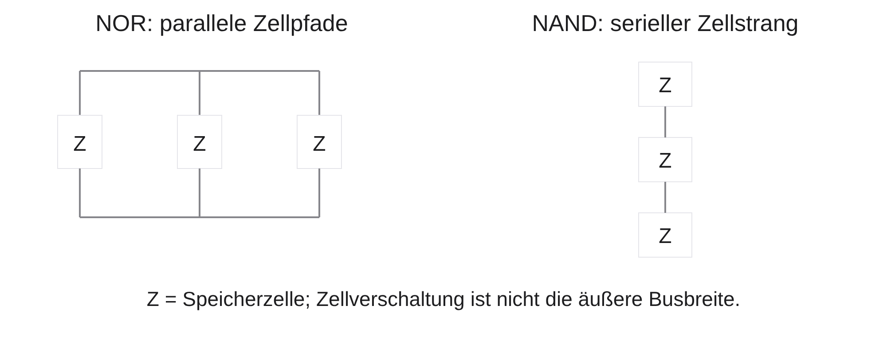{fig-alt="NOR zeigt parallele Zellpfade, NAND einen seriellen Zellstrang. Z bezeichnet eine Speicherzelle. Die äußere Schnittstelle wird nicht dargestellt."}

Page, Löschblock und CPU-Lesewort sind verschiedene Größen.

::: notes
Neben der Änderung spielt die Anordnung der Flashzellen eine Rolle. NOR, NOT-OR, bezeichnet eher parallele Strompfade; NAND, NOT-AND, verwendet seriell angeordnete Zellen in einer Kette, einem String. Z benennt jeweils eine Speicherzelle. Die Zeichnung stellt diese Verschaltungsidee dar, keine vollständige reale Auswahl- und Ausleseschaltung. Insbesondere ist ihre äußere Zugriffsschnittstelle nicht eingezeichnet.

Ein typischer NOR-Leseweg kann ein gezielt angefordertes Byte oder Wort liefern und einen speicherabbildbaren Codepfad ermöglichen. Rohes NAND liest dagegen eine Page, also eine Seite, in einen internen Puffer. Die Schnittstelle liefert anschließend Daten aus diesem Puffer. Die Lese- und Programmiergranularität ist nochmals vom Löschbereich zu unterscheiden: Eine Page ist nicht automatisch ein Erase-Block. Auch Dichte und Kosten hängen zusätzlich von Prozess und Zelltechnik ab.

Aus serieller Zellverkettung folgt daher kein zwingend serieller Außenbus, aus parallelen Zellpfaden kein zwingend paralleler Gehäusebus. Serielles NOR kann über einen geeigneten Controller speicherabbildbar sein. NAND ist umgekehrt nicht bloß ein sequentielles Band, erlaubt aber gewöhnlich keinen unmittelbaren Befehlsabruf aus den rohen Zellen. Ob der Prozessor gespeicherten Code direkt ausführen kann, entscheidet somit der vollständige Leseweg des Systems.
:::

## XIP braucht einen ausführbaren Leseweg

::: {.section-label}
2 / 5 · Nichtflüchtige Speicher
:::

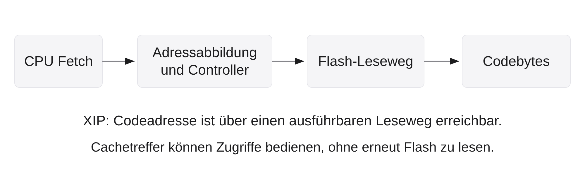{fig-alt="Der Befehlsweg führt von CPU Fetch über Adressabbildung und Controller zum Flash-Leseweg und Codebytes. Execute-in-Place erfordert einen ausführbaren speicherabbildbaren Pfad."}

Execute-in-Place ist eine Systemfähigkeit, kein Nachweis aus dem Namen NOR allein.

::: notes
Execute-in-Place, kurz XIP, bedeutet Ausführen am vorhandenen Speicherort. Der Prozessor holt Programmcode aus einer dafür speicherabbildbaren Region, ohne ihn zuvor vollständig in den Arbeitsspeicher zu kopieren. RAM steht für Random-Access Memory, wahlfreien Arbeitsspeicher. Der bereits eingeführte Fetch ist der Abruf eines Maschinenbefehls.

Die Pfeile der Grafik verfolgen den benötigten Befehlsweg: vom Prozessor über Adressabbildung und Controller zum Flash-Leseweg und zu den Codebytes. Zusätzliche Caches oder Prefetchpuffer sind nicht separat eingezeichnet. Prefetch bezeichnet vorsorgliches Vorholen; ein Cachetreffer kann einen Befehl liefern, ohne für jeden Abruf erneut die physische Flashschnittstelle zu benutzen. Bei seriellem NOR muss der Controller die entsprechenden Speicherzugriffe erst bereitstellen. Die Zellverschaltung allein genügt dafür nicht.

Zu XIP gehören außerdem eine ausführbare Region und die jeweiligen Plattformbedingungen. Es garantiert weder eine SRAM-ähnliche Latenz noch denselben Aufwand an jeder Adresse. Rohes NAND ist seitenorientiert; daraus stammender Code wird typischerweise zunächst in ausführbaren RAM geladen oder durch zusätzliche Controllertechnik vermittelt. Damit verbindet sich die Speicherwahl mit dem tatsächlichen Zugriffsweg. Neben dem Lesen begrenzt eine weitere Eigenschaft den Einsatz nichtflüchtiger Speicher: Ihre wiederholte Veränderung belastet die Speicherstruktur.
:::

## Verschleiß verteilen, nicht abschaffen

::: {.section-label}
2 / 5 · Nichtflüchtige Speicher
:::

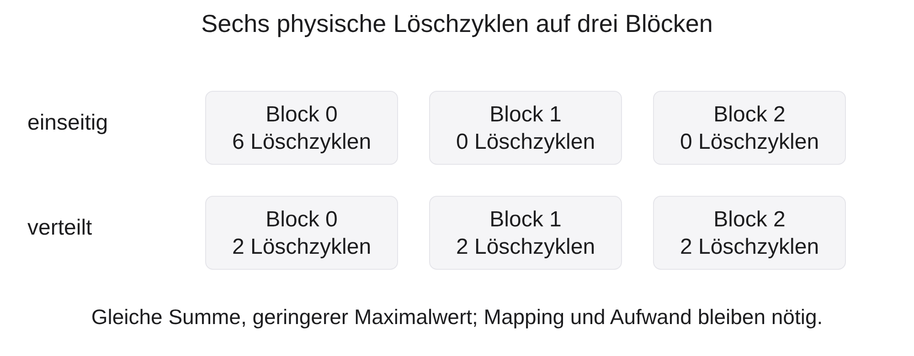{fig-alt="Sechs angenommene physische Löschzyklen landen ohne Verteilung im selben Block. Verteilt über drei Blöcke entstehen im vereinfachten Beispiel je zwei Zyklen. Logische Datenadresse und physischer Ort können verschieden sein."}

Wear Leveling braucht eine Zuordnung und freie nutzbare Bereiche.

::: notes
Programmieren und Löschen belasten Flashzellen. Endurance bezeichnet ihre spezifizierte Belastbarkeit bei solchen Zyklen, Retention den Datenerhalt. Beide Größen hängen vom Baustein und von den Betriebsbedingungen ab. Eine universelle zulässige Zahl von Änderungen für jeden Flash gibt es deshalb nicht. Wear Leveling versucht, diese begrenzte Belastbarkeit durch Verschleißausgleich besser zu nutzen.

Die Grafik setzt sechs physische Löschzyklen und drei gleich nutzbare Blöcke voraus. Ohne Verteilung erhält der erste Block sechs Zyklen, die übrigen keinen. Bei idealer Verteilung entfallen auf jeden zwei. Die Zahlen in den Blockfeldern zählen die lokale Belastung; ihr Maximum sinkt. Die Summe der physischen Arbeiten bleibt aber erhalten. Sechs beliebige Hostwrites wären kein gleichwertiger Ausgangspunkt: Softwareupdates können zusammengefasst werden oder zusätzliche physische Arbeiten auslösen.

Ein Flash Translation Layer, FTL, bildet logische Adressen auf physische Speicherorte ab. Neues Schreiben an anderer Stelle, Zurückgewinnen freier Blöcke und Verschleißausgleich sind getrennte Aufgaben. Ein kleiner Mikrocontroller benötigt dafür nicht zwingend ein vollständiges Massenspeicher-FTL; ein passendes Journalverfahren kann genügen. Schreibverteilung beseitigt weder den Verschleiß noch die Notwendigkeit eigener Konsistenzregeln. Selten geänderter Programmcode und oft geänderte Betriebsdaten bleiben daher unterschiedliche Auswahlfälle, obwohl beide über das Abschalten erhalten werden sollen.
:::

## Speicher nach Nutzung auswählen

::: {.section-label}
2 / 5 · Nichtflüchtige Speicher
:::

| Nutzung | Erste Auswahlfrage |
|---------|--------------------|
| Firmware über Abschalten bewahren | nichtflüchtig und passender Code-Leseweg? |
| Häufig veränderte Zwischensummen | beschreibbarer Arbeitsspeicher ausreichend? |
| Selten geänderte Konfiguration | passendes Update- und Löschverfahren? |
| Große Datenmenge | Kapazität, Zugriff und Controller passend? |

„Code“ und „Daten“ sind Nutzungen, keine Zellbauarten.

::: notes
Die Nutzung eines Speicherinhalts legt seine Zelltechnologie nicht automatisch fest. Firmware ist gerätenahe Software, eine Zwischensumme ändert sich während der Rechnung, und eine Konfiguration kann dauerhaft benötigte Geräteeinstellungen enthalten. Die Tabelle beginnt deshalb bei den geforderten Eigenschaften: Erhaltung, Veränderbarkeit, Kapazität und geeigneter Zugriffsweg.

Für dauerhaft vorhandenen Code kann nichtflüchtiger Speicher mit einem passenden Ausführungsweg sinnvoll sein. XIP verlangt dafür den beschriebenen speicherabbildbaren Fetchpfad. Häufig geänderte Laufzeitdaten gehören gewöhnlich in RAM. Eine in Flash abgelegte Konfiguration benötigt ein Updateverfahren, das Löschgranularität und Belastbarkeit beachtet. Ein anderes System kann sein Programmbild zunächst nach RAM laden und dort ausführen. Auch unveränderte Inhalte können als Daten gelesen werden; ihre Unveränderlichkeit macht den Zugriff nicht zum Befehlsholen.

Eine begründete Auswahl verbindet daher Kapazität, Controllerunterstützung, Datenrate und Lebensdauer der Anwendung. Sie beantwortet einen Teil der Einstiegsfrage: Programm und Arbeitszustand können verschiedene Speicher benötigen. Ob ein bestimmter Entwurf passt, lässt sich anhand konkreter Anforderungen prüfen. Die Papieraufgaben verbinden dafür die bisherigen Überlegungen zu Portkonflikten, Zellzahlen, Flashbitänderungen und XIP. Danach wird SRAM als Speicher für häufiges Lesen und Schreiben von innen betrachtet.
:::

## Papierphase 1: Größen, Wege und Flashbits

::: {.section-label}
2 / 5 · Nichtflüchtige Speicher
:::

Übungsblatt, Aufgaben 1–2 · 10 Minuten

- Byte- und Bitzahlen sowie Zellbauteile getrennt zählen
- Ein-Port-Konflikt vom gemeinsamen Adressraum unterscheiden
- Flashänderung und vollständigen Löschbereich prüfen

::: notes
Der Messwertpuffer der Papieraufgabe benötigt $768\cdot1024=786432$ Byte, weil ein KiB, Kibibyte, $1024$ Byte umfasst. Mit acht Bit pro Byte sind das $6291456$ Bit. Eine klassische 6T-SRAM-Zelle verwendet sechs Transistoren je Bit und benötigt hier $37748736$ Zelltransistoren. Beim 1T1C-DRAM ergeben sich jeweils $6291456$ Zelltransistoren und Kondensatoren. Auswahlperipherie und Bauteilgeometrie fehlen weiterhin; die Zählung ist keine genaue Flächenrechnung. Zwei gleichzeitige Anfragen an einen einzigen Port mit nur einer Bedienung können zudem nicht zugleich erfüllt werden.

Im logischen Flashmodell bezeichnet FF den gelöschten Zustand. C6 entspricht binär $11000110$, 84 ist $10000100$ und CE ist $11001110$. C6 nach 84 erfordert nur Eins-nach-null-Änderungen, C6 nach CE dagegen vorheriges Löschen. Das weiterhin benötigte Nachbarbyte 5A muss gesichert und danach wieder programmiert werden. Bei zwölf physischen Löschzyklen bleibt die Gesamtzahl zwölf; die Verteilung auf vier Blöcke senkt deren größte Belastung von zwölf auf drei.

XIP setzt einen ausführbaren speicherabbildbaren Leseweg mit passendem Controller und Zugriffsrechten voraus. NOR als Name der Zellverschaltung garantiert ihn allein nicht. Diese Lösungen beurteilen Größen, Wege und logische Veränderungen, ohne reale Controllerbefehle oder Stromausfallfestigkeit zu modellieren. Für häufig veränderte Arbeitsdaten folgt nun ein anderes Prinzip: ein durch Rückkopplung gehaltener Zustand ohne Flash-Löschblock.
:::

## 3 · SRAM: Rückkopplung und Zugriff {.section-divider}

Wie kann ein Bit ohne regelmäßiges Auffrischen gehalten werden?

::: {.section-route}
Datenwege → Nichtflüchtige Speicher → SRAM → DRAM → Software
:::

::: notes
Häufig veränderte Arbeitsdaten brauchen einen Speicher, der sich lesen und überschreiben lässt, ohne vor jeder Änderung einen Flashblock zu löschen. SRAM nutzt dafür im klassischen Modell zwei rückgekoppelte Inverter. Ihre beiden stabilen Zustände kodieren ein Bit, solange Versorgung und Betriebsbedingungen stimmen.

Vom logischen Inverter führt der Weg zu seiner CMOS-Umsetzung und den sechs Transistoren der Bitzelle. Halten, Lesen und Schreiben verwenden danach dieselbe Schaltung unter verschiedenen Randbedingungen. Entscheidend ist jeweils, welche äußeren Pfade freigegeben sind: Ein Lesezugriff soll den Zustand erhalten, ein Schreibtreiber ihn gezielt verändern.
:::

## Ein Inverter macht aus null eins

::: {.section-label}
3 / 5 · SRAM: Rückkopplung und Zugriff
:::

::: {.content-visible when-format="html"}
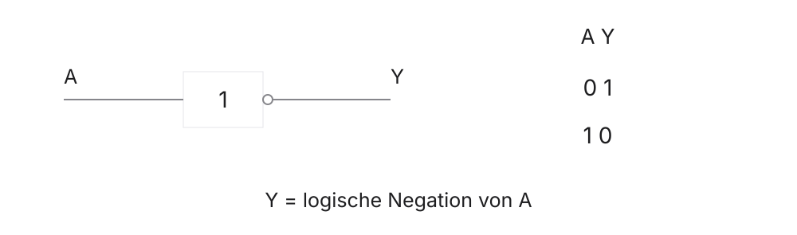{fig-alt="Ein rechteckiges IEC-Invertersymbol mit Kennzeichnung 1 und Negationskreis am Ausgang. Eingang 0 ergibt Ausgang 1, Eingang 1 ergibt Ausgang 0." style="max-height: 420px;"}
:::

::: {.content-visible when-format="pdf"}
{fig-alt="Ein rechteckiges IEC-Invertersymbol mit Kennzeichnung 1 und Negationskreis am Ausgang. Eingang 0 ergibt Ausgang 1, Eingang 1 ergibt Ausgang 0." style="max-height: 420px;"}
:::

Logische Werte stehen für Spannungsbereiche, nicht für einzelne Elektronen.

::: notes
Ein Inverter, auch NOT-Gatter, bildet die logische Negation. Mit Eingang $A$ und Ausgang $Y$ lautet die Funktion $Y=\neg A$: Auf null folgt eins, auf eins null. Das rechteckige Symbol mit einer Eins steht für die Durchleitung; der kleine Kreis am Ausgang kennzeichnet deren Negation. Diese europäische Darstellung stammt aus der IEC-Symbolik. IEC bedeutet International Electrotechnical Commission, die internationale Normungsorganisation für Elektrotechnik.

Die grauen Leitungen führen Signale, und die Wahrheitstabelle nennt die beiden digitalen Eingangsfälle. In positiver Logik steht eins für einen hohen und null für einen niedrigen zulässigen Spannungsbereich. Reale Schaltungen besitzen zusätzlich Übergänge, Verstärkung, Verzögerungen und Störabstände. Das digitale Modell abstrahiert diese Eigenschaften zunächst, statt sie schon quantitativ zu berechnen.

Ein einzelner Inverter hält noch keinen unabhängig gespeicherten Wert, weil sein Ausgang vom Eingang bestimmt wird. Werden zwei Inverter rückwärts miteinander verbunden, kann dagegen der Ausgang des zweiten den Eingang des ersten festlegen. Beide müssen ihre Negationsfunktion zugleich erfüllen können. Diese Rückkopplung führt zur Grundidee der statischen Bitzelle und erklärt, warum aus einfachen logischen Bausteinen ein dauerhaft gehaltener Zustand bei anliegender Versorgung entstehen kann.
:::

## Rückkopplung hält zwei mögliche Zustände

::: {.section-label}
3 / 5 · SRAM: Rückkopplung und Zugriff
:::

::: {.content-visible when-format="html"}
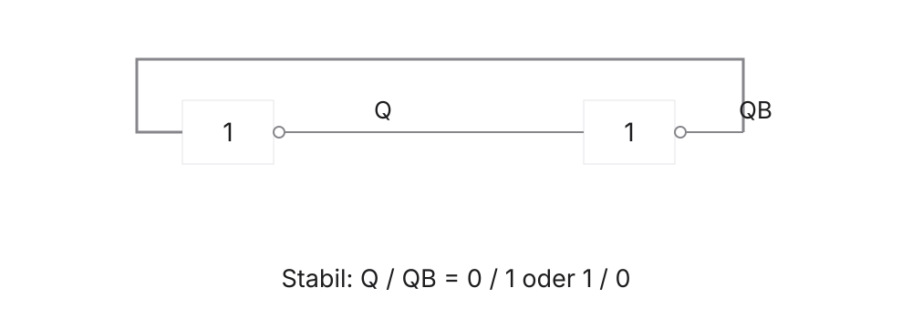{fig-alt="Zwei rechteckige Inverter sind über getrennte orthogonale Leitungen kreuzgekoppelt. Der AusgangQ des linken steuert rechts, der AusgangQB des rechten steuert links. Stabile digitale Paare sind 0/1 und 1/0." style="max-height: 420px;"}
:::

::: {.content-visible when-format="pdf"}
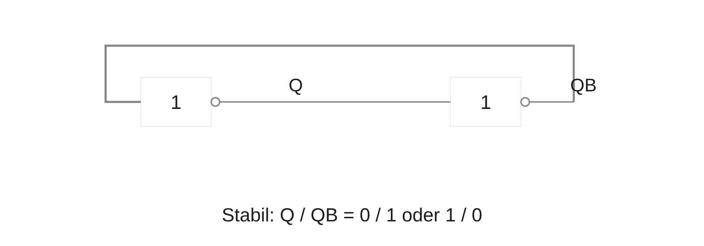{fig-alt="Zwei rechteckige Inverter sind über getrennte orthogonale Leitungen kreuzgekoppelt. Der AusgangQ des linken steuert rechts, der AusgangQB des rechten steuert links. Stabile digitale Paare sind 0/1 und 1/0." style="max-height: 420px;"}
:::

$Q=\neg Q_B$ und $Q_B=\neg Q$.

::: notes
Bei zwei kreuzgekoppelten Invertern steuert der Ausgang des linken den Eingang des rechten und umgekehrt. Die inneren Knoten heißen $Q$ und $Q_B$. Der Index B kennzeichnet hier den komplementären Knoten und keine zusätzliche Bytezahl. In einem stabilen digitalen Zustand tragen beide entgegengesetzte Werte.

Für $Q=0$ und $Q_B=1$ liegt links eins am Eingang und null am Ausgang, rechts null am Eingang und eins am Ausgang. Beide Inverterfunktionen sind gleichzeitig erfüllt. Das gilt ebenfalls für $Q=1$ und $Q_B=0$ mit vertauschten Werten. Null/null oder eins/eins erfüllen die beiden Negationsbedingungen dagegen nicht gleichzeitig und sind daher keine stabilen digitalen Speicherzustände dieses Modells. Zwei zulässige Zustände genügen, um ein Bit zu kodieren.

Die zwei Rückkopplungswege dürfen die Ausgänge nicht elektrisch kurzschließen. Im realen Umschaltvorgang oder unter ungünstigen Anfangsbedingungen können analoge Zwischenzustände auftreten; das einfache Wahrheitsmodell beschreibt deren Dauer und Stabilität nicht. Ein nutzbarer Speicher braucht außerdem kontrollierte Wege zum Lesen und Schreiben. Dazu wird zuerst der Aufbau eines einzelnen Inverters mit Transistoren bestimmt und anschließend um getrennt steuerbare Zugriffspfade ergänzt.
:::

## Ein CMOS-Inverter braucht zwei Transistoren

::: {.section-label}
3 / 5 · SRAM: Rückkopplung und Zugriff
:::

::: {.content-visible when-format="html"}
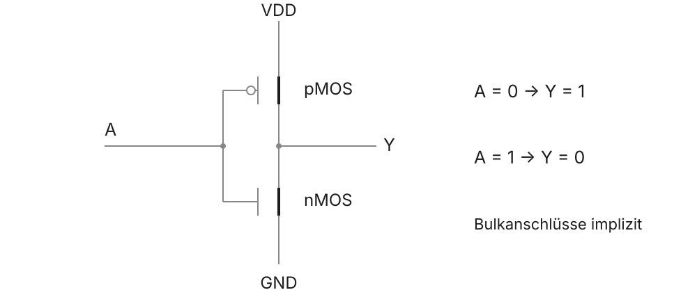{fig-alt="Ein pMOS verbindet bei Eingang 0 den Ausgang mit VDD. Ein nMOS verbindet bei Eingang 1 den Ausgang mit Masse. Beide Gates erhalten denselben Eingang, ihre Drainanschlüsse bilden den Ausgang." style="max-height: 420px;"}
:::

::: {.content-visible when-format="pdf"}
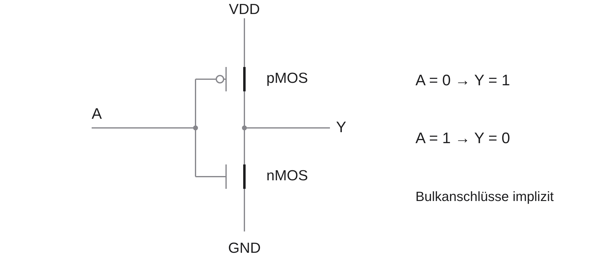{fig-alt="Ein pMOS verbindet bei Eingang 0 den Ausgang mit VDD. Ein nMOS verbindet bei Eingang 1 den Ausgang mit Masse. Beide Gates erhalten denselben Eingang, ihre Drainanschlüsse bilden den Ausgang." style="max-height: 420px;"}
:::

Eingang 0: oberer Pfad leitet · Eingang 1: unterer Pfad leitet.

::: notes
Die Umsetzung des Inverters liefert die Grundlage für das Zählen der Zelltransistoren. CMOS steht für Complementary Metal-Oxide-Semiconductor, komplementäre Metall-Oxid-Halbleitertechnik. MOS bedeutet Metal-Oxide-Semiconductor. Ein solcher Transistor hat ein Gate als Steueranschluss sowie Source und Drain als Anschlüsse des leitenden Pfads. Im qualitativen Modell leitet der obere p-Kanal-Transistor, pMOS, bei niedrigem Gatepegel. Der untere n-Kanal-Transistor, nMOS, leitet bei hohem Gatepegel. Der Kreis am pMOS-Gate kennzeichnet die invertierte Steuerwirkung.

VDD ist die positive Versorgung, GND, Ground oder Masse, das Bezugspotential. Beide Gates erhalten denselben Eingang $A$, die verbundenen Drainanschlüsse bilden $Y$. Bei $A=0$ verbindet der pMOS den Ausgang mit VDD, während der nMOS sperrt; der Ausgang ist eins. Bei $A=1$ sperrt der pMOS und der nMOS verbindet den Ausgang mit Masse; der Ausgang ist null.

Die nicht gezeichneten Substratanschlüsse liegen annahmegemäß an den üblichen Versorgungspotentialen. Die Darstellung berechnet weder Schaltschwellen noch Strom oder Verzögerung. Auch CMOS benötigt real Energie beim Umschalten und durch Leckströme. Zwei solche Inverter ergeben vier Transistoren. Mit zwei zusätzlichen gesteuerten Zugriffstransistoren entsteht daraus die klassische 6T-SRAM-Zelle.
:::

## 6T-SRAM: Halten und Zugriff

::: {.section-label}
3 / 5 · SRAM: Rückkopplung und Zugriff
:::

::: {.content-visible when-format="html"}
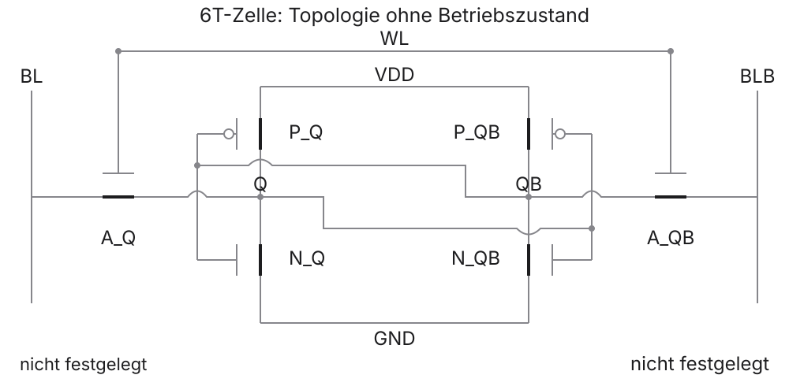{fig-alt="Elektrische 6 T-SRAM-Topologie: zwei kreuzgekoppelte CMOS-Inverter und zwei nMOS-Zugriffstransistoren. WL steuert beide Zugriffstransistoren, BL und BLB führen zuQ undQB. Brücken markieren nicht verbundene Leitungskreuzungen." style="max-height: 420px;"}
:::

::: {.content-visible when-format="pdf"}
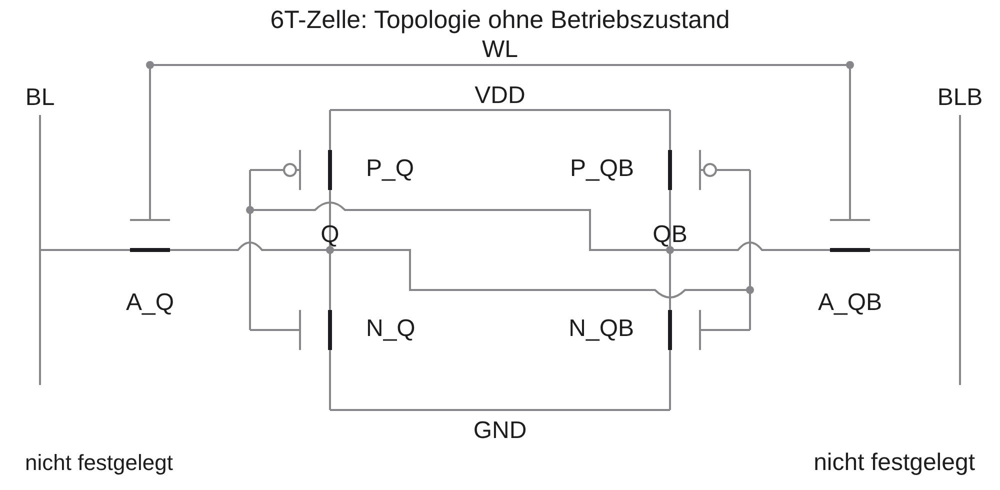{fig-alt="Elektrische 6 T-SRAM-Topologie: zwei kreuzgekoppelte CMOS-Inverter und zwei nMOS-Zugriffstransistoren. WL steuert beide Zugriffstransistoren, BL und BLB führen zuQ undQB. Brücken markieren nicht verbundene Leitungskreuzungen." style="max-height: 420px;"}
:::

WL: Word Line · BL / BLB: komplementäre Bit Lines.

::: notes
Die klassische 6T-SRAM-Zelle verbindet vier haltende Transistoren mit zwei Zugriffstransistoren. P_Q und N_Q bilden den linken CMOS-Inverter, P_QB und N_QB den rechten. P bezeichnet jeweils einen p-Kanal-, N einen n-Kanal-MOS-Transistor. A_Q und A_QB sind die beiden nMOS-Zugriffstransistoren. Die Abkürzungen beschreiben damit die Funktion und Zuordnung jedes Zellbauteils; insgesamt werden genau sechs Transistoren gezählt.

Die Word Line WL, Wortleitung, steuert beide Zugriffsgates gemeinsam. Die Bit Lines BL und BLB, Bitleitungen, verbinden die Zelle mit externer Lese- und Schreibperipherie. Die inneren Knoten Q und QB tragen komplementäre Werte; VDD und GND bezeichnen Versorgung und Masse. Für die Rückkopplung führt QB zu beiden linken Gates und Q zu beiden rechten Gates. Leitungssprünge markieren Kreuzungen ohne Verbindung, Punkte dagegen elektrische Verbindungen. Eine versehentliche Verbindung beider Rückkopplungen würde die Speicherfunktion zerstören.

Bei niedriger WL sind die inneren Knoten von den Bitleitungen getrennt. Hohe WL gibt den Zugriff frei, garantiert aber weder einen bestimmten Strom noch ideale Spannungsübertragung. Decoder, Vorladung, Leseverstärker und Schreibtreiber liegen außerhalb der sechs Zelltransistoren. Die drei Nutzungsphasen lassen sich nun anhand derselben Zelle unterscheiden: isoliert halten, den Zustand möglichst schonend lesen oder ihn gezielt umschreiben.
:::

## Halten: WL trennt die Zelle vom Zugriff

::: {.section-label}
3 / 5 · SRAM: Rückkopplung und Zugriff
:::

::: {.content-visible when-format="html"}
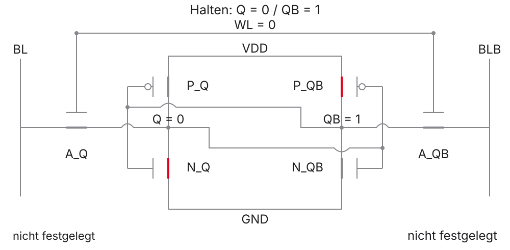{fig-alt="SRAM-HaltezustandQ 0 undQB 1 bei WL 0. P_Q undN_QB sperren, N_Q undP_QB leiten. Die Zugriffstransistoren sind gesperrt und die Bitleitungswerte sind für diesen Zustand nicht festgelegt." style="max-height: 420px;"}
:::

::: {.content-visible when-format="pdf"}
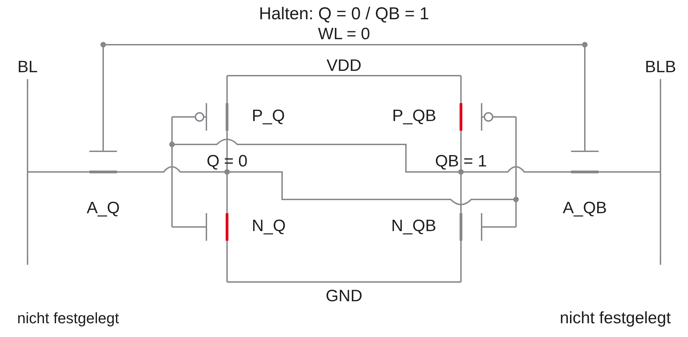{fig-alt="SRAM-HaltezustandQ 0 undQB 1 bei WL 0. P_Q undN_QB sperren, N_Q undP_QB leiten. Die Zugriffstransistoren sind gesperrt und die Bitleitungswerte sind für diesen Zustand nicht festgelegt." style="max-height: 420px;"}
:::

Versorgung vorhanden: $Q=0$, $Q_B=1$ bleibt durch Rückkopplung stabil.

::: notes
Für das Halten ist WL niedrig. Beide nMOS-Zugriffstransistoren sperren und isolieren die kreuzgekoppelten Inverter von BL und BLB. Die Bitleitungen benötigen in dieser Phase daher keine bestimmten Werte. Ihre Belegung verändert den gespeicherten Zustand im betrachteten Modell nicht, solange die Zugriffspfade gesperrt bleiben.

Im gezeichneten Zustand ist Q null und QB eins. QB steuert links: P_Q sperrt und N_Q leitet, sodass Q mit Masse verbunden bleibt. Q steuert rechts: P_QB verbindet QB mit VDD, während N_QB sperrt. Rot kennzeichnet die unter diesen qualitativen Bedingungen leitenden Zelltransistoren, Grau die gesperrten. Die Farben codieren Schaltzustände und keine gemessenen Stromstärken.

Solange Versorgung und zulässige Betriebsbedingungen erhalten bleiben, hält die Rückkopplung dieses Bit ohne periodischen Refresh. Refresh ist eine wiederkehrende Auffrischung gespeicherter Ladung, die beim später behandelten DRAM notwendig wird. Ein statischer Zustand verspricht trotzdem weder unbegrenzte Störfestigkeit noch eine Leistungsaufnahme von null. Ohne Versorgung ist SRAM flüchtig. Ein Lesezugriff muss nun die äußeren Bitleitungen anschließen, ohne den erhaltenen logischen Zustand ungewollt in den anderen stabilen Zustand zu kippen.
:::

## Lesen: eine kleine Differenz genügt

::: {.section-label}
3 / 5 · SRAM: Rückkopplung und Zugriff
:::

::: {.content-visible when-format="html"}
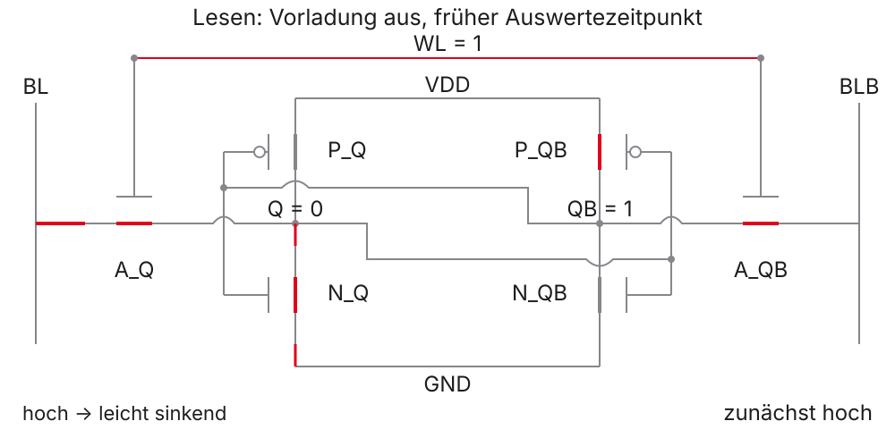{fig-alt="SRAM-Lesen bei Q 0 undQB 1. Beide Bitleitungen wurden hoch vorgeladen, die Vorladung ist jetzt abgeschaltet und WL ist 1. ÜberA_Q undN_Q sinkt BL leicht, BLB bleibt zunächst hoch. Ein externer Leseverstärker wertet die Differenz aus." style="max-height: 420px;"}
:::

::: {.content-visible when-format="pdf"}
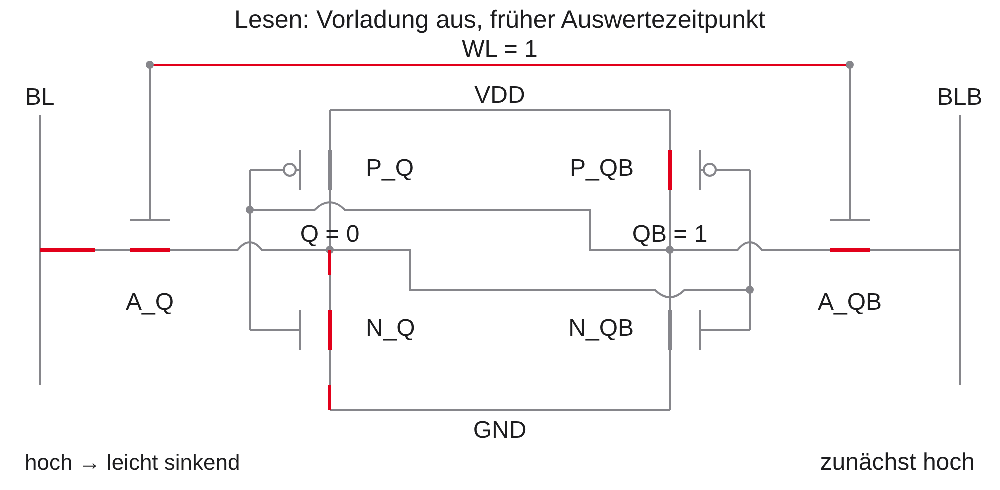{fig-alt="SRAM-Lesen bei Q 0 undQB 1. Beide Bitleitungen wurden hoch vorgeladen, die Vorladung ist jetzt abgeschaltet und WL ist 1. ÜberA_Q undN_Q sinkt BL leicht, BLB bleibt zunächst hoch. Ein externer Leseverstärker wertet die Differenz aus." style="max-height: 420px;"}
:::

Vorladen → Vorladung aus → WL hoch → Differenz auswerten → WL niedrig.

::: notes
Ein schonender SRAM-Lesezugriff beginnt außerhalb der Zelle: Die Peripherie lädt BL und BLB auf einen hohen Pegel vor. Für die dargestellte Auswertungsphase ist diese Vorladung abgeschaltet und WL hoch. Beide Zugriffstransistoren verbinden damit die Bitleitungen mit Q und QB.

Bei Q null entsteht links der Entladepfad von BL über A_Q und N_Q nach Masse. BL sinkt zunächst nur leicht ab. Rechts bleibt BLB am betrachteten frühen Lesezeitpunkt weitgehend hoch, weil QB eins ist. Ein Sense Amplifier, Leseverstärker, erkennt diese kleine Differenz. Die rote Markierung verfolgt den Entladeweg und die freigegebene Wortleitung; VDD kennzeichnet weiterhin die Versorgung. Eine vollständige Entladung ist für die Unterscheidung nicht erforderlich.

Die vorgeladene hohe BL kann zugleich den niedrigen inneren Knoten Q etwas anheben. Damit die gespeicherte null nicht kippt, sind ausreichende Lesestabilität und passende Transistordimensionierung nötig. Analoge Störabstände werden hier nicht ausgerechnet. Nichtdestruktiv bedeutet deshalb, dass ein korrekt ausgelegter Zugriff den logischen Inhalt erhält; es bedeutet nicht, dass alle Spannungen unverändert bleiben. Nach der Auswertung wird zuerst WL abgesenkt. Erst danach werden die Bitleitungen wieder vorgeladen. Diese Reihenfolge lässt sich im zugehörigen Zeitbild unabhängig von absoluten Laufzeiten nachvollziehen.
:::

## SRAM-Lesen als qualitative Zeitfolge

::: {.section-label}
3 / 5 · SRAM: Rückkopplung und Zugriff
:::

::: {.content-visible when-format="html"}
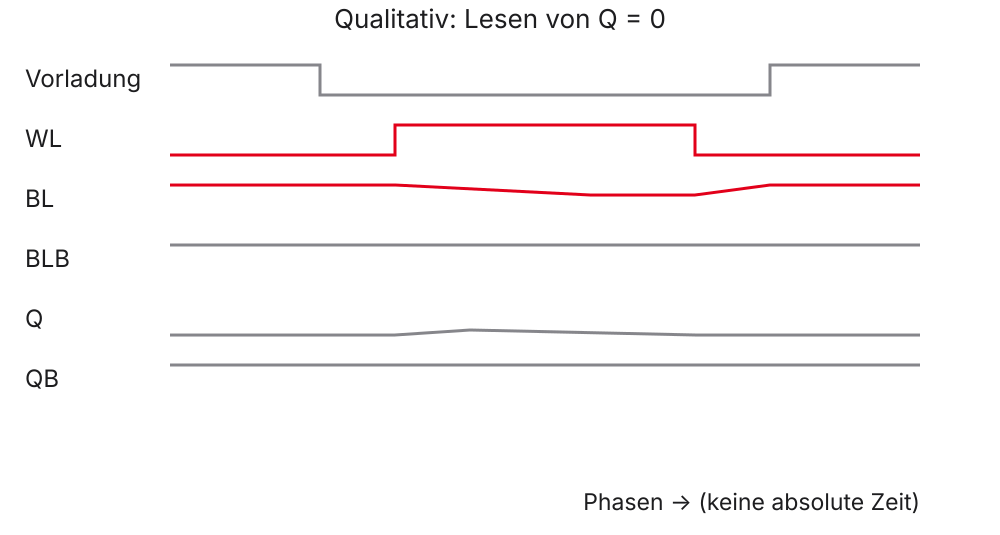{fig-alt="Qualitative Zeitfolge ohne Nanosekundenachse: Vorladung wird vor WL-Anstieg ausgeschaltet. Bei hoherWL sinkt BL leicht, Q zeigt einen kleinen Spannungshub und bleibt logisch 0. WL fällt vor erneuter Vorladung. QB bleibt logisch 1." style="max-height: 420px;"}
:::

::: {.content-visible when-format="pdf"}
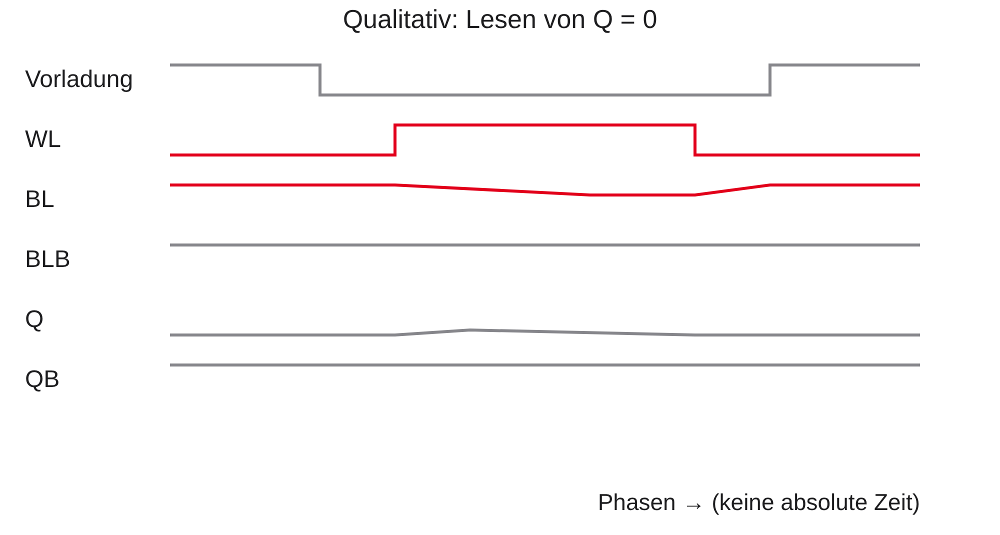{fig-alt="Qualitative Zeitfolge ohne Nanosekundenachse: Vorladung wird vor WL-Anstieg ausgeschaltet. Bei hoherWL sinkt BL leicht, Q zeigt einen kleinen Spannungshub und bleibt logisch 0. WL fällt vor erneuter Vorladung. QB bleibt logisch 1." style="max-height: 420px;"}
:::

Zeitfolge und Spannungsform sind Lehrmodelle, keine Simulation.

::: notes
Das Zeitbild ordnet die Schritte des gerade beschriebenen Lesens. Seine waagerechte Achse zeigt aufeinanderfolgende Phasen ohne absolute Zeiteinheit. WL ist die Wortleitung; BL und BLB sind die Bitleitungen. Q und QB beginnen mit null und eins. Bei der Vorladung bedeutet eins aktiviert und null abgeschaltet. Die Kurven sind schematisch und geben weder Nanosekunden noch Ströme oder reale Pegeldifferenzen an.

Zunächst ist die Vorladung aktiv und hält beide Bitleitungen hoch. Danach wird sie ausgeschaltet. Erst mit hoher WL beginnt die Auswertung: BL sinkt links leicht, während BLB im Modell zunächst hoch bleibt. Q zeigt einen kleinen analogen Hub, bleibt aber im gültigen Nullbereich; QB bleibt eins. Der Leseverstärker erkennt die Differenz, bevor die Bitleitung vollständig entladen wäre.

Nach dem Erkennen des Werts fällt WL und isoliert die Zelle. Erst anschließend wird die Vorladung erneut eingeschaltet. Dauerhaft gleichzeitiges Vorladen und Entladen würde gegeneinander arbeitende Pfade schaffen. Entscheidend sind deshalb die Reihenfolge und die Erhaltung des logischen Zellzustands. Ein Schreibzugriff wird dieselben Anschlüsse anders nutzen: Ein ausreichend starker äußerer Treiber soll die Rückkopplung nun bewusst in den anderen stabilen Zustand bringen.
:::

## Schreiben: den neuen Wert aktiv erzwingen

::: {.section-label}
3 / 5 · SRAM: Rückkopplung und Zugriff
:::

::: {.content-visible when-format="html"}
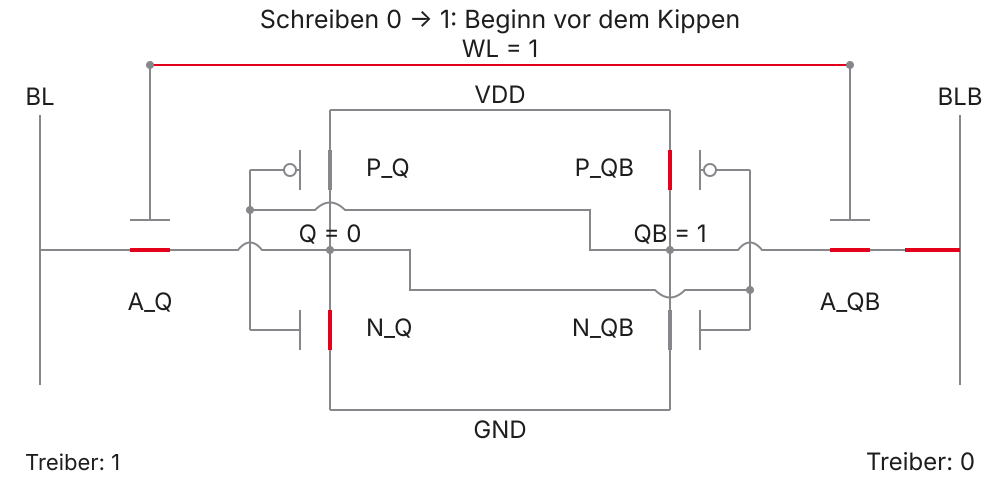{fig-alt="Beginn eines SRAM-Schreibens von Q 0 zuQ 1. Externe Treiber setzen BL 1 undBLB 0, dann wird WL 1. Rechts konkurriert der niedrige Schreibpfad mit dem bisher leitenden P_QB. SinkendesQB lässt links Q steigen, bis der neue stabile Zustand erreicht ist." style="max-height: 420px;"}
:::

::: {.content-visible when-format="pdf"}
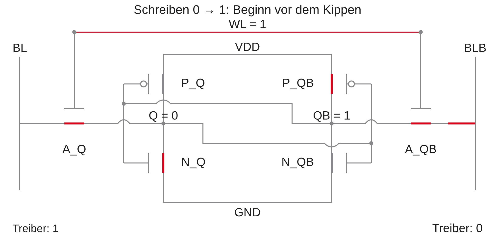{fig-alt="Beginn eines SRAM-Schreibens von Q 0 zuQ 1. Externe Treiber setzen BL 1 undBLB 0, dann wird WL 1. Rechts konkurriert der niedrige Schreibpfad mit dem bisher leitenden P_QB. SinkendesQB lässt links Q steigen, bis der neue stabile Zustand erreicht ist." style="max-height: 420px;"}
:::

Für $Q:0\rightarrow1$: BL hoch und BLB niedrig, bevor WL steigt.

::: notes
Ein Schreibzugriff soll die bestehende Rückkopplung gezielt in den anderen stabilen Zustand bringen. Ausgangspunkt ist $Q=0$ und $QB=1$; geschrieben werden soll $Q=1$, $QB=0$. Dazu legen die äußeren Schreibtreiber zuerst BL auf eins und BLB auf null. Erst wenn diese Daten bereitstehen, wird WL hoch und gibt die Zugriffstransistoren A_Q und A_QB frei. VDD bezeichnet die positive Versorgung, GND die Masse.

Der niedrige BLB-Treiber zieht QB über A_QB nach unten. Dabei arbeitet er zunächst gegen den noch leitenden pMOS P_QB. Die Dimensionierung von Zelle und Schreibpfad muss gewährleisten, dass dieser Eingriff unter den zulässigen Betriebsbedingungen gelingt. Sinkt QB weit genug, schaltet der linke Inverter um: P_Q leitet, N_Q sperrt und Q steigt. Das steigende Q lässt rechts P_QB sperren und N_QB leiten. Die Rückkopplung unterstützt damit den neuen Zustand.

Die Darstellung hält den Beginn dieses Vorgangs fest, bevor alle Transistoren ihren stabilen Endzustand erreicht haben. Rot markiert den äußeren Schreibweg und WL; eine genaue Stromaufteilung ist daraus nicht abzulesen. Nach ausreichender Schreibzeit fällt WL, während die Schreibdaten noch anliegen. Erst danach dürfen die Treiber freigegeben werden. Eine gegebenenfalls folgende Vorladung steuert die Speicherperipherie.
:::

## Schreiben endet mit erneutem Halten

::: {.section-label}
3 / 5 · SRAM: Rückkopplung und Zugriff
:::

::: {.content-visible when-format="html"}
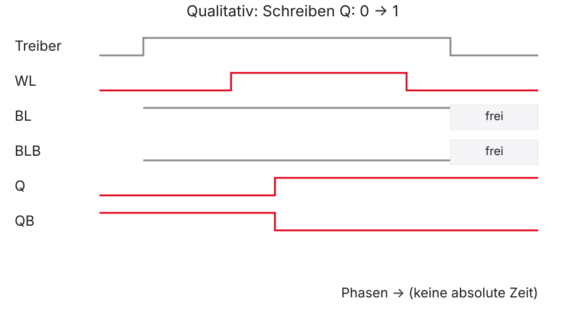{fig-alt="Qualitative SRAM-Schreibzeitfolge. BL 1 undBLB 0 liegen vor dem WL-Anstieg an und bleiben bis nach dem WL-Abfall gehalten. WährendWL 1 wechselnQ von 0 nach 1 undQB von 1 nach 0. NachWL 0 bleibt der neue Zustand erhalten, während die Bit Lines freigegeben werden dürfen." style="max-height: 420px;"}
:::

::: {.content-visible when-format="pdf"}
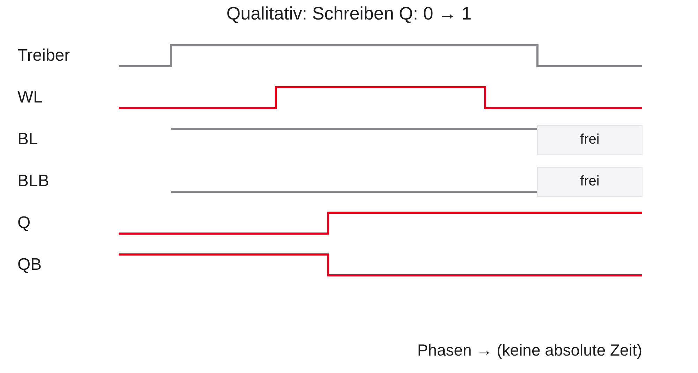{fig-alt="Qualitative SRAM-Schreibzeitfolge. BL 1 undBLB 0 liegen vor dem WL-Anstieg an und bleiben bis nach dem WL-Abfall gehalten. WährendWL 1 wechselnQ von 0 nach 1 undQB von 1 nach 0. NachWL 0 bleibt der neue Zustand erhalten, während die Bit Lines freigegeben werden dürfen." style="max-height: 420px;"}
:::

Schreibdaten bereit → WL hoch → Umschalten → WL niedrig → Treiber frei.

::: notes
Die zeitliche Reihenfolge macht deutlich, wann der äußere Schreibpfad die Zelle beeinflusst und wann sie den neuen Wert selbst hält. Die waagerechte Achse ordnet qualitative Phasen; sie gibt keine spezifizierte Schreibzeit an. BL und BLB werden zunächst auf eins und null getrieben. Das Treibersignal eins bedeutet, dass diese Schreibdaten aktiv bereitgestellt werden. Erst anschließend steigt WL. Q und QB bezeichnen weiterhin die komplementären inneren Speicherknoten.

Während WL hoch ist, zieht der Schreibpfad QB nach unten. Über die beiden rückgekoppelten Inverter steigt Q, bis sich der neue stabile Zustand eingestellt hat. Die Kurven erklären so das Schreiben von $Q=0$ nach $Q=1$. In einer realen Schaltung überlappen die Spannungsübergänge; ihr Verlauf hängt von Zell- und Treiberdimensionierung ab. Aus der Zeichnung folgt daher keine universelle Verzögerung. Voraussetzung bleibt eine ausreichende Schreibfähigkeit des Treibers.

Anschließend wird WL niedrig. Die Schreibdaten bleiben bis nach diesem Abfall erhalten, bevor die Treiber freigegeben werden. Das graue Feld „frei“ legt die Bitleitungswerte für die anschließende Haltephase nicht fest; es bezeichnet keinen dritten gespeicherten Logikwert. $Q=1$ und $QB=0$ bleiben durch Rückkopplung erhalten. Für späteres Lesen muss die Peripherie wieder die passende Vorladung herstellen. Schreiben und Vorladen verlangen somit eine aufeinander abgestimmte Phasensteuerung.
:::

## SRAM: schnell nutzbar, aber nicht kostenlos

::: {.section-label}
3 / 5 · SRAM: Rückkopplung und Zugriff
:::

| Vorteil der Zelle | Grenze der Aussage |
|------------------|-------------------|
| Halten ohne periodischen Refresh | Versorgung und Leckströme bleiben relevant |
| Lesen erhält bei korrekter Auslegung den Inhalt | Lesestabilität muss gesichert sein |
| Häufiges Überschreiben ohne Flash-Löschblock | sechs Zelltransistoren plus Peripherie |

Typische Rollen: interne Arbeitsspeicher, Cache-Daten und kleine Puffer.

::: notes
Die statische Rückkopplung einer SRAM-Zelle hält ihren Zustand ohne periodischen Refresh. Es muss also keine isoliert gespeicherte Ladung regelmäßig aufgefrischt werden. Dennoch benötigt die Zelle eine anliegende Versorgung und ausreichende Störabstände. Auch während des Haltens verursachen Leckströme Leistungsaufnahme; beim Zugriff kommen Umschaltvorgänge und die Arbeit der Peripherie hinzu.

Bei passenden Zugriffswegen lässt sich SRAM häufig lesen und überschreiben. Ein Lesezugriff erhält den logischen Inhalt, sofern die Lesestabilität der Zelle gesichert ist. Für ein neues Datenwort ist anders als im Flash-Lehrmodell kein vorheriges Löschen eines größeren Blocks erforderlich. Diesen Eigenschaften steht der Aufwand der klassischen 6T-Zelle gegenüber: Zu ihren sechs Transistoren kommen Decoder, Bitleitungsperipherie und Verstärker. Die Transistorzahl allein liefert deshalb weder eine genaue Chipfläche noch eine bestimmte Zugriffszeit.

Interne Arbeitsspeicher, Cache-Daten und kleine Puffer sind typische Anwendungen. Ein Cache hält nahe Kopien häufig benötigter Inhalte; seine Organisation wird in Vorlesung 2 behandelt. „Cache“ beschreibt eine Nutzung und führt keine neue Zellphysik ein. Andere SRAM-Zellformen können einzelne Eigenschaften verändern. Die folgenden Zellfragen beziehen sich deshalb ausdrücklich auf die entwickelte klassische 6T-Zelle. Ihr regeneratives Halten bildet anschließend den Vergleichspunkt für DRAM, dessen klassisches Zellmodell Information als Ladungszustand speichert.
:::

## Papierphase 2: die 6T-Zelle erklären

::: {.section-label}
3 / 5 · SRAM: Rückkopplung und Zugriff
:::

Übungsblatt, Aufgabe 3 · 15 Minuten

- Für beide stabilen Zustände die leitenden Invertertransistoren nennen
- Lesen von Schreiben und Halten unterscheiden
- Vorladung, Wortleitung und Schreibdaten zeitlich ordnen

::: notes
Die 6T-Zelle lässt sich erklären, indem Halten, Lesen und Schreiben jeweils vom inneren Zustand und der angeschlossenen Peripherie aus verfolgt werden. Beim vorgegebenen Anfangszustand $Q=1$, $QB=0$ leiten P_Q und N_QB; N_Q und P_QB sperren. In der Haltephase ist WL niedrig und trennt die Zelle von den Bitleitungen. Für den anderen stabilen Zustand $Q=0$, $QB=1$ vertauschen sich die leitenden Invertertransistoren: N_Q und P_QB leiten, P_Q und N_QB sperren. Beide Zustände erfüllen dieselbe komplementäre Haltebedingung.

Zum Lesen werden BL und BLB zunächst hoch vorgeladen. Nach dem Abschalten der Vorladung wird WL angehoben. Beim Anfangszustand $Q=1$, $QB=0$ sinkt BLB am Nullknoten leicht ab. Der Leseverstärker wertet die Differenz der Bitleitungen aus. Bei ausreichender Lesestabilität bleibt der logische Zellinhalt erhalten. Danach fällt WL; erst anschließend setzt die erneute Vorladung ein.

Zum Umschreiben von $Q=1$ nach $Q=0$ treiben die äußeren Schreiber BL auf null und BLB auf eins. Diese Daten müssen vor dem WL-Anstieg bereitstehen und bis nach dem WL-Abfall anliegen. Die Rückkopplung wechselt dadurch in den neuen stabilen Zustand. Hohe WL allein kennzeichnet somit noch kein Schreiben: Entscheidend sind die Wirkung der angeschlossenen Peripherie und die zeitliche Reihenfolge.
:::

## 4 · DRAM: Ladung und Organisation {.section-divider}

Was ändert sich, wenn ein Kondensator das Bit trägt?

::: {.section-route}
Datenwege → Nichtflüchtige Speicher → SRAM → DRAM → Software
:::

::: notes
Die statische Rückkopplung ermöglicht häufigen Zugriff, benötigt aber mehrere Zelltransistoren. Das klassische DRAM-Modell reduziert den Zellkern auf einen Transistor und einen Kondensator. Die gespeicherte Ladung muss dafür zuverlässig ausgewertet, nach dem Lesen wiederhergestellt und wegen realer Leckage regelmäßig aufgefrischt werden.

Die Ladungsteilung erklärt zunächst die kleine auswertbare Spannungsabweichung. Daraus ergeben sich die unterschiedlichen Aufgaben von Sense, Restore und Precharge. Banken, Zeilen und Spalten verbinden den elektrischen Vorgang anschließend mit der Adressauswahl. Der Abschluss trennt nochmals Latenz und Transferrate: Mehr Übertragungsereignisse je Taktperiode ändern nicht automatisch die Dauer eines einzelnen Zugriffs.
:::

## DRAM: ein Transistor, ein Kondensator

::: {.section-label}
4 / 5 · DRAM: Ladung und Organisation
:::

::: {.content-visible when-format="html"}
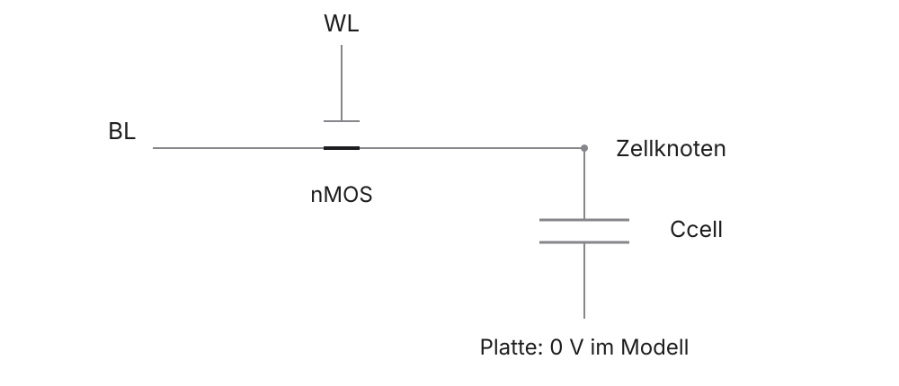{fig-alt="DRAM-Lehrzelle mit einem nMOS-Zugriffstransistor. WL steuert dessen Gate, BL ist über den leitenden Pfad mit dem Zellknoten verbunden. Ein Kondensator liegt zwischen Zellknoten und einer im Modell auf 0 Volt gesetzten Platte." style="max-height: 420px;"}
:::

::: {.content-visible when-format="pdf"}
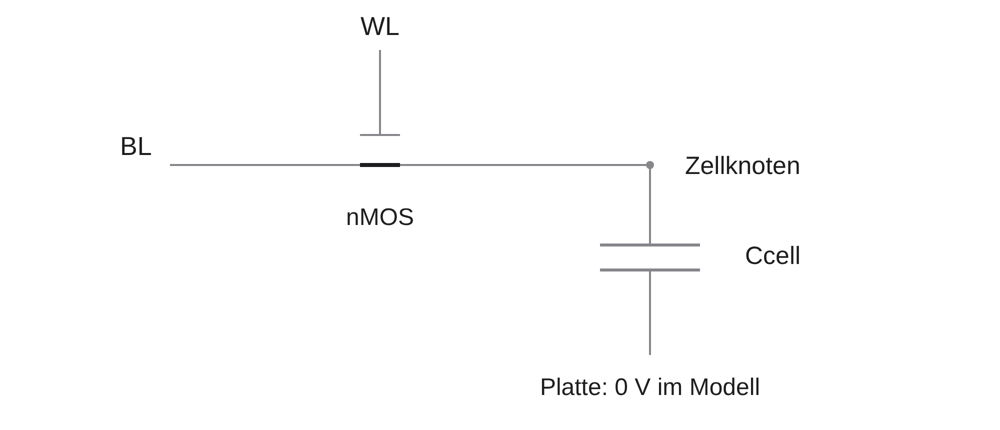{fig-alt="DRAM-Lehrzelle mit einem nMOS-Zugriffstransistor. WL steuert dessen Gate, BL ist über den leitenden Pfad mit dem Zellknoten verbunden. Ein Kondensator liegt zwischen Zellknoten und einer im Modell auf 0 Volt gesetzten Platte." style="max-height: 420px;"}
:::

WL niedrig: Ladung weitgehend isoliert · WL hoch: Ladungsaustausch mit BL.

::: notes
Die klassische DRAM-Bitzelle kommt mit einem Zugriffstransistor und einem Kondensator aus; dafür steht die Bezeichnung 1T1C. WL steuert das Gate des nMOS-Zugriffstransistors. Wird er leitend, verbindet sein Kanal den Zellknoten mit BL und damit mit der Speicherperipherie. Das Gate steuert diesen Pfad, ist aber selbst kein Datenanschluss des Pfads.

Der Kondensator besitzt eine Zell- und eine Plattenelektrode. In der Zeichnung liegt die Platte vereinfachend auf $0\,\mathrm{V}$; reale Bauformen und Plattenspannungen können davon abweichen. Bei niedriger WL ist die Ladung am Zellknoten weitgehend isoliert. Hohe WL ermöglicht dagegen einen Ladungsaustausch zwischen Zelle und Bitleitung. Die Isolation ist wegen realer Leckströme nicht dauerhaft vollkommen.

Die beiden waagerechten Striche stellen das Kondensatorsymbol dar, keinen Kurzschluss. Ccell bezeichnet die Zellkapazität. Anders als SRAM enthält dieser Zellkern keine rückgekoppelten Inverter. Decoder und Leseverstärker liegen außerhalb des gezeichneten 1T1C-Kerns. Die Peripherie wertet den Ladungszustand über die entstehende Spannung aus. Sie muss ihn nach dem Lesen wiederherstellen und regelmäßig auffrischen. Um diese Aufgaben zu verstehen, ist zunächst zwischen der elektrischen Ladung und dem logischen Bit zu unterscheiden, das die Schaltung daraus gewinnt.
:::

## Elektrische Ladung ist noch kein logischer Wert

::: {.section-label}
4 / 5 · DRAM: Ladung und Organisation
:::

$$q_\mathrm{el}=C_\mathrm{cell}(V_\mathrm{cell}-V_\mathrm{plate})$$

Lehrmodell: $C_\mathrm{cell}=30\,\mathrm{fF}$, $V_\mathrm{plate}=0\,\mathrm{V}$.

- Hoher Zellpegel $1{,}2\,\mathrm{V}$: $q_\mathrm{el}=36\,\mathrm{fC}$
- Niedriger Zellpegel $0\,\mathrm{V}$: $q_\mathrm{el}=0\,\mathrm{fC}$ im idealen Modell

::: notes
Die elektrische Ladung an der betrachteten Zellelektrode folgt im idealen Kondensatormodell aus

$$q_\mathrm{el}=C_\mathrm{cell}(V_\mathrm{cell}-V_\mathrm{plate}).$$

$q_\mathrm{el}$ bezeichnet hier eine Ladung und ist vom zuvor verwendeten SRAM-Knotennamen Q zu unterscheiden. $C_\mathrm{cell}$ ist die Zellkapazität in Farad, $V_\mathrm{cell}$ die Zellspannung und $V_\mathrm{plate}$ die Plattenspannung in Volt. Femtofarad und Femtocoulomb werden mit fF und fC abgekürzt; der Vorsatz Femto bedeutet $10^{-15}$.

Für die reinen Lehrwerte $C_\mathrm{cell}=30\,\mathrm{fF}$, $V_\mathrm{plate}=0\,\mathrm{V}$ und $V_\mathrm{cell}=1{,}2\,\mathrm{V}$ ergibt sich

$$q_\mathrm{el}=30\cdot10^{-15}\,\mathrm{F}\cdot1{,}2\,\mathrm{V}=36\cdot10^{-15}\,\mathrm{C}=36\,\mathrm{fC}.$$

Bei null Volt Spannungsdifferenz ist auch die Ladung im idealen Modell null. Die Werte beschreiben kein konkretes Bauteil; die Einheit Farad mal Volt ergibt Coulomb.

Ein logischer Wert entsteht erst dadurch, dass die Schaltung Spannungsbereiche als null oder eins interpretiert. Eine reale Zelle muss daher keinen jederzeit exakt gleichen Ladungswert halten, wohl aber einen hinreichenden Abstand zum Referenzzustand. Leckströme, Störungen und Auslesevorgänge verändern die Zellspannung. Aus diesem Ladungsprinzip ergibt sich die Notwendigkeit des regelmäßigen Auffrischens; eine für alle DRAM gültige feste Zeitangabe folgt daraus nicht.
:::

## Leckage macht Refresh erforderlich

::: {.section-label}
4 / 5 · DRAM: Ladung und Organisation
:::

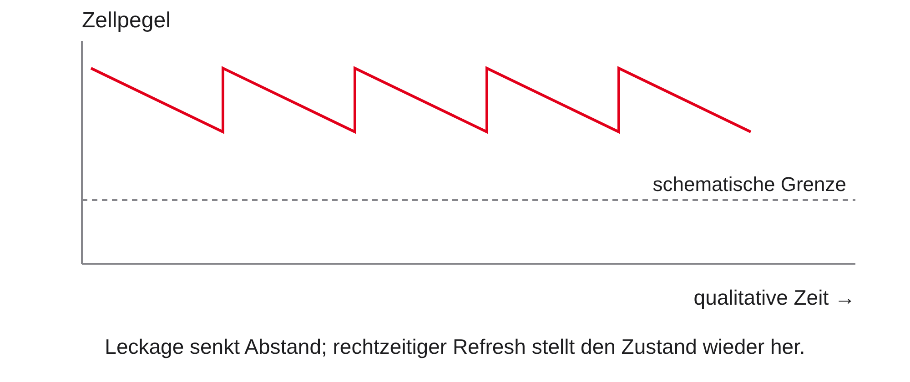{fig-alt="Qualitativer Spannungsverlauf einer hoch geladenen DRAM-Zelle: Leckage senkt den Pegel, rechtzeitiger Refresh stellt ihn wieder her. Eine gestrichelte Grenze markiert beispielhaft den benötigten Auswerteabstand, ohne Zeit- oder Spannungsdaten eines Bauteils."}

Refresh erhält Inhalte innerhalb spezifizierter Bedingungen; er ist kein neues Nutzdatum.

::: notes
Refresh frischt die gespeicherte Information auf: Eine Zeile wird ausgelesen, der erkannte Zustand verstärkt und mit denselben logischen Werten wiederhergestellt. Dadurch entstehen keine neuen Nutzdaten. Der Vorgang gleicht aus, dass reale Isolationspfade Ladung verlieren oder austauschen. Diese Leckage hängt unter anderem von Temperatur, Herstellung, Zustand und Speicherbauart ab.

Der dargestellte hohe Zellspannungszustand verändert sich entlang einer qualitativen Zeitachse. Ohne Auffrischung nimmt sein Abstand zum unsicheren Auswertebereich ab. Die roten Aufwärtsstücke zeigen, wie Refresh den hohen Zustand wiederherstellt. Die gestrichelte Linie kennzeichnet schematisch den für die Auswertung benötigten Abstand. Sie ist kein universell garantierter Schwellwert. Ebenso wenig sind Steigung und zeitliche Abstände als gemessene Kurve eines Bauteils zu lesen.

Der Controller muss die Auffrischpflichten einhalten, die für den konkreten Speicher spezifiziert sind. Eine häufig genannte Millisekundenangabe lässt sich deshalb ohne zugehöriges Datenblatt nicht auf jedes DRAM übertragen. Refresh belegt Ressourcen und kann andere Zugriffe beeinflussen; seine Planung gehört zur jeweiligen Schnittstelle. Ohne Versorgung und die nötige Auffrischung ist die Information nicht dauerhaft gesichert. Darüber hinaus verändert auch ein regulärer Lesezugriff zunächst die Zellladung. Sein Ablauf beginnt mit der Vorbereitung der Bitleitung als Referenz.
:::

## Vor dem Lesen: BL auf halbe Versorgung

::: {.section-label}
4 / 5 · DRAM: Ladung und Organisation
:::

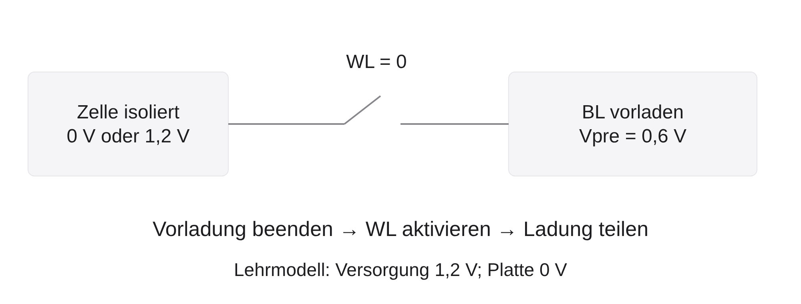{fig-alt="Lehrmodell der DRAM-Lesevorbereitung: Wortleitung niedrig, geladene oder entladene Zelle isoliert. Die Bitleitung ist auf 0,6 Volt vorgeladen, die halbe Modellversorgung von 1,2 Volt. Erst nach Abschalten der Vorladung wird die Wortleitung aktiviert."}

Lehrwerte: $V_\mathrm{DD}=1{,}2\,\mathrm{V}$ und $V_\mathrm{pre}=0{,}6\,\mathrm{V}$.

::: notes
Vor dem Lesen stellt die Peripherie einen definierten Bitleitungspegel her. Diese Vorbereitung heißt Precharge: Vorladen und gegebenenfalls Ausgleichen der Bitleitungen. Im gewählten Lehrmodell beträgt die positive Versorgung $V_\mathrm{DD}=1{,}2\,\mathrm{V}$, der Vorladepegel liegt bei der halben Versorgung, also $V_\mathrm{pre}=0{,}6\,\mathrm{V}$.

Währenddessen bleibt WL niedrig. Die Zelle ist daher vom Bitleitungsknoten getrennt und kann ihren hohen oder niedrigen Anfangszustand behalten. Die Abbildung zeigt genau diese Situation: Der Zellknoten liegt bei $0\,\mathrm{V}$ oder $1{,}2\,\mathrm{V}$, BL dagegen bei $0{,}6\,\mathrm{V}$. Zellzustand und Vorladepegel sind somit verschiedene Größen. Vor dem eigentlichen Ladungsaustausch wird die äußere Vorladung beendet; danach aktiviert die Peripherie WL.

Nun werden die kleine Zellkapazität und die größere Bitleitungskapazität miteinander verbunden. Ladung fließt, bis sich im idealisierten Modell ein gemeinsamer Spannungspegel einstellt. Eine anfangs hohe Zelle hebt BL etwas über den Vorladepegel, eine niedrige Zelle senkt BL etwas darunter. Gerade die Richtung dieser kleinen Abweichung ermöglicht später die Entscheidung des Leseverstärkers. Ihre Größe lässt sich mit Ladungserhaltung berechnen. Das einfache Zwei-Kondensator-Modell bildet differenzielle reale Bitleitungsanordnungen und weitere parasitäre Effekte dabei nicht vollständig ab.
:::

## Ladungsteilung: etwa 55 mV vom Vorladepegel

::: {.section-label}
4 / 5 · DRAM: Ladung und Organisation
:::

$$V_\mathrm{share}=\frac{C_\mathrm{cell}V_\mathrm{cell}+C_\mathrm{BL}V_\mathrm{pre}}{C_\mathrm{cell}+C_\mathrm{BL}}$$

$C_\mathrm{cell}=30\,\mathrm{fF}$, $C_\mathrm{BL}=300\,\mathrm{fF}$, $V_\mathrm{pre}=0{,}6\,\mathrm{V}$.

| Anfangswert der Zelle | Gemeinsamer Pegel | Abweichung von Vorladung |
|----------------------|------------------|--------------------------|
| $1{,}2\,\mathrm{V}$ | $0{,}6545\,\mathrm{V}$ | $+54{,}5\,\mathrm{mV}$ |
| $0\,\mathrm{V}$ | $0{,}5455\,\mathrm{V}$ | $-54{,}5\,\mathrm{mV}$ |

::: notes
Die Ladungsteilung liefert nur eine kleine Abweichung vom Vorladepegel und erklärt damit den Bedarf an einem empfindlichen Leseverstärker. $C_\mathrm{cell}$ und $C_\mathrm{BL}$ bezeichnen Zell- und Bitleitungskapazität, $V_\mathrm{cell}$ den anfänglichen Zellpegel und $V_\mathrm{pre}$ den Vorladepegel der Bitleitung. $V_\mathrm{share}$ ist die gemeinsame Spannung nach idealem Ladungsausgleich, bevor der Verstärker eingreift. Dabei bedeutet mV Millivolt, also $10^{-3}\,\mathrm{V}$.

Beide Kondensatoren liegen im Modell gegen dieselbe feste Bezugsspannung von $0\,\mathrm{V}$. Weitere Ladungsquellen und parasitäre Effekte bleiben ausgeschlossen. Aus der Ladungserhaltung folgt

$$(C_\mathrm{cell}+C_\mathrm{BL})V_\mathrm{share}=C_\mathrm{cell}V_\mathrm{cell}+C_\mathrm{BL}V_\mathrm{pre}.$$

Für $C_\mathrm{cell}=30\,\mathrm{fF}$, $C_\mathrm{BL}=300\,\mathrm{fF}$ und $V_\mathrm{pre}=0{,}6\,\mathrm{V}$ tragen eine hohe Zelle und BL anfangs $36\,\mathrm{fC}$ beziehungsweise $180\,\mathrm{fC}$. Die gesamte Ladung verteilt sich auf $330\,\mathrm{fF}$:

$$V_\mathrm{share}=\frac{216\,\mathrm{fC}}{330\,\mathrm{fF}}=0{,}654545\ldots\,\mathrm{V}.$$

Der Abstand zu $0{,}6\,\mathrm{V}$ beträgt gerundet $+54{,}5\,\mathrm{mV}$. Bei anfangs niedriger Zelle ist deren Ladungsbeitrag im Idealmodell null:

$$V_\mathrm{share}=\frac{180\,\mathrm{fC}}{330\,\mathrm{fF}}=0{,}545454\ldots\,\mathrm{V},$$

also gerundet $-54{,}5\,\mathrm{mV}$ Abweichung. Der hohe Zellpegel ist gesunken, der niedrige gestiegen. „Destruktives Lesen“ bezeichnet diesen Verlust des ursprünglichen deutlichen Informationsabstands; es bedeutet keine vollständige Entladung jedes Kondensators. Die noch erkennbare Richtung der Abweichung erlaubt Verstärken und Wiederherstellen.
:::

## Sense, Restore und Precharge sind verschiedene Phasen

::: {.section-label}
4 / 5 · DRAM: Ladung und Organisation
:::

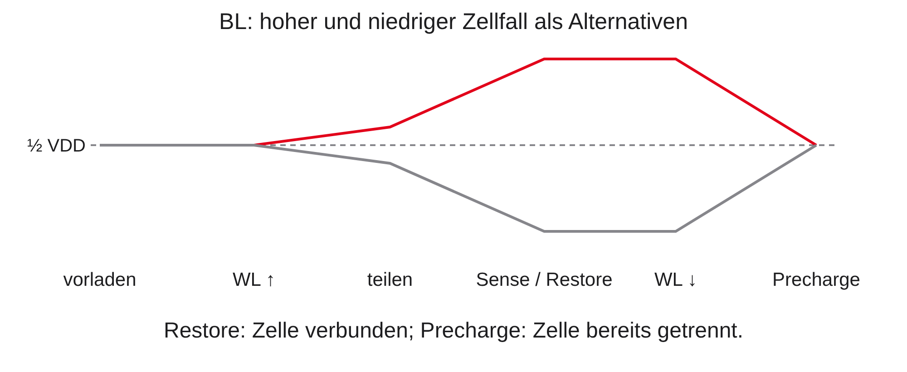{fig-alt="DRAM-Lesefolge im Lehrmodell: BL beginnt bei 0,6 Volt. NachWL-Aktivierung teilen Zelle undBL Ladung. Sense undRestore verstärken bei weiterhin hoherWL auf den ursprünglichen hohen oder niedrigen Wert. WL wird abgesenkt, danach kehrt BL durchPrecharge zu 0,6 Volt zurück."}

Restore bei verbundener Zelle; Precharge nach deren Trennung.

::: notes
Sense, Restore und Precharge erfüllen im Leseablauf unterschiedliche Aufgaben. Sense bezeichnet das Erkennen und Verstärken der kleinen Spannungsabweichung durch den Sense Amplifier, den Leseverstärker. Restore stellt den Zellzustand wieder her. Precharge bereitet anschließend die Bitleitung für einen weiteren Zugriff vor. Die gestrichelte Linie der Grafik markiert die halbe positive Versorgung; die waagerechte Achse ordnet qualitative Phasen ohne spezifizierte Befehlszeiten.

BL beginnt im Lehrmodell bei $0{,}6\,\mathrm{V}$. Mit hoher WL wird die Zelle angeschlossen. Die Ladungsteilung verschiebt den Bitleitungspegel um etwa $+54{,}5\,\mathrm{mV}$ oder $-54{,}5\,\mathrm{mV}$. Der Leseverstärker erkennt die Richtung und treibt BL auf einen hohen oder niedrigen Pegel. Da WL weiterhin hoch ist, erreicht dieser Pegel zugleich den Zellknoten. Die Zelle erhält ihren zugehörigen Zustand zurück: Das ist Restore und gleicht die Veränderung durch die Ladungsteilung aus.

Erst nach der Wiederherstellung wird WL niedrig und trennt die Zelle ab. Danach führt Precharge BL zum mittleren Referenzpegel zurück. Würde die Bitleitung bei noch verbundener Zelle auf diesen mittleren Pegel gebracht, ginge deren deutlicher Zustand gerade verloren. Hoher und niedriger Verlauf sind in der Grafik alternative Fälle, keine gleichzeitig gespeicherten Werte derselben Zelle. Viele Zellbits lassen sich über eine gemeinsame Wortleitung zu einer Zeile zusammenfassen.
:::

## Organisation: Bank, Zeile, Spalte und Byte

::: {.section-label}
4 / 5 · DRAM: Ladung und Organisation
:::

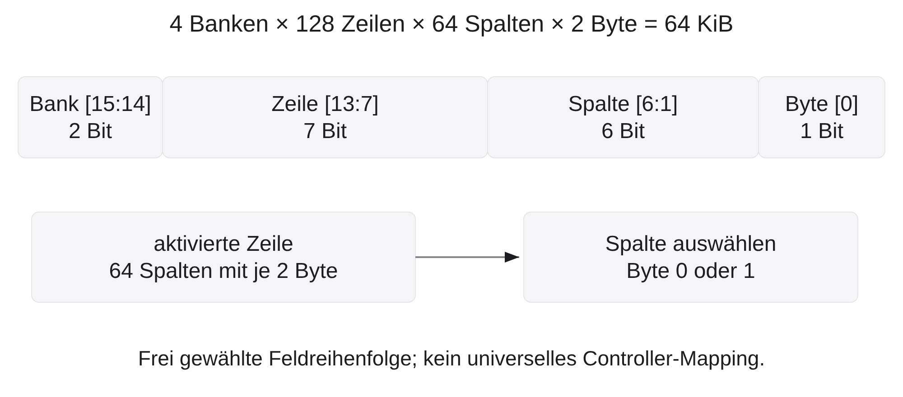{fig-alt="Frei gewähltes DRAM-Adressmodell: vierBanks, jeweils 128 Zeilen mit 64 Spalten und zweiByte proSpaltenelement. Eine 16 Bit-Adresse enthält Bankbits 15 bis 14, Zeilenbits 13 bis 7, Spaltenbits 6 bis 1 und Bytebit 0."}

$4\cdot128\cdot64\cdot2\,\mathrm{Byte}=64\,\mathrm{KiB}$.

::: notes
Die Organisation in Banken, Zeilen und Spalten verbindet das Zellprinzip mit der Auswahl von Daten. Eine Bank ist eine organisatorisch gesondert steuerbare Teilstruktur. Die Zellen einer Zeile teilen eine Auswahlleitung; aus deren aktivierten Inhalten werden über die Spaltenauswahl die gewünschten Daten gewählt. Die verstärkten Zeileninhalte bilden funktional den Row Buffer oder Zeilenpuffer. Er ist keine zweite dauerhafte Kopie der gesamten Speicherkapazität.

Das frei gewählte byteadressierte Modell besitzt vier Banken mit jeweils $128$ Zeilen, $64$ Spalten je Zeile und zwei Byte je Spaltenelement. Die Kapazität beträgt

$$4\cdot128\cdot64\cdot2\,\mathrm{Byte}=65\,536\,\mathrm{Byte}=64\,\mathrm{KiB},$$

wobei ein Kibibyte $2^{10}$ Byte umfasst. Zur Auswahl sind zwei Bankbits, sieben Zeilenbits, sechs Spaltenbits und ein Bytebit erforderlich, zusammen sechzehn Bit. Die Abbildung ordnet die Felder von hoch nach niedrig als Bank, Zeile, Spalte und Byte an: Bits $15$ bis $14$, $13$ bis $7$, $6$ bis $1$ und Bit $0$.

Bank zwei, Zeile fünf, Spalte neun und Byte eins ergeben damit

$$2\cdot2^{14}+5\cdot2^7+9\cdot2+1=33\,427,$$

hexadezimal `0x8293`. Reale Controller können Adressfelder anders verschachteln und weitere Kanalinformationen einbeziehen. Die Aufteilung ist eine Rechenannahme. Sie macht jedoch verständlich, warum eine bereits aktivierte passende Zeile einen anderen Zugriffsablauf erlaubt als ein Zeilenwechsel.
:::

## Eine offene Zeile verändert die Befehlsfolge

::: {.section-label}
4 / 5 · DRAM: Ladung und Organisation
:::

{fig-alt="Für einen modellierten DRAM-Lesezugriff genügt bei passender offener ZeileREAD. In einer geschlossenenBank gehtACTIVATE voraus. Bei einer anderen offenenZeile folgenPRECHARGE, ACTIVATE undREAD. Nötige Wartezeiten sind nicht quantifiziert."}

Befehlsfolge erklärt Aufwand; Datenblatt und Controller bestimmen die Zeiten.

::: notes
Der Zustand einer Bank bestimmt, welche Vorbereitungen ein Lesezugriff benötigt. ACTIVATE aktiviert eine Zeile und stellt ihre Inhalte in den Leseverstärkern bereit. READ wählt daraus die angeforderten Spaltendaten. PRECHARGE schließt unter Einhaltung der nötigen Bedingungen die bisherige Zeile und bereitet die Bitleitungen für eine weitere Aktivierung vor. Die englischen Bezeichnungen benennen hier Funktionen; sie sind keine fertige Controllerschnittstelle.

Ist die passende Zeile bereits offen, kann der Zugriff ohne erneuten Zeilenwechsel mit READ erfolgen. Bei geschlossener Bank geht ACTIVATE voraus. Ist eine andere Zeile derselben Bank offen, folgen PRECHARGE, ACTIVATE und READ aufeinander. Die drei von oben nach unten dargestellten Fälle veranschaulichen diesen zusätzlichen Aufwand. Die Pfeile legen die Reihenfolge fest, geben aber weder identische Zyklusdauern noch gemessene Latenzen an.

RAS bedeutet Row Address Strobe, Zeilenadress-Strobe, CAS entsprechend Column Address Strobe, Spaltenadress-Strobe. Historische Schnittstellen übertragen Zeilen- und Spaltenadresse zeitlich getrennt; bei synchronen Speichern bestehen entsprechende Befehlsfunktionen. Die Zugriffszeit lässt sich dennoch nicht allein mit der mehrfachen Nutzung von Adresspins erklären. Zellaktivierung, Verstärkung, Wiederherstellung und vorgeschriebene zeitliche Abstände tragen ebenfalls dazu bei. Ob anschließend an einer oder mehreren Taktflanken Daten übertragen werden, betrifft wiederum die mögliche Datenrate.
:::

## DDR verdoppelt Transfers, nicht die Taktfrequenz

::: {.section-label}
4 / 5 · DRAM: Ladung und Organisation
:::

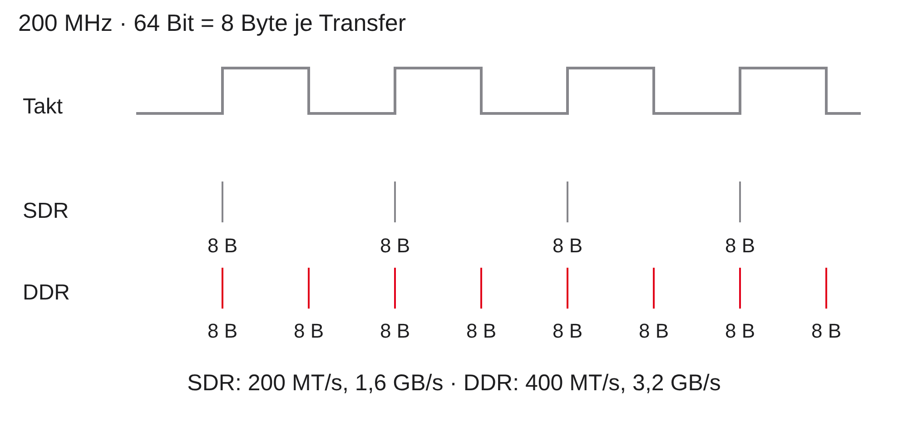{fig-alt="Modellvergleich bei 200 MHz externemTakt: SDR überträgt einmal jePeriode, DDR an beidenTaktflanken zweimal. Bei 64 Bit Datenbreite ergeben sich theoretisch 1,6 beziehungsweise 3,2 GB proSekunde."}

$200\,\mathrm{MHz}\cdot2\cdot8\,\mathrm{Byte}=3{,}2\,\mathrm{GB/s}$ als Spitzenrate.

::: notes
SDRAM steht für Synchronous Dynamic Random-Access Memory, also taktsynchronen dynamischen wahlfreien Speicher. Im dargestellten Vergleich überträgt SDR, Single Data Rate, einmal je Taktperiode. DDR, Double Data Rate, nutzt beide Taktflanken und überträgt zweimal je Periode. Taktfrequenz und Transferrate müssen deshalb mit unterschiedlichen Einheiten angegeben werden: MHz zählt Millionen Taktperioden pro Sekunde, MT/s Millionen Transfers pro Sekunde.

Das Lehrmodell setzt einen externen Takt von $200\,\mathrm{MHz}$ und einen Datenbus mit $64$ Bit voraus. Pro Transfer sind das acht Byte. Für SDR ergibt sich als theoretische Datenrate

$$200\cdot10^6\,\mathrm{s}^{-1}\cdot8\,\mathrm{Byte}=1{,}6\cdot10^9\,\mathrm{Byte/s}.$$

DDR erreicht $400\,\mathrm{MT/s}$ und damit

$$200\cdot10^6\,\mathrm{s}^{-1}\cdot2\cdot8\,\mathrm{Byte}=3{,}2\cdot10^9\,\mathrm{Byte/s}=3{,}2\,\mathrm{GB/s}.$$

GB ist hier dezimal mit $10^9$ Byte definiert. Die Grafik zeigt vier modellhafte Perioden; rote Markierungen heben die beiden Transferflanken hervor.

Diese Spitzenraten setzen eine lückenlose Nutzung voraus. Refresh, Befehlswechsel und andere Verluste bleiben in der Rechnung unberücksichtigt. Die doppelte Transferrate halbiert daher nicht automatisch die Latenz eines einzelnen Lesezugriffs und erhöht den externen Takt nicht auf $400\,\mathrm{MHz}$. Reale DDR-Generationen ergänzen interne Organisation und genaue Schnittstellenbedingungen. Für die Einordnung bleiben Takt, Transferrate und nutzbare Bandbreite getrennte Größen.
:::

## Papierphase 3: DRAM rechnen und ordnen

::: {.section-label}
4 / 5 · DRAM: Ladung und Organisation
:::

Übungsblatt, Aufgabe 4 · 15 Minuten

- Ladungserhaltung für hohe und niedrige Zelle anwenden
- Restore von Precharge unterscheiden
- Im vorgegebenen Modell Bank, Zeile, Spalte und Byte bilden

::: notes
Das neue DRAM-Lehrmodell verwendet $24\,\mathrm{fF}$ Zellkapazität, $240\,\mathrm{fF}$ Bitleitungskapazität und $0{,}5\,\mathrm{V}$ Vorladung. Femto steht für $10^{-15}$. Bei anfangs $1\,\mathrm{V}$ in der Zelle beträgt die Gesamtladung

$$24\,\mathrm{fF}\cdot1\,\mathrm{V}+240\,\mathrm{fF}\cdot0{,}5\,\mathrm{V}=144\,\mathrm{fC}.$$

Bei anfangs $0\,\mathrm{V}$ liefert nur die vorgeladene Bitleitung einen Ladungsbeitrag, insgesamt $120\,\mathrm{fC}$. Die gemeinsame Kapazität ist $264\,\mathrm{fF}$. Ladungserhaltung ergibt damit $0{,}54545\,\mathrm{V}$ beziehungsweise $0{,}45455\,\mathrm{V}$, jeweils gerundet. Der Abstand zum Referenzpegel beträgt etwa $\pm45{,}45\,\mathrm{mV}$.

Restore stellt den Zellwert bei noch hoher WL wieder her. Danach wird WL abgesenkt und trennt die Zelle ab; erst dann bringt Precharge BL zum mittleren Referenzpegel zurück. Lesen leert den Kondensator also nicht grundsätzlich: Im niedrigen Anfangszustand steigt seine Spannung durch die Ladungsteilung gerade an.

Das zweite Adressmodell umfasst

$$8\cdot64\cdot32\cdot4\,\mathrm{Byte}=65\,536\,\mathrm{Byte}=64\,\mathrm{KiB}.$$

Bank, Zeile, Spalte und Byte benötigen von hoch nach niedrig drei, sechs, fünf und zwei Bit. Bank fünf, Zeile elf, Spalte neunzehn und Byte zwei liefern

$$5\cdot8192+11\cdot128+19\cdot4+2=42\,446,$$

hexadezimal `0xA5CE`. Auch diese Feldaufteilung ist ausdrücklich eine Lehrannahme und keine universelle reale Bankabbildung. Nach Zellzugriff und Adressauswahl stehen nun die Organisation gültiger Firmwareobjekte und die Verwendung von Puffern im Mittelpunkt.
:::

## 5 · Speicherorganisation und Software {.section-divider}

Wie werden aus Speicherstellen gültige C-Objekte?

::: {.section-route}
Datenwege → Nichtflüchtige Speicher → SRAM → DRAM → Software
:::

::: notes
Die Zellphysik erklärt, wie ein Zustand erhalten und ausgelesen wird. Für ein Programm müssen zusätzlich Zugriffsmöglichkeiten, Reihenfolge und gültige Adressbereiche feststehen. Dual-Port-Speicher und FIFO-Puffer beantworten dabei andere Fragen als die Einteilung in SRAM, DRAM oder Flash.

Anschließend verbindet die Memory Map die ausgewählte Hardware mit numerischen Adressen. Ein vollständiger Zugriff muss im zulässigen Bereich liegen. Linkerabschnitte und Startcode beschreiben schließlich, wo C-Objekte abgelegt werden und wie ihre Anfangswerte entstehen. Damit lässt sich die Einstiegsbeobachtung erklären: Ein wieder vorhandener C-Anfangswert kann hergestellt worden sein, obwohl der vorherige Arbeitszustand das Abschalten nicht überstanden hat.
:::

## Dual-Port bezeichnet Zugriffsmöglichkeiten

::: {.section-label}
5 / 5 · Speicherorganisation und Software
:::

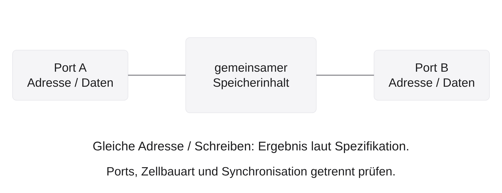{fig-alt="Dual-Port-RAM besitzt zwei Zugriffsinterfaces mit eigenen Adressen und Steuersignalen zum gemeinsamen Speicherinhalt. UnterschiedlicheAdresszugriffe können parallel unterstützt werden. Verhalten bei gleicherAdresse und Konflikten ist durch die jeweiligeSchnittstelle festgelegt."}

Zwei Ports ersetzen keine Regel für Konflikte oder unterschiedliche Takte.

::: notes
Dual-Port-RAM bietet zwei Zugriffsports zum gemeinsamen Speicherinhalt. Ein Port ist eine Schnittstelle aus Adress-, Daten- und Steuersignalen. Die Abbildung zeigt einen solchen Zugang auf jeder Seite. Je nach Baustein können unterschiedliche Adressen gleichzeitig bedient werden. Beide Ports greifen dabei auf denselben Inhalt zu; sie bilden keine zwei unabhängigen Datenkopien.

Die Bezeichnung True Dual Port wird häufig für zwei lesende und schreibende Ports verwendet. Simple Dual Port kann beispielsweise einen Schreibport und einen Leseport bezeichnen. Daraus lässt sich weder eine feste Zelltransistorzahl wie acht noch eine bestimmte Latenz ableiten. Ebenso wenig ist damit geklärt, was zwei gleichzeitige Schreibzugriffe auf dieselbe Adresse bewirken. Konfliktverhalten, der beim gleichzeitigen Schreiben gelesene Wert und zulässige Taktbedingungen müssen aus der konkreten Spezifikation hervorgehen.

Auch zwei unabhängig getaktete Ports lösen nicht automatisch die gesamte Kommunikation zwischen Taktdomänen. Steuerinformationen benötigen passende Synchronisation; diese Details werden später vertieft. Für die Einordnung genügt zunächst, die Eigenschaften auseinanderzuhalten: SRAM beschreibt das Zellprinzip und erklärt das Halten von Information, Dual-Port bezeichnet Zugriffsmöglichkeiten. FIFO, First In First Out, legt dagegen fest, dass zuerst eingelegte Elemente zuerst entnommen werden. Eine solche Reihenfolge kann auf unterschiedlichen Speicherstrukturen verwirklicht werden.
:::

## FIFO: Ringposition allein verrät nicht voll oder leer

::: {.section-label}
5 / 5 · Speicherorganisation und Software
:::

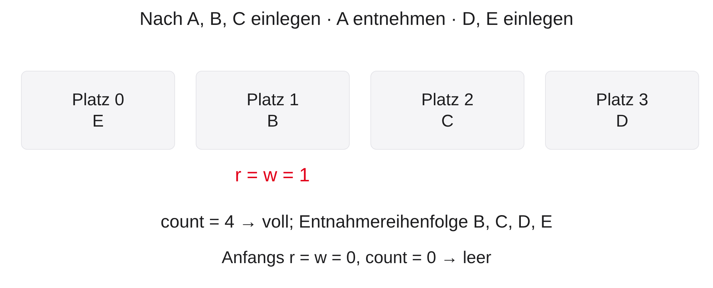{fig-alt="VierPlätze imRing und ein expliziter Belegungszähler. NachpushA, B, C, popA, pushD, E gilt r 1, w 1, count 4 und derPuffer istvoll. Der gleiche Positionsvergleich r=w kann imAnfangszustand mitcount 0 leer bedeuten."}

Vier nutzbare Plätze; `count` unterscheidet leer und voll.

::: notes
Ein Ringpuffer verwirklicht eine FIFO-Reihenfolge, indem er ein festes Array zyklisch nutzt. `r` bezeichnet die nächste Leseposition, `w` die nächste Schreibposition und `count` die Zahl belegter Plätze. Im Modell stehen vier vollständig nutzbare Plätze zur Verfügung; anfangs sind alle drei Werte null. Nach jeder erfolgreichen Operation wird der zugehörige Positionsindex modulo vier weitergeschaltet.

Das Einlegen von A, B und C führt zu $(r,w,\mathrm{count})=(0,3,3)$. Die folgende Entnahme liefert A und hinterlässt $(1,3,2)$. D wird in Platz drei geschrieben; `w` springt auf null und `count` steigt auf drei. E belegt anschließend Platz null. Nun gilt $(1,1,4)$, und die gültigen Inhalte werden in der Reihenfolge B, C, D, E entnommen. Die Grafik veranschaulicht diesen Zustand. Obwohl Lese- und Schreibindex gleich sind, ist der Puffer voll. Im Anfangszustand bedeuteten dieselben gleichen Indizes zusammen mit `count` null dagegen „leer“.

Ein weiterer Einlegeversuch mit F muss ohne Zustandsänderung scheitern. Erst nach der Entnahme von B ist wieder Platz. Wird dann F eingefügt, gilt $(2,2,4)$ mit der Reihenfolge C, D, E, F. Der explizite Belegungszähler unterscheidet hier voll und leer. Das optionale C-Programm prüft diese Regeln in einem einzigen Ausführungskontext. Für nebenläufige Zugriffe oder die Kommunikation über Taktdomänen enthält es keine Synchronisation.
:::

## Memory Map: Grenzen ausdrücklich angeben

::: {.section-label}
5 / 5 · Speicherorganisation und Software
:::

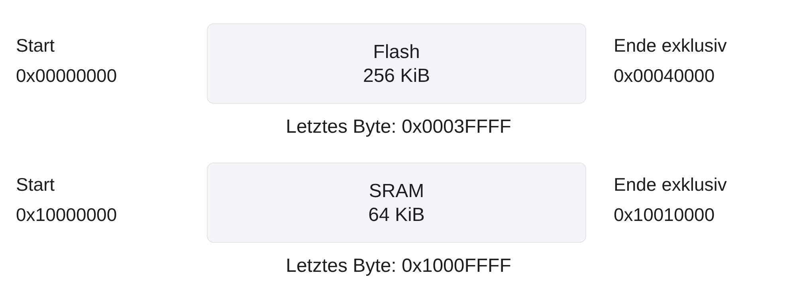{fig-alt="Frei gewählte byteadressierte MemoryMap: Flash beginnt bei 0 x 00000000 mit 256 KiB bis exklusiv 0 x 00040000. SRAM beginnt bei 0 x 10000000 mit 64 KiB bis exklusiv 0 x 10010000. Die letzten enthaltenenByteadressen sind 0 x 0003 FFFF beziehungsweise 0 x 1000 FFFF."}

Bereich $[\mathrm{Start},\mathrm{Ende})$: Ende ist die erste ausgeschlossene Adresse.

::: notes
Die Memory Map ordnet Adressbereiche einem Speicher oder Gerät zu. Die dargestellte Zuordnung ist ein frei gewähltes byteadressiertes Lehrmodell. Sie beschreibt weder eine zugesicherte Renode-Plattform noch ein allgemeines Gesetz der RISC-V-Befehlssatzfamilie. Der Befehlssatz legt die gezeigten Speicheradressen nicht fest.

Flash beginnt bei `0x00000000` und umfasst $256\,\mathrm{KiB}$. Mit $1\,\mathrm{KiB}=2^{10}\,\mathrm{Byte}$ ergibt sich `0x00040000` als erste ausgeschlossene Adresse. Die letzte enthaltene Byteadresse ist daher `0x0003FFFF`. Der SRAM-Bereich beginnt bei `0x10000000` und ist $64\,\mathrm{KiB}$ groß. Sein exklusives Ende liegt bei `0x10010000`, sein letztes Byte bei `0x1000FFFF`. Die Schreibweise $[\mathrm{Start},\mathrm{Ende})$ schließt den Start ein und das Ende aus. Die Balken veranschaulichen diese Bereichszuordnung; ihre Abstände sind im gesamten Adressraum nicht maßstäblich.

Da jede Adresse in diesem Modell ein Byte bezeichnet, beansprucht ein Wortzugriff mehrere aufeinanderfolgende Byteadressen. Sein Start kann noch im gültigen Bereich liegen, während spätere Bytes schon darüber hinausreichen. Für einen vollständigen Zugriff müssen deshalb alle benötigten Bytes enthalten sein. Zusätzlich können Zugriffsrechte, Ausrichtung und weitere Plattformregeln gelten. Eine Bereichsprüfung muss somit den gesamten Zugriff betrachten, bevor sich aus einer numerischen Adresse auf eine zulässige Operation schließen lässt.
:::

## Ein 32-Bit-Zugriff braucht vier gültige Byteadressen

::: {.section-label}
5 / 5 · Speicherorganisation und Software
:::

Lehrmodell: SRAM $[\mathtt{0x10000000},\mathtt{0x10010000})$.

| Startadresse | Vier Byte im Bereich? | Durch vier teilbar? |
|--------------|----------------------|--------------------|
| `0x1000FFFC` | ja, bis `0x1000FFFF` | ja |
| `0x1000FFFF` | nein | nein |
| `0x10010000` | nein | ja |

Die Prüfung erfolgt mit ganzen Zahlen; wir dereferenzieren diese Adressen nicht auf dem Host.

::: notes
Ein Zugriff auf `uint32_t`, einen vorzeichenlosen C-Ganzzahltyp mit exakt $32$ Bit, benötigt im Lehrmodell vier Byte zu jeweils acht Bit. Zusätzlich gilt hier eine Vier-Byte-Ausrichtungsregel: Die Startadresse muss durch vier teilbar sein. Diese Annahme ersetzt keine Prüfung der Zielplattform, denn reale Systeme können unausgerichtete Zugriffe unterschiedlich behandeln.

Beim SRAM-Bereich $[\mathtt{0x10000000},\mathtt{0x10010000})$ umfasst ein Zugriff ab `0x1000FFFC` genau die Byteadressen bis `0x1000FFFF`. Die Addition von vier zur Startadresse ergibt das exklusive Ende `0x10010000`; alle vier benötigten Bytes sind enthalten. Auch die Ausrichtung stimmt. `0x1000FFFF` wäre für sich noch eine gültige Byteadresse, reicht aber als Anfang eines Vier-Byte-Zugriffs über das Ende hinaus und ist außerdem unausgerichtet. `0x10010000` ist durch vier teilbar, liegt jedoch bereits außerhalb des Bereichs. Ausrichtung und vollständige Bereichsgültigkeit sind also getrennt zu prüfen.

Das optionale C-Programm behandelt die Modelladressen als ganze Zahlen und dereferenziert sie auf dem Host nicht. Eine subtraktive Längenprüfung vermeidet dabei, dass eine Adressaddition nahe der Ganzzahlgrenze überläuft. Selbst eine numerisch passende Adresse garantiert auf einem Entwicklungsrechner kein vorhandenes Objekt. Für die Ausführung müssen auch Objektexistenz, Lebensdauer, Zugriffsrechte und reale Hardwarezuordnung passen. Wie tatsächliche C-Objekte angeordnet und initialisiert werden, erklärt die Abschnittsaufteilung eines Firmware-Abbilds.
:::

## C-Objekte und typische Abschnitte

::: {.section-label}
5 / 5 · Speicherorganisation und Software
:::

```c
#include <stdint.h>
const uint32_t lookup[4] = {1, 2, 3, 4};
uint32_t counter = 3;
uint8_t buffer[16];
uint32_t read_snapshot(void) {
    return lookup[counter % 4] + buffer[0];
}
```

Typisches Modell: `.text` Code · `.rodata` Konstanten · `.data` Initialwerte · `.bss` Nullinitialisierung.

::: notes
Das vollständige C-Übersetzungsbeispiel bindet mit `stdint.h` Ganzzahltypen fester Breite ein. `uint32_t` ist vorzeichenlos und $32$ Bit breit, `uint8_t` acht Bit. Das globale Array `lookup` enthält die vier Werte eins bis vier. Sein `const`-Qualifizierer untersagt Änderungen des Objekts durch gewöhnliche C-Zuweisungen. Die globale Variable `counter` beginnt mit drei; das globale Array `buffer` enthält sechzehn Elemente und wird nach den C-Regeln vor Programmbeginn mit null initialisiert. Alle drei Objekte besitzen statische Speicherdauer.

`read_snapshot` gibt einen Tabellenwert plus das erste Pufferelement zurück. Der Restoperator `% 4` begrenzt den Tabellenindex auf null bis drei. Nach der Initialisierung ergibt `counter % 4` den Index drei: `lookup[3]` ist vier, `buffer[0]` null, die Rückgabe daher vier. Änderungen aus anderen Ausführungskontexten sind in diesem nicht nebenläufigen Beispiel nicht vorgesehen. Die Funktion bezieht alle Objekte ein und macht ihre Verwendung im Übersetzungsbeispiel nachvollziehbar.

Typische Werkzeugketten legen Maschinenbefehle in `.text`, schreibgeschützte Daten in `.rodata`, initialisierte veränderbare Daten in `.data` und vor Programmbeginn zu null gesetzte Daten in `.bss` ab. BSS heißt historisch Block Started by Symbol. Diese Namen sind Werkzeugkonventionen, keine Garantie des C-Standards. `const` erzwingt weder Flash noch einen physischen ROM. Optimierungen können Objekte verändern oder entfernen; Linkerskript und Zielplattform legen die endgültige Platzierung fest. Bei `.data` sind zudem dauerhaft gespeicherte Anfangswerte und laufzeitlich veränderbare Objekte zu unterscheiden.
:::

## .data hat ein Ladebild und eine Laufzeitadresse {.compact-figure}

::: {.section-label}
5 / 5 · Speicherorganisation und Software
:::

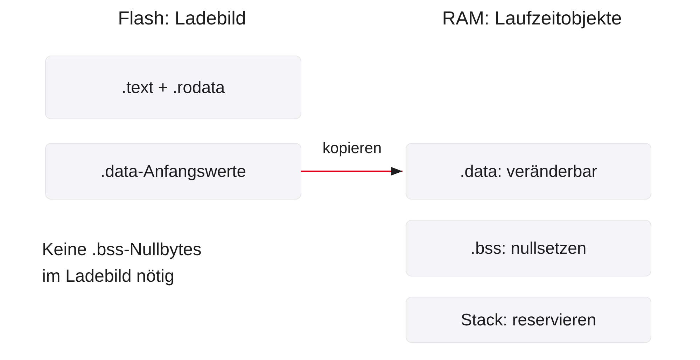{fig-alt="Flash enthält Code, Konstanten und die Anfangswerte für.data. RAM enthält die veränderbaren.data-Objekte sowie.bss undStack. Startcode kopiert die.data-Anfangswerte und setzt.bss aufnull. Das Abbild muss keine.bss-Nullbytes speichern."}

VMA: Laufzeitadresse · LMA: Adresse des Ladebilds.

::: notes
Ein initialisiertes veränderbares Objekt benötigt im typischen Firmwaremodell zwei Orte: einen für seinen dauerhaft gespeicherten Anfangswert und einen für seine Nutzung zur Laufzeit. Die vom Linker zugewiesene Laufzeitadresse eines Abschnitts heißt VMA, Virtual Memory Address. Hier verlangt diese Bezeichnung keine virtuelle Adressübersetzung. LMA, Load Memory Address, bezeichnet die Adresse des Ladebilds. Das Bare-Metal-Beispiel läuft ohne Betriebssystem, benötigt aber Startcode und Hardwareinitialisierung.

Das Ladebild von `.data` liegt im Flash. Die veränderbaren Laufzeitobjekte liegen dagegen im RAM. Vor dem Eintritt in die C-Anwendung kopiert der Startcode die Initialwerte vom Ladebild an die vorgesehenen Laufzeitadressen. Für `.bss` genügt es, den zugeordneten RAM-Bereich auf null zu setzen. Es müssen daher nicht für jedes Objekt Nullbytes im Flash-Abbild aufbewahrt werden. Der Stack, der unter anderem Aufrufverwaltung und automatische Objekte aufnimmt, wird getrennt reserviert.

Die Grafik zeigt den Kopierpfeil für `.data` und den Nullsetzbereich für `.bss`. Diese Vorgänge führt Startcode aus; sie geschehen nicht automatisch durch die Anordnung im Linker. `.text` und `.rodata` verbleiben im gezeigten Modell im Flash. Andere Systeme können auch Code in RAM kopieren. Platzierung und Initialisierung sind somit unterschiedliche Verantwortlichkeiten. Der Linker muss die Bereiche so beschreiben, dass der Startcode die vereinbarte C-Umgebung herstellen kann.
:::

## Startup stellt die vereinbarte C-Umgebung her {.compact-figure}

::: {.section-label}
5 / 5 · Speicherorganisation und Software
:::

{fig-alt="Vereinfachte Startfolge: Reset-Einstieg, nötige Prozessorinitialisierung und Stack, Kopieren der.data-Anfangswerte, Nullsetzen von.bss und anschließend main. Zusätzliche Plattforminitialisierung und Laufzeitfunktionen sind ausdrücklich zielabhängig."}

Der Linker berechnet Anordnung; der Startcode führt Initialisierung aus.

::: notes
Startup ist der Startcode, der nach dem Reset-Einstieg die benötigte Ausführungsumgebung herstellt. Reset bezeichnet den definierten Einstieg nach einem Rücksetzen. Die Einrichtung des Stacks und gegebenenfalls weiterer Prozessorregister hängt vom Ziel ab; der Stack nimmt unter anderem Aufrufinformationen und automatische Objekte auf. Die Grafik ordnet diese Schritte in einer vereinfachten Abhängigkeitsfolge. Sie ist kein vollständiger RISC-V-Startcode.

Sobald die nötigen Voraussetzungen bestehen, kopiert der Startcode die `.data`-Anfangswerte aus dem Ladebild zu den Laufzeitobjekten und setzt `.bss` auf null. Erst anschließend darf die Anwendung bei ihrem gewöhnlichen Einstieg `main` voraussetzen, dass `counter` drei enthält und die Elemente von `buffer` null sind. Der Linker stellt dafür typischerweise Bereichsgrenzen und Ladeadressen bereit. Er berechnet die Anordnung, führt aber beim Übersetzen keine Kopierschleife auf dem Ziel aus.

Das optionale Hostprogramm überprüft die Wirkung von Kopieren und Nullsetzen an gültigen lokalen Arrays. Die Bereiche überlappen nicht; ihre Längen sind vorgegeben. Dieses Modell prüft die Datenwirkung, keinen Reset-Vektor und keinen echten Gerätestart. Eine reale Plattform kann zusätzliche Speichercontroller, Takte oder Laufzeitmechanismen benötigen, bevor weitere Funktionen nutzbar sind. Die dargestellte Folge erklärt daher die Verantwortlichkeiten und Abhängigkeiten. Zu einer vollständig startfähigen Firmware gehören darüber hinaus die konkreten Plattformbedingungen.
:::

## Linkerskript: Regionen und Abschnitte zuordnen

::: {.section-label}
5 / 5 · Speicherorganisation und Software
:::

```ld
MEMORY {
  FLASH (rx) : ORIGIN = 0x00000000, LENGTH = 256K
  RAM  (rw) : ORIGIN = 0x10000000, LENGTH = 64K
}
SECTIONS {
  .text   : { *(.text*) }   > FLASH
  .rodata : { *(.rodata*) } > FLASH
  .data   : { *(.data*) }   > RAM AT> FLASH
  .bss (NOLOAD) : { *(.bss*) *(COMMON) } > RAM
}
```

Didaktischer GNU-ld-Ausschnitt; Startcode, Stack und weitere Abschnitte fehlen.

::: notes
Der Ausschnitt verwendet die Skriptsprache von GNU ld, dem Linker der GNU-Binutils-Werkzeuge; GNU steht für GNU's Not Unix. `MEMORY` definiert zwei Regionen mit Anfangsadresse `ORIGIN` und Länge `LENGTH`. Der Suffix `K` bedeutet hier einen Größenfaktor von $1024$. `FLASH` beginnt bei `0x00000000` und umfasst `256K`, `RAM` bei `0x10000000` mit `64K`. Die Attribute `rx` und `rw` bedeuten bei der Abschnittsauswahl lesbar/ausführbar beziehungsweise lesbar/beschreibbar. Sie programmieren keine Hardwareschutzrechte.

`SECTIONS` ordnet Eingabeabschnitte zu Ausgabeabschnitten. `*(.text*)` sammelt passende Codeabschnitte aller Eingabeobjekte; entsprechend werden mit `*(.rodata*)` die Konstantenabschnitte zusammengeführt. `.data` erhält durch `> RAM` seine Laufzeitadresse im RAM und durch `AT> FLASH` ein Ladebild im Flash. `.bss` wird mit `NOLOAD` als nicht zu ladender Bereich im RAM angeordnet. Der Startcode muss diesen Bereich dennoch nullsetzen. `COMMON` berücksichtigt gemeinsame uninitialisierte Symbole, sofern die Werkzeugkonfiguration solche erzeugt.

Für eine vollständige Firmwarekonfiguration fehlen unter anderem Einstieg, Ausrichtung, Startsymbole, Stackreservierung und weitere Zielabschnitte. Diese müssten zur konkreten Plattform passen. Das überprüfbare Host-Objektbeispiel zeigt typische Eingabeabschnitte; daraus folgt kein erfolgreicher Boot mit diesem Skript. Bei der Kapazitätsrechnung werden die `.data`-Initialwerte im Flash und die `.data`-Laufzeitobjekte im RAM jeweils an ihrer eigenen Stelle berücksichtigt.
:::

## Zellprinzip, Schnittstelle und Software zusammenführen

::: {.section-label}
5 / 5 · Speicherorganisation und Software
:::

| Ebene | Beispiel | Eigene Frage |
|-------|----------|--------------|
| Zelle | 6T-SRAM oder 1T1C-DRAM | Wie bleibt der Zustand erhalten? |
| Zugriff | Ein-Port, Dual-Port, Controller | Welche Zugriffe sind möglich? |
| Organisation | Zeile, FIFO, Adressbereich | Wie werden Inhalte ausgewählt? |
| Software | Abschnitte und Startup | Wo liegen Objekte, wie beginnen sie? |

Vorlesung 2 nutzt diese Grundlage für Lokalität und Caches.

::: notes
Vom Zellzustand bis zum Firmwareobjekt beantworten die betrachteten Ebenen unterschiedliche Fragen. Die klassische 6T-SRAM-Zelle hält ein Bit durch Rückkopplung. Die 1T1C-DRAM-Zelle speichert Ladung und benötigt Auswertung, Wiederherstellung und Refresh. Keines dieser Zellprinzipien legt für sich allein die vollständige Zugriffsschnittstelle fest.

Ein-Port und Dual-Port beschreiben, welche Zugriffe möglich sind. Ein Controller setzt die Anfragen in die jeweilige Speicherfunktion um. Die Organisation bestimmt wiederum die Auswahl und Reihenfolge: Eine Zeile verbindet gemeinsam ausgewählte Zellen, ein FIFO ordnet die Entnahme nach der Einlegereihenfolge und ein byteadressierter Bereich weist Zahlenadressen einem Speicher oder Gerät zu. Abschnitte wie `.data` und der zugehörige Startcode erklären schließlich, wo C-Objekte liegen und wie ihre Anfangswerte entstehen. Die Tabelle führt diese Beziehungen zusammen, ohne Zellbauart, Zugriff, Organisation und Softwarenutzung gleichzusetzen.

Auf dieser Grundlage lässt sich auch die Rolle eines Caches einordnen. Er hält Kopien von Inhalten, deren wiederholte oder benachbarte Nutzung Zugriffe beschleunigen kann. Dieses zeitliche beziehungsweise räumliche Nutzungsverhalten heißt Lokalität. Vorlesung 2 entwickelt daraus Treffer, Blöcke und Zuordnung; vorausgesetzt werden zunächst Kapazität, Adresse, Latenz und Bandbreite. Cacheformeln gehören deshalb noch nicht zur heutigen Pflichtübung. Die bisherige Trennung der Ebenen hilft, Systemaussagen zu prüfen und unzulässige Gleichsetzungen von Zellbauart, Nutzung und Organisation zu erkennen.
:::

## Papierphase 4 und Abschlussquiz

::: {.section-label}
5 / 5 · Speicherorganisation und Software
:::

Aufgaben 5–6: 15 Minuten · Quiz: 15 Minuten

- Vollständige Zugriffe und Speicherbedarf prüfen
- Ladebild, Laufzeitobjekt und Nullinitialisierung unterscheiden
- FIFO-Zustände erklären; anschließend Antworten begründen

::: notes
Im Datenlogger-Modell endet Flash exklusiv bei `0x00240000`, SRAM bei `0x21018000`. Die letzten enthaltenen Bytes liegen jeweils eine Adresse davor. Ein Vier-Byte-Zugriff ab `0x21017FFC` passt vollständig in den SRAM-Bereich und ist ausgerichtet. Ab `0x21017FFF` fehlen sowohl der Platz für den vollständigen Zugriff als auch die Ausrichtung. `0x21018000` liegt bereits außerhalb.

Für den Speicherbedarf zählen auch die zusätzlich gespeicherten Initialwerte: Code, Konstanten und `.data`-Ladebild benötigen $36+6+0{,}5=42{,}5\,\mathrm{KiB}$ Flash. Veränderbare Initialdaten, Nullbereich und Stack beanspruchen $0{,}5+8+3=11{,}5\,\mathrm{KiB}$ SRAM. Frei bleiben $213{,}5\,\mathrm{KiB}$ Flash und $84{,}5\,\mathrm{KiB}$ SRAM. Der Linker legt die Bereiche fest; Startcode kopiert die Initialwerte und nullt die Nullbereiche. `const` allein legt keinen physischen Flashort fest.

Der FIFO mit fünf Plätzen durchläuft als $(r,w,\mathrm{count})$ die Zustände $(0,1,1)$, $(0,2,2)$, $(0,3,3)$, $(0,4,4)$, nach Entnahme von K $(1,4,3)$, anschließend $(1,0,4)$ und $(1,1,5)$. Die gültigen Elemente sind L, M, N, P, Q in dieser Reihenfolge. R wird ohne Zustandsänderung abgewiesen. Gleiche Lese- und Schreibindizes kennzeichnen je nach Belegungszahl einen leeren oder vollen Puffer. Das Programmbild braucht dauerhaften Speicher, die häufig veränderten Zwischensummen passen zu SRAM.

Die zehn Transferfragen des Quiz haben jeweils genau eine richtige Antwort. Ihre Begründung ergibt sich aus den Modellannahmen, etwa der Trennung von Restore und Precharge oder von `const` und physischer Platzierung. Die vollständigen Übungslösungen stehen im Lösungsprofil. Die Aufgabenwerte unterscheiden sich bewusst von den vorgeführten Rechnungen.
:::

## Was Sie jetzt erklären können

::: {.section-label}
5 / 5 · Speicherorganisation und Software
:::

- Flash ändern: Bits, Löschbereich und Zugriffsweg beachten
- SRAM und DRAM: Halten, Lesen und Wiederherstellen unterscheiden
- Kapazität, Datenrate und Adressgrenzen nachvollziehbar rechnen
- Firmware: Anordnung und Initialisierung auseinanderhalten

Zum Einstieg: Flash bewahrt Code; Startup stellt C-Anfangswerte im RAM her.

::: {.source-note}
Literatur: Harris & Harris, *Digital Design and Computer Architecture — RISC-V Edition*; vertiefend Patterson & Hennessy, *Computer Organization and Design — RISC-V Edition*.
:::

::: notes
Die Frage „Was bleibt nach dem Ausschalten?“ lässt sich nun für den betrachteten Mikrocontroller mit Flash und SRAM beantworten. Flash bewahrt das Firmware-Abbild einschließlich der `.data`-Anfangswerte ohne laufende Versorgung. Für den veränderten SRAM-Arbeitszustand besteht diese dauerhafte Erhaltung nicht. Nach erneutem Einschalten kann die Firmware deshalb wieder starten. Im vereinbarten Startup kopiert der Startcode die `.data`-Anfangswerte aus Flash in den Arbeitsspeicher und setzt `.bss` auf null. Eine initialisierte C-Variable erhält so wieder ihren Startwert, statt den zuletzt veränderten Laufzeitwert fortzusetzen. Das gilt für diese Startfolge; ein Reset allein ist kein Ausschalten und setzt keinen Spannungsverlust des SRAM voraus.

Nichtflüchtigkeit, wahlfreier Zugriff und Softwareverwendung bleiben unabhängige Eigenschaften. Flashänderungen verlangen passende Programmier- und Löschverfahren; XIP erfordert einen ausführbaren Leseweg des gesamten Systems. Der Name NOR allein garantiert ihn nicht. SRAM hält in der klassischen 6T-Zelle durch zwei kreuzgekoppelte Inverter ohne periodischen Refresh. Beim 1T1C-DRAM verändert Lesen die gespeicherte Ladung und ihren Abstand zum Referenzpegel. Verstärken und Restore stellen den Zustand wieder her; nach Trennung der Zelle bereitet Precharge die Bitleitung vor. Refresh erhält Inhalte unter den spezifizierten Bedingungen.

Memory Map, Abschnittszuordnung und Startup verbinden Hardware, Linker und Startcode. Harris und Harris, *Digital Design and Computer Architecture — RISC-V Edition*, tragen die digitale und transistornahe Erklärung; Patterson und Hennessy, *Computer Organization and Design — RISC-V Edition*, vertiefen Rechnerorganisation und Speicherhierarchie. Zahlen und Schaltungen bleiben Lehrmodelle, keine Messungen konkreter Chips. Übungsblatt, Musterlösung und Quiz verwenden dieselben Voraussetzungen und bereiten damit Lokalität und Caches in Vorlesung 2 vor.
:::
