## Willkommen zu Mikrocomputertechnik 3

- Vom Rechenkern zum System aus Speicher, Verbindungen und Peripherie
- Heute: wie ein Bit gehalten, gelesen und verändert wird
- Danach: wie Software diese Speicherbereiche nutzt
- Roter Faden: Zelle → Zugriff → Organisation → Adresse

::: notes
Mikrocomputertechnik 3, kurz MCT3, verbindet die bekannten Grundideen eines Rechners mit seinem Gesamtsystem. Eine CPU, Central Processing Unit, ist der Prozessor, der Befehle ausführt. Speicher hält diese Befehle und die verarbeiteten Daten. Peripherie sind zusätzliche Funktionen wie Sensoranschlüsse oder Timer. Ein System-on-Chip, SoC, integriert viele solcher Funktionen in einem Chip; großer zusätzlicher Speicher kann trotzdem außerhalb liegen.

Die erste Vorlesung führt vom physikalischen Speicherzustand zu den Adressen der Firmware, der gerätenahen Software. Sie setzt keine Kenntnisse aus den späteren MCT3-Vorlesungen voraus. Benötigte Grundlagen aus MCT1/2 werden gleich benannt und kurz wiederholt. Ein konkreter Controller oder ein Datenblatt ist für die Pflichtübung nicht erforderlich.

Der Kurs behandelt danach Caches, Unterbrechungen und Timer, Aktorik, serielle Verbindungen, ausgelagerte Transfers, interne Prozessorparallelität, neuronale Beschleuniger und mehrere Kerne. Diese Themen werden heute nicht als bekannt vorausgesetzt. Entscheidend ist zunächst, warum verschiedene Speicherbauarten gebraucht werden und wie Zellphysik, Zugriffsschnittstelle und Softwarezuordnung zusammenpassen. Folien und Notizen bilden gemeinsam das Skript; die Papieraufgaben verlangen eigene nachvollziehbare Skizzen und Rechnungen.
:::

## Das benötigen wir aus MCT1/2

- Binäre Werte, Byte und hexadezimale Adressen
- Logisches NOT und einfache Rückkopplung
- Spannung, Kondensator und gesteuerter Schalter als Grundideen
- C-Arrays und Zeiger; die Beispiele werden hier erklärt

::: notes
MCT1/2 bedeutet Mikrocomputertechnik 1 und 2, die vorausgehenden Module. Ein Bit hat zwei logische Werte, null und eins. Ein Byte umfasst acht Bit. Hexadezimal ist eine Schreibweise zur Basis sechzehn; eine Ziffer entspricht vier Bit. Die Schreibweise `0x` kennzeichnet in C einen Hexadezimalwert. Ein NOT oder Inverter vertauscht logisch null und eins. Die folgenden Schaltbilder stellen digitale Funktionen dar, obwohl reale Knoten analoge Spannungen besitzen.

Ein Kondensator kann elektrische Ladung speichern. Ein Transistor wird hier zunächst als durch einen Steueranschluss freigegebener oder gesperrter Pfad betrachtet. Das ist eine qualitative Modellidee, keine vollständige Halbleiterkennlinie. Unterschiede zwischen zwei Transistorarten werden vor ihrer Verwendung erläutert. Sie müssen keine Prozessparameter oder Transistordimensionierung auswendig kennen.

Ein C-Array ist eine Folge von Elementen; ein Zeiger bezeichnet deren Adresse. Typ und gültiger Speicherbereich begrenzen einen Zugriff. Beim Lesen der Beispiele werden Datentyp, Lebensdauer und Adressbreite genannt. Details zu Caches, Interruptcontrollern oder atomaren Operationen gehören erst in spätere Vorlesungen. Wenn diese vier Grundlagen bekannt sind, können Sie den Aufbau von Bitzelle über Datenpfad bis zum Linker verfolgen. Der Linker ist das Werkzeug, das übersetzte Programmteile zu einer ausführbaren Anordnung verbindet.
:::

## Vier Schulstunden: Lernweg und Arbeitsphasen

| Stunde | Erklärung und Besprechung | Arbeitsphase |
|--------|---------------------------|--------------|
| 1 | System, Größen und Flash: 35 min | Aufgaben 1–2: 10 min |
| 2 | Inverter, 6T-SRAM, Lesen und Schreiben: 30 min | Aufgabe 3: 15 min |
| 3 | DRAM, Ladungsteilung und Organisation: 30 min | Aufgabe 4: 15 min |
| 4 | Puffer, Memory Map und Startup: 15 min | Aufgaben 5–6: 15 min; Quiz: 15 min |

::: notes
Vier Schulstunden ergeben hundertachtzig Minuten ohne zusätzliche Pausen. Der Plan enthält hundertzehn Minuten Erklärung, Denkfragen und Lösungsbesprechung, fünfundfünfzig Minuten angeleitete Papierarbeit sowie fünfzehn Minuten Quiz. Fünfzig Folien teilen den Stoff in Schritte; die Schaltungs- und Ladungsbilder brauchen mehr gemeinsame Betrachtung als die kurzen Orientierungen.

SRAM bedeutet Static Random-Access Memory, statischer wahlfreier Speicher. 6T bezeichnet seine klassische Zelle mit sechs Transistoren. DRAM heißt Dynamic Random-Access Memory, dynamischer wahlfreier Speicher. Die Unterschiede werden vollständig entwickelt. Eine Memory Map ist die Zuordnung von Adressbereichen zu Speicher oder Geräten. Startup ist die Initialisierung nach dem Start der Firmware.

Sie sollen Speicherarten begründet auswählen, eine SRAM-Lese- und Schreibfolge erklären, DRAM-Ladungsteilung berechnen sowie Adressgrenzen und Initialisierung auseinanderhalten können. Die Pflichtübungen sind auf Papier lösbar. Ihr längerer Zeitrichtwert gilt für vollständige selbstständige Bearbeitung. Das optionale Hostprogramm, ein Programm auf dem Entwicklungsrechner, ergänzt geprüfte Zahlen- und Pufferbeispiele. Es simuliert keine analogen Zellströme und setzt keine spätere MCT3-Plattform voraus.
:::

## Werkzeuge: Übersetzen, platzieren, ausführen

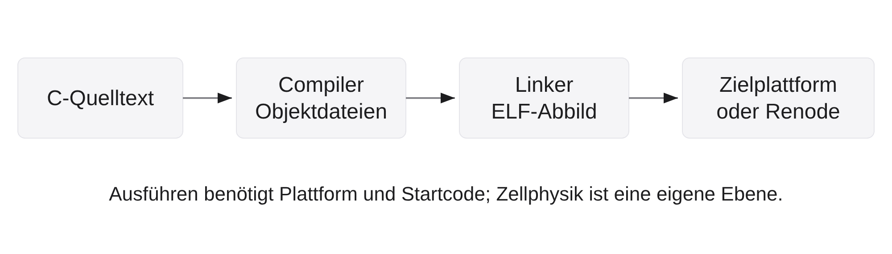{fig-alt="C-Quelltext wird übersetzt, Objektdateien werden gelinkt und eine ELF-Datei entsteht. Eine Zielplattform oder Renode verwendet diese Datei; funktionale Ausführung und Zellphysik sind unterschiedliche Ebenen."}

Das ausführbare Beispiel dieses Blatts nutzt den Host; RISC-V GCC und Renode sind Zielwerkzeuge.

::: notes
GCC bedeutet GNU Compiler Collection, eine Sammlung von Compilern. GNU ist der Name des freien Softwaresystems, ausgeschrieben GNU's Not Unix. Ein Compiler übersetzt C, ein Assembler Maschinenbefehlsnotation, und ein Linker verbindet Objektdateien und ordnet Abschnitte an. ELF, Executable and Linkable Format, ist ein verbreitetes Dateiformat für diese Ergebnisse. Die Grafik zeigt die Werkzeugfolge, keine bereits ausgeführte Geräteinitialisierung.

RISC-V ist die im Kurs verwendete Befehlssatzfamilie; RISC steht für Reduced Instruction Set Computer. Eine RISC-V-Toolchain übersetzt für dieses Ziel. Renode ist der im Modul vorgesehene Systemsimulator für Prozessor, Speicher und Peripherie. Er benötigt eine konkrete Plattformbeschreibung und passende Firmware. Ein funktional richtiges Simulatorergebnis ist ohne weiteres Modell keine Messung von Transistorströmen oder Zelllatenzen.

Bare-Metal bedeutet Software ohne Betriebssystem, aber mit Startcode und nötiger Hardwareinitialisierung. Unser optionales C-Programm wird dagegen mit dem vorhandenen Host-GCC übersetzt. Es prüft logische Flashregeln, Adressgrenzen, Initialisierungsdaten und einen Puffer. Es dereferenziert keine erfundenen Geräteadressen. So erhalten Sie einen ausführbaren Versuch, während die physikalischen Abbildungen als ausdrücklich benannte Lehrmodelle behandelt werden.
:::

## Im SoC müssen Datenwege zusammenpassen

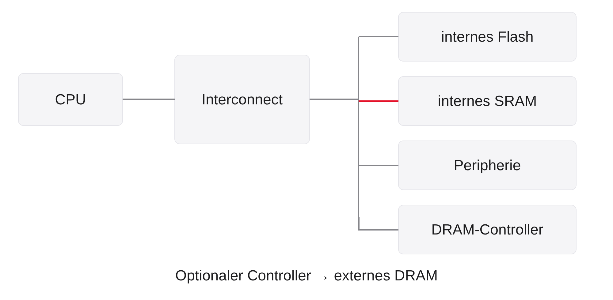{fig-alt="Ein Prozessor erreicht internes Flash, SRAM und Geräte über einen Interconnect. Ein DRAM-Controller kann zusätzlich externes DRAM anbinden. Nicht jeder Mikrocontroller braucht dieses externe Bauteil."}

Rechenkern, Speicherbaustein und Zugriffsweg sind verschiedene Bestandteile.

::: notes
SoC bedeutet System-on-Chip, integriertes System auf einem Chip; CPU Central Processing Unit, Prozessor. Ein Interconnect ist die Verbindung für Adressen, Daten und Steuerung. Ein Controller übersetzt Anfragen in die passende Speicher- oder Geräteschnittstelle. Die Abbildung zeigt einen Prozessor mit internem Flash, SRAM und Peripherie sowie einen optionalen externen DRAM-Pfad.

SRAM heißt Static Random-Access Memory, DRAM Dynamic Random-Access Memory. Flash ist elektrisch programmierbarer nichtflüchtiger Speicher. Ein kleiner Mikrocontroller kann allein mit Flash und SRAM arbeiten. Ein größeres System kann für hohe Kapazität zusätzlich DRAM über einen Controller benutzen. SoC heißt daher nicht, dass sämtlicher Hauptspeicher auf demselben Die, dem Halbleiterstück, gefertigt sein muss.

Die grauen Leitungen zeigen mögliche Zugriffswege. Rot hebt den Speicherpfad hervor, nicht eine gemessene Geschwindigkeit. Ein Register im Prozessor, eine Bitzelle im Speicher und ein Peripherieregister am Bus sind unterschiedliche Strukturen. Welcher Weg benutzt wird, entscheidet unter anderem die Adresszuordnung. Bevor wir diese Zuordnung verfolgen, müssen Größen und Einheiten stimmen: Eine Kapazität in Byte ist noch keine Anzahl von Transistoren und keine Zugriffsdauer.
:::

## Bytezahl, Bitzahl und Zellbauteile

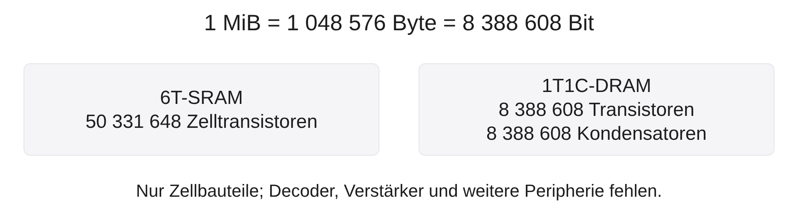{fig-alt="Ein MiB enthält 1 048 576 Byte und 8 388 608 Bit. Klassisches 6 T-SRAM benötigt 50 331 648 Zelltransistoren, 1 T 1 C-DRAM je 8 388 608 Transistoren und Kondensatoren. Peripherie ist nicht gezählt."}

$1\,\mathrm{MiB}=2^{20}\,\mathrm{Byte}$; $1\,\mathrm{MB}=10^6\,\mathrm{Byte}$.

::: notes
MiB bedeutet Mebibyte, eine binäre Größe von $2^{20}$ Byte. MB ist ein dezimales Megabyte mit $10^6$ Byte. Ein Byte besitzt acht Bit. Diese Einheiten sind nicht gleich und dürfen in Kapazitätsrechnungen nicht stillschweigend vertauscht werden.

Ein MiB enthält $1\,048\,576$ Byte beziehungsweise $8\,388\,608$ Bit. Eine klassische 6T-SRAM-Zelle, Static Random-Access Memory mit sechs Transistoren pro Bit, benötigt dafür $6\cdot8\,388\,608=50\,331\,648$ Zelltransistoren. Ein klassisches 1T1C-DRAM, Dynamic Random-Access Memory mit einem Transistor und einem Kondensator pro Bit, enthält $8\,388\,608$ Zelltransistoren und genauso viele Kondensatoren. Die Abbildung stellt diese Zellzählung nebeneinander.

Decoder, Auswahlleitungen, Verstärker, Redundanz und weitere Peripherie fehlen in dieser Rechnung. Auch Transistorgrößen und Kondensatorgeometrie unterscheiden sich. Aus der Bauteilzahl folgt deshalb weder direkt die Chipfläche noch eine Leistungsaufnahme oder Geschwindigkeit. Die Zahlen motivieren unterschiedliche Zellkonzepte; ihre Funktionsweise wird später erklärt. Zunächst kann selbst ein passender Speicher durch einen begrenzten gemeinsamen Zugriffsweg zum Engpass werden.
:::

## Gemeinsamer Adressraum ist nicht ein einziger Port

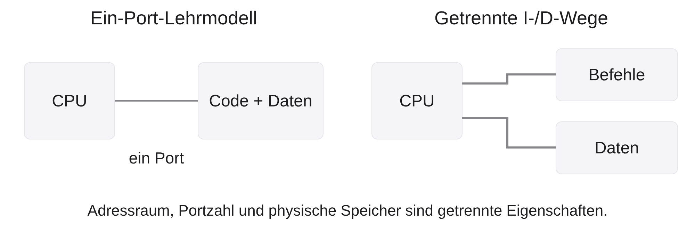{fig-alt="Ein gemeinsamer Port bedient Code und Daten. Daneben sind getrennte Befehls- und Datenwege dargestellt. Adressraum und Portzahl sind verschiedene Eigenschaften."}

Das einfache Ein-Port-Modell kann Fetch und Datenzugriff nicht gleichzeitig bedienen.

::: notes
Fetch bedeutet Holen eines Maschinenbefehls. Ein Load liest Daten, ein Store schreibt sie. Das klassische Von-Neumann-Konzept verwendet einen gemeinsamen Speicher für Befehle und Daten. Im einfachen linken Modell teilen beide zusätzlich einen physischen Zugriffport; dieser bedient nur eine Anfrage zugleich. Das kann einen Ressourcenkonflikt erzeugen, den Von-Neumann-Flaschenhals.

Harvard bezeichnet getrennte Befehls- und Datenspeicher mit getrennten Zugriffswegen. I steht in der Grafik für Instructions, Befehle, D für Data, Daten. Das rechte Schema kann unter seinen Modellannahmen beide Anfragen unabhängig versorgen. Ein modifiziertes System kann ebenfalls nahe Pfade trennen und darunter wieder gemeinsamen Speicher verwenden; diese zusätzliche Variante ist hier nicht separat gezeichnet. Ein Cache ist eine nahe Kopie ausgewählter Speicherblöcke. Getrennte Befehls- und Datencaches werden in Vorlesung 2 genauer behandelt.

Die Leitungen zeigen Verbindungen, keine Pipelinezyklen. Ein gemeinsamer Adressraum beschreibt die aus Software sichtbare Auswahl von Adressen. Er erzwingt nicht einen einzigen physischen Port. Deshalb ist die Aussage, jede CPU, Central Processing Unit, mit Von-Neumann-Sicht könne grundsätzlich nie parallel lesen, zu weit. Umgekehrt beseitigen zwei Wege nicht jede Wartezeit. Für den nächsten Vergleich unterscheiden wir Dauer einer Anfrage von der langfristig übertragenen Datenmenge.
:::

## Latenz und Bandbreite messen Verschiedenes

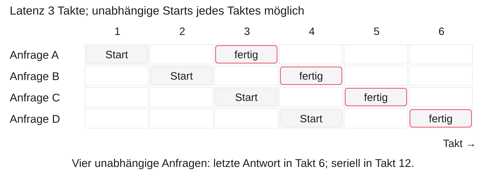{fig-alt="Vier unabhängige Anfragen mit Modelllatenz 3 Zeitschritten können seriell nach 3,6,9,12 oder mit Startabstand 1 nach 3,4,5,6 enden. Die einzelne Latenz bleibt 3."}

Memory Wall: benötigte Daten können die Rechnung begrenzen.

::: notes
Latenz ist die Dauer vom Beginn einer Anfrage bis zu ihrem Ergebnis. Bandbreite ist die übertragbare Datenmenge pro Zeit. Die Memory Wall, Speichergrenze, beschreibt die Situation, dass Datenversorgung die nutzbare Rechenrate begrenzt. Daraus folgt nicht, dass jeder Speicherzugriff dieselbe lange Wartezeit besitzt.

Die waagerechte Achse des Bildes zeigt abstrakte Zeitschritte. Vier unabhängige Anfragen benötigen jeweils drei Schritte. Ohne Überlappung enden sie nach drei, sechs, neun und zwölf. Wenn das Modell einen neuen Start je Schritt erlaubt, starten sie in eins bis vier und enden am Schluss von drei bis sechs. Die einzelne Latenz bleibt drei, der Abschluss aller vier rückt vor. Rot markiert Ergebnisereignisse. Es sind Lehrzeiten, keine Speicher- oder Prozessormessung.

Auch dieses Überlappen verlangt unabhängige Anfragen und passende Ressourcen. Eine Rechnung, die erst den vorigen Wert benötigt, kann nicht beliebig früh weiterfragen. Ebenso bietet eine Leitung keine unbegrenzte Datenrate. Ein schneller kleiner Speicher nahe am Prozessor kann viele Zugriffe bedienen und ein großer langsamer Speicher mehr Daten halten. Diese Kombination führt zur Hierarchie, ohne die verschiedenen Zelltechnologien gleichzusetzen.
:::

## Hierarchie: mehrere Speicher für mehrere Aufgaben

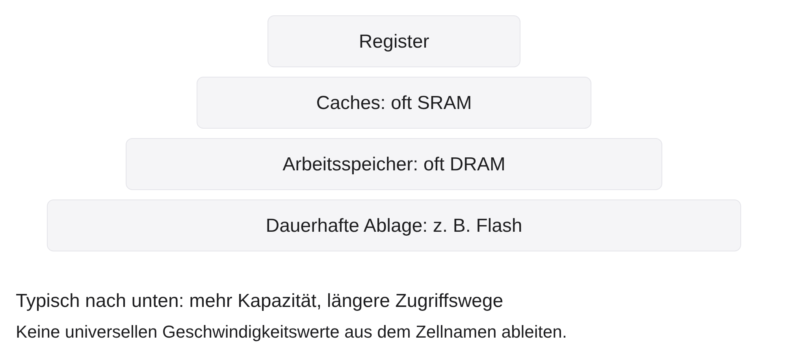{fig-alt="Register, nahe Cachekopien, Arbeitsspeicher und nichtflüchtiger Speicher stehen auf verschiedenen Ebenen. Nähe und Kapazität unterscheiden sich; Rolle und Zelltechnologie sind nicht dasselbe."}

Ein Cache ist eine Rolle; SRAM ist eine Zelltechnologie.

::: notes
Eine Speicherhierarchie kombiniert Bereiche mit unterschiedlicher Nähe, Kapazität und Zugriffskosten. Register sind kleine direkt im Rechenkern benutzte Arbeitsplätze. Ein Cache hält nahe Kopien ausgewählter Blöcke. Arbeitsspeicher enthält laufende Daten und gegebenenfalls Programme. Nichtflüchtiger Speicher bewahrt Inhalte über das Abschalten hinaus.

SRAM bedeutet Static Random-Access Memory, DRAM Dynamic Random-Access Memory. Caches werden häufig mit SRAM gebaut, großer Hauptspeicher häufig mit DRAM. Eine kleinere Mikrocontrolleranwendung kann ihren gesamten Arbeitsspeicher als SRAM haben. Ein Registerfile, Sammlung von Registern, muss nicht aus derselben klassischen 6T-Zelle wie ein Datencache bestehen. Die Abbildung zeigt daher Rollen und typische Beziehungen, keine verbindlichen Zellbauarten für jede Ebene.

Die vertikale Reihenfolge zeigt die Entfernung vom Rechenkern. Die breiteren unteren Flächen veranschaulichen mögliche größere Kapazität, keine maßstäbliche Chipfläche oder allgemeine Geschwindigkeitszahl. Ein Cache benötigt später Regeln zur Auswahl und Gültigkeit seiner Kopien; das ist Gegenstand von Vorlesung 2. Heute prüfen wir zunächst, welche Speicher Information ohne Versorgung bewahren und wie ihr Zugriff organisiert ist. Diese Klassifikationen sind unabhängig voneinander.
:::

## Flüchtig und wahlfrei sind unabhängige Eigenschaften

| Eigenschaft | Bedeutung | Beispiel |
|-------------|-----------|----------|
| volatil | dauerhafter Erhalt benötigt Versorgung | SRAM, DRAM |
| nichtflüchtig | Erhalt ohne laufende Versorgung spezifiziert | Flash, ROM |
| wahlfrei lesbar | gewünschte Stelle gezielt auswählen | SRAM, speicherabbildbares NOR |
| seitenorientiert | Anfrage verarbeitet größere Einheit | rohes NAND |

`volatile` in C ist keine Bezeichnung der Zellphysik.

::: notes
Volatil oder flüchtig beschreibt, dass ein Speicher seine Information ohne Versorgung nicht dauerhaft erhalten kann. SRAM, Static Random-Access Memory, und DRAM, Dynamic Random-Access Memory, sind flüchtig. Nichtflüchtiger Speicher besitzt spezifizierte Datenerhaltung ohne laufende Versorgung, beispielsweise Flash oder ROM, Read-Only Memory. Daraus folgt keine unbegrenzte Lebensdauer und kein zwingend augenblickliches Nullwerden flüchtiger Zellen nach Abschalten.

Random Access, wahlfreier Zugriff, beschreibt das gezielte Auswählen einer Stelle. Es ist unabhängig vom Datenerhalt. Ein speicherabbildbarer NOR-Flashpfad kann wahlfreies Lesen anbieten und ist trotzdem nichtflüchtig. NOR und NAND sind Namen von Flash-Zellorganisationen, abgeleitet von NOT-OR beziehungsweise NOT-AND. Rohes NAND verarbeitet Seiten und Löschblöcke, ist aber kein Magnetband mit ausschließlich streng sequenzieller Auswahl.

Das C-Schlüsselwort `volatile` betrifft den Zugriff nach Sprach- und Compilervertrag, beispielsweise auf Geräteobjekte. Es verwandelt weder Flash in flüchtigen Speicher noch SRAM in dauerhaften Speicher. Auch Schreiben und Löschen können andere Granularität als Lesen besitzen. Die nächsten Folien vergleichen deshalb Lesezugriff, Veränderung und Erhalt getrennt, statt alle Technologien auf einer einzigen Skala einzuordnen.
:::

## ROM-Familie: Lesen und Ändern getrennt betrachten

{fig-alt="Mask-ROM wird bei Fertigung festgelegt, PROM einmal programmiert, EPROM mit UV gelöscht, EEPROM elektrisch in kleinen Einheiten verändert und Flash elektrisch in größeren Blöcken gelöscht."}

Nichtflüchtig bedeutet nicht unveränderbar.

::: notes
ROM heißt Read-Only Memory, Festwertspeicher. Mask-ROM wird bei der Herstellung festgelegt. PROM, Programmable ROM, ist nachträglich einmal programmierbar. EPROM, Erasable Programmable ROM, kann bei der klassischen Fensterbauform mit ultraviolettem Licht gelöscht werden. EEPROM heißt Electrically Erasable Programmable ROM: Änderungen erfolgen elektrisch und in vergleichsweise kleinen Einheiten. Flash ist eine elektrisch programmierbare Familie mit Löschen größerer Sektoren oder Blöcke.

Die Grafik stellt diese Änderungsverfahren nebeneinander. UV bedeutet ultraviolett; die Kennzeichnung ist nur beim entsprechenden historischen EPROM-Verfahren relevant. Die Zell- und Schnittstellenvarianten unterscheiden sich auch innerhalb einer Familie. Eine allgemein gültige Bytezahl für jeden Löschbereich ist daraus nicht abzulesen.

Firmware kann nach Herstellung aktualisierbar sein und trotzdem über das Abschalten erhalten bleiben. Häufig veränderte Messwerte stellen andere Anforderungen als selten aktualisierter Programmcode. Nichtflüchtigkeit beantwortet die Erhaltungsfrage; Programmierbarkeit und Löschgranularität beantworten die Änderungsfrage. In einem verbreiteten Flash-Zellmodell wird Ladung in einer isolierten Struktur gehalten. Die nächste Abbildung zeigt, wie diese Ladung das auslesbare Transistorverhalten verändert.
:::

## Floating Gate: Ladung verändert die Schwellspannung

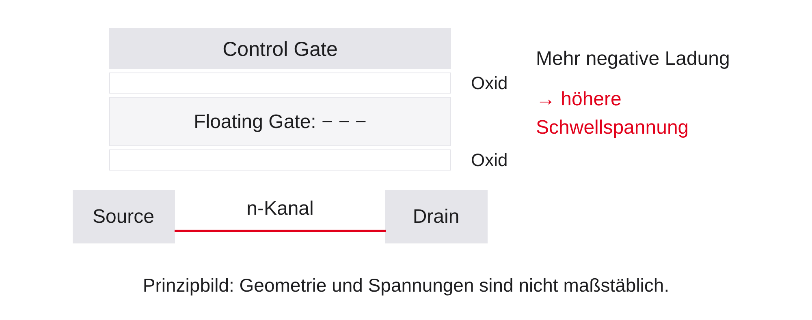{fig-alt="Schematischer Querschnitt mit Control Gate, isoliertem Floating Gate zwischen Oxidschichten sowie Source, Drain und n-Kanal. Mehr negative Gate-Ladung erhöht die Schwellspannung."}

Beispiel einer Flash-Zelltechnik; Charge-Trap-Flash verwendet eine andere Speicherstruktur.

::: notes
Ein Floating Gate ist ein elektrisch isoliertes leitendes Gate, das Ladung behalten kann. Das Control Gate steuert den Transistor von außen. Source und Drain begrenzen den leitfähigen Kanal. Oxid ist das isolierende Material zwischen den Strukturen. Die Abbildung ist ein schematischer Querschnitt, keine Prozesszeichnung mit realen Schichtdicken.

Im gewählten n-Kanal-Modell erhöht zusätzliche negative Ladung am Floating Gate die Schwellspannung: die Steuerspannung, ab der ausreichende Leitung einsetzt. Beim Lesen wird unter geeigneter Steuerspannung die Leitung beziehungsweise deren Unterschied ausgewertet. Rot hebt den Kanal und die Folge der Ladungsänderung hervor, keinen gemessenen Strom. Es wird kein Draht direkt zum isolierten Gate angeschlossen und kein Zähler einzelner Elektronen von der CPU, Central Processing Unit, gelesen.

Programmieren und Löschen verändern die Ladung mit vom Baustein erzeugten Bedingungen. Mehrere unterscheidbare Schwellbereiche können auch mehrere Bits je Zelle ermöglichen; hier betrachten wir nur ein binäres Lehrmodell. Nicht jede Flashtechnologie verwendet ein leitendes Floating Gate. Charge Trap, Ladungsfangstruktur, ist ein anderes Prinzip. Die gemeinsame Softwarefrage bleibt, welche Bitänderungen nach einem Löschvorgang zulässig sind und welche größere Einheit erneut gelöscht werden muss.
:::

## Flash-Modell: Programmieren ist kein beliebiger Store

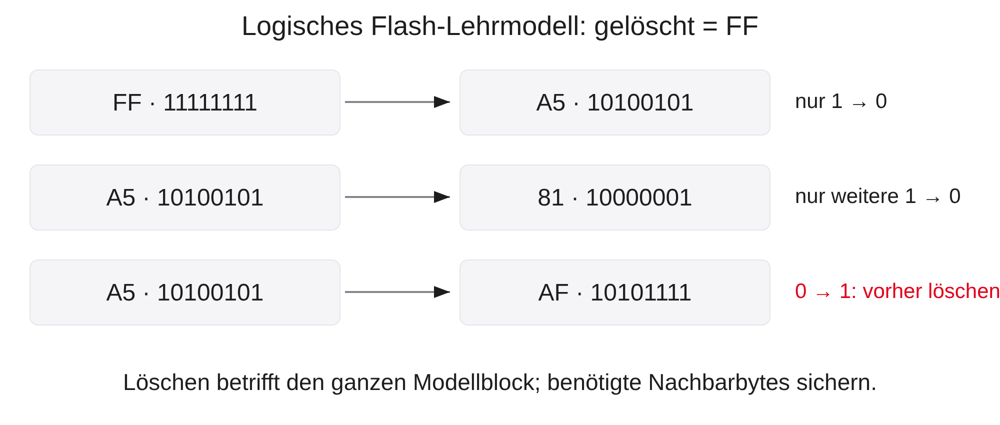{fig-alt="FF nach A 5 und A 5 nach 81 setzen nur Einsen auf null. A 5 nach AF benötigt null nach eins und damit vorheriges Löschen des ganzen Modellblocks."}

Gelöscht $=1$; Programmieren setzt ausgewählte Bits von $1$ nach $0$.

::: notes
Die dargestellte Eins-Kodierung des gelöschten Zustands ist ein binäres Flash-Lehrmodell, keine Aussage über jede Mehrbitkodierung. Ein Byte `0xFF` besteht aus acht Einsen. `0xA5` ist binär $10100101$. Programmieren setzt die nötigen Einsen auf null. Ein anschließendes `0x81`, $10000001$, verlangt nur weitere Eins-nach-null-Änderungen und ist in diesem Modell zulässig.

Von A5 zu AF, $10101111$, müssten dagegen bisherige Nullen zu Einsen werden. Dafür ist vor erneutem Programmieren ein Erase, Löschen, nötig. Dieser wirkt auf einen größeren Block, nicht nur das gewünschte Byte. Das Bild zeigt zwei erlaubte Bitänderungen und eine Änderung mit Löschbedarf. Der Hinweis darunter erinnert an die Rücksetzung des ganzen Modellblocks auf FF. Ein weiterer Datenwert im selben Block muss erhalten oder nach dem Löschen neu programmiert werden, wenn er weiter gelten soll.

Das Modell prüft logische Bitrichtungen. Reale Bausteine können zusätzliche Einschränkungen bei Programmierbreite, mehrfacher Teilprogrammierung, Reihenfolge und Timing verlangen. Ein gewöhnlicher CPU-Store, Speicherwrite des Prozessors, CPU ausgeschrieben Central Processing Unit, ersetzt ihre Controllersequenz nicht. Ob ein unzulässiger Zugriff abgewiesen wird, einen Fehler auslöst oder anders behandelt wird, ist plattformspezifisch. Die Pflichtaufgabe verlangt deshalb die Bitprüfung und Blockerhaltung, keine erfundene Geräteprogrammierung.
:::

## NOR und NAND: Zellanordnung und Schnittstelle

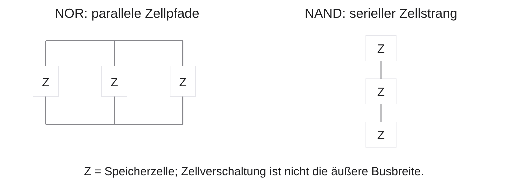{fig-alt="NOR zeigt parallele Zellpfade, NAND einen seriellen Zellstrang. Z bezeichnet eine Speicherzelle. Die äußere Schnittstelle wird nicht dargestellt."}

Page, Löschblock und CPU-Lesewort sind verschiedene Größen.

::: notes
NOR bedeutet NOT-OR, NAND NOT-AND. Die Namen beziehen sich auf die Anordnung der Flashzellen: eher parallele Strompfade bei NOR, seriell angeordnete Zellen in einer Kette, einem String, bei NAND. Die Grafik zeigt nur diese Verschaltungsidee. Z steht für eine Speicherzelle; eine äußere Zugriffsschnittstelle ist nicht gezeichnet. Sie zeichnet keine vollständige reale Auswahl- und Ausleseschaltung.

Ein typischer NOR-Leseweg kann ein gezielt angefordertes Byte oder Wort liefern und einen speicherabbildbaren Codepfad ermöglichen. Rohes NAND liest eine Page, Seite, in einen internen Puffer. Aus diesem werden Daten über die Schnittstelle ausgegeben. Programmier- und Löschgranularität sind davon nochmals zu trennen: Eine Page ist nicht automatisch ein Erase-Block. Dichte und Kosten hängen auch von Prozess und Zelltechnik ab.

Serielle Zellverkettung bedeutet nicht zwingend serieller Außenbus, und parallele Zellpfade bedeuten nicht zwingend paralleler Gehäusebus. Serielles NOR kann über einen geeigneten Controller trotzdem speicherabbildbar sein. NAND ist nicht bloß ein sequentielles Band, bietet aber gewöhnlich keinen direkten CPU-Fetch aus rohen Zellen. CPU heißt Central Processing Unit, Fetch Befehl holen. Der nächste Schritt erklärt die dafür nötige Systembedingung.
:::

## XIP braucht einen ausführbaren Leseweg

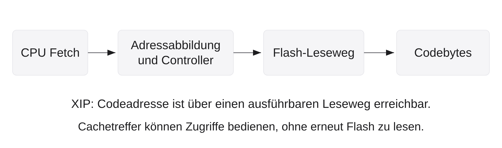{fig-alt="Der Befehlsweg führt von CPU Fetch über Adressabbildung und Controller zum Flash-Leseweg und Codebytes. Execute-in-Place erfordert einen ausführbaren speicherabbildbaren Pfad."}

Execute-in-Place ist eine Systemfähigkeit, kein Nachweis aus dem Namen NOR allein.

::: notes
XIP bedeutet Execute-in-Place, Ausführen am vorhandenen Speicherort. Programmcode wird aus einer dafür speicherabbildbaren Region geholt, ohne ihn zuvor vollständig in den Arbeitsspeicher zu kopieren. RAM steht für Random-Access Memory, wahlfreier Arbeitsspeicher; CPU für Central Processing Unit. Fetch ist der Abruf eines Maschinenbefehls.

Das Bild folgt dem Befehlsweg vom Prozessor über Adressabbildung und Controller zum Flash-Leseweg und den Codebytes. NOR bedeutet NOT-OR, NAND NOT-AND; die Namen beschreiben die Zellverschaltung. Im System können zusätzlich nahe Caches oder Prefetchpuffer vorhanden sein, die das vereinfachte Bild nicht separat zeichnet. Ein Cache ist eine Kopie ausgewählter Blöcke, Prefetch das vorsorgliche Vorholen. Ein Treffer kann daher einen Befehl liefern, ohne bei jedem Abruf erneut die physische Flashschnittstelle zu benutzen. Bei seriellem NOR muss ein Controller den passenden Speicherzugriff anbieten.

XIP setzt außerdem eine ausführbare Region und die Plattformbedingungen voraus. Es garantiert weder SRAM-ähnliche Latenz noch denselben Aufwand an jeder Adresse. SRAM heißt Static Random-Access Memory. Rohes NAND ist seitenorientiert; daraus verwendeter Code wird typischerweise in ausführbaren RAM geladen oder durch weitere Controllertechnik vermittelt. NOR als Zellname allein beweist deshalb keine vollständige Ausführungsfähigkeit. Die nächste Frage betrifft statt Lesen die wiederholte Veränderung nichtflüchtiger Daten.
:::

## Verschleiß verteilen, nicht abschaffen

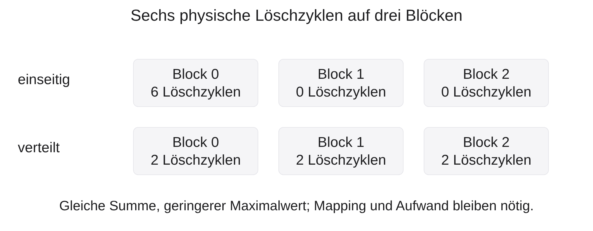{fig-alt="Sechs angenommene physische Löschzyklen landen ohne Verteilung im selben Block. Verteilt über drei Blöcke entstehen im vereinfachten Beispiel je zwei Zyklen. Logische Datenadresse und physischer Ort können verschieden sein."}

Wear Leveling braucht eine Zuordnung und freie nutzbare Bereiche.

::: notes
Wear Leveling bedeutet Verschleißausgleich. Programmieren und Löschen belasten die Speicherstruktur. Endurance bezeichnet die spezifizierte Belastbarkeit bei solchen Zyklen, Retention den Datenerhalt. Beides hängt vom Baustein und Betriebsbedingungen ab. Es gibt keine universelle Zahl zulässiger Änderungen für jeden Flash.

Die Grafik nimmt ausdrücklich sechs physische Löschzyklen und drei gleich nutzbare Blöcke an. Ohne Verteilung erhält der erste sechs, die anderen null. Bei idealer Verteilung erhält jeder zwei. Diese Rechnung beschreibt keine sechs beliebigen Hostwrites: Ein Softwareupdate kann gepuffert werden, mehrere Änderungen zusammenfassen oder zusätzliche physische Arbeiten verursachen. Die Zahlen in den Blockfeldern zeigen die lokale Belastung; ihr Maximalwert sinkt bei Verteilung.

Ein FTL, Flash Translation Layer, bildet logische Adressen auf physische Speicherorte ab. Das Schreiben an neuer Stelle, Zurückgewinnen freier Blöcke und Verschleißausgleich sind verschiedene Aufgaben. Ein kleiner Mikrocontroller kann statt eines vollständigen Massenspeicher-FTL ein passendes Journalverfahren benötigen. Schreibverteilung beseitigt den Verschleiß nicht und erfordert eigene Konsistenzregeln. Selten veränderter Code und oft geänderte Betriebsdaten sind deshalb unterschiedliche Auswahlfälle, auch wenn beide dauerhaft erhalten bleiben sollen.
:::

## Speicher nach Nutzung auswählen

| Nutzung | Erste Auswahlfrage |
|---------|--------------------|
| Firmware über Abschalten bewahren | nichtflüchtig und passender Code-Leseweg? |
| Häufig veränderte Zwischensummen | beschreibbarer Arbeitsspeicher ausreichend? |
| Selten geänderte Konfiguration | passendes Update- und Löschverfahren? |
| Große Datenmenge | Kapazität, Zugriff und Controller passend? |

„Code“ und „Daten“ sind Nutzungen, keine Zellbauarten.

::: notes
Firmware ist die gerätenahe Software. Eine Zwischensumme wird während der Rechnung immer wieder geändert, eine Konfiguration enthält beispielsweise dauerhaft gespeicherte Geräteeinstellungen. Die Tabelle fragt zunächst nach benötigten Eigenschaften, statt aus einem Softwarewort automatisch eine Zelltechnologie abzuleiten.

Für dauerhaft vorhandenen Code kann ein nichtflüchtiger Speicher mit passendem Ausführungsweg sinnvoll sein. XIP, Execute-in-Place, verlangt dafür einen geeigneten speicherabbildbaren Fetchpfad, also einen Weg zum Holen von Maschinenbefehlen. Häufig geänderte Laufzeitdaten gehören gewöhnlich in RAM, Random-Access Memory. Eine Konfiguration in Flash braucht dagegen ein Updateverfahren, das seine Löschgranularität und Belastbarkeit beachtet. Andere Designs können Programmbilder zuerst nach RAM laden und dort ausführen.

Die Kapazität, Controllerunterstützung, Datenrate und Lebensdauer einer Anwendung wirken zusammen. Ein Datenobjekt kann unverändert sein und dennoch als Daten gelesen werden; das macht seinen Zugriff nicht zum Befehlsholen. Die Speicherentscheidung ist also eine Systementscheidung. Die folgende Papierphase prüft die heute bereits erklärten Unterschiede zwischen gemeinsamem Port, Bytezahl, Bitänderung und XIP. Danach öffnen wir die SRAM-Zelle für häufiges Lesen und Schreiben.
:::

## Papierphase 1: Größen, Wege und Flashbits

Übungsblatt, Aufgaben 1–2 · 10 Minuten

- Byte- und Bitzahlen sowie Zellbauteile getrennt zählen
- Ein-Port-Konflikt vom gemeinsamen Adressraum unterscheiden
- Flashänderung und vollständigen Löschbereich prüfen

::: notes
Die Papieraufgaben übertragen die Folienmethoden auf einen Messwertpuffer und einen neuen Konfigurationsblock. Ein KiB, Kibibyte, enthält $1024$ Byte. Damit ergeben $768\cdot1024=786432$ Byte insgesamt $6291456$ Bit. Klassisches 6T-SRAM, Static Random-Access Memory mit sechs Zelltransistoren je Bit, benötigt $37748736$ Zelltransistoren. Beim 1T1C-DRAM, Dynamic Random-Access Memory mit einem Transistor und einem Kondensator je Bit, sind es jeweils $6291456$. Peripherie und Bauteilgeometrie fehlen; die Zählung ist keine genaue Flächenrechnung. Ein gemeinsamer Port kann die beiden gleichzeitigen Anfragen nicht zugleich bedienen.

Im logischen Flashmodell ist FF gelöscht. C6 entspricht binär 11000110, 84 ist 10000100 und CE ist 11001110. C6 nach 84 braucht nur Eins-nach-null-Änderungen; C6 nach CE erfordert Löschen. Das weiterhin benötigte Nachbarbyte 5A muss gesichert und wieder programmiert werden. Zwölf physische Löschzyklen bleiben insgesamt zwölf; Verteilung auf vier Blöcke senkt die größte Belastung von zwölf auf drei.

XIP, Execute-in-Place, benötigt einen ausführbaren speicherabbildbaren Leseweg mit passendem Controller und Zugriffsrechten. NOR, NOT-OR als Name der Zellverschaltung, allein garantiert diesen Weg nicht. Die Rechnungen modellieren keine realen Controllerbefehle oder Stromausfallfestigkeit. Die folgende Zellbetrachtung erklärt häufige Änderungen ohne Flash-Löschblock.
:::

## Ein Inverter macht aus null eins

::: {.content-visible when-format="html"}
{fig-alt="Ein rechteckiges IEC-Invertersymbol mit Kennzeichnung 1 und Negationskreis am Ausgang. Eingang 0 ergibt Ausgang 1, Eingang 1 ergibt Ausgang 0." style="max-height: 420px;"}
:::

::: {.content-visible when-format="pdf"}
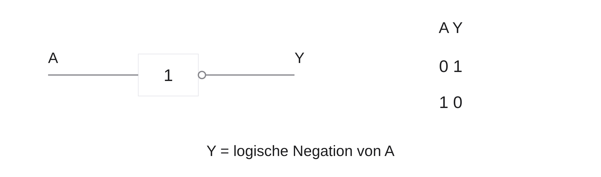{fig-alt="Ein rechteckiges IEC-Invertersymbol mit Kennzeichnung 1 und Negationskreis am Ausgang. Eingang 0 ergibt Ausgang 1, Eingang 1 ergibt Ausgang 0." style="max-height: 420px;"}
:::

Logische Werte stehen für Spannungsbereiche, nicht für einzelne Elektronen.

::: notes
Ein Inverter oder NOT-Gatter bildet die logische Negation. Sein Eingang heißt hier $A$, sein Ausgang $Y$; die Funktion lautet $Y=\neg A$. Bei Eingang null entsteht Ausgang eins und umgekehrt. Das rechteckige Symbol mit einer Eins beschreibt die Durchleitung, der kleine Kreis am Ausgang deren Negation. Es ist die europäische IEC-Darstellung; IEC steht für International Electrotechnical Commission, internationale Normungsorganisation für Elektrotechnik.

Die grau gezeichneten Leitungen führen Signale. Die Wahrheitstabelle daneben nennt beide möglichen digitalen Fälle. Ein logischer Wert eins bedeutet in unserer positiven Logik einen hohen, null einen niedrigen zulässigen Spannungsbereich. Reale Schaltungen haben außerdem Übergänge, Verstärkung, Verzögerungen und Störabstände. Wir benutzen zunächst das digitale Modell, ohne diese Größen zu berechnen.

Ein einzelner Inverter speichert noch keinen unabhängig gehaltenen Wert: Sein Ausgang folgt dem Eingang. Verbinden wir jedoch zwei Inverter rückwärts miteinander, kann der Ausgang des zweiten den Eingang des ersten bestimmen. Diese Rückkopplung liefert die Grundidee der statischen Bitzelle. Entscheidend ist dabei, dass beide Inverter ihre logische Funktion gleichzeitig erfüllen können.
:::

## Rückkopplung hält zwei mögliche Zustände

::: {.content-visible when-format="html"}
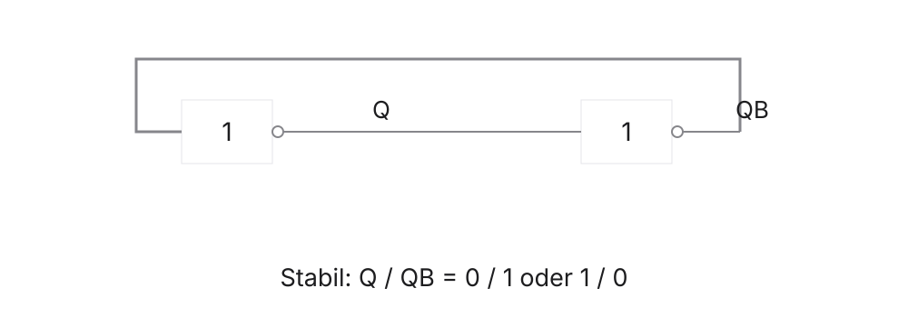{fig-alt="Zwei rechteckige Inverter sind über getrennte orthogonale Leitungen kreuzgekoppelt. Der AusgangQ des linken steuert rechts, der AusgangQB des rechten steuert links. Stabile digitale Paare sind 0/1 und 1/0." style="max-height: 420px;"}
:::

::: {.content-visible when-format="pdf"}
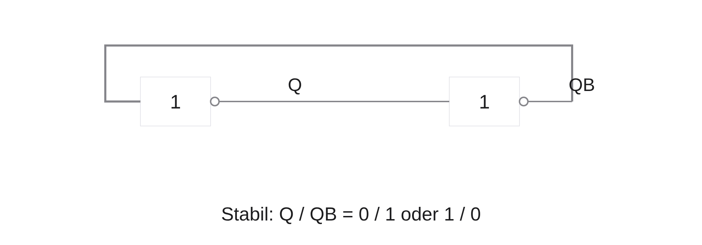{fig-alt="Zwei rechteckige Inverter sind über getrennte orthogonale Leitungen kreuzgekoppelt. Der AusgangQ des linken steuert rechts, der AusgangQB des rechten steuert links. Stabile digitale Paare sind 0/1 und 1/0." style="max-height: 420px;"}
:::

$Q=\neg Q_B$ und $Q_B=\neg Q$.

::: notes
Die beiden Inverter sind kreuzgekoppelt: Der Ausgang des linken steuert den rechten, dessen Ausgang wiederum den linken. $Q$ und $Q_B$ benennen zwei innere Signalknoten. Der Index B steht hier für den komplementären Knoten, nicht für eine zusätzliche Bytezahl. In einem stabilen digitalen Zustand tragen sie entgegengesetzte Werte.

Prüfen Sie zuerst $Q=0$ und $Q_B=1$: Links liegt eins am Eingang und null am Ausgang, rechts null am Eingang und eins am Ausgang. Beide Inverterbedingungen sind erfüllt. Für $Q=1$ und $Q_B=0$ gilt dieselbe Prüfung mit vertauschten Werten. Die Paare null/null und eins/eins erfüllen die Inverterbedingungen nicht gleichzeitig und sind keine stabilen digitalen Speicherzustände dieses Modells.

Die Abbildung zeigt zwei getrennte Rückkopplungswege. Die Leitungen dürfen die beiden Ausgänge nicht elektrisch kurzschließen. Reale Rückkopplungen können beim Umschalten oder unter ungünstigen Anfangsbedingungen analoge Zwischenzustände besitzen; das einfache Wahrheitsmodell beschreibt deren Dauer und Stabilität nicht. Für einen nutzbaren Speicher müssen wir außerdem gezielt lesen und schreiben können. Dazu betrachten wir zunächst die Transistoren eines Inverters und ergänzen danach die Zugriffspfade.
:::

## Ein CMOS-Inverter braucht zwei Transistoren

::: {.content-visible when-format="html"}
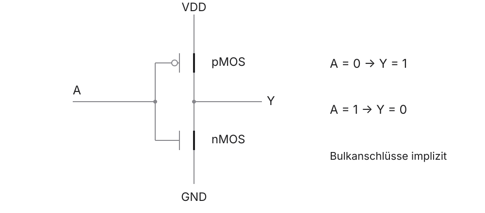{fig-alt="Ein pMOS verbindet bei Eingang 0 den Ausgang mit VDD. Ein nMOS verbindet bei Eingang 1 den Ausgang mit Masse. Beide Gates erhalten denselben Eingang, ihre Drainanschlüsse bilden den Ausgang." style="max-height: 420px;"}
:::

::: {.content-visible when-format="pdf"}
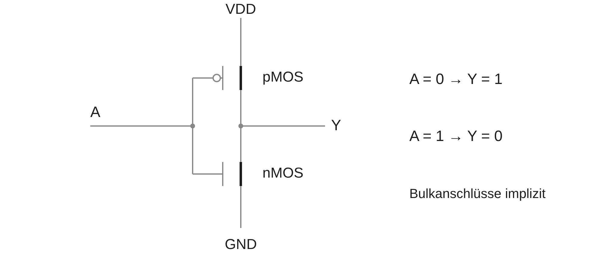{fig-alt="Ein pMOS verbindet bei Eingang 0 den Ausgang mit VDD. Ein nMOS verbindet bei Eingang 1 den Ausgang mit Masse. Beide Gates erhalten denselben Eingang, ihre Drainanschlüsse bilden den Ausgang." style="max-height: 420px;"}
:::

Eingang 0: oberer Pfad leitet · Eingang 1: unterer Pfad leitet.

::: notes
CMOS bedeutet Complementary Metal-Oxide-Semiconductor, komplementäre Metall-Oxid-Halbleitertechnik. Ein MOS-Transistor besitzt Gate als Steueranschluss und Source sowie Drain als Anschlüsse des leitenden Pfads. Der obere pMOS ist ein p-Kanal-MOS-Transistor, der untere nMOS ein n-Kanal-MOS-Transistor. Im hier verwendeten qualitativen Modell leitet der pMOS bei niedrigem Gatepegel, der nMOS bei hohem Gatepegel. Der Kreis am pMOS-Gate kennzeichnet die invertierte Steuerwirkung.

VDD bezeichnet die positive Versorgung, GND Ground beziehungsweise Masse als Bezugspotential. Beide Gates erhalten Eingang $A$. Die verbundenen Drainanschlüsse bilden Ausgang $Y$. Bei $A=0$ verbindet der obere Transistor den Ausgang mit VDD und der untere ist gesperrt: $Y=1$. Bei $A=1$ ist der obere gesperrt, der untere verbindet den Ausgang mit Masse: $Y=0$.

Das Bild lässt die Substratanschlüsse weg; angenommen sind die üblichen Versorgungspotentiale. Es ist kein Modell für Schaltschwellen, Strom oder Verzögerung. Auch CMOS verbraucht real Energie beim Umschalten und durch Leckströme. Zwei solche Inverter brauchen vier Transistoren. Mit zwei weiteren gesteuerten Zugriffstransistoren entsteht die klassische 6T-SRAM-Zelle.
:::

## 6T-SRAM: Halten und Zugriff

::: {.content-visible when-format="html"}
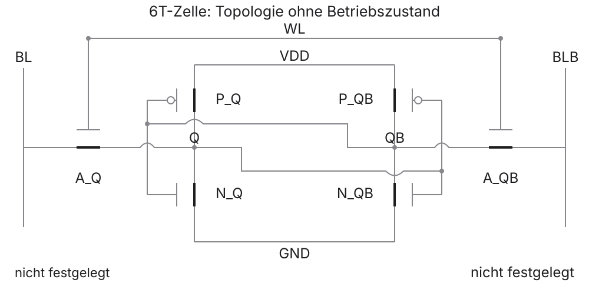{fig-alt="Elektrische 6 T-SRAM-Topologie: zwei kreuzgekoppelte CMOS-Inverter und zwei nMOS-Zugriffstransistoren. WL steuert beide Zugriffstransistoren, BL und BLB führen zuQ undQB. Brücken markieren nicht verbundene Leitungskreuzungen." style="max-height: 420px;"}
:::

::: {.content-visible when-format="pdf"}
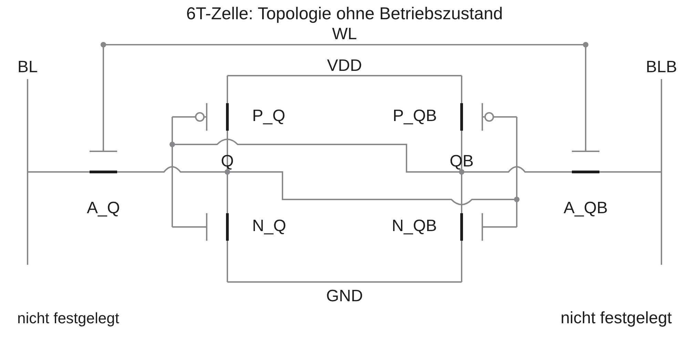{fig-alt="Elektrische 6 T-SRAM-Topologie: zwei kreuzgekoppelte CMOS-Inverter und zwei nMOS-Zugriffstransistoren. WL steuert beide Zugriffstransistoren, BL und BLB führen zuQ undQB. Brücken markieren nicht verbundene Leitungskreuzungen." style="max-height: 420px;"}
:::

WL: Word Line · BL / BLB: komplementäre Bit Lines.

::: notes
SRAM heißt Static Random-Access Memory, statischer wahlfreier Speicher. 6T bezeichnet sechs Transistoren pro klassischer Bitzelle. P_Q und N_Q bilden den linken CMOS-Inverter, P_QB und N_QB den rechten; CMOS bedeutet Complementary Metal-Oxide-Semiconductor. P benennt einen p-Kanal-MOS-Transistor, N einen n-Kanal-MOS-Transistor. A_Q und A_QB sind die zwei nMOS-Zugriffstransistoren. MOS steht für Metal-Oxide-Semiconductor.

Die Word Line WL, Wortleitung, steuert die beiden Zugriffsgates gemeinsam. Die Bit Lines BL und BLB, Bitleitungen, verbinden die Zelle mit der Lese- und Schreibperipherie. Q und QB sind innere komplementäre Speicherknoten; VDD Versorgung und GND Masse. Die Rückkopplung führt QB zu beiden linken Gates und Q zu beiden rechten Gates. Kleine Leitungssprünge markieren Kreuzungen ohne Verbindung, Punkte dagegen elektrische Verbindungen. Würden die Rückkopplungen hier versehentlich verbunden, wäre die Speicherfunktion zerstört.

Bei niedriger WL trennen die Zugriffstransistoren die Knoten von den Bitleitungen. Hohe WL ermöglicht Zugriff, garantiert aber nicht automatisch einen bestimmten Strom oder eine ideale Spannungsübertragung. Decoder, Vorladung, Leseverstärker und Schreibtreiber liegen außerhalb der sechs Zelltransistoren. Diese Peripherie wird in den folgenden Bildern als Randbedingung genannt, statt zur Zelle gezählt.
:::

## Halten: WL trennt die Zelle vom Zugriff

::: {.content-visible when-format="html"}
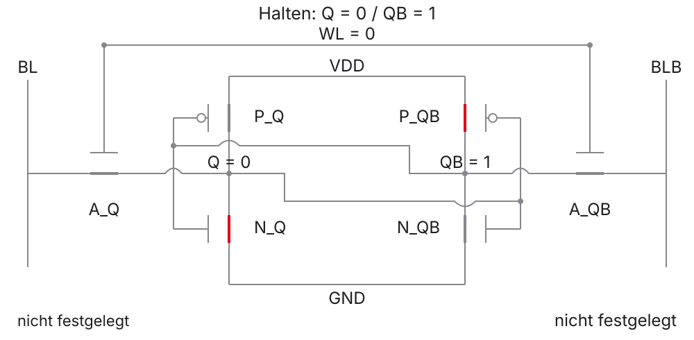{fig-alt="SRAM-HaltezustandQ 0 undQB 1 bei WL 0. P_Q undN_QB sperren, N_Q undP_QB leiten. Die Zugriffstransistoren sind gesperrt und die Bitleitungswerte sind für diesen Zustand nicht festgelegt." style="max-height: 420px;"}
:::

::: {.content-visible when-format="pdf"}
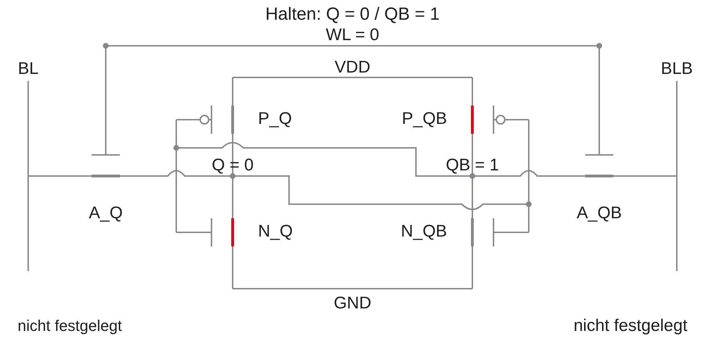{fig-alt="SRAM-HaltezustandQ 0 undQB 1 bei WL 0. P_Q undN_QB sperren, N_Q undP_QB leiten. Die Zugriffstransistoren sind gesperrt und die Bitleitungswerte sind für diesen Zustand nicht festgelegt." style="max-height: 420px;"}
:::

Versorgung vorhanden: $Q=0$, $Q_B=1$ bleibt durch Rückkopplung stabil.

::: notes
SRAM, Static Random-Access Memory, hält den hier gezeigten Zustand durch zwei kreuzgekoppelte Inverter. WL bedeutet Word Line, Wortleitung, und ist niedrig. Die beiden nMOS-Zugriffstransistoren sind deshalb gesperrt. BL und BLB, Bit Lines beziehungsweise Bitleitungen, müssen für diese isolierte Haltephase keine bestimmten Werte besitzen.

Q ist null, QB eins. QB steuert links: Der pMOS P_Q sperrt, der nMOS N_Q leitet und hält Q an GND, Ground oder Masse. Q steuert rechts: P_QB leitet von VDD, positiver Versorgung, nach QB, während N_QB sperrt. pMOS und nMOS sind p- beziehungsweise n-Kanal-Metal-Oxide-Semiconductor-Transistoren. Rot markiert die im qualitativen Zustand leitenden Zelltransistoren; Grau die gesperrten. Es sind keine gemessenen Stromstärken dargestellt.

Solange Versorgung und zulässige Betriebsbedingungen erhalten bleiben, benötigt dieser Zustand keinen periodischen Refresh, also keine wiederkehrende Auffrischung gespeicherter Ladung wie bei DRAM. Das bedeutet weder unbegrenzte Störfestigkeit noch null Leistungsaufnahme. Nach Abschalten ist SRAM flüchtig. Nun muss Lesen so organisiert werden, dass die angeschlossene Bitleitung den Zustand nicht versehentlich umschreibt.
:::

## Lesen: eine kleine Differenz genügt

::: {.content-visible when-format="html"}
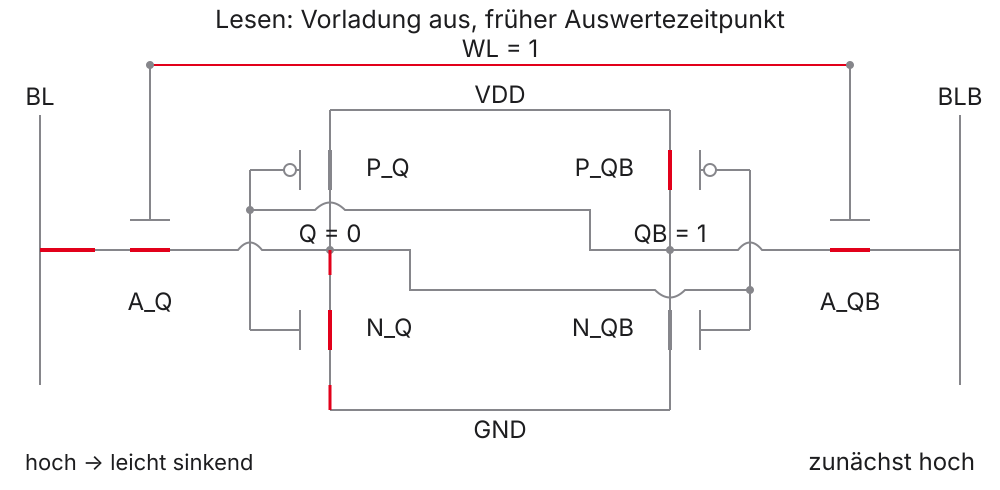{fig-alt="SRAM-Lesen bei Q 0 undQB 1. Beide Bitleitungen wurden hoch vorgeladen, die Vorladung ist jetzt abgeschaltet und WL ist 1. ÜberA_Q undN_Q sinkt BL leicht, BLB bleibt zunächst hoch. Ein externer Leseverstärker wertet die Differenz aus." style="max-height: 420px;"}
:::

::: {.content-visible when-format="pdf"}
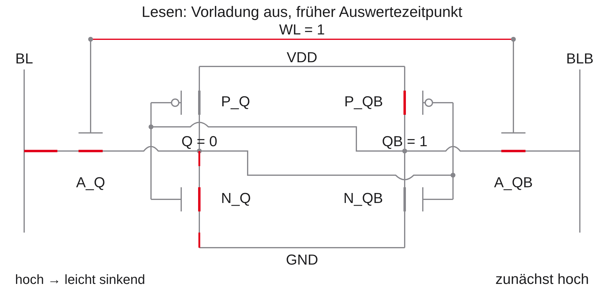{fig-alt="SRAM-Lesen bei Q 0 undQB 1. Beide Bitleitungen wurden hoch vorgeladen, die Vorladung ist jetzt abgeschaltet und WL ist 1. ÜberA_Q undN_Q sinkt BL leicht, BLB bleibt zunächst hoch. Ein externer Leseverstärker wertet die Differenz aus." style="max-height: 420px;"}
:::

Vorladen → Vorladung aus → WL hoch → Differenz auswerten → WL niedrig.

::: notes
SRAM bedeutet Static Random-Access Memory. Vor dem Zugriff lädt die externe Peripherie beide Bit Lines BL und BLB, Bitleitungen, auf einen hohen Pegel. In der dargestellten Auswertungsphase ist die Vorladung abgeschaltet und WL, Word Line oder Wortleitung, hoch. Die Zugriffstransistoren geben die Wege zu Q und QB frei.

Für Q null entsteht links ein Entladepfad von BL über A_Q und N_Q nach GND, Ground oder Masse. BL sinkt zunächst nur wenig. Rechts bleibt BLB für den betrachteten frühen Lesezeitpunkt weitgehend hoch, weil QB eins ist. Ein Sense Amplifier, Leseverstärker, erkennt die kleine Differenz. Die Abbildung markiert den linken Entladeweg und die freigegebene Wortleitung rot; Versorgung heißt VDD. nMOS und pMOS bezeichnen n- und p-Kanal-Metal-Oxide-Semiconductor-Transistoren.

Die hohe BL kann Q kurz etwas anheben. Damit die gespeicherte null nicht kippt, sind ausreichende Lesestabilität und passende Transistordimensionierung nötig. Wir rechnen diese analogen Störabstände nicht aus. „Nichtdestruktiv“ bedeutet hier, dass ein korrekt ausgelegter Lesezugriff den logischen Inhalt erhält, nicht dass keine Spannung verändert wird. Nach der Auswertung wird WL abgesenkt; erst danach werden die Bitleitungen für den nächsten Zugriff erneut vorgeladen.
:::

## SRAM-Lesen als qualitative Zeitfolge

::: {.content-visible when-format="html"}
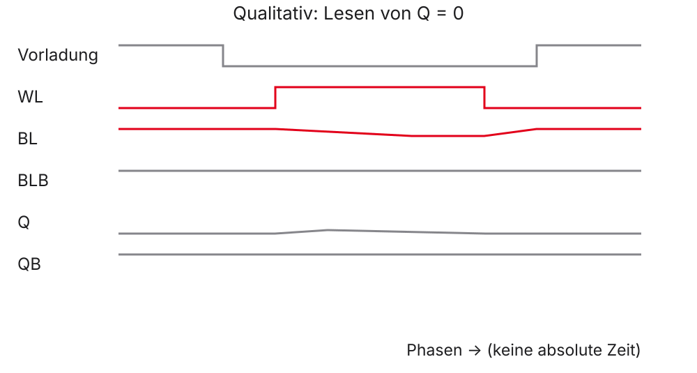{fig-alt="Qualitative Zeitfolge ohne Nanosekundenachse: Vorladung wird vor WL-Anstieg ausgeschaltet. Bei hoherWL sinkt BL leicht, Q zeigt einen kleinen Spannungshub und bleibt logisch 0. WL fällt vor erneuter Vorladung. QB bleibt logisch 1." style="max-height: 420px;"}
:::

::: {.content-visible when-format="pdf"}
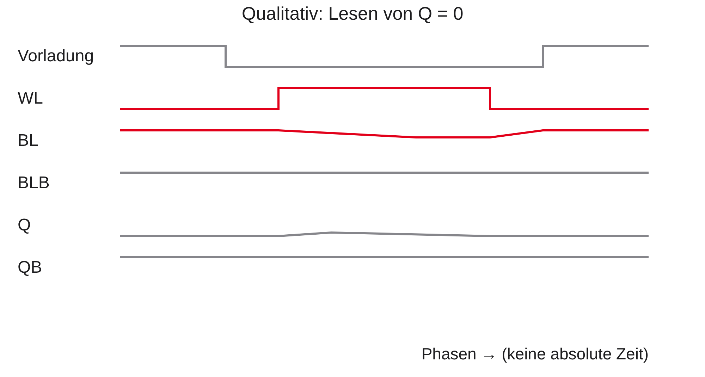{fig-alt="Qualitative Zeitfolge ohne Nanosekundenachse: Vorladung wird vor WL-Anstieg ausgeschaltet. Bei hoherWL sinkt BL leicht, Q zeigt einen kleinen Spannungshub und bleibt logisch 0. WL fällt vor erneuter Vorladung. QB bleibt logisch 1." style="max-height: 420px;"}
:::

Zeitfolge und Spannungsform sind Lehrmodelle, keine Simulation.

::: notes
SRAM heißt Static Random-Access Memory. Die waagerechte Achse zeigt aufeinanderfolgende Phasen ohne absolute Zeiteinheit. WL ist die Word Line, Wortleitung. BL und BLB sind Bit Lines, Bitleitungen. Q und QB bezeichnen die inneren Speicherknoten, die anfangs null und eins tragen. Vorladung eins bedeutet aktiviert, null abgeschaltet. Die Kurven sind schematisch und besitzen keine Aussage über Nanosekunden, Strom oder tatsächliche Pegeldifferenz.

Zuerst ist die Vorladung aktiv und beide Bitleitungen sind hoch. Danach wird sie ausgeschaltet. Mit hoher WL beginnt die Auswertung: Die linke BL sinkt leicht, BLB bleibt im Modell zunächst hoch. Q zeigt einen kleinen analogen Hub und bleibt dennoch im gültigen Nullbereich. QB bleibt eins. Der Leseverstärker erkennt die entstehende Differenz, bevor eine vollständige Entladung erforderlich wäre.

Nach dem Erkennen des Werts fällt WL und isoliert die Zelle. Erst anschließend wird die Vorladung wieder eingeschaltet. Gleichzeitiges dauerhaftes Vorladen und Entladen würde gegeneinander arbeitende Pfade erzeugen. Die wichtige Aussage ist deshalb die Reihenfolge und die Erhaltung des logischen Zustands. Der folgende Schreibzugriff nutzt stattdessen bewusst einen ausreichend starken äußeren Treiber, um die Rückkopplung zu einem anderen stabilen Zustand zu bringen.
:::

## Schreiben: den neuen Wert aktiv erzwingen

::: {.content-visible when-format="html"}
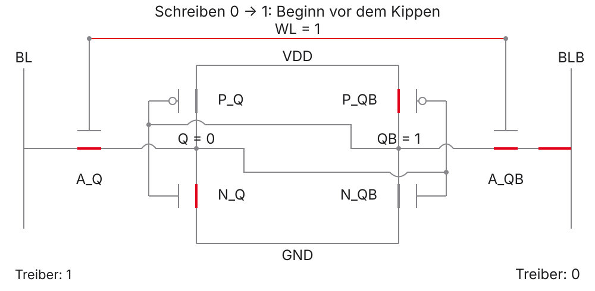{fig-alt="Beginn eines SRAM-Schreibens von Q 0 zuQ 1. Externe Treiber setzen BL 1 undBLB 0, dann wird WL 1. Rechts konkurriert der niedrige Schreibpfad mit dem bisher leitenden P_QB. SinkendesQB lässt links Q steigen, bis der neue stabile Zustand erreicht ist." style="max-height: 420px;"}
:::

::: {.content-visible when-format="pdf"}
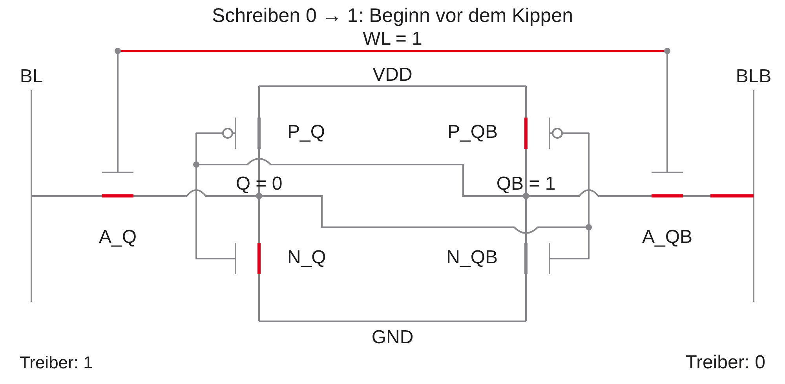{fig-alt="Beginn eines SRAM-Schreibens von Q 0 zuQ 1. Externe Treiber setzen BL 1 undBLB 0, dann wird WL 1. Rechts konkurriert der niedrige Schreibpfad mit dem bisher leitenden P_QB. SinkendesQB lässt links Q steigen, bis der neue stabile Zustand erreicht ist." style="max-height: 420px;"}
:::

Für $Q:0\rightarrow1$: BL hoch und BLB niedrig, bevor WL steigt.

::: notes
SRAM bedeutet Static Random-Access Memory. Das Bild zeigt den Beginn eines Schreibzugriffs, nicht bereits seinen stabilen Endzustand. Q ist anfangs null und QB eins. BL und BLB, Bit Lines oder Bitleitungen, werden durch externe Schreibtreiber auf eins und null gesetzt. WL, Word Line oder Wortleitung, wird erst danach hoch. VDD ist die positive Versorgung, GND Ground beziehungsweise Masse.

Über A_QB zieht der niedrige BLB-Treiber QB nach unten. Er arbeitet zunächst gegen den noch leitenden pMOS P_QB; die Schreibfähigkeit muss dies bei zulässigen Betriebsbedingungen ermöglichen. Wenn QB ausreichend sinkt, schaltet der linke Inverter um: P_Q leitet, N_Q sperrt, Q steigt. Dadurch sperrt rechts P_QB und N_QB leitet. pMOS und nMOS sind p- beziehungsweise n-Kanal-Metal-Oxide-Semiconductor-Transistoren. Die Rückkopplung unterstützt nun den neuen Zustand Q eins, QB null.

Rot kennzeichnet hier den äußeren Schreibweg und WL, nicht den schon vollständig erreichten Zustand sämtlicher Transistoren. A_Q und A_QB sind freigegebene Zugriffstransistoren. Wir zeigen keine exakte Stromaufteilung. Nach ausreichender Schreibzeit fällt WL, während die Daten noch gehalten werden. Anschließend dürfen die Treiber freigegeben werden. Ob und wann erneut vorgeladen wird, organisiert die Peripherie.
:::

## Schreiben endet mit erneutem Halten

::: {.content-visible when-format="html"}
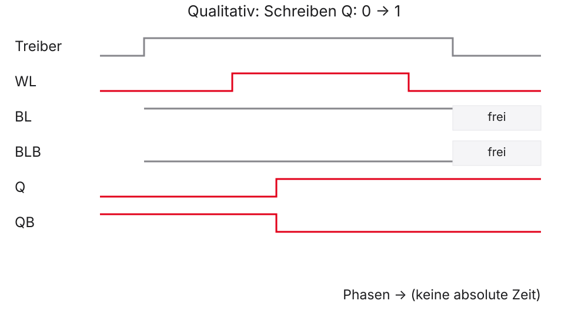{fig-alt="Qualitative SRAM-Schreibzeitfolge. BL 1 undBLB 0 liegen vor dem WL-Anstieg an und bleiben bis nach dem WL-Abfall gehalten. WährendWL 1 wechselnQ von 0 nach 1 undQB von 1 nach 0. NachWL 0 bleibt der neue Zustand erhalten, während die Bit Lines freigegeben werden dürfen." style="max-height: 420px;"}
:::

::: {.content-visible when-format="pdf"}
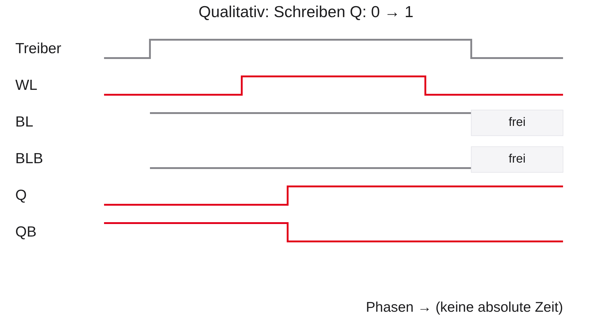{fig-alt="Qualitative SRAM-Schreibzeitfolge. BL 1 undBLB 0 liegen vor dem WL-Anstieg an und bleiben bis nach dem WL-Abfall gehalten. WährendWL 1 wechselnQ von 0 nach 1 undQB von 1 nach 0. NachWL 0 bleibt der neue Zustand erhalten, während die Bit Lines freigegeben werden dürfen." style="max-height: 420px;"}
:::

Schreibdaten bereit → WL hoch → Umschalten → WL niedrig → Treiber frei.

::: notes
Die Zeitachse zeigt eine qualitative Folge, keine spezifizierte Schreibzeit. SRAM bedeutet Static Random-Access Memory. BL und BLB, Bit Lines oder Bitleitungen, werden vor dem Zugriff auf eins und null getrieben. Das Treibersignal eins kennzeichnet die aktive Datenbereitstellung. WL, Word Line beziehungsweise Wortleitung, steigt erst nach deren Bereitstellung. Q und QB sind die komplementären inneren Knoten.

Während WL hoch ist, bringt der Treiber den Speicher zum neuen Zustand: QB fällt und Q steigt durch die Rückkopplung der beiden Inverter. Die gezeichnete Reihenfolge erläutert die Wirkung beim Schreiben von null nach eins. Reale Spannungsübergänge überlappen und hängen von Zell- und Treiberdimensionierung ab; die Kurven legen keine universelle Verzögerung fest. Der Treiber muss die nötige Schreibfähigkeit besitzen.

WL wird anschließend niedrig. Die äußeren Daten werden noch bis nach diesem Abfall gehalten und erst dann freigegeben. Das grau markierte Feld „frei“ bedeutet, dass die Bitleitungswerte danach für unsere Haltebetrachtung nicht festgelegt sind. Es steht nicht für einen dritten gespeicherten Logikwert. Der neue Inhalt Q eins und QB null bleibt durch Rückkopplung erhalten. Eine spätere Lesefolge benötigt wieder passende Vorladung; Schreiben und Vorladen dürfen nicht einfach ohne Phasensteuerung gleichgesetzt werden.
:::

## SRAM: schnell nutzbar, aber nicht kostenlos

| Vorteil der Zelle | Grenze der Aussage |
|------------------|-------------------|
| Halten ohne periodischen Refresh | Versorgung und Leckströme bleiben relevant |
| Lesen erhält bei korrekter Auslegung den Inhalt | Lesestabilität muss gesichert sein |
| Häufiges Überschreiben ohne Flash-Löschblock | sechs Zelltransistoren plus Peripherie |

Typische Rollen: interne Arbeitsspeicher, Cache-Daten und kleine Puffer.

::: notes
SRAM heißt Static Random-Access Memory. Seine statische Rückkopplung hält ein Bit ohne periodischen Refresh, also ohne wiederkehrendes Wiederauffrischen einer isoliert gespeicherten Ladung. Versorgung und zulässige Störabstände sind weiterhin erforderlich. Leckströme verursachen auch im Halten Leistungsaufnahme; beim Zugriff kommen Umschaltvorgänge und Peripherie hinzu.

Häufiges Lesen und Schreiben sind mit passenden Zugriffswegen möglich. Das Lesen ist bei ausreichender Lesestabilität logisch nichtdestruktiv. Anders als im Flash-Lehrmodell verlangt ein neues Datenwort keinen vorherigen Löschblock. Die klassische 6T-Zelle enthält jedoch sechs Transistoren, zu denen Decoder, Bitleitungsperipherie und Verstärker kommen. Eine reine Transistorzählung bestimmt deshalb noch keine genaue Fläche oder Zugriffszeit.

Ein Cache ist ein Zwischenspeicher für Kopien häufig benötigter Inhalte; seine Organisation folgt erst in Vorlesung 2. Interner Arbeitsspeicher und kleine Puffer sind weitere typische SRAM-Rollen. Die Nutzung „Cache“ ist somit keine neue Zellphysik. Andere SRAM-Zellformen sind möglich und ändern einzelne Eigenschaften. In der Papierphase beziehen sich alle Zellfragen ausdrücklich auf die hier entwickelte klassische 6T-Zelle. Danach vergleichen wir diese regenerative Speicherung mit dem Ladungsmodell einer DRAM-Zelle; DRAM heißt Dynamic Random-Access Memory.
:::

## Papierphase 2: die 6T-Zelle erklären

Übungsblatt, Aufgabe 3 · 15 Minuten

- Für beide stabilen Zustände die leitenden Invertertransistoren nennen
- Lesen von Schreiben und Halten unterscheiden
- Vorladung, Wortleitung und Schreibdaten zeitlich ordnen

::: notes
6T-SRAM bedeutet Static Random-Access Memory mit sechs Zelltransistoren. Q und QB sind die komplementären inneren Knoten. Bei dem hier vorgegebenen Anfangszustand Q eins, QB null leiten P_Q und N_QB; N_Q und P_QB sperren. N und P bezeichnen n- beziehungsweise p-Kanal-Metal-Oxide-Semiconductor-Transistoren. Beim Halten ist WL, Word Line oder Wortleitung, niedrig.

Zum Lesen werden BL und BLB, Bit Lines oder Bitleitungen, zunächst hoch vorgeladen. Nach Ausschalten der Vorladung wird WL angehoben. BLB am Nullknoten sinkt leicht, der Leseverstärker wertet die Differenz aus. Bei ausreichender Lesestabilität bleibt der logische Zellinhalt erhalten. Danach fällt WL, erst anschließend beginnt die erneute Vorladung.

Zum Umschreiben von Q eins nach null treiben die externen Schreiber BL null und BLB eins. Diese Daten müssen vor dem WL-Anstieg bereitstehen und bis nach dem WL-Abfall gehalten werden. Die Rückkopplung kippt zum neuen stabilen Zustand. Hohe WL allein bedeutet deshalb noch kein Schreiben: Die angeschlossene Peripherie und die zeitliche Reihenfolge bestimmen die Wirkung. Beide stabilen Zustände erfüllen dieselbe komplementäre Haltebedingung; beim umgekehrten Zustand vertauschen sich die leitenden Invertertransistoren.
:::

## DRAM: ein Transistor, ein Kondensator

::: {.content-visible when-format="html"}
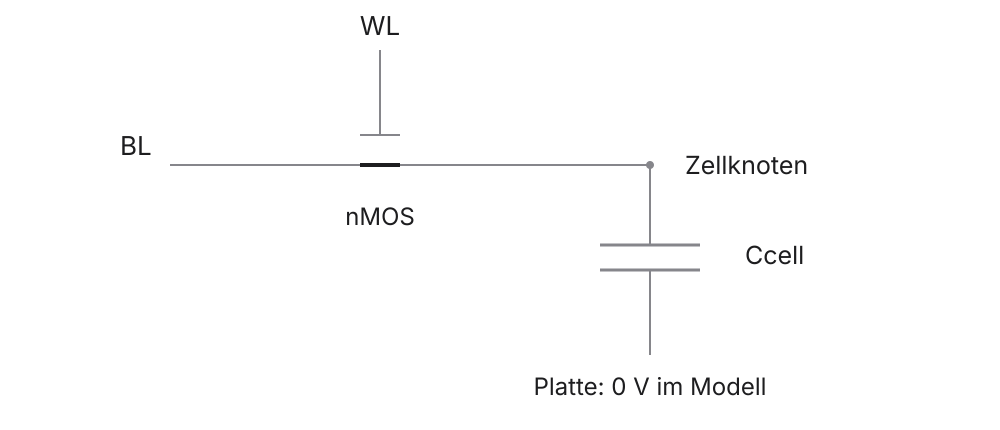{fig-alt="DRAM-Lehrzelle mit einem nMOS-Zugriffstransistor. WL steuert dessen Gate, BL ist über den leitenden Pfad mit dem Zellknoten verbunden. Ein Kondensator liegt zwischen Zellknoten und einer im Modell auf 0 Volt gesetzten Platte." style="max-height: 420px;"}
:::

::: {.content-visible when-format="pdf"}
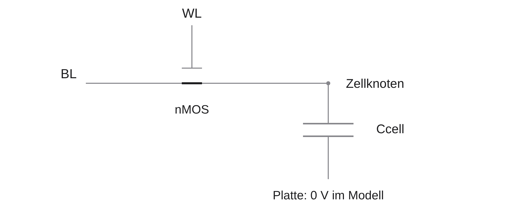{fig-alt="DRAM-Lehrzelle mit einem nMOS-Zugriffstransistor. WL steuert dessen Gate, BL ist über den leitenden Pfad mit dem Zellknoten verbunden. Ein Kondensator liegt zwischen Zellknoten und einer im Modell auf 0 Volt gesetzten Platte." style="max-height: 420px;"}
:::

WL niedrig: Ladung weitgehend isoliert · WL hoch: Ladungsaustausch mit BL.

::: notes
DRAM heißt Dynamic Random-Access Memory, dynamischer wahlfreier Speicher. 1T1C bedeutet ein Transistor und ein Kondensator pro klassischer Bitzelle. Der nMOS-Zugriffstransistor, n-Kanal-Metal-Oxide-Semiconductor-Transistor, wird durch WL, Word Line oder Wortleitung, gesteuert. BL, Bit Line oder Bitleitung, verbindet ihn mit der Speicherperipherie. Das Gate steuert den Pfad, ist aber kein Datenanschluss dieses Pfads.

Der Kondensator besitzt eine Zell- und eine Plattenelektrode. Das Bild setzt die Platte ausdrücklich vereinfachend auf null Volt. Reale Bauformen und Plattenspannungen können davon abweichen. Bei niedriger WL ist die Zellladung weitgehend isoliert, bei hoher WL kann Ladung zwischen Zelle und Bitleitung fließen. Leckströme verhindern perfekte dauerhafte Isolation.

Die beiden waagerechten Striche sind das Kondensatorsymbol, kein Kurzschluss. Die Zelle enthält keine rückgekoppelten Inverter wie SRAM. Ccell bezeichnet im Bild die Zellkapazität. Decoder und Leseverstärker liegen außerhalb des dargestellten 1T1C-Kerns. Die Ladung wird als Spannungszustand ausgewertet und muss beim Lesen wiederhergestellt sowie regelmäßig aufgefrischt werden. Um diesen Ablauf zu verstehen, unterscheiden wir jetzt ausdrücklich die elektrische Ladung von einem logischen gespeicherten Bit.
:::

## Elektrische Ladung ist noch kein logischer Wert

$$q_\mathrm{el}=C_\mathrm{cell}(V_\mathrm{cell}-V_\mathrm{plate})$$

Lehrmodell: $C_\mathrm{cell}=30\,\mathrm{fF}$, $V_\mathrm{plate}=0\,\mathrm{V}$.

- Hoher Zellpegel $1{,}2\,\mathrm{V}$: $q_\mathrm{el}=36\,\mathrm{fC}$
- Niedriger Zellpegel $0\,\mathrm{V}$: $q_\mathrm{el}=0\,\mathrm{fC}$ im idealen Modell

::: notes
$q_\mathrm{el}$ ist die elektrische Ladung an der betrachteten Zellelektrode, nicht der zuvor mit Q bezeichnete SRAM-Knoten. SRAM bedeutet Static Random-Access Memory. $C_\mathrm{cell}$ bezeichnet die Zellkapazität in Farad, $V_\mathrm{cell}$ die Zellspannung und $V_\mathrm{plate}$ die Plattenspannung in Volt. Die Gleichung ist das ideale Kondensatormodell. fF sind Femtofarad, $10^{-15}$ Farad; fC Femtocoulomb, $10^{-15}$ Coulomb.

Wir wählen als reine Lehrwerte dreißig Femtofarad, eine Platte auf null Volt und einen hohen Zellpegel von 1,2 Volt. Daraus folgen $30\cdot10^{-15}\,\mathrm{F}\cdot1{,}2\,\mathrm{V}=36\cdot10^{-15}\,\mathrm{C}$, also sechsunddreißig Femtocoulomb. Bei null Volt Spannungsdifferenz ist die Ladung im idealen Modell null. Das sind keine Daten eines konkreten Bauteils.

Eine Schaltung ordnet Spannungsbereiche logischen Werten zu. Sie kann nicht verlangen, dass eine reale Zelle immer exakt denselben Ladungswert hat. Leckströme, Störungen und Auslesevorgänge verändern die Spannung; die Auswertung braucht einen ausreichenden Abstand zum Referenzzustand. Darum muss DRAM, Dynamic Random-Access Memory, regelmäßig aufgefrischt werden. Diese Notwendigkeit folgt aus dem Ladungsprinzip, nicht aus einer universellen festen Zeitangabe.
:::

## Leckage macht Refresh erforderlich

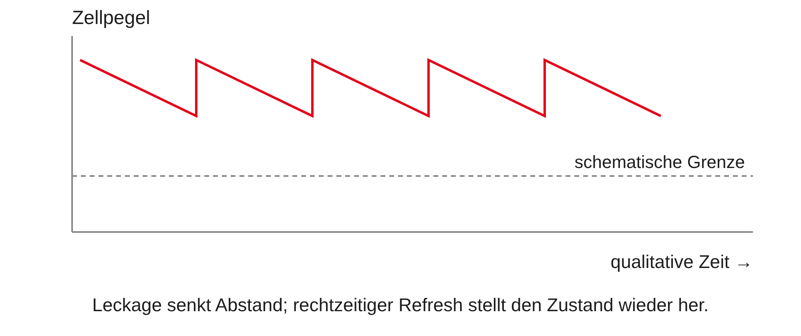{fig-alt="Qualitativer Spannungsverlauf einer hoch geladenen DRAM-Zelle: Leckage senkt den Pegel, rechtzeitiger Refresh stellt ihn wieder her. Eine gestrichelte Grenze markiert beispielhaft den benötigten Auswerteabstand, ohne Zeit- oder Spannungsdaten eines Bauteils."}

Refresh erhält Inhalte innerhalb spezifizierter Bedingungen; er ist kein neues Nutzdatum.

::: notes
DRAM bedeutet Dynamic Random-Access Memory. Refresh heißt Auffrischen: Eine Zeile wird ausgelesen, verstärkt und mit ihren bisherigen logischen Werten wiederhergestellt. Leckage bezeichnet unerwünschten Ladungsverlust beziehungsweise Ladungsaustausch über reale nicht perfekt isolierende Pfade. Temperatur, Herstellung, Zustand und Speicherbauart beeinflussen die nötigen Auffrischbedingungen.

Die Abbildung zeigt einen hohen Zellspannungszustand über eine qualitative Zeitachse. Ohne Eingriff nimmt sein Abstand zum unsicheren Auswertebereich ab. Die roten Aufwärtsstücke bedeuten erneutes Herstellen des hohen Zustands durch Refresh. Die gestrichelte Grenze ist eine schematische Lesbarkeitsgrenze, kein universeller garantierter Schwellwert. Weder der zeitliche Abstand noch die Steigung ist als gemessene Bauteilkurve zu verstehen.

Der Controller muss die vom konkreten Speicher spezifizierten Auffrischpflichten einhalten. Eine oft zitierte Millisekundenangabe ist daher nicht ohne Datenblatt auf jedes DRAM übertragbar. Refresh belegt Ressourcen und kann Zugriffe beeinflussen; seine konkrete Planung gehört zur Schnittstelle. Die Zelle ist außerdem flüchtig: Ohne Versorgung und nötige Auffrischung ist die Information nicht dauerhaft gesichert. Auch ein regulärer Lesezugriff verändert zunächst die Zellladung. Dessen Referenzpunkt ist die vorgeladene Bitleitung.
:::

## Vor dem Lesen: BL auf halbe Versorgung

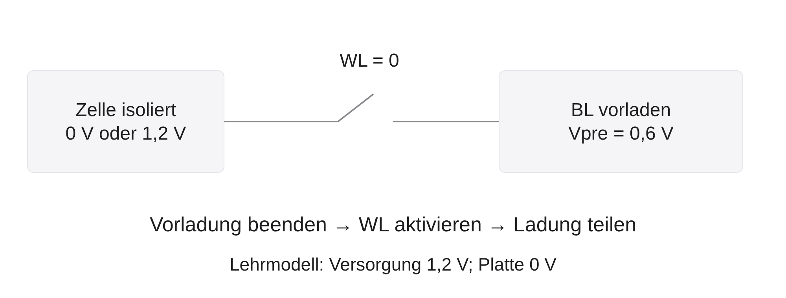{fig-alt="Lehrmodell der DRAM-Lesevorbereitung: Wortleitung niedrig, geladene oder entladene Zelle isoliert. Die Bitleitung ist auf 0,6 Volt vorgeladen, die halbe Modellversorgung von 1,2 Volt. Erst nach Abschalten der Vorladung wird die Wortleitung aktiviert."}

Lehrwerte: $V_\mathrm{DD}=1{,}2\,\mathrm{V}$ und $V_\mathrm{pre}=0{,}6\,\mathrm{V}$.

::: notes
DRAM heißt Dynamic Random-Access Memory. BL bedeutet Bit Line, Bitleitung; WL Word Line, Wortleitung. VDD benennt die positive Versorgung. Im gewählten Lehrmodell ist sie 1,2 Volt. Die Peripherie lädt BL vor dem Lesen auf die halbe Versorgung vor, hier $V_\mathrm{pre}=0{,}6$ Volt. Precharge heißt Vorladen und gegebenenfalls Ausgleichen der Bitleitungen; es bereitet den Referenzzustand für den nächsten Zugriff.

Solange WL niedrig ist, bleibt die Zelle vom Bitleitungsknoten getrennt. Ihr hoher oder niedriger Zustand ist deshalb nicht identisch mit dem Vorladepegel. Die Abbildung zeigt diesen getrennten Anfangszustand: Zelle null oder 1,2 Volt, BL 0,6 Volt. Die äußere Vorladung wird vor dem eigentlichen Ladungsaustausch beendet, dann wird WL aktiviert.

Die Zelle besitzt eine kleine Kapazität, die Bitleitung eine größere. Bei ihrem Verbinden fließt Ladung, bis im idealisierten Modell ein gemeinsamer Pegel erreicht ist. Eine hohe Zelle hebt BL daher ein wenig über den Referenzpegel, eine niedrige senkt sie darunter. Im nächsten Rechenschritt quantifizieren wir diese Abweichung. Differenzielle echte Bitleitungsanordnungen und weitere parasitäre Effekte sind im einfachen Zwei-Kondensator-Modell nicht vollständig dargestellt.
:::

## Ladungsteilung: nur etwa 55 mV Unterschied

$$V_\mathrm{share}=\frac{C_\mathrm{cell}V_\mathrm{cell}+C_\mathrm{BL}V_\mathrm{pre}}{C_\mathrm{cell}+C_\mathrm{BL}}$$

$C_\mathrm{cell}=30\,\mathrm{fF}$, $C_\mathrm{BL}=300\,\mathrm{fF}$, $V_\mathrm{pre}=0{,}6\,\mathrm{V}$.

| Anfangswert der Zelle | Gemeinsamer Pegel | Abweichung von Vorladung |
|----------------------|------------------|--------------------------|
| $1{,}2\,\mathrm{V}$ | $0{,}6545\,\mathrm{V}$ | $+54{,}5\,\mathrm{mV}$ |
| $0\,\mathrm{V}$ | $0{,}5455\,\mathrm{V}$ | $-54{,}5\,\mathrm{mV}$ |

::: notes
Die Ladungsteilung erklärt, warum DRAM, Dynamic Random-Access Memory, einen empfindlichen Leseverstärker benötigt. $C_\mathrm{cell}$ ist die Zellkapazität, $C_\mathrm{BL}$ die Kapazität der Bit Line BL, Bitleitung. $V_\mathrm{cell}$ ist der anfängliche Zellpegel und $V_\mathrm{pre}$ deren Vorladepegel. $V_\mathrm{share}$ bezeichnet die gemeinsame Spannung nach idealem Ladungsausgleich, bevor der Verstärker eingreift. fF bedeutet Femtofarad, $10^{-15}$ Farad, mV Millivolt, $10^{-3}$ Volt.

Wir nehmen beide Kondensatoren gegen dieselbe feste Bezugsspannung null Volt, keine weiteren Ladungsquellen und keine parasitären Effekte an. Ladungserhaltung ergibt $(C_\mathrm{cell}+C_\mathrm{BL})V_\mathrm{share}=C_\mathrm{cell}V_\mathrm{cell}+C_\mathrm{BL}V_\mathrm{pre}$. Beim hohen Zellzustand sind die Anfangsladungen sechsunddreißig und hundertachtzig Femtocoulomb. Ihre Summe von zweihundertsechzehn Femtocoulomb verteilt sich auf dreihundertdreißig Femtofarad: $216/330=0{,}654545\ldots$ Volt. Die Differenz zu 0,6 Volt beträgt ungefähr plus 54,5 Millivolt.

Beim niedrigen Zustand liefert die Zelle anfangs keine Ladung im Idealmodell. $180/330=0{,}545454\ldots$ Volt ergibt minus 54,5 Millivolt. Beide Werte sind gerundet. Der hohe Zellpegel ist abgesunken, der niedrige gestiegen; der ursprüngliche starke Spannungsunterschied ist verändert. „Destruktives Lesen“ bedeutet diesen Informationsabstandsverlust, nicht dass jeder Kondensator vollständig entladen wird. Die Richtung der kleinen Abweichung ermöglicht Verstärken und Wiederherstellen.
:::

## Sense, Restore und Precharge sind verschiedene Phasen

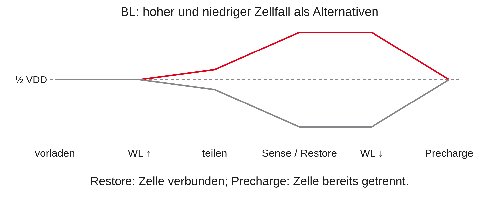{fig-alt="DRAM-Lesefolge im Lehrmodell: BL beginnt bei 0,6 Volt. NachWL-Aktivierung teilen Zelle undBL Ladung. Sense undRestore verstärken bei weiterhin hoherWL auf den ursprünglichen hohen oder niedrigen Wert. WL wird abgesenkt, danach kehrt BL durchPrecharge zu 0,6 Volt zurück."}

Restore bei verbundener Zelle; Precharge nach deren Trennung.

::: notes
DRAM bedeutet Dynamic Random-Access Memory. Sense bezeichnet Erkennen und Verstärken der kleinen Abweichung durch den Sense Amplifier, Leseverstärker. Restore ist die Wiederherstellung des Zellzustands. Precharge lädt die Bit Line BL, Bitleitung, für den nächsten Zugriff vor. WL ist die Word Line, Wortleitung. VDD ist die positive Versorgung; die gestrichelte Linie markiert deren halben Pegel. Die zeitliche Achse zeigt qualitative Phasen, keine spezifizierten Befehlszeiten.

BL startet im Modell bei halber Versorgung, 0,6 Volt. Hohe WL verbindet die Zelle; Ladungsteilung erzeugt etwa plus oder minus 54,5 Millivolt. Der Verstärker entscheidet anhand dieser Richtung und treibt die Bitleitung auf einen hohen oder niedrigen Pegel. Weil WL dabei noch hoch ist, wird auch die Zelle wieder in den zugehörigen Zustand gebracht. Das ist Restore und wirkt dem veränderten Zellpegel nach Ladungsteilung entgegen.

Erst danach wird WL niedrig und trennt die restaurierte Zelle ab. Precharge bringt die Bitleitung wieder auf den mittleren Referenzpegel. Würde man dies bei verbundener Zelle als vermeintliches Restore durchführen, würde gerade der deutliche Zellzustand beseitigt. Die Grafik zeigt hohen und niedrigen Fall als Alternativen, nicht als zwei gleichzeitig gespeicherte Werte derselben Zelle. Zeilenorganisation ermöglicht nun, viele solche Zellbits mit gemeinsamer Wortleitung zu aktivieren.
:::

## Organisation: Bank, Zeile, Spalte und Byte

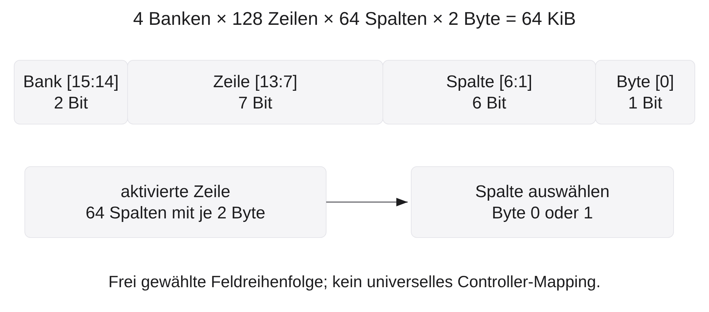{fig-alt="Frei gewähltes DRAM-Adressmodell: vierBanks, jeweils 128 Zeilen mit 64 Spalten und zweiByte proSpaltenelement. Eine 16 Bit-Adresse enthält Bankbits 15 bis 14, Zeilenbits 13 bis 7, Spaltenbits 6 bis 1 und Bytebit 0."}

$4\cdot128\cdot64\cdot2\,\mathrm{Byte}=64\,\mathrm{KiB}$.

::: notes
DRAM heißt Dynamic Random-Access Memory. Eine Bank ist eine organisatorisch gesondert steuerbare Teilstruktur des Speichers. Eine Zeile enthält Zellen an einer gemeinsamen Auswahlleitung, eine Spalte wählt aus den aktivierten Inhalten aus. Der Row Buffer, Zeilenpuffer, besteht funktional aus den verstärkten Zeileninhalten. Er ist keine zweite dauerhafte Kopie der gesamten Kapazität.

Wir definieren ausdrücklich ein kleines, frei gewähltes byteadressiertes Modell mit vier Banken, hundertachtundzwanzig Zeilen pro Bank, vierundsechzig Spalten pro Zeile und zwei Byte pro Spaltenelement. Seine Kapazität ist $4\cdot128\cdot64\cdot2=65\,536$ Byte oder vierundsechzig Kibibyte; KiB bedeutet $2^{10}$ Byte. Für die Felder brauchen wir zwei, sieben, sechs und ein Bit, zusammen sechzehn Bit. Die Abbildung ordnet sie von hoch nach niedrig als Bank, Zeile, Spalte und Byte an.

Für Bank zwei, Zeile fünf, Spalte neun und Byte eins folgt $2\cdot2^{14}+5\cdot2^7+9\cdot2+1=33\,427$, hexadezimal `0x8293`. Eine reale Controllerabbildung kann Felder anders verschachteln oder weitere Kanalinformationen verwenden. Diese Zuordnung ist daher eine Rechenannahme und kein allgemeines DRAM-Adressgesetz. Sie erlaubt nun zu verstehen, warum zwei Zugriffe auf dieselbe aktivierte Zeile andere Vorbereitungen benötigen als ein Zeilenwechsel.
:::

## Eine offene Zeile verändert die Befehlsfolge

{fig-alt="Für einen modellierten DRAM-Lesezugriff genügt bei passender offener ZeileREAD. In einer geschlossenenBank gehtACTIVATE voraus. Bei einer anderen offenenZeile folgenPRECHARGE, ACTIVATE undREAD. Nötige Wartezeiten sind nicht quantifiziert."}

Befehlsfolge erklärt Aufwand; Datenblatt und Controller bestimmen die Zeiten.

::: notes
DRAM bedeutet Dynamic Random-Access Memory. ACTIVATE aktiviert eine Zeile und stellt ihren Inhalt in den Leseverstärkern bereit. READ wählt daraus die gewünschten Spaltendaten. PRECHARGE schließt die bisherige Zeile nach Einhaltung der nötigen Bedingungen und bereitet die Bitleitungen für eine weitere Aktivierung vor. Diese englischen Befehlsnamen sind hier Funktionsnamen, keine fertige Controllerschnittstelle.

Bei einer passenden bereits offenen Zeile kann der nächste Lesezugriff ohne erneuten Zeilenwechsel erfolgen. Ist die Bank geschlossen, muss zuerst aktiviert werden. Ist eine andere Zeile derselben Bank offen, sind erst Vorladen, dann Aktivieren und Lesen nötig. Die Grafik stellt diese drei Fälle von oben nach unten als unterschiedlich lange Folgen dar. Ihre Pfeile geben Reihenfolge an, keine identischen Zyklusdauern oder gemessenen Latenzen.

RAS heißt Row Address Strobe, Zeilenadress-Strobe, CAS Column Address Strobe, Spaltenadress-Strobe. Historische Schnittstellen übermitteln Zeilen- und Spaltenadresse zeitlich getrennt; bei synchronen Speichern werden daraus entsprechende Befehlsfunktionen. Die gesamte Zugriffszeit entsteht nicht allein dadurch, dass Adresspins mehrfach genutzt werden. Zellaktivierung, Verstärkung, Wiederherstellung und vorgeschriebene Abstände gehören ebenfalls dazu. Datenübertragung auf mehreren Taktflanken verändert wiederum eine andere Größe: die mögliche Datenrate.
:::

## DDR verdoppelt Transfers, nicht die Taktfrequenz

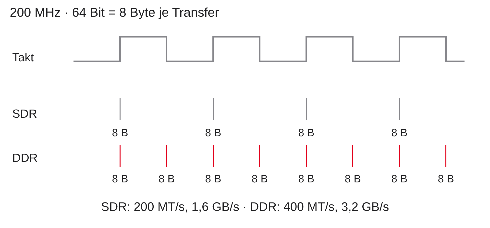{fig-alt="Modellvergleich bei 200 MHz externemTakt: SDR überträgt einmal jePeriode, DDR an beidenTaktflanken zweimal. Bei 64 Bit Datenbreite ergeben sich theoretisch 1,6 beziehungsweise 3,2 GB proSekunde."}

$200\,\mathrm{MHz}\cdot2\cdot8\,\mathrm{Byte}=3{,}2\,\mathrm{GB/s}$ als Spitzenrate.

::: notes
SDRAM heißt Synchronous Dynamic Random-Access Memory, taktsynchroner dynamischer wahlfreier Speicher. SDR, Single Data Rate, bezeichnet hier einen Datentransfer pro Taktperiode. DDR, Double Data Rate, nutzt beide Taktflanken für zwei Transfers pro Periode. MHz bedeutet Millionen Taktperioden pro Sekunde, MT/s Millionen Transfers pro Sekunde. Das sind verschiedene Einheiten.

Die Abbildung wählt zweihundert Megahertz externen Takt und einen Datenbus mit vierundsechzig Bit, also acht Byte pro Transfer. SDR ergibt $200\cdot10^6\cdot8=1{,}6\cdot10^9$ Byte pro Sekunde. DDR liefert theoretisch $200\cdot10^6\cdot2\cdot8=3{,}2\cdot10^9$ Byte pro Sekunde beziehungsweise vierhundert MT/s. GB bezeichnet hier dezimale Gigabyte, $10^9$ Byte. Die roten Markierungen heben die beiden Transferflanken hervor; die Achse zeigt vier modellhafte Perioden.

Das ist eine Spitzenrate unter lückenloser Nutzung der Datentransfers, ohne Refresh, Befehlswechsel oder sonstige Verluste. Sie halbiert nicht automatisch die Latenz eines einzelnen Lesezugriffs. Zweihundert Megahertz werden auch nicht zu vierhundert Megahertz Takt. Reale DDR-Generationen besitzen zusätzliche interne Organisation und genaue Schnittstellenbedingungen. Für diese Vorlesung genügt die sichere Unterscheidung von Takt, Transferrate und nutzbarer Bandbreite.
:::

## Papierphase 3: DRAM rechnen und ordnen

Übungsblatt, Aufgabe 4 · 15 Minuten

- Ladungserhaltung für hohe und niedrige Zelle anwenden
- Restore von Precharge unterscheiden
- Im vorgegebenen Modell Bank, Zeile, Spalte und Byte bilden

::: notes
DRAM bedeutet Dynamic Random-Access Memory. Das neue Lehrmodell verwendet $24$ Femtofarad Zellkapazität, $240$ Femtofarad Bitleitungskapazität und $0{,}5$ Volt Vorladung. Femto bedeutet $10^{-15}$. Bei anfangs einem Volt in der Zelle beträgt die Gesamtladung $144$ Femtocoulomb, bei null Volt $120$ Femtocoulomb. Teilen durch $264$ Femtofarad liefert $0{,}54545$ beziehungsweise $0{,}45455$ Volt. Der Abstand zum Referenzpegel beträgt etwa plus oder minus $45{,}45$ Millivolt.

Restore stellt den Zellwert bei noch aktiver WL, Word Line oder Wortleitung, wieder her. Danach wird WL abgesenkt; Precharge bringt BL, Bit Line oder Bitleitung, zurück zum mittleren Referenzpegel. Der Kondensator wird beim Lesen nicht immer geleert: Die niedrige Zellspannung steigt gerade durch die Ladungsteilung.

Das neue Adressmodell hat $8\cdot64\cdot32\cdot4=65536$ Byte, also $64$ KiB, Kibibyte. Bank, Zeile, Spalte und Byte benötigen von hoch nach niedrig drei, sechs, fünf und zwei Bit. Bank fünf, Zeile elf, Spalte neunzehn und Byte zwei ergeben $5\cdot8192+11\cdot128+19\cdot4+2=42446$, hexadezimal `0xA5CE`. Die Feldaufteilung ist ausdrücklich ein Lehrmodell und keine universelle reale Bankabbildung. Anschließend geht es um die Organisation gültiger Firmwareobjekte und Puffer.
:::

## Dual-Port bezeichnet Zugriffsmöglichkeiten

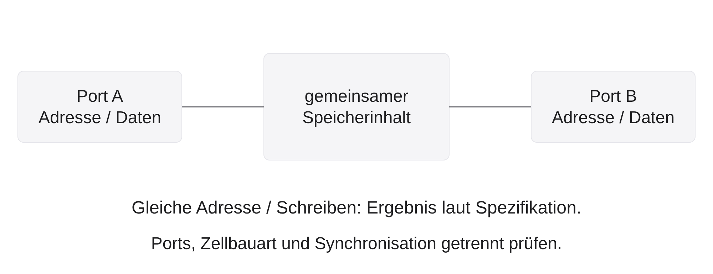{fig-alt="Dual-Port-RAM besitzt zwei Zugriffsinterfaces mit eigenen Adressen und Steuersignalen zum gemeinsamen Speicherinhalt. UnterschiedlicheAdresszugriffe können parallel unterstützt werden. Verhalten bei gleicherAdresse und Konflikten ist durch die jeweiligeSchnittstelle festgelegt."}

Zwei Ports ersetzen keine Regel für Konflikte oder unterschiedliche Takte.

::: notes
Dual-Port-RAM bedeutet wahlfreier Speicher mit zwei Zugriffsports; RAM steht für Random-Access Memory. Ein Port ist hier eine Schnittstelle mit Adress-, Daten- und Steuersignalen. Die Abbildung zeigt links und rechts je einen Port zum selben Speicherinhalt. Unterschiedliche Adressen können je nach Baustein gleichzeitig bedient werden. Die Ports erzeugen keine zwei voneinander unabhängigen Kopien der Daten.

True Dual Port bezeichnet häufig zwei Ports mit Lese- und Schreibfähigkeit, Simple Dual Port beispielsweise einen Schreib- und einen Leseport. Diese Begriffe beschreiben Schnittstellenfunktionen. Sie erlauben keinen universellen Schluss auf genau acht Zelltransistoren, eine bestimmte Latenz oder das Ergebnis zweier Schreibzugriffe auf dieselbe Adresse. Konfliktverhalten, Leseverhalten beim gleichzeitigen Schreiben und Taktbedingungen müssen in der konkreten Spezifikation stehen.

Ein Speicher mit zwei unabhängigen Takten löst außerdem nicht automatisch das gesamte Kommunikationsproblem zwischen Taktdomänen. Steuerinformationen brauchen dafür geeignete Synchronisation. Solche Details werden später vertieft. Heute genügt die Trennung: SRAM als Zellprinzip erklärt Halten, Dual-Port als Organisationsmerkmal erklärt Zugriffsmöglichkeiten. Ein FIFO, First In First Out, beschreibt wiederum die Reihenfolge von gespeicherten Elementen und kann auf unterschiedliche Speicherstrukturen aufbauen.
:::

## FIFO: Ringposition allein verrät nicht voll oder leer

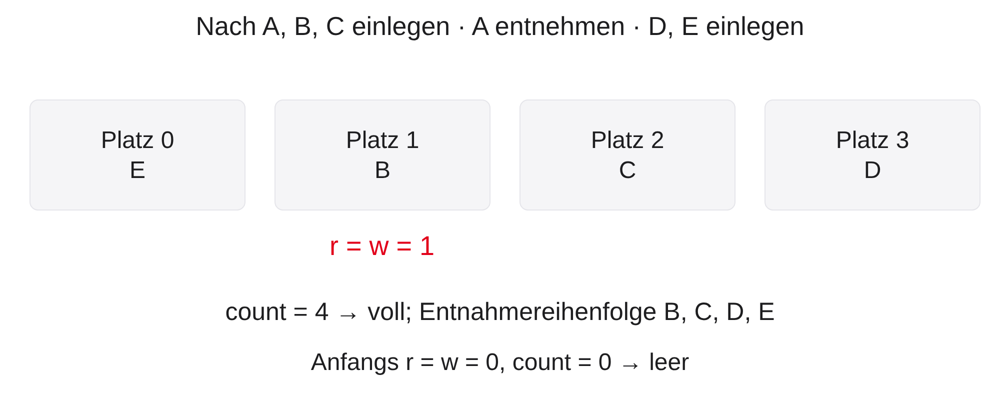{fig-alt="VierPlätze imRing und ein expliziter Belegungszähler. NachpushA, B, C, popA, pushD, E gilt r 1, w 1, count 4 und derPuffer istvoll. Der gleiche Positionsvergleich r=w kann imAnfangszustand mitcount 0 leer bedeuten."}

Vier nutzbare Plätze; `count` unterscheidet leer und voll.

::: notes
FIFO heißt First In First Out: Das zuerst eingelegte Element wird zuerst entnommen. Ein Ringpuffer nutzt ein festes Array zyklisch. r bezeichnet die nächste Leseposition, w die nächste Schreibposition und count die Zahl belegter Plätze. In unserem Modell beginnen alle drei Werte bei null; das Array hat vier vollständig nutzbare Plätze. Nach einer erfolgreichen Operation wird die jeweilige Position modulo vier weitergeschaltet.

Einlegen von A, B und C führt zu r null, w drei, count drei. Entnehmen liefert A und setzt r eins, count zwei. Einlegen von D benutzt Platz drei, w springt auf null. Einlegen von E nutzt Platz null und ergibt r eins, w eins, count vier. Die Reihenfolge der gültigen Inhalte ist nun B, C, D, E. Obwohl r und w gleich sind, ist der Puffer voll. Anfangs waren sie ebenfalls gleich, aber count war null und der Puffer leer.

Ein weiterer Versuch mit F muss ohne Zustandsänderung scheitern. Nach Entnahme von B darf F eingefügt werden; dann sind r und w zwei, count vier und die Reihenfolge C, D, E, F. Das optionale C-Programm prüft diese Regeln in einem einzelnen Ausführungskontext. Es ist kein nebenläufiger oder taktdomänenübergreifender FIFO und enthält dafür keine Synchronisation.
:::

## Memory Map: Grenzen ausdrücklich angeben

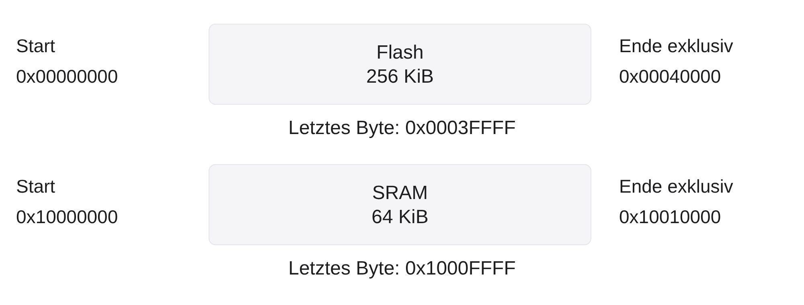{fig-alt="Frei gewählte byteadressierte MemoryMap: Flash beginnt bei 0 x 00000000 mit 256 KiB bis exklusiv 0 x 00040000. SRAM beginnt bei 0 x 10000000 mit 64 KiB bis exklusiv 0 x 10010000. Die letzten enthaltenenByteadressen sind 0 x 0003 FFFF beziehungsweise 0 x 1000 FFFF."}

Bereich $[\mathrm{Start},\mathrm{Ende})$: Ende ist die erste ausgeschlossene Adresse.

::: notes
Eine Memory Map ist die Zuordnung von Adressbereichen zu Speicher oder Geräten. SRAM bedeutet Static Random-Access Memory, Flash nichtflüchtiger elektrisch programmierbarer Speicher. Unsere Map ist ein frei gewähltes Lehrmodell, keine zugesicherte Renode-Plattform und kein allgemeines RISC-V-Gesetz. RISC-V ist eine Befehlssatzfamilie, RISC steht für Reduced Instruction Set Computer. Diese Befehlssatzfamilie legt nicht die gezeigten Speicheradressen fest.

Flash beginnt bei `0x00000000` und besitzt zweihundertsechsundfünfzig Kibibyte. KiB sind $2^{10}$ Byte. Seine erste ausgeschlossene Adresse ist `0x00040000`, seine letzte enthaltene Byteadresse `0x0003FFFF`. SRAM beginnt bei `0x10000000`; vierundsechzig KiB ergeben als exklusives Ende `0x10010000`, als letzte Byteadresse `0x1000FFFF`. Die Balken der Grafik zeigen Bereichszuordnung und Grenzen, keinen maßstäblichen Abstand der Bereiche im gesamten Adressraum.

Eine Adresse bezeichnet in diesem Modell ein Byte. Ein Wortzugriff benötigt daher mehrere aufeinanderfolgende gültige Byteadressen. Dass sein Start innerhalb des Balkens liegt, reicht nicht. Zusätzlich können Zugriffsrechte, Ausrichtung und Plattformregeln erforderlich sein. Die nächste Folie überprüft deshalb einen vollständigen Zugriff statt nur einen Zeigerwert.
:::

## Ein 32-Bit-Zugriff braucht vier gültige Byteadressen

Lehrmodell: SRAM $[\mathtt{0x10000000},\mathtt{0x10010000})$.

| Startadresse | Vier Byte im Bereich? | Durch vier teilbar? |
|--------------|----------------------|--------------------|
| `0x1000FFFC` | ja, bis `0x1000FFFF` | ja |
| `0x1000FFFF` | nein | nein |
| `0x10010000` | nein | ja |

Die Prüfung erfolgt mit ganzen Zahlen; wir dereferenzieren diese Adressen nicht auf dem Host.

::: notes
SRAM heißt Static Random-Access Memory. Ein Zugriff auf einen Wert vom C-Typ `uint32_t`, vorzeichenloser Ganzzahltyp mit exakt zweiunddreißig Bit, umfasst vier Byte. Im Lehrmodell gibt es acht Bit pro Byte und eine Vier-Byte-Ausrichtungsregel für diesen Zugriff. Diese Modellregel ersetzt keine Plattformprüfung; reale Unterstützung unausgerichteter Zugriffe kann unterschiedlich sein.

`0x1000FFFC` plus vier ergibt exakt das exklusive Ende `0x10010000`. Die vier belegten Byteadressen enden bei `0x1000FFFF` und sind enthalten. Die Startadresse ist außerdem durch vier teilbar. `0x1000FFFF` allein wäre eine gültige Byteadresse, aber von dort aus reichen vier Byte über das Ende hinaus. Zusätzlich ist sie unausgerichtet. `0x10010000` ist zwar ausgerichtet, aber bereits außerhalb.

Das optionale C-Programm prüft diese Grenzen mit Ganzzahlen und einer subtraktiven Längenprüfung, damit eine Addition nahe der Ganzzahlgrenze nicht überläuft. Es bildet keinen Zeiger auf diese Modelladressen. Selbst eine numerisch passende Adresse garantiert auf einem Entwicklungsrechner kein vorhandenes Objekt. Gültigkeit, Lebensdauer, Zugriffsrechte und reale Hardwarezuordnung müssen zur Ausführung passen. Anschließend betrachten wir, wie echte C-Objekte in einem Firmware-Abbild typischerweise angeordnet werden.
:::

## C-Objekte und typische Abschnitte

```c
#include <stdint.h>
const uint32_t lookup[4] = {1, 2, 3, 4};
uint32_t counter = 3;
uint8_t buffer[16];
uint32_t read_snapshot(void) {
    return lookup[counter % 4] + buffer[0];
}
```

Typisches Modell: `.text` Code · `.rodata` Konstanten · `.data` Initialwerte · `.bss` Nullinitialisierung.

::: notes
Das vollständige C-Übersetzungsbeispiel verwendet `stdint.h` für Ganzzahltypen fester Breite. `uint32_t` ist vorzeichenlos und zweiunddreißig Bit breit, `uint8_t` acht Bit. Das globale Array lookup enthält vier Werte; `const` untersagt Änderungen dieses Objekts durch gewöhnliche C-Zuweisungen. counter ist eine globale Variable mit Anfangswert drei. buffer ist ein globales Array mit sechzehn Elementen und wird nach den C-Regeln vor Programmbeginn mit null initialisiert. Alle drei besitzen statische Speicherdauer.

Die Funktion read_snapshot liefert einen Tabellenwert plus das erste Pufferelement. Der Restoperator `% 4` hält den Index im Bereich null bis drei. Das Beispiel ist nicht nebenläufig; Änderungen aus anderen Ausführungskontexten sind hier nicht vorgesehen. Anfangs ergibt der Aufruf lookup an Index drei, also vier, plus buffer an Index null, also null: Rückgabewert vier. Es bleibt durch Einbeziehung aller Objekte in einer Funktion als Übersetzungsbeispiel nachvollziehbar.

In einer üblichen Werkzeugkette enthält `.text` Maschinenbefehle, `.rodata` schreibgeschützte Daten, `.data` initialisierte veränderbare Daten und `.bss` vor Beginn zu null gesetzte Daten. BSS wird historisch als Block Started by Symbol bezeichnet. Diese Abschnittsnamen sind Werkzeugkonventionen, keine Garantie des C-Sprachstandards. `const` allein erzwingt weder Flash noch einen physischen ROM, Read-Only Memory. Optimierung kann Objekte verändern oder entfernen; Linkerskript und Zielplattform bestimmen die endgültige Platzierung. Für `.data` unterscheiden wir nun gespeicherte Anfangswerte und laufzeitlich veränderbare Objekte.
:::

## .data hat ein Ladebild und eine Laufzeitadresse

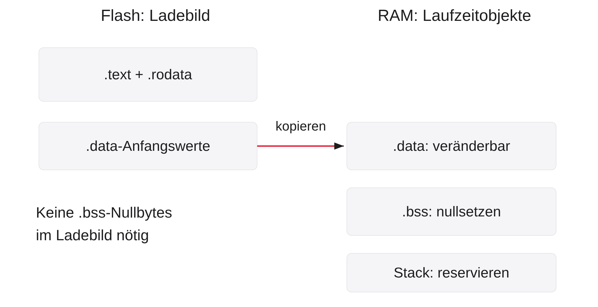{fig-alt="Flash enthält Code, Konstanten und die Anfangswerte für.data. RAM enthält die veränderbaren.data-Objekte sowie.bss undStack. Startcode kopiert die.data-Anfangswerte und setzt.bss aufnull. Das Abbild muss keine.bss-Nullbytes speichern."}

VMA: Laufzeitadresse · LMA: Adresse des Ladebilds.

::: notes
VMA bedeutet Virtual Memory Address, hier die vom Linker zugewiesene Laufzeitadresse eines Abschnitts. Sie verlangt in diesem Bare-Metal-Beispiel keine virtuelle Adressübersetzung. LMA heißt Load Memory Address, Adresse seines Ladebilds. Bare-Metal meint Firmware ohne Betriebssystem, jedoch mit Startcode und Hardwareinitialisierung. RAM steht für Random-Access Memory, wahlfreien Speicher; Flash speichert das Abbild nichtflüchtig.

`.data` enthält veränderbare Objekte mit vorgegebenen Anfangswerten. Im typischen Modell liegt deren Ladebild im Flash, während die laufzeitlichen Objekte im RAM liegen. Der Startcode kopiert vor Eintritt in die C-Anwendung die Initialwerte an die Laufzeitadressen. `.bss`, historisch Block Started by Symbol, enthält hier Objekte mit Nullinitialisierung: Ihr RAM-Bereich wird genullt, ohne für jedes Objekt Nullbytes im Flash-Abbild aufzubewahren. Der Stack ist der Speicherbereich für Aufrufverwaltung und automatische Objekte und wird getrennt reserviert.

Die Grafik zeigt den Kopierpfeil und den Nullsetzbereich; sie stellt keine automatisch ausgeführte Linkeraktion dar. `.text` für Code und `.rodata` für schreibgeschützte Daten verbleiben im gezeigten Modell im Flash. Andere Systeme können auch Code in RAM kopieren. Platzierung durch den Linker und Initialisierung durch Startcode sind verschiedene Vorgänge, deren Vereinbarung zusammenpassen muss.
:::

## Startup stellt die vereinbarte C-Umgebung her

{fig-alt="Vereinfachte Startfolge: Reset-Einstieg, nötige Prozessorinitialisierung und Stack, Kopieren der.data-Anfangswerte, Nullsetzen von.bss und anschließend main. Zusätzliche Plattforminitialisierung und Laufzeitfunktionen sind ausdrücklich zielabhängig."}

Der Linker berechnet Anordnung; der Startcode führt Initialisierung aus.

::: notes
Startup bezeichnet den Startcode der Firmware. Reset ist der definierte Einstieg nach einem Rücksetzen; main ist der gewöhnliche Einstieg in die C-Anwendung. Der Stack enthält unter anderem Aufrufinformationen und automatische Objekte. Seine Einrichtung und gegebenenfalls weitere Prozessorregister sind zielabhängig. Die Grafik gibt eine vereinfachte Abhängigkeitsfolge an und ist kein vollständiger RISC-V-Startcode; RISC steht für Reduced Instruction Set Computer.

Nachdem die nötige Ausführungsumgebung eingerichtet ist, kopiert Startcode die Anfangswerte von `.data` aus dem Ladebild zu den Laufzeitobjekten und setzt `.bss`, Block Started by Symbol, auf null. Erst danach darf die Anwendung voraussetzen, dass counter drei und buffer null enthält. Der Linker liefert dazu typischerweise Grenzen und Ladeadressen; er führt die Kopierschleife aber nicht beim Übersetzen auf dem Ziel aus.

Im optionalen Hostprogramm werden Kopieren und Nullsetzen an gültigen lokalen Arrays überprüft. Die Bereiche überlappen dort nicht, und ihre Längen sind vorgegeben. Dieses Modell prüft die Datenwirkung, keinen Reset-Vektor oder echten Gerätestart. Eine reale Plattform kann vor weiteren Funktionen zusätzliche Speichercontroller, Takte oder Laufzeitmechanismen benötigen. Daher sind die gezeigten Schritte eine Erklärung der Verantwortlichkeiten und keine universell sofort startfähige Firmware.
:::

## Linkerskript: Regionen und Abschnitte zuordnen

```ld
MEMORY {
  FLASH (rx) : ORIGIN = 0x00000000, LENGTH = 256K
  RAM  (rw) : ORIGIN = 0x10000000, LENGTH = 64K
}
SECTIONS {
  .text   : { *(.text*) }   > FLASH
  .rodata : { *(.rodata*) } > FLASH
  .data   : { *(.data*) }   > RAM AT> FLASH
  .bss (NOLOAD) : { *(.bss*) *(COMMON) } > RAM
}
```

Didaktischer GNU-ld-Ausschnitt; Startcode, Stack und weitere Abschnitte fehlen.

::: notes
GNU ld ist der Linker der GNU-Binutils-Werkzeuge; GNU steht für GNU's Not Unix. Seine Skriptsprache ist hier mit `ld` markiert. MEMORY definiert zwei Regionen mit Anfangsadresse ORIGIN und Länge LENGTH. Der Suffix K bedeutet in diesem Skript eine Größe mit Faktor 1024. Die Attribute rx und rw stehen für lesbar/ausführbar beziehungsweise lesbar/beschreibbar bei der Abschnittsauswahl; sie ersetzen keine programmierten Hardwareschutzrechte.

SECTIONS ordnet Eingabeabschnitte zu Ausgabeabschnitten. `*(.text*)` sammelt passende Codeabschnitte aller Eingabeobjekte, entsprechend funktioniert `.rodata`. `.data` wird mit `> RAM` an einer RAM-Laufzeitadresse angeordnet und erhält mit `AT> FLASH` ein Ladebild im Flash. RAM heißt Random-Access Memory. `.bss`, historisch Block Started by Symbol, wird mit NOLOAD als nicht zu ladender Bereich angeordnet; Startcode muss ihn trotzdem nullsetzen. COMMON berücksichtigt entsprechende gemeinsame uninitialisierte Symbole, falls die Werkzeugkonfiguration solche erzeugt.

Der Ausschnitt ist bewusst keine vollständige Firmwarekonfiguration. Einstieg, Ausrichtung, Startsymbole, Stackreservierung und weitere Zielabschnitte müssten mit der konkreten Plattform ergänzt werden. Unser überprüfbares Host-Objektbeispiel zeigt die typischen Eingabeabschnitte, nicht den erfolgreichen Boot dieses Skripts. Für eine Kapazitätsrechnung zählen `.data`-Initialwerte im Flash und `.data`-Objekte im RAM jeweils an ihrer eigenen Stelle.
:::

## Zellprinzip, Schnittstelle und Software zusammenführen

| Ebene | Beispiel | Eigene Frage |
|-------|----------|--------------|
| Zelle | 6T-SRAM oder 1T1C-DRAM | Wie bleibt der Zustand erhalten? |
| Zugriff | Ein-Port, Dual-Port, Controller | Welche Zugriffe sind möglich? |
| Organisation | Zeile, FIFO, Adressbereich | Wie werden Inhalte ausgewählt? |
| Software | Abschnitte und Startup | Wo liegen Objekte, wie beginnen sie? |

Vorlesung 2 nutzt diese Grundlage für Lokalität und Caches.

::: notes
Die Tabelle verbindet die heute entwickelten Ebenen. 6T-SRAM, Static Random-Access Memory mit sechs Transistoren, hält durch Rückkopplung. 1T1C-DRAM, Dynamic Random-Access Memory mit einem Transistor und einem Kondensator, benötigt Ladungsauswertung, Wiederherstellung und Refresh. Diese Zellprinzipien legen nicht allein die vollständige Zugriffsschnittstelle fest.

Ein-Port und Dual-Port beschreiben Zugriffsmöglichkeiten. Ein Controller setzt Anfragen in die jeweilige Speicherfunktion um. Eine Zeile ist eine gemeinsame Zellauswahl, FIFO bedeutet First In First Out und beschreibt eine Entnahmereihenfolge. Ein Adressbereich ordnet byteadressierte Zahlen Speicher oder Geräten zu. Abschnitte wie `.data` und Startcode erklären schließlich, wie C-Objekte platziert und initialisiert werden. Jede dieser Ebenen beantwortet eine eigene Frage.

Ein Cache ist ein Zwischenspeicher für Kopien von Inhalten, deren wiederholte oder benachbarte Nutzung Zugriffe beschleunigen kann. Lokalität nennt dieses räumliche oder zeitliche Nutzungsverhalten. Vorlesung 2 erklärt Treffer, Blöcke und Zuordnung vollständig; sie setzt hier nur das Verständnis von Kapazität, Adresse, Latenz und Bandbreite voraus. Deshalb wurden keine Cacheformeln für die heutige Pflichtübung vorweggenommen. Sie können nun Systemaussagen darauf prüfen, ob sie Zellbauart, Nutzung und Organisation unzulässig gleichsetzen.
:::

## Papierphase 4 und Abschlussquiz

Aufgaben 5–6: 15 Minuten · Quiz: 15 Minuten

- Vollständige Zugriffe und Speicherbedarf prüfen
- Ladebild, Laufzeitobjekt und Nullinitialisierung unterscheiden
- FIFO-Zustände erklären; anschließend Antworten begründen

::: notes
KiB bedeutet Kibibyte, $1024$ Byte. Im Datenlogger-Modell endet Flash exklusiv bei `0x00240000`, SRAM, Static Random-Access Memory, bei `0x21018000`. Die letzten Bytes liegen jeweils eins davor. Der Vier-Byte-Zugriff ab `0x21017FFC` passt und ist ausgerichtet. Ab `0x21017FFF` fehlen Platz und Ausrichtung; `0x21018000` ist bereits außerhalb. Code, Konstanten und die zusätzlichen Initialwerte benötigen $36+6+0{,}5=42{,}5$ KiB Flash. Veränderbare Initialdaten, Nullbereich und Stack brauchen $0{,}5+8+3=11{,}5$ KiB SRAM. Frei bleiben $213{,}5$ beziehungsweise $84{,}5$ KiB. Der Linker legt Bereiche fest, Startcode kopiert Initialwerte und setzt Nullbereiche. C-const allein erzwingt keinen physischen Flashort.

FIFO bedeutet First In First Out. Mit fünf Plätzen entstehen die Zustände $(r,w,count)$: $(0,1,1)$, $(0,2,2)$, $(0,3,3)$, $(0,4,4)$, nach Entnahme von K $(1,4,3)$, danach $(1,0,4)$ und $(1,1,5)$. Übrig bleiben L, M, N, P, Q in dieser Reihenfolge. R wird ohne Zustandsänderung abgewiesen. Gleiche Lese- und Schreibindizes können leer oder voll bedeuten; die Belegungszahl unterscheidet beides. Das Programmbild verlangt dauerhafte Speicherung, die häufig geänderten Zwischensummen passen zu SRAM.

Das Quiz enthält zehn Transferfragen mit genau einer richtigen Antwort. Begründen Sie die Wahl anhand der Annahmen, etwa Restore gegenüber Precharge oder const gegenüber physischer Platzierung. Die vollständigen Übungslösungen stehen im Lösungsprofil; die Aufgabenwerte unterscheiden sich bewusst von den vorgeführten Folienrechnungen.
:::

## Was Sie jetzt erklären können

- Flash ändern: Bits, Löschbereich und Zugriffsweg beachten
- SRAM und DRAM: Halten, Lesen und Wiederherstellen unterscheiden
- Kapazität, Datenrate und Adressgrenzen nachvollziehbar rechnen
- Firmware: Anordnung und Initialisierung auseinanderhalten

Literatur: Harris & Harris, *Digital Design and Computer Architecture — RISC-V Edition*; vertiefend Patterson & Hennessy, *Computer Organization and Design — RISC-V Edition*.

::: notes
Der Lernweg begann mit Bit und Byte und endete bei gültigen Firmwareobjekten. Nichtflüchtigkeit, wahlfreier Zugriff und Softwareverwendung sind unabhängige Fragen. Flashänderungen brauchen ein passendes Programmier- und Löschverfahren. XIP, Execute-in-Place, verlangt einen ausführbaren Leseweg des gesamten Systems. Ein Name wie NOR allein ist dafür keine ausreichende Garantie.

SRAM, Static Random-Access Memory, hält in der klassischen 6T-Zelle durch zwei kreuzgekoppelte Inverter und benötigt keinen periodischen Refresh. DRAM, Dynamic Random-Access Memory, nutzt im 1T1C-Modell gespeicherte Ladung; Lesen verändert ihren Abstand zum Referenzpegel. Verstärken und Restore stellen sie wieder her, Precharge bereitet danach die getrennte Bitleitung vor. Refresh erhält die Inhalte unter den spezifizierten Bedingungen.

Memory Map, Abschnittszuordnung und Startup erklären unterschiedliche Verantwortlichkeiten zwischen Hardware, Linker und Startcode. Die Literatur von Harris und Harris trägt die digitale und transistornahe Erklärung; Patterson und Hennessy vertiefen den Zusammenhang mit Rechnerorganisation und Speicherhierarchie. Unsere Zahlen und Schaltungen sind ausdrücklich Lehrmodelle, keine Messungen konkreter Chips. Übungsblatt, Musterlösung und Quiz greifen dieselben Voraussetzungen auf. Damit ist der Einstieg für Vorlesung 2 über Lokalität und Caches vorbereitet.
:::
