## Vom Speicherbaustein zum Cache

- Vorlesung 1: Speicherzellen, Memory Map und Linker
- Heute: Warum ein kleiner Zwischenspeicher viele Zugriffe beschleunigt
- Leitfrage: Welche Adressmuster passen zur Speicherhierarchie?

::: notes
In Vorlesung 1 haben Sie die Bausteine des Speichersystems kennengelernt. SRAM bedeutet Static Random Access Memory, statischer Speicher mit wahlfreiem Zugriff: Er hält seine Daten ohne Auffrischen, solange Spannung anliegt. DRAM bedeutet Dynamic Random Access Memory; seine Ladung muss regelmäßig aufgefrischt werden. SRAM ist meist schneller, benötigt aber mehr Chipfläche pro Bit. Deshalb lässt sich großer Arbeitsspeicher nicht einfach durch ebenso großen schnellen SRAM ersetzen.

Ein Cache ist ein kleiner Zwischenspeicher für Kopien ausgewählter Speicherblöcke. Wir untersuchen, wie er trotz seiner begrenzten Größe nützt. Die Memory Map, die Zuordnung von Adressbereichen zu Speicher und Geräten, bleibt dabei bestehen. Der Linker, der übersetzte Programmteile zusammenfügt und platziert, bestimmt nicht den aktuellen Cache-Inhalt. Der Schritt von der Speicherzelle zur Organisation erklärt schließlich, weshalb die Reihenfolge von C-Zugriffen einen Unterschied machen kann.
:::

## Unser Weg und Ihre Lernziele

1. Lokalität erklären: Wiederholung und Nachbarschaft
2. Treffer zählen und mittlere Zugriffszeit berechnen
3. Speicheradressen Cache-Plätzen zuordnen
4. Schreibzustände und Verdrängung nachvollziehen
5. C-Arrayzugriffe auf Papier vergleichen

::: notes
Für diese Vorlesung genügen die Begriffe Adresse und Daten aus Vorlesung 1 sowie einfache C-Arrays und Schleifen. Eine Adresse benennt eine Speicherstelle; ihr Inhalt ist das Datum. Wir nehmen einen byteadressierten Speicher an: Aufeinanderfolgende Adressen unterscheiden sich um ein Byte. Binärzahlen, Zweierpotenzen und der Rest einer ganzzahligen Division werden bei der Zuordnung nochmals erläutert.

Sie sollen nicht nur Begriffe wiedergeben, sondern einen Cache anhand einer kleinen Zugriffsspur, einer geordneten Liste von Adressen, schrittweise fortschreiben können. Zuerst begründen wir, welche Informationen sich zu behalten lohnen. Danach rechnen wir die Wirkung aus und erklären die Organisation. Die Schreibstrategien erweitern anschließend das Lesemodell. Zum Schluss wenden wir dieselben Regeln auf C an. Alle Zahlenbeispiele sind gewählte Lehrmodelle; eine berechnete Zugriffszeit ist noch keine gemessene Programmlaufzeit.
:::

## Vier Schulstunden: Ablauf

| Stunde | Vorlesungsphase | Arbeitsphase |
|--------|---------------------------|-------------|
| 1 | Folien 1–14: 35 min | Aufgabe 1: 10 min |
| 2 | Folien 15–25: 30 min | Aufgaben 2–3: 15 min |
| 3 | Folien 26–40: 30 min | Aufgaben 4–5: 15 min |
| 4 | Folien 41–48 und 50: 15 min | Aufgabe 6: 15 min; Quiz: 15 min |

::: notes
Vier Schulstunden umfassen hier viermal fünfundvierzig, also hundertachtzig Minuten Unterricht. Pausen kommen außerhalb dieser Unterrichtszeit hinzu. Der Ablauf verteilt sich auf hundertzehn Minuten Erklärung einschließlich kurzer Denkfragen, Aufgabenbesprechungen und Diskussion, fünfundfünfzig Minuten angeleitete Papierübungen und fünfzehn Minuten Abschlussquiz. Die fünfzig Folien dienen als Gesprächsgrundlage; ein Rechenbeispiel benötigt mehr Zeit als eine Orientierungsfolie.

In der ersten Stunde werden Begriffe und Lokalität eingeführt. Die zweite verbindet Trefferzahlen mit Zugriffszeiten und Platzzuordnung, dem Mapping. Assoziativität bedeutet die Anzahl zulässiger Plätze pro Cache-Set und leitet in der dritten Stunde zu Schreibregeln über. Die vierte wendet diese Regeln auf C-Arrayzugriffe an. Die Arbeitsphasen nutzen die sechs Aufgaben aus Übungsblatt 2 in dieser Reihenfolge. Die Bereiche in der Tabelle sind die sichtbaren Foliennummern; Folie 49 leitet das Abschlussquiz ein, Folie 50 schließt die Auswertung ab. Für selbstständiges vollständiges Bearbeiten nennt das Blatt weiterhin sechzig bis fünfundsiebzig Minuten; im Unterricht werden Zwischenschritte angeleitet und Lösungen anschließend gemeinsam erläutert. Die Zeitverteilung ist ein Planungsrichtwert und kann innerhalb einer Stunde an Rückfragen angepasst werden.
:::

## Warum Warten teuer wird

Didaktisches Beispiel: Prozessortakt $f=1\,\mathrm{GHz}$, Speicherlatenz $t=100\,\mathrm{ns}$.

$$
T=\frac{1}{f}=1\,\mathrm{ns}, \qquad n=\frac{t}{T}=100\ \text{Takte}
$$

- Latenz: Zeit von der Anfrage bis zu den benötigten Daten
- Ein abhängiger Folgebefehl muss auf diese Daten warten
- Mehr übertragenes Datenvolumen ersetzt keine kurze Latenz

::: notes
Die Latenz beschreibt die Wartezeit auf eine Antwort. Bei der angenommenen Frequenz von einem Gigahertz, einer Milliarde Taktperioden pro Sekunde, dauert eine Periode $T$ genau eine Nanosekunde. Die angenommene Speicherlatenz $t$ von hundert Nanosekunden umfasst somit hundert Taktperioden. $n$ zählt diese Perioden; die Einheiten kürzen sich bei der Division. Das ist ein Rechenbeispiel, kein Datenblatt eines bestimmten RISC-V-Prozessors.

Wenn eine Addition gerade den angeforderten Wert braucht, kann sie erst mit diesem Wert rechnen. Andere unabhängige Arbeit kann eine geeignete Implementierung gegebenenfalls überlappen; das behandeln wir später. Bandbreite bedeutet dagegen Datenmenge pro Zeit bei fortlaufender Übertragung. Eine breite Datenverbindung kann viel liefern, obwohl die erste Antwort spät kommt. Das als Memory Wall, Speichermauer, bezeichnete Problem ist die Begrenzung der Rechenleistung durch das Speichersystem. Ein Cache versucht, häufig benötigte Antworten näher am Rechenkern bereitzuhalten.
:::

## Die Speicherhierarchie

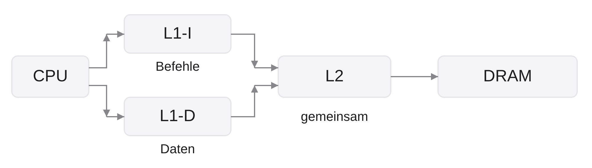{fig-alt="Befehls- und Datenzugriffe laufen über getrennte erste Cache-Ebenen zu gemeinsamem Cache und Hauptspeicher."}

- Nähe: wenig Kapazität, kurze Zugriffszeit
- L1-Miss: zuerst die nächste Ebene anfragen

::: notes
Die Abbildung liest sich von links nach rechts. CPU steht für Central Processing Unit, zentrale Verarbeitungseinheit. L1 bedeutet Level 1, erste Cache-Ebene. L1-I hält Instructions, Befehle, und bedient deren Abruf, den Fetch. L1-D hält Data, Daten, und bedient Lese- und Schreibzugriffe. Zwei getrennte erste Caches können gleichzeitigen Befehlsabruf und Datenzugriff ermöglichen, ohne denselben Speicherport zu beanspruchen.

L2, Level 2, ist hier ein gemeinsamer Cache für Befehle und Daten. Die Pfeile beschreiben Anfragen an die jeweils nächste Ebene; sie sind keine maßstäbliche Zeitachse. DRAM, Dynamic Random Access Memory, ist in diesem Modell der große dynamische Hauptspeicher. Eine weitere Cache-Ebene wäre möglich. Ein Fehlschlag in L1 bedeutet deshalb nicht automatisch einen DRAM-Zugriff.

Die Kästen zeigen die funktionale Verbindung, keine realen Chipflächen. RISC-V ist eine Befehlssatzarchitektur; daraus folgt weder eine bestimmte Cache-Größe noch, dass überhaupt ein Cache vorhanden ist. Ein kleiner Mikrocontroller kann direkt auf seinen Arbeitsspeicher zugreifen. Damit die Hierarchie nützt, müssen kleine obere Ebenen die richtigen Daten enthalten. Dies erklärt das Lokalitätsprinzip.
:::

## Gleiche Adresse, anderer Lieferweg

- Ein Cache verschiebt weder das Array noch seinen Adressbereich
- Der Linker legt Programmteile ab, nicht den aktuellen Cache-Inhalt
- Ein gewöhnlicher Load kann von verschiedenen Ebenen bedient werden
- Cache-Kopie und Originalblock gehören zur selben Speicheradresse

::: notes
Die Hierarchie verändert den Lieferweg einer Speicheranfrage, nicht die Bedeutung ihrer Adresse. Ein Load ist ein Lesezugriff. Wenn ein Arrayelement an Adresse `0x1000` liegt, bleibt die Anfrage an diese Adresse gerichtet, auch wenn eine Kopie aus einem Cache antwortet. Eine Cache-Zeile ist keine neue Adresse, auf die das C-Programm seinen Zeiger umsetzen müsste.

Die Memory Map, die Zuordnung von Adressbereichen zu Speicher und Geräten, wurde in Vorlesung 1 besprochen. Der Linker fügt übersetzte Programmteile zusammen und platziert sie in diesen Bereichen. Er bestimmt beispielsweise, wo ein Array im Speicher liegt. Welche seiner Blöcke gerade gültige Cache-Kopien haben, ergibt sich dagegen während der Ausführung aus Anfragen und Verwaltungsregeln.

Eine typische Fehlannahme lautet: Nach dem ersten Zugriff liegt das Array nur noch im Cache. Tatsächlich hält der Cache ausgewählte Blockkopien; das Programm adressiert weiterhin seine Speicherstellen. Bei späterem Verdrängen wird kein Arrayzeiger ungültig. Die konkrete Plattform regelt, welche Speicherbereiche cachefähig sind. Für den folgenden Lokalitätsvergleich bleiben wir bei normalem cachefähigem Speicher. Entscheidend ist nun, welche Kopien bald wieder gebraucht werden.
:::

## Zeitliche Lokalität: bald wieder dieselbe Adresse

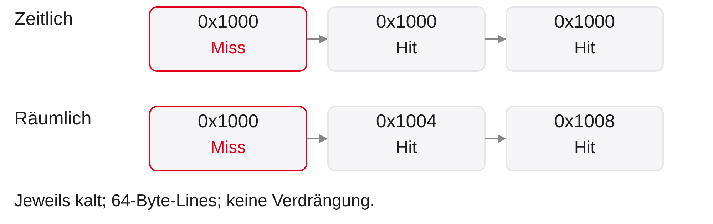{fig-alt="Zwei getrennte Zugriffsspuren: Wiederholung derselben Adresse und Zugriff auf benachbarte Wörter."}

- Zeitlich: Eine kürzlich genutzte Adresse wird erneut benötigt
- Ein geladener Block bleibt verfügbar, solange er nicht verdrängt wird

::: notes
Zeitliche Lokalität, Temporal Locality, bezeichnet die Wiederverwendung derselben Speicherstelle in kurzer Zeit. In der oberen Spur wird dreimal die Adresse `0x1000` gelesen. Das Präfix `0x` kennzeichnet hexadezimale Schreibweise. Beim ersten Zugriff ist der Cache kalt, noch ohne gültige Kopien: Es entsteht ein Miss, ein Fehlschlag. Anschließend kann dieselbe gespeicherte Kopie zweimal liefern; das sind Hits, Treffer.

Die untere Spur beginnt unabhängig davon ebenfalls mit einem kalten Cache. Dort steigen die Adressen um jeweils vier Byte. Sie illustriert räumliche Lokalität. Die beiden Spuren dürfen nicht als eine gemeinsame Folge gezählt werden. Die Beschriftungen tragen die Bedeutung, Rot markiert den Fehlschlag; eine Farbe allein ist nicht nötig, um das Bild zu verstehen.

Eine wiederholte Nutzung in C kann sich auch auf Register beziehen. Ein Schleifenzähler, den der Compiler in einem Register hält, verursacht nicht automatisch jedes Mal einen Daten-Cache-Zugriff. Deshalb zählen wir hier ausdrücklich Adressanfragen an den Cache. Die entscheidende Frage ist, welche dieser Anfragen dieselbe Kopie nutzen können.
:::

## Räumliche Lokalität: Nachbarn gemeinsam holen

- Räumlich: Benachbarte Adressen werden zeitnah benötigt
- Beim Miss wird ein ganzer zusammenhängender Block beschafft
- Die Verwaltungseinheit heißt Cache-Line oder Cache-Block

Bei $4$ Byte pro Element passen $16$ Elemente in einen $64$-Byte-Block.

::: notes
Räumliche Lokalität, Spatial Locality, bedeutet Nutzung benachbarter Speicherstellen. Ein Arraydurchlauf ist ein typisches Beispiel. Ein Cache verwaltet deshalb nicht jedes Byte separat, sondern zusammenhängende Blöcke, häufig Cache-Lines genannt. Bei einem Miss kann er Nachbarn mit aus der nächsten Ebene holen. Diese Nachbarn werden später durch einen normalen Zugriff als Hit genutzt; der Cache muss dafür den Quelltext nicht verstehen oder die nächste Adresse erraten.

Im Beispiel beträgt die Blockgröße $64$ Byte und ein Element belegt $4$ Byte. Die Division $64/4=16$ ergibt sechzehn Elemente. Das gilt für sechzehn vollständig in einem Block liegende Elemente, etwa bei entsprechend ausgerichtetem Arrayanfang. Ein beliebig beginnendes Array muss seine ersten sechzehn Elemente nicht in derselben Line haben.

Die untere Spur der vorigen Abbildung liest `0x1000`, `0x1004` und `0x1008`. Alle drei gehören zum Block `0x1000` bis `0x103F`. Nach dem ersten Miss folgen zwei Hits, sofern keine Verdrängung stattfindet. Größere Blöcke helfen bei solchen Folgen, verbrauchen aber auch Platz für möglicherweise ungenutzte Nachbarn.
:::

## Arbeitsmenge: Was muss im Cache bleiben?

- Working Set: während einer Phase wiederholt benötigte Blöcke
- Nicht das gesamte Programm muss gleichzeitig hineinpassen
- Kapazität genügt nur zusammen mit geeigneter Platzwahl

Beispiel: $8$ wiederverwendete Lines zu je $64$ Byte benötigen $512$ Byte Datenplätze.

::: notes
Working Set bedeutet Arbeitsmenge: die Speicherblöcke, die ein Programm in einer betrachteten Phase wiederholt benötigt. Das ist keine unveränderliche Eigenschaft des gesamten Programms. Eine Phase kann etwa eine innere Schleife sein; die nächste arbeitet möglicherweise mit anderen Daten. Lines sind Cache-Blöcke, also zusammenhängende Verwaltungseinheiten.

Acht wiederverwendete Lines mit je vierundsechzig Byte brauchen $8\cdot64=512$ Byte Datenkapazität. Ein insgesamt sehr großes Programm kann daher in einer kleinen wiederholten Teilaufgabe gute Trefferquoten erreichen. Umgekehrt können schon wenige Blöcke Konflikte erzeugen, wenn sie dieselben zulässigen Plätze benötigen. Die reine Summe der Datenbytes reicht deshalb noch nicht, um Treffer vorherzusagen; die Platzzuordnung wird später ergänzt.

Stellen Sie sich vor, eine Schleife liest dieselben acht Blöcke immer wieder. In einem anfangs leeren Cache entstehen zunächst Fehlschläge. Wenn alle acht passend untergebracht sind und bis zur Wiederverwendung erhalten bleiben, treffen spätere Durchläufe. Ein einmaliger langer Durchlauf ohne Wiederholung profitiert dagegen vor allem von Nachbarn innerhalb eines Blocks. Diese Unterscheidung erklärt, weshalb wir beim Zählen sowohl die Zugriffsspur als auch die betrachtete Programmphase benennen.
:::

## Blockgrenze und Offset

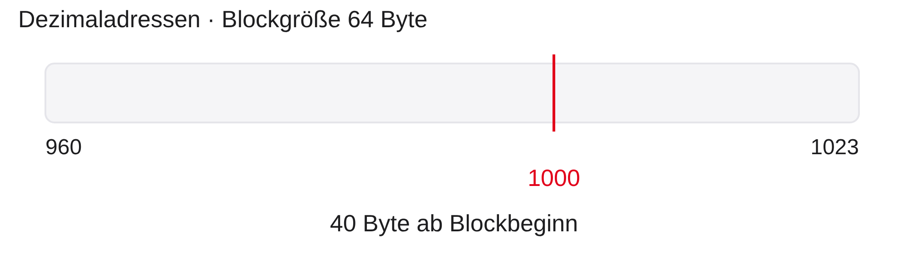{fig-alt="Eine 64-Byte-Line umfasst die Dezimaladressen 960 bis 1023; die Adresse 1000 liegt 40 Byte hinter dem Beginn."}

Für Byteadresse $a$ und Blockgröße $B$:

$$
q=\left\lfloor a/B\right\rfloor,\quad a_\text{Basis}=qB,\quad o=a\bmod B
$$

::: notes
Die Blocknummer $q$ entsteht, indem die Byteadresse $a$ ganzzahlig durch die Blockgröße $B$ geteilt wird. Die Abrundungsklammer bedeutet: Der nicht ganze Rest wird verworfen. Der Block beginnt an $a_\text{Basis}=qB$. Der Offset $o$, deutsch Versatz, ist der Rest und bezeichnet die Position des gesuchten Bytes innerhalb des Blocks. Das Zeichen $\bmod$ steht für diesen Divisionsrest.

In der Abbildung sind die Adressen ausdrücklich dezimal. Für $a=1000$ und $B=64$ ist $q=15$, denn $15\cdot64=960$ und $16\cdot64=1024$. Die Basis ist $960$, der Offset $1000-960=40$. Die letzten enthaltenen Bytes liegen bei $960+63=1023$. Die rote Markierung liegt entsprechend bei Position vierzig im gezeichneten Band. Ein Miss auf Adresse 1000 lädt also nicht den Bereich 1000 bis 1063.

Blockgrenzen sind für die spätere Adresszerlegung wesentlich. Bei einer Zweierpotenz als Blockgröße kann der Offset direkt aus den unteren Adressbits gewonnen werden. Zunächst reicht die Rechnung mit Division und Rest.
:::

## Blockgröße: Nutzen und Preis

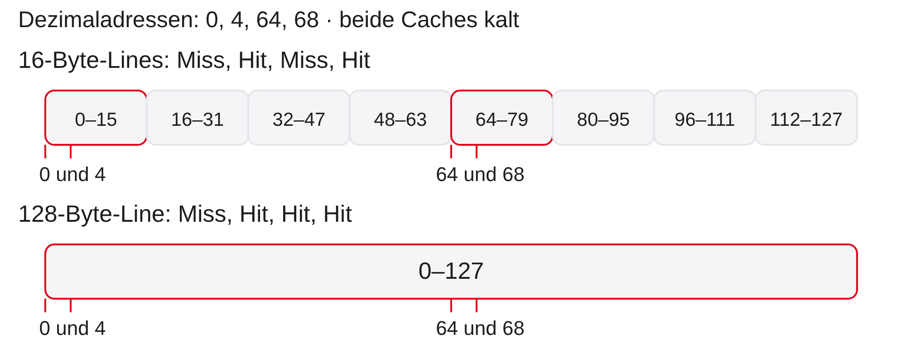{fig-alt="Die Adressen 0, 4, 64 und 68 benötigen bei 16-Byte-Blöcken zwei Fills, bei 128-Byte-Blöcken einen. Größere Blöcke fassen mehr Nachbarn zusammen."}

Gleiche Datenkapazität $256$ Byte: $16$ kleine oder $2$ große Lines.

::: notes
Die Abbildung zeigt zwei unabhängige, kalt beginnende Cache-Modelle mit gleicher Datenkapazität von zweihundertsechsundfünfzig Byte. Alle Adressen sind dezimal. Die obere Reihe teilt den Bereich null bis hundertsiebenundzwanzig in Blöcke zu sechzehn Byte. Die untere zeigt einen einzigen Block zu hundertachtundzwanzig Byte. Die Breiten stellen Adressbereiche dar, nicht Zeit. Die roten Markierungen zeigen die angefragten Stellen null, vier, vierundsechzig und achtundsechzig; Beschriftungen fassen die eng benachbarten Paare zusammen.

Bei sechzehn Byte pro Line, also Cache-Block, liegt null mit vier im ersten Block und vierundsechzig mit achtundsechzig im fünften. Die Folge ergibt Miss, Hit, Miss, Hit. Ein Miss ist ein Fehlschlag, ein Hit ein Treffer; ein Fill ist das Beschaffen der Line. Bei hundertachtundzwanzig Byte gehören alle vier Anfragen zu derselben Line: Miss, Hit, Hit, Hit. Die größere Line nutzt hier räumliche Lokalität besser.

Die feste Kapazität erlaubt aber $256/16=16$ kleine beziehungsweise $256/128=2$ große Einträge. Schon drei wiederholt benötigte, weit voneinander entfernte große Blöcke können nicht gleichzeitig in zwei Einträgen bleiben. Kleinere Blöcke erlauben mehr getrennte Kopien; ob sie passend untergebracht werden, klärt später die Platzzuordnung. Größer ist somit nicht grundsätzlich besser. Übertragungszeit und ungenutzte Nachbarbytes sind weitere Kosten; konkrete Zeiten werden hier nicht behauptet.
:::

## Array und verkettete Liste

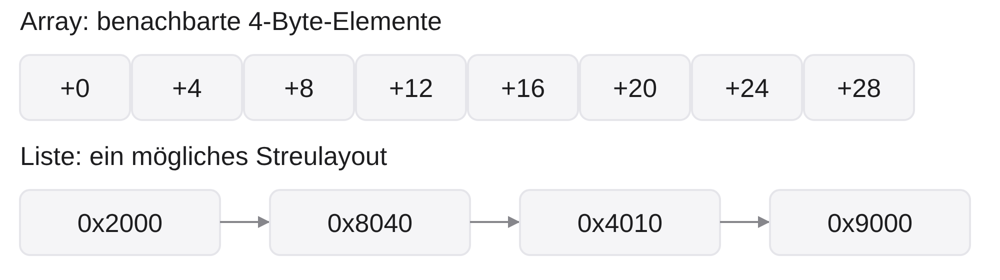{fig-alt="Ein Array hat zusammenhängende Elemente; eine beispielhafte Liste verbindet weit auseinanderliegende Knoten per Zeiger."}

- Arraydurchlauf: mitgeladene Nachbarn werden bald genutzt
- Verstreute Liste: der nächste Knoten kann in einem anderen Block liegen
- Das tatsächliche Layout entscheidet, nicht allein der Datentyp

::: notes
Das obere Band zeigt die ersten acht Wörter eines Arrays mit vier Byte pro Wort. Die angegebenen Versätze $+0,+4,\ldots,+28$ liegen in derselben angenommenen 64-Byte-Line. Ein Zugriff auf den Anfang beschafft also auch die gezeichneten Nachbarn. Das Band stellt Adressnähe dar, keine Taktfolge.

Unten sind vier Knoten einer verketteten Liste gezeigt. Ein Knoten enthält Daten und einen Zeiger auf den nächsten Knoten. Die Pfeile folgen den Zeigern in der Reihenfolge `0x2000`, `0x8040`, `0x4010`, `0x9000`, nicht der numerischen Adressreihenfolge. Bei diesem möglichen Streulayout liegt jeder Knoten in einer anderen Line. Die Nachbarbytes des ersten Knotens helfen beim nächsten dann wenig. Außerdem muss der nächste Zeigerwert zunächst gelesen werden, bevor die folgende Adresse bekannt ist.

Listen sind jedoch nicht grundsätzlich verstreut; ein Speicherpool kann ihre Knoten zusammenhängend ablegen. Umgekehrt kann ein Array mit großen Zugriffssprüngen schlechte Lokalität zeigen. Die praktische Folgerung lautet, das Speicherlayout und die Zugriffsmuster gemeinsam zu betrachten. Eine allgemeine Laufzeitquote lässt sich daraus nicht ableiten.
:::

## Was macht einen Treffer aus?

Ein Eintrag enthält:

| Feld | Aufgabe |
|------|---------|
| Daten | Kopie eines ganzen Blocks |
| Tag | Kennzeichnung des gespeicherten Blocks |
| Valid | Gültigkeit des Eintrags |

- Hit: gültiger Eintrag für den angefragten Block
- Miss: keine solche Kopie in dieser Cache-Ebene

::: notes
Ein Cache-Hit ist ein Treffer auf eine gültige Kopie des angefragten Blocks. Ein Tag, wörtlich Etikett, kennzeichnet dabei den Block zusammen mit seinem später eingeführten Platzindex. Das Valid-Bit ist das Gültigkeitsbit: Eins bedeutet verwendbar, null bedeutet ungültig. Beim Kaltstart setzen wir alle Valid-Bits auf null; zufällige Daten oder ein zufällig passendes Tag dürfen keinen Treffer vortäuschen.

Ein Miss besagt nur, dass die betrachtete Ebene nicht liefern kann. Die nächste Ebene kann durchaus treffen. Beim Nachladen, auch Fill genannt, wird der Eintrag mit passenden Daten und passendem Tag gefüllt und gültig gemacht. Der Offset wählt daraus das angeforderte Byte oder Wort.

Diese Verwaltung läuft bei gewöhnlichem cachefähigem Speicher meist transparent, ohne explizite Befehle im C-Programm. Nicht jeder Adressbereich ist cachefähig: Geräteadressen können besondere Eigenschaften besitzen. Das Lesemodell beschränkt sich daher auf normalen Speicher, einen Prozessor und vollständig abgeschlossene Zugriffe. Als Nächstes zählen wir Treffer und Fehlschläge in solchen Folgen.
:::

## Kalt und warm: fair vergleichen

Kalter Cache, $64$-Byte-Lines, keine Verdrängung:

`0x1000, 0x1004, 0x1040, 0x1000`

1. Zählen Sie Hits und Misses im ersten Durchlauf.
2. Wiederholen Sie dieselbe Folge ohne Reset.
3. Warum darf man diese beiden Trefferquoten nicht gleichsetzen?

::: notes
Kalt bedeutet, dass zu Beginn kein gültiger Cache-Eintrag vorhanden ist. Warm bedeutet, dass vorherige Zugriffe gültige Kopien hinterlassen haben. Das Valid-Bit, Gültigkeitsbit, ist beim kalten Start null und nach erfolgreichem Nachladen eins. Im Beispiel gibt es genug zulässige Plätze für beide angeforderten Blöcke; es findet keine Verdrängung und kein Vorabladen statt. Das Präfix `0x` kennzeichnet hexadezimale Adressen.

`0x1000` und `0x1004` gehören bei vierundsechzig Byte pro Line zum selben Block. `0x1040` liegt im nächsten. Im ersten Durchlauf lautet die Bilanz Miss, Hit, Miss, Hit: zwei Fehlschläge und zwei Treffer, Hit Rate beziehungsweise Trefferquote $2/4=50\,\%$. Die letzte Anfrage findet die zuerst geladene Kopie weiterhin vor.

Ohne Zurücksetzen bleiben beide Blocks gültig. Der zweite Durchlauf hat vier Hits und keine Misses, also hundert Prozent Treffer. Werden beide Durchläufe zusammen ausgewertet, ergeben sich sechs Hits bei acht Anfragen, also fünfundsiebzig Prozent. Das sind drei unterschiedliche Auswertungsfenster, keine widersprüchlichen Ergebnisse. Für einen fairen Variantenvergleich muss jede Variante mit demselben dokumentierten Zustand beginnen. Die Aufgabe lässt sich kurz zu zweit beantworten; sie bereitet die Trefferzählung im Übungsblatt vor.
:::

## Trefferquote ist eine Eigenschaft der Spur

$$
h=\frac{N_H}{N},\qquad m=\frac{N_M}{N}=1-h,\qquad N=N_H+N_M
$$

Beispiel: $N=100$, davon $N_H=95$ Hits und $N_M=5$ Misses.

- Hit Rate $h=0{,}95$, Miss Rate $m=0{,}05$
- Startzustand, Cache-Konfiguration und Zugriffsspur mit angeben

::: notes
$N$ ist die Anzahl der betrachteten Zugriffe, $N_H$ die Trefferzahl und $N_M$ die Fehlschlagzahl. Hit Rate bedeutet Trefferquote $h$, Miss Rate Fehlschlagquote $m$. In unserem einfachen Modell endet jede Anfrage genau als Hit oder Miss, daher ergänzen sich die beiden Quoten zu eins. Die Quoten sind dimensionslose Anteile; $0{,}95$ entspricht $95\,\%$.

Bei hundert Anfragen mit fünfundneunzig Hits und fünf Misses erhalten wir $h=95/100=0{,}95$ und $m=5/100=0{,}05$. Eine hohe Trefferquote ist keine Vorhersagegenauigkeit: Sie beschreibt die nach den Cache-Regeln gezählte oder gemessene Folge. Eine andere Folge kann auf demselben Cache ganz anders ausfallen.

Ein warmer Cache enthält bereits gültige Blöcke, ein kalter Cache beginnt leer. Auch diese Wahl verändert die Quote. Für einen fairen Vergleich müssen Startzustand, Blockgröße, Datenkapazität und Folge festgelegt sein. Die Trefferquote allein sagt zudem nicht, wie viel ein Miss kostet. Dazu verbinden wir sie jetzt mit einem Zeitmodell.
:::

## Mittlere Zugriffszeit: AMAT

Ein blockierendes Ein-Ebenen-Modell:

$$
\mathrm{AMAT}=t_H+m\,p
$$

- AMAT: Average Memory Access Time
- $t_H$: Zeit der Cache-Prüfung, bei jedem Zugriff
- $p$: zusätzliche Miss Penalty, nur beim Miss
- Miss-Gesamtzeit: $t_H+p$

::: notes
AMAT steht für Average Memory Access Time, mittlere Speicherzugriffszeit. Die Hit Time $t_H$ ist hier die Zeit für Prüfung und Lieferung bei einem Treffer. Jeder Zugriff durchläuft diese Prüfung. Die Miss Penalty $p$ ist ausdrücklich die zusätzliche Zeit für einen Fehlschlag, etwa zum Beschaffen des Blocks aus der nächsten Ebene. Ein Miss dauert somit insgesamt $t_H+p$, nicht nur $p$.

Die Formel ergibt sich aus dem gewichteten Mittel: $h\,t_H+m(t_H+p)=(h+m)t_H+mp=t_H+mp$. Die Miss Rate $m$ ist ein Anteil zwischen null und eins, keine ungeteilte Prozentzahl. Alle Zeiten müssen in derselben Einheit stehen, zum Beispiel Takte oder Nanosekunden.

Wir nehmen eine konstante Hit Time, eine konstante zusätzliche Penalty und nacheinander vollständig abgeschlossene Zugriffe an. Ein Writeback, das Zurückschreiben eines veränderten Blocks, ist in diesem ersten Lesemodell noch nicht enthalten. Reale Systeme können Anfragen überlappen und mehrere Ebenen haben. Die Formel beschreibt hier die einzelne mittlere Zugriffszeit; sie enthält weder die Zahl der Zugriffe eines Programms noch dessen übrige Rechenarbeit.
:::

## AMAT: Rechenbeispiel

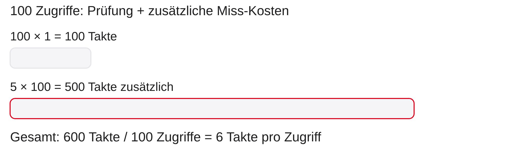{fig-alt="Von 100 Anfragen kosten alle einen Takt Prüfung; fünf Misses kosten zusätzlich jeweils 100 Takte."}

$$
t_H=1,\quad p=100,\quad h=0{,}95
\quad\Rightarrow\quad \mathrm{AMAT}=6\ \text{Takte}
$$

Und bei $h=0{,}80$? Begründen Sie den Unterschied.

::: notes
AMAT bedeutet Average Memory Access Time, mittlere Speicherzugriffszeit. In der Abbildung stehen hundert kurze Prüfungen oben und fünf zusätzliche lange Miss-Kosten unten. Die Breiten vergleichen die aufsummierten Takte: $100\cdot1=100$ Takte Prüfung und $5\cdot100=500$ Takte zusätzliche Wartezeit. Rot markiert nur diese Zusatzkosten. Die Gesamtzeit der hundert Modellanfragen beträgt $600$ Takte, also im Mittel sechs Takte pro Anfrage.

Mit Hit Rate $h=0{,}95$ ist die Miss Rate $m=1-h=0{,}05$. Aus $t_H=1$ Takt Hit Time und $p=100$ Takten zusätzlicher Miss Penalty folgt $1+0{,}05\cdot100=6$ Takte. Bei $h=0{,}80$ ist $m=0{,}20$, also $\mathrm{AMAT}=1+0{,}20\cdot100=21$ Takte. Ein einzelner Miss dauert in beiden Rechnungen $101$ Takte.

Typische Fehler sind, nur $mp$ zu rechnen oder $20$ statt $0{,}20$ einzusetzen. Die höhere mittlere Zugriffszeit kann Speicherzugriffe verteuern. Ein Programmbeschleunigungsfaktor folgt aber nicht direkt: Dafür müssten auch übrige Befehle, Anfrageanzahl und mögliche Überlappung bekannt sein. Nun stellt sich die Organisationsfrage: Welcher Block darf wo gespeichert werden?
:::

## AMAT rückwärts: erforderliche Trefferquote

Lehrmodell: $t_H=1$ Takt, zusätzliche Penalty $p=100$ Takte.

Ziel: $\mathrm{AMAT}\leq5$ Takte.

$$
1+(1-h)\cdot100\leq5
$$

Welche Hit Rate $h$ ist mindestens erforderlich?

::: notes
AMAT steht für Average Memory Access Time, mittlere Speicherzugriffszeit. $t_H$ ist die Hit Time, die Prüfzeit bei jedem Zugriff. $p$ ist die zusätzliche Miss Penalty, die Zusatzzeit beim Fehlschlag. $h$ ist die Hit Rate, Trefferquote als Anteil zwischen null und eins. Wir verwenden dasselbe serielle Ein-Ebenen-Modell mit einem Takt Prüfung und hundert Takten Zusatzzeit.

Die bisherige Rechnung bestimmte die Zugriffszeit aus der Quote. Nun fragen wir umgekehrt nach der nötigen Quote für ein vorgegebenes Ziel. Von $1+(1-h)\cdot100\leq5$ ziehen wir zuerst einen Takt ab. Es bleibt $(1-h)\cdot100\leq4$. Die Division durch die positive Zahl hundert ergibt $1-h\leq0{,}04$. Die Miss Rate darf somit höchstens vier Prozent betragen. Umgestellt folgt $h\geq0{,}96$, also mindestens sechsundneunzig Prozent Treffer.

Zur Kontrolle: Bei genau sechsundneunzig Prozent ist die mittlere Zeit $1+0{,}04\cdot100=5$ Takte. Fünfundneunzig Prozent ergeben dagegen sechs Takte und verfehlen das Ziel. Eine häufige Fehlannahme ist, dass schon jede sehr hohe Quote genügt. Das Ziel hängt auch von der Zusatzzeit eines Miss ab. Die Rechnung garantiert keine Programmlaufzeit; sie gilt für die beschriebenen Anfragen und Modellzeiten.
:::

## Zwei Cache-Ebenen: wo endet ein Miss?

Lehrmodell, alle Zeiten im selben Prozessortakt:

| Größe | Annahme |
|-------|---------|
| L1-Prüfung und lokale Miss Rate | $1$ Takt; $10\,\%$ |
| L2-Prüfung und lokale Miss Rate | $8$ Takte; $20\,\%$ |
| zusätzliche Zeit nach L2-Miss | $80$ Takte |

$$
\mathrm{AMAT}=1+0{,}10\,(8+0{,}20\cdot80)=3{,}4\ \text{Takte}
$$

::: notes
L1 bedeutet Level 1, erste Cache-Ebene, L2 Level 2, zweite Ebene. AMAT bedeutet Average Memory Access Time, mittlere Speicherzugriffszeit. Wir erweitern das Lesemodell und legen neue didaktische Zeiten fest. Jeder Zugriff zahlt einen Takt L1-Prüfung. Die L1-Miss Rate, lokale Fehlschlagquote, beträgt zehn Prozent. Nur diese Anfragen erreichen L2 und kosten dort acht weitere Takte Prüfung. Von den Anfragen an L2 verfehlen wiederum zwanzig Prozent diese Ebene und kosten weitere achtzig Takte für die untere Ebene. Alle Zeiten beziehen sich auf dieselbe Taktperiode und werden seriell addiert.

Die durchschnittliche Zusatzzeit einer Anfrage an L2 ist $8+0{,}20\cdot80=24$ Takte. Diese fällt für den Anteil $0{,}10$ aller ursprünglichen Anfragen an. Daher ist die gesamte mittlere Zeit $1+0{,}10\cdot24=3{,}4$ Takte. Die zwanzig Prozent beziehen sich ausdrücklich nicht auf alle L1-Anfragen. Der Anteil, der beide Ebenen verfehlt, ist $0{,}10\cdot0{,}20=0{,}02$, zwei Prozent.

Eine Kontrolle mit hundert Anfragen macht die Bedingtheit deutlich: neunzig enden nach einem Takt in L1, acht nach neun Takten in L2, zwei nach neunundachtzig Takten unten. Somit $(90\cdot1+8\cdot9+2\cdot89)/100=3{,}4$ Takte. Writebacks, Zurückschreiben geänderter Lines, und Überlappung sind ausgeschlossen. Das Beispiel zeigt, weshalb ein L1-Miss nicht automatisch die volle Hauptspeicherwartezeit verursacht.
:::

## Unser Referenzmodell für das Mapping

| Größe | Festlegung |
|-------|------------|
| Adresse | $P=32$ Bit, byteadressiert |
| Datenkapazität | $C=32\,\mathrm{KiB}=32768$ Byte |
| Blockgröße | $B=64$ Byte |
| Anzahl gespeicherter Blöcke | $L=C/B=512$ |

- Tags und Zustandsbits zählen nicht zur Datenkapazität
- Zunächst Direct Mapped: ein Platz pro Set

::: notes
Mapping heißt Zuordnung: Ein Block aus dem großen Adressraum muss einen zulässigen Platz im kleinen Cache bekommen. Wir legen dafür ein Referenzmodell fest, das bis zum Matrixbeispiel gilt. $P$ ist die Breite einer Byteadresse in Bit. Mit zweiunddreißig Bit lassen sich $2^{32}$ Bytepositionen benennen. Die Datenkapazität $C$ umfasst ausschließlich gespeicherte Nutzdaten. Ein Kibibyte, geschrieben KiB, hat $1024$ Byte. Deshalb sind $32$ KiB gleich $32768$ Byte.

Die Blockgröße $B$ beträgt $64$ Byte. Somit passen $L=C/B=32768/64=512$ Blöcke in den Cache. Metadaten wie Tag und Valid benötigen zusätzlich Speicher. Wer sie zur festgelegten Datenkapazität addiert, ändert das Modell.

Direct Mapped, direkt abgebildet, bedeutet einen fest zugeordneten Platz pro Set. Ein Set ist eine Menge von Cache-Plätzen, in denen ein Block liegen darf; hier hat jedes Set nur einen Platz. Es gibt daher $512$ Sets. Die Zuordnung muss schnell berechenbar sein und darf nicht vom zufälligen Inhalt des C-Programms abhängen.
:::

## Direct Mapped: Division mit Rest

Für Blocknummer $q$ und $S=512$ Sets:

$$
i=q\bmod S,\qquad t=\left\lfloor q/S\right\rfloor
$$

| Blocknummer $q$ | Index $i$ | Tag $t$ |
|----------------|-----------|---------|
| $0$ | $0$ | $0$ |
| $511$ | $511$ | $0$ |
| $512$ | $0$ | $1$ |

::: notes
Direct Mapped ist die direkte Zuordnung eines Speicherblocks zu genau einem Cache-Platz. Die Blocknummer $q$ wurde aus der Byteadresse durch Division durch die Blockgröße gewonnen. Der Set-Index $i$ ist der Rest bei Division durch die Anzahl $S$ der Sets. Das Tag $t$ ist der ganzzahlige Quotient. Gemeinsam unterscheiden Index und Tag die Blocknummer eindeutig: $q=tS+i$.

Block null und Block fünfhundertzwölf haben beide Index null. Sie müssen denselben Platz benutzen. Ihre Tags null und eins unterscheiden sie. Block fünfhundertelf ist noch im ersten Durchgang und landet bei Index fünfhundertelf mit Tag null. Das Tag ist daher nicht einfach die gesamte Blocknummer.

Modulo, das Bilden des Restes, benötigt bei Zweierpotenzen keine allgemeine Divisionsschaltung. Für $512=2^9$ reichen die unteren neun Bits der Blocknummer als Index. Trotzdem benötigen Decoder, Speicher und Vergleichsschaltung physikalisch Zeit. Eine einfache Zuordnung macht den Cache nicht verzögerungsfrei. Die Divisionen können nun in eine Zerlegung der Byteadresse übersetzt werden.
:::

## Gleicher Index heißt nicht gleiche Adresse

Referenz: Direct Mapped, $32$ KiB Daten, $64$-Byte-Lines.

| Adresse | Blocknummer | Index | Tag |
|---------|-------------|-------|-----|
| `0x1000` | $64$ | $64$ | $0$ |
| `0x1004` | $64$ | $64$ | $0$ |
| `0x9000` | $576$ | $64$ | $1$ |

Welche Anfragen nutzen denselben Block, welche konkurrieren nur um den Platz?

::: notes
Direct Mapped bedeutet direkte Abbildung auf einen festen Cache-Platz pro Block. KiB steht für Kibibyte mit tausendvierundzwanzig Byte. Das Referenzmodell hat zweiunddreißig KiB Datenkapazität und vierundsechzig Byte pro Line, somit fünfhundertzwölf Plätze. Das Präfix `0x` kennzeichnet hexadezimale Byteadressen. Die Blocknummer ist die ganzzahlige Division der Adresse durch vierundsechzig. Ihr Rest bei Division durch fünfhundertzwölf ist der Index, der Quotient das Tag, das Adressetikett.

Die ersten beiden Adressen gehören beide zum Block vierundsechzig. Sie haben dasselbe Tag null und denselben Index vierundsechzig, aber unterschiedliche Offsets, Versätze im Block: null und vier. Ein geladener Block kann beide Anfragen bedienen. `0x9000` ist dagegen die Dezimaladresse sechsunddreißigtausendachthundertvierundsechzig und gehört zu Block fünfhundertsechsundsiebzig. Dieser hat ebenfalls Index vierundsechzig, aber Tag eins.

Ein passender Index allein garantiert keinen Hit, Treffer. Er findet nur den zulässigen Platz. Für einen Hit muss das gespeicherte Tag ebenfalls passen und der Eintrag gültig sein. Die Musterantwort lautet daher: Die ersten beiden Anfragen teilen eine Kopie; die dritte verlangt eine andere Kopie am selben Platz. Diese Unterscheidung trägt den späteren Thrashing-Vergleich, das gegenseitige Verdrängen.
:::

## Adresse zerlegen: Tag, Index, Offset

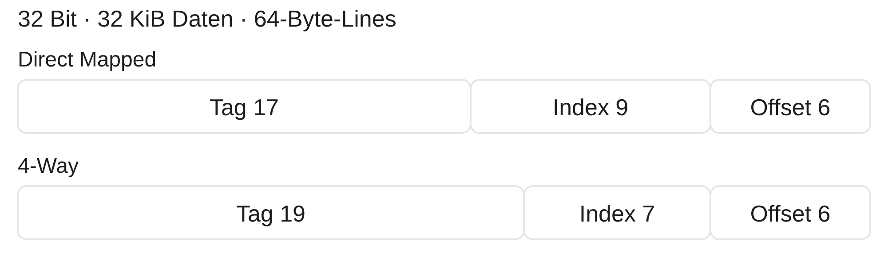{fig-alt="Bei gleicher Datenkapazität und Blockgröße besteht die 32-Bit-Adresse direkt abgebildet aus 17 Tag-, 9 Index- und 6 Offsetbits; bei vier Wegen aus 19, 7 und 6 Bit."}

Für $W$ Plätze pro Set:

$$
S=\frac{C}{BW},\quad b=\log_2 B,\quad s=\log_2 S,\quad \tau=P-b-s
$$

::: notes
KiB bedeutet Kibibyte mit 1024 Byte. Das Diagramm liest sich innerhalb jedes Bandes von den höchstwertigen Bits links zu den niedrigstwertigen Bits rechts. Tag, Index und Offset sind durch Beschriftungen und Feldgrenzen unterschieden. Ein Bit ist eine Binärstelle. Die Adresse hat insgesamt $P=32$ Bit; der Offset wählt das Byte im Block, der Index das Set, das Tag kennzeichnet den dort gespeicherten Block.

$C$ bezeichnet die Datenkapazität in Byte, $B$ die Blockgröße in Byte und $W$ die Anzahl der Ways, Plätze pro Set. Die Zahl der Sets ist $S=C/(BW)$. Bei Zweierpotenzen benötigen $B$ Positionen $b=\log_2 B$ Offsetbits und $S$ Sets $s=\log_2 S$ Indexbits. $\log_2$ bezeichnet den Logarithmus zur Basis zwei: Er fragt, welcher Exponent die angegebene Zweierpotenz ergibt. Die restlichen $\tau=P-b-s$ Bits bilden das Tag.

Für $W=1$ folgt $S=512$, $b=6$, $s=9$, $\tau=17$. Das untere Band nimmt $W=4$ vorweg: $S=128$, $s=7$, $\tau=19$. Die Blockgröße bleibt gleich, daher auch der Offset. Zusätzliche Ways werden nicht durch zusätzliche Byte-Offsetbits adressiert. Wie sie durchsucht werden, klären wir nach dem direkten Beispiel.
:::

## Beispiel: Adresse `0x12345678`

Direct Mapped, $32$ KiB, $64$-Byte-Lines:

$$
o=56,\qquad q=\texttt{0x48D159},\qquad
i=345,\qquad t=\texttt{0x2468}
$$

Kontrolle:

$$
a=t\cdot32768+i\cdot64+o
$$

::: notes
Ein KiB, Kibibyte, umfasst 1024 Byte. Wir zerlegen die hexadezimale Byteadresse `0x12345678` im direkt abgebildeten Referenzcache. Hexadezimal verwendet die Ziffern null bis neun und A bis F; jede Ziffer steht für vier Binärbits. Offset, Index und Tag entsprechen hier sechs, neun und siebzehn Bits. Die letzten sechs Bits der Adresse ergeben Offset $o=56$, hexadezimal `0x38`. Das Entfernen dieser Bits, ganzzahlige Division durch $64$, ergibt die Blocknummer $q=\texttt{0x48D159}$.

Der Rest $q\bmod512$ ergibt den Index $i=345$, hexadezimal `0x159`. Die Division $\lfloor q/512\rfloor$ liefert das Tag $t=\texttt{0x2468}$. Der Block beginnt bei `0x12345640` und endet bei `0x1234567F`. Das angeforderte Byte liegt bei Versatz sechsundfünfzig.

Die Rückrechnung zeigt, dass kein Adressteil fehlt: Ein Tag-Schritt entspricht $512\cdot64=32768$ Byte, ein Index-Schritt $64$ Byte und ein Offset-Schritt einem Byte. Mit $t=9320$ folgt $9320\cdot32768+345\cdot64+56=305419896$, die dezimale Form der gegebenen Adresse. Unterschiedliche Tags bei gleichem Index sind gerade der Fall, den die Hardware beim Lesen unterscheiden muss.
:::

## Leseweg: auswählen, prüfen, liefern

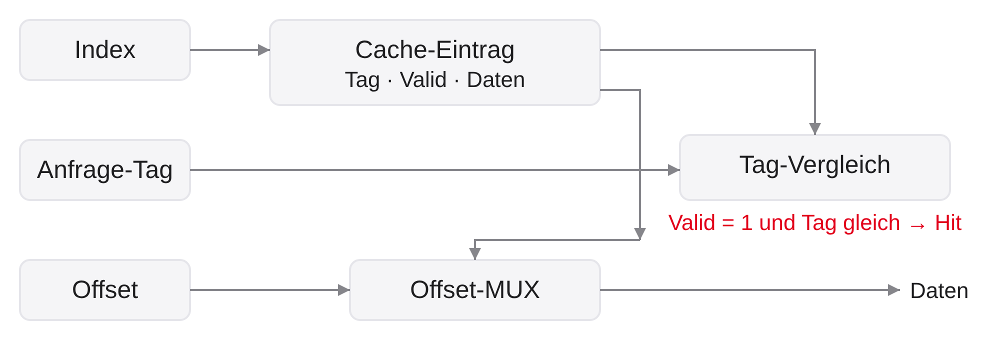{fig-alt="Index wählt einen Cache-Eintrag; Anfrage-Tag und gespeichertes Tag werden mit Valid geprüft, während der Offset die Daten auswählt."}

- Hit nur bei $\mathrm{Valid}=1$ und passendem Tag
- Miss: Block aus der nächsten Ebene beschaffen und Eintrag aktualisieren

::: notes
Die Abbildung trennt die Adressleitungen nach ihrer Aufgabe. Der Index führt zum ausgewählten Cache-Eintrag mit gespeichertem Tag, Valid-Bit und Daten. Das Tag der Anfrage geht auf einen eigenen Weg zum Vergleich. Valid ist das Gültigkeitsbit. Nur wenn es eins ist und beide Tags übereinstimmen, entsteht das Hit-Signal. Der Offset, der Versatz innerhalb des Blocks, wählt aus den Daten das angeforderte Wort. Datenweg und Trefferprüfung laufen nicht als eine Reihe von Datenkonvertierungen hintereinander.

Ein MUX ist ein Multiplexer, eine Auswahlfunktion für mehrere Eingänge. Hier wählt er mit dem Offset die Datenposition. Die Pfeile zeigen die Richtung der Information. Die rote Beschriftung kennzeichnet die Trefferbedingung, nicht einen weiteren Speicher. Die Zeichnung ist eine funktionale Übersicht, keine vollständige Gatterimplementierung und kein Zeitdiagramm.

Bei Miss muss der Prozessor im blockierenden Lehrmodell warten. Der neue Block wird aus der nächsten Ebene geladen und ersetzt gegebenenfalls den alten Eintrag am ausgewählten Platz. Anschließend sind Daten, Tag und Valid konsistent. Wenn zwei häufig benötigte Blöcke denselben Platz beanspruchen, hilft auch ein ansonsten großer leerer Cache wenig.
:::

## Thrashing: zwei Blöcke, ein Platz

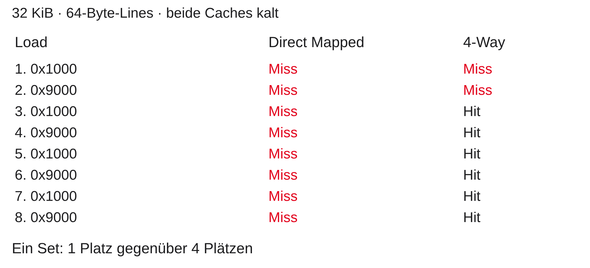{fig-alt="Acht abwechselnde Lesezugriffe: Direct Mapped hat acht Misses, vier Wege haben zwei Misses und sechs Hits."}

Spur: `0x1000, 0x9000`, viermal wiederholt; Cache zunächst kalt.

::: notes
Thrashing meint hier wiederholtes gegenseitiges Verdrängen. KiB steht für Kibibyte, jeweils 1024 Byte. Im direkt abgebildeten Referenzcache mit $32$ KiB Datenkapazität und $64$-Byte-Blöcken hat `0x1000` die Blocknummer $64$, Index $64$ und Tag null. `0x9000` hat Blocknummer $576$, ebenfalls Index $64$, aber Tag eins. Beide Blöcke brauchen denselben Platz. Die Tabelle ist zeitlich von oben nach unten zu lesen. M steht für Miss, Fehlschlag; H für Hit, Treffer.

Der erste Zugriff lädt den ersten Block. Der zweite verdrängt ihn durch den zweiten Block. Der dritte braucht wieder den inzwischen fehlenden ersten. Daher entstehen bei acht wechselnden Zugriffen acht Misses und kein Hit. Andere Plätze können dabei leer bleiben.

In der rechten Spalte ist die Datenkapazität unverändert, aber vier Ways, Plätze je Set, erlauben beide Blöcke gleichzeitig. Es gibt dann $128$ Sets. Beide Blöcke haben weiter Set-Index $64$, jedoch Tags null und vier. Die ersten beiden Zugriffe laden die Blöcke, die folgenden sechs treffen. Die Zeichnung vergleicht dieselbe Spur unter zwei Platzregeln, keine gemessenen Zeiten. Der Gewinn kommt aus vermiedenen Konflikten, nicht aus mehr Datenkapazität.
:::

## Drei Ursachen für Misses

| Ursache | Bedeutung |
|---------|-----------|
| Compulsory | erster Zugriff auf einen Block |
| Capacity | aktive Daten passen nicht in die Kapazität |
| Conflict | eingeschränkte Platzwahl verdrängt nutzbare Blöcke |

In der Wechselspur: zwei erste Zugriffe, danach sechs Konflikte.

::: notes
Compulsory Miss, verpflichtender erster Fehlschlag oder Kaltstart-Miss, bezeichnet das erstmalige Anfordern eines Blocks im kalten Modell ohne Vorabladen. Capacity Miss, Kapazitätsfehlschlag, entsteht, wenn die für Wiederverwendung benötigten Blöcke die verfügbare Kapazität überschreiten. Conflict Miss, Konfliktfehlschlag, entsteht durch die eingeschränkte Platzwahl: Blöcke verdrängen sich, obwohl ein anders organisierter Cache gleicher Kapazität sie halten könnte.

Für die Wechselspur `0x1000` und `0x9000` sind die ersten beiden Misses Kaltstart-Misses. Die folgenden sechs sind Konflikt-Misses; nur zwei Blöcke werden benötigt, und fünfhundertzwölf Blockplätze wären verfügbar. Für genaue Klassifikation kann ein vollassoziativer Vergleichscache gleicher Kapazität mit festgelegter Ersetzungsregel herangezogen werden. Ein späterer Miss ist nicht allein deshalb ein Kapazitätsmiss, weil sein einzelnes Set voll ist.

Diese Einteilung beschreibt Ursachen, keine zusätzlichen Zugriffskategorien neben Hit und Miss. Beim Zählen bleibt jeder Zugriff ein Treffer oder Fehlschlag. Mehr Assoziativität kann Konflikte reduzieren, aber weder erstmalige Anforderungen noch jede Kapazitätsgrenze beseitigen.
:::

## Miss-Ursachen: begründen statt raten

Im Referenzcache mit $512$ Datenplätzen:

1. Ein bisher ungelesener Block im kalten Cache
2. $513$ unterschiedliche Blöcke zyklisch in einem vollassoziativen Cache mit LRU
3. `0x1000` und `0x9000` im Wechsel, Direct Mapped

Ordnen Sie Kaltstart, Kapazität oder Konflikt zu. Welche Anfangszugriffe zählen gesondert?

::: notes
Die drei Fälle trennen Ursachen, die sich nicht allein aus dem Wort Miss, Fehlschlag, ablesen lassen. Ein Datenplatz hält eine Cache-Line, einen Speicherblock. Das Referenzmodell besitzt fünfhundertzwölf solcher Plätze. Ein vollassoziativer Cache erlaubt jeden Block an jedem Platz. LRU bedeutet Least Recently Used: Bei voller Kapazität wird der am längsten nicht verwendete Block verdrängt. Direct Mapped erlaubt dagegen genau einen festen Platz.

Fall eins ist ein Compulsory Miss, Kaltstart-Miss: Der Block ist erstmals angefordert und noch nicht geladen. In Fall zwei werden fünfhundertdreizehn Blöcke immer wieder in derselben Reihenfolge gelesen. Selbst freie Platzwahl kann nicht alle fünfhundertdreizehn gleichzeitig halten. Wenn die Folge zum ersten Block zurückkehrt, ist er unter LRU bereits verdrängt. Auch alle folgenden Wiederholungen verfehlen. Die ersten Anforderungen sind Kaltstart-Misses, die späteren Capacity Misses, Kapazitätsfehlschläge, des angegebenen Vergleichsmodells.

In Fall drei sind nur zwei Blöcke aktiv. Die hexadezimalen Adressen `0x1000` und `0x9000` teilen den Index vierundsechzig im direkt abgebildeten Referenzcache. Nach den zwei ersten Anforderungen entstehen Conflict Misses, Konfliktfehlschläge. Ein vollassoziativer Cache gleicher Kapazität könnte beide Kopien halten. Wichtig ist die Trennung von erster Blockanforderung und späterer Wiederverwendung; auch eine volle einzelne Menge beweist noch keinen Kapazitätsmangel des gesamten Caches.
:::

## Set-Associative: mehrere Plätze pro Set

- $W$-Way: ein fester Set-Index, darin $W$ mögliche Plätze
- Referenz: $W=4$ ergibt $128$ Sets mit je $4$ Ways
- Nur die Tags dieses Sets werden parallel verglichen
- Ein Hit wählt den passenden Way; ein volles Set braucht eine Ersetzungsregel

::: notes
Set-Associative bedeutet mengenassoziativ. Das Set, die Menge zulässiger Plätze, wird weiter durch den Index fest ausgewählt. Innerhalb des Sets kann ein Block in einem von $W$ Ways liegen. Ein Way ist einer dieser Plätze. Vier Ways erlauben vier unterschiedliche Blöcke mit gleichem Index, ohne dass sie sich sofort verdrängen.

Bei gleicher Datenkapazität von $32768$ Byte und Blockgröße von $64$ Byte gibt es weiterhin $512$ Blockplätze. Mit vier Wegen werden daraus $512/4=128$ Sets. Bei jeder Anfrage werden die vier gespeicherten Tags und Valid-Bits des gewählten Sets parallel geprüft. Valid bedeutet gültig. Ein Multiplexer, eine Auswahlfunktion, liefert die Daten des treffenden Ways. Der Way ist keine zusätzliche Position innerhalb eines Datenblocks und daher kein Teil des Byte-Offsets.

Direct Mapped ist der Spezialfall mit einem Way. Fully Associative, vollassoziativ, ist der andere Grenzfall: ein einziges Set umfasst alle Plätze. Die zusätzliche Freiheit hat einen Preis in Vergleichslogik und Verwaltung. Zudem brauchen fünf gleichzeitig benötigte Blöcke mit demselben Index auch im Vier-Wege-Cache eine Verdrängung.
:::

## Platzwahl und Suchaufwand vergleichen

| Organisation | Sets | Ways je Set | Tag-Vergleiche je Anfrage |
|--------------|------|-------------|--------------------------|
| Direct Mapped | $512$ | $1$ | $1$ |
| 4-Way | $128$ | $4$ | $4$ |
| Fully Associative | $1$ | $512$ | $512$ |

Immer: $32$ KiB Daten, $64$-Byte-Blöcke, $512$ Plätze.

::: notes
KiB bedeutet Kibibyte mit 1024 Byte. Die Tabelle vergleicht dasselbe Referenzmodell unter drei Organisationen. Direct Mapped bedeutet direkte Abbildung auf einen einzigen Platz. Vier-Wege-Organisation, 4-Way, erlaubt vier Plätze im ausgewählten Set. Fully Associative bedeutet vollassoziativ: Jeder Block darf jeden der fünfhundertzwölf Plätze nutzen. Das Produkt aus Sets und Ways bleibt fünfhundertzwölf, die Datenkapazität unverändert.

Für eine vollständig parallele Suche braucht Direct Mapped einen Tag-Vergleich, 4-Way vier und Fully Associative fünfhundertzwölf. Dazu kommen Gültigkeitsprüfung und Datenwahl. Größere Freiheit kann Konflikte vermeiden, verlangt aber mehr Schaltung, Energie und Ersetzungsverwaltung. Aus der Anzahl der Vergleiche allein lässt sich keine konkrete Zugriffszeit oder Chipfläche bestimmen. Kleine vollassoziative Strukturen können durchaus sinnvoll sein.

Bei einem einzigen Set entfällt der Index, er hat null Bits. Die unteren sechs Bits bleiben Offset; die übrigen sechsundzwanzig bilden das Tag. Vier Wege benötigen sieben Index- und neunzehn Tagbits. Die Freiheitsfrage ist damit beantwortet. Offen bleibt, welcher vorhandene Block in einem vollen Set weichen soll.
:::

## Verdrängen: FIFO und LRU

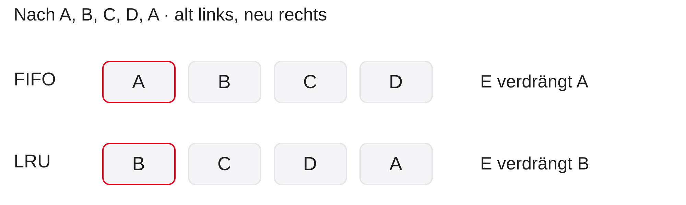{fig-alt="Nach der Folge A, B, C, D, A verdrängt der neue Block E bei FIFO den Block A und bei LRU den Block B."}

- FIFO: Reihenfolge des Ladens
- LRU: Reihenfolge der letzten Nutzung
- Zuerst freie Plätze verwenden; erst bei vollem Set verdrängen

::: notes
FIFO bedeutet First In, First Out, zuerst hinein, zuerst hinaus. Die Regel verdrängt den zuerst geladenen noch vorhandenen Block. LRU bedeutet Least Recently Used, am längsten nicht benutzt. Sie verdrängt den Block, dessen letzte Nutzung am weitesten zurückliegt. Ein Hit aktualisiert bei LRU die Nutzungsreihenfolge, bei FIFO nicht die Ladereihenfolge.

Im Bild sind A bis E Namen unterschiedlicher Speicherblöcke mit demselben Set-Index. Das zunächst leere Set hat vier Ways. A, B, C und D werden nacheinander geladen. Beide Reihenfolgen sind danach von alt nach neu A, B, C, D. Der anschließende Zugriff auf A ist ein Hit. FIFO behält seine Reihenfolge, LRU ordnet nun B, C, D, A. Der Miss auf E trifft ein volles Set. FIFO verdrängt A und endet mit B, C, D, E; LRU verdrängt B und endet mit C, D, A, E. Die gezeichnete Reihenfolge ist die Verwaltungsordnung, keine feste physische Anordnung der Ways.

LRU ist eine Heuristik, eine begründete Näherungsstrategie ohne Zukunftswissen. Sie ist nicht für jede Spur optimal. Vereinfachungen wie Pseudo-LRU nähern die Nutzungsordnung an und sparen Zustandsbits. Für Papieraufgaben geben wir die genaue Regel vor.
:::

## Prüfen Sie Ihr Mapping-Verständnis

Gleiche Kapazität und Blockgröße, nun $4$ Ways:

1. Wie viele Sets und Indexbits gibt es?
2. Welche Felder hat `0x12345678`?
3. Welche Bilanz hat `0x1000, 0x9000, 0x1000` im kalten Cache?

::: notes
Ein KiB, Kibibyte, umfasst 1024 Byte. Wir bleiben bei zweiunddreißig Bit breiten Byteadressen, $32$ KiB Datenkapazität und $64$-Byte-Lines. Ein Way ist ein Platz pro Set, ein Set die Gruppe zulässiger Plätze. Mit vier Ways ist $S=32768/(64\cdot4)=128$. Für den Index braucht man sieben Bit, denn $128=2^7$. Sechs Offsetbits bleiben unverändert, das Tag erhält $32-7-6=19$ Bit.

Für `0x12345678` bleibt der Offset sechsundfünfzig. Die Blocknummer ist weiter `0x48D159`. Ihr Rest bei Division durch $128$ ist $89$, also Set-Index neunundachtzig. Das Tag ist $\lfloor q/128\rfloor=\texttt{0x91A2}$. Zur Kontrolle gilt $a=t\cdot8192+i\cdot64+o$, weil ein Tag-Schritt nun $128\cdot64=8192$ Byte umfasst.

Die drei Zugriffe treffen Set vierundsechzig mit den Tags null, vier, null. Die ersten beiden sind Misses und belegen zwei freie Ways. Der dritte ist ein Hit, da der erste Block noch vorhanden ist. Im direkt abgebildeten Vergleich wären alle drei Misses. Eine typische Fehlannahme ist, mehr Ways mit größerer Datenkapazität gleichzusetzen; hier wird dieselbe Kapazität nur anders aufgeteilt. Danach erweitern wir das Modell um Schreibzugriffe.
:::

## Bessere Quote, gleiche Zugriffszeit?

Didaktischer Vergleich mit zusätzlicher Miss Penalty $p=100$ Takten:

| Variante | Hit Time | Hit Rate |
|----------|----------|----------|
| A | $1$ Takt | $95\,\%$ |
| B | $2$ Takte | $96\,\%$ |

Welche Variante hat die kleinere AMAT? Was fehlt für eine Hardwareentscheidung?

::: notes
Die Hit Rate ist die Trefferquote, die Hit Time die Prüfzeit bei jedem Zugriff. Die Miss Penalty $p$ ist hier die zusätzliche Zeit eines Fehlschlags. AMAT steht für Average Memory Access Time, mittlere Speicherzugriffszeit. Beide Varianten werden unter demselben seriellen Zeitmodell verglichen; die Zahlen sind didaktische Annahmen, keine Messung konkreter Cache-Entwürfe.

Für A beträgt die Miss Rate fünf Prozent. Die mittlere Zeit ist $1+0{,}05\cdot100=6$ Takte. Für B beträgt sie vier Prozent und die mittlere Zeit $2+0{,}04\cdot100=6$ Takte. Die zusätzliche Prüfzeit von einem Takt wird genau durch die geringere Häufigkeit der hundert Takte teuren Misses ausgeglichen. Beide Varianten sind bezüglich dieser einen Kenngröße gleich.

Mehr Assoziativität, also mehr zulässige Plätze pro Set, kann Konflikte vermeiden, erfordert aber zusätzliche Vergleiche und Datenwahl. Eine konkrete Implementierung kann dadurch andere Trefferzeiten haben; eine automatische Verdopplung wird nicht behauptet. Für eine Hardwareentscheidung fehlen beispielsweise Energiebedarf, Chipfläche, weitere Zugriffsspuren und mögliche Überlappung. Die Musterantwort zeigt, warum die maximale Trefferquote allein nicht das Ziel eines Cache-Entwurfs ist. In den Papieraufgaben sollen daher Zeitangaben und Zählannahmen gemeinsam gelesen werden.
:::

## Write-Through: Änderungen weitergeben

- Store-Hit aktualisiert den Cache und die nächste Ebene
- Ohne Puffer: auf die Weitergabe warten
- Write Buffer: ausstehende Schreibvorgänge zwischenspeichern
- Ein voller Puffer kann den Prozessor anhalten

::: notes
Ein Store ist ein Schreibzugriff, im Gegensatz zu einem Load, einem Lesezugriff. Wir betrachten zuerst einen Store-Hit auf eine gültige vorhandene Line. Write-Through bedeutet Durchschreiben: Der Cache nimmt den neuen Wert an und gibt den Schreibzugriff an die nächste Ebene weiter. Diese Ebene kann wiederum ein Cache sein, nicht zwingend der Hauptspeicher.

Ohne Schreibpuffer kann der Prozessor auf die Weitergabe warten müssen. Ein Write Buffer ist ein Schreibpuffer für noch ausstehende Weitergaben. Er erlaubt, Werte zunächst einzureihen und später zu übertragen. FIFO, First In, First Out, bezeichnet eine mögliche Reihenfolge nach dem Eingang. Details, etwa das Zusammenfassen benachbarter Writes, hängen von der Implementierung ab. Wenn kein weiterer Platz frei ist, kann ein Stall, ein Stillstand wegen einer unerfüllten Voraussetzung, auftreten.

Write-Through bedeutet deshalb nicht, dass jede Ebene zu jedem Zeitpunkt bereits denselben Wert enthält. Ein Puffer kann noch ausstehende Änderungen halten. Im einfachen ungepufferten Modell bedeutet jeder Store eine Weitergabe. Das kann mehr Verkehr erzeugen als eine Strategie, die mehrere Änderungen desselben Blocks sammelt.
:::

## Write-Back und Dirty

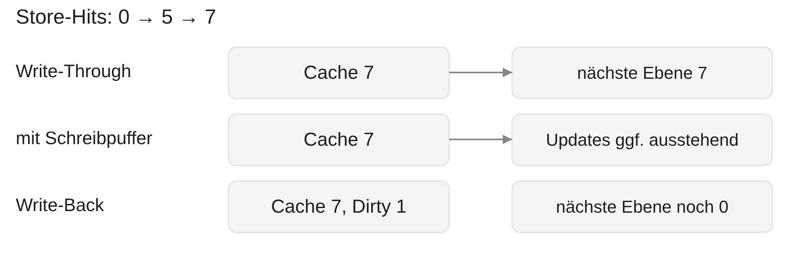{fig-alt="Startwert null: Zwei Store-Hits auf fünf und sieben werden je nach Strategie sofort weitergegeben, gepuffert oder als Dirty-Line gesammelt."}

- Dirty $=1$: Line gegenüber der nächsten Ebene verändert
- Zurückschreiben vor Verlust der Änderungen

::: notes
Write-Back bedeutet Zurückschreiben. Bei einem Store-Hit wird zunächst die Cache-Kopie geändert. Das Dirty-Bit, das Änderungsbit, wird eins. Es kennzeichnet eine gegenüber der nächsten Ebene veränderte Line. Dirty bedeutet weder beschädigt noch ungültig.

Die Abbildung zeigt drei getrennte Fälle mit gleichem Anfangswert null und zwei Store-Hits: zuerst fünf, danach sieben. Write-Through ohne Puffer gibt beide Werte weiter. Write-Through mit Puffer kann bereits sieben im Cache halten, während Weitergaben noch ausstehen. Bei Write-Back steht zuletzt sieben im Cache mit Dirty eins, während die nächste Ebene noch null enthalten darf. Die Zustände jeder Zeile gehören zum eigenen Fall und dürfen nicht addiert werden.

Der eigene Prozessor kann den aktuellen Wert aus seiner gültigen Cache-Line lesen. Vor deren Verlust muss der veränderte Inhalt gesichert werden. Dieses Writeback kann durch Verdrängung, eine explizite Verwaltungsaktion oder ein Protokoll ausgelöst werden. Mehrere Stores in dieselbe Line können eine gemeinsame spätere Blockweitergabe erzeugen. Eine garantierte Laufzeitverbesserung folgt daraus nicht; sie hängt auch von Puffern und Zugriffsmustern ab.
:::

## Schreibverkehr: Wort oder ganze Line?

Lehrmodell: $100$ Store-Hits auf dasselbe $4$-Byte-Wort, $64$-Byte-Line.

| Strategie | Weitergabe der Nutzdaten |
|-----------|--------------------------|
| Write-Through ohne Zusammenfassen | $100\cdot4=400$ Byte |
| Write-Back, danach eine Verdrängung | einmal $64$ Byte |

Übertragene Nutzbytes sind keine vollständige Bus- oder Laufzeitmessung.

::: notes
Ein Store-Hit ist ein Schreibzugriff auf eine vorhandene gültige Cache-Line. Write-Through bedeutet Durchschreiben an die nächste Ebene, Write-Back zunächst nur Ändern der Cache-Kopie und späteres Zurückschreiben. Wir nehmen hundert vollständige Stores auf dasselbe vier Byte große Wort an, eine anfangs gültige saubere Line mit vierundsechzig Byte und am Ende genau eine Verdrängung. Im Write-Through-Fall werden Stores nicht zusammengefasst; andere Transfers werden nicht gezählt.

Write-Through gibt hundertmal vier Nutzbytes weiter, also vierhundert Byte. Write-Back markiert die Line Dirty, verändert, und sammelt die Änderungen. Beim Verdrängen wird im angenommenen Modell einmal die ganze vierundsechzig Byte große Line mit dem letzten Wert weitergegeben. Die ursprüngliche Beschaffung liegt vor der gezählten Phase und ist in beiden Fällen ausgeschlossen.

Weniger Weitergaben bedeuten nicht unter allen Umständen weniger Nutzbytes. Bei nur einem vier Byte großen Store würde dieses vollständige Block-Writeback mehr Nutzbytes als das Durchschreiben eines Wortes übertragen. Bei $n$ solchen Stores ist die Grenze $4n=64$, also $n=16$; darüber ist die Write-Back-Nutzdatenmenge hier kleiner. Reale Schreibpuffer können Stores zusammenfassen, Schnittstellen andere Transferbreiten verwenden. Adressen, Steuerinformationen, Wartezeiten und Energie sind ebenfalls nicht enthalten. Das Beispiel begründet den Nutzen gesammelter Änderungen, ohne einen allgemeinen Geschwindigkeitsfaktor zu erfinden.
:::

## Dirty-Line verdrängen: an die alte Adresse

Beispiel: `0x9000` ersetzt `0x1000` im Direct-Mapped-Cache.

1. Alte Line: Valid $=1$, Dirty $=1$, Tag $=0$, Index $=64$
2. Zurückschreiben an $a_\text{alt}=(0\cdot512+64)\cdot64=\texttt{0x1000}$
3. Neuen Block laden; neues Tag $=1$, Dirty $=0$

::: notes
Wir verwenden den direkt abgebildeten Cache mit fünfhundertzwölf Sets und vierundsechzig Byte pro Block. Valid ist das Gültigkeitsbit und Dirty das Änderungsbit. Die gültige Line bei Index vierundsechzig gehört mit altem Tag null zum Block `0x1000`. Sie enthält Änderungen, die die nächste Ebene noch nicht erhalten hat. Die neue Anfrage `0x9000` hat denselben Index, aber Tag eins.

Das Writeback, Zurückschreiben, muss die alte Adresse rekonstruieren. Aus altem Tag $t_\text{alt}$ und Index $i$ folgt die alte Blockbasis $(t_\text{alt}S+i)B$. Hier ist das $(0\cdot512+64)\cdot64=4096=\texttt{0x1000}$. Würde man die geänderten alten Daten an die neue Anfrageadresse `0x9000` schreiben, würde man einen anderen Speicherblock überschreiben.

Erst nach Sicherung der Änderungen darf der alte Inhalt verloren gehen. Im seriellen Modell folgt das Nachladen des neuen Blocks mit Tag eins und Dirty null. Eine saubere gültige Line mit Dirty null müsste dagegen nicht zurückgeschrieben werden. Die Folie zählt keine universelle Miss Penalty: Writeback und Nachladen können unterschiedlich lange dauern oder durch Puffer entkoppelt sein.
:::

## Store-Miss: eine zweite Entscheidung

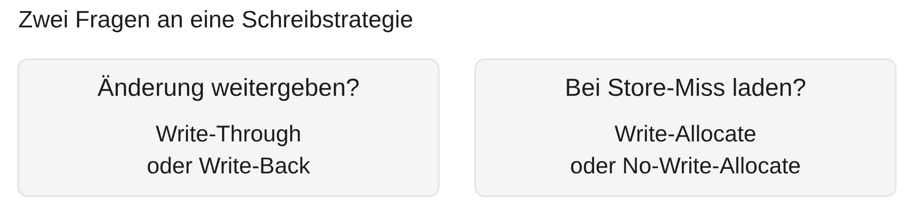{fig-alt="Weitergabe von Änderungen und Anlegen eines Eintrags beim Store-Miss sind unabhängige Entscheidungen."}

- Write-Allocate: Block beschaffen, dann Cache-Kopie ändern
- No-Write-Allocate: Store weitergeben, keinen neuen Eintrag anlegen
- Write-Back/Write-Through beantwortet eine andere Frage

::: notes
Ein Store-Miss ist ein Schreibzugriff ohne passenden gültigen Cache-Eintrag. Die bisherige Entscheidung Write-Through, Durchschreiben, oder Write-Back, späteres Zurückschreiben, betrifft die Weitergabe von Änderungen an vorhandenen Kopien. Die Allocate-Entscheidung betrifft das Anlegen eines neuen Eintrags.

Write-Allocate bedeutet Zuteilen beim Schreiben: Der fehlende Block wird in unserem einfachen Modell beschafft und der neue Wert darin eingetragen. Bei anschließendem Write-Back wird die Line Dirty, verändert. No-Write-Allocate bedeutet kein Zuteilen: Der Store wird an die nächste Ebene weitergegeben, ohne durch diesen Miss eine neue Line anzulegen.

Die zwei Gruppen in der Abbildung sind getrennte Entscheidungsachsen; sie bilden keine feste Paarung. Write-Back mit Write-Allocate und Write-Through mit No-Write-Allocate sind häufig betrachtete Kombinationen, aber keine logische Notwendigkeit. Eine Papieraufgabe mit Stores muss beide Regeln nennen. Auch das Nullsetzen eines C-Arrays führt daher nicht allein aufgrund der Blockgröße zu einer festgelegten Trefferzahl. Bei Lesezugriffen lassen sich die Grundeffekte zunächst ohne diese Zusatzentscheidung untersuchen.
:::

## Gleiche Stores, andere Zuteilung

Kalt, $64$-Byte-Lines, Write-Through ohne Puffer; alle Zugriffe auf denselben Block:

`Store 0x1000; Store 0x1004; Store 0x1008; Load 0x1000`

| Store-Miss-Regel | Hit/Miss-Folge |
|-----------------|---------------|
| Write-Allocate | Miss, Hit, Hit, Hit |
| No-Write-Allocate | Miss, Miss, Miss, Miss |

::: notes
Write-Through bedeutet Durchschreiben: Jeder Store wird hier ohne Puffer an die nächste Ebene weitergegeben. Ein Store ist ein Schreibzugriff, ein Load ein Lesezugriff. Die Schreibwerte sind für die Trefferzählung beliebige vollständige Wortwerte. Beide Varianten starten kalt und haben genügend Plätze, sodass keine Verdrängung eintritt. Mit vierundsechzig Byte pro Line gehören die hexadezimalen Adressen `0x1000`, `0x1004` und `0x1008` zum selben Block.

Bei Write-Allocate, Zuteilen beim Store-Miss, beschafft der erste Store den fehlenden Block und ändert seine Kopie. Die nächsten zwei Stores finden dieselbe gültige Line und treffen. Der abschließende Load trifft ebenfalls. Alle drei Stores werden zusätzlich entsprechend Write-Through weitergegeben; ein Hit bedeutet hier nicht, dass jede Weitergabe entfällt.

Bei No-Write-Allocate, keinem Zuteilen beim Store-Miss, werden die ersten drei Stores nach unten weitergegeben, ohne einen Cache-Eintrag anzulegen. Daher sind alle drei Misses. Auch der Load findet noch keine Kopie, ist ein Miss und beschafft jetzt den Block. Ein weiterer anschließender Load würde dann treffen. Die unterschiedliche Trefferquote folgt allein aus der Zuteilungsregel; die Weitergabestrategie ist in beiden Fällen gleich. Mehr Hits beweisen ohne ein Zeitmodell nicht, wie schnell die Stores abgeschlossen werden. Damit bleibt die Trennung der beiden Schreibentscheidungen auch in einer konkreten Spur erhalten.
:::

## Gültigkeitsgrenzen unseres Modells

- Normaler Speicher; ein Prozessor; abgeschlossene Anfragen
- Ein älterer Wert unten ist bei Write-Back zunächst erlaubt
- Weitere Kerne und externe Datenübertragung brauchen zusätzliche Regeln
- Gerätezugriffe aus Vorlesung 1 nicht blind wie Arrayzugriffe behandeln

::: notes
Write-Back bedeutet, dass eine gültige Cache-Kopie geänderte Daten zunächst allein halten darf. Ein älterer Wert in der nächsten Ebene ist daher im Ein-Prozessor-Modell kein Fehler. Kohärenz bezeichnet die Abstimmung mehrerer Kopien, etwa zwischen mehreren Prozessorkernen. Ein kohärentes System kann aktuelle Daten über ein Protokoll liefern, auch wenn der Hauptspeicher noch nicht aktualisiert ist. Diese Protokolle behandeln wir in Vorlesung 9.

DMA bedeutet Direct Memory Access, direkte Datenübertragung durch eine weitere Hardwareeinheit ohne jeden einzelnen Transfer durch den Prozessor. Liest diese Einheit Speicher ohne kohärente Cache-Anbindung, kann eine gesonderte Synchronisation nötig sein. Das vertiefen wir in Vorlesung 6. Die konkrete Plattform legt fest, welche Verwaltungsaktionen und Speicherattribute verfügbar sind; aus dem RISC-V-Befehlssatz allein folgt kein allgemeines Verfahren.

MMIO steht für Memory-Mapped Input/Output, Ein- und Ausgabe über Geräteadressen. Solche Zugriffe können Seiteneffekte haben und dürfen nicht einfach als gewöhnliche wiederverwendbare Speicherkopien behandelt werden. Wir begrenzen die folgenden Arrayrechnungen deshalb auf normalen cachefähigen Speicher. Dort können wir die Adressen direkt aus dem C-Layout herleiten.
:::

## C-Arrays liegen zeilenweise im Speicher

Annahme: `uint32_t a[16][16]`, Basisadresse `0x1000`.

$$
\operatorname{Adresse}(a[r][c])=\texttt{0x1000}+4(16r+c)
$$

- `r`: Zeilenindex; `c`: Spaltenindex
- Nachbarspalte: $4$ Byte Abstand
- Nächste Zeile: $64$ Byte Abstand

::: notes
C speichert ein zweidimensionales Array zeilenweise, auf Englisch Row-Major Order. Das Array besteht aus sechzehn Zeilen, von denen jede sechzehn aufeinanderfolgende Elemente enthält. Der Typ `uint32_t` aus `stdint.h` bezeichnet, wo verfügbar, einen vorzeichenlosen Ganzzahltyp mit genau zweiunddreißig Bit. Für unser Lehrmodell mit acht Bit pro Byte belegt ein Element vier Byte. Die Basisadresse `0x1000` und ihre Ausrichtung sind ausdrückliche Annahmen.

$r$ und $c$ zählen Zeile und Spalte jeweils von null bis fünfzehn. Vor Zeile $r$ liegen $16r$ Elemente, innerhalb der Zeile weitere $c$. Deshalb beträgt der Versatz in Byte $4(16r+c)$. `a[0][1]` liegt bei `0x1004`, `a[1][0]` bei `0x1040`. Die abstrakte Tabellenform wird in eine lineare Adressfolge übersetzt.

Die Schreibweise mit zwei Indizes bestimmt nicht die Besuchsreihenfolge. Diese entsteht durch die Schleifen. Durch Vertauschen der Schleifen bleiben die Werte dieselben, aber die Datenanfragen nutzen unterschiedliche Nachbarschaften. Für exakte Cache-Zahlen müssen wir die konkrete Anfragespur vom möglichen Compilerverhalten trennen.
:::

## Zeilenweise lesen

```c
/* Lehrcode: keine gemessene Maschinenspur. */
uint64_t sum = 0;
for (unsigned r = 0; r < 16; ++r)
    for (unsigned c = 0; c < 16; ++c)
        sum += a[r][c];
```

Modellspur: je ein Daten-Load pro Element, Nachbaradresse $+4$ Byte.

::: notes
Der C-Ausschnitt summiert die Elemente zeilenweise. `a` ist das zuvor festgelegte Array mit sechzehn mal sechzehn Elementen des Typs `uint32_t`, vorzeichenlose zweiunddreißig Bit. `uint64_t` bezeichnet einen vorzeichenlosen Vierundsechzig-Bit-Typ; `sum` sammelt die Summe und beginnt bei null. Sie kann hier alle zweihundertsechsundfünfzig maximalen Arraywerte ohne Überlauf aufnehmen. `r` ist der Zeilenindex, `c` der Spaltenindex, beide vom Typ `unsigned`, vorzeichenlose Ganzzahl. `++` erhöht den jeweiligen Index um eins.

Die innere Schleife verändert `c` zuerst. Der Ausschnitt besucht `a[0][0]`, `a[0][1]` bis `a[0][15]` und erst danach `a[1][0]`. Die ersten Adressen sind `0x1000`, `0x1004`, `0x1008`. Die 64-Byte-Line einer Zeile wird unmittelbar ausgenutzt.

Der Ausschnitt setzt ein initialisiertes Array und die Typdefinitionen aus `stdint.h` voraus. Er ist kein vollständiges Programm und keine hier gemessene RISC-V-Befehlsfolge. Für unsere Modellzählung wird ein Daten-Load pro Element angenommen; Registerzugriffe, Befehlsabruf und weitere Speicherzugriffe werden nicht mitgezählt. Ein Compiler kann dagegen vektorisieren oder andere Anfragen erzeugen. Die exakte Rechnung gehört zur definierten Spur.
:::

## Spaltenweise lesen

```c
/* Gleiche Summe, andere angenommene Daten-Load-Reihenfolge. */
uint64_t sum = 0;
for (unsigned c = 0; c < 16; ++c)
    for (unsigned r = 0; r < 16; ++r)
        sum += a[r][c];
```

Modellspur: nächster Zeilenanfang $+64$ Byte, Nachbarspalte erst später.

::: notes
Auch dieser C-Ausschnitt summiert dieselben initialisierten Arraywerte. `uint64_t` ist der vorzeichenlose Vierundsechzig-Bit-Typ des Akkumulators `sum`. Die Indizes `r` für Zeile und `c` sind vorzeichenlose Ganzzahlen; `++` erhöht um eins. Das Array `a` enthält sechzehn mal sechzehn Werte des Typs `uint32_t`, vorzeichenlose Zweiunddreißig-Bit-Ganzzahlen. Im Lehrmodell belegt jeder vier Byte. Das Beispiel verwendet keine Nebenläufigkeit und verändert das Array nicht.

Nun ändert die innere Schleife `r`. Die Reihenfolge beginnt mit `a[0][0]`, `a[1][0]` und `a[2][0]`, also `0x1000`, `0x1040` und `0x1080`. Zwischen zwei solchen Loads liegt eine ganze Zeilenbreite, vierundsechzig Byte. Die mitgeladenen Nachbarspalten derselben Zeile werden erst nach dem Besuch aller sechzehn Zeilen verwendet.

Dass der nächste Zugriff eine andere Line trifft, beweist allein noch keine hohe Miss Rate. Ein hinreichend großer Cache könnte alle Zeilen bis zur nächsten Spalte halten. Für eine konkrete Aussage müssen wir Kapazität, Organisation und Anfangszustand nennen. Das folgende kleinere Modell macht diese Wiederverwendung auf Papier nachvollziehbar.
:::

## Kleines Matrixmodell: alle Annahmen festlegen

- Array: $16\times16$ Elemente, je $4$ Byte, Basis `0x1000`
- Cache: $512$ Byte Daten, Direct Mapped, $64$-Byte-Lines
- $8$ Sets, kalt vor jedem Vergleich
- Genau $256$ Daten-Loads; kein Vorabladen, keine weiteren Anfragen

$$
i(r)=\left(\frac{\texttt{0x1000}}{64}+r\right)\bmod8=r\bmod8
$$

::: notes
KiB bezeichnet ein Kibibyte mit 1024 Byte. Hier wechseln wir ausdrücklich vom 32-KiB-Referenzcache zu einem kleinen Matrixmodell. Direct Mapped bedeutet ein Platz pro Set. Mit $512$ Byte Datenkapazität und $64$-Byte-Lines gibt es $512/64=8$ Sets. Kalt bedeutet: alle Einträge sind zunächst ungültig. Vorabladen, Prefetching, und fremde Anfragen werden ausgeschlossen. Jede Variante beginnt mit diesem gleichen Zustand.

Das Array hat $16\cdot16\cdot4=1024$ Byte, sechzehn vollständige Lines. Seine Basis `0x1000` ist durch vierundsechzig teilbar. Jede Zeile belegt genau einen Block. Die Blocknummer der Zeile $r$ ist $64+r$. Da $64$ durch acht teilbar ist, ergibt sich der Set-Index $i(r)=(64+r)\bmod8=r\bmod8$. Zeilen null und acht konkurrieren um Set null, Zeilen eins und neun um Set eins und entsprechend weiter.

Die Formel zählt nur die zweihundertsechsundfünfzig angenommenen Leseanfragen der Elemente. Sie macht keine Aussage über die gesamte übersetzte Programmausführung. Die kleine Kapazität wurde gewählt, damit der Unterschied zwischen unmittelbarer Nutzung der Nachbarn und verzögerter Wiederverwendung sichtbar wird. Mit dem größeren Referenzcache würden alle Arrayblöcke gleichzeitig passen.
:::

## Die Matrixspur Schritt für Schritt

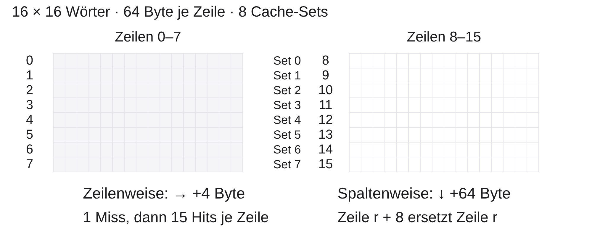{fig-alt="Sechzehn Arrayzeilen teilen sich acht Cache-Sets. Zeilenweise folgen je einem Miss fünfzehn Hits; spaltenweise verdrängen Zeile r und r plus acht einander."}

| Reihenfolge | Misses | Hits | Hit Rate |
|-------------|--------|------|----------|
| zeilenweise | $16$ | $240$ | $93{,}75\,\%$ |
| spaltenweise | $256$ | $0$ | $0\,\%$ |

::: notes
Im Diagramm bezeichnen Zeilennummern die Arrayzeilen und Set-Nummern die acht direkt zugeordneten Cache-Plätze. Zeilen $r$ und $r+8$ zeigen auf dasselbe Set. Die beiden Besuchsrichtungen beziehen sich auf zwei getrennt kalt gestartete Cache-Läufe.

Zeilenweise verursacht der erste Load einer Zeile einen Miss. Ihre fünfzehn weiteren Elemente liegen in der geladenen gültigen Line und werden unmittelbar gelesen, bevor eine andere Zeile sie verdrängt. Pro Zeile entstehen ein Miss und fünfzehn Hits. Bei sechzehn Zeilen sind das $16$ Misses und $16\cdot15=240$ Hits. Die Hit Rate, Trefferquote, ist $240/256=0{,}9375=93{,}75\,\%$.

Spaltenweise laden die ersten acht Zeilen zunächst acht unterschiedliche Blöcke. Zeilen acht bis fünfzehn ersetzen jeweils die entsprechende untere Zeile. Am Anfang der nächsten Spalte fehlen deshalb wieder Zeilen null bis sieben; deren Loads verdrängen nun die oberen Zeilen, die danach erneut fehlen. Dieses Muster wiederholt sich für jede Spalte. Alle $256$ Loads sind Misses, keine sind Hits. Die sechzehn ersten Blockanforderungen sind Kaltstart-Misses. Die weitere Ursache darf nicht pauschal nur Konflikt heißen: Auch ein vollassoziativer Cache mit acht Plätzen und LRU-Ersetzung könnte die sechzehn zyklisch gelesenen Zeilen nicht halten. LRU bedeutet Least Recently Used, Ersetzen des am längsten unbenutzten Blocks.
:::

## Transferfrage: größerer Cache

Dasselbe Array, dieselben Spuren, nun $1024$ Byte Direct Mapped und $64$-Byte-Lines.

1. Wie viele Sets gibt es?
2. Kollidieren Zeile $r$ und Zeile $r+8$ noch?
3. Wie viele Hits und Misses entstehen pro Reihenfolge?

::: notes
Wir ändern nur die Datenkapazität des Matrixcaches auf $1024$ Byte. Bei vierundsechzig Byte pro Line ergibt das sechzehn Sets. Direct Mapped bedeutet weiterhin einen Platz pro Set. Jede der sechzehn Arrayzeilen gehört zu einem anderen Set, denn der Index ist $(64+r)\bmod16=r$ für Zeilen null bis fünfzehn.

Zeilen $r$ und $r+8$ haben daher unterschiedliche Indizes. Das ganze Array kann im Cache bleiben. Zeilenweise ergibt sich wie zuvor ein Miss beim ersten Element jeder Zeile, danach fünfzehn Hits. Spaltenweise lädt die erste Spalte alle sechzehn Zeilen mit sechzehn Misses. Die fünfzehn übrigen Spalten treffen auf die erhaltenen Lines und ergeben $15\cdot16=240$ Hits. Beide Folgen haben sechzehn Misses und zweihundertvierzig Hits.

Die Übung zeigt, weshalb aus einem großen Adresssprung allein keine genaue Miss Rate folgt. Entscheidend ist, ob die benötigten Kopien bis zu ihrer Wiederverwendung erhalten bleiben. Sie zeigt außerdem, dass die schlechte Quote des kleineren Modells keine unveränderliche Eigenschaft spaltenweiser C-Schleifen ist. Für Papieraufgaben ist die Kapazitätsangabe genauso wichtig wie die Schleifenreihenfolge.
:::

## Schrittweite: welche Sets werden genutzt?

Kleines Modell: $8$ Direct-Mapped-Sets, $64$-Byte-Lines, kalt.

Schrittweite $128$ Byte, Start `0x1000`:

| Adresse | `0x1000` | `0x1080` | `0x1100` | `0x1180` | `0x1200` |
|---------|----------|----------|----------|----------|----------|
| Index | $0$ | $2$ | $4$ | $6$ | $0$ |

Was passiert bei der anschließenden Anfrage `0x1000`?

::: notes
Schrittweite, auf Englisch Stride, ist der Adressabstand aufeinanderfolgender Zugriffe. Direct Mapped bedeutet einen festen Cache-Platz pro Block. Wir verwenden ausdrücklich wieder das kleine Modell mit acht Sets zu vierundsechzig Byte, insgesamt fünfhundertzwölf Byte Datenkapazität. Das Präfix `0x` kennzeichnet hexadezimale Adressen. Alle Anfragen sind Loads, Lesezugriffe, und starten ohne gültige Kopien. Es gibt kein Vorabladen und keine fremden Anfragen.

Hundertachtundzwanzig Byte sind zwei Lines. Die Blocknummern lauten vierundsechzig, sechsundsechzig, achtundsechzig, siebzig und zweiundsiebzig. Modulo acht, also der Divisionsrest bei acht, liefert die Indizes null, zwei, vier, sechs und wieder null. Obwohl fünf Blöcke benötigt werden und acht Plätze existieren, nutzt diese Schrittweite nur vier verschiedene Sets. Der fünfte Block ersetzt den ersten bei Index null.

Die anschließende Anfrage `0x1000` ist daher ein Miss, Fehlschlag. Es wurden insgesamt sechs Misses gezählt: fünf erstmalige Blockanforderungen und ein Konflikt-Miss bei der Wiederholung. Ein vollassoziativer Cache gleicher Kapazität mit acht frei nutzbaren Plätzen könnte alle fünf Blöcke halten. Die räumliche Entfernung ist somit nicht der einzige Einfluss einer Schrittweite; sie bestimmt auch die Platzkollisionen. Aus dem C-Arraylayout lässt sich der Adressabstand ableiten, anschließend aus dem Cache-Modell seine Wirkung. Für einen veränderten Cache müsste diese Rechnung erneut geprüft werden.
:::

## Optional: eine Spur im Simulator prüfen

- Zuerst Adressen und Cache-Konfiguration festlegen
- Vor jeder Variante Cache-Zustand zurücksetzen
- Trefferzahlen mit der Papierlösung vergleichen
- Simulatorzähler sind keine allgemeine Laufzeitmessung

::: notes
Ripes ist ein visueller RISC-V-Simulator mit einer Cache-Ansicht. Eine optionale Untersuchung kann das Papiermodell ergänzen, ersetzt aber nicht dessen Annahmen. Prüfen Sie für die verwendete Version, wie Kapazität, Blockgröße und Assoziativität eingestellt und die Cache-Zähler zurückgesetzt werden. Assoziativität ist die Anzahl zulässiger Plätze pro Set. Manche Einstellungen verwenden Exponenten statt unmittelbarer Anzahlen.

Ein Simulatorprogramm enthält auch Befehlsabrufe und möglicherweise zusätzliche Datenzugriffe. Die Summe aller gezeigten Ereignisse muss nicht mit den zweihundertsechsundfünfzig explizit modellierten Array-Loads übereinstimmen. Vergleichen Sie nur gleich definierte Datenanfragen. Die [Ripes-Cache-Dokumentation](https://github.com/mortbopet/Ripes/blob/master/docs/cache_sim.md) beschreibt ausdrücklich: Cache-Zugriffslatenzen werden nicht simuliert. Für eine saubere Zählung empfiehlt sie das Ein-Takt-Prozessormodell, weil wartende Pipeline-Stufen zusätzliche Anfragen zählen können. Ein angezeigter Speicherwert ist im Write-Back-Modus außerdem kein Nachweis für einen veralteten Hauptspeicherwert.

Für die Pflichtübung sind weder Ripes noch RISC-V GCC, der Cross-Compiler für diesen Befehlssatz, nötig. In dieser Vorlesung wurden keine Simulatorzeiten oder RISC-V-Compilerergebnisse gemessen. Sie können die Adressspuren auf Papier oder mit einem kleinen Modell nachvollziehen. Wenn beobachtete Zähler abweichen, untersuchen Sie zuerst Startzustand, Einstellungen und tatsächlich gezählte Anfragen.
:::

## Abschlussquiz: erklären statt nur ankreuzen

- $16$ Fragen im QuizAcademy-Quiz zu Vorlesung 2
- $10$ Minuten beantworten, $5$ Minuten gemeinsam auswerten
- Bei strittigen Antworten: Annahme, Rechnung oder Cache-Zustand nennen
- Typische Stolperstellen: zusätzliche Penalty, Tag/Index, Dirty und Store-Miss

::: notes
Das Abschlussquiz nutzt die sechzehn Fragen der zugehörigen QuizAcademy-Datei. Die ersten zehn Minuten sind zum individuellen Beantworten vorgesehen, die folgenden fünf Minuten zur gemeinsamen Auswertung häufiger Fehlentscheidungen. Die Erklärungen zu den Fragen ermöglichen, gezielt die unsicheren Themen aufzugreifen; nicht jede richtige Einzelantwort braucht eine erneute lange Besprechung. Bei einer aufwendigeren Adressrechnung kann der Rechenweg im Anschluss ergänzt werden.

Penalty bedeutet Zusatzzeit eines Miss, Fehlschlags. Sie wird in unserem Zeitmodell zur Prüfzeit addiert. Der Index wählt das Set, das Tag kennzeichnet den dort gespeicherten Block. Dirty ist das Änderungsbit einer Write-Back-Line, deren aktuelle Daten noch nicht vollständig weitergegeben sind. Ein Store-Miss ist ein Schreibzugriff ohne passende gültige Kopie; seine Zuteilungsregel ist von der Weitergabe der Änderungen zu unterscheiden.

Eine richtige Auswahl sollte durch diese Begriffe begründbar sein. Bitten Sie bei Uneinigkeit um eine konkrete Zwischenrechnung oder einen Cache-Zustand. Die Fragen haben je eine richtige Antwort; deren Länge soll keinen Lösungsweg verraten. Die anschließende Zusammenfassung verknüpft die Einzelfragen wieder mit dem roten Faden: nützliche Kopien, passende Platzwahl und begründete Adressmuster.
:::

## Was Sie jetzt begründen können

- Lokalität erklärt, welche Kopien nützen
- AMAT verbindet Trefferquote mit zusätzlicher Miss-Zeit
- Mapping bestimmt Platzwahl; Ersetzung entscheidet bei vollem Set
- Schreibstrategie und Store-Miss-Regel getrennt angeben
- C-Layout, Zugriffsspur und Cache-Modell gemeinsam betrachten

::: notes
Die Speicherhierarchie verbindet kleine schnelle Kopien mit großem langsameren Speicher. Zeitliche Lokalität ist Wiederverwendung derselben Adresse, räumliche Lokalität die Nutzung benachbarter Adressen. AMAT bedeutet Average Memory Access Time, mittlere Speicherzugriffszeit; sie umfasst in unserem Modell die Prüfung bei jedem Zugriff und die gewichteten zusätzlichen Kosten der Misses.

Mapping, die Zuordnung zu zulässigen Cache-Plätzen, und Replacement, die Ersetzung bei vollem Set, sind verschiedene Aufgaben. Ebenso sind Write-Through beziehungsweise Write-Back, die Weitergabe geänderter Daten, und Write-Allocate beziehungsweise No-Write-Allocate, das Verhalten bei einem Store-Miss, getrennte Entscheidungen. Ein Dirty-Bit kennzeichnet Änderungen, ein Valid-Bit die Gültigkeit.

Prüfen Sie sich ohne Folien: Warum können zwei Blöcke einen fast leeren direkt abgebildeten Cache ständig verfehlen? Weil sie denselben einzigen Platz benötigen. Warum hilft im Matrixbeispiel mehr Kapazität auch beim Spaltendurchlauf? Weil die Zeilen bis zur nächsten Nutzung bleiben. Warum ist eine hohe Trefferquote noch keine schnelle Programmlaufzeit? Weil Zugriffszeiten und übrige Arbeit fehlen. Diese begründeten Antworten sind die Grundlage für Übungsblatt 2. Definitionen und Aufbau orientieren sich an Harris/Harris, Digital Design and Computer Architecture — RISC-V Edition, Abschnitt Speicherhierarchie; Patterson/Hennessy dient zur Vertiefung.
:::

