## Warum zählt die Reihenfolge der Zugriffe?

Zwei Schleifen lesen dieselben Arrayelemente gleich oft:

- Die eine besucht benachbarte Elemente nacheinander
- Die andere wechselt zwischen weit auseinanderliegenden Stellen

Müssen beide gleich schnell sein? Welche Angaben fehlen?

Zwei Minuten: Vermutung und Begründung austauschen.

::: notes
Zwei Schleifen können dieselben Arrayelemente gleich oft lesen und dem Speichersystem dennoch verschiedene Arbeit abverlangen. Die eine Anfragefolge nutzt benachbarte Elemente nacheinander, die andere wechselt zwischen weit auseinanderliegenden Stellen. Aus C-Arrays und Speicheradressen ist diese Unterscheidung bereits verständlich; Kenntnisse über eine konkrete Cache-Organisation werden für eine erste Vermutung nicht benötigt.

Die Vermutung „gleich viele Zugriffe, also gleiche Zeit“ betrachtet nur die Anzahl. Ein kleiner schneller Zwischenspeicher, der Cache, hält jedoch Kopien ausgewählter Speicherblöcke. Ein bereits beschaffter Block kann mehrere spätere Anfragen bedienen. Ob diese Wiederverwendung gelingt, hängt von der Reihenfolge und davon ab, welche Kopien bis dahin erhalten bleiben. Benachbarte Zugriffe sind deshalb häufig günstig, aber eine feste Beschleunigung folgt aus der Beschreibung noch nicht.

Für eine begründete Antwort fehlen insbesondere Startzustand, Datenkapazität, Blockgröße und Platzzuordnung des Caches sowie die genaue Anfragefolge. Auch die Ausführung des C-Programms ist zu unterscheiden: Ein Compiler kann Zugriffe verändern oder Werte in Registern halten. Die weitere Untersuchung verwendet deshalb ausdrücklich festgelegte Adressspuren. Der Lernweg führt von der Speicherzelle aus der vorigen Einheit zur Organisation nützlicher Kopien und schließlich zurück zu den beiden Schleifen.
:::

## Unser Weg und Ihre Lernziele

1. Lokalität erklären: Wiederholung und Nachbarschaft
2. Treffer zählen und mittlere Zugriffszeit berechnen
3. Speicheradressen Cache-Plätzen zuordnen
4. Schreibzustände und Verdrängung nachvollziehen
5. C-Arrayzugriffe auf Papier vergleichen

::: notes
Der Aufbau einer Speicherhierarchie knüpft an die verschiedenen Zelltechnologien an. SRAM, Static Random Access Memory, hält einen Zustand ohne regelmäßiges Auffrischen, solange die Versorgung anliegt. DRAM, Dynamic Random Access Memory, benötigt dagegen Refresh, also regelmäßiges Wiederherstellen der gespeicherten Ladung. SRAM ermöglicht meist kürzere Zugriffe, braucht aber mehr Chipfläche pro Bit. Großer Arbeitsspeicher lässt sich deshalb nicht ohne Weiteres durch ebenso großen schnellen SRAM ersetzen.

Adressen, Daten und einfache C-Arrays bilden die weiteren Voraussetzungen. Im byteadressierten Modell benennt jede aufeinanderfolgende Adresse ein weiteres Byte. Die Memory Map ordnet Adressbereiche Speicher und Geräten zu; der Linker fügt übersetzte Programmteile zusammen und platziert sie darin. Keine dieser Aufgaben legt fest, welche Blockkopien während der Ausführung im Cache liegen. Binärzahlen, Zweierpotenzen und der Divisionsrest werden bei der Cache-Zuordnung nochmals hergeleitet.

Das Ziel ist, die Wirkung einer geordneten Zugriffsspur schrittweise zu begründen: zunächst die nützlichen Kopien erkennen, anschließend Treffer zählen und ihre Zeitwirkung berechnen, danach Platzwahl und Schreibzustände fortschreiben. C-Zugriffe verbinden diese Regeln zum Schluss mit einer bekannten Programmdarstellung. Alle Zahlen sind Lehrannahmen. Eine berechnete mittlere Zugriffszeit ist weder eine Messung noch bereits die Laufzeit eines vollständigen Programms.
:::

## Vier Schulstunden: Ablauf

| Stunde | Vorlesungsphase | Arbeitsphase |
|--------|---------------------------|-------------|
| 1 | Hierarchie, Lokalität und Treffer: 35 min | Aufgabe 1: 10 min |
| 2 | Zugriffszeit und direkte Platzzuordnung: 30 min | Aufgaben 2–3: 15 min |
| 3 | Assoziativität, Verdrängung und Schreiben: 30 min | Aufgaben 4–5: 15 min |
| 4 | C-Zugriffsmuster und Auswertung: 15 min | Aufgabe 6: 15 min; Quiz: 15 min |

::: notes
Vier Schulstunden umfassen hundertachtzig Minuten Unterricht; zusätzliche Pausen liegen außerhalb dieser Zeit. Der Plan verteilt hundertzehn Minuten auf Erklärung, kurze Denkfragen, Diskussion und Aufgabenbesprechung, fünfundfünfzig Minuten auf angeleitete Papierarbeit und fünfzehn Minuten auf das Abschlussquiz. Die fünf kurzen Abschnittsübersichten geben Orientierung innerhalb dieses Zeitbudgets. Ein umfangreiches Rechenbeispiel benötigt mehr Zeit als ein solcher Übergang.

Der Lernweg beginnt mit Hierarchie und Lokalität. Aus einer Trefferbilanz entsteht anschließend ein Zeitmodell; die Platzzuordnung erklärt danach, wie diese Bilanz zustande kommt. Zuordnungsfreiheit, Verdrängung und Schreibregeln erweitern die einfache Lesevorstellung. Den Abschluss bilden die C-Arrayzugriffe und ihre Auswertung.

Die angeleiteten Arbeitsphasen verwenden die Aufgaben eins bis sechs des Übungsblatts in dieser Reihenfolge. Die zusätzliche Aufgabe sieben führt einen Cache-Controller auf Papier aus und dient der Nachbereitung. Das vollständige selbstständige Blatt ist mit fünfundsiebzig bis neunzig Minuten veranschlagt; die kürzere Unterrichtszeit setzt die vorgesehene Anleitung und Auswahl voraus. Der Zeitplan ist ein Richtwert, der Rückfragen und gemeinsame Zwischenschritte berücksichtigt.
:::

## 1 · Lokalität und Hierarchie {.section-divider}

Welche Kopien können spätere Anfragen beschleunigen?

::: {.section-route}
Lokalität → Zeitmodell → Platzwahl → Schreiben → C-Zugriffe
:::

Von Speichertechnologien zu nützlichen nahen Kopien.

::: notes
Der begrenzte Platz eines schnellen Speichers soll gerade diejenigen Daten bereithalten, die bald wieder benötigt werden. Dafür muss zunächst geklärt sein, welchen Weg eine Anfrage durch die Hierarchie nimmt und welche Teile des adressierten Speichers ein Cache gemeinsam beschafft.

Zeitliche Wiederverwendung und räumliche Nachbarschaft liefern zwei Gründe, eine Kopie zu behalten. Die Kapazität allein entscheidet aber noch nicht über ihren Nutzen: Auch Blockgrenzen und Datenlayout beeinflussen, welche mitgebrachten Bytes tatsächlich verwendet werden. Diese Betrachtung führt von den bekannten Speicherbausteinen zu den Anfragefolgen, deren Treffer anschließend genau gezählt werden.
:::

## Warum Warten teuer wird

::: {.section-label}
1 / 5 · Lokalität und Hierarchie
:::

Didaktisches Beispiel: Prozessortakt $f=1\,\mathrm{GHz}$, Speicherlatenz $t=100\,\mathrm{ns}$.

$$
T=\frac{1}{f}=1\,\mathrm{ns}, \qquad n=\frac{t}{T}=100\ \text{Takte}
$$

- Latenz: Zeit von der Anfrage bis zu den benötigten Daten
- Ein abhängiger Folgebefehl muss auf diese Daten warten
- Mehr übertragenes Datenvolumen ersetzt keine kurze Latenz

::: notes
Die Frage nach dem Nutzen naher Kopien beginnt bei der Wartezeit auf eine Antwort. Diese Dauer heißt Latenz. Bei der angenommenen Frequenz von einem Gigahertz, einer Milliarde Taktperioden pro Sekunde, dauert eine Periode $T$ genau eine Nanosekunde. Die angenommene Speicherlatenz $t$ von hundert Nanosekunden umfasst somit hundert Taktperioden. $n$ zählt diese Perioden; die Einheiten kürzen sich bei der Division. Das ist ein Rechenbeispiel, kein Datenblatt eines bestimmten RISC-V-Prozessors.

Wenn eine Addition gerade den angeforderten Wert braucht, kann sie erst mit diesem Wert rechnen. Eine geeignete Implementierung kann andere unabhängige Arbeit gegebenenfalls mit dieser Wartezeit überlappen; die Abhängigkeit vom angeforderten Wert bleibt dabei bestehen. Bandbreite bedeutet dagegen Datenmenge pro Zeit bei fortlaufender Übertragung. Eine breite Datenverbindung kann viel liefern, obwohl die erste Antwort spät kommt. Das als Memory Wall, Speichermauer, bezeichnete Problem ist die Begrenzung der Rechenleistung durch das Speichersystem. Ein Cache hält häufig benötigte Antworten näher am Rechenkern bereit. Wie sich ein solcher kleiner Speicher mit dem großen Arbeitsspeicher verbindet, beschreibt die Hierarchie.
:::

## Die Speicherhierarchie

::: {.section-label}
1 / 5 · Lokalität und Hierarchie
:::

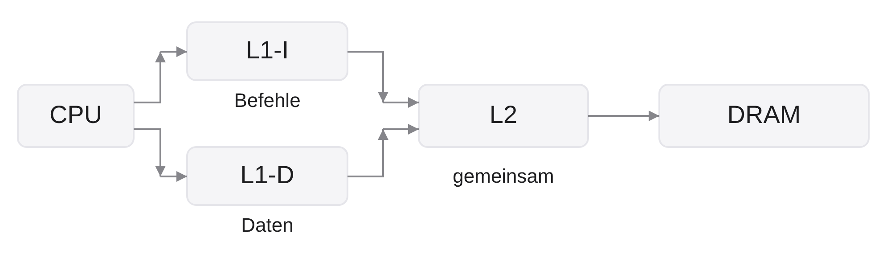{fig-alt="Befehls- und Datenzugriffe laufen über getrennte erste Cache-Ebenen zu gemeinsamem Cache und Hauptspeicher."}

- Nähe: wenig Kapazität, kurze Zugriffszeit
- L1-Miss: zuerst die nächste Ebene anfragen

::: notes
Die Hierarchie verbindet kurze nahe Zugriffe mit der Kapazität weiterer Speicherebenen. In der Abbildung verläuft dieser Weg von links nach rechts. CPU steht für Central Processing Unit, zentrale Verarbeitungseinheit. L1 bedeutet Level 1, erste Cache-Ebene. L1-I hält Instructions, Befehle, und bedient deren Abruf, den Fetch. L1-D hält Data, Daten, und bedient Lese- und Schreibzugriffe. Zwei getrennte erste Caches können gleichzeitigen Befehlsabruf und Datenzugriff ermöglichen, ohne denselben Speicherport zu beanspruchen.

L2, Level 2, ist hier ein gemeinsamer Cache für Befehle und Daten. Die Pfeile beschreiben Anfragen an die jeweils nächste Ebene; sie sind keine maßstäbliche Zeitachse. DRAM, Dynamic Random Access Memory, ist in diesem Modell der große dynamische Hauptspeicher. Eine weitere Cache-Ebene wäre möglich. Ein Fehlschlag, englisch Miss, in L1 bedeutet deshalb nicht automatisch einen DRAM-Zugriff.

Die Kästen zeigen die funktionale Verbindung, keine realen Chipflächen. RISC-V ist eine Befehlssatzarchitektur; daraus folgt weder eine bestimmte Cache-Größe noch, dass überhaupt ein Cache vorhanden ist. Ein kleiner Mikrocontroller kann direkt auf seinen Arbeitsspeicher zugreifen. Diese Unterschiede betreffen den Lieferweg einer Anfrage. Ihre Speicheradresse bleibt davon unabhängig. Erst danach stellt sich die Frage, welche Daten die kleinen oberen Ebenen für eine baldige Nutzung behalten sollten.
:::

## Gleiche Adresse, anderer Lieferweg

::: {.section-label}
1 / 5 · Lokalität und Hierarchie
:::

- Ein Cache verschiebt weder das Array noch seinen Adressbereich
- Der Linker legt Programmteile ab, nicht den aktuellen Cache-Inhalt
- Ein gewöhnlicher Load kann von verschiedenen Ebenen bedient werden
- Cache-Kopie und Originalblock gehören zur selben Speicheradresse

::: notes
Verschiedene Antwortwege führen weiterhin zu derselben adressierten Speicherstelle. Die Hierarchie verändert den Lieferweg einer Anfrage, nicht die Bedeutung ihrer Adresse. Ein Load ist ein Lesezugriff. Wenn ein Arrayelement an Adresse `0x1000` liegt, bleibt die Anfrage an diese Adresse gerichtet, auch wenn eine Kopie aus einem Cache antwortet. Eine Cache-Zeile ist keine neue Adresse, auf die das C-Programm seinen Zeiger umsetzen müsste.

Die aus der Speicherorganisation bekannte Memory Map bleibt die Zuordnung von Adressbereichen zu Speicher und Geräten. Auch die Platzierung durch den Linker bleibt davon getrennt. Er bestimmt beispielsweise, wo ein Array im Speicher liegt. Welche seiner Blöcke gerade gültige Cache-Kopien haben, ergibt sich dagegen während der Ausführung aus Anfragen und Verwaltungsregeln.

Eine typische Fehlannahme lautet: Nach dem ersten Zugriff liegt das Array nur noch im Cache. Tatsächlich hält der Cache ausgewählte Blockkopien; das Programm adressiert weiterhin seine Speicherstellen. Bei späterem Verdrängen wird kein Arrayzeiger ungültig. Die konkrete Plattform regelt, welche Speicherbereiche cachefähig sind. Für den folgenden Lokalitätsvergleich bleiben wir bei normalem cachefähigem Speicher. Entscheidend ist nun, welche Kopien bald wieder gebraucht werden.
:::

## Zeitliche Lokalität: bald wieder dieselbe Adresse

::: {.section-label}
1 / 5 · Lokalität und Hierarchie
:::

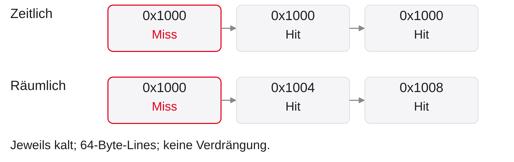{fig-alt="Zwei getrennte Zugriffsspuren: Wiederholung derselben Adresse und Zugriff auf benachbarte Wörter."}

- Zeitlich: Eine kürzlich genutzte Adresse wird erneut benötigt
- Ein geladener Block bleibt verfügbar, solange er nicht verdrängt wird

::: notes
Eine gehaltene Kopie lohnt sich besonders, wenn dieselbe Speicherstelle bald erneut angefragt wird. Diese Wiederverwendung heißt zeitliche Lokalität, englisch Temporal Locality. In der oberen Spur wird dreimal die Adresse `0x1000` gelesen. Das Präfix `0x` kennzeichnet hexadezimale Schreibweise. Beim ersten Zugriff ist der Cache kalt, noch ohne gültige Kopien: Es entsteht ein Miss, ein Fehlschlag. Anschließend kann dieselbe gespeicherte Kopie zweimal liefern; das sind Hits, Treffer.

Die untere Spur beginnt unabhängig davon ebenfalls mit einem kalten Cache. Dort steigen die Adressen um jeweils vier Byte. Sie illustriert räumliche Lokalität. Die beiden Spuren dürfen nicht als eine gemeinsame Folge gezählt werden. Die Beschriftungen tragen die Bedeutung, Rot markiert den Fehlschlag; eine Farbe allein ist nicht nötig, um das Bild zu verstehen.

Eine wiederholte Nutzung in C kann sich auch auf Register beziehen. Ein Schleifenzähler, den der Compiler in einem Register hält, verursacht nicht automatisch jedes Mal einen Daten-Cache-Zugriff. Deshalb zählen wir hier ausdrücklich Adressanfragen an den Cache. Die Zählung betrifft also echte Anfragen an den Cache. Neben derselben Adresse können auch verschiedene benachbarte Adressen von einer einzigen beschafften Kopie profitieren.
:::

## Räumliche Lokalität: Nachbarn gemeinsam holen

::: {.section-label}
1 / 5 · Lokalität und Hierarchie
:::

- Räumlich: Benachbarte Adressen werden zeitnah benötigt
- Beim Miss wird ein ganzer zusammenhängender Block beschafft
- Die Verwaltungseinheit heißt Cache-Line oder Cache-Block

Bei $4$ Byte pro Element passen $16$ Elemente in einen $64$-Byte-Block.

::: notes
Zur Wiederholung derselben Stelle kommt die Nutzung ihrer Nachbarn. Diese räumliche Lokalität heißt auf Englisch Spatial Locality. Ein Arraydurchlauf ist ein typisches Beispiel. Ein Cache verwaltet deshalb nicht jedes Byte separat, sondern zusammenhängende Blöcke, häufig Cache-Lines genannt. Bei einem Miss kann er Nachbarn mit aus der nächsten Ebene holen. Diese Nachbarn werden später durch einen normalen Zugriff als Hit genutzt; der Cache muss dafür den Quelltext nicht verstehen oder die nächste Adresse erraten.

Im Beispiel beträgt die Blockgröße $64$ Byte und ein Element belegt $4$ Byte. Die Division $64/4=16$ ergibt sechzehn Elemente. Das gilt für sechzehn vollständig in einem Block liegende Elemente, etwa bei entsprechend ausgerichtetem Arrayanfang. Ein beliebig beginnendes Array muss seine ersten sechzehn Elemente nicht in derselben Line haben.

Die bereits eingeführte untere Zugriffsspur liest `0x1000`, `0x1004` und `0x1008`. Alle drei gehören zum Block `0x1000` bis `0x103F`. Nach dem ersten Miss folgen zwei Hits, sofern keine Verdrängung stattfindet. Ein größerer Block kann bei solchen Folgen weitere Nachbarn bereitstellen. Er beansprucht aber auch mehr Datenkapazität. Wie viele Blöcke eine Programmphase wiederholt braucht, wird deshalb zur nächsten wichtigen Größe.
:::

## Arbeitsmenge: Was muss im Cache bleiben?

::: {.section-label}
1 / 5 · Lokalität und Hierarchie
:::

- Working Set: während einer Phase wiederholt benötigte Blöcke
- Nicht das gesamte Programm muss gleichzeitig hineinpassen
- Kapazität genügt nur zusammen mit geeigneter Platzwahl

Beispiel: $8$ wiederverwendete Lines zu je $64$ Byte benötigen $512$ Byte Datenkapazität.

::: notes
Ob nützliche Kopien erhalten bleiben können, hängt von der Arbeitsmenge ab. Working Set bezeichnet die Speicherblöcke, die ein Programm in einer betrachteten Phase wiederholt benötigt. Das ist keine unveränderliche Eigenschaft des gesamten Programms. Eine Phase kann etwa eine innere Schleife sein; die nächste arbeitet möglicherweise mit anderen Daten. Die Arbeitsmenge zählt dabei ganze Lines und damit zusammenhängende Speicherblöcke.

Acht wiederverwendete Lines mit je vierundsechzig Byte brauchen $8\cdot64=512$ Byte Datenkapazität. Ein insgesamt sehr großes Programm kann daher in einer kleinen wiederholten Teilaufgabe gute Trefferquoten erreichen. Umgekehrt können schon wenige Blöcke Konflikte erzeugen, wenn sie dieselben zulässigen Plätze benötigen. Die reine Summe der Datenbytes reicht deshalb noch nicht, um Treffer vorherzusagen; die Platzzuordnung wird später ergänzt.

Liest eine Schleife dieselben acht Blöcke immer wieder, entscheidet ihr Verbleib über die nächste Nutzung. In einem anfangs leeren Cache entstehen zunächst Fehlschläge. Wenn alle acht passend untergebracht sind und bis zur Wiederverwendung erhalten bleiben, treffen spätere Durchläufe. Ein einmaliger langer Durchlauf ohne Wiederholung profitiert dagegen vor allem von Nachbarn innerhalb eines Blocks. Die Bilanz braucht deshalb sowohl eine Zugriffsspur als auch die betrachtete Programmphase. Zusätzlich muss eindeutig sein, welche Adressen jeweils zu einem Block gehören.
:::

## Blockgrenze und Offset

::: {.section-label}
1 / 5 · Lokalität und Hierarchie
:::

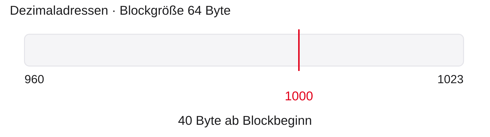{fig-alt="Eine 64-Byte-Line umfasst die Dezimaladressen 960 bis 1023; die Adresse 1000 liegt 40 Byte hinter dem Beginn."}

Für Byteadresse $a$ und Blockgröße $B$:

$$
q=\left\lfloor a/B\right\rfloor,\quad a_\text{Basis}=qB,\quad o=a\bmod B
$$

::: notes
Die Zugehörigkeit zu einem Block lässt sich direkt aus der Byteadresse berechnen. Die Blocknummer $q$ entsteht durch ganzzahlige Division der Byteadresse $a$ durch die Blockgröße $B$. Die Abrundungsklammer bedeutet: Der nicht ganze Rest wird verworfen. Der Block beginnt an $a_\text{Basis}=qB$. Der Offset $o$, deutsch Versatz, ist der Rest und bezeichnet die Position des gesuchten Bytes innerhalb des Blocks. Das Zeichen $\bmod$ steht für diesen Divisionsrest.

In der Abbildung sind die Adressen ausdrücklich dezimal. Für $a=1000$ und $B=64$ ist $q=15$, denn $15\cdot64=960$ und $16\cdot64=1024$. Die Basis ist $960$, der Offset $1000-960=40$. Die letzten enthaltenen Bytes liegen bei $960+63=1023$. Die rote Markierung liegt entsprechend bei Position vierzig im gezeichneten Band. Ein Miss auf Adresse 1000 lädt also nicht den Bereich 1000 bis 1063.

Blockgrenzen sind für die spätere Adresszerlegung wesentlich. Bei einer Zweierpotenz als Blockgröße kann der Offset direkt aus den unteren Adressbits gewonnen werden. Die Rechnung mit Division und Rest liefert zunächst die anschauliche Grundlage. Dieselbe Einteilung macht auch die Folgen einer veränderten Blockgröße nachvollziehbar.
:::

## Blockgröße: Nutzen und Preis

::: {.section-label}
1 / 5 · Lokalität und Hierarchie
:::

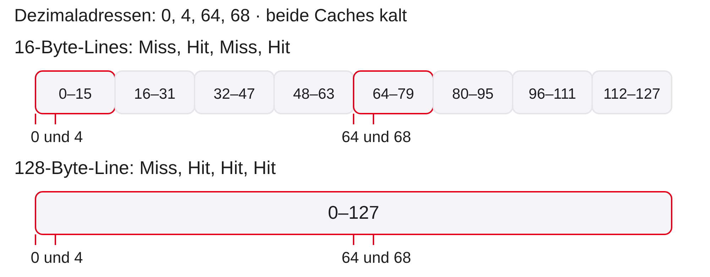{fig-alt="Die Adressen 0, 4, 64 und 68 benötigen bei 16-Byte-Blöcken zwei Fills, bei 128-Byte-Blöcken einen. Größere Blöcke fassen mehr Nachbarn zusammen."}

Gleiche Datenkapazität $256$ Byte: $16$ kleine oder $2$ große Lines.

::: notes
Eine größere Blockgröße verändert bei fester Kapazität zugleich die Zahl der verfügbaren Einträge. Die Abbildung vergleicht dazu zwei unabhängige, kalt beginnende Cache-Modelle mit jeweils zweihundertsechsundfünfzig Byte Datenkapazität. Alle Adressen sind dezimal. Die obere Reihe teilt den Bereich null bis hundertsiebenundzwanzig in Blöcke zu sechzehn Byte. Die untere zeigt einen einzigen Block zu hundertachtundzwanzig Byte. Die Breiten stellen Adressbereiche dar, nicht Zeit. Die roten Markierungen zeigen die angefragten Stellen null, vier, vierundsechzig und achtundsechzig; Beschriftungen fassen die eng benachbarten Paare zusammen.

Bei sechzehn Byte pro Line liegt null mit vier im ersten Block und vierundsechzig mit achtundsechzig im fünften. Die Folge ergibt Miss, Hit, Miss, Hit. Ein Fill bezeichnet jeweils das Beschaffen der angefragten Line. Bei hundertachtundzwanzig Byte gehören alle vier Anfragen zu derselben Line: Miss, Hit, Hit, Hit. Die größere Line nutzt hier räumliche Lokalität besser.

Die feste Kapazität erlaubt aber $256/16=16$ kleine beziehungsweise $256/128=2$ große Einträge. Schon drei wiederholt benötigte, weit voneinander entfernte große Blöcke können nicht gleichzeitig in zwei Einträgen bleiben. Kleinere Blöcke erlauben mehr getrennte Kopien; ob sie passend untergebracht werden, klärt später die Platzzuordnung. Ein größerer Block ist damit keine allgemeine Verbesserung. Übertragungszeit und ungenutzte Nachbarbytes sind weitere Kosten; konkrete Zeiten werden hier nicht behauptet. Welche Nachbarn überhaupt nützen, hängt auch von der Anordnung der Datenstruktur ab.
:::

## Array und verkettete Liste

::: {.section-label}
1 / 5 · Lokalität und Hierarchie
:::

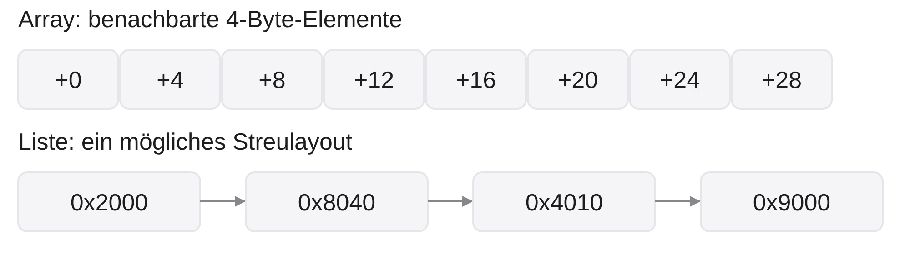{fig-alt="Ein Array hat zusammenhängende Elemente; eine beispielhafte Liste verbindet weit auseinanderliegende Knoten per Zeiger."}

- Arraydurchlauf: mitgeladene Nachbarn werden bald genutzt
- Verstreute Liste: der nächste Knoten kann in einem anderen Block liegen
- Das tatsächliche Layout entscheidet, nicht allein der Datentyp

::: notes
Der Vergleich zwischen Array und verketteter Liste verbindet Blockgröße mit der Anordnung einer Datenstruktur. Das obere Band zeigt die ersten acht Wörter eines Arrays mit vier Byte pro Wort. Die angegebenen Versätze $+0,+4,\ldots,+28$ liegen in derselben angenommenen 64-Byte-Line. Ein Zugriff auf den Anfang beschafft also auch die gezeichneten Nachbarn. Das Band stellt Adressnähe dar, keine Taktfolge.

Unten sind vier Knoten einer verketteten Liste gezeigt. Ein Knoten enthält Daten und einen Zeiger auf den nächsten Knoten. Die Pfeile folgen den Zeigern in der Reihenfolge `0x2000`, `0x8040`, `0x4010`, `0x9000`, nicht der numerischen Adressreihenfolge. Bei diesem möglichen Streulayout liegt jeder Knoten in einer anderen Line. Die Nachbarbytes des ersten Knotens helfen beim nächsten dann wenig. Außerdem muss der nächste Zeigerwert zunächst gelesen werden, bevor die folgende Adresse bekannt ist.

Listen sind jedoch nicht grundsätzlich verstreut; ein Speicherpool kann ihre Knoten zusammenhängend ablegen. Umgekehrt kann ein Array mit großen Zugriffssprüngen schlechte Lokalität zeigen. Speicherlayout und Zugriffsmuster müssen daher gemeinsam betrachtet werden. Aus der Darstellung folgt keine allgemeine Laufzeitquote. Eine genaue Bewertung benötigt vielmehr eine Regel dafür, wann eine Anfrage als Treffer gezählt wird.
:::

## 2 · Treffer und Zugriffszeit {.section-divider}

Wie wird aus einer Zugriffsspur eine mittlere Zugriffszeit?

::: {.section-route}
Lokalität → Zeitmodell → Platzwahl → Schreiben → C-Zugriffe
:::

Treffer zählen, Anfangszustände festlegen und Zeiten gewichten.

::: notes
Lokalität beschreibt zunächst eine Möglichkeit zur Wiederverwendung. Eine genaue Bilanz muss zusätzlich feststellen, ob die passende Kopie beim jeweiligen Zugriff gültig vorhanden ist. Dafür werden Anfangszustand und geordnete Anfragefolge ausdrücklich festgelegt.

Treffer und Fehlschläge ergeben zusammen die Quote des betrachteten Fensters. Ihre Zeitwirkung hängt darüber hinaus von der Prüfzeit und den zusätzlichen Miss-Kosten ab. Das Zeitmodell trennt diese Größen, damit weder eine hohe Quote mit kurzer Programmlaufzeit noch eine zusätzliche Penalty mit der gesamten Miss-Dauer verwechselt wird. Mehrere Ebenen erweitern dieselbe Idee um bedingte Zugriffswege.
:::

## Was macht einen Treffer aus?

::: {.section-label}
2 / 5 · Treffer und Zugriffszeit
:::

Ein Eintrag enthält:

| Feld | Aufgabe |
|------|---------|
| Daten | Kopie eines ganzen Blocks |
| Tag | Kennzeichnung des gespeicherten Blocks |
| Valid | Gültigkeit des Eintrags |

- Hit: gültiger Eintrag für den angefragten Block
- Miss: keine solche Kopie in dieser Cache-Ebene

::: notes
Die bisherige Vorstellung einer nutzbaren Kopie lässt sich nun als Trefferbedingung fassen: Ein Cache-Hit verlangt eine gültige Kopie des angefragten Blocks. Ein Tag, wörtlich Etikett, kennzeichnet den Block zusammen mit seinem Platzindex. Die genaue Zuordnung der Adressbits wird beim Mapping hergeleitet. Das Valid-Bit ist das Gültigkeitsbit: Eins bedeutet verwendbar, null bedeutet ungültig. Beim Kaltstart setzen wir alle Valid-Bits auf null; zufällige Daten oder ein zufällig passendes Tag dürfen keinen Treffer vortäuschen.

Ein Miss besagt nur, dass die betrachtete Ebene nicht liefern kann. Die nächste Ebene kann durchaus treffen. Beim Nachladen, auch Fill genannt, wird der Eintrag mit passenden Daten und passendem Tag gefüllt und gültig gemacht. Der Offset wählt daraus das angeforderte Byte oder Wort.

Diese Verwaltung läuft bei gewöhnlichem cachefähigem Speicher meist transparent, ohne explizite Befehle im C-Programm. Nicht jeder Adressbereich ist cachefähig: Geräteadressen können besondere Eigenschaften besitzen. Das Lesemodell beschränkt sich daher auf normalen Speicher, einen Prozessor und vollständig abgeschlossene Zugriffe. Für eine Trefferbilanz sind damit Kopienzustand und Anfragefolge festgelegt. Schon ein anderer Anfangszustand kann bei derselben Folge zu einem anderen Ergebnis führen.
:::

## Kalt und warm: fair vergleichen

::: {.section-label}
2 / 5 · Treffer und Zugriffszeit
:::

Kalter Cache, $64$-Byte-Lines, keine Verdrängung:

`0x1000, 0x1004, 0x1040, 0x1000`

1. Zählen Sie Hits und Misses im ersten Durchlauf.
2. Wiederholen Sie dieselbe Folge ohne Reset.
3. Warum darf man diese beiden Trefferquoten nicht gleichsetzen?

::: notes
Gleiche Adressen können unterschiedliche Trefferzahlen ergeben, wenn der Vergleich mit anderen Kopien beginnt. Ein kalter Cache hat anfangs keine gültigen Einträge; ein warmer enthält noch die Kopien vorheriger Zugriffe. Das gilt entsprechend für die Valid-Bits: zunächst null, nach erfolgreichem Nachladen eins. Im Beispiel gibt es genug zulässige Plätze für beide angeforderten Blöcke; es findet keine Verdrängung und kein Vorabladen statt. Das Präfix `0x` kennzeichnet hexadezimale Adressen.

`0x1000` und `0x1004` gehören bei vierundsechzig Byte pro Line zum selben Block. `0x1040` liegt im nächsten. Im ersten Durchlauf lautet die Bilanz Miss, Hit, Miss, Hit: zwei Fehlschläge und zwei Treffer, Hit Rate beziehungsweise Trefferquote $2/4=50\,\%$. Die letzte Anfrage findet die zuerst geladene Kopie weiterhin vor.

Ohne Zurücksetzen bleiben beide Blocks gültig. Der zweite Durchlauf hat vier Hits und keine Misses, also hundert Prozent Treffer. Werden beide Durchläufe zusammen ausgewertet, ergeben sich sechs Hits bei acht Anfragen, also fünfundsiebzig Prozent. Das sind drei unterschiedliche Auswertungsfenster, keine widersprüchlichen Ergebnisse. Für einen fairen Variantenvergleich muss jede Variante mit demselben dokumentierten Zustand beginnen. Die Wahl des Auswertungsfensters gehört damit ebenso zur Quote wie die eigentliche Adressfolge.
:::

## Trefferquote ist eine Eigenschaft der Spur

::: {.section-label}
2 / 5 · Treffer und Zugriffszeit
:::

$$
h=\frac{N_H}{N},\qquad m=\frac{N_M}{N}=1-h,\qquad N=N_H+N_M
$$

Beispiel: $N=100$, davon $N_H=95$ Hits und $N_M=5$ Misses.

- Hit Rate $h=0{,}95$, Miss Rate $m=0{,}05$
- Startzustand, Cache-Konfiguration und Zugriffsspur mit angeben

::: notes
Eine solche Bilanz lässt sich auf beliebige endliche Zugriffsspuren übertragen. $N$ zählt die betrachteten Zugriffe, $N_H$ die Treffer und $N_M$ die Fehlschläge. Hit Rate bedeutet Trefferquote $h$, Miss Rate Fehlschlagquote $m$. In unserem einfachen Modell endet jede Anfrage genau als Hit oder Miss, daher ergänzen sich die beiden Quoten zu eins. Die Quoten sind dimensionslose Anteile; $0{,}95$ entspricht $95\,\%$.

Bei hundert Anfragen mit fünfundneunzig Hits und fünf Misses erhalten wir $h=95/100=0{,}95$ und $m=5/100=0{,}05$. Eine hohe Trefferquote ist keine Vorhersagegenauigkeit: Sie beschreibt die nach den Cache-Regeln gezählte oder gemessene Folge. Eine andere Folge kann auf demselben Cache ganz anders ausfallen.

Der Vergleich des kalten und warmen Durchlaufs zeigt bereits, dass der Anfangszustand Bestandteil der Angabe sein muss. Für einen fairen Vergleich müssen Startzustand, Blockgröße, Datenkapazität und Folge festgelegt sein. Die Trefferquote allein sagt zudem nicht, wie viel ein Miss kostet. Eine Zeitbewertung verbindet deshalb die Quote mit den Kosten beider Fälle.
:::

## Mittlere Zugriffszeit: AMAT

::: {.section-label}
2 / 5 · Treffer und Zugriffszeit
:::

Ein blockierendes Ein-Ebenen-Modell:

$$
\mathrm{AMAT}=t_H+m\,p
$$

- AMAT: Average Memory Access Time
- $t_H$: Zeit der Cache-Prüfung, bei jedem Zugriff
- $p$: zusätzliche Miss Penalty, nur beim Miss
- Miss-Gesamtzeit: $t_H+p$

::: notes
Aus der Häufigkeit von Treffern und Fehlschlägen entsteht mit den zugehörigen Dauern eine mittlere Zeit. AMAT steht für Average Memory Access Time, mittlere Speicherzugriffszeit. Die Hit Time $t_H$ ist hier die Zeit für Prüfung und Lieferung bei einem Treffer. Jeder Zugriff durchläuft diese Prüfung. Die Miss Penalty $p$ ist ausdrücklich die zusätzliche Zeit für einen Fehlschlag, etwa zum Beschaffen des Blocks aus der nächsten Ebene. Ein Miss dauert somit insgesamt $t_H+p$, nicht nur $p$.

Die Formel ergibt sich aus dem gewichteten Mittel: $h\,t_H+m(t_H+p)=(h+m)t_H+mp=t_H+mp$. Die Miss Rate $m$ ist ein Anteil zwischen null und eins, keine ungeteilte Prozentzahl. Alle Zeiten müssen in derselben Einheit stehen, zum Beispiel Takte oder Nanosekunden.

Das Modell setzt eine konstante Hit Time, eine konstante zusätzliche Penalty und nacheinander vollständig abgeschlossene Zugriffe voraus. Ein Writeback, das Zurückschreiben eines veränderten Blocks, ist in diesem ersten Lesemodell noch nicht enthalten. Reale Systeme können Anfragen überlappen und mehrere Ebenen haben. Die Formel beschreibt hier die einzelne mittlere Zugriffszeit; sie enthält weder die Zahl der Zugriffe eines Programms noch dessen übrige Rechenarbeit. Die Wirkung einer kleinen Fehlschlagquote wird an einer konkreten Bilanz besonders deutlich.
:::

## AMAT: Rechenbeispiel

::: {.section-label}
2 / 5 · Treffer und Zugriffszeit
:::

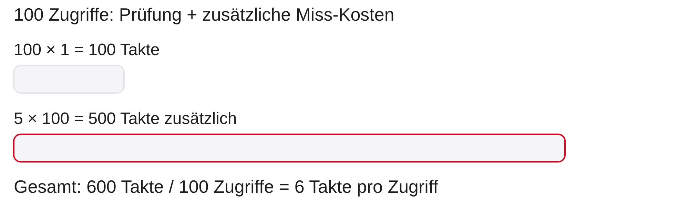{fig-alt="Von 100 Anfragen kosten alle einen Takt Prüfung; fünf Misses kosten zusätzlich jeweils 100 Takte."}

$$
t_H=1,\quad p=100,\quad h=0{,}95
\quad\Rightarrow\quad \mathrm{AMAT}=6\ \text{Takte}
$$

Und bei $h=0{,}80$? Begründen Sie den Unterschied.

::: notes
Das Zeitmodell gewichtet auch wenige Fehlschläge mit ihrer vollen Zusatzdauer. In der Abbildung stehen hundert kurze Prüfungen oben und fünf zusätzliche lange Miss-Kosten unten. Die Breiten vergleichen die aufsummierten Takte: $100\cdot1=100$ Takte Prüfung und $5\cdot100=500$ Takte zusätzliche Wartezeit. Rot markiert nur diese Zusatzkosten. Die Gesamtzeit der hundert Modellanfragen beträgt $600$ Takte, also im Mittel sechs Takte pro Anfrage.

Mit Hit Rate $h=0{,}95$ ist die Miss Rate $m=1-h=0{,}05$. Aus $t_H=1$ Takt Hit Time und $p=100$ Takten zusätzlicher Miss Penalty folgt $1+0{,}05\cdot100=6$ Takte. Bei $h=0{,}80$ ist $m=0{,}20$, also $\mathrm{AMAT}=1+0{,}20\cdot100=21$ Takte. Ein einzelner Miss dauert in beiden Rechnungen $101$ Takte.

Typische Fehler sind, nur $mp$ zu rechnen oder $20$ statt $0{,}20$ einzusetzen. Die höhere mittlere Zugriffszeit kann Speicherzugriffe verteuern. Ein Programmbeschleunigungsfaktor folgt aber nicht direkt: Dafür müssten auch übrige Befehle, Anfrageanzahl und mögliche Überlappung bekannt sein. Die Rechnung lässt sich außerdem umkehren: Für eine gewünschte mittlere Zeit kann eine mindestens erforderliche Trefferquote bestimmt werden.
:::

## AMAT rückwärts: erforderliche Trefferquote

::: {.section-label}
2 / 5 · Treffer und Zugriffszeit
:::

Lehrmodell: $t_H=1$ Takt, zusätzliche Penalty $p=100$ Takte.

Ziel: $\mathrm{AMAT}\leq5$ Takte.

$$
1+(1-h)\cdot100\leq5
$$

Welche Hit Rate $h$ ist mindestens erforderlich?

::: notes
Für die umgekehrte Fragestellung bleiben die bisherigen Modellgrößen erhalten: Die Hit Time $t_H$ ist die Prüfzeit bei jedem Zugriff, die zusätzliche Miss Penalty $p$ fällt nur beim Fehlschlag an. Die Trefferquote $h$ ist weiterhin ein Anteil zwischen null und eins. Im seriellen Ein-Ebenen-Modell gelten ein Takt Prüfung und hundert Takte Zusatzzeit.

Die gesuchte Quote soll eine mittlere Zugriffszeit von höchstens fünf Takten ermöglichen. Von $1+(1-h)\cdot100\leq5$ ziehen wir zuerst einen Takt ab. Es bleibt $(1-h)\cdot100\leq4$. Die Division durch die positive Zahl hundert ergibt $1-h\leq0{,}04$. Die Miss Rate darf somit höchstens vier Prozent betragen. Umgestellt folgt $h\geq0{,}96$, also mindestens sechsundneunzig Prozent Treffer.

Zur Kontrolle: Bei genau sechsundneunzig Prozent ist die mittlere Zeit $1+0{,}04\cdot100=5$ Takte. Fünfundneunzig Prozent ergeben dagegen sechs Takte und verfehlen das Ziel. Eine häufige Fehlannahme ist, dass schon jede sehr hohe Quote genügt. Das Ziel hängt auch von der Zusatzzeit eines Miss ab. Die Rechnung garantiert keine Programmlaufzeit; sie gilt für die beschriebenen Anfragen und Modellzeiten.
:::

## Zwei Cache-Ebenen: wo endet ein Miss?

::: {.section-label}
2 / 5 · Treffer und Zugriffszeit
:::

Lehrmodell, alle Zeiten im selben Prozessortakt:

| Größe | Annahme |
|-------|---------|
| L1-Prüfung und lokale Miss Rate | $1$ Takt; $10\,\%$ |
| L2-Prüfung und lokale Miss Rate | $8$ Takte; $20\,\%$ |
| zusätzliche Zeit nach L2-Miss | $80$ Takte |

$$
\mathrm{AMAT}=1+0{,}10\,(8+0{,}20\cdot80)=3{,}4\ \text{Takte}
$$

::: notes
Eine weitere Cache-Ebene verändert die Miss-Kosten, weil nicht jede Anfrage bis zum Hauptspeicher gelangt. Das erweiterte Lesemodell unterscheidet die bereits eingeführten Ebenen L1 und L2 und verwendet dafür neue didaktische Zeiten. Jeder Zugriff zahlt einen Takt L1-Prüfung. Die L1-Miss Rate, lokale Fehlschlagquote, beträgt zehn Prozent. Nur diese Anfragen erreichen L2 und kosten dort acht weitere Takte Prüfung. Von den Anfragen an L2 verfehlen wiederum zwanzig Prozent diese Ebene und kosten weitere achtzig Takte für die untere Ebene. Alle Zeiten beziehen sich auf dieselbe Taktperiode und werden seriell addiert.

Die durchschnittliche Zusatzzeit einer Anfrage an L2 ist $8+0{,}20\cdot80=24$ Takte. Diese fällt für den Anteil $0{,}10$ aller ursprünglichen Anfragen an. Daher ist die gesamte mittlere Zeit $1+0{,}10\cdot24=3{,}4$ Takte. Die zwanzig Prozent beziehen sich ausdrücklich nicht auf alle L1-Anfragen. Der Anteil, der beide Ebenen verfehlt, ist $0{,}10\cdot0{,}20=0{,}02$, zwei Prozent.

Eine Kontrolle mit hundert Anfragen macht die Bedingtheit deutlich: neunzig enden nach einem Takt in L1, acht nach neun Takten in L2, zwei nach neunundachtzig Takten unten. Somit $(90\cdot1+8\cdot9+2\cdot89)/100=3{,}4$ Takte. Writebacks und überlappende Zugriffe sind ausgeschlossen. Ein L1-Miss verursacht deshalb nicht automatisch die volle Hauptspeicherwartezeit. Bisher wurden die Quoten vorgegeben. Um sie aus einer Zugriffsspur herzuleiten, braucht das Modell zusätzlich die Zuordnung der Blöcke zu Cache-Plätzen.
:::

## 3 · Platzzuordnung und Verdrängung {.section-divider}

Welcher Speicherblock darf an welchem Cache-Platz liegen?

::: {.section-route}
Lokalität → Zeitmodell → Platzwahl → Schreiben → C-Zugriffe
:::

Adressfelder, zulässige Plätze und Ersetzungsregeln unterscheiden.

::: notes
Trefferquoten wurden bislang aus einfachen Kopienannahmen gewonnen oder für eine Zeitrechnung vorgegeben. Für eine eigenständige Zugriffsspur fehlt noch die Regel, welche Speicherblöcke zugleich im Cache bleiben dürfen. Diese Zuordnung heißt Mapping.

Ein fester Referenzcache erlaubt, Blocknummer, Set-Index und Tag aus derselben Adresse herzuleiten. Zusätzliche Plätze innerhalb eines Sets verändern die zulässige Ablage und den Suchaufwand. Erst wenn ein Set gefüllt ist, wird die Ersetzungsregel benötigt. Damit lassen sich Kaltstart, Kapazitätsmangel und Platzkonflikte anhand konkreter Zustände unterscheiden, statt jeden Fehlschlag mit derselben Ursache zu erklären.
:::

## Unser Referenzmodell für das Mapping

::: {.section-label}
3 / 5 · Platzzuordnung und Verdrängung
:::

| Größe | Festlegung |
|-------|------------|
| Adresse | $P=32$ Bit, byteadressiert |
| Datenkapazität | $C=32\,\mathrm{KiB}=32768$ Byte |
| Blockgröße | $B=64$ Byte |
| Anzahl gespeicherter Blöcke | $L=C/B=512$ |

- Tags und Zustandsbits zählen nicht zur Datenkapazität
- Zunächst Direct Mapped: ein Platz pro Set

::: notes
Die Platzwahl erklärt nun, welche Kopie nach einer Anfrage im Cache verbleiben kann. Mapping heißt Zuordnung: Ein Block aus dem großen Adressraum erhält einen zulässigen Platz im kleinen Cache. Dafür gilt ein festes Referenzmodell, das erst beim Matrixbeispiel ausdrücklich geändert wird. $P$ ist die Breite einer Byteadresse in Bit. Mit zweiunddreißig Bit lassen sich $2^{32}$ Bytepositionen benennen. Die Datenkapazität $C$ umfasst ausschließlich gespeicherte Nutzdaten. Ein Kibibyte, geschrieben KiB, hat $1024$ Byte. Deshalb sind $32$ KiB gleich $32768$ Byte.

Die Blockgröße $B$ beträgt $64$ Byte. Somit passen $L=C/B=32768/64=512$ Blöcke in den Cache. Metadaten wie Tag und Valid benötigen zusätzlich Speicher. Wer sie zur festgelegten Datenkapazität addiert, ändert das Modell.

Direct Mapped, direkt abgebildet, bedeutet einen fest zugeordneten Platz pro Set. Ein Set ist eine Menge von Cache-Plätzen, in denen ein Block liegen darf; hier hat jedes Set nur einen Platz. Es gibt daher $512$ Sets. Die Zuordnung muss schnell berechenbar sein und darf nicht vom zufälligen Inhalt des C-Programms abhängen. Eine feste Aufteilung in Quotient und Rest erfüllt diese Forderung auf logischer Ebene.
:::

## Direct Mapped: Division mit Rest

::: {.section-label}
3 / 5 · Platzzuordnung und Verdrängung
:::

Für Blocknummer $q$ und $S=512$ Sets:

$$
i=q\bmod S,\qquad t=\left\lfloor q/S\right\rfloor
$$

| Blocknummer $q$ | Index $i$ | Tag $t$ |
|----------------|-----------|---------|
| $0$ | $0$ | $0$ |
| $511$ | $511$ | $0$ |
| $512$ | $0$ | $1$ |

::: notes
Im direkt abgebildeten Referenzmodell darf jeder Speicherblock genau einen Cache-Platz nutzen. Die Blocknummer $q$ wurde aus der Byteadresse durch Division durch die Blockgröße gewonnen. Der Set-Index $i$ ist der Rest bei Division durch die Anzahl $S$ der Sets. Das Tag $t$ ist der ganzzahlige Quotient. Gemeinsam unterscheiden Index und Tag die Blocknummer eindeutig: $q=tS+i$.

Block null und Block fünfhundertzwölf haben beide Index null. Sie müssen denselben Platz benutzen. Ihre Tags null und eins unterscheiden sie. Block fünfhundertelf ist noch im ersten Durchgang und landet bei Index fünfhundertelf mit Tag null. Das Tag ist daher nicht einfach die gesamte Blocknummer.

Modulo, das Bilden des Restes, benötigt bei Zweierpotenzen keine allgemeine Divisionsschaltung. Für $512=2^9$ reichen die unteren neun Bits der Blocknummer als Index. Trotzdem benötigen Decoder, Speicher und Vergleichsschaltung physikalisch Zeit. Eine einfache Zuordnung macht den Cache nicht verzögerungsfrei. Die Divisionen können in eine Zerlegung der Byteadresse übersetzt werden. Zunächst macht ein Vergleich konkreter Adressen deutlich, warum Index und Tag gemeinsam benötigt werden.
:::

## Gleicher Index heißt nicht gleiche Adresse

::: {.section-label}
3 / 5 · Platzzuordnung und Verdrängung
:::

Referenz: Direct Mapped, $32$ KiB Daten, $64$-Byte-Lines.

| Adresse | Blocknummer | Index | Tag |
|---------|-------------|-------|-----|
| `0x1000` | $64$ | $64$ | $0$ |
| `0x1004` | $64$ | $64$ | $0$ |
| `0x9000` | $576$ | $64$ | $1$ |

Welche Anfragen nutzen denselben Block, welche konkurrieren nur um den Platz?

::: notes
Die gleiche Platznummer kann zu verschiedenen Speicherblöcken gehören. Im direkt abgebildeten Referenzmodell mit zweiunddreißig KiB und vierundsechzig Byte pro Line gibt es fünfhundertzwölf Plätze. Aus der Byteadresse entsteht durch Division durch die Blockgröße die Blocknummer; deren Rest bei Division durch fünfhundertzwölf bestimmt den Index. Der Quotient ist das Tag.

Die Byteadressen `0x1000` und `0x1004` gehören beide zum Block vierundsechzig. Sie haben dasselbe Tag null und denselben Index vierundsechzig, aber unterschiedliche Offsets, Versätze im Block: null und vier. Ein geladener Block kann beide Anfragen bedienen. `0x9000` ist dagegen die Dezimaladresse sechsunddreißigtausendachthundertvierundsechzig und gehört zu Block fünfhundertsechsundsiebzig. Dieser hat ebenfalls Index vierundsechzig, aber Tag eins.

Ein passender Index allein garantiert keinen Hit, Treffer. Er findet nur den zulässigen Platz. Für einen Hit muss das gespeicherte Tag ebenfalls passen und der Eintrag gültig sein. Die ersten beiden Anfragen teilen somit eine Kopie; die dritte verlangt eine andere Kopie am selben Platz. Diese Unterscheidung ermöglicht später die Erklärung von Thrashing, dem wiederholten gegenseitigen Verdrängen. Zuvor lässt sich die Platzwahl noch direkt an den Bits der Adresse ablesen.
:::

## Adresse zerlegen: Tag, Index, Offset

::: {.section-label}
3 / 5 · Platzzuordnung und Verdrängung
:::

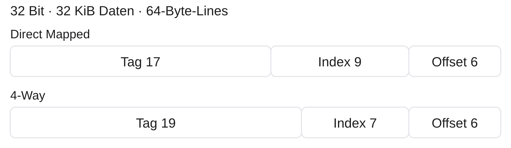{fig-alt="Bei gleicher Datenkapazität und Blockgröße besteht die 32-Bit-Adresse direkt abgebildet aus 17 Tag-, 9 Index- und 6 Offsetbits; bei vier Wegen aus 19, 7 und 6 Bit."}

Für $W$ Plätze pro Set:

$$
S=\frac{C}{BW},\quad b=\log_2 B,\quad s=\log_2 S,\quad \tau=P-b-s
$$

::: notes
Bei Zweierpotenzen entspricht die Rechnung mit Division und Rest einer Aufteilung der Adressbits. In jedem Band des Diagramms stehen die höchstwertigen Bits links und die niedrigstwertigen rechts. Tag, Index und Offset sind durch Beschriftungen und Feldgrenzen unterschieden. Ein Bit ist eine Binärstelle. Die Adresse hat insgesamt $P=32$ Bit; der Offset wählt das Byte im Block, der Index das Set, das Tag kennzeichnet den dort gespeicherten Block.

$C$ bezeichnet die Datenkapazität in Byte, $B$ die Blockgröße in Byte und $W$ die Anzahl der Ways, Plätze pro Set. Die Zahl der Sets ist $S=C/(BW)$. Bei Zweierpotenzen benötigen $B$ Positionen $b=\log_2 B$ Offsetbits und $S$ Sets $s=\log_2 S$ Indexbits. $\log_2$ bezeichnet den Logarithmus zur Basis zwei: Er fragt, welcher Exponent die angegebene Zweierpotenz ergibt. Die restlichen $\tau=P-b-s$ Bits bilden das Tag.

Für $W=1$ folgt $S=512$, $b=6$, $s=9$, $\tau=17$. Das untere Band nimmt $W=4$ vorweg: $S=128$, $s=7$, $\tau=19$. Die Blockgröße bleibt gleich, daher auch der Offset. Zusätzliche Ways werden nicht durch zusätzliche Byte-Offsetbits adressiert. Ihre Suche wird bei der Assoziativität behandelt. Zunächst führt das direkt abgebildete Modell durch eine vollständige Adressrechnung.
:::

## Beispiel: Adresse `0x12345678`

::: {.section-label}
3 / 5 · Platzzuordnung und Verdrängung
:::

Direct Mapped, $32$ KiB, $64$-Byte-Lines:

$$
o=56,\qquad q=\texttt{0x48D159},\qquad
i=345,\qquad t=\texttt{0x2468}
$$

Kontrolle:

$$
a=t\cdot32768+i\cdot64+o
$$

::: notes
Die bisherige Aufteilung lässt sich an einer einzelnen Adresse vollständig nachrechnen. Zerlegt wird die hexadezimale Byteadresse `0x12345678` im direkt abgebildeten Referenzcache. Hexadezimal verwendet die Ziffern null bis neun und A bis F; jede Ziffer steht für vier Binärbits. Offset, Index und Tag entsprechen hier sechs, neun und siebzehn Bits. Die letzten sechs Bits der Adresse ergeben Offset $o=56$, hexadezimal `0x38`. Das Entfernen dieser Bits, ganzzahlige Division durch $64$, ergibt die Blocknummer $q=\texttt{0x48D159}$.

Der Rest $q\bmod512$ ergibt den Index $i=345$, hexadezimal `0x159`. Die Division $\lfloor q/512\rfloor$ liefert das Tag $t=\texttt{0x2468}$. Der Block beginnt bei `0x12345640` und endet bei `0x1234567F`. Das angeforderte Byte liegt bei Versatz sechsundfünfzig.

Die Rückrechnung zeigt, dass kein Adressteil fehlt: Ein Tag-Schritt entspricht $512\cdot64=32768$ Byte, ein Index-Schritt $64$ Byte und ein Offset-Schritt einem Byte. Mit $t=9320$ folgt $9320\cdot32768+345\cdot64+56=305419896$, die dezimale Form der gegebenen Adresse. Unterschiedliche Tags bei gleichem Index muss die Hardware beim Lesen unterscheiden können. Die berechneten Felder bekommen deshalb im Datenweg jeweils eine eigene Aufgabe.
:::

## Leseweg: auswählen, prüfen, liefern

::: {.section-label}
3 / 5 · Platzzuordnung und Verdrängung
:::

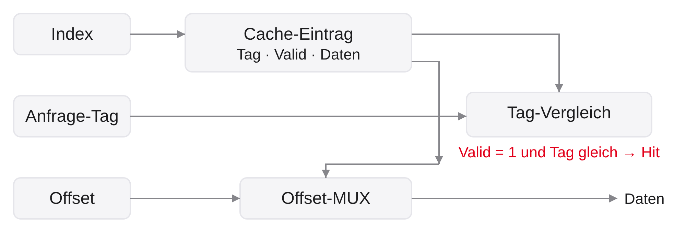{fig-alt="Index wählt einen Cache-Eintrag; Anfrage-Tag und gespeichertes Tag werden mit Valid geprüft, während der Offset die Daten auswählt."}

- Hit nur bei $\mathrm{Valid}=1$ und passendem Tag
- Miss: Block aus der nächsten Ebene beschaffen und Eintrag aktualisieren

::: notes
Aus den drei Adressfeldern entsteht eine funktionale Auswahl- und Prüfschaltung. Die Abbildung trennt die Adressleitungen entsprechend ihrer Aufgabe. Der Index führt zum ausgewählten Cache-Eintrag mit gespeichertem Tag, Valid-Bit und Daten. Das Tag der Anfrage geht auf einen eigenen Weg zum Vergleich. Valid ist das Gültigkeitsbit. Nur wenn es eins ist und beide Tags übereinstimmen, entsteht das Hit-Signal. Der Offset, der Versatz innerhalb des Blocks, wählt aus den Daten das angeforderte Wort. Datenweg und Trefferprüfung laufen nicht als eine Reihe von Datenkonvertierungen hintereinander.

Ein MUX ist ein Multiplexer, eine Auswahlfunktion für mehrere Eingänge. Hier wählt er mit dem Offset die Datenposition. Die Pfeile zeigen die Richtung der Information. Die rote Beschriftung kennzeichnet die Trefferbedingung, nicht einen weiteren Speicher. Die Zeichnung ist eine funktionale Übersicht, keine vollständige Gatterimplementierung und kein Zeitdiagramm.

Bei Miss muss der Prozessor im blockierenden Lehrmodell warten. Der neue Block wird aus der nächsten Ebene geladen und ersetzt gegebenenfalls den alten Eintrag am ausgewählten Platz. Anschließend sind Daten, Tag und Valid konsistent. Wenn zwei häufig benötigte Blöcke denselben Platz beanspruchen, hilft auch ein ansonsten großer leerer Cache wenig. Die nächste Zugriffsspur macht diese Grenze der festen Platzwahl sichtbar.
:::

## Thrashing: zwei Blöcke, ein Platz

::: {.section-label}
3 / 5 · Platzzuordnung und Verdrängung
:::

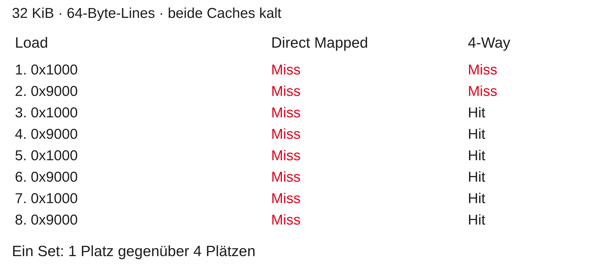{fig-alt="Acht abwechselnde Lesezugriffe: Direct Mapped hat acht Misses, vier Wege haben zwei Misses und sechs Hits."}

Spur: `0x1000, 0x9000`, viermal wiederholt; Cache zunächst kalt.

::: notes
Ein eindeutig bestimmter Cache-Platz kann zum Engpass werden, obwohl fast die gesamte Datenkapazität frei ist. Thrashing bezeichnet dieses wiederholte gegenseitige Verdrängen. Im direkt abgebildeten Referenzcache mit $32$ KiB Daten und $64$-Byte-Blöcken besitzt `0x1000` die Blocknummer $64$, den Index $64$ und das Tag null. Für `0x9000` ergibt sich die Blocknummer $576$: ebenfalls Index $64$, aber Tag eins. Beide Blöcke beanspruchen daher denselben Platz.

Die dargestellte Zugriffstabelle wird von oben nach unten gelesen; M bezeichnet einen Miss, H einen Hit. Der erste Load beschafft den ersten Block, der zweite ersetzt ihn durch den anderen. Bereits der dritte Load benötigt wieder den inzwischen verdrängten Inhalt. Dieses Muster setzt sich über die vier Wiederholungen der beiden Adressen fort. Alle acht Anfragen sind Misses; ein Treffer kommt nicht vor. Freie andere Plätze helfen nicht, weil diese beiden Blöcke dort nicht abgelegt werden dürfen.

Die rechte Vergleichsspalte verändert nur die Organisation. Bei weiterhin $512$ Datenplätzen ermöglichen vier Ways pro Set nun $128$ Sets. Beide Blöcke haben dort Index $64$, jedoch Tags null und vier, und können gleichzeitig bleiben. Nach zwei anfänglichen Misses folgen sechs Hits. Der Unterschied ist eine gezählte Wirkung vermiedener Platzkonflikte, keine Messung von Zugriffszeiten. Damit lässt sich erstmals unterscheiden, ob ein Miss aus fehlender Kapazität oder aus eingeschränkter Platzwahl entsteht.
:::

## Drei Ursachen für Misses

::: {.section-label}
3 / 5 · Platzzuordnung und Verdrängung
:::

| Ursache | Bedeutung |
|---------|-----------|
| Compulsory | erster Zugriff auf einen Block |
| Capacity | aktive Daten passen nicht in die Kapazität |
| Conflict | eingeschränkte Platzwahl verdrängt nutzbare Blöcke |

In der Wechselspur: zwei erste Zugriffe, danach sechs Konflikte.

::: notes
Nicht jeder Miss hat dieselbe Ursache. Beim erstmaligen Anfordern eines Blocks im kalten Cache ohne Vorabladen fehlt grundsätzlich eine passende Kopie. Dieser Fall heißt Compulsory Miss oder Kaltstart-Miss. Ein Capacity Miss entsteht dagegen, wenn die zur Wiederverwendung benötigten Blöcke die verfügbare Kapazität überschreiten. Ein Conflict Miss geht auf die eingeschränkte Platzwahl zurück: Ein anders organisierter Cache mit derselben Gesamtkapazität könnte die benötigten Kopien halten.

In der Wechselspur mit `0x1000` und `0x9000` sind zunächst zwei verschiedene Blöcke neu zu beschaffen. Diese beiden ersten Anfragen sind Kaltstart-Misses. Die folgenden sechs Misses sind Konflikt-Misses, denn zwei aktive Blöcke passen ohne Weiteres in $512$ Datenplätze. Ihr gemeinsamer fester Index verhindert lediglich die gleichzeitige Ablage.

Für eine genaue Einordnung dient ein vollassoziativer Vergleichscache gleicher Kapazität mit festgelegter Ersetzungsregel. Eine volle einzelne Menge beweist noch keinen Kapazitätsmangel des gesamten Caches. Die Ursachen bilden auch keine zusätzlichen Ergebnisse neben Hit und Miss: Jeder Zugriff bleibt entweder ein Treffer oder ein Fehlschlag. Mehr Assoziativität kann Konflikte vermeiden, beseitigt aber weder notwendige erste Blockanforderungen noch jede Kapazitätsgrenze. Die drei kleinen Fälle machen diese Abgrenzung konkret.
:::

## Miss-Ursachen: begründen statt raten

::: {.section-label}
3 / 5 · Platzzuordnung und Verdrängung
:::

Im Referenzcache mit $512$ Datenplätzen:

1. Ein bisher ungelesener Block im kalten Cache
2. $513$ unterschiedliche Blöcke zyklisch in einem vollassoziativen Cache mit LRU
3. `0x1000` und `0x9000` im Wechsel, Direct Mapped

Ordnen Sie Kaltstart, Kapazität oder Konflikt zu. Welche Anfangszugriffe zählen gesondert?

::: notes
Die Zuordnung einer Miss-Ursache verlangt Angaben über den Anfangszustand, die aktiven Blöcke und die Platzwahl. Das Referenzmodell stellt $512$ Datenplätze bereit, die jeweils eine Cache-Line halten. In einem vollassoziativen Cache darf jeder Block jeden dieser Plätze nutzen. LRU bedeutet Least Recently Used. Die vorgegebene Regel verdrängt bei voller Kapazität den am längsten nicht verwendeten Block; Direct Mapped beschränkt jeden Block dagegen auf einen festen Platz.

Der bisher ungelesene Block des ersten Falls verursacht einen Kaltstart-Miss. Im zweiten Fall werden $513$ unterschiedliche Blöcke zyklisch in derselben Reihenfolge angefordert. Die ersten Anforderungen sind ebenfalls Kaltstart-Misses. Danach ist bei jeder Wiederkehr der benötigte Block unter LRU bereits verdrängt: Selbst freie Platzwahl kann nicht alle $513$ Kopien in $512$ Plätzen halten. Die späteren Fehlschläge sind deshalb Capacity Misses des angegebenen Vergleichsmodells.

Der dritte Fall benötigt mit `0x1000` und `0x9000` lediglich zwei Blöcke. Im direkt abgebildeten Referenzcache teilen sie Index $64$ und verdrängen einander. Nach ihren beiden ersten Anforderungen entstehen Conflict Misses; ein vollassoziativer Cache gleicher Größe könnte beide behalten. Entscheidend ist somit die Trennung zwischen erstmaliger Beschaffung und späterer Wiederverwendung. Zusätzliche Plätze innerhalb des ausgewählten Sets bieten nun eine Möglichkeit, genau diese Konflikte zu vermindern.
:::

## Set-Associative: mehrere Plätze pro Set

::: {.section-label}
3 / 5 · Platzzuordnung und Verdrängung
:::

- $W$-Way: ein fester Set-Index, darin $W$ mögliche Plätze
- Referenz: $W=4$ ergibt $128$ Sets mit je $4$ Ways
- Nur die Tags dieses Sets werden parallel verglichen
- Ein Hit wählt den passenden Way; ein volles Set braucht eine Ersetzungsregel

::: notes
Ein mengenassoziativer Cache behält den festen Set-Index bei, erlaubt innerhalb des ausgewählten Sets jedoch mehrere Plätze. Bei einem $W$-Way-Cache kann ein Block in einem von $W$ Ways liegen. Vier Ways können folglich vier unterschiedliche Blöcke mit demselben Index gleichzeitig aufnehmen. Die zusätzliche Freiheit betrifft die Blockablage und nicht die Position eines Bytes im Block.

Im Referenzmodell bleiben Datenkapazität und Blockgröße unverändert: $32768$ Byte bei $64$ Byte pro Line ergeben weiterhin $512$ Datenplätze. Vier Ways teilen diese Plätze in $512/4=128$ Sets auf. Für eine Anfrage prüft der Controller die vier Tags und Valid-Bits des durch den Index ausgewählten Sets parallel. Trifft ein gültiger Eintrag, wählt ein Multiplexer dessen Daten aus. Das Valid-Bit kennzeichnet dabei die nutzbare Kopie; der Way gehört nicht zum Byte-Offset.

Direct Mapped ist der Grenzfall mit einem Way je Set. Beim anderen Grenzfall, Fully Associative, bildet die Gesamtheit der Plätze ein einziges Set. Mehr Freiheit verlangt zusätzliche Vergleichslogik und Verwaltung. Sie verhindert außerdem nicht jeden Miss: Fünf gleichzeitig benötigte Blöcke mit demselben Index passen weiterhin nicht in vier Ways. Für einen Entwurf müssen deshalb zulässige Plätze und Suchaufwand gemeinsam betrachtet werden.
:::

## Platzwahl und Suchaufwand vergleichen

::: {.section-label}
3 / 5 · Platzzuordnung und Verdrängung
:::

| Organisation | Sets | Ways je Set | Tag-Vergleiche je Anfrage |
|--------------|------|-------------|--------------------------|
| Direct Mapped | $512$ | $1$ | $1$ |
| 4-Way | $128$ | $4$ | $4$ |
| Fully Associative | $1$ | $512$ | $512$ |

Immer: $32$ KiB Daten, $64$-Byte-Blöcke, $512$ Plätze.

::: notes
Die drei Organisationen verteilen dieselben $512$ Datenplätze unterschiedlich. Bei $32$ KiB Datenkapazität und $64$-Byte-Blöcken besitzt Direct Mapped $512$ Sets mit je einem Way. Die Vier-Wege-Organisation verwendet $128$ Sets mit je vier Ways. Fully Associative fasst alle $512$ Ways in einem Set zusammen. Das Produkt aus Sets und Ways und damit die Datenkapazität bleibt unverändert.

Eine vollständig parallele Suche benötigt entsprechend einen, vier oder $512$ Tag-Vergleiche je Anfrage. Die Gültigkeitsprüfung und die Auswahl der passenden Daten kommen hinzu. Mehr mögliche Ablageorte können Konflikte reduzieren, erfordern aber auch mehr Schaltung, Energie und Ersetzungsverwaltung. Eine konkrete Zugriffszeit oder Chipfläche lässt sich aus der Zahl der Vergleiche allein nicht ableiten. Gerade kleine vollassoziative Strukturen können trotz dieses Aufwands sinnvoll sein.

Auch die Adressfelder ändern sich. Beim einzigen vollassoziativen Set entfällt der Index; seine Breite ist null Bit. Die sechs unteren Offsetbits bleiben erhalten, und die übrigen $26$ Bit bilden das Tag. Vier Ways benötigen dagegen sieben Indexbits und $19$ Tagbits. Die Organisation bestimmt somit, wo ein Block liegen darf und wie er gefunden wird. Erst bei einem vollen Set stellt sich die nächste Frage: Welche vorhandene Kopie soll einem neuen Block weichen?
:::

## Verdrängen: FIFO und LRU

::: {.section-label}
3 / 5 · Platzzuordnung und Verdrängung
:::

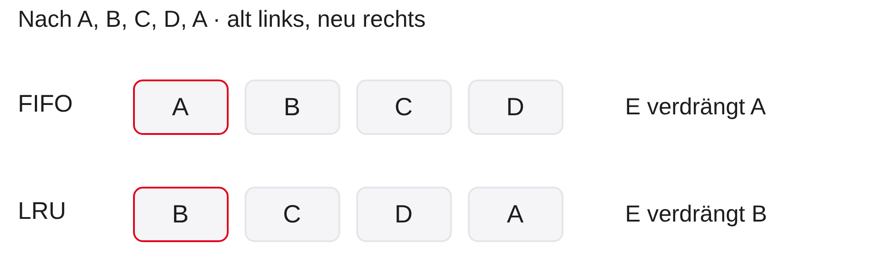{fig-alt="Nach der Folge A, B, C, D, A verdrängt der neue Block E bei FIFO den Block A und bei LRU den Block B."}

- FIFO: Reihenfolge des Ladens
- LRU: Reihenfolge der letzten Nutzung
- Zuerst freie Plätze verwenden; erst bei vollem Set verdrängen

::: notes
Sind freie Plätze vorhanden, werden diese zunächst belegt. Erst ein Miss auf ein volles Set benötigt eine Ersetzungsentscheidung. FIFO, First In, First Out, ordnet die noch vorhandenen Blöcke nach ihrem Ladezeitpunkt und verdrängt den zuerst geladenen. LRU ordnet sie nach ihrer letzten Nutzung und verdrängt den am längsten unbenutzten Block. Ein Treffer verändert deshalb die LRU-Nutzungsordnung, aber nicht die FIFO-Ladereihenfolge.

Die Namen A bis E bezeichnen in der Abbildung unterschiedliche Speicherblöcke mit demselben Set-Index. Das anfangs leere Set besitzt vier Ways. Nach dem Laden von A, B, C und D lautet die Reihenfolge von alt nach neu bei beiden Regeln A, B, C, D. Der anschließende Hit auf A lässt FIFO unverändert; LRU ordnet nun B, C, D, A. Beim Miss auf E muss ein Opfer gewählt werden. FIFO entfernt A und endet bei B, C, D, E. LRU entfernt B und endet bei C, D, A, E. Die gezeichnete Ordnung stellt Verwaltungsinformation dar und keine feste räumliche Anordnung der Ways.

LRU ist eine Heuristik: Sie nutzt die bisherige Verwendung als Hinweis auf zukünftigen Bedarf, kennt die Zukunft aber nicht und ist nicht für jede Zugriffsspur optimal. Vereinfachte Regeln wie Pseudo-LRU nähern die Nutzungsordnung an und sparen Zustandsbits. Eine exakte Papieranalyse benötigt deshalb immer die ausdrücklich angegebene Regel.
:::

## Prüfen Sie Ihr Mapping-Verständnis

::: {.section-label}
3 / 5 · Platzzuordnung und Verdrängung
:::

Gleiche Kapazität und Blockgröße, nun $4$ Ways:

1. Wie viele Sets und Indexbits gibt es?
2. Welche Felder hat `0x12345678`?
3. Welche Bilanz hat `0x1000, 0x9000, 0x1000` im kalten Cache?

::: notes
Die vier Ways verändern die Aufteilung der bekannten Referenzkapazität, nicht deren Größe. Bei $32$-Bit-Byteadressen, $32$ KiB Daten und $64$-Byte-Lines ergibt sich $S=32768/(64\cdot4)=128$. Der Index benötigt sieben Bit, weil $128=2^7$ gilt. Die sechs Offsetbits bleiben erhalten; für das Tag verbleiben $32-7-6=19$ Bit.

Die Adresse `0x12345678` hat weiterhin den Offset $56$ und die Blocknummer `0x48D159`. Deren Rest bei Division durch $128$ ist $89$, also der Set-Index. Der Quotient liefert das Tag $\lfloor q/128\rfloor=\texttt{0x91A2}$. Die Rekonstruktion $a=t\cdot8192+i\cdot64+o$ prüft die Zerlegung, denn ein Tag-Schritt umfasst nun $128\cdot64=8192$ Byte.

Die Spur `0x1000, 0x9000, 0x1000` nutzt Set $64$ mit den Tags null, vier und erneut null. Zwei erste Misses belegen zwei freie Ways; die dritte Anfrage trifft den erhaltenen ersten Block. Das direkt abgebildete Vergleichsmodell hätte drei Misses. Mehr Ways bedeuten hier folglich mehr zulässige Plätze innerhalb eines Sets und keine zusätzliche Datenkapazität. Die bessere Trefferbilanz allein beantwortet allerdings noch nicht, welcher Cache die geringere mittlere Zugriffszeit besitzt.
:::

## Bessere Quote, gleiche Zugriffszeit?

::: {.section-label}
3 / 5 · Platzzuordnung und Verdrängung
:::

Didaktischer Vergleich mit zusätzlicher Miss Penalty $p=100$ Takten:

| Variante | Hit Time | Hit Rate |
|----------|----------|----------|
| A | $1$ Takt | $95\,\%$ |
| B | $2$ Takte | $96\,\%$ |

Welche Variante hat die kleinere AMAT? Was fehlt für eine Hardwareentscheidung?

::: notes
Eine höhere Trefferquote ist nur dann vorteilhaft für die mittlere Zeit, wenn ihre Kosten mitberücksichtigt werden. Beide Varianten verwenden hier dasselbe serielle Zeitmodell: Die Hit Time fällt bei jedem Zugriff als Prüfzeit an, die Miss Penalty von $100$ Takten kommt nur bei einem Fehlschlag zusätzlich hinzu. Es handelt sich um didaktische Annahmen, nicht um Messwerte konkreter Cache-Entwürfe.

Variante A verfehlt bei einer Hit Rate von $95\,\%$ in fünf Prozent der Fälle. Ihre AMAT beträgt $1+0{,}05\cdot100=6$ Takte. Variante B erreicht $96\,\%$ Treffer, benötigt aber zwei Takte Prüfzeit. Damit folgt $2+0{,}04\cdot100=6$ Takte. Die um einen Takt größere Prüfzeit gleicht die vermiedenen zusätzlichen Miss-Kosten genau aus. In dieser Kenngröße sind beide Varianten gleichwertig.

Mehr Assoziativität kann Platzkonflikte vermeiden und zugleich zusätzliche Tag-Vergleiche und Datenwahl erfordern. Welchen Einfluss das auf die Trefferzeit hat, entscheidet die Implementierung; eine feste Verdopplung wird nicht angenommen. Eine Hardwareentscheidung benötigt außerdem Energiebedarf, Fläche, weitere Zugriffsspuren und mögliche Überlappung. Trefferzahlen und Zeitangaben bilden daher gemeinsam die Entscheidungsgrundlage. Bisher betraf diese Grundlage vor allem das Lesen. Für Stores muss zusätzlich festgelegt werden, wann Änderungen weitergegeben werden.
:::

## 4 · Schreibzugriffe {.section-divider}

Wann werden geänderte Daten weitergegeben?

::: {.section-route}
Lokalität → Zeitmodell → Platzwahl → Schreiben → C-Zugriffe
:::

Weitergabe von Änderungen und Zuteilung bei Store-Misses trennen.

::: notes
Ein gültiger Treffer beschreibt zunächst nur, dass eine passende Kopie verfügbar ist. Ein Schreibzugriff verändert diese Kopie und verlangt darüber hinaus eine Regel, wann die nächste Ebene den neuen Stand erhält. Durchschreiben und späteres Zurückschreiben beantworten genau diese Frage.

Fehlt beim Store die passende Line, kommt eine zweite Entscheidung hinzu: Soll der Block zunächst beschafft oder der Store ohne neue Zuteilung weitergegeben werden? Diese Achsen sind unabhängig voneinander. Die folgenden Spuren halten deshalb Anfangszustand, Weitergabe und Zuteilung getrennt fest. Gültigkeit und Änderungszustand bekommen dabei jeweils ein eigenes Verwaltungsbit.
:::

## Write-Through: Änderungen weitergeben

::: {.section-label}
4 / 5 · Schreibzugriffe
:::

- Store-Hit aktualisiert den Cache und die nächste Ebene
- Ohne Puffer: auf die Weitergabe warten
- Write Buffer: ausstehende Schreibvorgänge zwischenspeichern
- Ein voller Puffer kann den Prozessor anhalten

::: notes
Ein Store verändert Speicher und stellt damit eine zusätzliche Frage an den Cache: Wann erreicht der neue Wert die nächste Ebene? Zunächst sei die betroffene Line gültig vorhanden, es liege also ein Store-Hit vor. Bei Write-Through aktualisiert der Controller die Cache-Kopie und gibt den Schreibzugriff an die nächste Ebene weiter. Diese kann selbst ein weiterer Cache sein; sie ist nicht notwendigerweise der Hauptspeicher.

Ohne Puffer kann der Prozessor auf die Weitergabe warten müssen. Ein Write Buffer nimmt dagegen noch ausstehende Schreibvorgänge auf und erlaubt deren spätere Übertragung. FIFO beschreibt eine mögliche Abarbeitung nach der Eingangsreihenfolge. Einzelheiten wie das Zusammenfassen benachbarter Writes sind Eigenschaften der Implementierung. Ist kein Pufferplatz mehr frei, kann die fehlende Aufnahmemöglichkeit einen Stall verursachen: Der Prozessor kann den betreffenden Ablauf vorerst nicht fortsetzen.

Durchschreiben bedeutet deshalb bei gepuffertem Betrieb nicht, dass sämtliche Ebenen jederzeit bereits denselben Wert enthalten. Zwischen der Änderung im Cache und ihrer Weitergabe kann noch ein Puffereintrag liegen. Im einfachen ungepufferten Modell erzeugt dagegen jeder Store unmittelbar eine Weitergabe. Eine andere Strategie kann mehrere Änderungen derselben Line zunächst sammeln und später gemeinsam zurückschreiben.
:::

## Write-Back und Dirty

::: {.section-label}
4 / 5 · Schreibzugriffe
:::

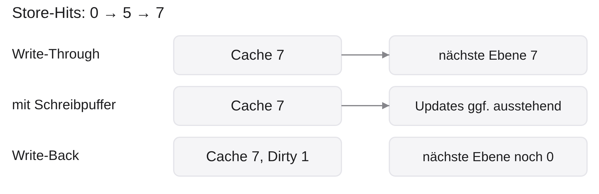{fig-alt="Startwert null: Zwei Store-Hits auf fünf und sieben werden je nach Strategie sofort weitergegeben, gepuffert oder als Dirty-Line gesammelt."}

- Dirty $=1$: Line gegenüber der nächsten Ebene verändert
- Zurückschreiben vor Verlust der Änderungen

::: notes
Write-Back sammelt Änderungen zunächst in der Cache-Kopie. Ein Store-Hit trägt den neuen Wert ein und setzt das Dirty-Bit auf eins. Dieses Änderungsbit bedeutet, dass die Line gegenüber der nächsten Ebene verändert ist. Es bezeichnet weder eine beschädigte noch eine ungültige Kopie.

Die drei Bildzeilen vergleichen getrennte Fälle mit gleichem Anfangswert null und zwei Store-Hits, zuerst auf fünf, danach auf sieben. Write-Through ohne Puffer gibt beide Schreibwerte weiter. Die gepufferte Variante kann schon sieben im Cache halten, obwohl Weitergaben noch ausstehen. Bei Write-Back enthält die gültige Line am Ende sieben und ist Dirty, während die nächste Ebene noch null enthalten darf. Jede Zeile besitzt ihren eigenen Anfangszustand; die drei dargestellten Fälle werden nicht addiert oder als ein gemeinsamer Ablauf gelesen.

Der eigene Prozessor kann den aktuellen Wert aus seiner gültigen Line erhalten. Vor deren Verlust müssen die Änderungen jedoch gesichert werden. Ein solches Writeback kann durch Verdrängung, eine explizite Verwaltungsaktion oder ein Protokoll ausgelöst werden. Mehrere Stores in dieselbe Line können so zu einer einzigen späteren Blockweitergabe zusammengefasst werden. Daraus folgt noch keine garantierte Laufzeitverbesserung. Zunächst lässt sich lediglich vergleichen, welche Nutzdatenmengen die beiden Strategien unter gleichen Annahmen weitergeben.
:::

## Schreibverkehr: Wort oder ganze Line?

::: {.section-label}
4 / 5 · Schreibzugriffe
:::

Lehrmodell: $100$ Store-Hits auf dasselbe $4$-Byte-Wort, $64$-Byte-Line.

| Strategie | Weitergabe der Nutzdaten |
|-----------|--------------------------|
| Write-Through ohne Zusammenfassen | $100\cdot4=400$ Byte |
| Write-Back, danach eine Verdrängung | einmal $64$ Byte |

Übertragene Nutzbytes sind keine vollständige Bus- oder Laufzeitmessung.

::: notes
Für den Verkehrsvergleich ist die gezählte Phase genau begrenzt. Eine gültige saubere $64$-Byte-Line ist bereits vorhanden; ihre ursprüngliche Beschaffung liegt vor dem Vergleich. Hundert vollständige Store-Hits verändern dasselbe $4$-Byte-Wort. Am Ende wird die Line genau einmal verdrängt. Andere Transfers werden nicht gezählt, und im Write-Through-Fall findet kein Zusammenfassen der Stores statt.

Write-Through gibt für jeden der hundert Stores vier Nutzbytes weiter. Daraus ergeben sich $100\cdot4=400$ Byte. Write-Back ändert jeweils die lokale Kopie und hält die Line Dirty. Bei der abschließenden Verdrängung wird einmal der gesamte Block mit $64$ Byte und dem letzten geschriebenen Wert zurückgegeben.

Weniger einzelne Weitergaben bedeuten jedoch nicht grundsätzlich weniger Nutzbytes. Für einen einzigen $4$-Byte-Store wäre die vollständige Blockweitergabe größer als das Durchschreiben des Wortes. Bei $n$ Stores liegt Gleichstand bei $4n=64$, also $n=16$; erst darüber ist die Write-Back-Nutzdatenmenge im angegebenen Modell kleiner. Reale Puffer können Writes zusammenfassen und Schnittstellen andere Breiten übertragen. Adressen, Steuerinformationen, Wartezeiten und Energie sind in dieser Rechnung nicht enthalten. Auch die eingesparte Nutzdatenmenge ist daher kein unmittelbar gemessener Laufzeitfaktor. Beim tatsächlichen Verdrängen muss außerdem die richtige alte Zieladresse erhalten bleiben.
:::

## Dirty-Line verdrängen: an die alte Adresse

::: {.section-label}
4 / 5 · Schreibzugriffe
:::

Beispiel: `0x9000` ersetzt `0x1000` im Direct-Mapped-Cache.

1. Alte Line: Valid $=1$, Dirty $=1$, Tag $=0$, Index $=64$
2. Zurückschreiben an $a_\text{alt}=(0\cdot512+64)\cdot64=\texttt{0x1000}$
3. Neuen Block laden; neues Tag $=1$, Dirty $=0$

::: notes
Eine geänderte Line gehört zu ihrem bisherigen Speicherblock, auch wenn gerade eine andere Adresse angefragt wird. Im direkt abgebildeten Referenzcache mit $512$ Sets und $64$ Byte pro Block ist der Eintrag bei Index $64$ gültig und Dirty. Sein altes Tag null bezeichnet den Block `0x1000`. Die neue Anfrage `0x9000` benutzt denselben Index, besitzt aber Tag eins und soll den bisherigen Block ersetzen.

Vor dem Ersetzen wird die alte Blockadresse aus den Verwaltungsdaten rekonstruiert. Für altes Tag $t_\text{alt}$, Set-Anzahl $S$, Index $i$ und Blockgröße $B$ gilt $a_\text{alt}=(t_\text{alt}S+i)B$. Eingesetzt ergibt sich $(0\cdot512+64)\cdot64=4096=\texttt{0x1000}$. Die geänderten alten Daten dürfen nicht an `0x9000` geschrieben werden; dadurch würde ein anderer Speicherblock überschrieben.

Erst nach ihrer Sicherung darf der alte Inhalt verloren gehen. Im seriellen Modell wird anschließend der neue Block geladen; sein Tag ist eins und sein Dirty-Bit zunächst null. Eine gültige saubere Line hätte dagegen keinen Writeback benötigt. Diese Reihenfolge benennt die benötigten Aktionen, aber keine universelle Miss Penalty. Zurückschreiben und Nachladen können unterschiedlich lange dauern oder durch Puffer entkoppelt sein. Die bisherige Beschreibung setzt einen vorhandenen Cache-Eintrag voraus; ein Store ohne passenden Eintrag verlangt eine weitere Entscheidung.
:::

## Store-Miss: eine zweite Entscheidung

::: {.section-label}
4 / 5 · Schreibzugriffe
:::

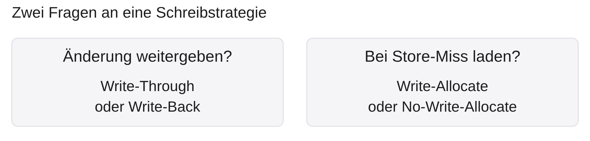{fig-alt="Weitergabe von Änderungen und Anlegen eines Eintrags beim Store-Miss sind unabhängige Entscheidungen."}

- Write-Allocate: Block beschaffen, dann Cache-Kopie ändern
- No-Write-Allocate: Store weitergeben, keinen neuen Eintrag anlegen
- Write-Back/Write-Through beantwortet eine andere Frage

::: notes
Die Weitergabe von Änderungen und die Beschaffung einer bislang fehlenden Kopie sind zwei verschiedene Entscheidungen. Ein Store-Miss liegt vor, wenn zur Schreibadresse kein passender gültiger Eintrag vorhanden ist. Write-Through und Write-Back regeln die Weitergabe von Änderungen an Cache-Kopien. Die Allocate-Regel bestimmt dagegen, ob der Store-Miss einen neuen Cache-Eintrag anlegt.

Bei Write-Allocate wird der fehlende Block im einfachen Modell zunächst beschafft. Anschließend trägt der Store seinen neuen Wert in die Cache-Kopie ein. Wird diese mit Write-Back verwaltet, ist sie danach Dirty. No-Write-Allocate gibt den Store an die nächste Ebene weiter, ohne gerade durch diesen Miss eine neue Line zuzuteilen.

Die zwei Gruppen der Abbildung stellen deshalb unabhängige Entscheidungsachsen dar. Write-Back mit Write-Allocate und Write-Through mit No-Write-Allocate sind häufig betrachtete Kombinationen, jedoch keine logische Pflichtpaarung. Für eine eindeutige Store-Spur müssen beide Regeln bekannt sein. Selbst das Nullsetzen eines C-Arrays besitzt somit nicht allein aufgrund der Blockgröße eine festgelegte Trefferzahl. Bei reinem Lesen sind diese zusätzlichen Schreibentscheidungen zunächst entbehrlich. Eine Spur mit identischen Stores und nur geänderter Zuteilungsregel macht ihren eigenständigen Einfluss sichtbar.
:::

## Gleiche Stores, andere Zuteilung

::: {.section-label}
4 / 5 · Schreibzugriffe
:::

Kalt, $64$-Byte-Lines, Write-Through ohne Puffer; alle Zugriffe auf denselben Block:

`Store 0x1000; Store 0x1004; Store 0x1008; Load 0x1000`

| Store-Miss-Regel | Hit/Miss-Folge |
|-----------------|---------------|
| Write-Allocate | Miss, Hit, Hit, Hit |
| No-Write-Allocate | Miss, Miss, Miss, Miss |

::: notes
Der Vergleich hält die Weitergabe fest und verändert nur die Zuteilung beim Store-Miss. Beide Varianten verwenden Write-Through ohne Puffer, beginnen kalt und besitzen genügend Plätze, sodass keine Verdrängung auftritt. Die $64$-Byte-Line umfasst die Adressen `0x1000`, `0x1004` und `0x1008` gemeinsam. Die drei Stores schreiben beliebige vollständige Wortwerte; anschließend liest ein Load erneut `0x1000`.

Mit Write-Allocate beschafft der erste Store den noch fehlenden Block und verändert seine Kopie. Die folgenden zwei Stores treffen dieselbe gültige Line. Auch der abschließende Load ist ein Hit. Die Ergebnisfolge lautet somit Miss, Hit, Hit, Hit. Unabhängig davon werden alle drei Stores gemäß Write-Through nach unten weitergegeben. Ein Store-Hit vermeidet in diesem Modell also nicht die Weitergabe.

Mit No-Write-Allocate legen die drei Store-Misses keinen Cache-Eintrag an. Sie geben ihre Werte lediglich weiter. Der anschließende Load findet weiterhin keine Kopie und ist ebenfalls ein Miss; erst er beschafft jetzt den Block. Ein weiterer anschließender Load würde dann treffen. Die vier Misses erklären sich allein aus der geänderten Zuteilung, denn die Weitergabestrategie ist dieselbe geblieben. Ohne ein Zeitmodell belegen die zusätzlichen Hits der ersten Variante noch keine schnellere Store-Ausführung. Die Trennung beider Entscheidungen muss auch bei der Interpretation einer konkreten Spur erhalten bleiben.
:::

## Gültigkeitsgrenzen unseres Modells

::: {.section-label}
4 / 5 · Schreibzugriffe
:::

- Normaler Speicher; ein Prozessor; abgeschlossene Anfragen
- Ein älterer Wert unten ist bei Write-Back zunächst erlaubt
- Weitere Kerne und externe Datenübertragung brauchen zusätzliche Regeln
- Gerätezugriffe aus Vorlesung 1 nicht blind wie Arrayzugriffe behandeln

::: notes
Die bisherigen Regeln gelten für einen Prozessor, gewöhnlichen Speicher und jeweils abgeschlossene Anfragen. Innerhalb dieser Grenze darf Write-Back eine geänderte gültige Kopie halten, obwohl die nächste Ebene noch einen älteren Wert enthält. Das ist zunächst kein Fehler. Erst zusätzliche Speicherteilnehmer verlangen weitere Regeln darüber, wer welchen aktuellen Wert erhalten muss.

Kohärenz bezeichnet die Abstimmung mehrerer Kopien, beispielsweise zwischen Prozessorkernen. Ein entsprechendes Protokoll kann aktuelle Daten liefern, bevor der Hauptspeicher aktualisiert ist; dies wird in der späteren Multicore-Betrachtung weitergeführt. Eine weitere mögliche Hardwareeinheit ist ein DMA-Controller. Direct Memory Access bedeutet hier eigenständige Datenübertragung, ohne dass der Prozessor jeden einzelnen Transfer selbst ausführt. Für einen nicht kohärent angebundenen Zugriff kann eine gesonderte Synchronisation erforderlich sein. Die ergänzenden DMA-Materialien vertiefen solche Übergaben. Welche Verwaltungsaktionen und Speicherattribute verfügbar sind, bestimmt die Plattform, nicht allein der RISC-V-Befehlssatz.

Geräteadressen aus der Memory Map bilden ebenfalls einen eigenen Fall. Bei Memory-Mapped Input/Output, MMIO, können Lesen und Schreiben Seiteneffekte auslösen; sie sind nicht einfach wie wiederverwendbare Arraydaten zu behandeln. Die folgenden Rechnungen bleiben deshalb ausdrücklich bei normalem cachefähigem Speicher. Dort lässt sich die Zugriffsspur aus dem bekannten C-Arraylayout ableiten.
:::

## 5 · C-Zugriffsmuster {.section-divider}

Welche Adressen erzeugt eine C-Schleife tatsächlich?

::: {.section-route}
Lokalität → Zeitmodell → Platzwahl → Schreiben → C-Zugriffe
:::

Layout, Besuchsreihenfolge und Cache-Regeln zusammenführen.

::: notes
Die Cache-Regeln lassen sich nun mit einer vertrauten Darstellung verbinden: einem C-Array und zwei Schleifenreihenfolgen. Das Speicherlayout bestimmt die Adressen der Elemente; die Schleifen bestimmen, wann diese Adressen angefragt werden. Erst das festgelegte Cache-Modell ergibt daraus eine Trefferbilanz.

Für die Papieranalyse wird die Datenanfragespur ausdrücklich vorgegeben. Eine tatsächliche Compilerübersetzung kann weitere oder andere Anfragen erzeugen und wird damit nicht als bereits gemessen behauptet. Der Vergleich kehrt so zur Einstiegsfrage zurück: Dieselbe logische Arbeitsmenge genügt für eine Zeitvorhersage nicht. Entscheidend ist, welche Blockkopien bis zu ihrer nächsten Verwendung erhalten bleiben.
:::

## C-Arrays liegen zeilenweise im Speicher

::: {.section-label}
5 / 5 · C-Zugriffsmuster
:::

Annahme: `uint32_t a[16][16]`, Basisadresse `0x1000`.

$$
\operatorname{Adresse}(a[r][c])=\texttt{0x1000}+4(16r+c)
$$

- `r`: Zeilenindex; `c`: Spaltenindex
- Nachbarspalte: $4$ Byte Abstand
- Nächste Zeile: $64$ Byte Abstand

::: notes
Ein zweidimensionales C-Array wird zeilenweise in einem linearen Adressraum abgelegt. Diese Row-Major Order betrifft die Anordnung der Elemente, noch nicht die spätere Besuchsreihenfolge. Das betrachtete Array `a` umfasst $16$ Zeilen mit jeweils $16$ aufeinanderfolgenden Elementen. `uint32_t` aus `stdint.h` bezeichnet, soweit vorhanden, einen vorzeichenlosen Typ mit genau $32$ Bit. Bei den angenommenen acht Bit je Byte belegt jedes Element vier Byte. Basisadresse und Ausrichtung bei `0x1000` sind ausdrückliche Lehrannahmen.

Die Indizes $r$ und $c$ zählen jeweils von null bis fünfzehn. Vor der Zeile $r$ liegen $16r$ Elemente, innerhalb dieser Zeile weitere $c$. Der Byteversatz beträgt daher $4(16r+c)$. Mit der Basis entsteht die Adressformel $\operatorname{Adresse}(a[r][c])=\texttt{0x1000}+4(16r+c)$. So liegt `a[0][1]` bei `0x1004`, während `a[1][0]` die Adresse `0x1040` besitzt. Die Nachbarspalte ist vier, die nächste Zeile vierundsechzig Byte entfernt.

Welche dieser Adressen nacheinander angefragt werden, bestimmen die Schleifen. Das Vertauschen ihrer Reihenfolge ändert die Arraywerte nicht, kann aber andere Nachbarschaften unmittelbar ausnutzen. Eine exakte Cache-Zählung muss diese angenommene Datenanfragespur vom möglichen Verhalten eines Compilers trennen.
:::

## Zeilenweise lesen

::: {.section-label}
5 / 5 · C-Zugriffsmuster
:::

```c
/* Lehrcode: keine gemessene Maschinenspur. */
uint64_t sum = 0;
for (unsigned r = 0; r < 16; ++r)
    for (unsigned c = 0; c < 16; ++c)
        sum += a[r][c];
```

Modellspur: je ein Daten-Load pro Element, Nachbaradresse $+4$ Byte.

::: notes
Der erste C-Ausschnitt besucht die Arrayelemente in ihrer Speicherreihenfolge. Die innere Schleife erhöht `c`, während `r` zunächst festbleibt: Auf `a[0][0]` folgen `a[0][1]` bis `a[0][15]`, erst danach beginnt `a[1][0]`. Die ersten Datenadressen sind `0x1000`, `0x1004` und `0x1008`. Die $64$-Byte-Line einer Arrayzeile wird dadurch unmittelbar ausgenutzt.

Das initialisierte Array enthält $16\cdot16=256$ Werte des zuvor festgelegten Typs `uint32_t`. Der vorzeichenlose $64$-Bit-Akkumulator `sum` beginnt bei null und kann hier selbst die Summe aller $256$ maximalen Arraywerte ohne Überlauf aufnehmen. `r` und `c` sind Indizes vom Typ `unsigned`; `++` erhöht den jeweiligen Wert um eins. Die Typdefinitionen stammen aus `stdint.h`.

Der Ausschnitt ist Lehrcode und kein vollständiges Programm oder eine gemessene RISC-V-Befehlsfolge. Für die Papieranalyse wird genau ein Daten-Load je Element angenommen. Befehlsabrufe, Registerzugriffe und weitere Speicheranfragen werden nicht mitgezählt. Eine tatsächliche Übersetzung könnte beispielsweise vektorisieren und andere Anfragen erzeugen. Die folgende Aussage über Nachbaradressen und spätere Treffer gilt daher für die definierte Modellspur. Dieselbe Summe lässt sich nun mit einer anderen Besuchsreihenfolge bilden.
:::

## Spaltenweise lesen

::: {.section-label}
5 / 5 · C-Zugriffsmuster
:::

```c
/* Gleiche Summe, andere angenommene
   Daten-Load-Reihenfolge. */
uint64_t sum = 0;
for (unsigned c = 0; c < 16; ++c)
    for (unsigned r = 0; r < 16; ++r)
        sum += a[r][c];
```

Modellspur: nächster Zeilenanfang $+64$ Byte, Nachbarspalte erst später.

::: notes
Die zweite Schleifenanordnung verarbeitet dieselben initialisierten Arraywerte und verändert das Array weiterhin nicht. `sum` beginnt erneut bei null und besitzt den bereits verwendeten vorzeichenlosen $64$-Bit-Typ. Die vorzeichenlosen Indizes `r` und `c` werden mit `++` jeweils um eins erhöht. Anders als zuvor ändert nun die innere Schleife zuerst den Zeilenindex `r`.

Die Folge beginnt mit `a[0][0]`, `a[1][0]` und `a[2][0]`. Aus dem unveränderten Layout ergeben sich die Adressen `0x1000`, `0x1040` und `0x1080`. Zwischen zwei Loads liegen somit $64$ Byte, eine ganze Arrayzeile mit sechzehn Vier-Byte-Elementen. Die bereits mitgeladenen Nachbarspalten derselben Zeile werden erst nach dem Besuch aller sechzehn Zeilen benötigt. Es handelt sich weiterhin um eine angenommene Daten-Load-Reihenfolge ohne Nebenläufigkeit.

Dieser größere Abstand beweist allein noch keine hohe Miss Rate. Ein ausreichend großer Cache könnte alle sechzehn Zeilen bis zur nächsten Spalte behalten. Für eine genaue Bilanz müssen Kapazität, Organisation und Anfangszustand feststehen. Gerade dieser Vorbehalt ist für den Vergleich der beiden Schleifen entscheidend: Derselbe C-Ausdruck kann je nach Speichermodell unterschiedlich viele erhaltene Kopien wiederverwenden. Das kleinere Matrixmodell legt die fehlenden Randbedingungen nun vollständig fest.
:::

## Kleines Matrixmodell: alle Annahmen festlegen

::: {.section-label}
5 / 5 · C-Zugriffsmuster
:::

- Array: $16\times16$ Elemente, je $4$ Byte, Basis `0x1000`
- Cache: $512$ Byte Daten, Direct Mapped, $64$-Byte-Lines
- $8$ Sets, kalt vor jedem Vergleich
- Genau $256$ Daten-Loads; kein Vorabladen, keine weiteren Anfragen

$$
i(r)=\left(\frac{\texttt{0x1000}}{64}+r\right)\bmod8=r\bmod8
$$

::: notes
Für den Matrixvergleich wird ausdrücklich ein anderer Cache als der bisherige $32$-KiB-Referenzcache angenommen. Das neue Modell besitzt $512$ Byte Datenkapazität und $64$-Byte-Lines. Direct Mapped ergibt damit $512/64=8$ Sets mit jeweils einem Platz. Jede der beiden Zugriffsspuren beginnt kalt, also ohne gültige Einträge. Vorabladen und fremde Anfragen sind ausgeschlossen; gezählt werden genau $256$ Daten-Loads.

Das Array benötigt $16\cdot16\cdot4=1024$ Byte und umfasst sechzehn vollständige Lines. Seine Basis `0x1000` ist durch $64$ teilbar, und jede Arrayzeile belegt genau einen Block. Die Blocknummer der Zeile $r$ lautet $64+r$. Weil die Basisblocknummer $64$ durch acht teilbar ist, folgt $i(r)=(64+r)\bmod8=r\bmod8$. Zeilen null und acht teilen Set null, Zeilen eins und neun Set eins und entsprechend weiter.

Die begrenzte Kapazität hält den Unterschied zwischen sofortiger Nachbarnutzung und späterer Wiederverwendung auf Papier sichtbar. Der größere Referenzcache könnte dagegen sämtliche Arrayblöcke zugleich aufnehmen. Die Annahme eines Loads pro Element beschreibt weiterhin nur die ausgewählten Datenanfragen, nicht die gesamte übersetzte Programmausführung. Mit diesen vollständig benannten Randbedingungen lässt sich die Wirkung beider Besuchsrichtungen Schritt für Schritt zählen.
:::

## Die Matrixspur Schritt für Schritt

::: {.section-label}
5 / 5 · C-Zugriffsmuster
:::

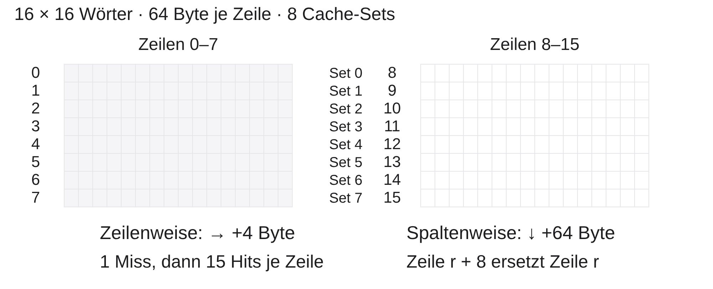{fig-alt="Sechzehn Arrayzeilen teilen sich acht Cache-Sets. Zeilenweise folgen je einem Miss fünfzehn Hits; spaltenweise verdrängen Zeile r und r plus acht einander."}

| Reihenfolge | Misses | Hits | Hit Rate |
|-------------|--------|------|----------|
| zeilenweise | $16$ | $240$ | $93{,}75\,\%$ |
| spaltenweise | $256$ | $0$ | $0\,\%$ |

::: notes
Die Abbildung verbindet die sechzehn Arrayzeilen mit den acht direkt zugeordneten Sets. Jeweils $r$ und $r+8$ zeigen auf denselben Platz. Die Besuchsrichtungen gehören zu zwei unabhängigen Cache-Läufen, die beide kalt beginnen; der zweite Lauf übernimmt daher keinen Zustand des ersten.

Beim zeilenweisen Lesen beschafft der erste Load jeder Zeile ihren Block. Die fünfzehn übrigen Elemente werden sofort aus dieser gültigen Line gelesen, bevor eine andere Zeile sie verdrängt. Pro Zeile entstehen ein Miss und fünfzehn Hits. Über alle sechzehn Zeilen ergibt dies $16$ Misses und $16\cdot15=240$ Hits. Die Trefferquote ist $240/256=0{,}9375=93{,}75\,\%$.

Beim spaltenweisen Lesen füllen zunächst die ersten acht Zeilen die acht Sets. Die Zeilen acht bis fünfzehn ersetzen anschließend die entsprechenden früheren Blöcke. Zu Beginn der nächsten Spalte fehlen dadurch erneut die Zeilen null bis sieben. Deren Loads verdrängen wiederum die höheren Zeilen, bevor diese wieder benötigt werden. Über alle Spalten wiederholt sich derselbe Ablauf: $256$ Misses, null Hits und damit null Prozent Trefferquote.

Die sechzehn ersten Blockanforderungen sind Kaltstart-Misses. Die späteren Fehlschläge dürfen nicht pauschal allein Konflikten zugeschrieben werden. Auch ein vollassoziativer Vergleichscache mit nur acht Plätzen und der festgelegten LRU-Regel könnte die sechzehn zyklisch angeforderten Zeilen nicht behalten. Der Vergleich muss also neben der Platzzuordnung ebenfalls die verfügbare Gesamtkapazität berücksichtigen.
:::

## Transferfrage: größerer Cache

::: {.section-label}
5 / 5 · C-Zugriffsmuster
:::

Dasselbe Array, dieselben Spuren, nun $1024$ Byte Direct Mapped und $64$-Byte-Lines.

1. Wie viele Sets gibt es?
2. Kollidieren Zeile $r$ und Zeile $r+8$ noch?
3. Wie viele Hits und Misses entstehen pro Reihenfolge?

::: notes
Der Transfer verändert ausschließlich die Datenkapazität des Matrixcaches auf $1024$ Byte. Bei unverändert $64$ Byte je Line stehen nun sechzehn Sets zur Verfügung. Direct Mapped erlaubt weiterhin nur einen Platz je Set. Für die Zeilen null bis fünfzehn gilt jetzt jedoch $(64+r)\bmod16=r$. Jede Arrayzeile besitzt dadurch einen eigenen Set-Index; insbesondere kollidieren $r$ und $r+8$ nicht mehr.

Das vollständige Array kann nun im Cache bleiben. Beim zeilenweisen Lesen erzeugt der erste Load jeder Zeile weiterhin einen Miss und die fünfzehn anschließenden Loads treffen. Beim Spaltendurchlauf beschafft die erste Spalte zunächst sämtliche sechzehn Blöcke. Ihre Kopien bleiben erhalten, sodass die fünfzehn folgenden Spalten je sechzehn Hits erzeugen. Beide Besuchsreihenfolgen enden bei $16$ Misses und $15\cdot16=240$ Hits.

Ein großer Adresssprung legt folglich noch keine genaue Miss Rate fest. Entscheidend ist, ob eine Kopie bis zu ihrer nächsten Nutzung vorhanden bleibt. Die schlechte Bilanz des kleineren Matrixmodells ist keine unveränderliche Eigenschaft spaltenweiser C-Schleifen. Für die Herleitung zählen das Arraylayout, die Spur und die Kapazität gemeinsam. Auch die Schrittweite selbst hat neben ihrer räumlichen Größe eine weitere Wirkung: Sie bestimmt, welche Sets überhaupt verwendet werden.
:::

## Schrittweite: welche Sets werden genutzt?

::: {.section-label}
5 / 5 · C-Zugriffsmuster
:::

Kleines Modell: $8$ Direct-Mapped-Sets, $64$-Byte-Lines, kalt.

Schrittweite $128$ Byte, Start `0x1000`:

| Adresse | `0x1000` | `0x1080` | `0x1100` | `0x1180` | `0x1200` |
|---------|----------|----------|----------|----------|----------|
| Index | $0$ | $2$ | $4$ | $6$ | $0$ |

Was passiert bei der anschließenden Anfrage `0x1000`?

::: notes
Die Schrittweite, auf Englisch Stride, ist der Adressabstand aufeinanderfolgender Anfragen. Für diesen Fall gilt wieder das kleine Direct-Mapped-Modell mit acht Sets und $64$-Byte-Lines, also $512$ Byte Datenkapazität. Alle Anfragen sind Loads; der Cache beginnt kalt, und weder Vorabladen noch fremde Zugriffe greifen ein.

Die Schrittweite von $128$ Byte entspricht zwei Lines. Beginnend bei der hexadezimalen Adresse `0x1000` entstehen die Blocknummern $64$, $66$, $68$, $70$ und $72$. Ihre Reste bei Division durch acht ergeben die Set-Indizes null, zwei, vier, sechs und erneut null. Fünf benötigte Blöcke nutzen somit nur vier verschiedene Sets, obwohl acht Plätze verfügbar sind. Die Anfrage `0x1200` verdrängt deshalb den zuerst geladenen Block bei Index null.

Ein anschließender Load auf `0x1000` verfehlt den Cache. Insgesamt sind sechs Misses entstanden: fünf erstmalige Blockanforderungen und danach ein Konflikt-Miss. Ein vollassoziativer Cache gleicher Kapazität könnte alle fünf Blöcke gleichzeitig halten. Die Schrittweite wirkt daher nicht nur über die Entfernung zwischen zwei Adressen, sondern auch über wiederholte Platzkollisionen. Aus dem C-Layout wird zunächst die Adressfolge und daraus unter den genannten Cache-Regeln die Bilanz abgeleitet. Für eine andere Organisation oder Größe ist die Zuordnung neu zu berechnen.
:::

## Optional: eine Spur im Simulator prüfen

::: {.section-label}
5 / 5 · C-Zugriffsmuster
:::

- Zuerst Adressen und Cache-Konfiguration festlegen
- Vor jeder Variante Cache-Zustand zurücksetzen
- Trefferzahlen mit der Papierlösung vergleichen
- Simulatorzähler sind keine allgemeine Laufzeitmessung

::: notes
Eine Simulatoransicht kann die Papieranalyse ergänzen, wenn sie dieselben Anfragen unter denselben Bedingungen zählt. Ripes ist ein visueller RISC-V-Simulator mit einer Cache-Ansicht. Für einen nachvollziehbaren Vergleich müssen in der verwendeten Version Kapazität, Blockgröße und Assoziativität bekannt sein und die Zähler vor jeder Variante zurückgesetzt werden. Manche Eingaben erwarten Exponenten statt unmittelbarer Anzahlen.

Ein ausgeführtes Programm erzeugt neben den modellierten Daten-Loads auch Befehlsabrufe und möglicherweise zusätzliche Datenzugriffe. Die Gesamtsumme aller angezeigten Ereignisse muss deshalb nicht $256$ ergeben. Maßgeblich sind gleich definierte Anfragen. Die [Ripes-Cache-Dokumentation](https://github.com/mortbopet/Ripes/blob/master/docs/cache_sim.md) hält zudem ausdrücklich fest, dass Cache-Zugriffslatenzen nicht simuliert werden. Für eine saubere Zählung empfiehlt sie das Ein-Takt-Prozessormodell, weil wartende Pipeline-Stufen zusätzliche Anfragen zählen können. Auch die Speicheranzeige ist nach ihren Darstellungsregeln zu interpretieren: Ein dort sichtbarer Wert belegt im Write-Back-Modus nicht ohne Weiteres einen veralteten Hauptspeicherstand.

Die Pflichtübung benötigt weder Ripes noch den RISC-V-Cross-Compiler GCC. Simulatorzeiten oder RISC-V-Compilerergebnisse wurden hier nicht gemessen. Die definierten Adressspuren lassen sich auf Papier oder mit einem kleinen Modell nachvollziehen. Abweichende Zählerstände verlangen zuerst einen Vergleich von Anfangszustand, Konfiguration und tatsächlich gezählten Ereignissen, bevor daraus eine technische Folgerung gezogen wird.
:::

## Abschlussquiz: erklären statt nur ankreuzen

::: {.section-label}
5 / 5 · C-Zugriffsmuster
:::

- $10$ Fragen im QuizAcademy-Quiz zu Vorlesung 2
- $10$ Minuten beantworten, $5$ Minuten gemeinsam auswerten
- Bei strittigen Antworten: Annahme, Rechnung oder Cache-Zustand nennen
- Typische Stolperstellen: zusätzliche Penalty, Tag/Index, Dirty und Store-Miss

::: notes
Die zehn Fragen des zugehörigen QuizAcademy-Quiz bündeln die entscheidenden Unterscheidungen der Speicherhierarchie. Für ihre Bearbeitung sind zehn Minuten und für die Auswertung weitere fünf Minuten vorgesehen. Die Erläuterungen ermöglichen, eine Antwort auf ihre konkrete Annahme, Rechnung oder ihren Cache-Zustand zurückzuführen. Eine aufwendigere Adressrechnung kann dabei auch nach dem kurzen Auswahlformat vollständig nachvollzogen werden.

Im Zeitmodell ist die Miss Penalty eine zusätzliche Dauer des Fehlschlags; sie wird zur bei jedem Zugriff anfallenden Prüfzeit addiert. Bei der Adresszuordnung wählt der Index das Set, während das Tag den darin abgelegten Block kennzeichnet. Dirty beschreibt eine geänderte gültige Write-Back-Line, deren Inhalt noch nicht vollständig weitergegeben ist. Ein Store-Miss besitzt keine passende gültige Kopie; ob er einen neuen Eintrag anlegt, ist getrennt von der Weitergabe der Schreibwerte festzulegen.

Diese Beziehungen tragen die Begründung einer Auswahl. Eine strittige Entscheidung lässt sich durch einen Zwischenschritt oder einen konkreten Zustand klären. Jede Frage hat eine richtige Option; deren Länge soll keinen Lösungshinweis liefern. Das Quiz ordnet damit die einzelnen Regeln noch einmal in denselben Zusammenhang ein: nützliche Kopien behalten, zulässige Plätze bestimmen und aus begründeten Adressmustern ihre Wirkung ableiten.
:::

## Was Sie jetzt begründen können

::: {.section-label}
5 / 5 · C-Zugriffsmuster
:::

- Lokalität erklärt, welche Kopien nützen
- AMAT verbindet Trefferquote mit zusätzlicher Miss-Zeit
- Mapping bestimmt Platzwahl; Ersetzung entscheidet bei vollem Set
- Schreibstrategie und Store-Miss-Regel getrennt angeben
- C-Layout, Zugriffsspur und Cache-Modell gemeinsam betrachten

Rückblick: Warum zählt die Reihenfolge der Zugriffe?

::: notes
Die Speicherhierarchie verbindet kleine schnelle Kopien mit größerem langsameren Speicher. Zeitliche Lokalität nutzt eine bald erneut benötigte Adresse, räumliche Lokalität die Nachbarn eines geladenen Blocks. Die mittlere Speicherzugriffszeit, AMAT, verbindet die bei jeder Anfrage anfallende Prüfung mit den gewichteten zusätzlichen Miss-Kosten. Erst diese gemeinsame Betrachtung erklärt, weshalb eine höhere Trefferquote nicht zwingend eine geringere Laufzeit bedeutet.

Platzzuordnung und Ersetzung erfüllen unterschiedliche Aufgaben: Mapping legt die zulässigen Plätze eines Blocks fest, Replacement wählt bei einem vollen Set das Opfer. Ebenso müssen die Weitergabe geänderter Daten durch Write-Through oder Write-Back und die Zuteilung bei einem Store-Miss durch Write-Allocate oder No-Write-Allocate getrennt angegeben werden. Valid kennzeichnet die Gültigkeit, Dirty die Veränderung einer Kopie gegenüber der nächsten Ebene.

Damit lässt sich die Einstiegsfrage nach derselben Arbeitsmenge bei verschiedener Reihenfolge präzise beantworten. Die Schleifen können dieselben Arrayelemente lesen und dennoch unterschiedlich viele geladene Kopien wiederverwenden. Im kleinen Matrixmodell verdrängen die Zeilen einander bis zur nächsten Spalte; mit hinreichender Kapazität bleiben sie dagegen erhalten. Eine Umordnung garantiert deshalb weder eine bessere Quote noch automatisch eine schnellere Ausführung. Entscheidend sind C-Layout, konkrete Zugriffsspur, Cache-Modell, Zugriffszeiten und übrige Arbeit gemeinsam.

Auch zwei Blöcke können einen fast leeren direkt abgebildeten Cache fortwährend verfehlen, wenn sie denselben einzigen Platz benötigen. Solche begründeten Zustands- und Zeitbetrachtungen bilden die Grundlage für das Übungsblatt. Definitionen und Aufbau orientieren sich an Harris/Harris, Digital Design and Computer Architecture — RISC-V Edition, Abschnitt Speicherhierarchie; Patterson/Hennessy dient zur Vertiefung.
:::
