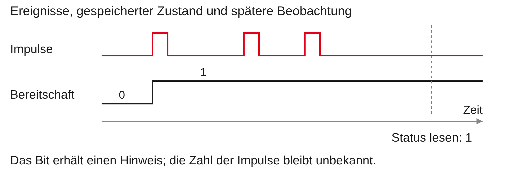
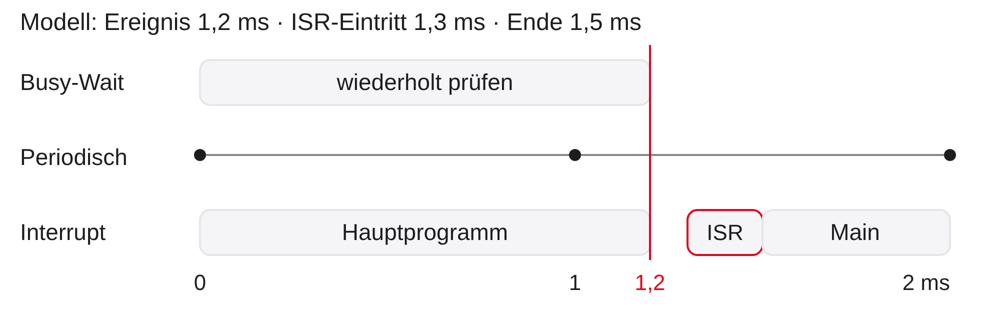
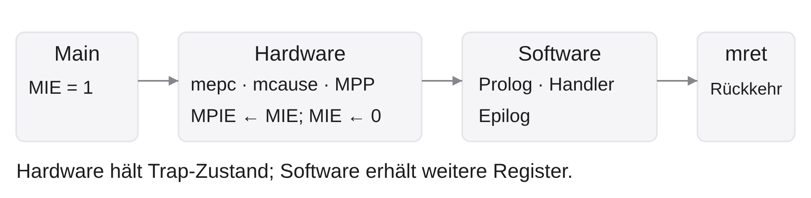
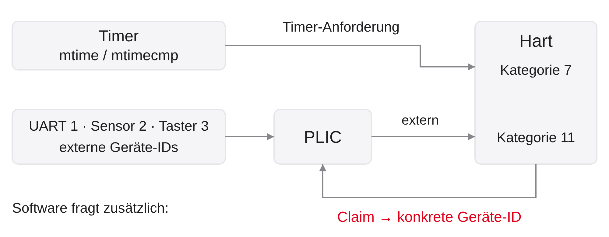
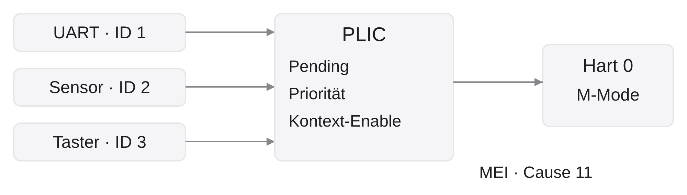
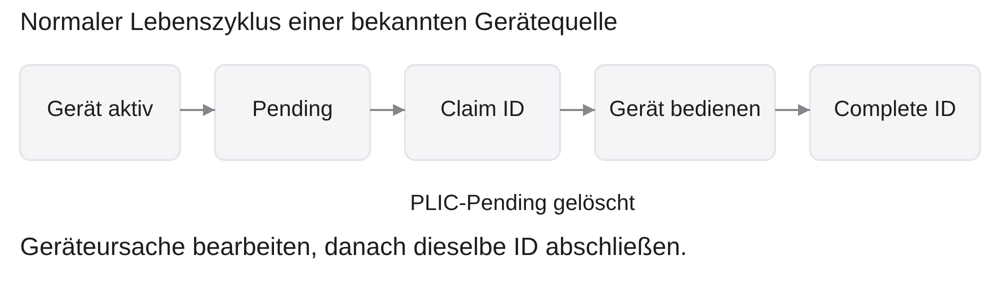
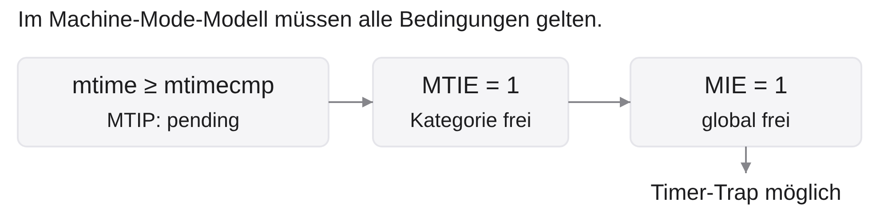
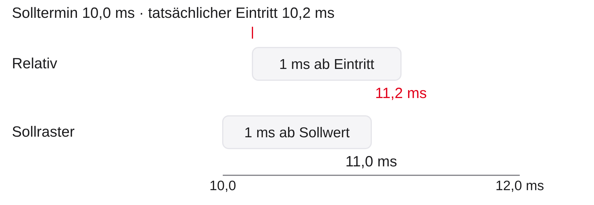
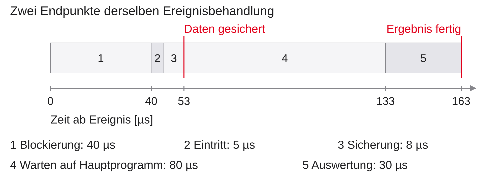
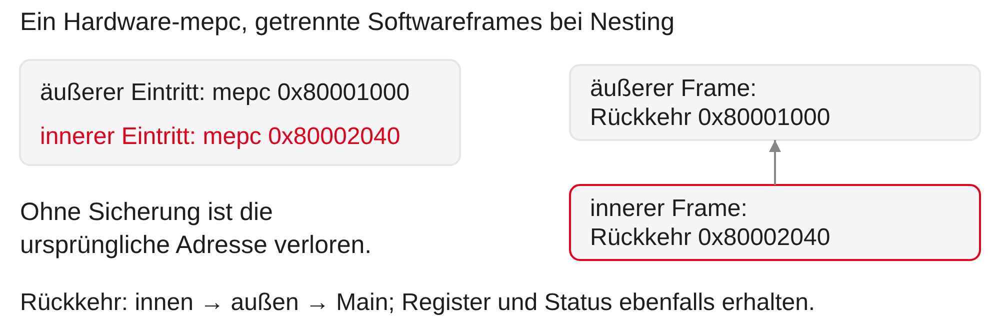

## Reicht ein schnellerer Prozessor?

Ein Messgerät rechnet gerade $4$ ms lang. Neue Sensordaten sollen
innerhalb von $100\,\mu$s aus dem Gerät gesichert werden.

- Würde ein doppelt so schneller Prozessor das Problem lösen?
- Woher weiß das Programm, dass Daten vorliegen?
- Was muss die Hardware bis zur Bearbeitung festhalten?

Zwei Minuten zu zweit: Vorschlag und fehlende Annahme nennen.

::: notes
Ein Mikrocontroller wertet gerade 4 ms lang alte Messdaten aus. Währenddessen meldet sein ADC einen neuen Wert, der nach 100 µs überschrieben wird. Wie kommt dieser Wert rechtzeitig in den Speicher?

ADC bedeutet Analog-to-Digital Converter, Analog-Digital-Umsetzer. Er wandelt ein analoges Eingangssignal in einen digitalen Messwert um.

Beginnen Sie mit der Diskussion, bevor Sie Interruptregister erklären. Die Studierenden kennen aus den bisherigen Einheiten Prozessor, Geräteadressen und unterschiedlich schnelle Speicherzugriffe. Sie sollen diese Kenntnisse anwenden und erkennen, welche Information für eine zeitliche Zusage noch fehlt. Die Zahlen beschreiben ein Lehrszenario, keine gemessene Plattform. Die Frist endet beim Sichern der Daten aus dem Gerät, nicht erst nach ihrer vollständigen Auswertung.

Eine Verdopplung der Rechengeschwindigkeit verkürzt die vier Millisekunden im idealisierten Fall auf zwei Millisekunden. Eine Abfrage erst nach dieser Rechnung käme im ungünstigen Fall weiterhin deutlich später als hundert Mikrosekunden. Ein schnellerer Cache beantwortet ebenfalls nicht, an welcher Programmstelle die nächste Abfrage stattfindet. Periodisches Prüfen, eine Unterbrechung oder eine hardwaregestützte Übernahme sind mögliche Vorschläge, deren Voraussetzungen erst untersucht werden müssen.

Fragen Sie nach dem genauen Ablauf: Bleiben Daten und Bereitschaft gespeichert? Kann die Rechnung unterbrochen werden? Was passiert bei einem zweiten Messwert? Sammeln Sie mehrere begründete Ansätze. Die endgültige Entscheidung wird am Ende erneut aufgegriffen. Der Einstieg soll vorhandene Vorstellungen sichtbar machen und keine noch unbekannten Registernamen verlangen.
:::

## Was sollen Sie entscheiden können?

- Ereignisbehandlung begründet auswählen
- Trap- und Gerätepfad vollständig erklären
- Timertermine trotz Verspätung planen
- Reaktionszeit und Datenübergabe prüfen

| Lernphase | Zweck |
|-----------|-------|
| Vorlesung | Zusammenhänge begründen |
| Übung | Neue Fälle auf Papier lösen |
| Quiz | Fehlvorstellungen erkennen |

::: notes
Das Ziel dieser Einheit ist ein verständlicher, begründbarer Entwurf für Zeit und Ereignisse in einem Mikrocomputersystem. Polling bedeutet regelmäßiges Abfragen, ein Interrupt ist eine asynchrone Unterbrechungsanforderung. Ein Trap ist der Eintritt in ihre Behandlung oder in die Behandlung einer synchronen Ausnahme. Diese Begriffe werden im Verlauf genauer eingeführt. Entscheidend ist die Fähigkeit, einen Ablauf mit seinen Voraussetzungen zu erklären und Fehler darin zu finden.

Die Vorlesung baut dafür ein gemeinsames Zustands- und Zeitmodell auf. Das Übungsblatt verändert Geräte, Zahlen und Ablaufspuren, damit die Studierenden das Modell übertragen. Das Quiz prüft anschließend besonders die Verwechslungen zwischen wartender Anforderung und Freigabe, Controllerübernahme und Gerätequittierung sowie mittlerer Auslastung und Reaktionsfrist. Ein richtiges Kreuz allein ersetzt dort nicht die begründete Auswertung.

Für das fünfte Semester ist diese Verbindung von Architektur, C-Programmierung und Systementwurf angemessen anspruchsvoll. Das Auswendiglernen einer vollständigen Registerkarte ist dafür nicht erforderlich. Der Hauptteil behandelt die notwendigen Zusammenhänge; vier ausdrücklich optionale Vertiefungsfolien nach dem Abschluss erklären ausgewählte Implementierungsdetails. Übung und Quiz setzen diese Vertiefungen nicht voraus.
:::

## Vorkenntnisse und Lehrmodell

::: {style="font-size: 0.9em; text-align: left;"}

**Was Sie mitbringen**\
Geräteadressen, Speicherzugriffe und Cache-Kopien (VL 1–2)\
C-Zeiger, Bitoperationen, einfache Schleifen\
STM32-Timer mit Prescaler, ARR und CNT aus dem Labor

**Vereinfachungen dieser Vorlesung (neu)**\
RV32: RISC-V mit $32$-Bit-Registern\
Ein Hart: genau ein Befehlsstrom, vereinfacht ein Prozessorkern\
Machine Mode: höchste Privilegstufe mit vollem Zugriff auf Prozessor und Geräte\
Keine Verschachtelung: Eine laufende Interruptbehandlung wird nicht von weiteren Interrupts unterbrochen

Geräteadressen und Timerfrequenzen sind plattformabhängig.

:::

::: notes
Die Folie trennt vorhandenes Wissen von den neuen Modellannahmen. VL bedeutet Vorlesung. Aus den Vorlesungen 1–2 werden Geräteadressen, Speicherzugriffe und Cache-Kopien vorausgesetzt. Aus der C-Programmierung benötigen wir Zeiger als gespeicherte Adressen, Bitoperationen zum Prüfen oder Ändern einzelner Bits und einfache Schleifen. Gerätezugriffe knüpfen an Memory-Mapped Input/Output an, Ein- und Ausgabe über Geräteadressen. Ein Gerätestatus kann beim Lesen einen Seiteneffekt besitzen; eine Cache-Kopie ist kein Ersatz für dessen Benachrichtigung.

Aus dem Labor sind außerdem STM32-Timer mit Prescaler, dem Vorteiler, ARR, Auto-Reload Register, und CNT, Counter, bekannt. ARR legt im betrachteten Aufwärtszählbetrieb die Periodengrenze fest, CNT enthält den laufenden Zählwert. Daran knüpfen wir den Unterschied zwischen einer von Hardware wiederholten Periode und einem einzeln programmierten Vergleichstermin an. Der frei laufende Output-Compare-Betrieb mit Vergleichsereignissen wird als Brücke erklärt und nicht als bereits beherrschte Voraussetzung verlangt.

RV32, Hart und Machine Mode sind hier neue Begriffe. RV32 bezeichnet die RISC-V-Variante mit zweiunddreißig Bit breiten allgemeinen Integerregistern; daraus folgt nicht, dass jedes Geräte- oder Timerregister ebenfalls nur zweiunddreißig Bit breit ist. Ein Hart ist ein Hardware-Ausführungskontext mit einem eigenen Befehlsstrom. Für unser Ein-Hart-Modell genügt die Vorstellung eines einzelnen Prozessorkerns. Allgemein kann ein physischer Kern mehrere solche Ausführungskontexte besitzen. Hauptprogramm und Unterbrechungsbehandlung laufen hier nacheinander auf demselben Hart.

Machine Mode ist die höchste RISC-V-Privilegstufe. Im Lehrmodell haben Hauptprogramm und Behandlung dort vollen Zugriff auf die benötigten Prozessorregister und Geräte; andere Privilegstufen und zusätzliche Zugriffsbeschränkungen werden nicht modelliert. Eine Weiterleitung der Behandlung an andere Privilegstufen betrachten wir ebenfalls nicht. Keine Verschachtelung bedeutet: Eine laufende Interruptbehandlung wird nicht von einem weiteren der betrachteten maskierbaren Interrupts unterbrochen. Neue Anforderungen können trotzdem entstehen und warten. Synchrone Exceptions, Ausnahmen durch den gerade ausgeführten Befehl, sind damit nicht ausgeschlossen; die Unterscheidung wird später erklärt.

Die konkreten Geräteadressen und die Frequenz der Timerzeitquelle liefert die jeweilige Plattform, nicht allein der Name RISC-V. Alle Zahlenbeispiele bleiben ausdrücklich Lehrannahmen. Eine reale Firmware benötigt passende Gerätezugriffe und eine Plattformbeschreibung; ihre Ausführung wird hier nicht vorausgesetzt. So können wir zunächst den Ereignis- und Zeitpfad verstehen, ohne mehrere Kerne und verschachtelte Behandlungen gleichzeitig berücksichtigen zu müssen.
:::

## Vier Schulstunden: Ablauf

| Stunde | Gemeinsame Erarbeitung | Arbeitsphase |
|--------|------------------------|--------------|
| 1 | Ereignisse und Trap-Eintritt: $30$ min | Aufgabe 1: $15$ min |
| 2 | Ursachenauswahl und Gerätepfad: $30$ min | Aufgaben 2–3: $15$ min |
| 3 | Zeitquelle und Sollraster: $30$ min | Aufgabe 4: $15$ min |
| 4 | Reaktionszeit und Datenübergabe: $20$ min | Aufgaben 5–6: $10$ min; Quiz: $15$ min |

Die vier Vertiefungsfolien nach dem Abschluss gehören zur Selbstlektüre.

::: notes
Vier Schulstunden umfassen viermal fünfundvierzig, insgesamt hundertachtzig Unterrichtsminuten; Pausen kommen hinzu. Hundertzehn Minuten sind für Erklärung, Einstiegsdiskussion, kurze Denkfragen und gemeinsame Auswertung vorgesehen, fünfundfünfzig für angeleitete Aufgaben und fünfzehn für das Quiz. Die sechs Pflichtaufgaben beginnen ohne längere Einführung direkt mit neuen Situationen.

Die angeleitete Arbeitszeit dient ausgewählten Teilaufgaben und dem Vergleich der Lösungswege. Für die vollständige selbstständige Bearbeitung nennt das überarbeitete Übungsblatt etwa fünfundsiebzig bis neunzig Minuten. Besonders in der letzten Stunde werden ausgewählte Entwurfsentscheidungen gemeinsam begründet; offene Teilaufgaben können anschließend fertiggestellt werden.

Der Foliensatz umfasst fünfzig Folien, davon sechsundvierzig im Hauptteil. Die vier folgenden Vertiefungen sind Nachschlagematerial zu Gerätezugriffen, Verschachtelung und Controllerdetails. Sie füllen keine zusätzlich vorausgesetzte Unterrichtszeit und werden weder für die Pflichtaufgaben noch das Quiz benötigt. Bei langsamerem Diskussionsverlauf hat die nachvollziehbare Begründung Vorrang vor einer gleichmäßigen Minutenverteilung über die Folien.
:::

## Drei Schritte bis zur Reaktion

{fig-alt="Drei Ereignisimpulse treffen ein. Ein gespeichertes Bereitschaftsbit bleibt nach dem ersten auf eins. Die Software liest später nur diesen einen Zustand, nicht automatisch die Zahl drei."}

- Erfassen: Das Ereignis muss einen Zustand hinterlassen
- Benachrichtigen: Software muss davon erfahren
- Bearbeiten: Daten sichern und Ursache behandeln

::: notes
Diese Folie legt die Grundidee der ganzen Vorlesung: Damit ein Ereignis eine Reaktion auslöst, sind drei getrennte Aufgaben zu erfüllen. Jede kann für sich scheitern. Erfassen, Benachrichtigen und Bearbeiten bilden gemeinsam den Weg vom Ereignis zur gewünschten Wirkung.

**Was die Grafik zeigt**

Die obere rote Bahn zeigt drei kurze Impulse entlang einer gemeinsamen Zeitachse. Das sind Ereignisse eines Geräts, etwa eines Sensors, der kurz „neuer Wert da“ signalisiert. Ein solcher Impuls ist flüchtig: Ist er vorbei, ist er weg. Die Achse besitzt keine konkrete Zeiteinheit, weil hier zunächst die Reihenfolge der Vorgänge zählt.

Die mittlere Bahn zeigt ein Bereitschaftsbit in der Hardware. Als technische Vorstellung eignet sich ein Flipflop, ein Schaltungselement zum Speichern eines Bits. Der gespeicherte Zustand springt beim ersten Impuls von null auf eins und bleibt im dargestellten Modell bis zum Rücksetzen erhalten. Der zweite und dritte Impuls ändern nichts mehr, denn das Bit steht bereits auf eins. Die Grafik zeigt damit eine Zustandsmarkierung, keinen Ereigniszähler.

Die gestrichelte senkrechte Linie markiert den Zeitpunkt, an dem die Software das Statusregister liest. Ein Statusregister enthält hier den beobachtbaren Gerätezustand. Die Software sieht eine Eins und erfährt: „Mindestens ein Ereignis ist eingetroffen.“ Dass es drei waren, kann sie nicht erkennen. Genau darauf weist die Bildunterschrift hin. Die Abbildung zeigt die Beobachtung; ein späteres Rücksetzen des Bits ist nicht eingezeichnet.

**Die drei Schritte**

*Erfassen* heißt, dass das flüchtige Ereignis einen bis zur Bearbeitung erhaltenen Zustand hinterlässt. In der Grafik leistet das das Bereitschaftsbit. Ohne einen solchen Speicher kann ein Impuls, der vollständig zwischen zwei Beobachtungen der Software liegt, spurlos verloren gehen. Die spätere Software kann ein nicht gespeichertes Ereignis nicht nachträglich rekonstruieren.

*Benachrichtigen* heißt, dass die Software von diesem Zustand erfährt. Dafür betrachten wir zwei Wege: Sie schaut selbst nach, Polling genannt, wie an der gestrichelten Linie. Oder die Hardware fordert aufgrund des gesetzten Zustands einen Interrupt an, eine Unterbrechung der laufenden Programmausführung. Der tatsächliche Eintritt benötigt zusätzlich passende Freigaben; das wird später erläutert.

*Bearbeiten* heißt, die benötigten Daten rechtzeitig zu sichern und die Ursache passend zu behandeln. In unserem einfachen Bitmodell gehört dazu, die Bereitschaft nach der Behandlung wieder zurückzusetzen, damit neue Arbeit angezeigt werden kann. Wie eine reale Geräteursache quittiert wird, legt die Gerätebeschreibung fest; bloßes Lesen setzt nicht jedes Statusbit automatisch zurück.

**Die eigentliche Botschaft**

Die drei Aufgaben lassen sich unterscheiden, ersetzen einander aber nicht. Wer Polling durch Interrupts ersetzt, ändert zunächst den Benachrichtigungsweg. Hat die Hardware ein Ereignis nicht erfasst, kann auch ein schneller Interruptpfad diese fehlende Information nicht wiederherstellen. Umgekehrt bedeutet ein gesetztes Bereitschaftsbit noch nicht, dass die Daten bereits gesichert oder ausgewertet wurden.

Wenn die Anwendung alle drei Ereignisse unterscheiden muss, reicht ein einzelnes Bit nicht. Ein Zähler kann die Anzahl erhalten. Werden dagegen die drei einzelnen Messwerte benötigt, müssen auch diese Werte in einem geeigneten Datenpuffer gespeichert werden. Ein Zähler allein enthält sie nicht. Kapazität und mögliche Überläufe müssen zur Anwendung passen; Folie 9 vertieft diese Unterscheidung.

Damit beantwortet die Folie auch die dritte Einstiegsfrage aus Folie 1: Die Hardware muss mindestens die Bereitschaft bis zur Beobachtung festhalten. Wenn jeder Messwert zählt, müssen zusätzlich die Werte selbst bis zur Übernahme erhalten bleiben. Ein gesetztes Bit schützt einen Messwert nicht vor dem Überschreiben.

Als Gedankenbild eignet sich ein Briefkasten mit einem Fähnchen. Stellen Sie sich vor, das Fähnchen gehe beim ersten eingeworfenen Brief hoch und bleibe oben, egal wie viele Briefe folgen. Wer vorbeischaut, weiß, dass Post da ist, aber nicht, wie viel. Das Fähnchen entspricht dem Bereitschaftsbit; die im Kasten aufbewahrten Briefe entsprechen zusätzlich gespeicherten Daten. Der Blick auf das Fähnchen ist die Benachrichtigung durch Polling, das Herausnehmen der Briefe und Zurücksetzen des Fähnchens die Bearbeitung.
:::

## Polling: selbst nachfragen

- Polling: Gerätezustand per Software prüfen
- Busy Waiting: wiederholt prüfen und dabei warten
- Periodisches Polling: zwischen Abfragen andere Arbeit
- Kurze ungespeicherte Ereignisse können zwischen Abfragen verschwinden

::: notes
Polling bedeutet Abfragen. Software liest beispielsweise ein Statusregister eines Geräts und prüft, ob Daten bereitliegen. Busy Waiting, beschäftigtes Warten, ist eine enge Wiederholung dieser Prüfung ohne andere nützliche Arbeit. Periodisches Polling fragt dagegen nur gelegentlich nach und bearbeitet zwischenzeitlich andere Aufgaben.

Ein lesbares Gerätestatusregister stammt aus dem Konzept der Geräteadressen in Vorlesung 1. Es muss nicht dieselben Eigenschaften wie gewöhnlicher Arbeitsspeicher besitzen: Lesen kann Seiteneffekte haben. Für ein korrektes Programm sind die Gerätereigenschaften zu beachten.

Polling ist nicht grundsätzlich falsch. Bei einer dauerhaft sichtbaren Bereitschaft und tolerierbarer Verzögerung kann es einfach und passend sein. Ein kurzer Impuls, der weder im Gerät noch in weiterer Hardware gespeichert wird, kann dagegen zwischen zwei Prüfungen liegen und vollständig übersehen werden. Ein Interrupt ist ein anderer Benachrichtigungsweg, aber auch dort müssen Ereignisse erfasst und gegebenenfalls gespeichert werden. Die nächste Abbildung vergleicht ausdrücklich modellierte Reaktionswege, nicht pauschal Energieverbrauch oder Laufzeit.
:::

## Reaktionswege auf einer Zeitachse

{fig-alt="Ereignis bei 1,2 ms; periodisches Polling entdeckt es bei 2 ms, Interruptbehandlung beginnt im Modell bei 1,3 ms."}

- Periodische Abfrage: Modellwartezeit $0{,}8$ ms
- Interrupt: eigene Eintrittslatenz und Behandlungszeit

::: notes
**Aufbau der Grafik**

Die waagrechte Achse zeigt die Zeit von null bis zwei Millisekunden. Die rote senkrechte Linie bei $1{,}2$ ms markiert das Ereignis, etwa „Sensor hat einen neuen Wert“. Die drei Bahnen sind alternative Programmentwürfe für dieselbe Situation, keine drei gleichzeitig laufenden Prozessoren. Für den Vergleich nehmen wir an, dass die Hardware das Ereignis wie auf Folie 5 in einem Bereitschaftsbit bis zur Bearbeitung festhält. Das speichert den Hinweis, aber nicht automatisch den zugehörigen Messwert oder die Anzahl mehrerer Ereignisse.

**Die drei Bahnen**

*Busy-Wait, oben:* Busy Waiting bedeutet beschäftigtes Warten. Der Prozessor liest ständig das Statusbit, statt andere Arbeit zu erledigen. Im gezeichneten Modell bemerkt er das Ereignis näherungsweise bei $1{,}2$ ms. Auch eine solche Schleife braucht in Wirklichkeit Zeit für ihre einzelnen Abfragen; „praktisch sofort“ ist hier eine Vereinfachung. Der Preis der kurzen Reaktion ist, dass während dieser Wartephase keine andere Nutzarbeit erfolgt. Die vier Millisekunden lange Auswertung aus dem Einstieg käme in dieser Zeit nicht voran.

*Periodisch, Mitte:* Die Software fragt nur zu festen Zeitpunkten ab, hier bei null, eins und zwei Millisekunden. Die Punkte markieren die Statusbeobachtungen. Die Verbindungslinie steht für die dazwischen verfügbare Zeit, in der andere Arbeit erledigt werden kann. Das Ereignis bei $1{,}2$ ms liegt nach der Abfrage bei einer Millisekunde und wird erst bei zwei Millisekunden erkannt. Die Wartezeit beträgt $2-1{,}2=0{,}8$ ms. Im ungünstigsten Fall entsteht das Ereignis unmittelbar nach einer Abfrage und wartet nahezu ein volles Intervall. Folie 8 verallgemeinert diese Überlegung auf eine begrenzte Abfragelücke.

*Interrupt, unten:* Zunächst läuft das Hauptprogramm. Nach dem Ereignis beginnt bei $1{,}3$ ms die rot umrandete ISR, Interrupt Service Routine, Unterbrechungsbehandlung. Der Abstand zum Ereignis beträgt $1{,}3-1{,}2=0{,}1$ ms und heißt hier Eintrittslatenz. Er ist eine Lehrannahme für den Weg bis zum Beginn der eingezeichneten Behandlung, keine gemessene reine Hardwarelatenz. Die Grafik zerlegt diesen Eintrittspfad nicht in seine Hardware- und Softwareanteile. Neben der Hardwareerkennung und dem Einsprung kann auch die nötige Sicherung von Registerwerten zum Aufwand bis zur eigentlichen Gerätearbeit beitragen. Es wäre deshalb falsch, die gesamten hundert Mikrosekunden allein mit dem Abschluss des laufenden Befehls zu erklären. Folie 15 erläutert die Aufgaben von Hardware und Software beim Eintritt.

Die ISR endet bei $1{,}5$ ms. Ihre eingezeichnete Dauer beträgt somit $1{,}5-1{,}3=0{,}2$ ms. Danach setzt das Hauptprogramm fort; „Main“ ist die englische Beschriftung dafür. Eine zusätzliche Wartezeit durch gesperrte Interrupts wird in diesem Zahlenbeispiel nicht gesondert eingezeichnet. Bei anderen Voraussetzungen muss sie ebenfalls berücksichtigt werden.

**Die eigentliche Botschaft**

Erstens gibt es keinen Sieger ohne Bedingungen. Busy-Wait reagiert im gezeichneten Modell schnell, belegt dafür aber den Prozessor mit Abfragen. Periodisches Polling, regelmäßiges Nachfragen, lässt Rechenzeit für andere Arbeit frei, entdeckt das Ereignis hier jedoch später. Ein Interrupt lässt zunächst das Hauptprogramm arbeiten und lenkt es bei einer Anforderung in die Behandlung um. Er besitzt eigene Eintritts- und Behandlungszeiten und kann zusätzlich warten, wenn Freigaben fehlen oder andere Behandlung im Weg ist. Ob die Reaktion rechtzeitig erfolgt, entscheidet der ganze Ablauf.

Zweitens bezeichnen die Zahlen verschiedene Größen. Die $0{,}8$ ms beim Polling sind Wartezeit bis zur Entdeckung. Die $0{,}1$ ms beim Interrupt sind Eintrittslatenz, die $0{,}2$ ms die Dauer des gezeichneten ISR-Blocks. Diese Größen haben unterschiedliche Anfangs- und Endpunkte und dürfen nicht gleichgesetzt werden.

Drittens muss die geforderte Wirkung feststehen. Zählt der Beginn der ISR, hier $0{,}1$ ms nach dem Ereignis, ihr Ende nach $0{,}3$ ms oder erst eine spätere Auswertung im Hauptprogramm? Wann innerhalb der ISR der Messwert gesichert wird, gibt diese Grafik nicht an. Setzt die ISR nur eine Arbeitsmarkierung, entstehen bis zur Nutzarbeit zusätzliche Warte- und Bearbeitungszeiten. Folie 38 greift diese Frage mit zwei ausdrücklich unterschiedenen Endpunkten auf: Daten gesichert nach $53\,\mu$s und Ergebnis fertig nach $163\,\mu$s.

**Eine mögliche Stolperfalle**

Die Eintrittslatenz von $0{,}1$ ms entspricht genau den hundert Mikrosekunden aus dem Einstiegsfall. Mit diesen Zahlen ist dessen Datensicherung deshalb nicht rechtzeitig nachgewiesen: Die ISR beginnt erst beim Ablauf der Frist, für eine anschließende Übernahme bleibt kein Zeitbudget. Die Werte dieser Grafik wurden zur Veranschaulichung der drei Wege gewählt und sind keine Lösung des Messgerät-Szenarios. Die eigentliche Fristprüfung erfolgt auf Folie 38 mit anderen ausdrücklich angenommenen Grenzen: vierzig Mikrosekunden Blockierung, fünf Mikrosekunden Eintritt und acht Mikrosekunden Datensicherung ergeben dreiundfünfzig Mikrosekunden. Auch diese Werte sind ein Lehrmodell und kein Messnachweis für einen realen Mikrocontroller.
:::

## Wie oft muss Polling nachfragen?

Lehrmodell: gespeicherter Status, alle $250\,\mu$s prüfen.
Eine Abfrage kostet $3\,\mu$s Prozessorzeit.

$$
W_{\max}=250\,\mu\mathrm{s},\qquad
U=\frac{3}{250}=1{,}2\,\%
$$

- $100\,\mu$s Erkennungsfrist sind damit nicht garantiert
- Kürzeres Intervall: weniger Wartezeit, mehr Abfrageaufwand
- Die größte tatsächliche Abfragelücke zählt

::: notes
Folie 7 zeigte ein Ereignis an einer bestimmten Stelle zwischen zwei Abfragen und kam auf $0{,}8$ ms Wartezeit. Für eine zeitliche Zusage reicht dieser einzelne Ablauf nicht aus; wir benötigen den ungünstigsten Fall. Trifft das Ereignis unmittelbar nach einer Statusbeobachtung ein, wartet es fast ein volles Abfrageintervall. Voraussetzung bleibt, dass die Hardware den Ereignishinweis bis zur Bearbeitung speichert.

Wir nennen die tatsächliche Periode zwischen Statusbeobachtungen $P$. $W_{\max}$ bezeichnet die obere Grenze der Wartezeit vom Ereignis bis zur nächsten Beobachtung. Im Modell gilt $W_{\max}=P$, hier also zweihundertfünfzig Mikrosekunden. Damit ist bereits die Erkennung innerhalb von hundert Mikrosekunden nicht garantiert. Das anschließende Sichern der Daten benötigt zusätzlich Zeit und ist erst recht nicht durch diese Abfrageperiode abgesichert.

**Die zweite Größe: der Preis des Nachfragens**

$U$ ist die Auslastung durch die Abfragen, also der mittlere Anteil der Prozessorzeit, den sie belegen. Der angenommene gesamte Aufwand einer Abfrage beträgt $C=3\,\mu$s. Bei einer Abfrage je Periode ergibt sich $U=C/P=3/250=0{,}012=1{,}2$ Prozent. Die übrige Zeit kann im Modell für andere Arbeit genutzt werden. Bei unverändertem Abfrageaufwand und einer Periode von fünfzig Mikrosekunden steigt der Anteil auf $3/50=0{,}06=6$ Prozent.

Die Periode bestimmt damit beide Größen zugleich, aber gegenläufig: Eine kürzere Periode senkt die mögliche Wartezeit und erhöht den Abfrageaufwand. Das ist der Zielkonflikt der Folie. Ein niedriger mittlerer Abfrageaufwand beweist keine kurze Reaktionszeit; eine kurze Reaktionszeit durch häufigeres Prüfen kostet dagegen Prozessorzeit. Die Zahlen sind ausdrücklich Lehrannahmen ohne Geräte- oder Compilermessung.

Hier schließt die obere Bahn aus Folie 7 an: Busy Waiting bedeutet beschäftigtes Warten und lässt zwischen den Abfragen keine Zeit für andere Arbeit. Man kann es als Grenzfall periodischen Pollings, des regelmäßigen Nachfragens, mit der kürzestmöglichen Periode auffassen. Im vereinfachten Modell nähert sich $P$ dem Abfrageaufwand $C$, und $U=C/P$ nähert sich eins, also hundert Prozent. Die Wartezeit wird klein, aber nicht automatisch null: Auch eine einzelne Statusabfrage braucht Zeit. Eine Periode kleiner als der gesamte Abfrageaufwand wäre auf unserem einzelnen Prozessor ohne Überlappung nicht ausführbar.

**Der dritte Punkt ist der wichtigste**

„Die größte tatsächliche Abfragelücke zählt“ führt zurück zum Einstieg. Das Rechenmodell setzt voraus, dass die Statusbeobachtungen wirklich alle zweihundertfünfzig Mikrosekunden erfolgen. Enthält das Programm gelegentlich eine vier Millisekunden lange Rechnung ohne Abfrage, ist diese längere Lücke maßgebend, unabhängig davon, wie kurz die Hauptschleife sonst ist. Eine durchschnittliche Schleifendauer genügt deshalb nicht. Genau diese ununterbrochene Auswertung ist das Problem des Messgeräts aus Folie 1.

Eine mögliche Polling-Lösung müsste die Rechnung in ausreichend kurze Abschnitte teilen und dazwischen den Gerätestatus prüfen. Als zusätzliches Lehrbeispiel nehmen wir an, dass von der Statusbeobachtung bis zur abgeschlossenen Datensicherung höchstens acht Mikrosekunden vergehen und keine weiteren Verzögerungen hinzukommen. Bei einer tatsächlichen Abfragelücke von höchstens neunzig Mikrosekunden wäre die Sicherung dann nach spätestens $90+8=98\,\mu$s abgeschlossen. Zur Frist von hundert Mikrosekunden blieben zwei Mikrosekunden Reserve. Die neunzig Mikrosekunden folgen also aus einem gewählten Zeitbudget; sie sind keine allgemeine Vorgabe für jedes Gerät. Der Abfrageaufwand von drei Mikrosekunden ist Teil der Periode zwischen Beobachtungen und wird nicht nochmals pauschal zur Wartezeit addiert.

Die Größenordnung des Eingriffs zeigt $4000/90\approx44{,}4$: Über einen Zeitraum von vier Millisekunden wären rund fünfundvierzig Statusbeobachtungen nötig. Eine Schleife kann dabei dieselbe Abfragestelle wiederholt benutzen. Zusätzlicher Abfrageaufwand verlängert die ursprünglich vier Millisekunden reine Auswertung, sodass die genaue Anzahl von der entstehenden Gesamtdauer abhängt. Vor allem müssen alle Rechenabschnitte auch bei ungünstigen Speicherzugriffen kurz genug bleiben. Eine solche Aufteilung ist möglich, kann aber unhandlich und fehleranfällig werden. Das motiviert den Interrupt als anderen Ausführungspfad: Die Benachrichtigung benötigt dann keine entsprechend verteilten Abfragen in der Rechnung. Eintritt, mögliche Blockierung und Datensicherung brauchen dennoch ein eigenes geprüftes Reaktionsbudget.
:::

## Gespeichert heißt nicht gezählt

Vor einer Behandlung treten drei Ereignisse ein.

| Hardwarezustand | Was kann Software daraus erkennen? |
|-----------------|------------------------------------|
| Ungespeicherter kurzer Impuls | später möglicherweise nichts |
| Ein Bereitschaftsbit | mindestens ein Ereignis |
| Ereigniszähler ohne Überlauf | Anzahl der Ereignisse |
| Ausreichend großer Datenpuffer | gespeicherte einzelne Daten |

Welche Information braucht das Messgerät aus dem Einstieg?

::: notes
**Was die Tabelle zeigt**

Ausgangslage sind wieder drei Ereignisse vor der Bearbeitung, wie auf Folie 5. Die Tabelle fragt, was die Software danach noch erkennen kann, je nachdem, was die Hardware gespeichert hat. Von oben nach unten steigt der Informationsgehalt: von möglicherweise keiner bleibenden Spur über den Hinweis „mindestens ein Ereignis“ und die Anzahl der Ereignisse bis zu den einzelnen gespeicherten Daten. Dabei gelten die jeweils genannten Voraussetzungen: Der Zähler läuft nicht über und der Datenpuffer ist ausreichend groß.

Das gespeicherte Objekt muss zur Anforderung passen. Ein Bereitschaftsbit enthält nur zwei Zustände und kann die Anzahl drei nicht darstellen. Mehrfaches Setzen auf eins führt wieder zum Wert eins. Ein Ereigniszähler erhält die Anzahl nur innerhalb seiner Kapazität und bei geeigneter Erfassung. Ein Datenpuffer speichert zusätzlich die zugehörigen Werte, solange er nicht überläuft und seine Übergabe korrekt organisiert ist.

Im Einstiegsfall ist zunächst nur gefordert, neue Sensordaten rechtzeitig aus dem Gerät zu sichern. Ob jeder Messwert erhalten bleiben muss oder nur der jeweils neueste, ist noch offen. Diese fehlende Anforderung muss vor der Wahl von Flag, Zähler oder Puffer geklärt werden. Ein Flag ist eine einzelne Zustandsmarkierung; es genügt beispielsweise für „bitte den aktuellen Zustand neu auswerten“, aber nicht für „alle seitdem aufgenommenen Werte liefern“.

Ein Pending-Bit, eine wartende Interruptanforderung, ist ebenfalls kein unbegrenzter Ereignisspeicher. Auch bei einem Interrupt können mehrere Ereignisse vor der Behandlung zusammenfallen. Diese Folie vertieft deshalb die Erfassung, statt nur einen weiteren Registerbegriff einzuführen. Später wird dieselbe Frage bei der Übergabe von der Unterbrechungsbehandlung an das Hauptprogramm erneut gestellt.
:::

## Welche Strategie passt zum Ereignis?

| Situation | Zu prüfende Bedingung |
|-----------|----------------------|
| Bereitschaft bleibt sichtbar | zulässige Abfrageperiode |
| Kurzer Impuls | Erfassung oder Speicherung |
| Sehr viele Ereignisse | Behandlungsaufwand und Puffer |
| Feste Reaktionsfrist | gesamte Verzögerung |

::: notes
Die Tabelle ordnet nicht „Gerät X bekommt Polling, Gerät Y einen Interrupt“ zu. Sie zeigt, welche Frage man in welcher Situation stellen muss. Polling bedeutet regelmäßiges Abfragen, ein Interrupt ist eine Unterbrechungsanforderung. Jede Zeile bündelt einen Gesichtspunkt aus den vorherigen Folien; mehrere Zeilen können für dieselbe Anwendung gleichzeitig gelten.

| Situation | Zu prüfen | Herkunft |
|-----------|-----------|----------|
| Bereitschaft bleibt sichtbar | Passt die Abfrageperiode zur Frist? | Folie 6, 8 |
| Kurzer Impuls | Wird er überhaupt erfasst? | Folie 5, 6 |
| Sehr viele Ereignisse | Aufwand pro Ereignis und Puffergröße | Folie 9 |
| Feste Reaktionsfrist | Gesamte Verzögerung vom Ereignis bis zur Wirkung | Folie 7 |

Die erste Zeile verlangt eine passende größte Abfragelücke. Die zweite liegt davor: Ohne Erfassung oder Speicherung kann ein kurzer Impuls verschwinden, bevor Software reagiert. Die Wahl des Benachrichtigungswegs ersetzt diese Voraussetzung nicht. Auch ein Pending-Bit, eine einzelne Markierung für eine wartende Anforderung, speichert keine beliebige Anzahl von Ereignissen.

**Die dritte Zeile: Viele Ereignisse kosten wiederholt Zeit**

Diese Zeile macht einen bisher nur angedeuteten Gesichtspunkt ausdrücklich: Ein Interrupt pro Ereignis benötigt jedes Mal Ein- und Austritt und die jeweilige Gerätebearbeitung. ISR bedeutet Interrupt Service Routine, Unterbrechungsbehandlung. Als Lehrannahme übernehmen wir die fünf Mikrosekunden Gesamtaufwand je vollständiger ISR von Folie 37, einschließlich Ein- und Austritt. Das ist ein angenommener Zeitanteil für den ganzen Behandlungspfad, keine Messung und keine isolierte Angabe nur für den Hardwareeinsprung.

Ein Beispiel liefert eine UART, Universal Asynchronous Receiver/Transmitter, eine serielle Sende- und Empfangsschnittstelle. Für die Rechnung genügt folgende Annahme: kontinuierlicher Empfang im Format 8N1, also acht Datenbits, kein zusätzliches Paritätsbit zur Fehlererkennung und ein Stoppbit. Zusammen mit einem Startbit sind das zehn Leitungsbits je Nutzbyte. Start- und Stoppbit markieren Beginn und Ende dieses Rahmens. Baud bezeichnet Symbole pro Sekunde; bei dieser binären Übertragung entspricht ein Symbol einem Bit. Weitere Übertragungsdetails folgen in der Vorlesung zu seriellen Bussystemen.

Bei $115200$ Baud kommen damit $115200/10=11520$ Byte pro Sekunde an. Wenn jedes Byte genau eine vollständige ISR mit fünf Mikrosekunden Aufwand auslöst, beträgt der mittlere Prozessorzeitanteil

$$
U=11520\,\mathrm{s}^{-1}\cdot5\,\mu\mathrm{s}
=0{,}0576=5{,}76\,\%\approx6\,\%.
$$

Bei einem MBaud, einer Million Symbole pro Sekunde, ergibt dieselbe Annahme $100000$ Byte pro Sekunde und $U=100000\cdot5\cdot10^{-6}=0{,}5=50$ Prozent. Diese Zahlen setzen die angegebene konstante Behandlungsdauer, das gewählte Rahmenformat und lückenlosen Empfang voraus. Ein anderer Gerätetreiber oder Pausen im Datenstrom ändern das Ergebnis.

Damit wird das Sammeln mehrerer Daten vor einer gemeinsamen Benachrichtigung interessant. Kann ein Gerätepuffer mehrere Byte halten und eine Behandlung mehrere Byte übernehmen, verteilen sich feste Ein- und Austrittskosten auf mehrere Daten. Die Übernahme und Verarbeitung der Byte selbst bleiben nötig. Ein zusätzlicher Softwarepuffer allein senkt die Interruptzahl nicht, solange weiterhin jedes Byte einzeln einen Interrupt auslöst. Außerdem muss die zusätzliche Wartezeit des Sammelns zur Frist passen, und der Puffer darf nicht überlaufen. Es gibt deshalb keine allgemeingültige Ereignisrate, ab der eine Technik immer gewinnt.

**Die vierte Zeile verweist voraus**

Eine Reaktionsfrist ist die späteste zulässige Zeit für eine geforderte Wirkung. Zum gesamten Weg gehören Erfassung, mögliche Wartezeit, Eintritt in die Behandlung und Nutzarbeit. Eine kurze mittlere ISR-Dauer sagt noch nicht, wie lange ein einzelnes Ereignis vorher warten muss. Ebenso ist das Setzen einer Arbeitsmarkierung nicht schon die spätere Auswertung. Folie 38 rechnet diese Kette mit getrennten Endpunkten durch: dreiundfünfzig Mikrosekunden bis zur Datensicherung und hundertdreiundsechzig Mikrosekunden bis zum fertigen Ergebnis.

**Didaktischer Vorschlag**

Lassen Sie die Studierenden das Messgerät aus dem Einstieg mit der Tabelle einordnen. Es fällt in mehrere Zeilen zugleich: Unter der Annahme eines gespeicherten Bereitschaftsbits bleibt die Meldung sichtbar, also ist die Abfrageperiode zu prüfen. Zugleich müssen die Daten innerhalb von hundert Mikrosekunden gesichert werden; die vollständige Verzögerung ist maßgebend. Bei Dauerbetrieb können außerdem viele Ereignisse und damit Behandlungsaufwand und Pufferkapazität relevant werden.

Bitten Sie um eine Begründung je zutreffender Zeile und um die noch fehlenden Angaben, etwa Ereignisrate oder Dauer der Datenübernahme. So wird sichtbar, dass die Tabelle mehrere Prüfungen nebeneinander verlangt und keine einfache Gerätezuordnung liefert. Nachdem die Auswahlbedingungen geklärt sind, untersuchen wir, wie der Prozessor tatsächlich in eine Behandlung eintritt.
:::

## Interrupt, Exception und Trap

- Interrupt: asynchrone Anforderung, etwa vom Timer
- Exception: synchron zum ausgeführten Befehl, etwa ein ungültiger Befehl
- Trap: gemeinsamer Übergang in die Behandlung
- Gleicher Einsprungmechanismus bedeutet nicht gleiche Ursache

::: notes
Ein Interrupt entsteht unabhängig vom gerade ausgeführten Befehl, etwa weil die Hardware-Zeitquelle einen Vergleichswert erreicht hat. Eine Exception, Ausnahme, entsteht synchron aus der Befehlsausführung, beispielsweise wenn der Prozessor einen nicht unterstützten Befehl erkennt. Trap ist der Oberbegriff für den Übergang in die zuständige Behandlung.

Die beiden Fälle können denselben Eintrittsmechanismus und dieselben Register benutzen. Trotzdem müssen sie unterschieden werden. Nach einem Interrupt wird gewöhnlich die unterbrochene Ausführung fortgesetzt. Bei einer Exception muss die Software dagegen entscheiden, ob und wie der auslösende Fehler behoben wird. Eine Rückkehr ohne geeignete Behandlung kann denselben Fehler erneut auslösen.

Als Bild für die Vorlesung: Beim Lesen klingelt das Telefon (Interrupt), oder man stößt auf ein unbekanntes Wort (Exception). In beiden Fällen legt man ein Lesezeichen ein und unterbricht, das ist der Trap. Nach dem Telefonat liest man einfach weiter. Beim unbekannten Wort muss man es erst nachschlagen, sonst stolpert man beim Weiterlesen sofort wieder.

Interruptfreigaben sperren im folgenden Modell die betrachteten maskierbaren Interrupts, nicht automatisch synchrone Exceptions. Wer global Interrupts deaktiviert, kann also weiterhin durch einen ungültigen Speicherzugriff oder Befehl einen Trap erzeugen. Diese Unterscheidung erklärt das zusätzliche Interrupt-Bit im Ursachenregister und begrenzt später die Aussage, während einer ISR könne nichts mehr dazwischenkommen.
:::

## Pending ist nicht Freigabe

Im betrachteten Machine Mode:

$$
\text{Interruptnahme}:\quad \text{Pending}\land\text{Quellenfreigabe}\land\mathrm{MIE}
$$

- `mip`: Machine Interrupt Pending
- `mie`: Machine Interrupt Enable, Kategorienfreigaben
- `mstatus.MIE`: globale Freigabe der betrachteten M-Interrupts

::: {style="font-size: 0.8em;"}

CSR: Control and Status Register, Steuer- und Statusregister.
`mip`, `mie` und `mstatus` sind CSRs im Prozessor; `MIE` ist ein Bit in `mstatus`.

:::

```asm
csrsi mstatus, 8    # MIE setzen, andere Bits erhalten
```

::: notes
CSR bedeutet Control and Status Register, Steuer- und Statusregister im Prozessor. Solche Register werden durch dafür vorgesehene Prozessorbefehle angesprochen, nicht durch einen gewöhnlichen Zugriff auf eine Geräteadresse. `mip`, `mie` und `mstatus` sind CSRs. Ein Bit ist dagegen ein einzelnes Feld innerhalb eines solchen Registers. Die Schreibweise `mstatus.MIE` benennt das MIE-Bit im Register `mstatus`.

Pending bedeutet, dass eine Unterbrechungsanforderung wartet. `mip`, Machine Interrupt Pending, zeigt solche Zustände für die Kategorien. `mie`, Machine Interrupt Enable, enthält deren einzelne Freigaben. `mstatus`, Machine Status, enthält unter anderem MIE, Machine Interrupt Enable, die globale Freigabe der betrachteten Maschinen-Interrupts. Registername `mie` und Statusbit MIE sind daher zwei unterschiedliche Dinge.

Die Formel gilt für unser Modell: ein Hart, ein Hardware-Ausführungskontext, läuft bereits im Machine Mode ohne Delegation. Das logische Und, $\land$, verlangt alle drei Bedingungen. Ein pending Timer bei deaktivierter Timerfreigabe wird nicht genommen. Ein freigegebener Timer ohne Pending ebenfalls nicht. Ist MIE null, bleiben die betrachteten maskierbaren Maschinen-Interrupts trotz Pending zurückgestellt.

Das Sperren der Freigabe muss die Ursache nicht löschen. Nach Wiederfreigabe kann eine erhaltene Anforderung wirksam werden. Umgekehrt ist ein einziges Pending-Bit kein Zähler für alle während der Sperrzeit eingetroffenen Ereignisse. Synchrone Exceptions, Ausnahmen aus Befehlen, sind durch diese Formel nicht beschrieben. Die Trennung wird bei Timer und externen Geräten jeweils konkretisiert.

Der RISC-V-Assemblerbefehl `csrsi mstatus, 8` macht den Registerzugriff greifbar. `csrsi` steht für CSR Set Immediate, Setzen durch eine unmittelbar im Befehl enthaltene Bitmaske. MIE liegt an der architektonisch festgelegten Bitposition drei, von null gezählt; seine Maske ist $2^3=8$. Die Anweisung verknüpft die Maske mit dem bisherigen Registerwert durch bitweises Oder. Sie setzt MIE auf eins und erhält die anderen Bits, statt das ganze Register durch den Wert acht zu ersetzen. Der verwandte Befehl `csrci mstatus, 8`, CSR Clear Immediate, löscht gezielt dieses Bit und erhält die übrigen.

Das Beispiel setzt die CSR-Befehle und die nötige Berechtigung im Machine Mode voraus. Es ist ein Lehrbefehl, keine hier ausgeführte Firmware. Eine Freigabe darf erst erfolgen, wenn Stack, Trap-Eintritt und Gerätebehandlung vorbereitet sind; bei bereits wartender und einzeln freigegebener Anforderung kann sie sonst sofort einen Trap erlauben. Folie 31 ordnet diesen Zugriff in die Initialisierung ein. Die Semantik der Befehle beschreibt die [RISC-V-Spezifikation der CSR-Befehle](https://docs.riscv.org/reference/isa/unpriv/zicsr.html).
:::

## Welche Anforderung wird angenommen?

Ein Timer hat eine wartende Anforderung. Im Machine-Mode-Modell:

| Timerfreigabe MTIE | Globale Freigabe MIE | Timer-Trap möglich? |
|-------------------|---------------------|----------------------|
| $0$ | $0$ | ? |
| $0$ | $1$ | ? |
| $1$ | $0$ | ? |
| $1$ | $1$ | ? |

Was passiert beim Sperren mit Zeitquelle und Ursache?

::: notes
MTIE bedeutet Machine Timer Interrupt Enable, die Timerkategorienfreigabe. MIE bedeutet Machine Interrupt Enable, hier das globale Freigabebit in `mstatus`. Ein Trap ist der Eintritt in die Behandlung. Wir nehmen weiterhin an, dass das Programm bereits im Machine Mode läuft, keine Weiterleitung an andere Privilegstufen erfolgt und die Timeranforderung wartet.

Nur die letzte Zeile erlaubt den betrachteten Timer-Trap. Die anderen drei Kombinationen enthalten mindestens eine fehlende Freigabe. „Möglich“ sagt dabei nichts über eine garantierte Eintrittsdauer aus. Die Zeitquelle läuft durch das Sperren unverändert weiter. Ebenso löscht eine Freigabeänderung nicht automatisch die Ursache im Timer. Nach Wiederfreigabe kann sie deshalb weiterhin wirksam sein.

Lassen Sie die Tabelle zunächst ohne Registerbitnummern vervollständigen. Studierende sollen das logische Und der Bedingungen erklären können. Ein häufiges Fehlbild lautet „Interrupts aus bedeutet, die Zeit steht still“; ein anderes lautet „beim Einschalten kommen alle verpassten Ereignisse einzeln nach“. Beides folgt nicht aus einer Freigabe. Der Unterschied zwischen Zustand und Ereignisanzahl aus den vorherigen Folien bleibt bestehen. Aufgabe 2 überträgt diese Überlegung auf einen anderen Register- und Freigabezustand.
:::

## Kontext und spezielle Register

| Zustand | Bedeutung |
|---------|-----------|
| Allgemeine Register | laufende Werte und Adressen |
| `mepc` | gespeicherte Fortsetzungsadresse |
| `mcause` | Trap-Ursache |
| `mstatus` | Status und Interruptfreigaben |
| `mip` | wartende Interruptanforderungen |
| `mie` | Freigaben der Interrupt-Kategorien |

::: notes
Kontext bezeichnet den Zustand, der zum korrekten Fortsetzen einer Ausführung nötig ist. Dazu gehören allgemeine Register mit Zwischenergebnissen und Adressen sowie besondere Statusinformationen. CSR bedeutet Control and Status Register, Steuer- und Statusregister. Ein CSR wird durch dafür vorgesehene Prozessorbefehle angesprochen und ist nicht dasselbe wie ein Gerät an einer Speicheradresse.

`mepc` heißt Machine Exception Program Counter und speichert die Rückkehradresse eines Traps. PC steht für Program Counter, Befehlsadresszähler. `mcause`, Machine Cause, enthält die Ursache. `mstatus`, Machine Status, enthält unter anderem das globale Freigabebit MIE, Machine Interrupt Enable. `mip`, Machine Interrupt Pending, zeigt wartende Anforderungen, während `mie`, Machine Interrupt Enable, die einzelnen Interrupt-Kategorien freigibt. Register `mie` und Bit MIE in `mstatus` bleiben zu unterscheiden. Das Präfix m kennzeichnet hier den Machine Mode, die Maschinenprivilegstufe.

Die Hardware aktualisiert beim Trap einige dieser speziellen Register. Sie sichert jedoch nicht automatisch sämtliche allgemeinen Register auf dem Softwarestack. Der Stack ist ein Speicherbereich für Aufruf- und Sicherungsrahmen. Benutzt der Handler Register der unterbrochenen Ausführung, müssen diese passend erhalten werden. Deshalb reicht ein Sprung zur richtigen Funktion noch nicht für einen vollständigen, korrekten Interruptpfad.

Die Tabelle erläutert die verschiedenen Zustände und ist keine pauschale Liste zurückzuschreibender Register. Insbesondere zeigen Pending-Bits aktuelle Anforderungen an; ihre Werte werden nicht einfach als Teil eines alten Programmzustands wiederhergestellt. Welche Sicherungen Software benötigt, hängt vom Behandlungspfad und den von ihm veränderten Registern ab.
:::

## Trap-Eintritt: Hardware und Software

{fig-alt="Die Hardware sichert Rückkehradresse und Ursache, sperrt M-Interrupts; Software erhält weitere Register, behandelt die Ursache und kehrt mit mret zurück."}

- Hardwarezustand und Software-Sicherung ergänzen sich
- `mret` ersetzt keine Wiederherstellung allgemeiner Register

::: notes
Die Abbildung liest sich von links nach rechts als Ablauf. Vor dem Trap läuft das Hauptprogramm. Die Hardware schreibt die Fortsetzungsadresse nach `mepc`, Machine Exception Program Counter, und die Ursache nach `mcause`, Machine Cause. Sie kopiert das alte MIE-Bit, Machine Interrupt Enable, globale Maschinen-Interruptfreigabe, in MPIE, Machine Previous Interrupt Enable, und setzt MIE auf null. MPP, Machine Previous Privilege, hält die vorherige Privilegstufe; im Modell ist das Machine Mode.

Ein Bild für die Vorlesung: Der Machine Mode ist der Hausmeister mit Generalschlüssel, der User Mode ein Mieter, der nur seine eigene Wohnung öffnen kann. Machine Mode bezeichnet den Maschinenmodus mit höchsten Rechten, User Mode den Benutzermodus mit eingeschränkten Rechten. Die Analogie veranschaulicht die unterschiedlichen Berechtigungen; die konkreten Grenzen für Speicher- und Gerätezugriffe ergeben sich aus den eingerichteten Schutzmechanismen. In unserem Lehrmodell laufen Hauptprogramm und Unterbrechungsbehandlung beide im Machine Mode. Der Trap bedeutet hier deshalb keinen Wechsel vom User Mode in den Machine Mode.

Danach erhält die Software im Prolog, dem Eintrittsteil, die benötigten allgemeinen Register auf einem Stackrahmen. Der Handler bearbeitet die Ursache. Im Epilog, dem Austrittsteil, stellt die Software ihre Sicherungen wieder her. `mret`, Machine Return, verwendet `mepc` als Rückkehradresse und stellt unter anderem MIE aus MPIE sowie die vorherige Privilegstufe her.

Die Kästen unterscheiden Hardwareaktionen von Softwareaufgaben; die Pfeile zeigen zeitliche Reihenfolge, keine gemessenen Dauern. `mret` lädt nicht automatisch den Softwarestack. Fehlt eine Registerwiederherstellung, kann das Hauptprogramm mit falschen Werten weiterlaufen, obwohl die Rückkehradresse stimmt. Ein normaler Funktionsrücksprung ist ebenfalls kein Ersatz für die Trap-Rückkehr.
:::

## `mcause` auf RV32 lesen

$$
I=(\text{raw}\gg31)\mathbin{\&}1,\qquad
c=\text{raw}\mathbin{\&}\texttt{0x7FFFFFFF}
$$

| Rohwert | Interpretation |
|---------|----------------|
| `0x80000007` | Interrupt, Kategorie $7$ |
| `0x8000000B` | Interrupt, Kategorie $11$ |
| `0x00000002` | Exception, Code $2$ |

::: notes
Folie 16 zeigt, wie die Software nach einem Trap herausfindet, was passiert ist. Ein Trap ist der Übergang in die Behandlung eines Interrupts oder einer Exception. `mcause`, Machine Cause, ist das zugehörige Ursachenregister. Die Kernaussage: Dieses Register enthält zwei Informationen in einem Wort, und man braucht beide, um die Ursache richtig zu deuten.

**Aufbau des Registers**

Auf RV32, der RISC-V-Variante mit zweiunddreißig Bit breiten Integerregistern, ist auch `mcause` zweiunddreißig Bit breit. Es ist in zwei Felder geteilt:

```text
 Bit 31  Bit 30                              Bit 0
+-------+-----------------------------------------+
|   I   |                 Code c                  |
+-------+-----------------------------------------+
```

Das oberste Bit $I$ sagt, ob ein Interrupt ($I=1$) oder eine Exception ($I=0$) vorliegt. Ein Interrupt ist eine asynchrone Unterbrechungsanforderung, eine Exception eine synchrone Ausnahme aus der Befehlsausführung. Die übrigen einunddreißig Bits enthalten den Code $c$, also welche Interrupt-Kategorie oder welche Exception vorliegt. Der Code muss deshalb zusammen mit dem Interrupt-Bit gelesen werden.

Der Rohwert `raw` in der Formel ist der vollständige Registerinhalt. Die Rechtsverschiebung $\gg31$ bringt das oberste Bit an die niedrigste Stelle; bitweises Und $\&1$ isoliert den Wert von $I$. Die Maske `0x7FFFFFFF` enthält eine Null an Bit einunddreißig und Einsen an den übrigen Stellen. Bitweises Und mit dieser Maske entfernt das Interrupt-Bit und erhält den Ursachencode $c$. Hexadezimale Werte tragen `0x`.

`0x80000007` hat $I=1$ und $c=7$, Machine Timer Interrupt. `0x8000000B` hat $I=1$ und $c=11$, Machine External Interrupt, externe Kategorie. `0x00000002` hat $I=0$ und $c=2$, Illegal Instruction, ungültiger Befehl. Der Begriff Exception Code in der Spezifikation benennt das Codefeld auch dann, wenn das Interrupt-Bit gesetzt ist.

Eine Geräte-ID wird daraus nicht gewonnen. Auch ein Timer und eine externe Quelle mit zufällig gleicher Zahlen-ID wären verschiedene Ebenen. Wer nur die niedrigen Bits vergleicht, ohne Interrupt und Exception zu unterscheiden, kann die falsche Behandlung wählen. Die nächste Folie zeigt daher die zweite Identifikationsebene.
:::

## Kategorie ist nicht Geräte-ID

{fig-alt="Der lokale Timer meldet dem Hart Kategorie sieben. Drei externe Geräte laufen über den PLIC und teilen Kategorie elf. Erst ein Claim liefert ihre konkrete Geräte-ID."}

- `mcause`: Welche Art von Trap liegt vor?
- PLIC-Claim: Welches externe Gerät wurde übernommen?

::: notes
Folie 17 zeigt, dass die Identifikation bei externen Interrupts zweistufig ist. `mcause`, Machine Cause, sagt zunächst nur, welche Art von Interrupt vorliegt. Bei externen Geräten muss die Software anschließend beim PLIC, Platform-Level Interrupt Controller, nachfragen, welche konkrete Gerätequelle zur Bearbeitung übernommen wird. Der Kategoriencode und die Geräte-ID beantworten also unterschiedliche Fragen.

**Aufbau der Grafik**

Die Abbildung zeigt zwei getrennte Wege zum Hart, einem Hardware-Ausführungskontext des Prozessors. Oben liegt der lokale Timerpfad, unten der Pfad für externe Geräte. Beide Wege können eine Unterbrechungsanforderung auslösen, liefern aber unterschiedlich genaue Informationen über ihre Herkunft.

*Oben* liegt der Timerbaustein mit `mtime`, Machine Time, der Zeitquelle, und `mtimecmp`, Machine Time Compare, dem Vergleichswert. Sein Anforderungsweg führt im dargestellten Modell ohne PLIC zum Hart und meldet die Kategorie sieben, Machine Timer Interrupt. Im klassischen Modell hat jeder Hart seinen zugeordneten Timervergleich; die Zeitquelle selbst kann gemeinsam genutzt werden. Mit Kategorie sieben ist dieser Vergleichspfad identifiziert, eine weitere Geräteauswahl per PLIC-Claim entfällt. Die Timerbehandlung bleibt trotzdem nötig. Die beiden Register werden in der dritten Unterrichtsstunde ab Folie 27 genauer erklärt; hier genügt dieser Vorgriff auf ihre Aufgabe.

*Unten* liegt der Gerätepfad. UART, Sensor und Taster melden ihre Anforderungen an den PLIC. UART heißt Universal Asynchronous Receiver/Transmitter, eine serielle Sende- und Empfangsschnittstelle. Der PLIC bündelt die externen Anforderungen und meldet dem Hart zunächst nur die Kategorie elf, Machine External Interrupt. Aus dieser gemeinsamen Kategorie kann die Software nicht ablesen, welches der drei Geräte gerade bearbeitet werden soll.

Der Pfeil vom Hart zurück zum PLIC stellt keine weitere Interruptleitung dar, sondern einen Softwarezugriff: Der Handler, die Behandlungsroutine, liest das Claim-Register des Controllers über eine Geräteadresse. Claim bedeutet Übernehmen; der Zugriff liefert die Identifikationsnummer der ausgewählten Quelle, die Geräte-ID. Er ist nicht bloß ein passives Nachsehen, sondern hat einen Seiteneffekt, den Folie 22 erläutert. Die Pfeile zeigen Informations- und Zugriffswege, keine Zeitdauern oder gemessenen Latenzen.

**Warum zwei Stufen?**

Die betrachtete klassische Organisation verwendet wenige Maschinen-Interruptkategorien, insbesondere Software, Timer und extern. Diese Kategorien sind von der Zahl der Peripheriegeräte zu unterscheiden; sie sind auch keine allgemeine Aussage über die genaue Zahl physischer Prozessoranschlüsse. Ein Mikrocontroller kann Dutzende externe Quellen besitzen. Statt jede davon als eigene Kategorie am Hart zu unterscheiden, sammelt der PLIC ihre Anforderungen und führt sie für den betrachteten Machine-Mode-Kontext auf die gemeinsame externe Benachrichtigung zusammen. Machine Mode ist die Maschinenprivilegstufe; der Kontext bezeichnet hier das Ziel dieser Benachrichtigung.

Die [klassische PLIC-Spezifikation](https://github.com/riscv/riscv-plic-spec/blob/master/riscv-plic.adoc) sieht bis zu 1023 Interruptquellen vor. Das ist eine Obergrenze, keine Zusage über die tatsächlich vorhandene Quellenzahl eines konkreten Chips. Die Geräteauswahl wandert damit zum Controller und zum Claim-Zugriff. Eine externe Geräte-ID sieben wäre weiterhin eine externe Quelle der Kategorie elf und würde nicht zum lokalen Timer der Kategorie sieben. Die Zahlen gehören zu verschiedenen Namensräumen.

**Woher die Geräte-IDs kommen**

Im betrachteten fest verdrahteten System ist die Zuordnung von Gerätequelle zu PLIC-ID durch die Anbindung im Chip vorgegeben und in der Plattformbeschreibung dokumentiert. Die Software wählt diese Nummern nicht frei. Für die Abbildung wurden UART als Quelle eins, Sensor als Quelle zwei und Taster als Quelle drei angenommen; auf einer anderen Plattform kann die Zuordnung anders lauten. Einstellbar sind dagegen die Prioritäten im Rahmen der unterstützten Werte. Folie 21 zeigt, wie sie die Auswahl wartender Quellen beeinflussen.

ID null ist reserviert und bezeichnet kein Gerät. Liefert ein Claim null, wurde für den betrachteten Kontext keine Quelle übernommen. Folie 22 erläutert diesen Fall genauer. Die zweite Stufe liefert somit eine Geräte-ID für die konkrete Bearbeitung, während `mcause` weiterhin die gemeinsame Interrupt-Kategorie enthält.
:::

## Direct / Vectored: erster Einsprung

::: {style="font-size: 0.9em; text-align: left;"}

`mtvec`: BASE in den oberen Bits, MODE in Bits $1{:}0$.
MODE $0$: Direct, MODE $1$: Vectored.

| Modus | Eintrittsadresse |
|-------|------------------|
| Direct | BASE für alle Traps |
| Vectored, Interrupt | $\mathrm{BASE}+4c$ |
| Vectored, Exception | BASE |

$c$: Code ohne Interrupt-Bit. Slotabstand: $4$ Byte.

BASE `0x80000100`: Timer ($c=7$) → `0x8000011C`.

- Am Slot steht ein Befehl, etwa `j timer_entry`, kein geladener Zeiger
- Externe Geräte teilen Kategorie $11$; PLIC-Claim bleibt nötig

Partnerfrage: Code $11$ als Interrupt? Als Exception (`ecall` im Machine Mode)?

:::

::: notes
Folie 18 klärt, wohin der Prozessor beim Trap springt. Ein Trap ist der Übergang in die Behandlung eines Interrupts oder einer Exception. Direct und Vectored bestimmen nur die Adresse des allerersten ausgeführten Befehls dieser Behandlung. Die anschließende Sicherung, weitere Verzweigungen und die Gerätebearbeitung bleiben Aufgaben der Software. Ein Einsprungmodus ist noch kein vollständiger Handler.

**Das Register mtvec**

`mtvec` bedeutet Machine Trap-Vector Base Address. Es ist ein CSR, Control and Status Register, also ein Steuer- und Statusregister im Prozessor. Die oberen Registerbits kodieren die Basisadresse BASE, die untersten beiden Bits den Modus MODE: null für Direct und eins für Vectored. Die Basisadresse ist mindestens auf vier Byte ausgerichtet; ihre beiden niedrigsten Adressbits sind daher null. Im Register können an diesen Stellen stattdessen die Modusbits stehen. Bei BASE `0x80000100` lautet der Registerwert für Direct `0x80000100`, für Vectored `0x80000101`. Die Hardware trennt Basis und Modus, statt zur ungeraden Adresse des Registerwerts zu springen.

Diese Ausrichtung ist eine Anforderung an die Trap-Basis, keine allgemeine Aussage, dass alle RISC-V-Befehle vier Byte lang oder vier Byte ausgerichtet seien. Mit komprimierten Befehlen sind auch zwei Byte lange Befehle und entsprechende Befehlsgrenzen möglich. Eine konkrete Implementierung kann für Vectored strengere Anforderungen an BASE haben oder nur bestimmte Modi unterstützen. Für die Folie genügt die Trennung von Basisadresse und Modus; ein vollständiger Tabellenaufbau ist nicht vorausgesetzt.

**Direct**

In Direct führt jeder betrachtete Trap zuerst an dieselbe Adresse BASE. Dort beginnt ein gemeinsamer Dispatcher, eine Routine, die anhand der Ursache die passende Behandlung auswählt. Sie liest `mcause`, Machine Cause, und trennt wie auf Folie 16 Interrupt-Bit und Ursachencode. Bei externen Interrupts folgt anschließend die Geräteauswahl des PLIC, Platform-Level Interrupt Controller, aus Folie 17.

Direct heißt nicht, dass die Software alle Ursachen oder Gerätestatus nacheinander durchprobieren muss. Sie kann beispielsweise nach Prüfung des Interrupt-Bits den Code als Index einer geeigneten Sprungtabelle verwenden. Eine solche Tabelle enthält Ziele für die anschließende Softwareverzweigung; ihre Einträge sind von den ausführbaren Befehlen an den Hardware-Vektorplätzen zu unterscheiden. Unbekannte oder nicht unterstützte Codes benötigen eine definierte Behandlung.

**Vectored**

Bei einem Interrupt berechnet die Hardware die erste Befehlsadresse als $\mathrm{BASE}+4c$. $c$ ist der Code ohne das höchste Interrupt-Bit. Mit BASE `0x80000100` ergibt sich für den Timer $4\cdot7=28=\texttt{0x1C}$ Byte, also `0x8000011C`. Die folgende Adressskizze zeigt ausgewählte Plätze, kein vollständiges Assemblerprogramm; die nicht aufgeführten Zwischenplätze dürfen in einer realen Tabelle nicht einfach entfallen:

```text
0x80000100: j exception_entry  # BASE: alle Exceptions
0x8000010C: j software_entry   # Interrupt-Code 3
0x8000011C: j timer_entry      # Interrupt-Code 7
0x8000012C: j external_entry   # Interrupt-Code 11
```

`j` steht für einen unbedingten Sprung, ohne einen normalen Funktionsaufruf vorzubereiten. Die Zielnamen bezeichnen hier die jeweiligen Eintrittsroutinen; sie sind keine bereits implementierten Repository-Funktionen. Kategorie drei bezeichnet den klassischen Maschinen-Softwareinterrupt, eine durch Software ausgelöste Anforderung. Sieben bezeichnet den Timer, elf die externe Maschinenkategorie.

Der Abstand der Vektorplätze beträgt stets vier Byte. Für die Skizze nehmen wir je Platz einen vier Byte langen Sprung an. Daraus folgt nicht, dass allgemein nur ein einziger Befehl in diesen Abstand passt: Zwei komprimierte Zwei-Byte-Befehle wären ebenfalls möglich. Entscheidend ist, dass ein realer Aufbau die vorgegebenen Eintrittsadressen einhält. Der Assembler übersetzt Befehle, der Linker platziert sie; ihre Umformungen dürfen die vorgesehenen Plätze nicht verschieben. Die Skizze ist keine vollständige Vorlage für diese Platzierung oder für die Kontextsicherung.

**Warum Exceptions immer zu BASE gehen**

Das ist die festgelegte Regel der betrachteten RISC-V-Architektur. Sie wird nicht daraus abgeleitet, dass Exceptions angeblich selten oder grundsätzlich wenig zeitkritisch wären. An BASE kann die Software eine zur jeweiligen Exception passende Behandlung auswählen. Die Codes für Interrupts und Exceptions gehören zu getrennten Namensräumen und dürfen dieselbe Zahl verwenden.

Ein anschaulicher Vergleich ist `ecall`, Environment Call, eine bewusst ausgelöste Anforderung an die Ausführungsumgebung. Wird dieser Befehl im Machine Mode, der Maschinenprivilegstufe unseres Modells, ausgeführt, erzeugt er eine Exception mit Code elf. Auch der externe Maschineninterrupt hat Code elf, aber sein Interrupt-Bit ist eins. Im Vectored-Modus geht die `ecall`-Exception deshalb nach BASE, während der externe Interrupt nach BASE plus vierundvierzig Byte geht. Die überlappenden Codes machen die Bedeutung des Interrupt-Bits deutlich; sie beweisen nicht, dass jede denkbare Architektur dieselbe Vektorisierungsregel wählen müsste. Schon rechnerisch würde ein Interrupt mit Code null ebenfalls bei BASE liegen; im hier betrachteten klassischen Maschinenmodell ist das keine regulär belegte Interrupt-Kategorie.

**Befehl oder Adresse: Vergleich mit Cortex-M**

Für Studierende mit ARM-Erfahrung hilft ein gezielter Vergleich: Die Handler-Einträge einer Cortex-M-Vektortabelle enthalten Adressen, die die Hardware lädt. Bei der hier betrachteten RISC-V-Vektorisierung stehen an den Eintrittsplätzen dagegen Befehle, die ausgeführt werden, typischerweise Sprünge zu den eigentlichen Behandlungen. Dort wird kein Funktionszeiger automatisch geladen. Beide Tabellen sehen deshalb trotz des gemeinsamen Wortes Vektor unterschiedlich aus.

**Die wichtigste Einschränkung**

Vectored verteilt nach Interrupt-Kategorien, nicht nach den einzelnen Geräten hinter dem PLIC. Alle diese externen Geräte teilen den Platz für Code elf. Die dortige Eintrittsroutine muss weiterhin per Claim, dem Übernahmezugriff beim PLIC, eine konkrete Geräte-ID erhalten. Ein eigener Kategorieplatz ersetzt weder diese Auswahl noch die Gerätequittierung.

Das Fehlbild „Vectored bedeutet einen eigenen Handler für jedes Gerät“ ist daher zu vermeiden. Auch bei Cortex-M mit dem NVIC, Nested Vectored Interrupt Controller, kann ein externer Interruptvektor mehrere Geräte- oder Unterursachen zusammenfassen. Als Ausblick kann der CLIC, Core Local Interrupt Controller, erwähnt werden: Diese alternative RISC-V-Interruptorganisation ermöglicht unter anderem quellenbezogene Vektorisierung. Daraus folgt keine Änderung der hier erklärten Regeln für `mtvec` und den klassischen PLIC. Die weiteren CLIC-Verfahren und ihr konkreter Versionsstand sind nicht Gegenstand dieser Folie.

**Was Vectored bringt und was nicht**

Bei entsprechend aufgebauten Eintrittsroutinen kann Vectored die erste Auswahl zwischen Interrupt-Kategorien vorwegnehmen und damit Auswahlbefehle eines gemeinsamen Dispatchers einsparen. Das bedeutet nicht, dass `mcause` nie mehr gelesen wird; etwa für weitere Unterscheidungen oder Diagnose kann es weiterhin nötig sein. Ob und wie viel Zeit tatsächlich gespart wird, hängt vom Codeaufbau und der Plattform ab. Der Modus allein belegt keine feste Reaktionszeit.

Insbesondere verschwinden durch den anderen Einsprung weder gesperrte Interrupts noch eine bereits laufende, nicht verschachtelte ISR, Interrupt Service Routine, Unterbrechungsbehandlung. Die auf Folie 38 angenommenen vierzig Mikrosekunden Blockierung bleiben ein eigener Teil des Reaktionsbudgets. Aus dieser Lehrzahl folgt keine allgemeine Größenordnung für das Verhältnis von Blockierung und eingesparten Befehlszeiten.

**Didaktischer Hinweis**

Lassen Sie die Studierenden nach dem Timerbeispiel die Adresse für einen externen Interrupt mit Code elf berechnen: $4\cdot11=44=\texttt{0x2C}$ Byte, also `0x8000012C`. Fragen Sie anschließend, wohin die `ecall`-Exception aus dem Machine Mode springt. Die Antwort lautet BASE, also `0x80000100`, obwohl ihr Code ebenfalls elf ist. Wer beide Fälle an denselben Platz legt, hat das Interrupt-Bit oder die Sonderregel für Exceptions übersehen. Die Frage prüft damit die Verbindung zwischen den Folien 16 bis 18, statt das Auswendiglernen weiterer Codes zu verlangen.
:::

## Den Trap-Pfad in eigenen Worten erklären

RV32: `mcause = 0x8000000B`, später liefert Claim die ID $2$.

1. Welche Information liefert jeweils der erste und der zweite Wert?
2. Was hat die Hardware beim Eintritt bereits gesichert?
3. Was muss Software vor der Fortsetzung erledigen?

Verwenden Sie die Begriffe Ursache, Kontext und Gerätebearbeitung.

::: notes
RV32 bezeichnet zweiunddreißig Bit breite Integerregister. `mcause`, Machine Cause, enthält hier im höchsten Bit eins und im Codefeld elf. Es ist also ein Interrupt der externen Maschinenkategorie. Die Zahl zwei stammt erst aus Claim, dem Übernahmezugriff beim PLIC, Platform-Level Interrupt Controller, und bezeichnet die externe Gerätequelle. Die beiden Zahlen sind keine alternative Schreibweise desselben Werts.

Beim Trap-Eintritt hat die Hardware unter anderem die Fortsetzungsadresse in `mepc`, Machine Exception Program Counter, und die Ursache in `mcause` festgehalten sowie die globale Maschinen-Interruptfreigabe gesperrt und ihren vorherigen Zustand erhalten. Allgemeine Register, in denen das Hauptprogramm noch benötigte Werte hält, sind dadurch nicht automatisch auf dem Stack gesichert. Kontext bedeutet der zur Fortsetzung benötigte Zustand.

Die Software muss ihre benötigten Register erhalten, den übernommenen Gerätepfad vollständig bearbeiten und den Controllerabschluss durchführen. Anschließend stellt sie den Softwarekontext wieder her und kehrt mit `mret`, Machine Return, anhand des Trap-Zustands zurück. Lassen Sie die Erklärung als zusammenhängenden Weg formulieren. Eine bloße Liste aus drei Registern zeigt weniger Verständnis als die Begründung, warum die Fortsetzung sonst beschädigt würde. Der nächste Abschnitt öffnet dazu die noch fehlende Gerätebearbeitung.
:::

## Der PLIC verbindet Geräte mit einem Kontext

{fig-alt="Drei externe Geräte speisen den PLIC; Pending, Priorität und Kontextfreigabe bestimmen die Benachrichtigung an einen Hart."}

- Quellen haben Geräte-IDs und Prioritäten
- Ein Kontext gehört zu Hart und Privilegstufe
- Globale Ursache im Lehrmodell: Machine External, Code $11$

::: notes
Folie 20 öffnet den PLIC, der auf Folie 17 noch weitgehend ein geschlossener Kasten war. PLIC heißt Platform-Level Interrupt Controller, Plattform-Interrupt-Controller. Die Kernaussage: Er verwaltet Zustand und Einstellungen auf zwei Ebenen, pro Gerätequelle und pro Empfänger, dem Kontext. Dieser Begriff wird hier systematisch erklärt.

Die Grafik liest sich von links nach rechts: UART, Sensor und Taster führen zum PLIC, dieser zum Hart null im Machine Mode. UART heißt Universal Asynchronous Receiver/Transmitter, serielle Sende- und Empfangsschnittstelle. Die angenommenen Geräte-IDs, Identifikationsnummern, sind eins, zwei und drei. Die Pfeile zeigen das Sammeln und Weiterleiten von Anforderungen, keine Zeitdauern oder konkreten Geräteadressen.

**Was der PLIC pro Quelle verwaltet**

Jede Gerätequelle besitzt eine durch ihre Anbindung vorgegebene ID und eine von Software einstellbare Priorität im Rahmen der unterstützten Werte. Ein Pending-Bit zeigt an, dass für diese Quelle eine wartende Anforderung vorliegt. Dieser Pending-Zustand gehört zur Quelle und wird gemeinsam verwaltet; es ist kein eigenes Pending-Bit für jeden möglichen Empfänger.

An der Quellanbindung sitzt ein Gateway, das in der Grafik nicht separat eingezeichnet ist. Es setzt das Gerätesignal in eine Anforderung an den Controller um und lässt pro Quelle höchstens eine noch nicht abgeschlossene Anforderung zum PLIC weiter. Nach der Weitergabe bleibt die Anbindung für eine weitere solche Anforderung gesperrt, bis der Abschluss gemeldet wird. Ob zusätzliche Ereignisse zwischengespeichert werden, hängt von Gerät und Gateway ab; daraus folgt keine unbegrenzte Warteschlange. Auf den Folien 23 und 24 wird wichtig, dass Claim und Abschluss verschiedene Schritte sind.

**Was der PLIC pro Kontext verwaltet**

Ein Kontext ist ein Empfänger, der einem Hart und einer Privilegstufe zugeordnet ist. Ein Hart ist ein Hardware-Ausführungskontext des Prozessors. Unser Lehrmodell verwendet genau einen PLIC-Kontext: Hart null im Machine Mode, der höchsten RISC-V-Privilegstufe. M-Mode in der Grafik ist die Kurzform dafür. MEI steht dort für Machine External Interrupt, die externe Maschinen-Interruptkategorie mit Code elf.

Für jeden Kontext gibt es eigene Enable-Bits, Freigabebits, eines je Quelle. Sie legen fest, welche Geräte diesen Empfänger erreichen dürfen. Dazu kommen ein kontextbezogener Threshold, Schwellenwert, und ein Claim/Complete-Zugriff. Der Schwellenwert bleibt im Hauptteil null. Lesen des Claim/Complete-Registers übernimmt eine Gerätequelle, Claim genannt; Schreiben der übernommenen ID meldet ihren Abschluss, Complete genannt. Die nächsten Folien erklären diese Aktionen genauer.

Als Gedankenbild für Studierende der Elektrotechnik eignet sich eine Matrix: Die Zeilen sind die Quellen, die Spalten die Kontexte. An jedem Kreuzungspunkt sitzt ein Enable-Bit, das die Zuordnung freigibt oder sperrt. Die Priorität und der Pending-Zustand gehören dagegen zur ganzen Quellenzeile, der Schwellenwert zur Empfängerspalte. Ein gesetztes Enable allein genügt noch nicht zur Benachrichtigung; Pending, Priorität und Schwellenwert müssen ebenfalls passen. Auf der Hart-Seite kommen weitere Freigaben hinzu.

**Warum Kontext und nicht einfach Kern?**

Ein Hart kann externe Interrupts für verschiedene Privilegstufen empfangen. Stellen wir uns als zusätzliches Beispiel eine Plattform mit zwei Harts vor, deren PLIC für jeden Hart einen Machine- und einen Supervisor-Kontext bereitstellt: Dann gibt es $2\cdot2=4$ Kontexte. Der Supervisor Mode ist eine Privilegstufe für Betriebssystemsoftware unterhalb des Machine Mode. Die vier Empfänger sind eine Annahme dieses Beispiels, keine automatische Zusage für jede Plattform mit zwei Harts.

Bei entsprechend eingerichteter Plattform und Weiterleitung kann die UART etwa zum Betriebssystem auf Hart eins gelangen, der Sensor zur Firmware auf Hart null. Die zugehörigen Kategorien unterscheiden sich: Machine External Interrupt hat Code elf, Supervisor External Interrupt Code neun. Welche Ziele und Weiterleitungsregeln unterstützt werden, muss zur Plattform passen. Für die Vorlesung genügt dies als Begründung des Begriffs Kontext; der weitere Hauptteil bleibt beim einen Machine-Mode-Kontext aus der Grafik.
:::

## Welche externe Quelle kommt zuerst?

Alle Quellen warten und sind freigegeben. Der Schwellenwert ist $0$.

| Geräte-ID | Quelle | Priorität |
|-----------|--------|-----------|
| $1$ | UART | $3$ |
| $2$ | Sensor | $7$ |
| $3$ | Taster | $7$ |

- Höhere Priorität zuerst, bei Gleichstand kleinere ID
- Priorität $0$ wäre unwirksam
- Bestimmen Sie die Reihenfolge ohne neue Ereignisse

::: notes
PLIC bedeutet Platform-Level Interrupt Controller. UART steht für Universal Asynchronous Receiver/Transmitter, eine serielle Schnittstelle. Die Identifikationsnummern in der Tabelle sind Geräte-IDs; die Priorität ist eine getrennt eingestellte Rangordnung. Alle Quellen sind pending, wartend, und für unseren einen Kontext enabled, freigegeben. Sein Schwellenwert bleibt im Hauptteil null, sodass alle angegebenen positiven Prioritäten zur Benachrichtigung beitragen können.

Zuerst wird Quelle zwei übernommen: Sie hat dieselbe höchste Priorität sieben wie Quelle drei, aber die kleinere ID. Nach vollständiger Behandlung von zwei folgt drei und anschließend eins mit Priorität drei. Die Reihenfolge lautet daher zwei, drei, eins. Vorausgesetzt sind keine neuen Ereignisse, korrekte Gerätebearbeitung und der jeweilige Controllerabschluss.

Die höhere Priorität verkürzt nicht die Dauer einer bereits laufenden, nicht verschachtelten Unterbrechungsbehandlung. Sie entscheidet die Auswahl unter wartenden externen Quellen. Diese Begrenzung ist für die Reaktionszeit wichtiger als zusätzliche Registerbitnummern. Einen veränderten Schwellenwert und den Sonderfall eines bewusst außerhalb der Benachrichtigung ausgeführten Claim behandelt erst die optionale Vertiefung. Die Pflichtübung verwendet ebenfalls den festen Schwellenwert null.
:::

## Claim ist ein Zugriff mit Seiteneffekt

- Liefert die höchstpriorisierte claimbare Geräte-ID
- Löscht atomar das zugehörige PLIC-Pending
- ID $0$: keine claimbare Quelle; kein Handler und kein Complete
- Die Ursache im Gerät ist dadurch noch nicht bearbeitet

::: notes
Folie 22 führt eine Eigenschaft ein, die für viele Studierende ungewohnt ist: einen Lesezugriff, der etwas verändert. Claim ist der Übernahmezugriff beim PLIC, Platform-Level Interrupt Controller. Das Lesen seines Claim-Registers ist kein bloßes Nachschauen, sondern eine Aktion. Es übernimmt eine wartende Anforderung. Das hat Folgen, wenn man den Zugriff unbedacht wiederholt.

**Was beim Lesen passiert**

Die Software liest ein bestimmtes MMIO-Register des PLIC, das zu ihrem Kontext gehört. MMIO bedeutet Memory-Mapped Input/Output, Gerätezugriff über Speicheradressen. Ein Kontext ist der auf Folie 20 erklärte Empfänger aus Hart und Privilegstufe. Der PLIC liefert bei Claim die ID, Identifikationsnummer, der höchstpriorisierten wartenden und für diesen Kontext freigegebenen Quelle mit positiver Priorität. Dabei löscht er deren Pending-Bit, die Markierung für die wartende Controlleranforderung. Auswahl und Entfernen dieses Pending-Zustands bilden eine atomare, unteilbare Übernahme.

Ein zweites Lesen führt einen neuen Claim aus. Solange die gerade übernommene Quelle nicht abgeschlossen wurde, erhält die Software bei diesem weiteren Zugriff eine andere wartende Quelle oder null. Sie liest keine unveränderte Kopie des ersten Ergebnisses. Deshalb muss die einmal gelesene ID für Gerätebearbeitung und Abschluss gespeichert werden.

Ein vertrauter Vergleich aus dem Labor ist eine UART, Universal Asynchronous Receiver/Transmitter, eine serielle Sende- und Empfangsschnittstelle, deren Empfangsregister beim Lesen ein Byte aus einem Empfangspuffer entnimmt. Ein weiterer Lesezugriff kann dann das nächste gepufferte Byte liefern. Ob und wie genau ein konkretes UART-Register diesen Seiteneffekt hat und was bei leerem Puffer geschieht, bestimmt die Gerätebeschreibung. Das Beispiel macht die auf Folie 6 angedeutete Eigenschaft greifbar: Ein Gerätezugriff muss sich nicht wie das Lesen gewöhnlichen Speichers verhalten.

**Warum atomar wichtig ist**

Die Unteilbarkeit wird besonders bei mehreren Harts, Hardware-Ausführungskontexten, sichtbar. Ist dieselbe Quelle für zwei Kontexte freigegeben und sind deren weitere Benachrichtigungsbedingungen erfüllt, können beide Empfänger benachrichtigt werden. Lesen anschließend zwei Harts ihren Claim, bekommt nur einer diese wartende Quellen-ID. Der andere erhält null oder eine andere Quelle, weil das gemeinsame Pending bereits entfernt wurde.

So wird dieselbe wartende PLIC-Anforderung nicht gleichzeitig zweimal übernommen. Das ist eine Aussage über die Controllerübernahme, keine Garantie, dass beliebig viele physische Einzelereignisse zuvor erfasst wurden oder die Gerätebearbeitung schon abgeschlossen wäre. Die Grenzen eines einzelnen Ereignisbits aus den Folien 5 und 9 bleiben bestehen.

**Warum es ID null gibt**

Ein Handler, die Behandlungsroutine, kann nach einer Benachrichtigung eintreten und beim Claim trotzdem null erhalten, etwa weil ein anderer Hart schneller war. Zwischen Benachrichtigung und Übernahme kann sich der wartende Zustand bereits verändert haben. Null bezeichnet kein Gerät und muss deshalb abgefangen werden: keine Gerätebehandlung und kein Complete mit null. Die Software führt dann ihren korrekten Trap-Rückkehrpfad aus, einschließlich der nötigen Kontextwiederherstellung.

**Claim ist nicht Gerätebehandlung**

Claim verändert den Pending-Zustand im PLIC, nicht automatisch die Ursache im Gerät. Empfangsdaten können weiterhin im UART-Puffer liegen und ein Gerätestatus kann weiterhin aktiv sein. Der Treiber muss diese Ursache nach Gerätebeschreibung behandeln. Complete ist anschließend die Abschlussmeldung derselben zuvor übernommenen ID an den Controller. Es sind damit drei getrennte Stellen zu beachten:

| Stelle | Was dort ansteht | Passender Schritt |
|--------|------------------|-------------------|
| PLIC | Pending-Bit der Quelle | Claim |
| Gerät | Statusflag und Daten | Gerätebehandlung nach Datenblatt |
| Gateway | offene Weitergabe, weitere Anforderung gesperrt | Complete derselben übernommenen ID |

Das Gateway war bereits durch die Weitergabe der Anforderung belegt. Claim allein öffnet es nicht wieder. Complete erlaubt die nächste Weitergabe; eine weiterhin aktive Geräteursache kann dann erneut gemeldet werden. Die Folien 23 und 24 führen diesen Lebenszyklus weiter aus.

**Die Debugger-Falle**

Ein Debugger oder ein Diagnoseausdruck, der das Claim-Register tatsächlich liest, kann eine Quelle übernehmen. Wird die gelieferte ID anschließend nicht für die normale Behandlung und Complete verwendet, fehlt ihr Abschluss. Das Pending-Bit ist zwar verschwunden, das Gateway wartet aber weiter auf die Abschlussmeldung und leitet keine neue Anforderung dieser Quelle zum PLIC durch. Das Gerät kann weiterarbeiten, während seine Interruptquelle für das laufende Programm scheinbar dauerhaft verstummt. Der Zustand bleibt bestehen, bis der passende Abschluss nachgeholt oder der betroffene Controllerzustand zurückgesetzt wird.

So kann ein automatisch aktualisiertes Beobachtungsfenster im Debugger genau den Fehler auslösen, den man gerade sucht. Auch eine Diagnoseausgabe mit der C-Funktion `printf`, die für die Ausgabe erneut das Claim-Register liest, kann eine weitere Quelle übernehmen und ohne Abschluss zurücklassen. Die bereits gespeicherte ID an `printf` zu übergeben, löst dagegen keinen weiteren Claim aus. Die praktische Regel lautet deshalb: Claim genau einmal für die beabsichtigte Übernahme lesen, das Ergebnis speichern und für Auswertung sowie Complete dieselbe ID verwenden.
:::

## Claim, Gerät bearbeiten, Complete

{fig-alt="Gerät meldet eine Ursache, PLIC setzt Pending, Software übernimmt per Claim, bearbeitet die Geräteursache und sendet Complete derselben ID."}

Claim und Complete betreffen den Controller; Gerätequittierung ist ein eigener Schritt.

::: notes
Die Abbildung zeigt den normalen Lebenszyklus einer externen Anforderung. Zuerst meldet das Gerät eine Ursache an sein Gateway, die Quellanbindung. Der PLIC, Platform-Level Interrupt Controller, hält sie als Pending, wartend, und benachrichtigt den Hart, Hardware-Ausführungskontext. Die Software übernimmt eine Geräte-ID per Claim, Abholen, wodurch deren PLIC-Pending gelöscht wird.

Danach bearbeitet sie die tatsächliche Ursache im Gerät. Beim UART, Universal Asynchronous Receiver/Transmitter, kann dazu etwa das nach Gerätebeschreibung nötige Lesen empfangener Daten gehören. Diese konkrete Geräteaktion wird hier nicht als universelles Registerrezept erfunden. Anschließend schreibt Software dieselbe geclaimte ID als Complete, Abschlussmeldung, zurück.

Das Gateway darf danach wieder Anforderungen dieser Quelle weiterreichen. Die Pfeile stellen die Reihenfolge der Verantwortlichkeiten dar, nicht garantierte Taktdauern. Ein Complete ersetzt das Bearbeiten einer Geräteursache ebenso wenig wie ein Claim. Auch ein Funktionsrücksprung aus dem Handler informiert den PLIC nicht automatisch über den Abschluss. Die nächste Folie zeigt, wie eine weiterhin aktive Leitung eine neue Anforderung auslösen kann.
:::

## Level-Ursache bleibt aktiv

1. Ein Gerät hält seine Anforderungsleitung aktiv
2. Claim entfernt das PLIC-Pending
3. Software meldet Complete, ohne die Geräteursache zu beseitigen
4. Das Gateway kann erneut Pending melden

Priorität erhöhen behebt die Geräteursache nicht.

::: notes
Eine Level-Anforderung bleibt als aktiver Leitungszustand bestehen, solange ihre Ursache vorhanden ist. Eine Edge-Anforderung beruht dagegen auf einer Flanke; Erfassung und Speicherung hängen von Gerät und Gateway ab. PLIC heißt Platform-Level Interrupt Controller. Für das gezeigte Level-Modell nimmt ein Claim, Übernahme, die wartende Controlleranforderung zunächst heraus.

Wird das Gerät nicht passend bedient oder quittiert, bleibt die Leitung aktiv. Complete, Abschluss der übernommenen ID, macht die Quellanbindung wieder aufnahmebereit. Sie kann die aktive Ursache erneut an den PLIC weitergeben. Das führt zu wiederholten Handler-Eintritten, obwohl das vorherige Claim formal korrekt war.

Das ist kein Fehler, den eine höhere Priorität, ein anderer Vektorplatz oder allein `mret`, Trap-Rückkehr, beseitigt. Die zuständige Gerätelogik muss behandelt werden. Ein Pending-Bit ist zugleich kein unbegrenzter Speicher für sämtliche Flanken. Ein Puffer im Gerät und die Controllerwartemarkierung erfüllen verschiedene Aufgaben. Die Folie begründet, warum eine externe Behandlung die Gerätebeschreibung benötigt und auf kurze, aber vollständige Bearbeitung zielen soll.
:::

## Normaler externer Behandlungspfad

Pseudocode für bekannte, konfigurierte Quellen:

```text
id = einmal Claim lesen
wenn id = 0: keine Gerätebearbeitung
sonst:
    Daten / Status des Geräts id bearbeiten
    Geräteursache nach Gerätebeschreibung quittieren
    dieselbe id als Complete schreiben
Kontext wiederherstellen und Trap-Rückkehr
```

::: notes
`id` ist die Identifikationsnummer einer externen Gerätequelle. Claim, der Übernahmezugriff beim PLIC, Platform-Level Interrupt Controller, wird einmal gelesen und gespeichert. Eine zweite diagnostische Lesung wäre kein bloßer Blick auf denselben Wert, sondern könnte eine weitere Quelle übernehmen. Liefert der Zugriff null, entfällt die Gerätebearbeitung und es wird keine Complete-Meldung für null geschrieben.

Bei einer bekannten Quelle erfolgen Datenübernahme und Quittierung nach ihrer Gerätebeschreibung. Quittieren bedeutet, die behandelte Ursache passend zurückzunehmen; ein allgemeingültiges Registerrezept gibt es dafür nicht. Complete schließt danach genau die zuvor übernommene ID beim Controller ab. Die Software stellt ihren Kontext wieder her und führt die Trap-Rückkehr mit `mret`, Machine Return, aus.

Der Pseudocode setzt eine passende Initialisierung und einen korrekten Ein- und Austritt voraus. Er ist ein Ablaufmodell, kein fertiger Treiber. Unerwartete Quellen brauchen in realer Software eine definierte Fehlerbehandlung. Für die Pflichtaufgaben sind Quellen bekannt und freigegeben. Lassen Sie zu jeder Zeile den Fehler benennen, der beim Weglassen entsteht: fehlende Daten, erneut aktive Ursache, blockierter Controllerabschluss oder beschädigte Fortsetzung. So wird aus einer Befehlsfolge eine begründete Behandlungskette.
:::

## Hohe Priorität unterbricht nicht automatisch

Während einer ISR ist die globale Freigabe MIE im Grundmodell $0$.

- Eine weitere Anforderung kann trotzdem entstehen und warten
- PLIC-Priorität ordnet wartende externe Quellen
- Sie unterbricht die laufende ISR nicht von selbst
- Lange ISR verlängern deshalb mögliche Wartezeiten

Unser Hauptmodell bleibt kurz und nicht verschachtelt.

::: notes
ISR bedeutet Interrupt Service Routine, Unterbrechungsbehandlung. MIE ist Machine Interrupt Enable, die globale Freigabe im Maschinenstatus `mstatus`. Für den Vortrag ist die Trennung zwischen Hardwareaktion und Softwareentscheidung wichtig: „Die Hardware setzt MIE beim Eintritt auf 0. Im Grundmodell lässt die Software es dabei.“ Eine weitere maskierbare Maschinen-Interruptanforderung kann währenddessen entstehen, wird im Grundmodell aber nicht als neuer Interrupt-Trap angenommen. Die Ursache oder ihr gespeicherter Hinweis kann weiter warten.

PLIC heißt Platform-Level Interrupt Controller. Seine Quellenpriorität bestimmt, welche externe Quelle als Nächstes übernommen wird. Sie ist keine Anweisung, eine bereits laufende ISR sofort zu unterbrechen. Eine höher priorisierte Quelle kann deshalb durch die Restdauer einer niedrigeren Behandlung aufgehalten werden. Auch der Timer gewinnt nicht allein durch seine lokale Anbindung automatisch Vorrang.

Zum Vergleich mit dem STM32-Labor: Der NVIC, Nested Vectored Interrupt Controller, im Cortex-M kann bei passenden Freigaben und entsprechender Prioritätskonfiguration eine laufende Behandlung durch höher priorisierte Arbeit unterbrechen. Unser Grundmodell lässt MIE dagegen während der gesamten ISR null. Die höhere Quellenpriorität im PLIC allein stellt deshalb kein solches Unterbrechen bereit.

Software könnte Interrupts während einer Behandlung wieder freigeben. Damit entstehen jedoch zusätzliche Anforderungen an gesicherten Zustand, Auswahlregeln und Stackverbrauch. Das ist eine eigene Entwurfsentscheidung und wird in der optionalen Vertiefung eingegrenzt. Für den Hauptteil ist die belastbarere erste Maßnahme, die unmittelbare Gerätebehandlung kurz zu halten und längere Auswertung passend aufzuschieben. Die nächste Frage lautet, wie überhaupt eine zeitliche Anforderung entsteht, wenn kein externes Gerät sie liefert.
:::

## `mtime` ist die Zeitquelle

- Machine Time: $64$-Bit-Zähler, auch auf RV32
- Frequenz der Zeitquelle von der Plattform bestimmen
- Kein notwendiger Gleichlauf mit dem Prozessortakt
- Zeit seit Start: Differenz zum gespeicherten Startwert

::: notes
`mtime` heißt Machine Time und ist ein vierundsechzig Bit breiter Zähler der Plattformzeit. RV32, die Variante mit zweiunddreißig Bit breiten Integerregistern, verkürzt seine Registerbreite nicht. Der Zähler schreitet mit einer von der Plattform angegebenen konstanten Frequenz fort und kann bei Überlauf umlaufen. Er ist nicht automatisch ein Zähler seit dem Start dieses C-Programms.

Ein Programm kann einen Startwert $t_0$ speichern und vergangene Ticks durch eine Differenz zu `mtime` bestimmen. Ein Tick bedeutet hier einen Zählschritt der Hardware-Zeitquelle; derselbe Ausdruck wird später auch für periodische Softwaretermine benutzt. Wir unterscheiden diese Bedeutungen ausdrücklich.

**Warum 64 Bit, auch auf RV32?**

Die Breite lohnt eine kleine Rechnung mit der Lehrfrequenz aus Folie 28. Zehn Megahertz, also $10^7$ Zählschritte pro Sekunde, ergeben für einen zweiunddreißig Bit breiten Zähler die Umlaufzeit

$$
T_{32}=\frac{2^{32}}{10^7\,\mathrm{s}^{-1}}
=429{,}4967296\,\mathrm{s}\approx7{,}16\,\mathrm{min}.
$$

$T_{32}$ ist die Zeit für einen vollständigen Umlauf über alle darstellbaren Zählerstände. Schon nach gut sieben Minuten wäre wieder derselbe Wert erreicht. Für vierundsechzig Bit gilt dagegen

$$
T_{64}=\frac{2^{64}}{10^7\,\mathrm{s}^{-1}}
\approx1{,}845\cdot10^{12}\,\mathrm{s}
\approx58454\ \text{Jahre}.
$$

Für die Umrechnung sind $365{,}25$ Tage je Jahr und $86400$ Sekunden je Tag angenommen. Die Größenordnung beträgt damit rund achtundfünfzigtausend Jahre. Bei einem Zählerstart bei null liegt sein Umlauf weit außerhalb der kurzen betrachteten Abläufe. Das macht die Annahme auf den Folien 33 und 35 plausibel, dass im jeweiligen Beispiel kein Umlauf stattfindet. Sie bleibt ausdrücklich eine Modellannahme über Startwert und Zeitraum: Ein bereits nahe seiner Grenze stehender Zähler wäre anders zu behandeln. Auch die Überlauffreiheit der arithmetischen Zwischenergebnisse der Terminrechnung ist zusätzlich vorausgesetzt.

**Die Kehrseite: zwei Hälften müssen zusammenpassen**

`mtime` wird hier über MMIO, Memory-Mapped Input/Output, Ein- und Ausgabe durch Geräteadressen, erreicht. Im betrachteten RV32-MMIO-Modell sind diese Zugriffe zweiunddreißig Bit breit. Der vierundsechzig Bit breite Zeitwert wird deshalb aus zwei gelesenen Hälften zusammengesetzt. RV32 allein garantiert hier keinen atomaren Vierundsechzig-Bit-Gerätezugriff; maßgebend sind die bereitgestellten Zugriffsmöglichkeiten der konkreten Plattform.

Fällt zwischen den Lesezugriffen ein Übertrag von der unteren in die obere Hälfte, können eine alte obere und eine neue untere Hälfte einen falschen Mischwert ergeben. Schon ein Fehler um $2^{32}$ Zählschritte entspricht bei zehn Megahertz rund $429{,}5$ Sekunden, also gut sieben Minuten. Die große Gesamtbreite verhindert diesen Zugriffsfehler nicht.

Die optionale Folie 47 zeigt mit `read_mtime32`, einer C-Funktion zum konsistenten Lesen, wie ein geeigneter Zugriff das Problem erkennt und kapselt. Im Hauptteil genügt der Vertrag, dass die verwendete Plattformfunktion einen konsistenten Zeitwert liefert; die zusätzliche Leseprüfung muss hier nicht selbst implementiert werden. Ein variabler Prozessortakt muss zudem nicht dieselbe Frequenz wie die Zeitquelle haben, weshalb deren Einheit separat festgelegt wird.
:::

## Timer-Ticks sind keine Prozessorzyklen

Lehrannahmen: Timer $f_T=10$ MHz, Prozessor $f_C=100$ MHz.

$$
\Delta=f_T\cdot1\,\mathrm{ms}=10000\ \text{Timer-Ticks}
$$

| Größe für $1$ ms | Anzahl |
|------------------|--------|
| Timer-Ticks | $10000$ |
| Prozessorzyklen | $100000$ |

Eine Änderung des Prozessortakts ändert die vorgegebene Timerfrequenz nicht.

::: notes
$f_T$ ist die Frequenz der Hardware-Zeitquelle, $f_C$ die Prozessorfrequenz. MHz bedeutet Megahertz, eine Million Schritte beziehungsweise Taktperioden pro Sekunde. Ein Timer-Tick ist ein Zählschritt der Zeitquelle. Bei zehn Megahertz dauert er $0{,}1$ Mikrosekunden. Für eine Millisekunde benötigen wir $10^7\,\mathrm{s}^{-1}\cdot10^{-3}\,\mathrm{s}=10000$ Timer-Ticks. $\Delta$ bezeichnet diese Intervalllänge im Zählermaß.

Der Prozessor mit hundert Megahertz durchläuft in derselben Millisekunde hunderttausend Taktperioden. Das bedeutet nicht automatisch hunderttausend fertig ausgeführte Befehle: Speicherzugriffe und andere Ausführungseigenschaften können mehrere Zyklen beanspruchen. Die Tabelle trennt nur die beiden Frequenzeinheiten.

Würde die Prozessorfrequenz auf fünfzig Megahertz sinken, blieben unter der vorgegebenen unabhängigen Zeitquelle zehntausend Timer-Ticks pro Millisekunde richtig. Eine aus Prozessorzyklen geschätzte Warteschleife hätte dagegen andere Voraussetzungen. Für die umgekehrte Umrechnung gilt $t=n/f_T$, mit Tickzahl $n$ und Zeit $t$ in Sekunden. Die Pflichtübung verändert Frequenz und Zielintervall, damit die Einheitenumrechnung selbst durchgeführt wird. Ein zusätzliches Überlaufbeispiel mit einer plötzlich anderen Tickfrequenz ist für diese Unterscheidung nicht nötig.
:::

## Vergleich und Freigaben des Timers

{fig-alt="mtime größer oder gleich mtimecmp erzeugt die Timeranforderung; MTIE und globale MIE-Freigabe erlauben im Modell den Trap."}

- STM32-Update: ARR erzeugt das Periodenraster in Hardware
- Hier: `mtime` zählt weiter, `mtimecmp` setzt einen einzelnen Termin

::: notes
`mtimecmp` heißt Machine Time Compare, Vergleichswert der Maschinenzeit. Er ist wie `mtime`, Machine Time, vierundsechzig Bit breit. Die Hardware betrachtet beide Werte vorzeichenlos und setzt die Timeranforderung, sobald `mtime` größer oder gleich `mtimecmp` ist. Die Abbildung liest sich vom Vergleich über die Freigaben zum Trap.

MTIP bedeutet Machine Timer Interrupt Pending, wartender Maschinen-Timerinterrupt im Register `mip`. MTIE bedeutet Machine Timer Interrupt Enable und ist die Timerfreigabe in `mie`. MIE bedeutet Machine Interrupt Enable, globale Freigabe in `mstatus`. Im Modell mit bereits laufendem Machine Mode müssen Pending, MTIE und MIE zusammen wirksam sein. Die Kästen zeigen getrennte logische Bedingungen, keine Verzögerungen.

Ein Vergleichswert hundert bei aktuellem Zählerstand hundert ist schon fällig. Ein neuer Termin muss daher größer als die aktuelle Zeit sein, wenn die Bedingung wieder falsch werden soll. Ein Interrupt ist hier keine kurze einzelne Flanke des Vergleichers; die Anforderung bleibt grundsätzlich bestehen, bis die Bedingung beseitigt ist. Das erklärt die nötige Aktion im Handler.

**Die Brücke zum bekannten STM32-Timer**

Die Studierenden kennen bereits den periodischen Update-Betrieb mit PSC, Prescaler, dem Vorteiler, ARR, Auto-Reload Register, und CNT, Counter, dem Zählwert. Wir betrachten stetiges Aufwärtszählen bei unveränderten Einstellungen. CNT durchläuft null bis einschließlich ARR und beginnt dann wieder bei null. Die Periodenlänge beträgt daher ARR plus eins Zählschritte. Der Zeitpunkt dieser Hardwaregrenze hängt nicht davon ab, wann eine ISR, Interrupt Service Routine, ausgeführt wird. Die ISR kann verspätet beginnen, ohne dadurch die nächste Hardwareperiode nach hinten zu verschieben.

Ein didaktisches Beispiel mit hundert Megahertz Timer-Eingangstakt, PSC neunundneunzig und ARR neunhundertneunundneunzig ergibt einen Megahertz Zählfrequenz und eine Millisekunde Periodendauer. Das Hardware-Raster besitzt hier keine durch verspätete ISR-Eintritte verursachte Drift. Genauigkeit und Schwankungen der Taktquelle sowie eine geänderte Konfiguration sind davon zu unterscheiden. Die genannten Werte sind Lehrannahmen, keine Messung eines konkreten STM32.

Der Ankersatz für den Vortrag lautet: „Beim bekannten STM32-Update-Timer erzeugt ARR die Periode in Hardware. Dieser RISC-V-Systemtimer hat keinen solchen Periodenreset; er vergleicht eine weiterlaufende Zeitquelle mit einem einzelnen Termin. Die Periode bauen wir in Software.“ Funktional erinnert `mtimecmp` an ein CCR, Capture/Compare Register, am frei laufenden Zähler. Diese Analogie wird auf Folie 32 präzisiert. Sie bedeutet nicht, dass alle STM32- und RISC-V-Timer dieselben Ereignis- und Quittierungsregeln besitzen. Ein RISC-V-System kann zusätzlich andere Peripherietimer mit eigener Periodenhardware enthalten.

**Warum eine fortlaufende Zeitbasis und einzelne Termine sinnvoll sind**

Im klassischen RISC-V-Modell kann `mtime` als gemeinsame Zeitbasis mehrerer Harts, Hardware-Ausführungskontexte, dienen. Jeder Hart besitzt seinen zugeordneten Vergleich `mtimecmp`. Ein periodisches Zurücksetzen der gemeinsamen Zeitquelle für den Takt einer einzelnen Anwendung würde ihre fortlaufenden Zeitdifferenzen auch für andere Nutzer stören. Deshalb wird die Zeit im normalen Betrieb nicht zur Bildung jeder Softwareperiode zurückgesetzt.

Ein frei wählbarer nächster Termin ermöglicht außerdem tickless-Betrieb: zeitgesteuertes Arbeiten ohne zwingenden periodischen Softwaretick. Ein Betriebssystem oder eine einfache Anwendung kann den nächsten Interrupt für den Zeitpunkt planen, an dem tatsächlich wieder Arbeit ansteht. Weniger unnötige Aufweckvorgänge können Energie sparen, wenn Plattform und Software passende Schlafzustände nutzen. Das sind nützliche Eigenschaften dieser Organisation, keine behauptete vollständige historische Entwurfsbegründung. Für unseren Hauptteil bleibt zunächst ein periodisches Sollraster das Beispiel.
:::

## Rückkehr ist keine Timerquittierung

Bei Eintritt gilt `mtime` $\geq$ `mtimecmp`.

- `mret` stellt den Trap-Rückkehrzustand her
- Es setzt den Vergleichswert nicht automatisch weiter
- Der nächste Termin muss strikt in der Zukunft liegen

Was passiert bei Rückkehr mit unverändertem Vergleich und wirksamen Freigaben?

::: notes
`mtime`, Machine Time, ist die Zeitquelle und `mtimecmp`, Machine Time Compare, ihr Vergleichswert. Die Timerbedingung bleibt wahr, solange die vorzeichenlos gelesene Zeit mindestens den Vergleich erreicht hat. `mret`, Machine Return, stellt den Trap-Rückkehrzustand einschließlich der vorherigen globalen Freigabe her. Es verändert jedoch nicht den Vergleichswert.

Bei unveränderter fälliger Bedingung und wirksamen Freigaben kann deshalb unmittelbar eine weitere Timerbehandlung folgen. Nur eine Softwarevariable zu erhöhen oder aus einer C-Funktion zurückzukehren behebt die Hardwarebedingung nicht. Die geeignete Aktion ist, einen neuen Vergleichstermin zu schreiben, der beim betrachteten Zeitstand tatsächlich noch in der Zukunft liegt. Gleichheit ist bereits fällig.

Die Anzeige der zurückgenommenen Timeranforderung muss eine Vergleichsänderung auf realen Plattformen nicht verzögerungsfrei widerspiegeln. Der Behandlungspfad sollte daher auch einen Eintritt verkraften, bei dem der nächste Solltermin noch nicht erreicht ist. Das ist ein Grund, die aktuelle Zeit zu lesen und nicht jeden Handler-Aufruf als eine verstrichene Periode zu zählen. Die Feinheit gehört zur Erklärung eines robusten Ablaufs, nicht zu einer zusätzlichen auswendig zu lernenden Registersequenz. Die folgende Initialisierungsfolge und die spätere Planungsfunktion berücksichtigen diese Trennung.

Der Vergleich zum STM32-Labor hilft bei der Quittierung. Im periodischen Update-Betrieb signalisiert UIF, Update Interrupt Flag, ein Update-Ereignis. Das Flag muss nach den Regeln des Referenzhandbuchs behandelt und gelöscht werden. Solange es bei wirksamen Interruptfreigaben gesetzt bleibt, kann die Behandlung nach der Rückkehr erneut angefordert werden. Beim hier betrachteten RISC-V-Timer ist dagegen der Vergleich `mtime` größer oder gleich `mtimecmp` die Ursache; ein Zukunftstermin nimmt diese Bedingung zurück. In beiden Fällen kann unvollständige Ursachenbehandlung zu wiederholten Eintritten, einem Interruptsturm, führen. Der STM32-Update-Timer benötigt zum Fortsetzen seines Hardware-Rasters kein neues ARR, Auto-Reload Register, in jeder ISR. Beim STM32-Compare-Betrieb ist zusätzlich das passende Kanalflag zu behandeln; dieses ist vom Update-Flag zu unterscheiden.
:::

## Erst vorbereiten, zuletzt freigeben

1. Gültigen Stack und Trap-Eintritt sicherstellen
2. Globale Interruptfreigabe zunächst gesperrt halten
3. Zeit lesen, ersten Zukunftstermin nach `mtimecmp` schreiben
4. Timerkategorie freigeben: `mie.MTIE`
5. Globale Freigabe setzen: `mstatus.MIE`

::: notes
Die Reihenfolge verhindert einen Eintritt in unvorbereitete Software. Der Stack ist der Speicherbereich für Sicherungsrahmen; der Stackzeiger muss bereits gültig sein. `mtvec`, Machine Trap-Vector Base Address, muss auf einen geeigneten Trap-Eintritt zeigen. Die Freigabe MIE, Machine Interrupt Enable in `mstatus`, bleibt bis zum Abschluss dieser Vorbereitungen aus.

Bei zehn Megahertz Zeitquellenfrequenz wird etwa ein erster Termin als aktuell gelesene Zeit plus zehntausend Timer-Ticks für eine Millisekunde gewählt. `mtimecmp`, Machine Time Compare, erhält diesen Wert durch eine zur Plattform passende Zugriffsfunktion. Erst danach werden MTIE, Machine Timer Interrupt Enable, die Timerkategorienfreigabe in `mie`, und MIE, Machine Interrupt Enable, die globale Freigabe in `mstatus`, gesetzt. Andere Registerfelder müssen dabei erhalten bleiben.

Die Positionen dieser standardisierten Bits sind in der privilegierten RISC-V-Spezifikation festgelegt: MIE ist Bit drei in `mstatus`, MTIE Bit sieben in `mie` und MEIE, Machine External Interrupt Enable, Bit elf in `mie`. Die entsprechenden Anzeigen MTIP, Machine Timer Interrupt Pending, und MEIP, Machine External Interrupt Pending, liegen an Bit sieben und elf in `mip`. Diese Bitnummern sind keine frei gewählten Eigenschaften einer konkreten Plattform. Welche Interruptquellen und weiteren Funktionen tatsächlich vorhanden sind, muss dagegen anhand der Implementierung geprüft werden.

CSR bedeutet Control and Status Register, Steuer- und Statusregister im Prozessor. Die Geräteadressen für `mtime` und `mtimecmp` sowie den PLIC, Platform-Level Interrupt Controller, sind MMIO-Adressen: Memory-Mapped Input/Output, Ein- und Ausgabe über den Speicheradressraum. Sie stammen ebenso wie die Timerfrequenz aus der Plattformbeschreibung. Eine CSR-Bitposition ist deshalb von einer Geräteadresse und von der unterstützten Ausstattung zu unterscheiden.

Ein RISC-V-Assembler-Lehrausschnitt für die letzten beiden Freigabeschritte lautet, nachdem Stack, Trap-Eintritt und erster Timervergleich vorbereitet sind:

```asm
li    t0, 128       # Maske fuer MTIE: Bit 7
csrs  mie, t0       # Timerkategorie freigeben
csrsi mstatus, 8    # MIE: Bit 3, zuletzt freigeben
```

`li`, Load Immediate, lädt hier die Bitmaske $2^7=128$ in das allgemeine temporäre Register `t0`. `csrs`, CSR Set, verknüpft die Maske aus diesem Register mit dem bisherigen Inhalt von `mie` durch bitweises Oder. `csrsi`, CSR Set Immediate, setzt anschließend MIE mit der unmittelbar angegebenen Maske acht. Beide CSR-Zugriffe erhalten die nicht ausgewählten Bits. Die unmittelbare Maske von `csrsi` ist nur fünf Bit breit: Acht passt hinein, hundertachtundzwanzig nicht. Für MTIE wird deshalb die Registerform `csrs` benutzt. Die verwandten Befehle `csrc` und `csrci`, CSR Clear beziehungsweise CSR Clear Immediate, löschen ausgewählte Bits anhand einer Register- beziehungsweise unmittelbaren Maske. Das Beispiel wurde nicht als RISC-V-Firmware ausgeführt.

Die Folie ist eine Initialisierungsreihenfolge, kein vollständiges Bootprogramm. Plattformzustand, Geräteordnung und Abbruchfälle bleiben Aufgaben der konkreten Implementierung. Wenn die Vorbereitung länger als das gewählte Intervall dauert, kann der Termin bei Freigabe bereits fällig sein; entscheidend ist, dass dann ein gültiger Handler existiert. Die spätere periodische Planung benötigt außerdem eine Entscheidung, ob der nächste Termin relativ zur tatsächlichen Bearbeitung oder zu einem Sollraster liegt.
:::

## Vom ARR-Raster zum Softwaretermin

::: {style="font-size: 0.9em; text-align: left;"}

STM32-Update: Hardware-Raster durch Prescaler und ARR.

{fig-alt="Zwei Softwareplanungen am frei laufenden Zähler: Behandlung bei 10,2 ms nach Solltermin 10 ms; relativ folgt 11,2 ms, im absoluten Sollraster 11 ms."}

Brücke zum STM32-Compare: CNT läuft frei, ARR ist maximal.

- `CCR1 += period` bzw. $d+\Delta$: Sollraster
- `CCR1 = CNT + period` bzw. $\mathrm{now}+\Delta$: relativ

:::

::: notes
**Vom bekannten Update-Betrieb zum Vergleichstermin**

Beim bekannten STM32-Timer stellt sich die folgende Planungsfrage im periodischen Update-Grundbetrieb mit festem ARR zunächst nicht. PSC, Prescaler, bestimmt als Vorteiler die Zählfrequenz; ARR, Auto-Reload Register, die Periodengrenze. CNT, Counter, beginnt nach dem Durchlaufen von null bis ARR wieder bei null. Dieses Raster entsteht in Hardware. Eine verspätete ISR verschiebt seine folgenden Periodengrenzen nicht. ISR bedeutet Interrupt Service Routine, Unterbrechungsbehandlung.

Der RISC-V-Systemtimer arbeitet anders: `mtime`, Machine Time, liefert die fortlaufende Zeit, und `mtimecmp`, Machine Time Compare, legt nur den nächsten Vergleichstermin fest. Er setzt den Zeitwert nicht nach jeder gewünschten Softwareperiode zurück. Deshalb muss die Software entscheiden, wie sie den nächsten Termin berechnet. Genau diese Entscheidung zeigt die Abbildung; ihre beiden Bahnen stellen Softwareplanungen dar, nicht die automatische Wiederholung durch ARR.

**Eine Brücke über STM32-Output-Compare**

Output Compare bedeutet hier Betrieb mit Vergleichsereignissen. Ein geeigneter STM32-Timer lässt sich mit ARR am maximalen Zählwert frei laufen. CCR1, Capture/Compare Register des ersten Kanals, enthält einen Vergleichstermin. Die Software verschiebt CCR1 nach einem Treffer zum nächsten Termin. Die beiden schematischen Alternativen lauten `CCR1 += period` für das Sollraster und `CCR1 = CNT + period` für einen neuen Abstand ab der gelesenen Zeit. `period` ist die gewünschte positive Periode in den Zählschritten dieses Timers. Die Zeilen zeigen Registerprinzipien, keinen vollständigen STM32-Treiber.

Bei mehreren verfügbaren Compare-Kanälen kann jeder Kanal seinen Vergleich um eine eigene Periode fortsetzen. Die Kanäle teilen sich CNT und den Vorteiler; unabhängig sind ihre geplanten Vergleichstermine, nicht beliebig viele separate Taktquellen. Ein Kanal kann etwa im Ein-Millisekunden-Raster arbeiten und ein anderer in einem anderen Raster. Welche Kanäle und Betriebsarten vorhanden sind, bestimmt der konkrete Timer.

Die Analogie ist funktional: `mtime` übernimmt die Rolle einer Zeitbasis wie CNT, `mtimecmp` die eines Vergleichswerts wie CCR1. Es gibt aber zwei wichtige Unterschiede. Erstens läuft auch ein STM32-Zähler mit maximalem ARR irgendwann um; die zusätzliche Umlauflogik wird auf Folie 35 eingegrenzt. Zweitens entsteht der STM32-Compare-Treffer im betrachteten Betrieb bei Gleichheit von CNT und CCR1 und setzt das Kanalflag CC1IF, Capture/Compare 1 Interrupt Flag. Wird ein bereits verpasster Vergleich eingetragen, kann der nächste Treffer erst nach einem Zählerumlauf erfolgen. Bei RISC-V bleibt die Bedingung `mtime` größer oder gleich `mtimecmp` dagegen anstehend. Ein passender Zukunftstermin und die richtige Ursachenbehandlung sind in beiden Fällen nötig, ihre Mechanismen sind nicht identisch.

**Die Planungsfrage im frei gewählten Vergleich**

Der RISC-V-Timer soll nun jede Millisekunde eine Behandlung anfordern. Sein Solltermin war $10{,}0$ ms, der Handler beginnt aber erst bei $10{,}2$ ms, etwa weil zuvor eine andere ISR lief. Folie 26 erklärte, warum im Grundmodell auch eine höher priorisierte Anforderung warten kann. Die Frage lautet: Wo soll der nächste Vergleichstermin liegen?

Die Abbildung zeigt zwei Antworten auf derselben Zeitachse. Rot kennzeichnet die Verspätung. `now` bedeutet die aktuell gelesene Zeit, $d$ den bisherigen Solltermin und $\Delta$ die positive Periode. Alle Größen müssen dieselbe Einheit besitzen. Die Grafik verwendet Millisekunden, die Software die entsprechenden Timer-Ticks, Zählschritte der Hardware-Zeitquelle.

**Die zwei Strategien**

| | Relativ | Absolut, Sollraster |
|----------------|----------------------|----------------------|
| Formel | $\mathrm{now}+\Delta$ | $d+\Delta$ |
| Nächster Termin im Beispiel | $11{,}2$ ms | $11{,}0$ ms |
| Wirkung der Verspätung | wird in die Phase folgender Solltermine übernommen | verschiebt das Sollraster nicht |
| Passt für | neue Wartezeit ab einem gewählten Ereignis oder Aktionsende | gleichmäßiges Raster von Sollterminen |

Die relative Planung rechnet hier vom tatsächlichen Handler-Eintritt aus und übernimmt dessen Verspätung: $10{,}2+1=11{,}2$ ms. Die absolute Planung rechnet vom geplanten Termin aus: $10+1=11$ ms. Sie tut für die Terminfolge so, als hätte die Bearbeitung rechtzeitig begonnen. Damit wird die aktuelle Verspätung nicht automatisch auf die späteren Solltermine übertragen. Das entspricht dem Fortschieben des bisherigen STM32-CCR-Werts. Eine andauernde Blockierung kann allerdings auch die nächste tatsächliche Behandlung verspäten; sie verschwindet durch die andere Rechnung nicht. Die numerische Tickzahl für eine Millisekunde hängt in jedem System von der jeweiligen Zählfrequenz ab: Bei einem Megahertz wären es tausend, bei zehn Megahertz zehntausend Schritte.

Für einen geforderten Mindestabstand nach Abschluss einer Aktion muss der relative Bezugspunkt tatsächlich deren Abschluss sein. Ein bei Handler-Eintritt gelesener `now`-Wert gewährleistet nicht denselben Abstand nach einer anschließend noch länger dauernden Aktion. Der Bezugspunkt gehört deshalb zur Anforderung und muss ausdrücklich gewählt werden.

**Drift und Jitter**

Bei relativer Planung können sich wiederholte Verspätungen aufaddieren. Die Phase, also die Lage der Termine gegenüber dem ursprünglich gewünschten Raster, wandert zunehmend ab. Diesen fortlaufenden Versatz bezeichnen wir hier als Drift. Als zusätzliches Lehrbeispiel nehmen wir eine konstante Eintrittsverspätung von fünf Mikrosekunden je Periode und keine weiteren Verzögerungen an. Das ist keine gemessene oder für jeden Prozessor typische Latenz.

Bei einer Sollperiode von tausend Mikrosekunden und relativer Neuplanung bei Eintritt liegen die tatsächlichen Eintritte dann $1000+5=1005\,\mu$s auseinander. Das Intervall ist $0{,}5$ Prozent länger als gewünscht. Eine Softwareuhr, die trotzdem bei jedem Eintritt nur eine Millisekunde addiert, läuft mit dem Verhältnis $1000/1005$ und verliert nach einer realen Stunde ungefähr

$$
3600\,\mathrm{s}\cdot\left(1-\frac{1000}{1005}\right)
\approx17{,}91\,\mathrm{s}\approx18\,\mathrm{s}.
$$

Die Hardware-Zeitquelle `mtime`, Machine Time, läuft dadurch nicht langsamer. Der Fehler entsteht durch Planung und das Zählen von Handler-Aufrufen. Das ist ein weiterer Grund, verstrichene Zeit aus der Zeitquelle abzuleiten.

Absolute Planung hält dagegen die Solltermine auf dem Raster. Die tatsächlichen Eintritte können trotzdem schwanken; solche zeitlichen Schwankungen heißen Jitter. Bei exakt gleicher Verspätung von fünf Mikrosekunden wären alle Eintritte lediglich um fünf Mikrosekunden verschoben, ohne diese Schwankung. Bei wechselnder Verspätung bleibt Jitter auch mit absoluter Planung bestehen. Der langfristige mittlere Abstand der Eintritte nähert sich der Sollperiode nur unter passenden Voraussetzungen, insbesondere wenn alle Termine behandelt werden und die Verzögerung begrenzt bleibt. Die Genauigkeit der Hardware-Zeitquelle ist zusätzlich zu berücksichtigen; das Sollraster allein garantiert keine exakt gleichmäßigen tatsächlichen Reaktionen.

**Wann welche Strategie richtig ist**

Ein Sollraster passt zu regelmäßigen Verarbeitungs- oder Anzeigeterminen, zur Signalabtastung und zu einem digitalen Regler mit fester Abtastzeit. Viele vertraute Abtast- und Reglermodelle setzen gleichmäßige Zeitabstände voraus. Ein Software-Sollraster allein stellt diese Abstände bei der tatsächlichen Messwerterfassung jedoch noch nicht sicher. Wenn der genaue Abtastzeitpunkt entscheidend ist, kann eine timerabhängige Hardwareerfassung nötig sein, während die spätere Auswertung verzögert erfolgen darf. Eine Uhr gewinnt ihre Zeit ebenfalls aus einer geeigneten Zeitquelle; ein regelmäßiger Anzeigeaufruf ist davon zu unterscheiden.

Eine relative Wartezeit passt dagegen zu einem Abstand ab einem bestimmten Ereignis: Tasterentprellung zwanzig Millisekunden nach der letzten erfassten Flanke, ein Empfangs-Timeout als Ablauffrist nach dem letzten Byte oder die Erholzeit eines Sensors nach einer abgeschlossenen Messung. Bei einer neuen relevanten Flanke oder einem neuen Byte wird die jeweilige relative Frist erneut von diesem Ereignis aus berechnet.

Als Alltagsbild eignet sich das Pflanzengießen. „Täglich um acht Uhr gießen“ ist ein Sollraster. „Vierundzwanzig Stunden nach dem letzten Gießen“ ist eine relative Wartezeit. Wird einmal erst um zehn Uhr gegossen und treten danach keine weiteren Verspätungen auf, plant das Sollraster den nächsten Morgen wieder um acht Uhr. Die relative Planung verschiebt den nächsten Termin dagegen auf zehn Uhr und behält diesen neuen Bezugspunkt bei. Beide Regeln sind sinnvoll, beantworten aber unterschiedliche Anforderungen.

**Die Grenze der absoluten Planung**

Schon bei einer Verspätung von mindestens einer ganzen Periode reicht $d+\Delta$ nicht mehr: Dieser Termin liegt dann vor oder genau auf `now` und ist bereits fällig. Für einen zurückgenommenen Timervergleich muss der nächste Termin strikt in der Zukunft liegen. Die nächste Folie betrachtet deshalb mehrere verstrichene Solltermine und berechnet, wie weit das Raster vorgerückt werden muss. Ein System-Tick ist dabei nur das Softwarekonzept wiederkehrender Termine, kein Nachweis rechtzeitiger Ausführung und kein zwingend vorausgesetztes Betriebssystem.
:::

## Ein Flag zählt keine Perioden

STM32: $6$ Update-Ereignisse können in `UIF = 1` zusammenfallen.

RISC-V-Beispiel: $\Delta=1$ ms, nächster Solltermin $d=10$ ms,
aktuelle Zeit $n=15{,}3$ ms.

$$
k=\left\lfloor\frac{n-d}{\Delta}\right\rfloor+1=6,\qquad
d'=d+k\Delta=16\ \mathrm{ms}
$$

Ein Handler-Aufruf bedeutet hier sechs fällige Solltermine.

Nachzählen braucht eine erhaltene Zeitbasis, nicht nur ein Flag.

::: notes
**Auch der STM32 speichert im Flag keine Ereignisanzahl**

Beim periodischen STM32-Update-Betrieb laufen die Hardwareperioden weiter, auch wenn ihre Interruptbehandlung gesperrt ist. UIF bedeutet Update Interrupt Flag. Wir betrachten hier die durch den Zählerüberlauf erzeugten Update-Ereignisse. Das erste setzt UIF auf eins; weitere setzen dasselbe bereits gesetzte Bit erneut. Nach sechs Perioden kann die Software deshalb weiterhin nur ein gesetztes Flag sehen. Eine später einmal ausgeführte ISR, Interrupt Service Routine, die ihren Softwaretick um genau eine Periode erhöht, verliert in diesem Fall fünf Perioden. Das Hardware-Raster selbst hat sich nicht verschoben; verloren ging die Information in der bloßen Zählung von ISR-Aufrufen.

Aus UIF und dem periodisch zurückgesetzten CNT, Counter, allein lässt sich ohne weitere Zeitinformation im Allgemeinen nicht bestimmen, wie viele volle Perioden vergangen sind. Mit einer zusätzlich erhaltenen Zeitbasis, etwa einem geeigneten frei laufenden Zähler und einer passenden Umlaufregel, ist eine solche Rekonstruktion auch auf einem STM32 möglich. Der Vorteil des hier benutzten RISC-V-Modells ist, dass `mtime`, Machine Time, diese fortlaufende Zeit bereits liefert. Das ist keine grundsätzliche Grenze aller STM32-Timer.

**Fällige Solltermine aus der Zeit bestimmen**

$d$ ist der bisher nächste Solltermin, $n$ die aktuell gelesene Zeit und $\Delta$ die positive Periode. Alle drei Größen müssen in derselben Einheit stehen; die Folie verwendet Millisekunden zur Anschaulichkeit, die Implementierung Timer-Ticks. Das Modell schließt einen Zählerumlauf und arithmetischen Überlauf im betrachteten Zeitraum aus.

Es sind die Termine zehn, elf, zwölf, dreizehn, vierzehn und fünfzehn Millisekunden fällig. Die Abrundung in der Formel zählt abgeschlossene weitere Perioden seit $d$: $\lfloor(15{,}3-10)/1\rfloor=5$. Mit dem ursprünglichen Termin sind es $k=6$. Der neue Termin liegt bei $d'=10+6\cdot1=16$ ms, also tatsächlich in der Zukunft und weiterhin auf demselben Sollraster.

Nur einmal auf elf Millisekunden zu erhöhen ließe den Vergleich weiterhin fällig. Zurückkehren könnte dann sofort weitere Interrupts erzeugen. Die Anzahl fälliger Termine wird aus der Zeitdifferenz gewonnen, nicht aus einem Pending-Bit, einer einzelnen Wartemarkierung. Ob das Programm sechs logische Aktionen nachholt, Ereignisse zusammenfasst oder Überlast meldet, ist eine gesonderte Anwendungspolitik. Die Zeitquelle und die Zahl der Handler-Eintritte dürfen jedenfalls nicht gleichgesetzt werden.
:::

## Sechs Termine – sechsmal messen?

Im Beispiel aus Folie 33 sind die Termine $10$ bis $15$ ms fällig.
Der Handler läuft erst bei $15{,}3$ ms.

| Ziel der Anwendung | Mögliche Reaktion |
|--------------------|-------------------|
| Verstrichene Zeit bestimmen | Zeitdifferenz aus dem Hardwarezähler |
| Eine aktuelle Anzeige erneuern | einmal mit aktuellem Zustand auswerten |
| Jeden historischen Messwert erhalten | zuvor gespeicherte Daten benötigen |
| Regelmäßig Messwerte erfassen | Hardware-Trigger und ausreichenden Puffer prüfen |

Ein Sollraster ersetzt keine gespeicherten Messwerte.

::: notes
Ein Handler ist die Behandlungsroutine einer Anforderung. Im Beispiel sind sechs logische Solltermine fällig, obwohl nur ein Behandlungseintritt beobachtet wird. Das erklärt eine vergangene Zeit und den nächsten passenden Rastertermin. Daraus folgt aber nicht, dass sechs unmittelbar nacheinander ausgeführte Sensorlesungen die Messwerte der vergangenen Zeitpunkte rekonstruieren.

Das gilt auch dann, wenn ein STM32 mit ARR, Auto-Reload Register, seine Perioden in Hardware korrekt wiederholt hat. UIF, Update Interrupt Flag, erhält nur den Hinweis auf mindestens ein Update. Es speichert weder die Anzahl noch die einzelnen Messwerte. Umgekehrt bewahrt `mtime`, Machine Time, zwar eine fortlaufende Zeitbasis und erlaubt die Rechnung aus Folie 33, speichert aber ebenfalls keine Sensordaten. Eine ISR, Interrupt Service Routine, kann verlorene physikalische Beobachtungen nicht nachträglich herstellen.

Für eine Anzeige kann es genügen, nur den aktuellen Zustand einmal neu auszuwerten. Eine Zeitberechnung verwendet die Hardware-Zeitquelle. Wer dagegen jeden historischen Messwert benötigt, braucht eine vorherige Erfassung mit ausreichend großem Puffer oder einer anderen geeigneten Hardwarefunktion. Noch nicht aufgezeichnete Daten der Zeitpunkte zehn bis fünfzehn Millisekunden sind durch nachträgliches Lesen nicht wiederherstellbar.

Ein Hardware-Trigger ist ein auslösendes Ereignis aus Hardware. Ein Timer kann damit, sofern die Plattform es unterstützt, die Messwerterfassung zum gewünschten Zeitpunkt anstoßen, während ihre Auswertung später erfolgt. Auch dann müssen die aufgenommenen Werte bis zur Übernahme erhalten bleiben. Ein gleichmäßiges Hardware-Raster, ein gesetztes Interruptflag und ein ausreichend großer Datenpuffer erfüllen drei verschiedene Aufgaben. Welche davon benötigt werden, bestimmt die Anwendung.

Nachholen, Zusammenfassen oder Überlast melden ist damit eine Entscheidung anhand der Anwendungsanforderung. Ohne diese Entscheidung kann ein gut gemeintes Nachholen die Verzögerung weiter vergrößern. Diese Folie verbindet das Ereignisspeicherproblem vom Einstieg mit der Timerplanung: Die Zahl fälliger Solltermine und die Zahl tatsächlich verfügbarer Daten sind unterschiedliche Größen. Die folgende Hilfsfunktion berechnet ausschließlich den zukünftigen Solltermin und trifft diese Anwendungspolitik bewusst nicht.
:::

## Nächsten Vergleichstermin planen

C-Lehrmodell: monotone Zeit, positive Periode, kein Umlauf oder Überlauf.

```c
uint64_t next_future(uint64_t d, uint64_t now,
                     uint64_t period) {
    if (now < d)
        return d;
    uint64_t k = (now - d) / period + 1u;
    return d + k * period;
}
```

Ergebnis nach `mtimecmp`; beim STM32-CCR zusätzlich den Zählerumlauf behandeln.

::: notes
Die C-Funktion isoliert die Terminrechnung vom Gerätezugriff. `uint64_t` aus `stdint.h` bezeichnet einen vorzeichenlosen Vierundsechzig-Bit-Typ. `d` ist der nächste Solltermin, `now` die aktuelle Zeit und `period` das positive Intervall, alle in Timer-Ticks. `k` zählt fällige Termine. Ganzzahlige Division positiver Werte entspricht der Abrundung aus der vorherigen Formel.

Liegt `now` vor `d`, gibt die Funktion den unveränderten zukünftigen Termin zurück. Sonst springt sie um genau so viele Intervalle weiter, dass das Ergebnis strikt größer als `now` ist. Zehntausend Ticks pro Millisekunde ergeben für `d=100000`, `now=153000` und `period=10000` den neuen Wert `160000`. Bei `now=99999` bleibt `100000` bestehen; bei genau `100000` wird auf `110000` erhöht.

Eine ISR, Interrupt Service Routine, kann zuerst `mtime`, Machine Time, konsistent lesen und diesen Hilfswert für `mtimecmp` verwenden. Ein zusätzlicher Eintritt bei noch zukünftigem Termin zählt dadurch nicht automatisch als verstrichene Periode. Die Funktion allein quittiert jedoch kein Gerät und enthält keinen Trap-Prolog. Der echte Vergleichszugriff, die Kontextsicherung und ein eventuell veröffentlichter Zeit-Snapshot sind getrennte Schritte. Die reine Rechnung lässt sich auf dem Host prüfen, ohne eine RISC-V-Firmwareausführung zu behaupten.

**Übertragung auf STM32-Compare und RISC-V**

Für den RISC-V-Pfad wird der berechnete Zukunftstermin durch die passende Plattformfunktion nach `mtimecmp`, Machine Time Compare, geschrieben. Das entspricht funktional dem Fortschieben eines CCR, Capture/Compare Register, am frei laufenden STM32-Zähler. Im normalen, rechtzeitig bedienten Ein-Perioden-Fall reduziert sich die Rechnung auf den bisherigen Vergleich plus Periode. Bei mehreren fälligen Terminen rückt sie bis zum ersten zukünftigen Rasterpunkt vor. Die Entscheidung, wie viele fachliche Aktionen nachgeholt werden, gehört weiterhin nicht zu dieser Funktion.

Der C-Lehrcode arbeitet jedoch mit Zeitwerten, die im betrachteten Zeitraum nicht umlaufen. Ein STM32-CNT, Counter, bleibt bei maximalem ARR, Auto-Reload Register, ein endlicher Zähler und läuft je nach Timerbreite wieder bei null weiter. Einen solchen Rohwert nur nach `uint64_t` umzuwandeln macht ihn nicht zu einer fortlaufenden Zeitbasis. Für eine konkrete STM32-Übertragung muss die Software eine passende Umlaufbehandlung oder eine korrekt erweiterte Zeitbasis sowie die zulässigen Abstände zwischen Vergleichsterminen berücksichtigen. Die Funktion ist daher keine unverändert einzusetzende STM32-Treibervorlage.

Außerdem muss der Compare-Wert rechtzeitig wirksam werden. Bei der betrachteten STM32-Gleichheitsprüfung kann ein schon verpasster CCR-Termin bis zum nächsten Zählerumlauf auf seinen Treffer warten; das Kanalflag ist passend zu quittieren. Beim RISC-V-Vergleich bleibt ein fälliges `mtimecmp` dagegen anstehend und muss durch einen geeigneten Zukunftswert abgelöst werden. Nach einer langen Behandlung ist deshalb in beiden Fällen die tatsächlich verbleibende Zeit bis zum neuen Termin zu prüfen.

Ein einzeln frei gewählter Termin erfordert schließlich nicht immer eine Periode. Für tickless-Betrieb, also ohne zwingenden periodischen Softwaretick, kann der nächste relevante absolute Termin direkt gewählt werden. Die gezeigte Funktion löst speziell das Fortschieben eines periodischen Sollrasters und behält deshalb ihre Voraussetzung einer positiven Periode. Die Zeitquelle selbst wird in keinem dieser Fälle zur Bildung der Anwendungsperiode zurückgesetzt.
:::

## Kurze Behandlung, spätere Nutzarbeit

{fig-alt="Eine kurze ISR übernimmt den dringenden Geräteschritt und veröffentlicht Zustand; das Hauptprogramm verarbeitet ihn später, wodurch zusätzliche Reaktionszeit entsteht."}

- ISR: erforderliche zeitkritische Schritte
- Hauptprogramm: längere Verarbeitung
- Eine Markierung allein ist nicht schon die fertige Reaktion

::: notes
ISR heißt Interrupt Service Routine, Unterbrechungsbehandlung. Die Abbildung zeigt auf einer Zeitachse zuerst die Unterbrechung des Hauptprogramms, dann eine kurze Behandlung und anschließend spätere Hauptprogrammarbeit. Foreground bezeichnet hier die vorrangige ISR, Background das zwischen Interrupts laufende Hauptprogramm. Beide laufen auf demselben Hart, Hardware-Ausführungskontext, nacheinander und nicht parallel auf zwei Kernen.

Die ISR erledigt die für das Gerät oder den Timer nötige unmittelbare Aktion und veröffentlicht beispielsweise einen Zeit-Snapshot oder eine Arbeitsmarkierung. Rechenintensive Auswertung kann das Hauptprogramm übernehmen. Deferred Handling bedeutet aufgeschobene Behandlung. Das kann die Zeit verkürzen, in der weitere Interrupts blockiert sind.

Für die vollständige Reaktion muss allerdings auch die Wartezeit bis zur Hauptprogrammbearbeitung berücksichtigt werden. Die Pfeile trennen Benachrichtigung und Nutzarbeit. Eine gesetzte Variable beweist nicht, dass die gewünschte Ausgabe schon erfolgt ist. Ebenso dürfen Daten nicht schneller anfallen, als ein Puffer oder Bearbeitungspfad sie bewältigt. Die Aufteilung erzeugt gemeinsam genutzten Zustand, dessen Zugriffe wir nun prüfen.
:::

## Kurze ISR: Aufwand berechnen

Lehrwerte: Prozessor $100$ MHz, $1000$ Behandlungen pro Sekunde,
$500$ Prozessorzyklen je vollständiger ISR.

$$
t_\text{ISR}=\frac{500}{100\cdot10^6}=5\,\mu\mathrm{s}
$$

$$
U=1000\,\mathrm{s}^{-1}\cdot5\,\mu\mathrm{s}=0{,}5\,\%
$$

Beweist dieser kleine Zeitanteil eine Reaktion binnen $100\,\mu$s?

::: notes
ISR bedeutet Interrupt Service Routine, Unterbrechungsbehandlung. Die fünfhundert Prozessorzyklen umfassen im Lehrmodell den gesamten Aufwand einer Behandlung einschließlich Ein- und Austritt. Bei hundert Megahertz, hundert Millionen Taktperioden pro Sekunde, dauert das $500/(100\cdot10^6)$ Sekunden, also fünf Mikrosekunden.

$U$ ist der mittlere Anteil der Prozessorzeit für diese Behandlungen. Tausendmal fünf Mikrosekunden pro Sekunde ergeben fünf Millisekunden pro Sekunde und damit $0{,}005=0{,}5$ Prozent. Die Rechnung setzt voraus, dass tatsächlich tausend vollständige Behandlungen dieses Aufwands stattfinden. Sie ist keine Aussage darüber, ob beliebig viele Einzelereignisse in einer Pending-Markierung erhalten bleiben.

Die Antwort auf die Frage lautet nein. Der geringe Mittelwert beschreibt die beanspruchte Rechenzeit, aber nicht die maximale Wartezeit eines einzelnen Ereignisses. Es könnte zunächst durch eine lange gesperrte Phase oder eine andere laufende Behandlung aufgehalten werden. Außerdem kann die eigentliche Nutzarbeit erst im Hauptprogramm stattfinden. Für eine Reaktionsfrist sind Anfang, Ende und alle zulässigen Verzögerungen des Wegs zu benennen. Die nächste Zeitachse macht diese unterschiedlichen Endpunkte ausdrücklich sichtbar.
:::

## Wann ist die Reaktion fertig?

{fig-alt="Ab Ereignis: 40 Mikrosekunden Blockierung, fünf Eintritt, acht Datensicherung. Daten sind nach 53 Mikrosekunden gesichert. Nach 80 weiterer Wartezeit und 30 Auswertung ist das Ergebnis nach 163 Mikrosekunden fertig."}

- Daten gesichert: $40+5+8=53\,\mu$s
- Ergebnis fertig: $53+80+30=163\,\mu$s

Eine $100\,\mu$s-Frist erfüllt nur der erste Endpunkt.

::: notes
Die Zeitachse beginnt beim Ereignis und ist in Mikrosekunden skaliert. Das Lehrmodell begrenzt zunächst die Blockierung, etwa durch gesperrte Interrupts oder eine andere nicht verschachtelte Behandlung, auf vierzig Mikrosekunden. Der Eintritt bis zum Beginn der eigenen Gerätearbeit benötigt höchstens weitere fünf. Nach acht Mikrosekunden Datensicherung liegt der Wert im geeigneten Speicher vor. Der erste rote Endpunkt liegt deshalb bei $40+5+8=53$ Mikrosekunden.

Das Hauptprogramm kann die längere Auswertung erst nach weiteren achtzig Mikrosekunden beginnen und braucht dafür dreißig. Der zweite Endpunkt liegt bei $53+80+30=163$ Mikrosekunden. Die nummerierten Abschnitte trennen blockierte Zeit, unmittelbare Behandlung und spätere Verarbeitung; die Segmentbreiten entsprechen ihren Dauern. Die beiden roten Marken zeigen unterschiedliche Erfüllungszeitpunkte, nicht zwei verschiedene Ereignisse.

Wenn die Forderung aus dem Einstieg nur die Datensicherung binnen hundert Mikrosekunden betrifft, passt dieser begrenzte Ablauf. Soll das ausgewertete Ergebnis binnen derselben Frist vorliegen, reicht er nicht. Alle angegebenen Dauern sind angenommene Obergrenzen eines einzelnen Ablaufs ohne zusätzliche, nicht eingerechnete Last. Reale Worst-Case-Grenzen, Grenzen für den ungünstigsten zulässigen Fall, benötigen eine passende Plattform- und Lastanalyse. Das Diagramm ist ein Rechenmodell und keine Messung realer Hardwarelatenz.
:::

## Was bleibt in der ISR?

| Sofort nötiger Schritt | Häufig aufschiebbare Arbeit |
|------------------------|----------------------------|
| Daten vor Überschreiben sichern | längere Filterrechnung |
| Geräteursache passend quittieren | Text formatieren |
| Nächsten Timervergleich setzen | Bedienoberfläche aktualisieren |
| Übernommene Quelle abschließen | gespeicherte Daten weiter auswerten |

Die Aufteilung folgt Frist, Gerätevertrag und Speicherbedarf.

::: notes
ISR ist die Interrupt Service Routine, Unterbrechungsbehandlung. Die Tabelle enthält typische Zuordnungen, keine für jedes Gerät gültige starre Regel. Muss ein Messwert gesichert werden, bevor der nächste ihn überschreibt, gehört diese Übernahme in einen ausreichend schnellen Pfad. Die Geräteursache muss nach Gerätebeschreibung behandelt und eine übernommene Controllerquelle passend abgeschlossen werden. Beim Timer muss die nächste Vergleichsbedingung vorbereitet sein.

Filterrechnung, Textausgabe oder Bedienoberfläche lassen sich häufig später im Hauptprogramm bearbeiten. Das hält die Zeit kurz, in der andere Interrupts im Grundmodell warten. Auch aufgeschobene Arbeit benötigt jedoch ein bekanntes Zeit- und Speicherbudget. Ein Hauptprogramm, das gespeicherte Daten dauerhaft langsamer verarbeitet als sie eintreffen, verliert irgendwann Daten oder muss seine Strategie ändern.

Lassen Sie zum Messgerät eine begründete Zuordnung vornehmen: Datensicherung ist der fristgebundene Teil, die vier Millisekunden Auswertung können gegebenenfalls unterbrechbar im Hauptprogramm bleiben. Wenn stattdessen jede Auswertung selbst binnen hundert Mikrosekunden beendet sein müsste, wäre diese Aufteilung kein Nachweis. Die Entwurfsentscheidung erzeugt nun einen Übergabepunkt zwischen Behandlung und Hauptprogramm. Dafür genügt nicht allein, irgendwo eine Variable zu setzen; ihre Bedeutung und ihr Zugriff müssen vereinbart sein.
:::

## Gemeinsam genutzter Zustand

- ISR und Hauptprogramm greifen zeitlich verschränkt zu
- Snapshot: veröffentlichter Beobachtungsstand
- Ein Bit kann Ereignisse zusammenfassen
- Mehrschrittige Änderungen benötigen ein Konsistenzverfahren

::: notes
ISR bedeutet Interrupt Service Routine. Selbst auf einem Hart kann das Hauptprogramm zwischen zwei eigenen Schritten unterbrochen werden. Das ist zeitliche Verschränkung, keine gleichzeitige Mehrkern-Ausführung. Ein Snapshot ist ein veröffentlichter Beobachtungsstand, etwa vergangene Millisekunden aus der Hardware-Zeitquelle. Er kann bis zur nächsten Veröffentlichung veralten.

Ein einzelnes natürlich ausgerichtetes Zweiunddreißig-Bit-Wort kann im festgelegten Plattformmodell durch einen unteilbaren Zugriff gelesen und geschrieben werden. Dies ist eine Hardware- und Compilerannahme, keine allgemeine Wirkung des C-Schlüsselworts `volatile`. Ein Vierundsechzig-Bit-Wert auf RV32, der Variante mit Zweiunddreißig-Bit-Integerregistern, kann dagegen mehrere Zugriffe benötigen und auseinandergerissene Hälften liefern.

Ein konsistenter Zugriff kann beispielsweise in einer kurzen kritischen Sektion stattfinden. Diese sperrt die nötigen Interrupts für den Zugriff und stellt anschließend den zuvor geltenden Freigabestand wieder her. Sie darf nicht blind alle Interrupts freigeben, wenn sie vorher schon gesperrt waren. Andere Verfahren verwenden bewusst entworfene atomare oder versionierte Datenstrukturen. Ein bloßes „wird schon passen“ ersetzt keine dieser Voraussetzungen.
:::

## `volatile` verhindert keinen verlorenen Hinweis

| Schritt | Hauptprogramm | ISR |
|---------|---------------|-----|
| $1$ | liest Flag $1$ | |
| $2$ | | setzt erneut Flag $1$ |
| $3$ | schreibt Flag $0$ | |

Die zweite Markierung ist danach nicht mehr sichtbar.

::: notes
Ein Flag ist eine einzelne Zustandsmarkierung. ISR steht für Interrupt Service Routine. Im Beispiel hat eine frühere Behandlung das Flag auf eins gesetzt. Das Hauptprogramm liest eins und plant, die vorgemerkte Arbeit zu übernehmen. Vor seinem Löschen setzt eine weitere ISR dasselbe Flag erneut auf eins. Danach schreibt das Hauptprogramm null. Die zweite Markierung bleibt nicht unterscheidbar erhalten.

`volatile` weist die verwendete C-Implementierung an, die entsprechenden beobachtbaren Zugriffe zu berücksichtigen. Es macht die getrennte Folge „lesen, entscheiden, löschen“ nicht zu einer atomaren Gesamtaktion und stellt keine Warteschlange bereit. Die Tabelle stellt die Reihenfolge dar, nicht drei gleichzeitig ablaufende Prozessoren.

Ein Bit kann bewusst „mindestens eine neue Arbeit vorhanden“ bedeuten und mehrere Ereignisse zusammenfassen. Wenn jedes einzelne Ereignis erhalten werden muss, ist diese Bedeutung unzureichend. Ein geeignetes Konsistenzverfahren und gegebenenfalls ein Zähler oder Puffer sind nötig. Bei einem Flag kann etwa die kurze Übernahme-und-Lösch-Aktion gegen die betreffende ISR geschützt werden; die längere Nutzarbeit folgt außerhalb. Welche Lösung passt, hängt davon ab, was die Ereignisse repräsentieren.
:::

## Übernahme und Löschen zusammen schützen

Pseudocode: ein Hart, ein Arbeitsflag, keine verschachtelte ISR.

```text
vorherige Freigabe merken und relevante IRQ sperren
    lokal = arbeitsflag
    arbeitsflag = 0
vorherige Freigabe wiederherstellen
wenn lokal gesetzt: längere Arbeit erledigen
```

Die geschützte Folge bleibt kurz; die Nutzarbeit liegt außerhalb.

::: notes
IRQ bedeutet Interrupt Request, Unterbrechungsanforderung. Ein Arbeitsflag ist eine Markierung mit der Bedeutung „mindestens eine Bearbeitung angefordert“. `lokal` ist eine nur vom Hauptprogramm verwendete Kopie. Die gezeigten Zeilen sind Pseudocode und keine Namen einer vorhandenen Plattformbibliothek. Die Plattform muss einen geeigneten Mechanismus für Interruptsperre, Wiederherstellung und die erforderliche Compilerordnung bereitstellen.

Die kurze kritische Sektion verhindert, dass die betreffende ISR, Interrupt Service Routine, zwischen Flaglesen und Flaglöschen eintritt. Ein späteres Setzen nach der Wiederherstellung bleibt für die nächste Runde stehen. Schon vor der Übernahme eingetroffene Hinweise werden bei diesem Flag bewusst zusammengefasst. Wer jede einzelne Anforderung zählen möchte, benötigt stattdessen einen passenden Zähler oder Datenpuffer.

Der vorherige Freigabestand wird wiederhergestellt, statt anschließend blind alle Interrupts einzuschalten. Sonst könnte aufrufender Code unerwartet eine zuvor gewollte Sperre verlieren. Die lange Verarbeitung liegt außerhalb, damit andere Reaktionen nicht durch sie blockiert werden. Auf mehreren Harts, Hardware-Ausführungskontexten, schützt eine lokale Interruptsperre allein nicht vor Zugriffen eines anderen Kerns; diese Situation gehört zur späteren Mehrkernvorlesung. Hier genügt das klar begrenzte Einzel-Hart-Modell, um die verlorene Markierung aus der vorherigen Tabelle zu vermeiden.
:::

## Flag, Zähler oder Datenpuffer?

| Benötigte Aussage | Geeignete Grundidee |
|-------------------|---------------------|
| Aktuellen Zustand erneut auswerten | Flag, Ereignisse dürfen zusammenfallen |
| Wie viele Ereignisse sind eingetroffen? | konsistent übernommener Zähler |
| Welche einzelnen Messwerte kamen an? | ausreichend großer Datenpuffer |

Auch Zähler und Puffer brauchen Überlauf- und Übergaberegeln.

::: notes
Ein Flag speichert eine einzelne Zustandsaussage. Es passt, wenn mehrere Anforderungen dieselbe noch offene Arbeit auslösen dürfen, etwa die Anzeige des aktuellen Zustands zu erneuern. Es enthält keine Ereignisanzahl. Ein Zähler speichert dagegen eine Anzahl, aber ohne zusätzliche Ablage nicht die einzelnen Messwerte. Sein Zählen und seine Übernahme müssen konsistent sein, und seine Kapazität darf nicht unbeachtet überschritten werden.

Ein Datenpuffer speichert einzelne Werte, gegebenenfalls mit Zeitstempel. Er erhält sie nur bis zu seiner Kapazitätsgrenze und nur bei einer korrekten Vereinbarung, welche Seite welchen Eintrag beschreiben oder lesen darf. Für diese Einheit genügt die begründete Auswahl; ein vollständiger Ringpufferentwurf wird noch nicht vorausgesetzt. Ein Ringpuffer ist eine zyklisch wiederverwendete Datenablage und wird später vertieft.

Diese Entscheidung ist vom Schlüsselwort `volatile` getrennt. Es beeinflusst beobachtbare Zugriffe gemäß der verwendeten C-Implementierung, fügt aber weder Speicherplätze noch atomare mehrschrittige Übergaben hinzu. Atomar bedeutet unteilbar im benötigten Zugriffsmodell. Die Pflichtübung verlangt deshalb sowohl die Fehleranalyse einer Flagfolge als auch eine Aussage darüber, welche Information für die Anwendung erhalten bleiben muss. Das ist eine Systementscheidung und keine Frage nach einer möglichst kurzen C-Deklaration.
:::

## Zurück zum Messgerät

Neue Daten binnen $100\,\mu$s sichern, Auswertung dauert $4$ ms.

- Rechengeschwindigkeit allein begrenzt die Abfragelücke nicht passend
- Hardware muss Daten und Bereitschaft bis zur Übernahme erhalten
- Kurze ISR kann sichern und quittieren; Auswertung folgt später
- Frist und Übergabe brauchen eigene Begründungen

Was ändert dauerhafter Messbetrieb?

::: notes
ISR bedeutet Interrupt Service Routine, Unterbrechungsbehandlung. Der ursprüngliche Vorschlag „Prozessor doppelt so schnell“ verkürzt die angenommene Rechnung auf zwei Millisekunden, aber nicht unter die hundert Mikrosekunden Frist. Eine passende periodische Abfrage wäre möglich, wenn ihre größte Lücke einschließlich Geräteübernahme sicher klein genug ist. Ein Interrupt eröffnet einen anderen Pfad, dessen Blockierung, Eintritt und Datensicherung ebenfalls begrenzt sein müssen. Die Frage besitzt deshalb keine pauschale Antwort „Interrupt ist immer besser“.

Im betrachteten Entwurf speichert das Gerät Daten bis zur Übernahme. Die kurze ISR sichert sie, behandelt die Ursache und schließt die Controlleranforderung ab. Ein ausreichend dimensionierter Übergabepfad erlaubt die spätere Auswertung. Die Beispielrechnung mit dreiundfünfzig Mikrosekunden bis zur Sicherung zeigt, wie diese Aussage begründet wird, während hundertdreiundsechzig Mikrosekunden bis zum Ergebnis eine andere Frist betreffen.

Falls Daten dauerhaft schneller anfallen, als die vier Millisekunden Auswertung sie verarbeitet, wächst die wartende Menge. Kein endlicher Puffer behebt eine unbegrenzt höhere mittlere Ankunftsrate. Dann müssen zum Beispiel Datenmenge, Auswertungskosten, zulässiges Zusammenfassen oder Hardwareunterstützung geändert werden. Für einzelne kurze Lastspitzen kann ein ausreichender Puffer genügen. Diese Unterscheidung macht aus der Einstiegsdiskussion einen überprüfbaren Systementwurf und bereitet spätere Datenübertragung und Hardwarebeschleunigung vor.
:::

## Abschlussquiz: Welche Annahme fehlt?

- Zehn Fragen, zehn Minuten beantworten, fünf Minuten auswerten
- Prüfen Sie Ereignisspeicherung, Freigaben und vollständige Behandlung
- Unterscheiden Sie Zeitquelle, Solltermin und Handler-Aufruf
- Begründen Sie strittige Antworten mit Zustand oder Zeitrechnung

Die optionalen Vertiefungen werden nicht vorausgesetzt.

::: notes
Das Quiz ist eine kurze Lernstandsdiagnose zu den Hauptlernzielen. Es enthält zehn Fragen mit jeweils einer richtigen Antwort. Die Erläuterungen der QuizAcademy-Datei erklären die entscheidende Unterscheidung in ein bis zwei Sätzen. Die Fragen verlangen keine Details aus den anschließenden optionalen Folien und keine auswendig gelernte vollständige Registerkarte.

Die ersten Fragen untersuchen Ereignisspeicherung und Freigaben, danach folgen Hardware- und Softwarekontext, Kategorie und Geräte-ID sowie Gerätequittierung und die Grenzen der Quellenpriorität. Zwei Fragen prüfen Timerfrequenz und Sollraster. Die letzten untersuchen den Unterschied zwischen mittlerer Auslastung und Reaktionsfrist sowie eine konsistente Flagübergabe. ISR bedeutet Interrupt Service Routine, PLIC Platform-Level Interrupt Controller; beide gehören zum vorher erklärten Ablaufmodell.

Nutzen Sie die fünf Minuten Auswertung für die zwei oder drei häufigsten Fehlentscheidungen. Fragen Sie nach einer falschen Annahme und ihrem Gegenbeispiel, statt nur die korrekte Option vorzulesen. Wer etwa die Anzahl der Handler-Aufrufe mit vergangener Zeit gleichsetzt, soll auf einen verspäteten Solltermin zeigen. Damit ergänzt das Quiz die offenen Papieraufgaben: Es deckt Fehlvorstellungen schnell auf, während die Übung den vollständigen eigenen Lösungsweg sichtbar macht.
:::

## Was Sie jetzt begründen können

- Ein Ereignis braucht Erfassung, Benachrichtigung und Behandlung
- Freigaben und Kontext machen einen Trap-Pfad korrekt
- Claim, Geräteaktion und Complete haben verschiedene Aufgaben
- Zeitquelle und absolutes Sollraster begrenzen Planungsfehler
- Kurze ISR und konsistente Übergabe brauchen ein Reaktionsbudget

Vorlesung 4 nutzt diese Grundlage für zeitgesteuerte Ausgänge.

::: notes
Das zentrale Ergebnis ist ein zusammenhängendes Ereignis- und Zeitmodell. Ein Interrupt ersetzt keine Datenspeicherung. Die Freigaben bestimmen, ob eine wartende Anforderung im betrachteten Maschinenmodus eintreten darf. Hardware sichert den speziellen Trap-Zustand; Software erhält zusätzlich die benötigten allgemeinen Register. Kontext bezeichnet gemeinsam den zur korrekten Fortsetzung erforderlichen Zustand.

Beim PLIC, Platform-Level Interrupt Controller, übernimmt Claim eine externe Quelle, die Geräteaktion behandelt ihre tatsächliche Ursache, und Complete schließt die Übernahme beim Controller ab. `mtime`, Machine Time, liefert die Zeit; `mtimecmp`, Machine Time Compare, legt einen Vergleichstermin fest. Ein absolutes Sollraster verhindert das systematische Fortschieben um jede Bearbeitungsverspätung, garantiert jedoch noch keine rechtzeitige Ausführung. ISR bedeutet Interrupt Service Routine. Ihre Kürze hilft nur zusammen mit begrenzten Wartezeiten und einer korrekten Datenübergabe.

Die Grundbegriffe orientieren sich an Harris/Harris, Digital Design and Computer Architecture — RISC-V Edition. Architekturdetails sind in der [RISC-V Machine-Level-Spezifikation](https://github.com/riscv/riscv-isa-manual/blob/main/src/priv/machine.adoc), der Controllerpfad in der [PLIC-Spezifikation](https://github.com/riscv/riscv-plic-spec/blob/master/riscv-plic.adoc) nachzulesen. Die folgenden vier Folien dienen der optionalen Vertiefung und sind keine Voraussetzung für Übung oder Quiz. Die nächste Vorlesung baut auf Zeitquelle, Hardwarevergleich und begründeter Reaktion auf, um Ausgänge und Überwachung zu behandeln.
:::

## Vertiefung: `mtime` auf RV32 lesen

C-Lehrfunktion; `mt[0]` ist LO, `mt[1]` HI:

```c
uint64_t read_mtime32(volatile uint32_t *mt) {
    uint32_t hi, lo, hi_again;
    do {
        hi = mt[1];
        lo = mt[0];
        hi_again = mt[1];
    } while (hi != hi_again);
    return ((uint64_t)hi << 32) | lo;
}
```

::: notes
Die C-Lehrfunktion setzt Typdefinitionen aus `stdint.h` voraus. `uint32_t` und `uint64_t` sind vorzeichenlose Ganzzahltypen mit genau zweiunddreißig beziehungsweise vierundsechzig Bit, soweit die Implementierung sie bereitstellt. `mt` ist ein Zeiger auf die untere Hälfte des angenommenen `mtime`-Registers; die nächste Wortposition enthält die obere Hälfte. Das Modell ist Little Endian und erlaubt passend ausgerichtete, in dieser Reihenfolge wirksame zweiunddreißig Bit breite Gerätezugriffe.

`hi`, `lo` und `hi_again` speichern obere, untere und nochmals obere Hälfte. Die Schleife wiederholt bei unterschiedlichen oberen Werten. Sind sie gleich, gehört die gelesene untere Hälfte zum passenden oberen Bereich, vorausgesetzt ein Leseversuch umfasst nicht einen ganzen Umlauf der unteren Hälfte. Die Umwandlung nach `uint64_t` erfolgt vor der Verschiebung um zweiunddreißig Bits; bitweises Oder fügt LO ein.

`volatile` verlangt die entsprechenden beobachtbaren Gerätezugriffe nach den Regeln der verwendeten C-Implementierung. Es ersetzt nicht beliebige plattformspezifische Speicherordnung. Zum Beispiel liefern HI gleich eins vor und LO gleich null nach dem Übergang zu `0x00000002_00000000` einen falschen Mischwert. Ein zweites HI gleich zwei erkennt ihn. Interruptsperren hält den Hardwarezähler nicht an. Die Funktion ist ein optionaler Lehrzugriff, kein bereits ausgeführter RISC-V-Treiber. Das fehlende konkrete Geräteadressargument muss beim Einsatz aus der Plattformbeschreibung stammen. Für das Schreiben eines Vergleichswerts ist eine andere Reihenfolge nötig.
:::

## Vertiefung: `mtimecmp` auf RV32 schreiben

C-Lehrfunktion für Little Endian und stark geordnete Gerätezugriffe:

```c
void write_compare32(volatile uint32_t *cmp,
                     uint64_t value) {
    cmp[0] = UINT32_MAX;
    cmp[1] = (uint32_t)(value >> 32);
    cmp[0] = (uint32_t)value;
}
```

Ein einzelner `uint64_t`-Store garantiert auf RV32 keine atomare Aktualisierung.

::: notes
`mtimecmp` ist Machine Time Compare, der vierundsechzig Bit breite Timervergleich. RV32 hat zweiunddreißig Bit breite Integerregister. Zwei normale Halbschreibungen könnten kurzfristig einen Vergleichswert erzeugen, der kleiner als alter und neuer Gesamtwert ist. Die Funktion verwendet daher die in der Spezifikation beschriebene Dreischrittfolge.

`cmp` zeigt auf die untere Hälfte des Vergleichsregisters, `value` ist der gewünschte vorzeichenlose Vierundsechzig-Bit-Wert. `uint32_t` und `uint64_t` bezeichnen die entsprechend breiten Typen aus `stdint.h`; `UINT32_MAX` ist der maximale Wert `0xFFFFFFFF` des Zweiunddreißig-Bit-Typs. Zuerst setzt die Funktion LO, die untere Hälfte, auf diesen Maximalwert. Danach schreibt sie HI, die obere Hälfte des neuen Werts, und zuletzt dessen LO. Die Zwischenwerte werden dadurch nicht kleiner als der kleinere der beiden Vergleichswerte.

Vorausgesetzt werden Little Endian, hier untere Hälfte an der kleineren Adresse, sowie stark geordnete Gerätezugriffe in dieser Reihenfolge. `volatile` allein begründet diese Hardwareeigenschaft nicht. Ein zweiter schreibender Handler ist im Modell ausgeschlossen. Die Folge vermeidet einen künstlich zu frühen Zwischenvergleich; ein absichtlich bereits fälliger Endwert würde dennoch eine Anforderung erzeugen. Der konkrete Adresszeiger ist eine Plattforminformation, keine universelle RISC-V-Adresse.
:::

## Vertiefung: Verschachtelte Interrupts

{fig-alt="Beim äußeren Trap steht die Main-Adresse in mepc; ein innerer Trap ersetzt sie durch die ISR-Adresse. Separate Softwareframes erhalten beide Rückkehrzustände."}

Ein `mepc` ist kein Stapel von Rückkehradressen.

Vor Wiederfreigabe: Kontext sichern, Quellen und Stackbedarf begrenzen.

::: notes
Nesting bedeutet Verschachtelung von Interruptbehandlungen. Im Grundmodell bleibt MIE, Machine Interrupt Enable, während der ISR, Interrupt Service Routine, null. Wenn Software es vorzeitig wieder setzt, kann eine weitere freigegebene Anforderung eintreten. `mepc`, Machine Exception Program Counter, erhält dabei die neue Fortsetzungsadresse.

Im Beispiel der Abbildung unterbricht der äußere Trap das Hauptprogramm bei `0x80001000`. Diese Adresse steht zuerst in `mepc`. Ein innerer Trap bei `0x80002040` innerhalb der äußeren ISR überschreibt das Register mit jener Adresse. Ohne separate Software-Sicherung fehlt danach die ursprüngliche Hauptprogrammadresse. Der innere Rücksprung kann korrekt sein, während der spätere äußere falsch wird.

Die rechte Bildhälfte zeigt getrennte Softwareframes, Sicherungsrahmen im Stack, für äußeren und inneren Zustand. Gesichert werden müssen auch benötigte allgemeine Register, Status und geänderte Masken, nicht allein zwei Adresswerte. Pfeile zeigen die umgekehrte Rückkehrreihenfolge. Die Darstellung ist ein Kontextmodell und keine geprüfte sichere Assemblerimplementierung. Vor jeglicher Wiederfreigabe muss die erforderliche Sicherung bereits existieren.
:::

## Vertiefung: Was der PLIC-Threshold filtert

Für die Benachrichtigung eines Kontexts:

$$
\mathrm{pending}\land\mathrm{enabled}\land
(\mathrm{priority}>\mathrm{threshold})
$$

- Priorität $0$: Quelle unwirksam
- Bei gleicher aktiver Priorität gewinnt die kleinere Geräte-ID
- Expliziter Claim und Benachrichtigung sind getrennte Vorgänge

::: notes
Priority ist die Priorität einer PLIC-Quelle, ihre Rangordnung. Enable ist die Quellenfreigabe für den betrachteten Kontext. Pending heißt wartend. Threshold ist der kontextbezogene Schwellenwert: Eine Benachrichtigung verlangt eine Priorität strikt größer als dieser Wert. PLIC bedeutet Platform-Level Interrupt Controller.

Bei Threshold fünf darf eine Quelle mit Priorität fünf noch nicht benachrichtigen, mit Priorität sieben dagegen schon, wenn sie wartend und freigegeben ist. Priorität null ist unwirksam. Stimmen aktive Prioritäten überein, entscheidet die kleinere Identifikationsnummer, Geräte-ID. Der Threshold verändert weder diese IDs noch die eingestellten Prioritäten.

Die Formel betrifft die Benachrichtigung vom Controller. Im Hart müssen zusätzlich die externe Kategorienfreigabe und globale Freigabe passen, damit ein Trap genommen wird. Die Formel ist auch nicht unverändert auf einen expliziten Claim zu übertragen: Dieser Abholzugriff ist unabhängig vom Threshold. Bei einer wartenden, freigegebenen Quelle mit Priorität drei und Threshold fünf fehlt die Benachrichtigung. Ein bewusst ausgeführter Claim kann sie trotzdem übernehmen. Eine Quelle auszublenden, eine Rangordnung festzulegen und eine wartende Quelle zu übernehmen sind daher verschiedene Aktionen. Im Hauptteil bleibt der Threshold null, sodass dieser Sonderfall nicht benötigt wird.
:::
