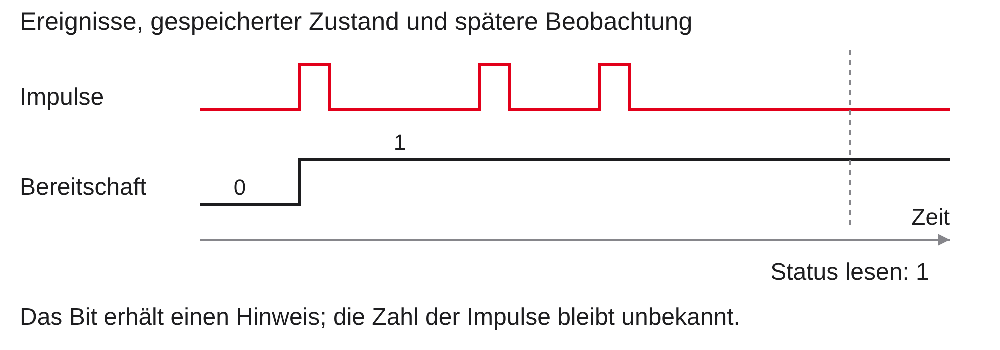
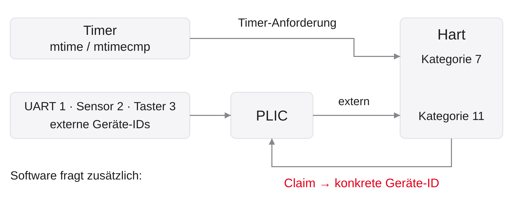
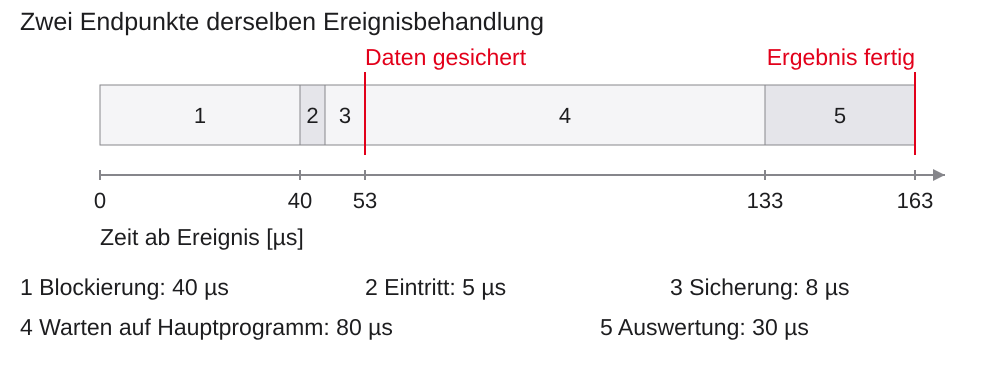

## Reicht ein schnellerer Prozessor?

Ein Messgerät rechnet gerade $4$ ms lang. Neue Sensordaten sollen
innerhalb von $100\,\mu$s aus dem Gerät gesichert werden.

- Würde ein doppelt so schneller Prozessor das Problem lösen?
- Woher weiß das Programm, dass Daten vorliegen?
- Was muss die Hardware bis zur Bearbeitung festhalten?

Zwei Minuten zu zweit: Vorschlag und fehlende Annahme nennen.

::: notes
Beginnen Sie mit der Diskussion, bevor Sie Interruptregister erklären. Die Studierenden kennen aus den bisherigen Einheiten Prozessor, Geräteadressen und unterschiedlich schnelle Speicherzugriffe. Sie sollen diese Kenntnisse anwenden und erkennen, welche Information für eine zeitliche Zusage noch fehlt. Die Zahlen beschreiben ein Lehrszenario, keine gemessene Plattform. Die Frist endet beim Sichern der Daten aus dem Gerät, nicht erst nach ihrer vollständigen Auswertung.

Eine Verdopplung der Rechengeschwindigkeit verkürzt die vier Millisekunden im idealisierten Fall auf zwei Millisekunden. Eine Abfrage erst nach dieser Rechnung käme im ungünstigen Fall weiterhin deutlich später als hundert Mikrosekunden. Ein schnellerer Cache beantwortet ebenfalls nicht, an welcher Programmstelle die nächste Abfrage stattfindet. Periodisches Prüfen, eine Unterbrechung oder eine hardwaregestützte Übernahme sind mögliche Vorschläge, deren Voraussetzungen erst untersucht werden müssen.

Fragen Sie nach dem genauen Ablauf: Bleiben Daten und Bereitschaft gespeichert? Kann die Rechnung unterbrochen werden? Was passiert bei einem zweiten Messwert? Sammeln Sie mehrere begründete Ansätze. Die endgültige Entscheidung wird am Ende erneut aufgegriffen. Der Einstieg soll vorhandene Vorstellungen sichtbar machen und keine noch unbekannten Registernamen verlangen.
:::

## Was sollen Sie entscheiden können?

- Ereignisbehandlung begründet auswählen
- Trap- und Gerätepfad vollständig erklären
- Timertermine trotz Verspätung planen
- Reaktionszeit und Datenübergabe prüfen

| Lernphase | Zweck |
|-----------|-------|
| Vorlesung | Zusammenhänge begründen |
| Übung | Neue Fälle auf Papier lösen |
| Quiz | Fehlvorstellungen erkennen |

::: notes
Das Ziel dieser Einheit ist ein verständlicher, begründbarer Entwurf für Zeit und Ereignisse in einem Mikrocomputersystem. Polling bedeutet regelmäßiges Abfragen, ein Interrupt ist eine asynchrone Unterbrechungsanforderung. Ein Trap ist der Eintritt in ihre Behandlung oder in die Behandlung einer synchronen Ausnahme. Diese Begriffe werden im Verlauf genauer eingeführt. Entscheidend ist die Fähigkeit, einen Ablauf mit seinen Voraussetzungen zu erklären und Fehler darin zu finden.

Die Vorlesung baut dafür ein gemeinsames Zustands- und Zeitmodell auf. Das Übungsblatt verändert Geräte, Zahlen und Ablaufspuren, damit die Studierenden das Modell übertragen. Das Quiz prüft anschließend besonders die Verwechslungen zwischen wartender Anforderung und Freigabe, Controllerübernahme und Gerätequittierung sowie mittlerer Auslastung und Reaktionsfrist. Ein richtiges Kreuz allein ersetzt dort nicht die begründete Auswertung.

Für das fünfte Semester ist diese Verbindung von Architektur, C-Programmierung und Systementwurf angemessen anspruchsvoll. Das Auswendiglernen einer vollständigen Registerkarte ist dafür nicht erforderlich. Der Hauptteil behandelt die notwendigen Zusammenhänge; vier ausdrücklich optionale Vertiefungsfolien nach dem Abschluss erklären ausgewählte Implementierungsdetails. Übung und Quiz setzen diese Vertiefungen nicht voraus.
:::

## Vorkenntnisse und Lehrmodell

- Aus Vorlesung 1–2: Geräteadressen, Speicherzugriffe und Cache-Kopien
- Aus der Programmierung: C-Zeiger, Bits und einfache Schleifen
- RV32: RISC-V mit $32$-Bit-Integerregistern
- Ein Hart im Machine Mode, ohne verschachtelte Interrupts

Geräteadressen und Timerfrequenzen sind plattformabhängig.

::: notes
Ein Hart ist ein Hardware-Ausführungskontext eines RISC-V-Prozessors. RV32 bezeichnet zweiunddreißig Bit breite Integerregister. Machine Mode ist die Maschinenprivilegstufe. Hauptprogramm und Unterbrechungsbehandlung laufen im Modell auf demselben Hart in dieser Stufe. Es gibt keine Weiterleitung an andere Privilegstufen und zunächst keine Verschachtelung: Eine laufende Interruptbehandlung wird nicht von einer weiteren der betrachteten Interruptanforderungen unterbrochen.

Die Gerätezugriffe knüpfen an Memory-Mapped Input/Output an, Ein- und Ausgabe über Geräteadressen aus Vorlesung 1. Caches aus Vorlesung 2 erklären Zugriffskosten, ersetzen aber weder eine Gerätebenachrichtigung noch die Eigenschaften eines Statusregisters. Lesen eines Geräts kann anders als Lesen eines Arrays einen Seiteneffekt besitzen.

Der Hauptteil verwendet einen klassischen lokalen Timer und einen externen Interruptcontroller. Deren Namen und Aufgaben werden erst bei Bedarf eingeführt. Die Beispiele sind ausdrücklich Lehrmodelle mit angegebenen Frequenzen und Zuständen. Eine konkrete Firmware benötigt zusätzlich die Plattformbeschreibung und geprüfte Gerätezugriffe. Es wird hier keine ausgeführte RISC-V-Firmware vorausgesetzt. So bleibt der Gedankengang ohne Kenntnisse späterer Vorlesungen oder einer bestimmten Laborplatine nachvollziehbar.
:::

## Vier Schulstunden: Ablauf

| Stunde | Gemeinsame Erarbeitung | Arbeitsphase |
|--------|------------------------|--------------|
| 1 | Ereignisse und Trap-Eintritt: $30$ min | Aufgabe 1: $15$ min |
| 2 | Ursachenauswahl und Gerätepfad: $30$ min | Aufgaben 2–3: $15$ min |
| 3 | Zeitquelle und Sollraster: $30$ min | Aufgabe 4: $15$ min |
| 4 | Reaktionszeit und Datenübergabe: $20$ min | Aufgaben 5–6: $10$ min; Quiz: $15$ min |

Die vier Vertiefungsfolien nach dem Abschluss gehören zur Selbstlektüre.

::: notes
Vier Schulstunden umfassen viermal fünfundvierzig, insgesamt hundertachtzig Unterrichtsminuten; Pausen kommen hinzu. Hundertzehn Minuten sind für Erklärung, Einstiegsdiskussion, kurze Denkfragen und gemeinsame Auswertung vorgesehen, fünfundfünfzig für angeleitete Aufgaben und fünfzehn für das Quiz. Die sechs Pflichtaufgaben beginnen ohne längere Einführung direkt mit neuen Situationen.

Die angeleitete Arbeitszeit dient ausgewählten Teilaufgaben und dem Vergleich der Lösungswege. Für die vollständige selbstständige Bearbeitung nennt das Übungsblatt weiterhin etwa sechzig bis fünfundsiebzig Minuten. Besonders in der letzten Stunde sind die Rechenansätze vorbereitet und werden an den neuen Werten kurz überprüft; offene Teilaufgaben können anschließend fertiggestellt werden.

Der Foliensatz umfasst fünfzig Folien, davon sechsundvierzig im Hauptteil. Die vier folgenden Vertiefungen sind Nachschlagematerial zu Gerätezugriffen, Verschachtelung und Controllerdetails. Sie füllen keine zusätzlich vorausgesetzte Unterrichtszeit und werden weder für die Pflichtaufgaben noch das Quiz benötigt. Bei langsamerem Diskussionsverlauf hat die nachvollziehbare Begründung Vorrang vor einer gleichmäßigen Minutenverteilung über die Folien.
:::

## Drei Schritte bis zur Reaktion

{fig-alt="Drei Ereignisimpulse treffen ein. Ein gespeichertes Bereitschaftsbit bleibt nach dem ersten auf eins. Die Software liest später nur diesen einen Zustand, nicht automatisch die Zahl drei."}

- Erfassen: Das Ereignis muss einen Zustand hinterlassen
- Benachrichtigen: Software muss davon erfahren
- Bearbeiten: Daten sichern und Ursache behandeln

::: notes
Die Abbildung zeigt oben drei kurze Ereignisimpulse entlang einer gemeinsamen Zeitachse. In der mittleren Bahn speichert die Hardware die Aussage „mindestens ein Ereignis ist eingetroffen“ in einem Bereitschaftsbit. Dieses Bit steigt beim ersten Ereignis auf eins und bleibt bis zur späteren Bearbeitung gesetzt. Weitere Impulse ändern den bereits gesetzten Wert nicht. Unten markiert der senkrechte Strich den Zeitpunkt, zu dem Software den Zustand liest. Die roten Markierungen verbinden Ereignis und gespeicherten Zustand; die Zeitachse besitzt keine konkrete Einheit, weil hier die Reihenfolge zählt.

Erfassen, Benachrichtigen und Bearbeiten sind verschiedene Aufgaben. Eine kurze Flanke ohne gespeicherten Zustand kann verschwinden, bevor Software sie bemerkt. Ein gespeichertes Bit kann später durch Polling, regelmäßiges Abfragen, oder über einen Interrupt, eine Unterbrechungsanforderung, Aufmerksamkeit erhalten. Keiner der beiden Wege rekonstruiert automatisch die Anzahl der drei Impulse.

Wenn alle Messwerte benötigt werden, muss ein geeigneter Datenpuffer oder ein anderes Erfassungsverfahren sie erhalten. Die spätere Softwarebehandlung kann nur das nutzen, was tatsächlich gespeichert wurde. Diese Trennung liefert das erste Kriterium für den Vergleich von Polling und Interrupts: Ein anderer Benachrichtigungsweg behebt nicht von selbst fehlende Ereignis- oder Datenspeicherung.
:::

## Polling: selbst nachfragen

- Polling: Gerätezustand per Software prüfen
- Busy Waiting: wiederholt prüfen und dabei warten
- Periodisches Polling: zwischen Abfragen andere Arbeit
- Kurze ungespeicherte Ereignisse können zwischen Abfragen verschwinden

::: notes
Polling bedeutet Abfragen. Software liest beispielsweise ein Statusregister eines Geräts und prüft, ob Daten bereitliegen. Busy Waiting, beschäftigtes Warten, ist eine enge Wiederholung dieser Prüfung ohne andere nützliche Arbeit. Periodisches Polling fragt dagegen nur gelegentlich nach und bearbeitet zwischenzeitlich andere Aufgaben.

Ein lesbares Gerätestatusregister stammt aus dem Konzept der Geräteadressen in Vorlesung 1. Es muss nicht dieselben Eigenschaften wie gewöhnlicher Arbeitsspeicher besitzen: Lesen kann Seiteneffekte haben. Für ein korrektes Programm sind die Gerätereigenschaften zu beachten.

Polling ist nicht grundsätzlich falsch. Bei einer dauerhaft sichtbaren Bereitschaft und tolerierbarer Verzögerung kann es einfach und passend sein. Ein kurzer Impuls, der weder im Gerät noch in weiterer Hardware gespeichert wird, kann dagegen zwischen zwei Prüfungen liegen und vollständig übersehen werden. Ein Interrupt ist ein anderer Benachrichtigungsweg, aber auch dort müssen Ereignisse erfasst und gegebenenfalls gespeichert werden. Die nächste Abbildung vergleicht ausdrücklich modellierte Reaktionswege, nicht pauschal Energieverbrauch oder Laufzeit.
:::

## Reaktionswege auf einer Zeitachse

{fig-alt="Ereignis bei 1,2 ms; periodisches Polling entdeckt es bei 2 ms, Interruptbehandlung beginnt im Modell bei 1,3 ms."}

- Periodische Abfrage: Modellwartezeit $0{,}8$ ms
- Interrupt: eigene Eintrittslatenz und Behandlungszeit

::: notes
Die gemeinsame horizontale Achse der Abbildung ist Zeit in Millisekunden. Die senkrechte rote Linie markiert das Ereignis bei $1{,}2$ ms. Die obere Bahn zeigt Dauer-Polling, das den Prozessor zum wiederholten Prüfen belegt. Die mittlere zeigt Abfragen bei null, eins und zwei Millisekunden. Unter der Annahme eines bis zur Behandlung gespeicherten Ereignisses entdeckt sie es bei zwei Millisekunden, also $2-1{,}2=0{,}8$ ms später.

Die untere Bahn zeigt ein getrenntes Interruptmodell. Main bezeichnet dort das Hauptprogramm. Nach einer angenommenen Eintrittslatenz von $0{,}1$ ms beginnt bei $1{,}3$ ms die ISR, Interrupt Service Routine, Unterbrechungsbehandlung. Im gezeichneten Beispiel endet sie nach weiteren $0{,}2$ ms; anschließend läuft das Hauptprogramm weiter. Diese Zeiten sind Lehrwerte. Die Eintrittslatenz ist nicht dieselbe Größe wie die Wartezeit auf das Ereignis.

Die Bahnen sind alternative Abläufe, keine gleichzeitig laufenden Prozessoren. Ein Interrupt kann durch Maskierung noch länger warten. Wird in seiner kurzen Behandlung nur Arbeit vorgemerkt, kommt bis zur eigentlichen Bearbeitung im Hauptprogramm eine weitere Verzögerung hinzu. Deshalb muss für jede Reaktionsanforderung der relevante Anfangs- und Endpunkt benannt werden.
:::

## Wie oft muss Polling nachfragen?

Lehrmodell: gespeicherter Status, alle $250\,\mu$s prüfen.
Eine Abfrage kostet $3\,\mu$s Prozessorzeit.

$$
W_{\max}=250\,\mu\mathrm{s},\qquad
U=\frac{3}{250}=1{,}2\,\%
$$

- $100\,\mu$s Erkennungsfrist sind damit nicht garantiert
- Kürzeres Intervall: weniger Wartezeit, mehr Abfrageaufwand
- Die größte tatsächliche Abfragelücke zählt

::: notes
$W_{\max}$ ist die größte Wartezeit vom gespeicherten Ereignis bis zur nächsten Statusbeobachtung. Das vereinfachte Modell setzt voraus, dass die Beobachtungszeitpunkte wirklich alle zweihundertfünfzig Mikrosekunden liegen. Trifft das Ereignis unmittelbar nach einer Beobachtung ein, wartet es nahezu ein volles Intervall. Die Nutzarbeit nach dem Erkennen ist dabei noch nicht enthalten. Eine Frist von hundert Mikrosekunden kann also schon bis zur Erkennung nicht zugesagt werden.

$U$ bezeichnet den mittleren Anteil der Prozessorzeit für die Abfragen. Jede Abfrage belegt drei Mikrosekunden, daher ergeben sich $3/250=0{,}012=1{,}2$ Prozent. Bei unverändertem Aufwand und einem Intervall von fünfzig Mikrosekunden wären es sechs Prozent. Beide Zahlen sind Lehrannahmen ohne Geräte- oder Compilermessung.

Eine durchschnittlich kurze Hauptschleife reicht als Nachweis nicht aus. Enthält sie gelegentlich eine vier Millisekunden lange Rechnung ohne Abfrage, ist diese längere Lücke maßgebend. Zusätzliche Verzögerungen und die eigentliche Datenübernahme müssen in eine vollständige Reaktionsrechnung eingehen. Die Aufgabe für den Systementwurf lautet daher: Ist die größte Abfragelücke bekannt und klein genug? Wenn nicht, kann ein Interrupt einen anderen Ausführungspfad eröffnen, dessen Verzögerungen ebenfalls geprüft werden müssen.
:::

## Gespeichert heißt nicht gezählt

Vor einer Behandlung treten drei Ereignisse ein.

| Hardwarezustand | Was kann Software daraus erkennen? |
|-----------------|------------------------------------|
| Ungespeicherter kurzer Impuls | später möglicherweise nichts |
| Ein Bereitschaftsbit | mindestens ein Ereignis |
| Ereigniszähler ohne Überlauf | Anzahl der Ereignisse |
| Ausreichend großer Datenpuffer | gespeicherte einzelne Daten |

Welche Information braucht das Messgerät aus dem Einstieg?

::: notes
Das gespeicherte Objekt muss zur Anforderung passen. Ein Bereitschaftsbit enthält nur zwei Zustände und kann die Anzahl drei nicht darstellen. Mehrfaches Setzen auf eins führt wieder zum Wert eins. Ein Ereigniszähler erhält die Anzahl nur innerhalb seiner Kapazität und bei geeigneter Erfassung. Ein Datenpuffer speichert zusätzlich die zugehörigen Werte, solange er nicht überläuft und seine Übergabe korrekt organisiert ist.

Im Einstiegsfall ist zunächst nur gefordert, neue Sensordaten rechtzeitig aus dem Gerät zu sichern. Ob jeder Messwert erhalten bleiben muss oder nur der jeweils neueste, ist noch offen. Diese fehlende Anforderung muss vor der Wahl von Flag, Zähler oder Puffer geklärt werden. Ein Flag ist eine einzelne Zustandsmarkierung; es genügt beispielsweise für „bitte den aktuellen Zustand neu auswerten“, aber nicht für „alle seitdem aufgenommenen Werte liefern“.

Ein Pending-Bit, eine wartende Interruptanforderung, ist ebenfalls kein unbegrenzter Ereignisspeicher. Auch bei einem Interrupt können mehrere Ereignisse vor der Behandlung zusammenfallen. Diese Folie vertieft deshalb die Erfassung, statt nur einen weiteren Registerbegriff einzuführen. Später wird dieselbe Frage bei der Übergabe von der Unterbrechungsbehandlung an das Hauptprogramm erneut gestellt.
:::

## Welche Strategie passt zum Ereignis?

| Situation | Zu prüfende Bedingung |
|-----------|----------------------|
| Bereitschaft bleibt sichtbar | zulässige Abfrageperiode |
| Kurzer Impuls | Erfassung oder Speicherung |
| Sehr viele Ereignisse | Behandlungsaufwand und Puffer |
| Feste Reaktionsfrist | gesamte Verzögerung |

::: notes
Die Tabelle ist eine Entscheidungshilfe, keine feste Zuordnung eines Geräts zu einer einzigen Programmiertechnik. Bleibt ein Zustand bis zur Bearbeitung sichtbar, kann Polling, regelmäßiges Abfragen, ihn finden. Die maximale Zeit bis zur nächsten Abfrage muss dann zur Reaktionsfrist passen. Ein kurzer Impuls erfordert dagegen eine Erfassung, etwa ein gespeichertes Statusbit oder einen passenden Eingang.

Auch ein Pending-Bit, eine Markierung für eine wartende Anforderung, ist noch keine beliebig lange Ereigniswarteschlange. Mehrere Ereignisse können zusammenfallen. Bei vielen eingehenden Daten braucht das Gerät oder die Software möglicherweise einen Puffer. Die Behandlung jedes einzelnen Ereignisses als Interrupt kann zusätzlich erheblichen Aufwand erzeugen.

Eine Reaktionsfrist ist eine späteste zulässige Zeit für die gewünschte Wirkung. Zu prüfen sind Erfassung, Wartezeit, Eintritt und Nutzarbeit. Der Vorteil einer ereignisgesteuerten Behandlung liegt darin, andere Arbeit zwischen Ereignissen zuzulassen; kurze Reaktion ist dennoch eine Eigenschaft des ganzen Ablaufs. Nun untersuchen wir, wie der Prozessor tatsächlich in eine Behandlung eintritt.
:::

## Interrupt, Exception und Trap

- Interrupt: asynchrone Anforderung, etwa vom Timer
- Exception: synchron zum ausgeführten Befehl, etwa ein ungültiger Befehl
- Trap: gemeinsamer Übergang in die Behandlung
- Gleicher Einsprungmechanismus bedeutet nicht gleiche Ursache

::: notes
Ein Interrupt entsteht unabhängig vom gerade ausgeführten Befehl, etwa weil die Hardware-Zeitquelle einen Vergleichswert erreicht hat. Eine Exception, Ausnahme, entsteht synchron aus der Befehlsausführung, beispielsweise wenn der Prozessor einen nicht unterstützten Befehl erkennt. Trap ist der Oberbegriff für den Übergang in die zuständige Behandlung.

Die beiden Fälle können denselben Eintrittsmechanismus und dieselben Register benutzen. Trotzdem müssen sie unterschieden werden. Nach einem Interrupt wird gewöhnlich die unterbrochene Ausführung fortgesetzt. Bei einer Exception muss die Software dagegen entscheiden, ob und wie der auslösende Fehler behoben wird. Eine Rückkehr ohne geeignete Behandlung kann denselben Fehler erneut auslösen.

Interruptfreigaben sperren im folgenden Modell die betrachteten maskierbaren Interrupts, nicht automatisch synchrone Exceptions. Wer global Interrupts deaktiviert, kann also weiterhin durch einen ungültigen Speicherzugriff oder Befehl einen Trap erzeugen. Diese Unterscheidung erklärt das zusätzliche Interrupt-Bit im Ursachenregister und begrenzt später die Aussage, während einer ISR könne nichts mehr dazwischenkommen.
:::

## Pending ist nicht Freigabe

Im betrachteten Machine Mode:

$$
\text{Interruptnahme}:\quad \text{Pending}\land\text{Quellenfreigabe}\land\mathrm{MIE}
$$

- `mip`: Machine Interrupt Pending
- `mie`: Machine Interrupt Enable, Kategorienfreigaben
- `mstatus.MIE`: globale Freigabe der betrachteten M-Interrupts

::: notes
Pending bedeutet, dass eine Unterbrechungsanforderung wartet. `mip`, Machine Interrupt Pending, zeigt solche Zustände für die Kategorien. `mie`, Machine Interrupt Enable, enthält deren einzelne Freigaben. Das MIE-Bit in `mstatus`, Machine Interrupt Enable im Statusregister, ist zusätzlich die globale Freigabe. Registername `mie` und Statusbit MIE sind daher zwei unterschiedliche Dinge.

Die Formel gilt für unser Modell: ein Hart, ein Hardware-Ausführungskontext, läuft bereits im Machine Mode ohne Delegation. Das logische Und, $\land$, verlangt alle drei Bedingungen. Ein pending Timer bei deaktivierter Timerfreigabe wird nicht genommen. Ein freigegebener Timer ohne Pending ebenfalls nicht. Ist MIE null, bleiben die betrachteten maskierbaren Maschinen-Interrupts trotz Pending zurückgestellt.

Das Sperren der Freigabe muss die Ursache nicht löschen. Nach Wiederfreigabe kann eine erhaltene Anforderung wirksam werden. Umgekehrt ist ein einziges Pending-Bit kein Zähler für alle während der Sperrzeit eingetroffenen Ereignisse. Synchrone Exceptions, Ausnahmen aus Befehlen, sind durch diese Formel nicht beschrieben. Die Trennung wird bei Timer und externen Geräten jeweils konkretisiert.
:::

## Welche Anforderung wird angenommen?

Ein Timer hat eine wartende Anforderung. Im Machine-Mode-Modell:

| Timerfreigabe MTIE | Globale Freigabe MIE | Timer-Trap möglich? |
|-------------------|---------------------|----------------------|
| $0$ | $0$ | ? |
| $0$ | $1$ | ? |
| $1$ | $0$ | ? |
| $1$ | $1$ | ? |

Was passiert beim Sperren mit Zeitquelle und Ursache?

::: notes
MTIE bedeutet Machine Timer Interrupt Enable, die Timerkategorienfreigabe. MIE bedeutet Machine Interrupt Enable, hier das globale Freigabebit in `mstatus`. Ein Trap ist der Eintritt in die Behandlung. Wir nehmen weiterhin an, dass das Programm bereits im Machine Mode läuft, keine Weiterleitung an andere Privilegstufen erfolgt und die Timeranforderung wartet.

Nur die letzte Zeile erlaubt den betrachteten Timer-Trap. Die anderen drei Kombinationen enthalten mindestens eine fehlende Freigabe. „Möglich“ sagt dabei nichts über eine garantierte Eintrittsdauer aus. Die Zeitquelle läuft durch das Sperren unverändert weiter. Ebenso löscht eine Freigabeänderung nicht automatisch die Ursache im Timer. Nach Wiederfreigabe kann sie deshalb weiterhin wirksam sein.

Lassen Sie die Tabelle zunächst ohne Registerbitnummern vervollständigen. Studierende sollen das logische Und der Bedingungen erklären können. Ein häufiges Fehlbild lautet „Interrupts aus bedeutet, die Zeit steht still“; ein anderes lautet „beim Einschalten kommen alle verpassten Ereignisse einzeln nach“. Beides folgt nicht aus einer Freigabe. Der Unterschied zwischen Zustand und Ereignisanzahl aus den vorherigen Folien bleibt bestehen. Aufgabe 2 überträgt diese Überlegung auf einen anderen Register- und Freigabezustand.
:::

## Kontext und spezielle Register

| Zustand | Bedeutung |
|---------|-----------|
| Allgemeine Register | laufende Werte und Adressen |
| `mepc` | gespeicherte Fortsetzungsadresse |
| `mcause` | Trap-Ursache |
| `mstatus` | Status und Interruptfreigaben |

CSR: Control and Status Register.

::: notes
Kontext bezeichnet den Zustand, der zum korrekten Fortsetzen einer Ausführung nötig ist. Dazu gehören allgemeine Register mit Zwischenergebnissen und Adressen sowie besondere Statusinformationen. CSR bedeutet Control and Status Register, Steuer- und Statusregister. Ein CSR wird durch dafür vorgesehene Prozessorbefehle angesprochen und ist nicht dasselbe wie ein Gerät an einer Speicheradresse.

`mepc` heißt Machine Exception Program Counter und speichert die Rückkehradresse eines Traps. PC steht für Program Counter, Befehlsadresszähler. `mcause`, Machine Cause, enthält die Ursache. `mstatus`, Machine Status, enthält unter anderem Interruptfreigaben. Das Präfix m kennzeichnet hier den Machine Mode, die Maschinenprivilegstufe.

Die Hardware aktualisiert beim Trap einige dieser speziellen Register. Sie sichert jedoch nicht automatisch sämtliche allgemeinen Register auf dem Softwarestack. Der Stack ist ein Speicherbereich für Aufruf- und Sicherungsrahmen. Benutzt der Handler Register der unterbrochenen Ausführung, müssen diese passend erhalten werden. Deshalb reicht ein Sprung zur richtigen Funktion noch nicht für einen vollständigen, korrekten Interruptpfad.
:::

## Trap-Eintritt: Hardware und Software

{fig-alt="Die Hardware sichert Rückkehradresse und Ursache, sperrt M-Interrupts; Software erhält weitere Register, behandelt die Ursache und kehrt mit mret zurück."}

- Hardwarezustand und Software-Sicherung ergänzen sich
- `mret` ersetzt keine Wiederherstellung allgemeiner Register

::: notes
Die Abbildung liest sich von links nach rechts als Ablauf. Vor dem Trap läuft das Hauptprogramm. Die Hardware schreibt die Fortsetzungsadresse nach `mepc`, Machine Exception Program Counter, und die Ursache nach `mcause`, Machine Cause. Sie kopiert das alte MIE-Bit, Machine Interrupt Enable, globale Maschinen-Interruptfreigabe, in MPIE, Machine Previous Interrupt Enable, und setzt MIE auf null. MPP, Machine Previous Privilege, hält die vorherige Privilegstufe; im Modell ist das Machine Mode.

Danach erhält die Software im Prolog, dem Eintrittsteil, die benötigten allgemeinen Register auf einem Stackrahmen. Der Handler bearbeitet die Ursache. Im Epilog, dem Austrittsteil, stellt die Software ihre Sicherungen wieder her. `mret`, Machine Return, verwendet `mepc` als Rückkehradresse und stellt unter anderem MIE aus MPIE sowie die vorherige Privilegstufe her.

Die Kästen unterscheiden Hardwareaktionen von Softwareaufgaben; die Pfeile zeigen zeitliche Reihenfolge, keine gemessenen Dauern. `mret` lädt nicht automatisch den Softwarestack. Fehlt eine Registerwiederherstellung, kann das Hauptprogramm mit falschen Werten weiterlaufen, obwohl die Rückkehradresse stimmt. Ein normaler Funktionsrücksprung ist ebenfalls kein Ersatz für die Trap-Rückkehr.
:::

## `mcause` auf RV32 lesen

$$
I=(\text{raw}\gg31)\mathbin{\&}1,\qquad
c=\text{raw}\mathbin{\&}\texttt{0x7FFFFFFF}
$$

| Rohwert | Interpretation |
|---------|----------------|
| `0x80000007` | Interrupt, Kategorie $7$ |
| `0x8000000B` | Interrupt, Kategorie $11$ |
| `0x00000002` | Exception, Code $2$ |

::: notes
`mcause`, Machine Cause, ist das Ursachenregister eines Traps. RV32 bedeutet zweiunddreißig Bit breite Integerregister. Das höchste Bit, Bit einunddreißig, unterscheidet einen Interrupt von einer Exception. Der Rohwert raw ist der vollständige Registerinhalt. Die Rechtsverschiebung $\gg31$ und bitweises Und $\&1$ gewinnen das Interrupt-Bit $I$. Die Maske `0x7FFFFFFF` entfernt es; $c$ ist der verbleibende Ursachencode. Hexadezimale Werte tragen `0x`.

`0x80000007` hat $I=1$ und $c=7$, Machine Timer Interrupt. `0x8000000B` hat $I=1$ und $c=11$, Machine External Interrupt, externe Kategorie. `0x00000002` hat $I=0$ und $c=2$, Illegal Instruction, ungültiger Befehl. Der Begriff Exception Code in der Spezifikation benennt das Codefeld auch dann, wenn das Interrupt-Bit gesetzt ist.

Eine Geräte-ID wird daraus nicht gewonnen. Auch ein Timer und eine externe Quelle mit zufällig gleicher Zahlen-ID wären verschiedene Ebenen. Wer nur die niedrigen Bits vergleicht, ohne Interrupt und Exception zu unterscheiden, kann die falsche Behandlung wählen. Die nächste Folie zeigt daher die zweite Identifikationsebene.
:::

## Kategorie ist nicht Geräte-ID

{fig-alt="Der lokale Timer meldet dem Hart Kategorie sieben. Drei externe Geräte laufen über den PLIC und teilen Kategorie elf. Erst ein Claim liefert ihre konkrete Geräte-ID."}

- `mcause`: Welche Art von Trap liegt vor?
- PLIC-Claim: Welches externe Gerät wurde übernommen?

::: notes
Die Abbildung trennt oben den lokalen Timerpfad und unten den externen Gerätepfad. Ein Hart ist der Hardware-Ausführungskontext. `mtime`, Machine Time, und `mtimecmp`, Machine Time Compare, erzeugen im oberen Pfad die Timerbedingung mit Ursachencode sieben. PLIC bedeutet Platform-Level Interrupt Controller. Er sammelt unten Anforderungen von UART, Sensor und Taster. UART steht für Universal Asynchronous Receiver/Transmitter, eine serielle Schnittstelle, deren Übertragungsdetails erst später behandelt werden.

Die drei externen Quellen besitzen eigene Geräte-IDs, Identifikationsnummern eins, zwei und drei. Sie teilen sich auf dem Weg zum Hart aber den externen Ursachencode elf. `mcause`, Machine Cause, benennt diese Kategorie und noch nicht das einzelne Gerät. Erst Claim, ein Übernahmezugriff beim Controller, liefert dessen konkrete ID. Die untere Verbindung in der Abbildung zeigt diesen zusätzlichen Zugriff der Software auf den Controller.

Die Pfeile beschreiben unterschiedliche Informationswege, keine gemessenen Latenzen. Eine externe Geräte-ID sieben wäre weiterhin eine externe Quelle und würde nicht zum lokalen Timer mit Kategorie sieben. Die Zahlen gehören zu verschiedenen Namensräumen. Die Trennung genügt für den Hauptteil; zusätzliche lokale Softwareinterrupts sind für diese beiden Behandlungswege nicht erforderlich.
:::

## Direct und Vectored: nur der erste Einsprung

| Modus | Eintrittsadresse |
|-------|------------------|
| Direct | BASE für alle Traps |
| Vectored, Interrupt | $\mathrm{BASE}+4c$ |
| Vectored, Exception | BASE |

$c$: Cause-Code ohne Interrupt-Bit; Konfiguration über `mtvec`.

Beispiel: BASE `0x80000100`, Timer-Code $7$ → `0x8000011C`.

Externe Geräte brauchen in beiden Modi weiterhin eine Geräteauswahl.

::: notes
`mtvec` bedeutet Machine Trap-Vector Base Address, das Register für Basis und Einsprungmodus der Maschinen-Traps. Direct führt alle betrachteten Traps zuerst zur Basisadresse BASE. Ein gemeinsamer Dispatcher, eine Verzweigung nach der Ursache, wählt dort den zuständigen Pfad. Er kann danach ebenso eine Geräte-ID verwenden wie ein vektorisierter Eintritt; Direct erzwingt keine lineare Suche durch sämtliche Geräte.

Vectored addiert bei Interrupts vier Byte mal Cause-Code $c$ zur Basis. Der Code enthält nicht das höchste Interrupt-Bit aus `mcause`, Machine Cause. Beim Timer ergibt sich $4\cdot7=28=\texttt{0x1C}$ Byte und damit `0x8000011C`. Eine Exception, synchrone Ausnahme aus einem Befehl, geht auch in diesem Modus zur Basis. Der Kategorienplatz enthält einen ausführbaren Befehl, keinen automatisch geladenen Funktionszeiger.

Die gemeinsame externe Kategorie wird durch Vectored nicht in einzelne Geräte aufgeteilt. Der PLIC, Platform-Level Interrupt Controller, liefert diese Auswahl weiterhin per Claim. Für den Hauptteil genügt dieser Vergleich mit einer kleinen Adressrechnung. Bitkodierung, Linkerplatzierung, Assemblerdirektiven und Sprungreichweiten einer vollständigen Tabelle sind keine zusätzlichen Pflichtlernziele. Der Modus allein belegt auch keine feste Reaktionszeit.
:::

## Den Trap-Pfad in eigenen Worten erklären

RV32: `mcause = 0x8000000B`, später liefert Claim die ID $2$.

1. Welche Information liefert jeweils der erste und der zweite Wert?
2. Was hat die Hardware beim Eintritt bereits gesichert?
3. Was muss Software vor der Fortsetzung erledigen?

Verwenden Sie die Begriffe Ursache, Kontext und Gerätebearbeitung.

::: notes
RV32 bezeichnet zweiunddreißig Bit breite Integerregister. `mcause`, Machine Cause, enthält hier im höchsten Bit eins und im Codefeld elf. Es ist also ein Interrupt der externen Maschinenkategorie. Die Zahl zwei stammt erst aus Claim, dem Übernahmezugriff beim PLIC, Platform-Level Interrupt Controller, und bezeichnet die externe Gerätequelle. Die beiden Zahlen sind keine alternative Schreibweise desselben Werts.

Beim Trap-Eintritt hat die Hardware unter anderem die Fortsetzungsadresse in `mepc`, Machine Exception Program Counter, und die Ursache in `mcause` festgehalten sowie die globale Maschinen-Interruptfreigabe gesperrt und ihren vorherigen Zustand erhalten. Allgemeine Register, in denen das Hauptprogramm noch benötigte Werte hält, sind dadurch nicht automatisch auf dem Stack gesichert. Kontext bedeutet der zur Fortsetzung benötigte Zustand.

Die Software muss ihre benötigten Register erhalten, den übernommenen Gerätepfad vollständig bearbeiten und den Controllerabschluss durchführen. Anschließend stellt sie den Softwarekontext wieder her und kehrt mit `mret`, Machine Return, anhand des Trap-Zustands zurück. Lassen Sie die Erklärung als zusammenhängenden Weg formulieren. Eine bloße Liste aus drei Registern zeigt weniger Verständnis als die Begründung, warum die Fortsetzung sonst beschädigt würde. Der nächste Abschnitt öffnet dazu die noch fehlende Gerätebearbeitung.
:::

## Der PLIC verbindet Geräte mit einem Kontext

{fig-alt="Drei externe Geräte speisen den PLIC; Pending, Priorität und Kontextfreigabe bestimmen die Benachrichtigung an einen Hart."}

- Quellen haben Geräte-IDs und Prioritäten
- Ein Kontext gehört zu Hart und Privilegstufe
- Globale Ursache im Lehrmodell: Machine External, Code $11$

::: notes
PLIC heißt Platform-Level Interrupt Controller, Plattform-Interrupt-Controller. Er nimmt Anforderungen externer Geräte über Gateways, Quellanbindungen, an. Das Modell verwendet UART als Quelle eins, einen Sensor als Quelle zwei und einen Taster als Quelle drei. UART heißt Universal Asynchronous Receiver/Transmitter, serielle Sende- und Empfangsschnittstelle; Einzelheiten der Busse sind hier nicht nötig.

Jede Quelle besitzt eine Identifikationsnummer, Geräte-ID, und eine Priorität. Der PLIC verwaltet ihre Pending-Zustände, wartende Anforderungen. Ein Kontext ist ein Ziel mit Zuordnung zu einem Hart, Hardware-Ausführungskontext, und einer Privilegstufe. Es ist daher präziser als die pauschale Bezeichnung „Kern“. Für diesen Kontext existieren Quellenfreigaben und ein Schwellenwert.

Die Abbildung zeigt das Sammeln und Weiterleiten von links nach rechts. Sie ist keine konkrete Memory Map und keine Zeitmessung. Der Machine-Mode-Kontext, die Maschinenprivilegstufe im Zielhart, meldet dem Hart die Kategorie Machine External Interrupt, Ursachencode elf. Die Geräte-ID erhält die Software erst bei Claim, dem Abholen einer Quelle. Zunächst betrachten wir die Regeln, die eine Benachrichtigung zulassen.
:::

## Welche externe Quelle kommt zuerst?

Alle Quellen warten und sind freigegeben. Der Schwellenwert ist $0$.

| Geräte-ID | Quelle | Priorität |
|-----------|--------|-----------|
| $1$ | UART | $3$ |
| $2$ | Sensor | $7$ |
| $3$ | Taster | $7$ |

- Höhere Priorität zuerst, bei Gleichstand kleinere ID
- Priorität $0$ wäre unwirksam
- Bestimmen Sie die Reihenfolge ohne neue Ereignisse

::: notes
PLIC bedeutet Platform-Level Interrupt Controller. UART steht für Universal Asynchronous Receiver/Transmitter, eine serielle Schnittstelle. Die Identifikationsnummern in der Tabelle sind Geräte-IDs; die Priorität ist eine getrennt eingestellte Rangordnung. Alle Quellen sind pending, wartend, und für unseren einen Kontext enabled, freigegeben. Sein Schwellenwert bleibt im Hauptteil null, sodass alle angegebenen positiven Prioritäten zur Benachrichtigung beitragen können.

Zuerst wird Quelle zwei übernommen: Sie hat dieselbe höchste Priorität sieben wie Quelle drei, aber die kleinere ID. Nach vollständiger Behandlung von zwei folgt drei und anschließend eins mit Priorität drei. Die Reihenfolge lautet daher zwei, drei, eins. Vorausgesetzt sind keine neuen Ereignisse, korrekte Gerätebearbeitung und der jeweilige Controllerabschluss.

Die höhere Priorität verkürzt nicht die Dauer einer bereits laufenden, nicht verschachtelten Unterbrechungsbehandlung. Sie entscheidet die Auswahl unter wartenden externen Quellen. Diese Begrenzung ist für die Reaktionszeit wichtiger als zusätzliche Registerbitnummern. Einen veränderten Schwellenwert und den Sonderfall eines bewusst außerhalb der Benachrichtigung ausgeführten Claim behandelt erst die optionale Vertiefung. Die Pflichtübung verwendet ebenfalls den festen Schwellenwert null.
:::

## Claim ist ein Zugriff mit Seiteneffekt

- Liefert die höchstpriorisierte claimbare Geräte-ID
- Löscht atomar das zugehörige PLIC-Pending
- ID $0$: keine claimbare Quelle; kein Handler und kein Complete
- Die Ursache im Gerät ist dadurch noch nicht bearbeitet

::: notes
Claim ist der Übernahmezugriff beim PLIC, Platform-Level Interrupt Controller. Er wird typischerweise durch Lesen eines kontextbezogenen MMIO-Registers ausgelöst. MMIO bedeutet Memory-Mapped Input/Output, Gerätezugriff über Speicheradressen. Anders als ein normales Lesen einer C-Variablen besitzt dieser Zugriff einen Seiteneffekt: Der Controller liefert die ID der gewählten Quelle und löscht deren Pending, Wartemarkierung, atomar.

Atomar bedeutet hier, dass Übernahme und zugehörige Pending-Änderung nicht als getrennte konkurrierende Schritte beobachtet werden. Wenn mehrere Harts, Hardware-Ausführungskontexte, dieselbe Quelle beanspruchen, kann derselbe wartende Vorgang nicht gleichzeitig zweimal übernommen werden. Andere wartende Quellen bleiben jedoch claimbar. Eine gelesene ID null bedeutet keine Quelle und darf weder für einen Gerätehandler noch ein Complete verwendet werden.

Der Claim liest nicht automatisch die Nutzdaten eines UART, einer seriellen Schnittstelle, und löscht nicht zwangsläufig dessen Statusursache. Ein Debugger oder Diagnoseausdruck, der das Claim-Register noch einmal liest, kann also eine weitere Quelle abholen. Software sollte den gelesenen Wert speichern und denselben Wert später für die passende Abschlussmeldung verwenden.
:::

## Claim, Gerät bearbeiten, Complete

{fig-alt="Gerät meldet eine Ursache, PLIC setzt Pending, Software übernimmt per Claim, bearbeitet die Geräteursache und sendet Complete derselben ID."}

Claim und Complete betreffen den Controller; Gerätequittierung ist ein eigener Schritt.

::: notes
Die Abbildung zeigt den normalen Lebenszyklus einer externen Anforderung. Zuerst meldet das Gerät eine Ursache an sein Gateway, die Quellanbindung. Der PLIC, Platform-Level Interrupt Controller, hält sie als Pending, wartend, und benachrichtigt den Hart, Hardware-Ausführungskontext. Die Software übernimmt eine Geräte-ID per Claim, Abholen, wodurch deren PLIC-Pending gelöscht wird.

Danach bearbeitet sie die tatsächliche Ursache im Gerät. Beim UART, Universal Asynchronous Receiver/Transmitter, kann dazu etwa das nach Gerätebeschreibung nötige Lesen empfangener Daten gehören. Diese konkrete Geräteaktion wird hier nicht als universelles Registerrezept erfunden. Anschließend schreibt Software dieselbe geclaimte ID als Complete, Abschlussmeldung, zurück.

Das Gateway darf danach wieder Anforderungen dieser Quelle weiterreichen. Die Pfeile stellen die Reihenfolge der Verantwortlichkeiten dar, nicht garantierte Taktdauern. Ein Complete ersetzt das Bearbeiten einer Geräteursache ebenso wenig wie ein Claim. Auch ein Funktionsrücksprung aus dem Handler informiert den PLIC nicht automatisch über den Abschluss. Die nächste Folie zeigt, wie eine weiterhin aktive Leitung eine neue Anforderung auslösen kann.
:::

## Level-Ursache bleibt aktiv

1. Ein Gerät hält seine Anforderungsleitung aktiv
2. Claim entfernt das PLIC-Pending
3. Software meldet Complete, ohne die Geräteursache zu beseitigen
4. Das Gateway kann erneut Pending melden

Priorität erhöhen behebt die Geräteursache nicht.

::: notes
Eine Level-Anforderung bleibt als aktiver Leitungszustand bestehen, solange ihre Ursache vorhanden ist. Eine Edge-Anforderung beruht dagegen auf einer Flanke; Erfassung und Speicherung hängen von Gerät und Gateway ab. PLIC heißt Platform-Level Interrupt Controller. Für das gezeigte Level-Modell nimmt ein Claim, Übernahme, die wartende Controlleranforderung zunächst heraus.

Wird das Gerät nicht passend bedient oder quittiert, bleibt die Leitung aktiv. Complete, Abschluss der übernommenen ID, macht die Quellanbindung wieder aufnahmebereit. Sie kann die aktive Ursache erneut an den PLIC weitergeben. Das führt zu wiederholten Handler-Eintritten, obwohl das vorherige Claim formal korrekt war.

Das ist kein Fehler, den eine höhere Priorität, ein anderer Vektorplatz oder allein `mret`, Trap-Rückkehr, beseitigt. Die zuständige Gerätelogik muss behandelt werden. Ein Pending-Bit ist zugleich kein unbegrenzter Speicher für sämtliche Flanken. Ein Puffer im Gerät und die Controllerwartemarkierung erfüllen verschiedene Aufgaben. Die Folie begründet, warum eine externe Behandlung die Gerätebeschreibung benötigt und auf kurze, aber vollständige Bearbeitung zielen soll.
:::

## Normaler externer Behandlungspfad

Pseudocode für bekannte, konfigurierte Quellen:

```text
id = einmal Claim lesen
wenn id = 0: keine Gerätebearbeitung
sonst:
    Daten / Status des Geräts id bearbeiten
    Geräteursache nach Gerätebeschreibung quittieren
    dieselbe id als Complete schreiben
Kontext wiederherstellen und Trap-Rückkehr
```

::: notes
`id` ist die Identifikationsnummer einer externen Gerätequelle. Claim, der Übernahmezugriff beim PLIC, Platform-Level Interrupt Controller, wird einmal gelesen und gespeichert. Eine zweite diagnostische Lesung wäre kein bloßer Blick auf denselben Wert, sondern könnte eine weitere Quelle übernehmen. Liefert der Zugriff null, entfällt die Gerätebearbeitung und es wird keine Complete-Meldung für null geschrieben.

Bei einer bekannten Quelle erfolgen Datenübernahme und Quittierung nach ihrer Gerätebeschreibung. Quittieren bedeutet, die behandelte Ursache passend zurückzunehmen; ein allgemeingültiges Registerrezept gibt es dafür nicht. Complete schließt danach genau die zuvor übernommene ID beim Controller ab. Die Software stellt ihren Kontext wieder her und führt die Trap-Rückkehr mit `mret`, Machine Return, aus.

Der Pseudocode setzt eine passende Initialisierung und einen korrekten Ein- und Austritt voraus. Er ist ein Ablaufmodell, kein fertiger Treiber. Unerwartete Quellen brauchen in realer Software eine definierte Fehlerbehandlung. Für die Pflichtaufgaben sind Quellen bekannt und freigegeben. Lassen Sie zu jeder Zeile den Fehler benennen, der beim Weglassen entsteht: fehlende Daten, erneut aktive Ursache, blockierter Controllerabschluss oder beschädigte Fortsetzung. So wird aus einer Befehlsfolge eine begründete Behandlungskette.
:::

## Hohe Priorität unterbricht nicht automatisch

Während einer ISR ist die globale Freigabe MIE im Grundmodell $0$.

- Eine weitere Anforderung kann trotzdem entstehen und warten
- PLIC-Priorität ordnet wartende externe Quellen
- Sie unterbricht die laufende ISR nicht von selbst
- Lange ISR verlängern deshalb mögliche Wartezeiten

Unser Hauptmodell bleibt kurz und nicht verschachtelt.

::: notes
ISR bedeutet Interrupt Service Routine, Unterbrechungsbehandlung. MIE ist Machine Interrupt Enable, die globale Freigabe im Maschinenstatus. Die Hardware setzt sie beim Trap-Eintritt auf null. Eine weitere maskierbare Maschinen-Interruptanforderung kann währenddessen entstehen, wird im Grundmodell aber nicht als neuer Interrupt-Trap angenommen. Die Ursache oder ihr gespeicherter Hinweis kann weiter warten.

PLIC heißt Platform-Level Interrupt Controller. Seine Quellenpriorität bestimmt, welche externe Quelle als Nächstes übernommen wird. Sie ist keine Anweisung, eine bereits laufende ISR sofort zu unterbrechen. Eine höher priorisierte Quelle kann deshalb durch die Restdauer einer niedrigeren Behandlung aufgehalten werden. Auch der Timer gewinnt nicht allein durch seine lokale Anbindung automatisch Vorrang.

Software könnte Interrupts während einer Behandlung wieder freigeben. Damit entstehen jedoch zusätzliche Anforderungen an gesicherten Zustand, Auswahlregeln und Stackverbrauch. Das ist eine eigene Entwurfsentscheidung und wird in der optionalen Vertiefung eingegrenzt. Für den Hauptteil ist die belastbarere erste Maßnahme, die unmittelbare Gerätebehandlung kurz zu halten und längere Auswertung passend aufzuschieben. Die nächste Frage lautet, wie überhaupt eine zeitliche Anforderung entsteht, wenn kein externes Gerät sie liefert.
:::

## `mtime` ist die Zeitquelle

- Machine Time: $64$-Bit-Zähler, auch auf RV32
- Frequenz der Zeitquelle von der Plattform bestimmen
- Kein notwendiger Gleichlauf mit dem Prozessortakt
- Zeit seit Start: Differenz zum gespeicherten Startwert

::: notes
`mtime` heißt Machine Time und ist ein vierundsechzig Bit breiter Zähler der Plattformzeit. RV32, die Variante mit zweiunddreißig Bit breiten Integerregistern, verkürzt seine Registerbreite nicht. Der Zähler schreitet mit einer von der Plattform angegebenen konstanten Frequenz fort und kann bei Überlauf umlaufen. Er ist nicht automatisch ein Zähler seit dem Start dieses C-Programms.

Ein Programm kann einen Startwert $t_0$ speichern und vergangene Ticks durch eine Differenz zu `mtime` bestimmen. Ein Tick bedeutet hier einen Zählschritt der Hardware-Zeitquelle; derselbe Ausdruck wird später auch für periodische Softwaretermine benutzt. Wir unterscheiden diese Bedeutungen ausdrücklich.

`mtime` wird hier über MMIO, Memory-Mapped Input/Output, Ein- und Ausgabe durch Geräteadressen, erreicht. Die Gerätezugriffe werden durch eine zur Plattform passende Funktion gekapselt. Wie ein vierundsechzig Bit breiter Wert auf RV32 konsistent gelesen wird, ist eine Implementierungsfrage der optionalen Vertiefung. Ein variabler Prozessortakt muss nicht dieselbe Frequenz wie die Zeitquelle haben, weshalb deren Einheit separat festgelegt wird.
:::

## Timer-Ticks sind keine Prozessorzyklen

Lehrannahmen: Timer $f_T=10$ MHz, Prozessor $f_C=100$ MHz.

$$
\Delta=f_T\cdot1\,\mathrm{ms}=10000\ \text{Timer-Ticks}
$$

| Größe für $1$ ms | Anzahl |
|------------------|--------|
| Timer-Ticks | $10000$ |
| Prozessorzyklen | $100000$ |

Eine Änderung des Prozessortakts ändert die vorgegebene Timerfrequenz nicht.

::: notes
$f_T$ ist die Frequenz der Hardware-Zeitquelle, $f_C$ die Prozessorfrequenz. MHz bedeutet Megahertz, eine Million Schritte beziehungsweise Taktperioden pro Sekunde. Ein Timer-Tick ist ein Zählschritt der Zeitquelle. Bei zehn Megahertz dauert er $0{,}1$ Mikrosekunden. Für eine Millisekunde benötigen wir $10^7\,\mathrm{s}^{-1}\cdot10^{-3}\,\mathrm{s}=10000$ Timer-Ticks. $\Delta$ bezeichnet diese Intervalllänge im Zählermaß.

Der Prozessor mit hundert Megahertz durchläuft in derselben Millisekunde hunderttausend Taktperioden. Das bedeutet nicht automatisch hunderttausend fertig ausgeführte Befehle: Speicherzugriffe und andere Ausführungseigenschaften können mehrere Zyklen beanspruchen. Die Tabelle trennt nur die beiden Frequenzeinheiten.

Würde die Prozessorfrequenz auf fünfzig Megahertz sinken, blieben unter der vorgegebenen unabhängigen Zeitquelle zehntausend Timer-Ticks pro Millisekunde richtig. Eine aus Prozessorzyklen geschätzte Warteschleife hätte dagegen andere Voraussetzungen. Für die umgekehrte Umrechnung gilt $t=n/f_T$, mit Tickzahl $n$ und Zeit $t$ in Sekunden. Die Pflichtübung verändert Frequenz und Zielintervall, damit die Einheitenumrechnung selbst durchgeführt wird. Ein zusätzliches Überlaufbeispiel mit einer plötzlich anderen Tickfrequenz ist für diese Unterscheidung nicht nötig.
:::

## Vergleich und Freigaben des Timers

{fig-alt="mtime größer oder gleich mtimecmp erzeugt die Timeranforderung; MTIE und globale MIE-Freigabe erlauben im Modell den Trap."}

`mtimecmp` muss für den nächsten Termin in der Zukunft liegen.

::: notes
`mtimecmp` heißt Machine Time Compare, Vergleichswert der Maschinenzeit. Er ist wie `mtime`, Machine Time, vierundsechzig Bit breit. Die Hardware betrachtet beide Werte vorzeichenlos und setzt die Timeranforderung, sobald `mtime` größer oder gleich `mtimecmp` ist. Die Abbildung liest sich vom Vergleich über die Freigaben zum Trap.

MTIP bedeutet Machine Timer Interrupt Pending, wartender Maschinen-Timerinterrupt im Register `mip`. MTIE bedeutet Machine Timer Interrupt Enable und ist die Timerfreigabe in `mie`. MIE bedeutet Machine Interrupt Enable, globale Freigabe in `mstatus`. Im Modell mit bereits laufendem Machine Mode müssen Pending, MTIE und MIE zusammen wirksam sein. Die Kästen zeigen getrennte logische Bedingungen, keine Verzögerungen.

Ein Vergleichswert hundert bei aktuellem Zählerstand hundert ist schon fällig. Ein neuer Termin muss daher größer als die aktuelle Zeit sein, wenn die Bedingung wieder falsch werden soll. Ein Interrupt ist hier keine kurze einzelne Flanke des Vergleichers; die Anforderung bleibt grundsätzlich bestehen, bis die Bedingung beseitigt ist. Das erklärt die nötige Aktion im Handler.
:::

## Rückkehr ist keine Timerquittierung

Bei Eintritt gilt `mtime` $\geq$ `mtimecmp`.

- `mret` stellt den Trap-Rückkehrzustand her
- Es setzt den Vergleichswert nicht automatisch weiter
- Der nächste Termin muss strikt in der Zukunft liegen

Was passiert bei Rückkehr mit unverändertem Vergleich und wirksamen Freigaben?

::: notes
`mtime`, Machine Time, ist die Zeitquelle und `mtimecmp`, Machine Time Compare, ihr Vergleichswert. Die Timerbedingung bleibt wahr, solange die vorzeichenlos gelesene Zeit mindestens den Vergleich erreicht hat. `mret`, Machine Return, stellt den Trap-Rückkehrzustand einschließlich der vorherigen globalen Freigabe her. Es verändert jedoch nicht den Vergleichswert.

Bei unveränderter fälliger Bedingung und wirksamen Freigaben kann deshalb unmittelbar eine weitere Timerbehandlung folgen. Nur eine Softwarevariable zu erhöhen oder aus einer C-Funktion zurückzukehren behebt die Hardwarebedingung nicht. Die geeignete Aktion ist, einen neuen Vergleichstermin zu schreiben, der beim betrachteten Zeitstand tatsächlich noch in der Zukunft liegt. Gleichheit ist bereits fällig.

Die Anzeige der zurückgenommenen Timeranforderung muss eine Vergleichsänderung auf realen Plattformen nicht verzögerungsfrei widerspiegeln. Der Behandlungspfad sollte daher auch einen Eintritt verkraften, bei dem der nächste Solltermin noch nicht erreicht ist. Das ist ein Grund, die aktuelle Zeit zu lesen und nicht jeden Handler-Aufruf als eine verstrichene Periode zu zählen. Die Feinheit gehört zur Erklärung eines robusten Ablaufs, nicht zu einer zusätzlichen auswendig zu lernenden Registersequenz. Die folgende Initialisierungsfolge und die spätere Planungsfunktion berücksichtigen diese Trennung.
:::

## Erst vorbereiten, zuletzt freigeben

1. Gültigen Stack und Trap-Eintritt sicherstellen
2. Globale Interruptfreigabe zunächst gesperrt halten
3. Zeit lesen, ersten Zukunftstermin nach `mtimecmp` schreiben
4. Timerkategorie freigeben: `mie.MTIE`
5. Globale Freigabe setzen: `mstatus.MIE`

::: notes
Die Reihenfolge verhindert einen Eintritt in unvorbereitete Software. Der Stack ist der Speicherbereich für Sicherungsrahmen; der Stackzeiger muss bereits gültig sein. `mtvec`, Machine Trap-Vector Base Address, muss auf einen geeigneten Trap-Eintritt zeigen. Die Freigabe MIE, Machine Interrupt Enable in `mstatus`, bleibt bis zum Abschluss dieser Vorbereitungen aus.

Bei zehn Megahertz Zeitquellenfrequenz wird etwa ein erster Termin als aktuell gelesene Zeit plus zehntausend Timer-Ticks für eine Millisekunde gewählt. `mtimecmp`, Machine Time Compare, erhält diesen Wert durch eine zur Plattform passende Zugriffsfunktion. Erst danach werden MTIE, Machine Timer Interrupt Enable, die Timerkategorienfreigabe in `mie`, und MIE, Machine Interrupt Enable, die globale Freigabe in `mstatus`, gesetzt. Andere Registerfelder müssen dabei erhalten bleiben. Die Bitnummern sind bei einer konkreten Implementierung nachzuschlagen; der begründete Ablauf ist das Lernziel.

Die Folie ist eine Initialisierungsreihenfolge, kein vollständiges Bootprogramm. Plattformzustand, Geräteordnung und Abbruchfälle bleiben Aufgaben der konkreten Implementierung. Wenn die Vorbereitung länger als das gewählte Intervall dauert, kann der Termin bei Freigabe bereits fällig sein; entscheidend ist, dass dann ein gültiger Handler existiert. Die spätere periodische Planung benötigt außerdem eine Entscheidung, ob der nächste Termin relativ zur tatsächlichen Bearbeitung oder zu einem Sollraster liegt.
:::

## Periodisch planen: Sollraster oder neue Wartezeit?

{fig-alt="Ein Termin bei 10 ms wird erst bei 10,2 ms bedient; now plus 1 ms verschiebt auf 11,2 ms, das absolute Raster bleibt bei 11 ms."}

- Relativ: nächster Termin aus der Bearbeitungszeit
- Absolut: nächster Termin aus dem bisherigen Sollwert

::: notes
Die Zeitachse zeigt einen Solltermin bei zehn Millisekunden und einen verspäteten Handler-Eintritt bei $10{,}2$ ms. Rot kennzeichnet diese Verzögerung. Mit einem Millisekundenintervall ergibt die relative Planung `now + interval` einen nächsten Termin bei $11{,}2$ ms. Die Eintrittsverspätung wird damit in die Phase des Zeitrasters übernommen.

Eine absolute Planung addiert das Intervall zum bisherigen Solltermin: zehn plus eins ergibt elf Millisekunden. Die Verzögerung der aktuellen Bearbeitung verschiebt dann nicht automatisch alle späteren Solltermine. Die Intervalle sind hier in der Abbildung in Zeit dargestellt; die Software speichert die entsprechenden Timer-Ticks. `now` bedeutet aktuell gelesene Zeit, `interval` das gewünschte Intervall.

Beide Strategien können sinnvoll sein. Eine neue Wartezeit nach Abschluss einer Aktion ist ein anderes Ziel als ein festes periodisches Raster. Ein System-Tick ist ein Softwarekonzept für wiederkehrende Termine und kein universell vorgeschriebener Betriebssystemmechanismus. Das absolute Raster verhindert nicht, dass Software zu spät reagiert. Wenn bereits mehrere Termine vergangen sind, reicht das einmalige Addieren eines Intervalls nicht mehr, um den Vergleich in die Zukunft zu bringen.
:::

## Mehrere Termine sind bereits fällig

Sollraster mit Periode $\Delta=1$ ms, nächster Termin $d=10$ ms, Zeit $n=15{,}3$ ms.

$$
k=\left\lfloor\frac{n-d}{\Delta}\right\rfloor+1=6,\qquad
d'=d+k\Delta=16\ \mathrm{ms}
$$

Ein Handler-Aufruf bedeutet hier sechs fällige Solltermine.

::: notes
$d$ ist der bisher nächste Solltermin, $n$ die aktuell gelesene Zeit und $\Delta$ die positive Periode. Alle drei Größen müssen in derselben Einheit stehen; die Folie verwendet Millisekunden zur Anschaulichkeit, die Implementierung Timer-Ticks. Das Modell schließt einen Zählerumlauf und arithmetischen Überlauf im betrachteten Zeitraum aus.

Es sind die Termine zehn, elf, zwölf, dreizehn, vierzehn und fünfzehn Millisekunden fällig. Die Abrundung in der Formel zählt abgeschlossene weitere Perioden seit $d$: $\lfloor(15{,}3-10)/1\rfloor=5$. Mit dem ursprünglichen Termin sind es $k=6$. Der neue Termin liegt bei $d'=10+6\cdot1=16$ ms, also tatsächlich in der Zukunft und weiterhin auf demselben Sollraster.

Nur einmal auf elf Millisekunden zu erhöhen ließe den Vergleich weiterhin fällig. Zurückkehren könnte dann sofort weitere Interrupts erzeugen. Die Anzahl fälliger Termine wird aus der Zeitdifferenz gewonnen, nicht aus einem Pending-Bit, einer einzelnen Wartemarkierung. Ob das Programm sechs logische Aktionen nachholt, Ereignisse zusammenfasst oder Überlast meldet, ist eine gesonderte Anwendungspolitik. Die Zeitquelle und die Zahl der Handler-Eintritte dürfen jedenfalls nicht gleichgesetzt werden.
:::

## Sechs fällige Termine: sechsmal messen?

Ein Handler erreicht das $1$-ms-Sollraster erst bei $15{,}3$ ms.
Die Termine $10$ bis $15$ ms sind fällig.

| Ziel der Anwendung | Mögliche Reaktion |
|--------------------|-------------------|
| Verstrichene Zeit bestimmen | Zeitdifferenz aus dem Hardwarezähler |
| Eine aktuelle Anzeige erneuern | einmal mit aktuellem Zustand auswerten |
| Jeden historischen Messwert erhalten | zuvor gespeicherte Daten benötigen |

Das Sollraster ersetzt keine verlorenen Daten.

::: notes
Ein Handler ist die Behandlungsroutine einer Anforderung. Im Beispiel sind sechs logische Solltermine fällig, obwohl nur ein Behandlungseintritt beobachtet wird. Das erklärt eine vergangene Zeit und den nächsten passenden Rastertermin. Daraus folgt aber nicht, dass sechs unmittelbar nacheinander ausgeführte Sensorlesungen die Messwerte der vergangenen Zeitpunkte rekonstruieren.

Für eine Anzeige kann es genügen, nur den aktuellen Zustand einmal neu auszuwerten. Eine Zeitberechnung verwendet die Hardware-Zeitquelle. Wer dagegen jeden historischen Messwert benötigt, braucht eine vorherige Erfassung mit ausreichend großem Puffer oder einer anderen geeigneten Hardwarefunktion. Noch nicht aufgezeichnete Daten der Zeitpunkte zehn bis fünfzehn Millisekunden sind durch nachträgliches Lesen nicht wiederherstellbar.

Nachholen, Zusammenfassen oder Überlast melden ist damit eine Entscheidung anhand der Anwendungsanforderung. Ohne diese Entscheidung kann ein gut gemeintes Nachholen die Verzögerung weiter vergrößern. Diese Folie verbindet das Ereignisspeicherproblem vom Einstieg mit der Timerplanung: Die Zahl fälliger Solltermine und die Zahl tatsächlich verfügbarer Daten sind unterschiedliche Größen. Die folgende Hilfsfunktion berechnet ausschließlich den zukünftigen Solltermin und trifft diese Anwendungspolitik bewusst nicht.
:::

## Eine überprüfbare Planungsfunktion

C-Lehrmodell: positive Periode, kein Umlauf oder Überlauf im Zeitraum.

```c
uint64_t next_future(uint64_t d, uint64_t now,
                     uint64_t period) {
    if (now < d)
        return d;
    uint64_t k = (now - d) / period + 1u;
    return d + k * period;
}
```

Die ISR nutzt das Ergebnis für den Vergleich; vergangene Zeit stammt aus `mtime`.

::: notes
Die C-Funktion isoliert die Terminrechnung vom Gerätezugriff. `uint64_t` aus `stdint.h` bezeichnet einen vorzeichenlosen Vierundsechzig-Bit-Typ. `d` ist der nächste Solltermin, `now` die aktuelle Zeit und `period` das positive Intervall, alle in Timer-Ticks. `k` zählt fällige Termine. Ganzzahlige Division positiver Werte entspricht der Abrundung aus der vorherigen Formel.

Liegt `now` vor `d`, gibt die Funktion den unveränderten zukünftigen Termin zurück. Sonst springt sie um genau so viele Intervalle weiter, dass das Ergebnis strikt größer als `now` ist. Zehntausend Ticks pro Millisekunde ergeben für `d=100000`, `now=153000` und `period=10000` den neuen Wert `160000`. Bei `now=99999` bleibt `100000` bestehen; bei genau `100000` wird auf `110000` erhöht.

Eine ISR, Interrupt Service Routine, kann zuerst `mtime`, Machine Time, konsistent lesen und diesen Hilfswert für `mtimecmp` verwenden. Ein zusätzlicher Eintritt bei noch zukünftigem Termin zählt dadurch nicht automatisch als verstrichene Periode. Die Funktion allein quittiert jedoch kein Gerät und enthält keinen Trap-Prolog. Der echte Vergleichszugriff, die Kontextsicherung und ein eventuell veröffentlichter Zeit-Snapshot sind getrennte Schritte. Die reine Rechnung lässt sich auf dem Host prüfen, ohne eine RISC-V-Firmwareausführung zu behaupten.
:::

## Kurze Behandlung, spätere Nutzarbeit

{fig-alt="Eine kurze ISR übernimmt den dringenden Geräteschritt und veröffentlicht Zustand; das Hauptprogramm verarbeitet ihn später, wodurch zusätzliche Reaktionszeit entsteht."}

- ISR: erforderliche zeitkritische Schritte
- Hauptprogramm: längere Verarbeitung
- Eine Markierung allein ist nicht schon die fertige Reaktion

::: notes
ISR heißt Interrupt Service Routine, Unterbrechungsbehandlung. Die Abbildung zeigt auf einer Zeitachse zuerst die Unterbrechung des Hauptprogramms, dann eine kurze Behandlung und anschließend spätere Hauptprogrammarbeit. Foreground bezeichnet hier die vorrangige ISR, Background das zwischen Interrupts laufende Hauptprogramm. Beide laufen auf demselben Hart, Hardware-Ausführungskontext, nacheinander und nicht parallel auf zwei Kernen.

Die ISR erledigt die für das Gerät oder den Timer nötige unmittelbare Aktion und veröffentlicht beispielsweise einen Zeit-Snapshot oder eine Arbeitsmarkierung. Rechenintensive Auswertung kann das Hauptprogramm übernehmen. Deferred Handling bedeutet aufgeschobene Behandlung. Das kann die Zeit verkürzen, in der weitere Interrupts blockiert sind.

Für die vollständige Reaktion muss allerdings auch die Wartezeit bis zur Hauptprogrammbearbeitung berücksichtigt werden. Die Pfeile trennen Benachrichtigung und Nutzarbeit. Eine gesetzte Variable beweist nicht, dass die gewünschte Ausgabe schon erfolgt ist. Ebenso dürfen Daten nicht schneller anfallen, als ein Puffer oder Bearbeitungspfad sie bewältigt. Die Aufteilung erzeugt gemeinsam genutzten Zustand, dessen Zugriffe wir nun prüfen.
:::

## Kurze ISR: Aufwand berechnen

Lehrwerte: Prozessor $100$ MHz, $1000$ Behandlungen pro Sekunde,
$500$ Prozessorzyklen je vollständiger ISR.

$$
t_\text{ISR}=\frac{500}{100\cdot10^6}=5\,\mu\mathrm{s}
$$

$$
U=1000\,\mathrm{s}^{-1}\cdot5\,\mu\mathrm{s}=0{,}5\,\%
$$

Beweist dieser kleine Zeitanteil eine Reaktion binnen $100\,\mu$s?

::: notes
ISR bedeutet Interrupt Service Routine, Unterbrechungsbehandlung. Die fünfhundert Prozessorzyklen umfassen im Lehrmodell den gesamten Aufwand einer Behandlung einschließlich Ein- und Austritt. Bei hundert Megahertz, hundert Millionen Taktperioden pro Sekunde, dauert das $500/(100\cdot10^6)$ Sekunden, also fünf Mikrosekunden.

$U$ ist der mittlere Anteil der Prozessorzeit für diese Behandlungen. Tausendmal fünf Mikrosekunden pro Sekunde ergeben fünf Millisekunden pro Sekunde und damit $0{,}005=0{,}5$ Prozent. Die Rechnung setzt voraus, dass tatsächlich tausend vollständige Behandlungen dieses Aufwands stattfinden. Sie ist keine Aussage darüber, ob beliebig viele Einzelereignisse in einer Pending-Markierung erhalten bleiben.

Die Antwort auf die Frage lautet nein. Der geringe Mittelwert beschreibt die beanspruchte Rechenzeit, aber nicht die maximale Wartezeit eines einzelnen Ereignisses. Es könnte zunächst durch eine lange gesperrte Phase oder eine andere laufende Behandlung aufgehalten werden. Außerdem kann die eigentliche Nutzarbeit erst im Hauptprogramm stattfinden. Für eine Reaktionsfrist sind Anfang, Ende und alle zulässigen Verzögerungen des Wegs zu benennen. Die nächste Zeitachse macht diese unterschiedlichen Endpunkte ausdrücklich sichtbar.
:::

## Wann ist die Reaktion fertig?

{fig-alt="Ab Ereignis: 40 Mikrosekunden Blockierung, fünf Eintritt, acht Datensicherung. Daten sind nach 53 Mikrosekunden gesichert. Nach 80 weiterer Wartezeit und 30 Auswertung ist das Ergebnis nach 163 Mikrosekunden fertig."}

- Daten gesichert: $40+5+8=53\,\mu$s
- Ergebnis fertig: $53+80+30=163\,\mu$s

Eine $100\,\mu$s-Frist erfüllt nur der erste Endpunkt.

::: notes
Die Zeitachse beginnt beim Ereignis und ist in Mikrosekunden skaliert. Das Lehrmodell begrenzt zunächst die Blockierung, etwa durch gesperrte Interrupts oder eine andere nicht verschachtelte Behandlung, auf vierzig Mikrosekunden. Der Eintritt bis zum Beginn der eigenen Gerätearbeit benötigt höchstens weitere fünf. Nach acht Mikrosekunden Datensicherung liegt der Wert im geeigneten Speicher vor. Der erste rote Endpunkt liegt deshalb bei $40+5+8=53$ Mikrosekunden.

Das Hauptprogramm kann die längere Auswertung erst nach weiteren achtzig Mikrosekunden beginnen und braucht dafür dreißig. Der zweite Endpunkt liegt bei $53+80+30=163$ Mikrosekunden. Die nummerierten Abschnitte trennen blockierte Zeit, unmittelbare Behandlung und spätere Verarbeitung; die Segmentbreiten entsprechen ihren Dauern. Die beiden roten Marken zeigen unterschiedliche Erfüllungszeitpunkte, nicht zwei verschiedene Ereignisse.

Wenn die Forderung aus dem Einstieg nur die Datensicherung binnen hundert Mikrosekunden betrifft, passt dieser begrenzte Ablauf. Soll das ausgewertete Ergebnis binnen derselben Frist vorliegen, reicht er nicht. Alle angegebenen Dauern sind angenommene Obergrenzen eines einzelnen Ablaufs ohne zusätzliche, nicht eingerechnete Last. Reale Worst-Case-Grenzen, Grenzen für den ungünstigsten zulässigen Fall, benötigen eine passende Plattform- und Lastanalyse. Das Diagramm ist ein Rechenmodell und keine Messung realer Hardwarelatenz.
:::

## Was bleibt in der ISR?

| Sofort nötiger Schritt | Häufig aufschiebbare Arbeit |
|------------------------|----------------------------|
| Daten vor Überschreiben sichern | längere Filterrechnung |
| Geräteursache passend quittieren | Text formatieren |
| Nächsten Timervergleich setzen | Bedienoberfläche aktualisieren |
| Übernommene Quelle abschließen | gespeicherte Daten weiter auswerten |

Die Aufteilung folgt Frist, Gerätevertrag und Speicherbedarf.

::: notes
ISR ist die Interrupt Service Routine, Unterbrechungsbehandlung. Die Tabelle enthält typische Zuordnungen, keine für jedes Gerät gültige starre Regel. Muss ein Messwert gesichert werden, bevor der nächste ihn überschreibt, gehört diese Übernahme in einen ausreichend schnellen Pfad. Die Geräteursache muss nach Gerätebeschreibung behandelt und eine übernommene Controllerquelle passend abgeschlossen werden. Beim Timer muss die nächste Vergleichsbedingung vorbereitet sein.

Filterrechnung, Textausgabe oder Bedienoberfläche lassen sich häufig später im Hauptprogramm bearbeiten. Das hält die Zeit kurz, in der andere Interrupts im Grundmodell warten. Auch aufgeschobene Arbeit benötigt jedoch ein bekanntes Zeit- und Speicherbudget. Ein Hauptprogramm, das gespeicherte Daten dauerhaft langsamer verarbeitet als sie eintreffen, verliert irgendwann Daten oder muss seine Strategie ändern.

Lassen Sie zum Messgerät eine begründete Zuordnung vornehmen: Datensicherung ist der fristgebundene Teil, die vier Millisekunden Auswertung können gegebenenfalls unterbrechbar im Hauptprogramm bleiben. Wenn stattdessen jede Auswertung selbst binnen hundert Mikrosekunden beendet sein müsste, wäre diese Aufteilung kein Nachweis. Die Entwurfsentscheidung erzeugt nun einen Übergabepunkt zwischen Behandlung und Hauptprogramm. Dafür genügt nicht allein, irgendwo eine Variable zu setzen; ihre Bedeutung und ihr Zugriff müssen vereinbart sein.
:::

## Gemeinsam genutzter Zustand

- ISR und Hauptprogramm greifen zeitlich verschränkt zu
- Snapshot: veröffentlichter Beobachtungsstand
- Ein Bit kann Ereignisse zusammenfassen
- Mehrschrittige Änderungen benötigen ein Konsistenzverfahren

::: notes
ISR bedeutet Interrupt Service Routine. Selbst auf einem Hart kann das Hauptprogramm zwischen zwei eigenen Schritten unterbrochen werden. Das ist zeitliche Verschränkung, keine gleichzeitige Mehrkern-Ausführung. Ein Snapshot ist ein veröffentlichter Beobachtungsstand, etwa vergangene Millisekunden aus der Hardware-Zeitquelle. Er kann bis zur nächsten Veröffentlichung veralten.

Ein einzelnes natürlich ausgerichtetes Zweiunddreißig-Bit-Wort kann im festgelegten Plattformmodell durch einen unteilbaren Zugriff gelesen und geschrieben werden. Dies ist eine Hardware- und Compilerannahme, keine allgemeine Wirkung des C-Schlüsselworts `volatile`. Ein Vierundsechzig-Bit-Wert auf RV32, der Variante mit Zweiunddreißig-Bit-Integerregistern, kann dagegen mehrere Zugriffe benötigen und auseinandergerissene Hälften liefern.

Ein konsistenter Zugriff kann beispielsweise in einer kurzen kritischen Sektion stattfinden. Diese sperrt die nötigen Interrupts für den Zugriff und stellt anschließend den zuvor geltenden Freigabestand wieder her. Sie darf nicht blind alle Interrupts freigeben, wenn sie vorher schon gesperrt waren. Andere Verfahren verwenden bewusst entworfene atomare oder versionierte Datenstrukturen. Ein bloßes „wird schon passen“ ersetzt keine dieser Voraussetzungen.
:::

## `volatile` verhindert keinen verlorenen Hinweis

| Schritt | Hauptprogramm | ISR |
|---------|---------------|-----|
| $1$ | liest Flag $1$ | |
| $2$ | | setzt erneut Flag $1$ |
| $3$ | schreibt Flag $0$ | |

Die zweite Markierung ist danach nicht mehr sichtbar.

::: notes
Ein Flag ist eine einzelne Zustandsmarkierung. ISR steht für Interrupt Service Routine. Im Beispiel hat eine frühere Behandlung das Flag auf eins gesetzt. Das Hauptprogramm liest eins und plant, die vorgemerkte Arbeit zu übernehmen. Vor seinem Löschen setzt eine weitere ISR dasselbe Flag erneut auf eins. Danach schreibt das Hauptprogramm null. Die zweite Markierung bleibt nicht unterscheidbar erhalten.

`volatile` weist die verwendete C-Implementierung an, die entsprechenden beobachtbaren Zugriffe zu berücksichtigen. Es macht die getrennte Folge „lesen, entscheiden, löschen“ nicht zu einer atomaren Gesamtaktion und stellt keine Warteschlange bereit. Die Tabelle stellt die Reihenfolge dar, nicht drei gleichzeitig ablaufende Prozessoren.

Ein Bit kann bewusst „mindestens eine neue Arbeit vorhanden“ bedeuten und mehrere Ereignisse zusammenfassen. Wenn jedes einzelne Ereignis erhalten werden muss, ist diese Bedeutung unzureichend. Ein geeignetes Konsistenzverfahren und gegebenenfalls ein Zähler oder Puffer sind nötig. Bei einem Flag kann etwa die kurze Übernahme-und-Lösch-Aktion gegen die betreffende ISR geschützt werden; die längere Nutzarbeit folgt außerhalb. Welche Lösung passt, hängt davon ab, was die Ereignisse repräsentieren.
:::

## Übernahme und Löschen zusammen schützen

Pseudocode: ein Hart, ein Arbeitsflag, keine verschachtelte ISR.

```text
vorherige Freigabe merken und relevante IRQ sperren
    lokal = arbeitsflag
    arbeitsflag = 0
vorherige Freigabe wiederherstellen
wenn lokal gesetzt: längere Arbeit erledigen
```

Die geschützte Folge bleibt kurz; die Nutzarbeit liegt außerhalb.

::: notes
IRQ bedeutet Interrupt Request, Unterbrechungsanforderung. Ein Arbeitsflag ist eine Markierung mit der Bedeutung „mindestens eine Bearbeitung angefordert“. `lokal` ist eine nur vom Hauptprogramm verwendete Kopie. Die gezeigten Zeilen sind Pseudocode und keine Namen einer vorhandenen Plattformbibliothek. Die Plattform muss einen geeigneten Mechanismus für Interruptsperre, Wiederherstellung und die erforderliche Compilerordnung bereitstellen.

Die kurze kritische Sektion verhindert, dass die betreffende ISR, Interrupt Service Routine, zwischen Flaglesen und Flaglöschen eintritt. Ein späteres Setzen nach der Wiederherstellung bleibt für die nächste Runde stehen. Schon vor der Übernahme eingetroffene Hinweise werden bei diesem Flag bewusst zusammengefasst. Wer jede einzelne Anforderung zählen möchte, benötigt stattdessen einen passenden Zähler oder Datenpuffer.

Der vorherige Freigabestand wird wiederhergestellt, statt anschließend blind alle Interrupts einzuschalten. Sonst könnte aufrufender Code unerwartet eine zuvor gewollte Sperre verlieren. Die lange Verarbeitung liegt außerhalb, damit andere Reaktionen nicht durch sie blockiert werden. Auf mehreren Harts, Hardware-Ausführungskontexten, schützt eine lokale Interruptsperre allein nicht vor Zugriffen eines anderen Kerns; diese Situation gehört zur späteren Mehrkernvorlesung. Hier genügt das klar begrenzte Einzel-Hart-Modell, um die verlorene Markierung aus der vorherigen Tabelle zu vermeiden.
:::

## Flag, Zähler oder Datenpuffer?

| Benötigte Aussage | Geeignete Grundidee |
|-------------------|---------------------|
| Aktuellen Zustand erneut auswerten | Flag, Ereignisse dürfen zusammenfallen |
| Wie viele Ereignisse sind eingetroffen? | konsistent übernommener Zähler |
| Welche einzelnen Messwerte kamen an? | ausreichend großer Datenpuffer |

Auch Zähler und Puffer brauchen Überlauf- und Übergaberegeln.

::: notes
Ein Flag speichert eine einzelne Zustandsaussage. Es passt, wenn mehrere Anforderungen dieselbe noch offene Arbeit auslösen dürfen, etwa die Anzeige des aktuellen Zustands zu erneuern. Es enthält keine Ereignisanzahl. Ein Zähler speichert dagegen eine Anzahl, aber ohne zusätzliche Ablage nicht die einzelnen Messwerte. Sein Zählen und seine Übernahme müssen konsistent sein, und seine Kapazität darf nicht unbeachtet überschritten werden.

Ein Datenpuffer speichert einzelne Werte, gegebenenfalls mit Zeitstempel. Er erhält sie nur bis zu seiner Kapazitätsgrenze und nur bei einer korrekten Vereinbarung, welche Seite welchen Eintrag beschreiben oder lesen darf. Für diese Einheit genügt die begründete Auswahl; ein vollständiger Ringpufferentwurf wird noch nicht vorausgesetzt. Ein Ringpuffer ist eine zyklisch wiederverwendete Datenablage und wird später vertieft.

Diese Entscheidung ist vom Schlüsselwort `volatile` getrennt. Es beeinflusst beobachtbare Zugriffe gemäß der verwendeten C-Implementierung, fügt aber weder Speicherplätze noch atomare mehrschrittige Übergaben hinzu. Atomar bedeutet unteilbar im benötigten Zugriffsmodell. Die Pflichtübung verlangt deshalb sowohl die Fehleranalyse einer Flagfolge als auch eine Aussage darüber, welche Information für die Anwendung erhalten bleiben muss. Das ist eine Systementscheidung und keine Frage nach einer möglichst kurzen C-Deklaration.
:::

## Zurück zum Messgerät

Neue Daten binnen $100\,\mu$s sichern, Auswertung dauert $4$ ms.

- Rechengeschwindigkeit allein begrenzt die Abfragelücke nicht passend
- Hardware muss Daten und Bereitschaft bis zur Übernahme erhalten
- Kurze ISR kann sichern und quittieren; Auswertung folgt später
- Frist und Übergabe brauchen eigene Begründungen

Was ändert dauerhafter Messbetrieb?

::: notes
ISR bedeutet Interrupt Service Routine, Unterbrechungsbehandlung. Der ursprüngliche Vorschlag „Prozessor doppelt so schnell“ verkürzt die angenommene Rechnung auf zwei Millisekunden, aber nicht unter die hundert Mikrosekunden Frist. Eine passende periodische Abfrage wäre möglich, wenn ihre größte Lücke einschließlich Geräteübernahme sicher klein genug ist. Ein Interrupt eröffnet einen anderen Pfad, dessen Blockierung, Eintritt und Datensicherung ebenfalls begrenzt sein müssen. Die Frage besitzt deshalb keine pauschale Antwort „Interrupt ist immer besser“.

Im betrachteten Entwurf speichert das Gerät Daten bis zur Übernahme. Die kurze ISR sichert sie, behandelt die Ursache und schließt die Controlleranforderung ab. Ein ausreichend dimensionierter Übergabepfad erlaubt die spätere Auswertung. Die Beispielrechnung mit dreiundfünfzig Mikrosekunden bis zur Sicherung zeigt, wie diese Aussage begründet wird, während hundertdreiundsechzig Mikrosekunden bis zum Ergebnis eine andere Frist betreffen.

Falls Daten dauerhaft schneller anfallen, als die vier Millisekunden Auswertung sie verarbeitet, wächst die wartende Menge. Kein endlicher Puffer behebt eine unbegrenzt höhere mittlere Ankunftsrate. Dann müssen zum Beispiel Datenmenge, Auswertungskosten, zulässiges Zusammenfassen oder Hardwareunterstützung geändert werden. Für einzelne kurze Lastspitzen kann ein ausreichender Puffer genügen. Diese Unterscheidung macht aus der Einstiegsdiskussion einen überprüfbaren Systementwurf und bereitet spätere Datenübertragung und Hardwarebeschleunigung vor.
:::

## Abschlussquiz: Welche Annahme fehlt?

- Zehn Fragen, zehn Minuten beantworten, fünf Minuten auswerten
- Prüfen Sie Ereignisspeicherung, Freigaben und vollständige Behandlung
- Unterscheiden Sie Zeitquelle, Solltermin und Handler-Aufruf
- Begründen Sie strittige Antworten mit Zustand oder Zeitrechnung

Die optionalen Vertiefungen werden nicht vorausgesetzt.

::: notes
Das Quiz ist eine kurze Lernstandsdiagnose zu den Hauptlernzielen. Es enthält zehn Fragen mit jeweils einer richtigen Antwort. Die Erläuterungen der QuizAcademy-Datei erklären die entscheidende Unterscheidung in ein bis zwei Sätzen. Die Fragen verlangen keine Details aus den anschließenden optionalen Folien und keine auswendig gelernte vollständige Registerkarte.

Die ersten Fragen untersuchen Ereignisspeicherung und Freigaben, danach folgen Hardware- und Softwarekontext, Kategorie und Geräte-ID sowie Gerätequittierung. Zwei Fragen prüfen Timerfrequenz und Sollraster. Die letzten untersuchen den Unterschied zwischen mittlerer Auslastung und Reaktionsfrist sowie eine konsistente Flagübergabe. ISR bedeutet Interrupt Service Routine, PLIC Platform-Level Interrupt Controller; beide gehören zum vorher erklärten Ablaufmodell.

Nutzen Sie die fünf Minuten Auswertung für die zwei oder drei häufigsten Fehlentscheidungen. Fragen Sie nach einer falschen Annahme und ihrem Gegenbeispiel, statt nur die korrekte Option vorzulesen. Wer etwa die Anzahl der Handler-Aufrufe mit vergangener Zeit gleichsetzt, soll auf einen verspäteten Solltermin zeigen. Damit ergänzt das Quiz die offenen Papieraufgaben: Es deckt Fehlvorstellungen schnell auf, während die Übung den vollständigen eigenen Lösungsweg sichtbar macht.
:::

## Was Sie jetzt begründen können

- Ein Ereignis braucht Erfassung, Benachrichtigung und Behandlung
- Freigaben und Kontext machen einen Trap-Pfad korrekt
- Claim, Geräteaktion und Complete haben verschiedene Aufgaben
- Zeitquelle und absolutes Sollraster begrenzen Planungsfehler
- Kurze ISR und konsistente Übergabe brauchen ein Reaktionsbudget

Vorlesung 4 nutzt diese Grundlage für zeitgesteuerte Ausgänge.

::: notes
Das zentrale Ergebnis ist ein zusammenhängendes Ereignis- und Zeitmodell. Ein Interrupt ersetzt keine Datenspeicherung. Die Freigaben bestimmen, ob eine wartende Anforderung im betrachteten Maschinenmodus eintreten darf. Hardware sichert den speziellen Trap-Zustand; Software erhält zusätzlich die benötigten allgemeinen Register. Kontext bezeichnet gemeinsam den zur korrekten Fortsetzung erforderlichen Zustand.

Beim PLIC, Platform-Level Interrupt Controller, übernimmt Claim eine externe Quelle, die Geräteaktion behandelt ihre tatsächliche Ursache, und Complete schließt die Übernahme beim Controller ab. `mtime`, Machine Time, liefert die Zeit; `mtimecmp`, Machine Time Compare, legt einen Vergleichstermin fest. Ein absolutes Sollraster verhindert das systematische Fortschieben um jede Bearbeitungsverspätung, garantiert jedoch noch keine rechtzeitige Ausführung. ISR bedeutet Interrupt Service Routine. Ihre Kürze hilft nur zusammen mit begrenzten Wartezeiten und einer korrekten Datenübergabe.

Die Grundbegriffe orientieren sich an Harris/Harris, Digital Design and Computer Architecture — RISC-V Edition. Architekturdetails sind in der [RISC-V Machine-Level-Spezifikation](https://github.com/riscv/riscv-isa-manual/blob/main/src/priv/machine.adoc), der Controllerpfad in der [PLIC-Spezifikation](https://github.com/riscv/riscv-plic-spec/blob/master/riscv-plic.adoc) nachzulesen. Die folgenden vier Folien dienen der optionalen Vertiefung und sind keine Voraussetzung für Übung oder Quiz. Die nächste Vorlesung baut auf Zeitquelle, Hardwarevergleich und begründeter Reaktion auf, um Ausgänge und Überwachung zu behandeln.
:::

## Vertiefung: `mtime` auf RV32 lesen

C-Lehrfunktion; `mt[0]` ist LO, `mt[1]` HI:

```c
uint64_t read_mtime32(volatile uint32_t *mt) {
    uint32_t hi, lo, hi_again;
    do {
        hi = mt[1];
        lo = mt[0];
        hi_again = mt[1];
    } while (hi != hi_again);
    return ((uint64_t)hi << 32) | lo;
}
```

::: notes
Die C-Lehrfunktion setzt Typdefinitionen aus `stdint.h` voraus. `uint32_t` und `uint64_t` sind vorzeichenlose Ganzzahltypen mit genau zweiunddreißig beziehungsweise vierundsechzig Bit, soweit die Implementierung sie bereitstellt. `mt` ist ein Zeiger auf die untere Hälfte des angenommenen `mtime`-Registers; die nächste Wortposition enthält die obere Hälfte. Das Modell ist Little Endian und erlaubt passend ausgerichtete, in dieser Reihenfolge wirksame zweiunddreißig Bit breite Gerätezugriffe.

`hi`, `lo` und `hi_again` speichern obere, untere und nochmals obere Hälfte. Die Schleife wiederholt bei unterschiedlichen oberen Werten. Sind sie gleich, gehört die gelesene untere Hälfte zum passenden oberen Bereich, vorausgesetzt ein Leseversuch umfasst nicht einen ganzen Umlauf der unteren Hälfte. Die Umwandlung nach `uint64_t` erfolgt vor der Verschiebung um zweiunddreißig Bits; bitweises Oder fügt LO ein.

`volatile` verlangt die entsprechenden beobachtbaren Gerätezugriffe nach den Regeln der verwendeten C-Implementierung. Es ersetzt nicht beliebige plattformspezifische Speicherordnung. Zum Beispiel liefern HI gleich eins vor und LO gleich null nach dem Übergang zu `0x00000002_00000000` einen falschen Mischwert. Ein zweites HI gleich zwei erkennt ihn. Interruptsperren hält den Hardwarezähler nicht an. Die Funktion ist ein optionaler Lehrzugriff, kein bereits ausgeführter RISC-V-Treiber. Das fehlende konkrete Geräteadressargument muss beim Einsatz aus der Plattformbeschreibung stammen. Für das Schreiben eines Vergleichswerts ist eine andere Reihenfolge nötig.
:::

## Vertiefung: `mtimecmp` auf RV32 schreiben

C-Lehrfunktion für Little Endian und stark geordnete Gerätezugriffe:

```c
void write_compare32(volatile uint32_t *cmp,
                     uint64_t value) {
    cmp[0] = UINT32_MAX;
    cmp[1] = (uint32_t)(value >> 32);
    cmp[0] = (uint32_t)value;
}
```

Ein einzelner `uint64_t`-Store garantiert auf RV32 keine atomare Aktualisierung.

::: notes
`mtimecmp` ist Machine Time Compare, der vierundsechzig Bit breite Timervergleich. RV32 hat zweiunddreißig Bit breite Integerregister. Zwei normale Halbschreibungen könnten kurzfristig einen Vergleichswert erzeugen, der kleiner als alter und neuer Gesamtwert ist. Die Funktion verwendet daher die in der Spezifikation beschriebene Dreischrittfolge.

`cmp` zeigt auf die untere Hälfte des Vergleichsregisters, `value` ist der gewünschte vorzeichenlose Vierundsechzig-Bit-Wert. `uint32_t` und `uint64_t` bezeichnen die entsprechend breiten Typen aus `stdint.h`; `UINT32_MAX` ist der maximale Wert `0xFFFFFFFF` des Zweiunddreißig-Bit-Typs. Zuerst setzt die Funktion LO, die untere Hälfte, auf diesen Maximalwert. Danach schreibt sie HI, die obere Hälfte des neuen Werts, und zuletzt dessen LO. Die Zwischenwerte werden dadurch nicht kleiner als der kleinere der beiden Vergleichswerte.

Vorausgesetzt werden Little Endian, hier untere Hälfte an der kleineren Adresse, sowie stark geordnete Gerätezugriffe in dieser Reihenfolge. `volatile` allein begründet diese Hardwareeigenschaft nicht. Ein zweiter schreibender Handler ist im Modell ausgeschlossen. Die Folge vermeidet einen künstlich zu frühen Zwischenvergleich; ein absichtlich bereits fälliger Endwert würde dennoch eine Anforderung erzeugen. Der konkrete Adresszeiger ist eine Plattforminformation, keine universelle RISC-V-Adresse.
:::

## Vertiefung: Verschachtelte Interrupts

{fig-alt="Beim äußeren Trap steht die Main-Adresse in mepc; ein innerer Trap ersetzt sie durch die ISR-Adresse. Separate Softwareframes erhalten beide Rückkehrzustände."}

Ein `mepc` ist kein Stapel von Rückkehradressen.

Vor Wiederfreigabe: Kontext sichern, Quellen und Stackbedarf begrenzen.

::: notes
Nesting bedeutet Verschachtelung von Interruptbehandlungen. Im Grundmodell bleibt MIE, Machine Interrupt Enable, während der ISR, Interrupt Service Routine, null. Wenn Software es vorzeitig wieder setzt, kann eine weitere freigegebene Anforderung eintreten. `mepc`, Machine Exception Program Counter, erhält dabei die neue Fortsetzungsadresse.

Im Beispiel der Abbildung unterbricht der äußere Trap das Hauptprogramm bei `0x80001000`. Diese Adresse steht zuerst in `mepc`. Ein innerer Trap bei `0x80002040` innerhalb der äußeren ISR überschreibt das Register mit jener Adresse. Ohne separate Software-Sicherung fehlt danach die ursprüngliche Hauptprogrammadresse. Der innere Rücksprung kann korrekt sein, während der spätere äußere falsch wird.

Die rechte Bildhälfte zeigt getrennte Softwareframes, Sicherungsrahmen im Stack, für äußeren und inneren Zustand. Gesichert werden müssen auch benötigte allgemeine Register, Status und geänderte Masken, nicht allein zwei Adresswerte. Pfeile zeigen die umgekehrte Rückkehrreihenfolge. Die Darstellung ist ein Kontextmodell und keine geprüfte sichere Assemblerimplementierung. Vor jeglicher Wiederfreigabe muss die erforderliche Sicherung bereits existieren.
:::

## Vertiefung: Was der PLIC-Threshold filtert

Für die Benachrichtigung eines Kontexts:

$$
\mathrm{pending}\land\mathrm{enabled}\land
(\mathrm{priority}>\mathrm{threshold})
$$

- Priorität $0$: Quelle unwirksam
- Bei gleicher aktiver Priorität gewinnt die kleinere Geräte-ID
- Expliziter Claim und Benachrichtigung sind getrennte Vorgänge

::: notes
Priority ist die Priorität einer PLIC-Quelle, ihre Rangordnung. Enable ist die Quellenfreigabe für den betrachteten Kontext. Pending heißt wartend. Threshold ist der kontextbezogene Schwellenwert: Eine Benachrichtigung verlangt eine Priorität strikt größer als dieser Wert. PLIC bedeutet Platform-Level Interrupt Controller.

Bei Threshold fünf darf eine Quelle mit Priorität fünf noch nicht benachrichtigen, mit Priorität sieben dagegen schon, wenn sie wartend und freigegeben ist. Priorität null ist unwirksam. Stimmen aktive Prioritäten überein, entscheidet die kleinere Identifikationsnummer, Geräte-ID. Der Threshold verändert weder diese IDs noch die eingestellten Prioritäten.

Die Formel betrifft die Benachrichtigung vom Controller. Im Hart müssen zusätzlich die externe Kategorienfreigabe und globale Freigabe passen, damit ein Trap genommen wird. Die Formel ist auch nicht unverändert auf einen expliziten Claim zu übertragen: Dieser Abholzugriff ist unabhängig vom Threshold. Bei einer wartenden, freigegebenen Quelle mit Priorität drei und Threshold fünf fehlt die Benachrichtigung. Ein bewusst ausgeführter Claim kann sie trotzdem übernehmen. Eine Quelle auszublenden, eine Rangordnung festzulegen und eine wartende Quelle zu übernehmen sind daher verschiedene Aktionen. Im Hauptteil bleibt der Threshold null, sodass dieser Sonderfall nicht benötigt wird.
:::
