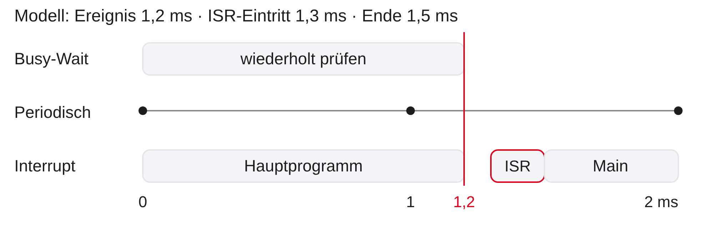
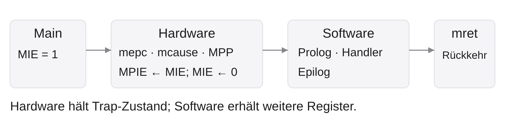
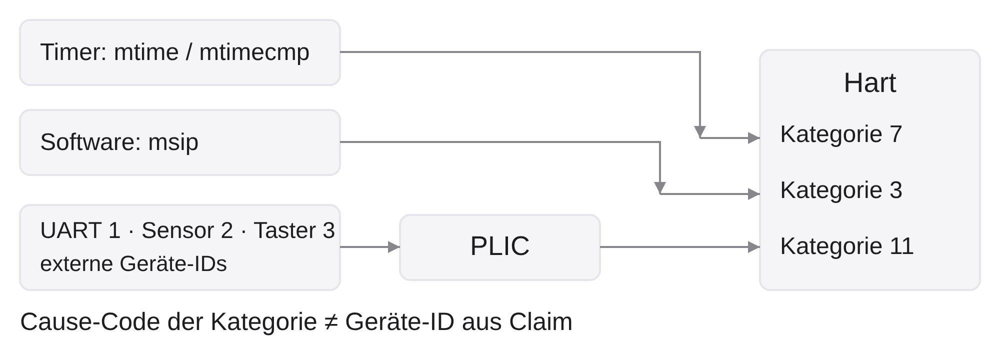
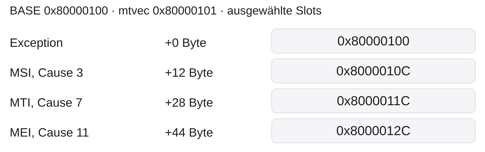
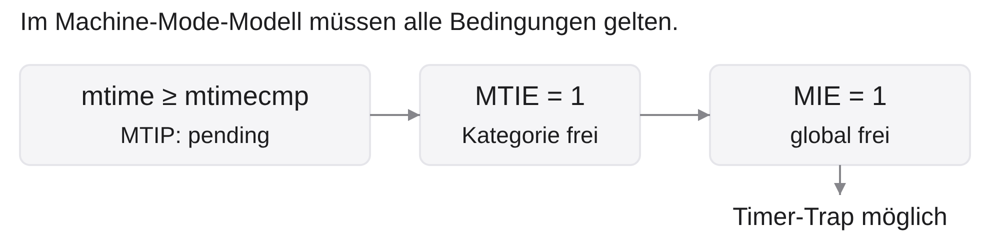
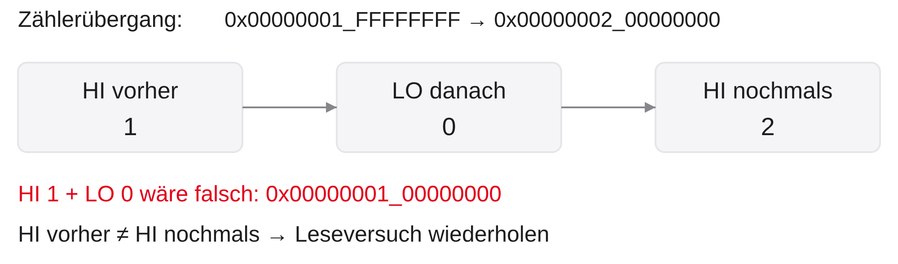
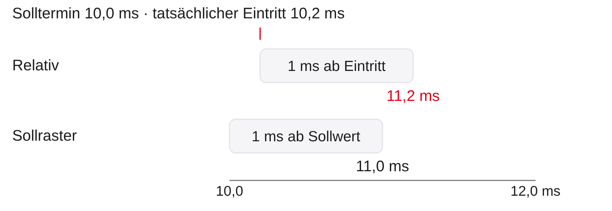
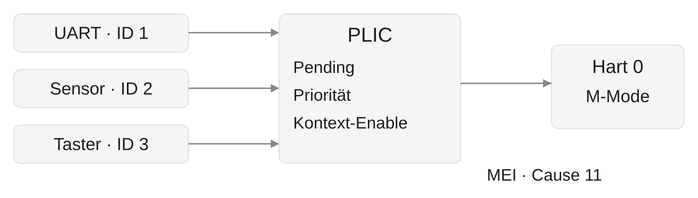
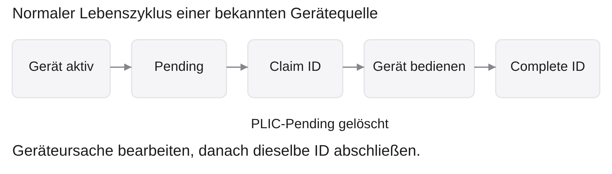
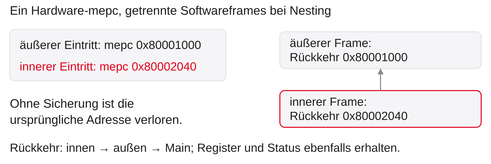

## Vom Speicher zum Ereignis

- Vorlesung 1: Speicher und Geräteadressen
- Vorlesung 2: Cache-Kopien und Zugriffskosten
- Heute: Wann muss das Programm auf ein Ereignis reagieren?
- Ziel: Zeit erfassen, Ursachen unterscheiden, Arbeit passend aufteilen

::: notes
Ein schneller Speicherzugriff beantwortet noch nicht, wann ein Programm einen Sensor oder einen Zeitpunkt beachten soll. Vorlesung 1 hat Memory-Mapped Input/Output, Ein- und Ausgabe über Geräteadressen, eingeführt. Vorlesung 2 erklärte, wie Caches Kopien gewöhnlicher Speicherblöcke verwalten. Nun verbinden wir die laufende Programmausführung mit Ereignissen aus Geräten und einer Hardware-Zeitquelle.

Ein Interrupt ist eine asynchrone Unterbrechungsanforderung: Sie entsteht unabhängig davon, welcher Befehl gerade bearbeitet wird. Ein Timer liefert eine zeitbezogene Bedingung. Beide benötigen einen vereinbarten Weg von der Anforderung über die Behandlung bis zur Fortsetzung des unterbrochenen Programms. Eine hohe Taktfrequenz allein garantiert keine rechtzeitige Reaktion. Wir betrachten deshalb auch Freigaben, Wartezeiten und die Aufgabenverteilung zwischen Handler und Hauptprogramm. Der rote Faden führt von einem einzelnen Ereignis zu mehreren Quellen und schließlich zu gemeinsam genutztem Zustand.
:::

## Vorkenntnisse und Lehrmodell

- Adresse, C-Zeiger, Binärbits und einfache Schleifen
- RV32: RISC-V mit $32$-Bit-Integerregistern
- Ein Hart im Machine Mode; keine Delegation, zunächst kein Nesting
- Klassischer Timer-/PLIC-Pfad; Ausstattung und Adressen sind plattformabhängig

::: notes
Ein Hart ist ein Hardware-Thread, ein Ausführungskontext eines RISC-V-Prozessors. RV32 bezeichnet die Variante mit zweiunddreißig Bit breiten Integerregistern. Machine Mode, kurz M-Mode, ist die höchste normale Privilegstufe. Unser Modell führt Hauptprogramm und Handler dort auf einem Hart aus. Es leitet Traps nicht an andere Privilegstufen weiter und verschachtelt Interrupts zunächst nicht.

PLIC steht für Platform-Level Interrupt Controller, Plattform-Interrupt-Controller für externe Geräte. Den lokalen Timer betrachten wir in einem CLINT-artigen Modul; CLINT bedeutet Core Local Interruptor. Diese klassische Organisation ist ein Lehrmodell und keine Behauptung über jeden RISC-V-Chip. Neuere Interrupt-Architekturen oder andere Plattformmodule können anders aussehen.

Erforderlich sind Zeiger und einfache C-Schleifen sowie die Unterscheidung zwischen Adresse und Inhalt aus den vorherigen Vorlesungen. Register und neue Abkürzungen werden erneut erklärt. Alle Zahlen, Geräte-IDs und gegebenenfalls genannten Adressen sind explizite Lehrannahmen. Es liegt keine ausgeführte RISC-V-Firmware vor. Damit lassen sich die Regeln auf Papier nachvollziehen, ohne eine bestimmte Laborplatine vorauszusetzen.
:::

## Vier Schulstunden: Ablauf

| Stunde | Vorlesungsphase | Arbeitsphase |
|--------|-----------------|--------------|
| 1 | Ereignisse und Traps: 35 min | Aufgabe 1: 10 min |
| 2 | Vektoren und Timer: 30 min | Aufgaben 2–3: 15 min |
| 3 | Zeitraster und PLIC: 30 min | Aufgaben 4–5: 15 min |
| 4 | Kontext und Hauptprogramm: 15 min | Aufgabe 6: 15 min; Quiz: 15 min |

::: notes
Vier Schulstunden bedeuten hier viermal fünfundvierzig, insgesamt hundertachtzig Minuten Unterricht; Pausen sind zusätzlich zu planen. Der Plan enthält hundertzehn Minuten Erklärung, kurze Denkfragen und gemeinsame Aufgabenbesprechungen, fünfundfünfzig Minuten angeleitete Papierübungen und fünfzehn Minuten Quiz.

Die erste Phase führt vom Ereignis zum Trap, dem gemeinsamen Eintritt in die Behandlung von Interrupts und Exceptions. Die zweite erklärt Einsprungadressen und die Zeitquelle. In der dritten werden verspätete Termine und externe Geräte bearbeitet. PLIC bedeutet Platform-Level Interrupt Controller, der externe Quellen sammelt. Die letzte Phase untersucht Kontext und gemeinsam benutzte Variablen. Die Arbeitsphasen folgen den sechs Aufgaben des Übungsblatts. Für das vollständige selbstständige Bearbeiten darf mehr Zeit als in den angeleiteten Phasen benötigt werden. Die fünfzig Folien verteilen sich nicht gleichmäßig auf die Minuten: Ein Zustandsbeispiel braucht Diskussion, eine Orientierungsfolie meist nur einen kurzen Übergang.
:::

## Polling: selbst nachfragen

- Polling: Gerätezustand per Software prüfen
- Busy Waiting: wiederholt prüfen und dabei warten
- Periodisches Polling: zwischen Abfragen andere Arbeit
- Kurze ungespeicherte Ereignisse können zwischen Abfragen verschwinden

::: notes
Polling bedeutet Abfragen. Software liest beispielsweise ein Statusregister eines Geräts und prüft, ob Daten bereitliegen. Busy Waiting, beschäftigtes Warten, ist eine enge Wiederholung dieser Prüfung ohne andere nützliche Arbeit. Periodisches Polling fragt dagegen nur gelegentlich nach und bearbeitet zwischenzeitlich andere Aufgaben.

Ein lesbares Gerätestatusregister stammt aus dem Konzept der Geräteadressen in Vorlesung 1. Es muss nicht dieselben Eigenschaften wie gewöhnlicher Arbeitsspeicher besitzen: Lesen kann Seiteneffekte haben. Für ein korrektes Programm sind die Gerätereigenschaften zu beachten.

Polling ist nicht grundsätzlich falsch. Bei einer dauerhaft sichtbaren Bereitschaft und tolerierbarer Verzögerung kann es einfach und passend sein. Ein kurzer Impuls, der weder im Gerät noch in weiterer Hardware gespeichert wird, kann dagegen zwischen zwei Prüfungen liegen und vollständig übersehen werden. Ein Interrupt ist ein anderer Benachrichtigungsweg, aber auch dort müssen Ereignisse erfasst und gegebenenfalls gespeichert werden. Die nächste Abbildung vergleicht ausdrücklich modellierte Reaktionswege, nicht pauschal Energieverbrauch oder Laufzeit.
:::

## Reaktionswege auf einer Zeitachse

{fig-alt="Ereignis bei 1,2 ms; periodisches Polling entdeckt es bei 2 ms, Interruptbehandlung beginnt im Modell bei 1,3 ms."}

- Periodische Abfrage: Modellwartezeit $0{,}8$ ms
- Interrupt: eigene Eintrittslatenz und Behandlungszeit

::: notes
Die gemeinsame horizontale Achse der Abbildung ist Zeit in Millisekunden. Die senkrechte rote Linie markiert das Ereignis bei $1{,}2$ ms. Die obere Bahn zeigt Dauer-Polling, das den Prozessor zum wiederholten Prüfen belegt. Die mittlere zeigt Abfragen bei null, eins und zwei Millisekunden. Unter der Annahme eines bis zur Behandlung gespeicherten Ereignisses entdeckt sie es bei zwei Millisekunden, also $2-1{,}2=0{,}8$ ms später.

Die untere Bahn zeigt ein getrenntes Interruptmodell. Main bezeichnet dort das Hauptprogramm. Nach einer angenommenen Eintrittslatenz von $0{,}1$ ms beginnt bei $1{,}3$ ms die ISR, Interrupt Service Routine, Unterbrechungsbehandlung. Im gezeichneten Beispiel endet sie nach weiteren $0{,}2$ ms; anschließend läuft das Hauptprogramm weiter. Diese Zeiten sind Lehrwerte. Die Eintrittslatenz ist nicht dieselbe Größe wie die Wartezeit auf das Ereignis.

Die Bahnen sind alternative Abläufe, keine gleichzeitig laufenden Prozessoren. Ein Interrupt kann durch Maskierung noch länger warten. Wird in seiner kurzen Behandlung nur Arbeit vorgemerkt, kommt bis zur eigentlichen Bearbeitung im Hauptprogramm eine weitere Verzögerung hinzu. Deshalb muss für jede Reaktionsanforderung der relevante Anfangs- und Endpunkt benannt werden.
:::

## Welche Strategie passt zum Ereignis?

| Situation | Zu prüfende Bedingung |
|-----------|----------------------|
| Bereitschaft bleibt sichtbar | zulässige Abfrageperiode |
| Kurzer Impuls | Erfassung oder Speicherung |
| Sehr viele Ereignisse | Behandlungsaufwand und Puffer |
| Feste Reaktionsfrist | gesamte Verzögerung |

::: notes
Die Tabelle ist eine Entscheidungshilfe, keine feste Zuordnung eines Geräts zu einer einzigen Programmiertechnik. Bleibt ein Zustand bis zur Bearbeitung sichtbar, kann Polling, regelmäßiges Abfragen, ihn finden. Die maximale Zeit bis zur nächsten Abfrage muss dann zur Reaktionsfrist passen. Ein kurzer Impuls erfordert dagegen eine Erfassung, etwa ein gespeichertes Statusbit oder einen passenden Eingang.

Auch ein Pending-Bit, eine Markierung für eine wartende Anforderung, ist noch keine beliebig lange Ereigniswarteschlange. Mehrere Ereignisse können zusammenfallen. Bei vielen eingehenden Daten braucht das Gerät oder die Software möglicherweise einen Puffer. Die Behandlung jedes einzelnen Ereignisses als Interrupt kann zusätzlich erheblichen Aufwand erzeugen.

Eine Reaktionsfrist ist eine späteste zulässige Zeit für die gewünschte Wirkung. Zu prüfen sind Erfassung, Wartezeit, Eintritt und Nutzarbeit. Der Vorteil einer ereignisgesteuerten Behandlung liegt darin, andere Arbeit zwischen Ereignissen zuzulassen; kurze Reaktion ist dennoch eine Eigenschaft des ganzen Ablaufs. Nun untersuchen wir, wie der Prozessor tatsächlich in eine Behandlung eintritt.
:::

## Interrupt, Exception und Trap

- Interrupt: asynchrone Anforderung, etwa vom Timer
- Exception: synchron zum ausgeführten Befehl, etwa ein ungültiger Befehl
- Trap: gemeinsamer Übergang in die Behandlung
- Gleicher Einsprungmechanismus bedeutet nicht gleiche Ursache

::: notes
Ein Interrupt entsteht unabhängig vom gerade ausgeführten Befehl, etwa weil die Hardware-Zeitquelle einen Vergleichswert erreicht hat. Eine Exception, Ausnahme, entsteht synchron aus der Befehlsausführung, beispielsweise wenn der Prozessor einen nicht unterstützten Befehl erkennt. Trap ist der Oberbegriff für den Übergang in die zuständige Behandlung.

Die beiden Fälle können denselben Eintrittsmechanismus und dieselben Register benutzen. Trotzdem müssen sie unterschieden werden. Nach einem Interrupt wird gewöhnlich die unterbrochene Ausführung fortgesetzt. Bei einer Exception muss die Software dagegen entscheiden, ob und wie der auslösende Fehler behoben wird. Eine Rückkehr ohne geeignete Behandlung kann denselben Fehler erneut auslösen.

Interruptfreigaben sperren im folgenden Modell die betrachteten maskierbaren Interrupts, nicht automatisch synchrone Exceptions. Wer global Interrupts deaktiviert, kann also weiterhin durch einen ungültigen Speicherzugriff oder Befehl einen Trap erzeugen. Diese Unterscheidung erklärt das zusätzliche Interrupt-Bit im Ursachenregister und begrenzt später die Aussage, während einer ISR könne nichts mehr dazwischenkommen.
:::

## Kontext und spezielle Register

| Zustand | Bedeutung |
|---------|-----------|
| Allgemeine Register | laufende Werte und Adressen |
| `mepc` | gespeicherte Fortsetzungsadresse |
| `mcause` | Trap-Ursache |
| `mstatus` | Status und Interruptfreigaben |

CSR: Control and Status Register.

::: notes
Kontext bezeichnet den Zustand, der zum korrekten Fortsetzen einer Ausführung nötig ist. Dazu gehören allgemeine Register mit Zwischenergebnissen und Adressen sowie besondere Statusinformationen. CSR bedeutet Control and Status Register, Steuer- und Statusregister. Ein CSR wird durch dafür vorgesehene Prozessorbefehle angesprochen und ist nicht dasselbe wie ein Gerät an einer Speicheradresse.

`mepc` heißt Machine Exception Program Counter und speichert die Rückkehradresse eines Traps. PC steht für Program Counter, Befehlsadresszähler. `mcause`, Machine Cause, enthält die Ursache. `mstatus`, Machine Status, enthält unter anderem Interruptfreigaben. Das Präfix m kennzeichnet hier den Machine Mode, die Maschinenprivilegstufe.

Die Hardware aktualisiert beim Trap einige dieser speziellen Register. Sie sichert jedoch nicht automatisch sämtliche allgemeinen Register auf dem Softwarestack. Der Stack ist ein Speicherbereich für Aufruf- und Sicherungsrahmen. Benutzt der Handler Register der unterbrochenen Ausführung, müssen diese passend erhalten werden. Deshalb reicht ein Sprung zur richtigen Funktion noch nicht für einen vollständigen, korrekten Interruptpfad.
:::

## Trap-Eintritt: Hardware und Software

{fig-alt="Die Hardware sichert Rückkehradresse und Ursache, sperrt M-Interrupts; Software erhält weitere Register, behandelt die Ursache und kehrt mit mret zurück."}

- Hardwarezustand und Software-Sicherung ergänzen sich
- `mret` ersetzt keine Wiederherstellung allgemeiner Register

::: notes
Die Abbildung liest sich von links nach rechts als Ablauf. Vor dem Trap läuft das Hauptprogramm. Die Hardware schreibt die Fortsetzungsadresse nach `mepc`, Machine Exception Program Counter, und die Ursache nach `mcause`, Machine Cause. Sie kopiert das alte MIE-Bit, Machine Interrupt Enable, globale Maschinen-Interruptfreigabe, in MPIE, Machine Previous Interrupt Enable, und setzt MIE auf null. MPP, Machine Previous Privilege, hält die vorherige Privilegstufe; im Modell ist das Machine Mode.

Danach erhält die Software im Prolog, dem Eintrittsteil, die benötigten allgemeinen Register auf einem Stackrahmen. Der Handler bearbeitet die Ursache. Im Epilog, dem Austrittsteil, stellt die Software ihre Sicherungen wieder her. `mret`, Machine Return, verwendet `mepc` als Rückkehradresse und stellt unter anderem MIE aus MPIE sowie die vorherige Privilegstufe her.

Die Kästen unterscheiden Hardwareaktionen von Softwareaufgaben; die Pfeile zeigen zeitliche Reihenfolge, keine gemessenen Dauern. `mret` lädt nicht automatisch den Softwarestack. Fehlt eine Registerwiederherstellung, kann das Hauptprogramm mit falschen Werten weiterlaufen, obwohl die Rückkehradresse stimmt. Ein normaler Funktionsrücksprung ist ebenfalls kein Ersatz für die Trap-Rückkehr.
:::

## Pending ist nicht Freigabe

Im betrachteten Machine Mode:

$$
\text{Interruptnahme}:\quad \text{Pending}\land\text{Quellenfreigabe}\land\mathrm{MIE}
$$

- `mip`: Machine Interrupt Pending
- `mie`: Machine Interrupt Enable, Kategorienfreigaben
- `mstatus.MIE`: globale Freigabe der betrachteten M-Interrupts

::: notes
Pending bedeutet, dass eine Unterbrechungsanforderung wartet. `mip`, Machine Interrupt Pending, zeigt solche Zustände für die Kategorien. `mie`, Machine Interrupt Enable, enthält deren einzelne Freigaben. Das MIE-Bit in `mstatus`, Machine Interrupt Enable im Statusregister, ist zusätzlich die globale Freigabe. Registername `mie` und Statusbit MIE sind daher zwei unterschiedliche Dinge.

Die Formel gilt für unser Modell: ein Hart, ein Hardware-Ausführungskontext, läuft bereits im Machine Mode ohne Delegation. Das logische Und, $\land$, verlangt alle drei Bedingungen. Ein pending Timer bei deaktivierter Timerfreigabe wird nicht genommen. Ein freigegebener Timer ohne Pending ebenfalls nicht. Ist MIE null, bleiben die betrachteten maskierbaren Maschinen-Interrupts trotz Pending zurückgestellt.

Das Sperren der Freigabe muss die Ursache nicht löschen. Nach Wiederfreigabe kann eine erhaltene Anforderung wirksam werden. Umgekehrt ist ein einziges Pending-Bit kein Zähler für alle während der Sperrzeit eingetroffenen Ereignisse. Synchrone Exceptions, Ausnahmen aus Befehlen, sind durch diese Formel nicht beschrieben. Die Trennung wird bei Timer und externen Geräten jeweils konkretisiert.
:::

## `mcause` auf RV32 lesen

$$
I=(\text{raw}\gg31)\mathbin{\&}1,\qquad
c=\text{raw}\mathbin{\&}\texttt{0x7FFFFFFF}
$$

| Rohwert | Interpretation |
|---------|----------------|
| `0x80000007` | Interrupt, Kategorie $7$ |
| `0x8000000B` | Interrupt, Kategorie $11$ |
| `0x00000002` | Exception, Code $2$ |

::: notes
`mcause`, Machine Cause, ist das Ursachenregister eines Traps. RV32 bedeutet zweiunddreißig Bit breite Integerregister. Das höchste Bit, Bit einunddreißig, unterscheidet einen Interrupt von einer Exception. Der Rohwert raw ist der vollständige Registerinhalt. Die Rechtsverschiebung $\gg31$ und bitweises Und $\&1$ gewinnen das Interrupt-Bit $I$. Die Maske `0x7FFFFFFF` entfernt es; $c$ ist der verbleibende Ursachencode. Hexadezimale Werte tragen `0x`.

`0x80000007` hat $I=1$ und $c=7$, Machine Timer Interrupt. `0x8000000B` hat $I=1$ und $c=11$, Machine External Interrupt, externe Kategorie. `0x00000002` hat $I=0$ und $c=2$, Illegal Instruction, ungültiger Befehl. Der Begriff Exception Code in der Spezifikation benennt das Codefeld auch dann, wenn das Interrupt-Bit gesetzt ist.

Eine Geräte-ID wird daraus nicht gewonnen. Auch ein Timer und eine externe Quelle mit zufällig gleicher Zahlen-ID wären verschiedene Ebenen. Wer nur die niedrigen Bits vergleicht, ohne Interrupt und Exception zu unterscheiden, kann die falsche Behandlung wählen. Die nächste Folie zeigt daher die zweite Identifikationsebene.
:::

## Kategorie und Geräte-ID

{fig-alt="Lokaler Software-Interrupt hat Cause 3, Timer Cause 7; mehrere PLIC-Geräte teilen Cause 11 und werden per Claim-ID unterschieden."}

- `mcause` benennt die Interrupt-Kategorie
- PLIC-Claim benennt eine externe Quelle
- Geräte-ID $7$ wäre nicht automatisch Timer-Cause $7$

::: notes
Die Abbildung unterscheidet zwei Wege zum Hart, dem Hardware-Ausführungskontext. CLINT, Core Local Interruptor, bezeichnet im Modell die lokale Timer- und Software-Interruptorganisation. Die Register mtime, Machine Time, liefern die Zeit, mtimecmp, Machine Time Compare, den Vergleich und msip, Machine Software Interrupt Pending, die Software-Wartemarkierung. Machine Software Interrupt hat Cause, Ursachencode, drei; Machine Timer Interrupt sieben. PLIC, Platform-Level Interrupt Controller, sammelt dagegen externe Geräte und meldet gemeinsam Machine External Interrupt mit Cause elf.

Die rechte Seite zeigt die angenommenen Geräte-IDs, Identifikationsnummern: UART eins, Sensor zwei und Taster drei. UART bedeutet Universal Asynchronous Receiver/Transmitter, serielle Sende- und Empfangsschnittstelle. Claim ist das Abholen einer konkreten wartenden Quelle beim PLIC. Erst dieser Zugriff liefert die Geräte-ID. Alle drei Geräte verwenden zuvor dieselbe externe Kategorie.

Die Pfeile beschreiben Signal- und Auswahlwege, keine feste Leitungslänge oder Reaktionszeit. Eine Zahl sieben in der PLIC-Quellliste wäre die siebte externe Quelle und bliebe im Ursachenregister Kategorie elf. Der lokale Timer bleibt dagegen Kategorie sieben. Dadurch wird verständlich, warum eine Vektortabelle für Kategorien die Geräteauswahl nicht ersetzt.
:::

## Ein Direct-Handler kann sauber verzweigen

Konzeptioneller Dispatcher, kein vollständiger Trap-Prolog:

```text
Rohwert aus mcause lesen
Interrupt-Bit und Cause-Code trennen
bei Exception: Ausnahmebehandlung
sonst bei Cause 7: Timerbehandlung
sonst bei Cause 11: externe Quelle per Claim abholen
sonst: definierte Behandlung der übrigen Kategorien
```

::: notes
Direct bedeutet, dass Traps zuerst an einer gemeinsamen Adresse eintreten. Der gezeigte Pseudocode beschreibt danach die Auswahl der Behandlung. `mcause`, Machine Cause, liefert den Rohwert; Interrupt-Bit und Code werden wie zuvor getrennt. Eine Exception ist eine synchrone Ausnahme und benötigt eine eigene Fehlerbehandlung. Kategorie sieben ruft im Modell den lokalen Timerpfad, elf den externen PLIC-Pfad auf. PLIC bedeutet Platform-Level Interrupt Controller; Claim holt dort die Geräte-ID.

Eine lineare Suche durch viele Gerätestatusregister kann mit deren Zahl länger werden. Das ist aber keine notwendige Eigenschaft jedes Direct-Handlers. Er kann Kategorien direkt unterscheiden und anschließend die vom Controller ausgewählte ID für eine Tabelle nutzen. Die Komplexitätsaussage $\mathcal{O}(n)$, mit der Zahl $n$ der Abfragen wachsend, betrifft die lineare Suche, nicht pauschal diesen Modus.

Der Dispatcher setzt bereits gesicherten Kontext, einen gültigen Stack und festgelegte Behandlungen voraus. Er ist keine ausführbare Firmware und enthält nicht den vollständigen Ein- und Austritt. Eine konkrete Implementierung muss auch unerwartete Ursachen beherrschen. Nun können Sie die Zustände des Eintritts unabhängig von der Geräteauswahl prüfen.
:::

## Verständnisfrage: wartet oder verschwindet?

Ein Timer ist pending, aber `mstatus.MIE` ist $0$.

1. Wird `mtime` dadurch angehalten?
2. Wird sofort ein Timer-Trap genommen?
3. Garantiert das Pending-Bit eine Behandlung pro verstrichener Periode?

::: notes
`mtime`, Machine Time, ist die im folgenden Abschnitt erläuterte Hardware-Zeitquelle. MIE bedeutet Machine Interrupt Enable, globale Freigabe der betrachteten Maschinen-Interrupts. Ein Timer ist pending, wenn seine Anforderung wartet. Die drei Fragen trennen Zeitfortschritt, Prozessorfreigabe und Ereigniszählung.

Die erste Antwort lautet nein: Das MIE-Bit steuert die Interruptnahme, nicht den Timeroszillator. Der Zähler läuft im festgelegten Modell weiter. Zweitens wird bei MIE null kein betrachteter maskierbarer Timer-Trap genommen, auch wenn die Kategorie freigegeben ist. Die Anfrage kann nach Wiederfreigabe weiterhin anstehen. Drittens ist das Pending-Bit keine Warteschlange für einzelne Perioden. Fünf vergangene Solltermine bedeuten nicht automatisch fünf erhaltene Handler-Aufrufe.

Die Lösung erklärt, weshalb verstrichene Zeit aus einer Zeitquelle und nicht allein aus der Anzahl der ISR-Aufrufe abgeleitet werden sollte. ISR bedeutet Interrupt Service Routine, Unterbrechungsbehandlung. Die Frage eignet sich für eine kurze Partnerdiskussion und bereitet Aufgabe 1 des Übungsblatts vor. Danach präzisieren wir, wohin ein freigegebener Trap tatsächlich springt.
:::

## `mtvec`: Basis und Modus

- Machine Trap-Vector Base Address
- Untere zwei Bits: MODE; übrige Bits bilden BASE
- Direct: MODE $0$; Vectored: MODE $1$
- Unterstützte Modi und strengere Ausrichtung prüfen

Beispiel: BASE `0x80000100`, Vectored-Wert `0x80000101`.

::: notes
`mtvec` heißt Machine Trap-Vector Base Address, Register für die Maschinen-Trap-Basis und den Modus. BASE ist die Basisadresse des Einsprungs. MODE legt fest, wie die Hardware diese Basis verwendet. Die unteren zwei Bits des Registerwerts tragen MODE, nicht zwei frei nutzbare Adressbits. Die Basis selbst ist mindestens auf vier Byte ausgerichtet; die konkrete Implementierung kann für den vektorisierten Modus strengere Ausrichtung verlangen.

Bei der hexadezimalen Basis `0x80000100` ergibt Direct mit MODE null den Registerwert `0x80000100`. Vectored mit MODE eins ergibt `0x80000101`. Die Hardware springt nicht zur ungeraden Registeradresse: Sie trennt Modus und Basis. Reservierte oder nicht unterstützte Werte dürfen nicht als zusätzliche Standardmodi angenommen werden.

Ein Linker, der Programmteile platziert, muss eine ausführbare, geeignet ausgerichtete Tabelle beziehungsweise Eintrittsfunktion ermöglichen. `mtvec` einzustellen ersetzt weder Stackinitialisierung noch Kontextsicherung. Die nächste Unterscheidung betrifft die Adressbildung bei Interrupts gegenüber Exceptions.
:::

## Direct und Vectored

$$
a_\text{Trap}=
\begin{cases}
\mathrm{BASE} & \text{Direct}\\
\mathrm{BASE}+4c & \text{Vectored, Interrupt}\\
\mathrm{BASE} & \text{Vectored, Exception}
\end{cases}
$$

$c$: Cause-Code ohne Interrupt-Bit.

::: notes
$a_\text{Trap}$ ist die Adresse, an der die Hardware die Trap-Behandlung beginnt. Direct ist der gemeinsame Einsprung: Alle betrachteten Traps gehen zu BASE, der Basisadresse. Vectored ist der kategorienabhängige Einsprung für Interrupts: Der Cause-Code $c$, Ursachencode ohne höchstes Interrupt-Bit, wird mit vier Byte multipliziert und zur Basis addiert. Eine synchrone Exception, Ausnahme aus einem Befehl, geht auch in diesem Modus zur Basis.

Die vier Byte sind ein festgelegter Slotabstand, der Abstand zwischen Kategorienplätzen. Er hängt nicht davon ab, welche Befehlslängen die Implementierung unterstützt. Auch mit komprimierten Befehlen bleibt die Hardwareformel dieselbe. Komprimierte RISC-V-Befehle können zwei Byte lang sein; sie ändern deshalb die Tabellenplanung, nicht den Abstand der Einsprungadressen.

Vectored wählt die Interrupt-Kategorie, nicht jede externe Geräte-ID. Ein PLIC, Platform-Level Interrupt Controller, liefert weiterhin per Claim die konkrete externe Quelle. Direct mit einem passenden Dispatcher bleibt eine korrekte Alternative. Aus der Adressformel allein folgt keine gemessene Latenz oder Echtzeitgarantie.
:::

## Einsprungadressen selbst berechnen

{fig-alt="BASE 0x80000100; im Vectored-Modus liegen die Kategorieplätze 3, 7 und 11 bei den Versätzen 12, 28 und 44 Byte."}

Wo landet eine Exception mit Code $2$? Wo landet der Timer im Direct-Modus?

::: notes
Die Abbildung zeigt ausgewählte Adressen der Vektortabelle von oben nach unten. BASE ist die Basis `0x80000100`. Für den Vectored-Modus enthält `mtvec` den Wert `0x80000101`, weil MODE eins in den unteren Bits steht. MSI bedeutet Machine Software Interrupt mit Cause drei, MTI Machine Timer Interrupt mit Cause sieben, MEI Machine External Interrupt mit Cause elf.

Die Versätze sind $4\cdot3=12=\texttt{0x0C}$ Byte, $4\cdot7=28=\texttt{0x1C}$ Byte und $4\cdot11=44=\texttt{0x2C}$ Byte. Addition ergibt `0x8000010C`, `0x8000011C` und `0x8000012C`. Die Kästen sind Kategorieplätze für Befehle, keine Geräte-ID-Tabelle. Zwischenplätze bleiben in einer vollständigen Tabelle ebenfalls berücksichtigt.

Die Exception mit Code zwei geht zur Basis `0x80000100`, nicht zu Basis plus acht, weil nur Interrupts vektorisiert werden. Im Direct-Modus landet auch der Timer an dieser Basis. Das Interrupt-Bit des vollständigen `mcause`-Werts wird nie als Teil von $c$ mitmultipliziert. Diese Rechnungen und ihre Begründung sind klausurtauglich und werden in Aufgabe 2 aufgegriffen.
:::

## An einem Slot steht ein Befehl

Strukturtabelle, kein vollständiges Assemblerprogramm:

| Slot | Versatz | Beispielbefehl |
|------|---------|----------------|
| $0$ | $0$ Byte | `jal x0, exception_entry` |
| $3$ | $12$ Byte | `jal x0, software_entry` |
| $7$ | $28$ Byte | `jal x0, timer_entry` |
| $11$ | $44$ Byte | `jal x0, external_entry` |

::: notes
Ein Slot ist ein vier Byte breiter Kategorienplatz der Vektortabelle. In RISC-V steht dort ein auszuführender Befehl, kein vom Prozessor automatisch geladener Funktionszeiger. `jal` bedeutet Jump And Link, Sprung mit möglicher Rücksprungsicherung. Mit Zielregister `x0`, dem konstanten Nullregister, wird die Sicherung verworfen: Der Befehl springt zur angegebenen Eintrittsroutine. Die Namen `exception_entry`, `software_entry`, `timer_entry` und `external_entry` bezeichnen hier nur die jeweiligen Zieladressen der Strukturtabelle.

Die Darstellung lässt Zwischenplätze sichtbar als nicht aufgeführte Tabellenzeilen aus und ist ausdrücklich kein vollständiges Assemblerprogramm. Ein realer Aufbau muss alle benötigten Slots samt geeigneten Standardbehandlungen, Sprungreichweiten und Ausrichtung berücksichtigen. Werden Befehle durch Kompression oder Relaxation kürzer oder anders angeordnet, darf der nächste Slot nicht versehentlich verrutschen. Beispielsweise erlauben GNU-Assemblerdirektiven `.option norvc` und `.option norelax`, diese Umformungen für die betreffende Region auszuschließen.

Auch ein gültiger Sprung führt zunächst zu einem Eintritt, der Kontext erhält; er ist nicht schon der vollständige Handler. Die Tabelle klärt eine räumliche Beziehung und keine gemessenen Hardwarezeiten.
:::

## Lokale Pfade und externe Quellen

- Timer und Software-Interrupt: eigene Kategorien
- PLIC-Geräte: gemeinsam über Machine External
- CLINT ist ein verbreitetes Plattformmodul
- Lokal bedeutet Zuordnung zum Hart, keine garantierte Mindestlatenz

::: notes
CLINT bedeutet Core Local Interruptor und bezeichnet die klassische Organisation lokaler Timer- und Software-Interrupts. Ein Hart ist ein Hardware-Ausführungskontext. Lokale Anforderungen werden ihm zugeordnet und nehmen im betrachteten Modell nicht an der PLIC-Geräteauswahl teil. PLIC, Platform-Level Interrupt Controller, sammelt externe Peripheriequellen.

Diese Zuordnung sagt weder eine bestimmte Leitungslänge noch einen universellen Prioritätsvorrang des Timers voraus. Die Hardware muss die passenden Kategorie-Pending- und Freigabebits mit dem globalen Status verbinden. Konkrete Registeradressen und Timerfrequenz stammen von der Plattform, nicht allein vom Namen des RISC-V-Befehlssatzes.

Das zentrale Timerregister und Software-Interruptregister werden typischerweise über Geräteadressen erreicht. Sie sind nicht mit den Steuer- und Statusregistern des Prozessors zu verwechseln. Die Unterscheidung nutzt die Memory Map aus Vorlesung 1: Software adressiert ein Systemmodul, während der Hart seine Kategorieinformation in eigenen Registern abbildet. Wir öffnen jetzt zuerst die lokale Zeitquelle und danach den externen Controller.
:::

## `mtime` ist die Zeitquelle

- Machine Time: $64$-Bit-Zähler, auch auf RV32
- Frequenz der Zeitquelle von der Plattform bestimmen
- Kein notwendiger Gleichlauf mit dem Prozessortakt
- Zeit seit Start: Differenz zum gespeicherten Startwert

::: notes
`mtime` heißt Machine Time und ist ein vierundsechzig Bit breiter Zähler der Plattformzeit. RV32, die Variante mit zweiunddreißig Bit breiten Integerregistern, verkürzt seine Registerbreite nicht. Der Zähler schreitet mit einer von der Plattform angegebenen konstanten Frequenz fort und kann bei Überlauf umlaufen. Er ist nicht automatisch ein Zähler seit dem Start dieses C-Programms.

Ein Programm kann einen Startwert $t_0$ speichern und vergangene Ticks durch eine Differenz zu `mtime` bestimmen. Ein Tick bedeutet hier einen Zählschritt der Hardware-Zeitquelle; derselbe Ausdruck wird später auch für periodische Softwaretermine benutzt. Wir unterscheiden diese Bedeutungen ausdrücklich.

`mtime` wird über MMIO, Memory-Mapped Input/Output, Ein- und Ausgabe durch Geräteadressen, erreicht. Das im privilegierten Befehlssatz beschriebene `time`-CSR, Control and Status Register, kann eine lesbare Spiegelung der Zeit bieten; es ist aber nicht dasselbe Register wie die Speicheradresse `mtime`. Unser Modell verwendet MMIO. Ein variabler Prozessortakt muss nicht dieselbe Frequenz wie die Zeitquelle haben, weshalb deren Einheit separat festgelegt wird.
:::

## Timer-Ticks in Zeit umrechnen

Lehrannahmen: Timer $f_T=10$ MHz, Prozessor $f_C=100$ MHz.

$$
\Delta=f_T\cdot1\,\mathrm{ms}=10000\ \text{Timer-Ticks}
$$

$$
t=\frac{n}{f_T},\qquad
2^{32}/10^6\ \mathrm{s}\approx71{,}58\ \mathrm{min}
$$

::: notes
$f_T$ ist die Frequenz der Hardware-Zeitquelle, $f_C$ die des Prozessors. MHz bedeutet Megahertz, eine Million Schritte beziehungsweise Taktperioden pro Sekunde. Bei zehn Megahertz Timerfrequenz dauert ein Zählschritt $0{,}1$ Mikrosekunden. Ein Millisekundenintervall benötigt $\Delta=10^7\cdot10^{-3}=10000$ Timer-Ticks. Der angenommene Prozessor mit hundert Megahertz hat dagegen hunderttausend Taktperioden pro Millisekunde.

$n$ ist eine Anzahl von Timer-Ticks. Die Division durch $f_T$ ergibt die Zeit $t$ in Sekunden. Der gezeigte Überlaufvergleich verwendet ausdrücklich eine andere Frequenz: Ein zweiunddreißig Bit breiter Zähler mit einer Million Schritten pro Sekunde läuft nach $2^{32}/10^6=4294{,}967296$ Sekunden, rund $71{,}58$ Minuten, um. Ein zweiunddreißig Bit breiter Millisekundenzähler würde dagegen $2^{32}$ Millisekunden halten, rund $49{,}71$ Tage.

`mtime` selbst ist auch auf RV32 vierundsechzig Bit breit. Das Problem beim Zugriff ist daher nicht ein zweiunddreißig Bit breiter Timer, sondern das Zusammensetzen seiner Hälften. Frequenz und gezählte Einheit müssen in jeder Rechnung genannt werden.
:::

## Vergleich und Freigaben des Timers

{fig-alt="mtime größer oder gleich mtimecmp erzeugt die Timeranforderung; MTIE und globale MIE-Freigabe erlauben im Modell den Trap."}

`mtimecmp` muss für den nächsten Termin in der Zukunft liegen.

::: notes
`mtimecmp` heißt Machine Time Compare, Vergleichswert der Maschinenzeit. Er ist wie `mtime`, Machine Time, vierundsechzig Bit breit. Die Hardware betrachtet beide Werte vorzeichenlos und setzt die Timeranforderung, sobald `mtime` größer oder gleich `mtimecmp` ist. Die Abbildung liest sich vom Vergleich über die Freigaben zum Trap.

MTIP bedeutet Machine Timer Interrupt Pending, wartender Maschinen-Timerinterrupt im Register `mip`. MTIE bedeutet Machine Timer Interrupt Enable und ist die Timerfreigabe in `mie`. MIE bedeutet Machine Interrupt Enable, globale Freigabe in `mstatus`. Im Modell mit bereits laufendem Machine Mode müssen Pending, MTIE und MIE zusammen wirksam sein. Die Kästen zeigen getrennte logische Bedingungen, keine Verzögerungen.

Ein Vergleichswert hundert bei aktuellem Zählerstand hundert ist schon fällig. Ein neuer Termin muss daher größer als die aktuelle Zeit sein, wenn die Bedingung wieder falsch werden soll. Ein Interrupt ist hier keine kurze einzelne Flanke des Vergleichers; die Anforderung bleibt grundsätzlich bestehen, bis die Bedingung beseitigt ist. Das erklärt die nötige Aktion im Handler.
:::

## Warum `mret` den Timer nicht quittiert

| Vergleich fällig | MTIE | MIE | Timer-Trap im Modell |
|------------------|------|-----|----------------------|
| nein | $1$ | $1$ | nein |
| ja | $0$ | $1$ | nein |
| ja | $1$ | $0$ | nein |
| ja | $1$ | $1$ | möglich |

- Vergleichswert in die Zukunft setzen
- MTIP kann die Änderung mit Verzögerung anzeigen

::: notes
MTIE ist Machine Timer Interrupt Enable, die Timerkategorienfreigabe. MIE ist Machine Interrupt Enable, die globale Freigabe der betrachteten Maschinen-Interrupts. Die Tabelle fasst die Bedingungen zusammen; „möglich“ bedeutet, dass die Anforderung genommen werden kann, nicht dass eine bestimmte Nanosekundenlatenz garantiert wird. Weitere gleichzeitig anstehende Kategorien können die Auswahl beeinflussen.

`mret`, Machine Return, stellt den Trap-Rückkehrzustand her. Es ändert nicht automatisch `mtimecmp`, den Timervergleichswert. Ist nach Rückkehr `mtime` weiterhin größer oder gleich dem Vergleich und sind die Freigaben wirksam, kann ein neuer Trap folgen. Nur eine Softwarevariable zu erhöhen beseitigt diese Bedingung nicht.

Ein Zukunftswert nimmt die Vergleichsbedingung zurück. MTIP, Machine Timer Interrupt Pending, muss diese Änderung laut Spezifikation aber nicht sofort widerspiegeln. Ein zusätzlicher Timer-Eintritt ohne bereits fälligen neuen Termin ist daher möglich. Der Handler sollte diesen Fall verkraften und nicht jeden Eintritt als vergangene Millisekunde zählen. Ein Busy-Wait, dauerhaftes Prüfen, bis MTIP fällt, ist dafür gewöhnlich nicht nötig. Als Nächstes müssen wir die vierundsechzig Bit langen Werte auf RV32 konsistent zugreifen.
:::

## Zwei Hälften ergeben nicht immer einen Zeitpunkt

{fig-alt="Ein Überlauf zwischen Lesen von HI und LO kann einen nie gelesenen Gesamtzustand erzeugen; ein zweites HI erkennt den Übergang."}

IRQ-Sperren hält den Hardwarezähler nicht an.

::: notes
RV32 hat zweiunddreißig Bit breite Integerregister. Das vierundsechzig Bit breite `mtime`, Machine Time, kann im angenommenen MMIO-Modell nur in zwei Hälften gelesen werden. HI ist die obere, LO die untere Hälfte. MMIO bedeutet Memory-Mapped Input/Output, Zugriff auf Geräte über Adressen. Der Zähler kann zwischen zwei Lesezugriffen weiterlaufen.

Die Abbildung zeigt den Übergang von `0x00000001_FFFFFFFF` zu `0x00000002_00000000`. Der Unterstrich trennt zur Lesbarkeit die Hälften. Liest Software zuerst HI gleich eins vor dem Übergang und dann LO gleich null danach, würde sie `0x00000001_00000000` bilden. Dieser zusammengesetzte Wert ist deutlich älter als beide beobachteten Zeitpunkte.

Ein weiterer HI-Zugriff liefert zwei und erkennt den Unterschied. Der Leseversuch muss dann wiederholt werden. IRQ bedeutet Interrupt Request, Unterbrechungsanforderung. Das Sperren von Interrupts verhindert gegebenenfalls eine andere Softwarebehandlung, stoppt aber den Zähler nicht. Der Zeitablauf selbst erzeugt dieses Zugriffsproblem. Das folgende Muster nutzt deshalb zwei gleiche HI-Beobachtungen statt einer vermeintlichen atomaren Vierundsechzig-Bit-C-Ladung.
:::

## `mtime` auf RV32 konsistent lesen

C-Lehrfunktion; `mt[0]` ist LO, `mt[1]` HI:

```c
uint64_t read_mtime32(volatile uint32_t *mt) {
    uint32_t hi, lo, hi_again;
    do {
        hi = mt[1];
        lo = mt[0];
        hi_again = mt[1];
    } while (hi != hi_again);
    return ((uint64_t)hi << 32) | lo;
}
```

::: notes
Die C-Lehrfunktion setzt Typdefinitionen aus `stdint.h` voraus. `uint32_t` und `uint64_t` sind vorzeichenlose Ganzzahltypen mit genau zweiunddreißig beziehungsweise vierundsechzig Bit, soweit die Implementierung sie bereitstellt. `mt` ist ein Zeiger auf die untere Hälfte des angenommenen `mtime`-Registers; die nächste Wortposition enthält die obere Hälfte. Das Modell ist Little Endian und erlaubt passend ausgerichtete, in dieser Reihenfolge wirksame zweiunddreißig Bit breite Gerätezugriffe.

`hi`, `lo` und `hi_again` speichern obere, untere und nochmals obere Hälfte. Die Schleife wiederholt bei unterschiedlichen oberen Werten. Sind sie gleich, gehört die gelesene untere Hälfte zum passenden oberen Bereich, vorausgesetzt ein Leseversuch umfasst nicht einen ganzen Umlauf der unteren Hälfte. Die Umwandlung nach `uint64_t` erfolgt vor der Verschiebung um zweiunddreißig Bits; bitweises Oder fügt LO ein.

`volatile` verlangt die entsprechenden beobachtbaren Gerätezugriffe nach den Regeln der verwendeten C-Implementierung. Es ersetzt nicht beliebige plattformspezifische Speicherordnung. Die Funktion ist ein Lehrzugriff, kein bereits ausgeführter RISC-V-Treiber. Das fehlende konkrete Geräteadressargument muss beim Einsatz aus der Plattformbeschreibung stammen. Für das Schreiben eines Vergleichswerts ist eine andere Reihenfolge nötig.
:::

## `mtimecmp` auf RV32 schreiben

C-Lehrfunktion für Little Endian und stark geordnete Gerätezugriffe:

```c
void write_compare32(volatile uint32_t *cmp,
                     uint64_t value) {
    cmp[0] = UINT32_MAX;
    cmp[1] = (uint32_t)(value >> 32);
    cmp[0] = (uint32_t)value;
}
```

Ein einzelner `uint64_t`-Store garantiert auf RV32 keine atomare Aktualisierung.

::: notes
`mtimecmp` ist Machine Time Compare, der vierundsechzig Bit breite Timervergleich. RV32 hat zweiunddreißig Bit breite Integerregister. Zwei normale Halbschreibungen könnten kurzfristig einen Vergleichswert erzeugen, der kleiner als alter und neuer Gesamtwert ist. Die Funktion verwendet daher die in der Spezifikation beschriebene Dreischrittfolge.

`cmp` zeigt auf die untere Hälfte des Vergleichsregisters, `value` ist der gewünschte vorzeichenlose Vierundsechzig-Bit-Wert. `uint32_t` und `uint64_t` bezeichnen die entsprechend breiten Typen aus `stdint.h`; `UINT32_MAX` ist der maximale Wert `0xFFFFFFFF` des Zweiunddreißig-Bit-Typs. Zuerst setzt die Funktion LO, die untere Hälfte, auf diesen Maximalwert. Danach schreibt sie HI, die obere Hälfte des neuen Werts, und zuletzt dessen LO. Die Zwischenwerte werden dadurch nicht kleiner als der kleinere der beiden Vergleichswerte.

Vorausgesetzt werden Little Endian, hier untere Hälfte an der kleineren Adresse, sowie stark geordnete Gerätezugriffe in dieser Reihenfolge. `volatile` allein begründet diese Hardwareeigenschaft nicht. Ein zweiter schreibender Handler ist im Modell ausgeschlossen. Die Folge vermeidet einen künstlich zu frühen Zwischenvergleich; ein absichtlich bereits fälliger Endwert würde dennoch eine Anforderung erzeugen. Der konkrete Adresszeiger ist eine Plattforminformation, keine universelle RISC-V-Adresse.
:::

## Erst vorbereiten, zuletzt freigeben

1. Gültigen Stack und Trap-Eintritt sicherstellen
2. Globale Interruptfreigabe zunächst gesperrt halten
3. Zeit lesen, ersten Zukunftstermin nach `mtimecmp` schreiben
4. Timerkategorie freigeben: `mie.MTIE`
5. Globale Freigabe setzen: `mstatus.MIE`

::: notes
Die Reihenfolge verhindert einen Eintritt in unvorbereitete Software. Der Stack ist der Speicherbereich für Sicherungsrahmen; der Stackzeiger muss bereits gültig sein. `mtvec`, Machine Trap-Vector Base Address, muss auf einen geeigneten Trap-Eintritt zeigen. Die Freigabe MIE, Machine Interrupt Enable in `mstatus`, bleibt bis zum Abschluss dieser Vorbereitungen aus.

Bei zehn Megahertz Zeitquellenfrequenz wird etwa ein erster Termin als aktuell gelesene Zeit plus zehntausend Timer-Ticks für eine Millisekunde gewählt. `mtimecmp`, Machine Time Compare, erhält diesen Wert durch den korrekten Gerätezugriff. Erst danach wird MTIE, Machine Timer Interrupt Enable, das Bit sieben in `mie`, gesetzt. MIE ist dagegen Bit drei in `mstatus`. Die Bits müssen geändert werden, ohne andere Registerfelder versehentlich zu überschreiben.

Die Folie ist eine Initialisierungsreihenfolge, kein vollständiges Bootprogramm. Plattformzustand, Geräteordnung und Abbruchfälle bleiben Aufgaben der konkreten Implementierung. Wenn die Vorbereitung länger als das gewählte Intervall dauert, kann der Termin bei Freigabe bereits fällig sein; entscheidend ist, dass dann ein gültiger Handler existiert. Die spätere periodische Planung benötigt außerdem eine Entscheidung, ob der nächste Termin relativ zur tatsächlichen Bearbeitung oder zu einem Sollraster liegt.
:::

## Periodisch planen: Sollraster oder neue Wartezeit?

{fig-alt="Ein Termin bei 10 ms wird erst bei 10,2 ms bedient; now plus 1 ms verschiebt auf 11,2 ms, das absolute Raster bleibt bei 11 ms."}

- Relativ: nächster Termin aus der Bearbeitungszeit
- Absolut: nächster Termin aus dem bisherigen Sollwert

::: notes
Die Zeitachse zeigt einen Solltermin bei zehn Millisekunden und einen verspäteten Handler-Eintritt bei $10{,}2$ ms. Rot kennzeichnet diese Verzögerung. Mit einem Millisekundenintervall ergibt die relative Planung `now + interval` einen nächsten Termin bei $11{,}2$ ms. Die Eintrittsverspätung wird damit in die Phase des Zeitrasters übernommen.

Eine absolute Planung addiert das Intervall zum bisherigen Solltermin: zehn plus eins ergibt elf Millisekunden. Die Verzögerung der aktuellen Bearbeitung verschiebt dann nicht automatisch alle späteren Solltermine. Die Intervalle sind hier in der Abbildung in Zeit dargestellt; die Software speichert die entsprechenden Timer-Ticks. `now` bedeutet aktuell gelesene Zeit, `interval` das gewünschte Intervall.

Beide Strategien können sinnvoll sein. Eine neue Wartezeit nach Abschluss einer Aktion ist ein anderes Ziel als ein festes periodisches Raster. Ein System-Tick ist ein Softwarekonzept für wiederkehrende Termine und kein universell vorgeschriebener Betriebssystemmechanismus. Das absolute Raster verhindert nicht, dass Software zu spät reagiert. Wenn bereits mehrere Termine vergangen sind, reicht das einmalige Addieren eines Intervalls nicht mehr, um den Vergleich in die Zukunft zu bringen.
:::

## Mehrere Termine sind bereits fällig

Sollraster mit Periode $\Delta=1$ ms, nächster Termin $d=10$ ms, Zeit $n=15{,}3$ ms.

$$
k=\left\lfloor\frac{n-d}{\Delta}\right\rfloor+1=6,\qquad
d'=d+k\Delta=16\ \mathrm{ms}
$$

Ein Handler-Aufruf bedeutet hier sechs fällige Solltermine.

::: notes
$d$ ist der bisher nächste Solltermin, $n$ die aktuell gelesene Zeit und $\Delta$ die positive Periode. Alle drei Größen müssen in derselben Einheit stehen; die Folie verwendet Millisekunden zur Anschaulichkeit, die Implementierung Timer-Ticks. Das Modell schließt einen Zählerumlauf und arithmetischen Überlauf im betrachteten Zeitraum aus.

Es sind die Termine zehn, elf, zwölf, dreizehn, vierzehn und fünfzehn Millisekunden fällig. Die Abrundung in der Formel zählt abgeschlossene weitere Perioden seit $d$: $\lfloor(15{,}3-10)/1\rfloor=5$. Mit dem ursprünglichen Termin sind es $k=6$. Der neue Termin liegt bei $d'=10+6\cdot1=16$ ms, also tatsächlich in der Zukunft und weiterhin auf demselben Sollraster.

Nur einmal auf elf Millisekunden zu erhöhen ließe den Vergleich weiterhin fällig. Zurückkehren könnte dann sofort weitere Interrupts erzeugen. Die Anzahl fälliger Termine wird aus der Zeitdifferenz gewonnen, nicht aus einem Pending-Bit, einer einzelnen Wartemarkierung. Ob das Programm sechs logische Aktionen nachholt, Ereignisse zusammenfasst oder Überlast meldet, ist eine gesonderte Anwendungspolitik. Die Zeitquelle und die Zahl der Handler-Eintritte dürfen jedenfalls nicht gleichgesetzt werden.
:::

## Eine überprüfbare Planungsfunktion

C-Lehrmodell: positive Periode, kein Umlauf oder Überlauf im Zeitraum.

```c
uint64_t next_future(uint64_t d, uint64_t now,
                     uint64_t period) {
    if (now < d)
        return d;
    uint64_t k = (now - d) / period + 1u;
    return d + k * period;
}
```

Die ISR nutzt das Ergebnis für den Vergleich; vergangene Zeit stammt aus `mtime`.

::: notes
Die C-Funktion isoliert die Terminrechnung vom Gerätezugriff. `uint64_t` aus `stdint.h` bezeichnet einen vorzeichenlosen Vierundsechzig-Bit-Typ. `d` ist der nächste Solltermin, `now` die aktuelle Zeit und `period` das positive Intervall, alle in Timer-Ticks. `k` zählt fällige Termine. Ganzzahlige Division positiver Werte entspricht der Abrundung aus der vorherigen Formel.

Liegt `now` vor `d`, gibt die Funktion den unveränderten zukünftigen Termin zurück. Sonst springt sie um genau so viele Intervalle weiter, dass das Ergebnis strikt größer als `now` ist. Zehntausend Ticks pro Millisekunde ergeben für `d=100000`, `now=153000` und `period=10000` den neuen Wert `160000`. Bei `now=99999` bleibt `100000` bestehen; bei genau `100000` wird auf `110000` erhöht.

Eine ISR, Interrupt Service Routine, kann zuerst `mtime`, Machine Time, konsistent lesen und diesen Hilfswert für `mtimecmp` verwenden. Ein zusätzlicher Eintritt bei noch zukünftigem Termin zählt dadurch nicht automatisch als verstrichene Periode. Die Funktion allein quittiert jedoch kein Gerät und enthält keinen Trap-Prolog. Der echte Vergleichszugriff, die Kontextsicherung und ein eventuell veröffentlichter Zeit-Snapshot sind getrennte Schritte. Die reine Rechnung lässt sich auf dem Host prüfen, ohne eine RISC-V-Firmwareausführung zu behaupten.
:::

## Software-Interrupt: ein Bit als Benachrichtigung

- `msip`: Machine Software Interrupt Pending
- Software setzt die Anforderung für einen Hart
- Behandlung löscht sie wieder
- Nachrichteninhalt braucht eine eigene Datenstruktur

::: notes
`msip` bedeutet Machine Software Interrupt Pending, Wartemarkierung des Software-Interrupts. Ein Hart ist ein Hardware-Ausführungskontext. In einer klassischen CLINT-Organisation, Core Local Interruptor, besitzt jeder adressierte Hart ein entsprechendes Speicherregister mit dem Anforderungsbit. Im Machine Mode lautet der Ursachencode drei. Die Kategorie benötigt ihre Freigabe sowie die globale Interruptfreigabe.

Ein Inter-Processor Interrupt, IPI, ist die Benachrichtigung eines anderen Prozessorkontexts. Ein Hart kann dessen `msip`-Bit setzen. Der Zielhart behandelt die Anforderung und löscht sie wieder. In einem Einzel-Hart-System kann ein entsprechender Mechanismus lokale Softwarearbeit anfordern, sofern die Plattform ihn bereitstellt.

Das Bit selbst ist kein Nachrichteninhalt und keine Warteschlange. Mehrfaches Setzen auf eins zählt nicht automatisch mehrere Nachrichten. Nutzdaten liegen in einer gesonderten Speicherstruktur, deren Zugriffsordnung und Synchronisation bei mehreren Harts zusätzlich geregelt werden müssen. Diese Mehrkernfragen folgen später. Ein Software-Interrupt ist auch kein automatisch niedriger priorisierter Ausweichpfad für Timerarbeit. Die Priorität seiner Kategorie und die gewählte Softwarepolitik sind getrennte Fragen.
:::

## Der PLIC verbindet Geräte mit einem Kontext

{fig-alt="Drei externe Geräte speisen den PLIC; Pending, Priorität und Kontextfreigabe bestimmen die Benachrichtigung an einen Hart."}

- Quellen haben Geräte-IDs und Prioritäten
- Ein Kontext gehört zu Hart und Privilegstufe
- Globale Ursache im Lehrmodell: Machine External, Code $11$

::: notes
PLIC heißt Platform-Level Interrupt Controller, Plattform-Interrupt-Controller. Er nimmt Anforderungen externer Geräte über Gateways, Quellanbindungen, an. Das Modell verwendet UART als Quelle eins, einen Sensor als Quelle zwei und einen Taster als Quelle drei. UART heißt Universal Asynchronous Receiver/Transmitter, serielle Sende- und Empfangsschnittstelle; Einzelheiten der Busse sind hier nicht nötig.

Jede Quelle besitzt eine Identifikationsnummer, Geräte-ID, und eine Priorität. Der PLIC verwaltet ihre Pending-Zustände, wartende Anforderungen. Ein Kontext ist ein Ziel mit Zuordnung zu einem Hart, Hardware-Ausführungskontext, und einer Privilegstufe. Es ist daher präziser als die pauschale Bezeichnung „Kern“. Für diesen Kontext existieren Quellenfreigaben und ein Schwellenwert.

Die Abbildung zeigt das Sammeln und Weiterleiten von links nach rechts. Sie ist keine konkrete Memory Map und keine Zeitmessung. Der Machine-Mode-Kontext, die Maschinenprivilegstufe im Zielhart, meldet dem Hart die Kategorie Machine External Interrupt, Ursachencode elf. Die Geräte-ID erhält die Software erst bei Claim, dem Abholen einer Quelle. Zunächst betrachten wir die Regeln, die eine Benachrichtigung zulassen.
:::

## Priorität, Enable und Threshold

Für die Benachrichtigung eines Kontexts:

$$
\mathrm{pending}\land\mathrm{enabled}\land
(\mathrm{priority}>\mathrm{threshold})
$$

- Priorität $0$: Quelle unwirksam
- Bei gleicher aktiver Priorität gewinnt die kleinere Geräte-ID
- Ein Threshold ist keine Änderung der Gerätepriorität

::: notes
Priority ist die Priorität einer PLIC-Quelle, ihre Rangordnung. Enable ist die Quellenfreigabe für den betrachteten Kontext. Pending heißt wartend. Threshold ist der kontextbezogene Schwellenwert: Eine Benachrichtigung verlangt eine Priorität strikt größer als dieser Wert. PLIC bedeutet Platform-Level Interrupt Controller.

Bei Threshold fünf darf eine Quelle mit Priorität fünf noch nicht benachrichtigen, mit Priorität sieben dagegen schon, wenn sie wartend und freigegeben ist. Priorität null ist unwirksam. Stimmen aktive Prioritäten überein, entscheidet die kleinere Identifikationsnummer, Geräte-ID. Der Threshold verändert weder diese IDs noch die eingestellten Prioritäten.

Die Formel betrifft die Benachrichtigung vom Controller. Im Hart müssen zusätzlich die externe Kategorienfreigabe und globale Freigabe passen, damit ein Trap genommen wird. Die Formel ist auch nicht unverändert auf einen expliziten Claim zu übertragen: Dieser Abholzugriff ist unabhängig vom Threshold. Eine Quelle auszublenden, eine Rangordnung festzulegen und eine wartende Quelle zu übernehmen sind daher verschiedene Aktionen.
:::

## Wer wird zuerst abgeholt?

Alle Quellen pending und enabled; Threshold $5$:

| Geräte-ID | Quelle | Priorität |
|-----------|--------|-----------|
| $1$ | UART | $3$ |
| $2$ | Sensor | $7$ |
| $3$ | Taster | $7$ |

1. Besteht eine Benachrichtigung?
2. Welche ID liefert der erste Claim?
3. Was ändert ein Threshold von $7$?

::: notes
UART bedeutet Universal Asynchronous Receiver/Transmitter, serielle Sende- und Empfangsschnittstelle. Die Tabelle enthält angenommene Geräte-IDs, Identifikationsnummern, und Prioritäten. Alle drei Anforderungen sind pending, wartend, und im betrachteten PLIC-Kontext enabled, freigegeben. PLIC heißt Platform-Level Interrupt Controller. Claim ist das Abholen der höchsten priorisierten aktiven Quelle.

Bei Threshold, Schwellenwert, fünf bestehen Benachrichtigungen durch die Quellen zwei und drei, weil sieben strikt größer als fünf ist. Quelle eins mit Priorität drei benachrichtigt hier nicht. Der erste Claim liefert ID zwei: Zwischen zwei gleich priorisierten Quellen gewinnt die kleinere ID. Dabei wird ihr PLIC-Pending atomar entfernt. Quelle drei bleibt wartend.

Bei Threshold sieben besteht keine Benachrichtigung dieser Tabelle, denn keine Priorität ist strikt größer als sieben. Ein bewusst ausgeführter Claim kann dennoch ID zwei liefern, solange der Ausgangszustand der Tabelle unverändert ist; der Threshold filtert die Benachrichtigung, nicht den Claim. Ebenso könnte nach Bearbeitung von zwei und drei ein expliziter Claim Quelle eins liefern. Diese Unterscheidung ist wichtig für die Zustandsaufgabe im Übungsblatt.
:::

## Claim ist ein Zugriff mit Seiteneffekt

- Liefert die höchstpriorisierte claimbare Geräte-ID
- Löscht atomar das zugehörige PLIC-Pending
- ID $0$: keine claimbare Quelle; kein Handler und kein Complete
- Die Ursache im Gerät ist dadurch noch nicht bearbeitet

::: notes
Claim ist der Übernahmezugriff beim PLIC, Platform-Level Interrupt Controller. Er wird typischerweise durch Lesen eines kontextbezogenen MMIO-Registers ausgelöst. MMIO bedeutet Memory-Mapped Input/Output, Gerätezugriff über Speicheradressen. Anders als ein normales Lesen einer C-Variablen besitzt dieser Zugriff einen Seiteneffekt: Der Controller liefert die ID der gewählten Quelle und löscht deren Pending, Wartemarkierung, atomar.

Atomar bedeutet hier, dass Übernahme und zugehörige Pending-Änderung nicht als getrennte konkurrierende Schritte beobachtet werden. Wenn mehrere Harts, Hardware-Ausführungskontexte, dieselbe Quelle beanspruchen, kann derselbe wartende Vorgang nicht gleichzeitig zweimal übernommen werden. Andere wartende Quellen bleiben jedoch claimbar. Eine gelesene ID null bedeutet keine Quelle und darf weder für einen Gerätehandler noch ein Complete verwendet werden.

Der Claim liest nicht automatisch die Nutzdaten eines UART, einer seriellen Schnittstelle, und löscht nicht zwangsläufig dessen Statusursache. Ein Debugger oder Diagnoseausdruck, der das Claim-Register noch einmal liest, kann also eine weitere Quelle abholen. Software sollte den gelesenen Wert speichern und denselben Wert später für die passende Abschlussmeldung verwenden.
:::

## Claim, Gerät bearbeiten, Complete

{fig-alt="Gerät meldet eine Ursache, PLIC setzt Pending, Software übernimmt per Claim, bearbeitet die Geräteursache und sendet Complete derselben ID."}

Claim und Complete betreffen den Controller; Gerätequittierung ist ein eigener Schritt.

::: notes
Die Abbildung zeigt den normalen Lebenszyklus einer externen Anforderung. Zuerst meldet das Gerät eine Ursache an sein Gateway, die Quellanbindung. Der PLIC, Platform-Level Interrupt Controller, hält sie als Pending, wartend, und benachrichtigt den Hart, Hardware-Ausführungskontext. Die Software übernimmt eine Geräte-ID per Claim, Abholen, wodurch deren PLIC-Pending gelöscht wird.

Danach bearbeitet sie die tatsächliche Ursache im Gerät. Beim UART, Universal Asynchronous Receiver/Transmitter, kann dazu etwa das nach Gerätebeschreibung nötige Lesen empfangener Daten gehören. Diese konkrete Geräteaktion wird hier nicht als universelles Registerrezept erfunden. Anschließend schreibt Software dieselbe geclaimte ID als Complete, Abschlussmeldung, zurück.

Das Gateway darf danach wieder Anforderungen dieser Quelle weiterreichen. Die Pfeile stellen die Reihenfolge der Verantwortlichkeiten dar, nicht garantierte Taktdauern. Ein Complete ersetzt das Bearbeiten einer Geräteursache ebenso wenig wie ein Claim. Auch ein Funktionsrücksprung aus dem Handler informiert den PLIC nicht automatisch über den Abschluss. Die nächste Folie zeigt, wie eine weiterhin aktive Leitung eine neue Anforderung auslösen kann.
:::

## Level-Ursache bleibt aktiv

1. Ein Gerät hält seine Anforderungsleitung aktiv
2. Claim entfernt das PLIC-Pending
3. Software meldet Complete, ohne die Geräteursache zu beseitigen
4. Das Gateway kann erneut Pending melden

Priorität erhöhen behebt die Geräteursache nicht.

::: notes
Eine Level-Anforderung bleibt als aktiver Leitungszustand bestehen, solange ihre Ursache vorhanden ist. Eine Edge-Anforderung beruht dagegen auf einer Flanke; Erfassung und Speicherung hängen von Gerät und Gateway ab. PLIC heißt Platform-Level Interrupt Controller. Für das gezeigte Level-Modell nimmt ein Claim, Übernahme, die wartende Controlleranforderung zunächst heraus.

Wird das Gerät nicht passend bedient oder quittiert, bleibt die Leitung aktiv. Complete, Abschluss der übernommenen ID, macht die Quellanbindung wieder aufnahmebereit. Sie kann die aktive Ursache erneut an den PLIC weitergeben. Das führt zu wiederholten Handler-Eintritten, obwohl das vorherige Claim formal korrekt war.

Das ist kein Fehler, den eine höhere Priorität, ein anderer Vektorplatz oder allein `mret`, Trap-Rückkehr, beseitigt. Die zuständige Gerätelogik muss behandelt werden. Ein Pending-Bit ist zugleich kein unbegrenzter Speicher für sämtliche Flanken. Ein Puffer im Gerät und die Controllerwartemarkierung erfüllen verschiedene Aufgaben. Die Folie begründet, warum eine externe Behandlung die Gerätebeschreibung benötigt und auf kurze, aber vollständige Bearbeitung zielen soll.
:::

## Normaler externer Behandlungspfad

Pseudocode für die konfigurierten bekannten Quellen:

```text
id = einmal Claim lesen
wenn id = 0: zurückkehren
Geräteursache für id bearbeiten und quittieren
dieselbe id als Complete schreiben
gesicherten Kontext wiederherstellen und Trap-Rückkehr
```

::: notes
`id` ist die Identifikationsnummer einer externen Quelle. Claim, der Übernahmezugriff, wird einmal gelesen und sein Ergebnis gespeichert. Liefert er null, gibt es keine übernommene Quelle; Complete, Abschlussmeldung, entfällt. Bei einer bekannten konfigurierten Quelle wird deren Ursache bearbeitet und anschließend genau ihre ID abgeschlossen. Die normale Trap-Rückkehr verwendet gesicherten Kontext und `mret`, Machine Return.

Der Pseudocode ist kein vollständiger Treiber und setzt eine kontrollierte Quellkonfiguration sowie passenden Ein- und Austritt voraus. Eine reale Tabelle muss Grenzen prüfen und für unerwartete gültige IDs eine definierte Fehlerbehandlung besitzen. Eine unbekannte Quelle einfach immer wieder abzuschließen, während ihr Gerät aktiv bleibt, kann einen Interruptsturm erzeugen.

Bei einer Fehlerpolitik ist außerdem die PLIC-Regel zu beachten: PLIC bedeutet Platform-Level Interrupt Controller; eine Completion für eine im Zielkontext bereits deaktivierte Quelle kann ignoriert werden. Daher darf „zuerst das Enable entfernen, dann irgendwann Complete“ nicht ungeprüft als allgemeines Verfahren gelten. Die Geräteursache und die Abschlussreihenfolge müssen zusammen zur Plattform passen. Für die Papieraufgaben bleiben alle genannten Quellen bekannt und freigegeben, sodass der normale Lebenszyklus eindeutig ist.
:::

## Quellenpriorität ist nicht automatische Verschachtelung

- PLIC priorisiert externe Quellen untereinander
- Im klassischen Modell: MEI vor MSI vor MTI
- Bei MIE $=0$ unterbricht kein betrachteter M-Interrupt die ISR
- Freigeben bedeutet nicht automatisch „nur höhere Priorität“

::: notes
PLIC, Platform-Level Interrupt Controller, legt die Rangfolge seiner externen Geräte fest. Daneben gibt es die Rangfolge der Interrupt-Kategorien im betrachteten klassischen Machine-Mode-Modell. MEI steht für Machine External Interrupt, MSI für Machine Software Interrupt und MTI für Machine Timer Interrupt. Sind diese Kategorien gleichzeitig zur Auswahl berechtigt, gilt hier MEI vor MSI vor MTI.

MIE bedeutet Machine Interrupt Enable, globale Freigabe in `mstatus`. Beim Trap-Eintritt setzt die Hardware es auf null. Eine ISR, Interrupt Service Routine, wird deshalb im Grundmodell nicht allein aufgrund einer höheren PLIC-Gerätepriorität unterbrochen. Auch ein lokaler Timer erhält nicht automatisch Vorrang vor allen externen Quellen.

Software könnte MIE wieder setzen, erlaubt damit aber zunächst alle passend freigegebenen Kategorien, nicht nur gewünschte höher priorisierte Arbeit. Eine echte Verschachtelungspolitik braucht zusätzliche Masken, gesicherten Kontext und begrenzten Stackverbrauch. Wir betrachten diese Risiken später. Das erste Mittel gegen lange Blockierungszeiten bleibt eine kurze, nicht verschachtelte Behandlung und passende Verlagerung weiterer Arbeit ins Hauptprogramm.
:::

## Kurze ISR und Reaktionsbudget

Lehrwerte: Prozessor $100$ MHz, Timer $1$ kHz, $500$ Prozessorzyklen je ISR.

$$
t_\text{ISR}=\frac{500}{100\cdot10^6}=5\,\mu\mathrm{s},\quad
U=1000\cdot5\,\mu\mathrm{s}=0{,}5\,\%
$$

- Durchschnittsaufwand ist kein Worst-Case-Reaktionsnachweis
- Maskierung und vorgelagerte Arbeit zählen ebenfalls

::: notes
ISR bedeutet Interrupt Service Routine, Unterbrechungsbehandlung. MHz bezeichnet eine Million Taktperioden pro Sekunde, kHz tausend Ereignisse pro Sekunde. Die Zahl fünfhundert ist hier ein angenommener gesamter Prozessorzyklusaufwand pro Timerbehandlung einschließlich ihrer Eintritts- und Austrittsarbeit. Bei hundert Megahertz dauert das fünf Mikrosekunden. $U$ ist der mittlere Zeitanteil unter der Annahme genau tausend solcher Behandlungen pro Sekunde: $1000\cdot5\cdot10^{-6}=0{,}005=0{,}5\,\%$.

Eine geringe mittlere Auslastung garantiert dennoch keine Reaktionsfrist. Muss eine neue Anforderung im Modell erst zweihundert Mikrosekunden maskierte Arbeit abwarten, danach fünf Mikrosekunden Eintritt und dreißig Mikrosekunden eigene Nutzarbeit, beträgt ihre relevante Verzögerung $200+5+30=235$ Mikrosekunden. Eine Frist von fünfzig Mikrosekunden würde verfehlt.

Worst Case bedeutet ungünstigster zugelassener Ablauf. Reale Worst-Case-Grenzen benötigen Nachweise für Hardware, Software und Last; die Zahlen hier sind reine Rechenannahmen. Die Unterscheidung verhindert, dass eine kurze Durchschnitts-ISR oder Vektorisierung als vollständiger Echtzeitnachweis verstanden wird.
:::

## ISR-Eintritt und Compilervertrag

- Normale Funktion: Aufrufkonvention gilt zwischen Aufrufer und Funktion
- Interrupt: unterbrochener Code hat keinen normalen Aufruf vorbereitet
- GCCs Interrupt-Attribut erzeugt passenden Ein- und Austritt
- Es installiert weder `mtvec` noch die Gerätefreigaben

::: notes
GCC bedeutet GNU Compiler Collection. Sein RISC-V-Interrupt-Attribut kennzeichnet eine Funktion als Unterbrechungsbehandlung und erzeugt passende Eintritts- und Austrittssequenzen. Für Machine Mode kann es als `__attribute__((interrupt("machine")))` geschrieben werden; die konkrete Unterstützung ist anhand der verwendeten Compiler-Version zu prüfen.

Eine ABI, Application Binary Interface, ist die Vereinbarung über Register, Stack und Aufrufe zwischen übersetzten Komponenten. Bei einem normalen C-Aufruf weiß der Aufrufer, welche Register die aufgerufene Funktion verändern darf. Ein asynchron unterbrochenes Programm hat diese Vorbereitung nicht ausgeführt. Ein Handler muss daher die durch seinen Pfad benötigten allgemeinen Register passend sichern und am Ende mit Trap-Semantik zurückkehren.

`ret` ist der normale Rücksprung über die Aufrufkonvention; `mret`, Machine Return, kehrt anhand von `mepc` und dem Trap-Status zurück. Das Attribut allein stellt keine Plattforminitialisierung bereit und ist kein vollständiger Nesting-Vertrag für relevante Steuerregister. Hier wurde kein RISC-V-Compilerlauf ausgeführt. Die GCC-Dokumentation belegt das Attribut, nicht die Eignung eines erfundenen vollständigen Prologs.
:::

## Kurze Behandlung, spätere Nutzarbeit

{fig-alt="Eine kurze ISR übernimmt den dringenden Geräteschritt und veröffentlicht Zustand; das Hauptprogramm verarbeitet ihn später, wodurch zusätzliche Reaktionszeit entsteht."}

- ISR: erforderliche zeitkritische Schritte
- Hauptprogramm: längere Verarbeitung
- Eine Markierung allein ist nicht schon die fertige Reaktion

::: notes
ISR heißt Interrupt Service Routine, Unterbrechungsbehandlung. Die Abbildung zeigt auf einer Zeitachse zuerst die Unterbrechung des Hauptprogramms, dann eine kurze Behandlung und anschließend spätere Hauptprogrammarbeit. Foreground bezeichnet hier die vorrangige ISR, Background das zwischen Interrupts laufende Hauptprogramm. Beide laufen auf demselben Hart, Hardware-Ausführungskontext, nacheinander und nicht parallel auf zwei Kernen.

Die ISR erledigt die für das Gerät oder den Timer nötige unmittelbare Aktion und veröffentlicht beispielsweise einen Zeit-Snapshot oder eine Arbeitsmarkierung. Rechenintensive Auswertung kann das Hauptprogramm übernehmen. Deferred Handling bedeutet aufgeschobene Behandlung. Das kann die Zeit verkürzen, in der weitere Interrupts blockiert sind.

Für die vollständige Reaktion muss allerdings auch die Wartezeit bis zur Hauptprogrammbearbeitung berücksichtigt werden. Die Pfeile trennen Benachrichtigung und Nutzarbeit. Eine gesetzte Variable beweist nicht, dass die gewünschte Ausgabe schon erfolgt ist. Ebenso dürfen Daten nicht schneller anfallen, als ein Puffer oder Bearbeitungspfad sie bewältigt. Die Aufteilung erzeugt gemeinsam genutzten Zustand, dessen Zugriffe wir nun prüfen.
:::

## Gemeinsam genutzter Zustand

- ISR und Hauptprogramm greifen zeitlich verschränkt zu
- Snapshot: veröffentlichter Beobachtungsstand
- Ein Bit kann Ereignisse zusammenfassen
- Mehrschrittige Änderungen benötigen ein Konsistenzverfahren

::: notes
ISR bedeutet Interrupt Service Routine. Selbst auf einem Hart kann das Hauptprogramm zwischen zwei eigenen Schritten unterbrochen werden. Das ist zeitliche Verschränkung, keine gleichzeitige Mehrkern-Ausführung. Ein Snapshot ist ein veröffentlichter Beobachtungsstand, etwa vergangene Millisekunden aus der Hardware-Zeitquelle. Er kann bis zur nächsten Veröffentlichung veralten.

Ein einzelnes natürlich ausgerichtetes Zweiunddreißig-Bit-Wort kann im festgelegten Plattformmodell durch einen unteilbaren Zugriff gelesen und geschrieben werden. Dies ist eine Hardware- und Compilerannahme, keine allgemeine Wirkung des C-Schlüsselworts `volatile`. Ein Vierundsechzig-Bit-Wert auf RV32, der Variante mit Zweiunddreißig-Bit-Integerregistern, kann dagegen mehrere Zugriffe benötigen und auseinandergerissene Hälften liefern.

Ein konsistenter Zugriff kann beispielsweise in einer kurzen kritischen Sektion stattfinden. Diese sperrt die nötigen Interrupts für den Zugriff und stellt anschließend den zuvor geltenden Freigabestand wieder her. Sie darf nicht blind alle Interrupts freigeben, wenn sie vorher schon gesperrt waren. Andere Verfahren verwenden bewusst entworfene atomare oder versionierte Datenstrukturen. Ein bloßes „wird schon passen“ ersetzt keine dieser Voraussetzungen.
:::

## `volatile` verhindert keinen verlorenen Hinweis

| Schritt | Hauptprogramm | ISR |
|---------|---------------|-----|
| $1$ | liest Flag $1$ | |
| $2$ | | setzt erneut Flag $1$ |
| $3$ | schreibt Flag $0$ | |

Die zweite Markierung ist danach nicht mehr sichtbar.

::: notes
Ein Flag ist eine einzelne Zustandsmarkierung. ISR steht für Interrupt Service Routine. Im Beispiel hat eine frühere Behandlung das Flag auf eins gesetzt. Das Hauptprogramm liest eins und plant, die vorgemerkte Arbeit zu übernehmen. Vor seinem Löschen setzt eine weitere ISR dasselbe Flag erneut auf eins. Danach schreibt das Hauptprogramm null. Die zweite Markierung bleibt nicht unterscheidbar erhalten.

`volatile` weist die verwendete C-Implementierung an, die entsprechenden beobachtbaren Zugriffe zu berücksichtigen. Es macht die getrennte Folge „lesen, entscheiden, löschen“ nicht zu einer atomaren Gesamtaktion und stellt keine Warteschlange bereit. Die Tabelle stellt die Reihenfolge dar, nicht drei gleichzeitig ablaufende Prozessoren.

Ein Bit kann bewusst „mindestens eine neue Arbeit vorhanden“ bedeuten und mehrere Ereignisse zusammenfassen. Wenn jedes einzelne Ereignis erhalten werden muss, ist diese Bedeutung unzureichend. Ein geeignetes Konsistenzverfahren und gegebenenfalls ein Zähler oder Puffer sind nötig. Bei einem Flag kann etwa die kurze Übernahme-und-Lösch-Aktion gegen die betreffende ISR geschützt werden; die längere Nutzarbeit folgt außerhalb. Welche Lösung passt, hängt davon ab, was die Ereignisse repräsentieren.
:::

## Zeitdifferenz trotz $32$-Bit-Umlauf

Lehrbeispiel eines vorzeichenlosen Millisekundenzählers:

$$
\text{last}=\texttt{0xFFFFFFF0},\quad
\text{now}=\texttt{0x00000020}
$$

$$
(\text{now}-\text{last})\bmod2^{32}=48\ \mathrm{ms}
$$

Kein vollständiger Umlauf darf zwischen den verglichenen Beobachtungen verborgen bleiben.

::: notes
`last` ist der vorherige Beobachtungswert, `now` der aktuelle eines vorzeichenlosen Zweiunddreißig-Bit-Millisekundenzählers. Der Wert läuft nach $2^{32}$ Schritten wieder bei null weiter. Hier liegt last sechzehn Schritte vor dem Umlauf und now zweiunddreißig Schritte danach. Die tatsächliche kleine Differenz ist daher $16+32=48$ Millisekunden.

C-Arithmetik in einem passenden vorzeichenlosen Typ bildet den Rest modulo $2^{32}$. Ein Ausdruck wie `(uint32_t)(now - last)` kann diese Differenz erhalten. `uint32_t` aus `stdint.h` bezeichnet einen vorzeichenlosen Typ mit genau zweiunddreißig Bit. Ein einfacher Größenvergleich `now >= last` würde am gezeigten Umlauf dagegen nicht die vergangene Zeit ausdrücken.

Die Methode setzt voraus, dass zwischen den relevanten Beobachtungen nicht ein vollständiger Umlauf unbemerkt vergangen ist. Ein Snapshot aus einer ISR, Interrupt Service Routine, muss zusätzlich konsistent übernommen werden. Der Zweiunddreißig-Bit-Millisekundenumlauf beträgt rund neunundvierzig Komma einundsiebzig Tage, nicht die etwa einundsiebzig Minuten eines Zweiunddreißig-Bit-Tickzählers bei einem Megahertz. Die Einheit gehört zur Bedeutung jedes Werts.
:::

## Verschachtelung überschreibt den Trap-Zustand

{fig-alt="Beim äußeren Trap steht die Main-Adresse in mepc; ein innerer Trap ersetzt sie durch die ISR-Adresse. Separate Softwareframes erhalten beide Rückkehrzustände."}

Ein Hart hat hier ein `mepc`-Register, keinen automatischen Stapel aller Rücksprünge.

::: notes
Nesting bedeutet Verschachtelung von Interruptbehandlungen. Im Grundmodell bleibt MIE, Machine Interrupt Enable, während der ISR, Interrupt Service Routine, null. Wenn Software es vorzeitig wieder setzt, kann eine weitere freigegebene Anforderung eintreten. `mepc`, Machine Exception Program Counter, erhält dabei die neue Fortsetzungsadresse.

Im Beispiel der Abbildung unterbricht der äußere Trap das Hauptprogramm bei `0x80001000`. Diese Adresse steht zuerst in `mepc`. Ein innerer Trap bei `0x80002040` innerhalb der äußeren ISR überschreibt das Register mit jener Adresse. Ohne separate Software-Sicherung fehlt danach die ursprüngliche Hauptprogrammadresse. Der innere Rücksprung kann korrekt sein, während der spätere äußere falsch wird.

Die rechte Bildhälfte zeigt getrennte Softwareframes, Sicherungsrahmen im Stack, für äußeren und inneren Zustand. Gesichert werden müssen auch benötigte allgemeine Register, Status und geänderte Masken, nicht allein zwei Adresswerte. Pfeile zeigen die umgekehrte Rückkehrreihenfolge. Die Darstellung ist ein Kontextmodell und keine geprüfte sichere Assemblerimplementierung. Vor jeglicher Wiederfreigabe muss die erforderliche Sicherung bereits existieren.
:::

## Nesting braucht eine begrenzte Politik

- Vor Wiederfreigabe Kontext und Rückkehrzustand sichern
- Gewünschte Quellen gezielt maskieren
- Vor Wiederherstellung erneut passend sperren
- Stackverbrauch und gegenseitige Abhängigkeiten begrenzen

Lehrbudget: $256$ Byte nur für ISR-Frames, $64$ Byte je Frame $\Rightarrow$ höchstens $4$ Frames.

::: notes
ISR heißt Interrupt Service Routine. Ein Frame ist der Software-Sicherungsrahmen einer Behandlung. Bei einem ausschließlich für solche Frames verfügbaren Budget von zweihundertsechsundfünfzig Byte und angenommenen vierundsechzig Byte pro Frame passen rechnerisch vier Rahmen. Hauptprogrammstack, zusätzliche Funktionsaufrufe und andere Daten sind bei dieser Angabe bereits ausgeschlossen. Die Rechnung ist eine Lehrgrenze, kein Nachweis eines realen Stackbedarfs.

Ein geeigneter Nesting-Pfad sichert allgemeine Register, `mepc`, Machine Exception Program Counter, nötigen `mstatus`-Zustand und veränderte Masken, bevor MIE, Machine Interrupt Enable, erneut gesetzt wird. Vor dem Restaurieren muss ein weiterer Eingriff passend verhindert werden. Die normale RISC-V-Aufrufkonvention verlangt bei Standard-C-Aufrufen eine sechzehn Byte ausgerichtete Stackadresse; ein erfundener Acht-Byte-Rahmen ist keine allgemeine Vorlage.

Freigeben erlaubt nicht automatisch nur höher priorisierte Quellen. Eine noch aktive eigene Ursache kann rekursive Eintritte ermöglichen. Locks, Sperren auf gemeinsam benötigte Ressourcen, können zudem eine innere ISR blockieren, während deren Besitzer unterbrochen ist. Deshalb bleibt das Hauptmodell kurz und nicht verschachtelt. Nesting benötigt eine ausdrücklich begründete, begrenzte Politik.
:::

## Optional: Modell und Firmware getrennt prüfen

- Papiermodell: Zustände, Zeiten und Adressen nachrechnen
- Host-Prüfung: reine Terminrechnung ohne Gerätezugriff
- Renode: konkrete Plattform und Firmware erforderlich
- Simulatorzeit ist kein Nachweis realer Chiplatenz

::: notes
Renode ist ein Systemsimulator, der eine konkrete Plattformbeschreibung und passende Firmware benötigt. Er kann Geräte, Timer und virtuelle Zeit modellieren. Diese virtuelle Modellzeit ist von der Uhr des Hostrechners zu unterscheiden. Eine konfigurierte Instruktionsleistung ist kein allgemeiner Nachweis zyklengenauer realer Hardwarelatenz.

Die reine Funktion `next_future` lässt sich dagegen als gewöhnliche C-Rechnung mit einem Hostcompiler prüfen. Das validiert ihre Ergebnisse unter den genannten Grenzen, aber weder eine Geräteadresse noch einen RISC-V-Trap-Prolog. Eine Plattformausführung müsste zusätzlich `mtvec`, die Trap-Basis, Kontextsicherung, Gerätefreigaben und die Interruptursache tatsächlich zusammenbringen.

Für die Pflichtübung sind deshalb keine neu installierte Toolchain und keine erfundene Laborplatine nötig. Alle Zustands- und Zeitaufgaben sind auf Papier lösbar. Eine spätere Renode-Untersuchung sollte die konkrete Version, Plattform, Timerfrequenz und beobachtete Ursache dokumentieren. Es liegt in dieser Überarbeitung keine ausgeführte Renode-Firmware und kein gemessener RISC-V-Handler vor. Aussagen über Simulator oder Hardware müssen auf den jeweiligen Nachweis beschränkt bleiben.
:::

## Abschlussquiz: Entscheidungen begründen

- Zehn Fragen zu Vorlesung 3
- Zehn Minuten beantworten, fünf Minuten auswerten
- Bei Unsicherheit: Ursache, Registerzustand oder Zwischenrechnung nennen
- Antwortlänge liefert keinen verlässlichen Lösungsweg

::: notes
Das Quiz nutzt die zehn Fragen der zugehörigen QuizAcademy-Datei. Die Zeitplanung sieht zehn Minuten individuelles Beantworten und fünf Minuten gezielte Auswertung häufiger Fehlentscheidungen vor. Die vorhandene Fragenzahl bleibt nach der Quizregel erhalten. Jede Frage besitzt genau eine richtige Antwort, und Erläuterungen erklären die Entscheidung anhand der Vorlesung.

Wichtige Unterscheidungen sind der Cause-Code, Ursachencode einer Interrupt-Kategorie, gegenüber der Geräte-ID, sowie Pending, wartend, gegenüber Enable, freigegeben. Hinzu kommen der vektorisierte Einsprung, ein konsistenter Zeitwert und der gesicherte Trap-Rückkehrzustand. Diese Wörter haben jeweils eine konkrete Funktion im behandelten Modell.

Bitten Sie bei unterschiedlichen Antworten um den passenden Registerwert oder Rechenschritt statt bloß um eine Vermutung. Eine längere Formulierung ist nicht grundsätzlich richtiger; die Optionen wurden so gestaltet, dass ihre Länge keine systematische Kennzeichnung liefert. Die Auswertung kann diejenigen Aufgaben aufgreifen, bei denen Modellannahmen vergessen wurden. Danach bündelt die letzte Folie die Ergebnisse als Grundlage der zeitbezogenen Aktorik in der nächsten Vorlesung.
:::

## Was Sie jetzt nachvollziehen können

- Ereignis, wartende Anforderung und tatsächliche Behandlung trennen
- Kategorieeinsprung und externe Geräteauswahl unterscheiden
- Zeit aus `mtime` statt aus Handler-Aufrufen ableiten
- Geräteursache, Claim und Complete vollständig behandeln
- Kontext und gemeinsam genutzten Zustand erhalten

::: notes
Ein Interruptpfad verbindet mehrere getrennte Verantwortlichkeiten. Geräte oder Timer erzeugen eine Bedingung. Hardware hält und signalisiert eine wartende Anforderung. Freigaben erlauben den Trap-Eintritt. Der Einsprung bestimmt zuerst eine Kategorie; beim PLIC, Platform-Level Interrupt Controller, liefert Claim die konkrete externe Geräte-ID. Die Behandlung muss die Geräteursache bearbeiten und die Übernahme mit Complete abschließen.

`mtime`, Machine Time, liefert die Zeitquelle. Ein fester Sollrastertermin wird nicht allein durch die Zahl von ISR-Aufrufen, Interrupt Service Routine, repräsentiert. Die Software erhält zudem allgemeinen Kontext und den nötigen Trap-Zustand. `volatile` ersetzt keine mehrschrittige Konsistenzregel.

Die Grundbegriffe orientieren sich an Harris/Harris, Digital Design and Computer Architecture — RISC-V Edition. Die Register- und Timerregeln wurden mit der [RISC-V Machine-Level-Spezifikation](https://github.com/riscv/riscv-isa-manual/blob/main/src/priv/machine.adoc), Claim und Threshold mit der [PLIC-Spezifikation](https://github.com/riscv/riscv-plic-spec/blob/master/riscv-plic.adoc) abgeglichen. GCCs [RISC-V-Attributdokumentation im Quellbaum](https://github.com/gcc-mirror/gcc/blob/master/gcc/doc/extend.texi) beschreibt den Compilervertrag. Damit sind Zustandsmodelle belegbar, während konkrete Firmwaremessungen weiterhin eine passende Plattform benötigen. Vorlesung 4 nutzt diese Zeit- und Ereignisgrundlage für Aktorik.
:::
