## Von Ereignissen zu Ausgaben

- Vorlesung 3: Zeitquelle, Termine und Interruptbehandlung
- Heute: Licht, Bewegung und andere physikalische Wirkungen
- Ein Timer erzeugt ein Signal; eine Treiberstufe liefert Leistung
- Ein Watchdog überwacht einen vereinbarten Fortschrittsnachweis

::: notes
Vorlesung 3 hat erklärt, wie Hardwarezeit, Interruptfreigaben und Softwaretermine zusammenhängen. Aktorik erweitert diese Verarbeitung um eine physikalische Ausgabe: Licht, Wärme oder Bewegung. Ein Aktor setzt ein elektrisches Kommando in eine solche Wirkung um. Das Kommando ist nicht automatisch die dafür benötigte Energie.

Eine Pulsweitenmodulation kann aus einem digitalen Ausgang ein zeitlich veränderliches Steuersignal machen. Eine angeschlossene Last reagiert darauf entsprechend ihren elektrischen und mechanischen Eigenschaften. Der Watchdog ist dagegen eine Überwachung: Bleibt ein vereinbartes Lebenszeichen aus, löst er im betrachteten Modell einen Reset aus. Das ersetzt weder die eigentliche Steuerung noch den Entwurf eines passenden Ausgangszustands.

Wir behandeln beide Aufgaben gemeinsam, weil Hardwareausgänge auch dann weiterlaufen können, wenn die Anwendung nicht mehr fortschreitet. Der rote Faden führt daher von der Zeitbasis über Ausgangssignale zu ihrer Aktualisierung und anschließend zur Erkennung ausbleibender Arbeit.

Ein Beispiel ist eine langsam heller werdende Lampe: Die Anwendung entscheidet über den nächsten Sollwert, ein PWM-Timer erzeugt die Pulse. PWM steht für Pulse Width Modulation, Pulsweitenmodulation. Stoppt nur die Sollwertberechnung, kann die Lampe mit der zuletzt eingestellten Ausgabe weiter leuchten.
:::

## Voraussetzungen und unser Timer-Modell

- Geräteadressen, C-Zeiger und Timer-Ticks aus Vorlesung 3
- GPT: General Purpose Timer, Peripheriezähler
- Up-Counting: `CNT` läuft von $0$ bis einschließlich `ARR`
- Vorteiler `PSC+1`; Active-High, solange `CNT < CCR`
- Diese Registerkonvention ist ein Lehrmodell, kein RISC-V-Standard

::: notes
GPT heißt General Purpose Timer, allgemein verwendbarer Peripherietimer. CNT steht für Counter, Zählwert. ARR bedeutet Auto-Reload Register, Periodengrenze. PSC ist der Prescaler, Vorteiler. CCR heißt Capture/Compare Register; wir nutzen seine Vergleichsfunktion. Im Modell zählt CNT aufwärts von null bis einschließlich ARR und setzt sich erst mit dem nächsten Tick zurück. Die Periode hat daher $N=ARR+1$ Zählintervalle.

Der Vorteiler teilt die anliegende Timerfrequenz durch PSC plus eins. Der Ausgang ist im Active-High-Modell aktiv und HIGH, solange CNT kleiner als CCR ist. Für die folgenden Rechnungen legen wir einen Timer-Eingangstakt von hundert Megahertz, PSC neunundneunzig und ARR neunhundertneunundneunzig fest, sofern nicht ausdrücklich anders angegeben.

RISC-V beschreibt den Befehlssatz des Prozessors; GPT, Registeradressen, Pinzuordnung und Watchdog sind Plattformmerkmale. Die Konvention erinnert an verbreitete Peripherietimer, ersetzt aber kein Datenblatt. Alle Zahlen sind Lehrannahmen. Für vollständige Hardware-Ausführung fehlen bewusst eine konkrete Plattform und ein geprüfter Treiber.

Active-High benennt die aktive Polarität, nicht eine höhere elektrische Leistung. HIGH und LOW sind die hohen und niedrigen Pegel. Up-Counting beschreibt nur die Zählrichtung; die Wirkung am Pin entsteht erst durch Vergleich, Modus und angeschlossene Last.
:::

## Vier Schulstunden: Ablauf

| Stunde | Vorlesungsphase | Arbeitsphase |
|--------|-----------------|--------------|
| 1 | Timer und PWM-Grundlagen: 35 min | Aufgabe 1: 10 min |
| 2 | Signale und Aktualisierung: 30 min | Aufgaben 2–3: 15 min |
| 3 | Anwendungen und Überwachung: 30 min | Aufgabe 4: 15 min |
| 4 | Watchdog und Ausgangszustand: 15 min | Aufgaben 5–6: 15 min; Quiz: 15 min |

::: notes
Vier Schulstunden entsprechen hundertachtzig Minuten Unterricht, Pausen zusätzlich. Der Plan enthält hundertzehn Minuten Erklärung mit Denkfragen und gemeinsamer Lösungsbesprechung, fünfundfünfzig Minuten angeleitete Papierübungen und fünfzehn Minuten Quiz.

PWM heißt Pulse Width Modulation, Pulsweitenmodulation. In der ersten Phase werden ihre Zeitgrößen aus dem Zähler abgeleitet. In der zweiten unterscheiden wir Spannungsgrößen, Softwareflanken und gepufferte Änderungen. Anwendungen wie LED-Dimmen und Servos führen in der dritten Phase zu der Frage, was bei fehlender neuer Softwarearbeit geschieht. LED bedeutet Light Emitting Diode, Leuchtdiode. Der Watchdog, eine zeitbezogene Überwachung, und sein Zusammenspiel mit dem Ausgangszustand schließen den Ablauf ab.

Die sechs Aufgaben des Übungsblatts folgen dieser Reihenfolge. Für vollständiges selbstständiges Bearbeiten nennt das Blatt einen längeren Richtwert; im Unterricht werden Schritte angeleitet und Lösungen in den Vorlesungsphasen besprochen. Die fünfzig Folien dienen als unterschiedlich lange Gesprächsgrundlagen. Insbesondere die Signaldiagramme und Zustandsbeispiele benötigen mehr Zeit als eine kurze Orientierung.
:::

## Systemzeit ist nicht PWM-Träger

- `mtime`: Zeitquelle für Softwaretermine
- `mtimecmp`: Zeitpunkt einer Timeranforderung
- Peripherietimer: wiederkehrende Flanken am Ausgang
- PWM-Träger und Änderungsrate eines Sollwerts unterscheiden

::: notes
`mtime` heißt Machine Time, Hardware-Zeitquelle des klassischen RISC-V-Modells. `mtimecmp` ist Machine Time Compare, Vergleichswert für eine zeitbezogene Interruptanforderung. Die CLINT-Organisation, Core Local Interruptor, aus Vorlesung 3 bietet solche lokalen Funktionen. Sie besitzt in diesem Modell keinen PWM-Ausgangspin.

PWM bedeutet Pulse Width Modulation, Pulsweitenmodulation. Ein eigener Peripherietimer kann seine Flanken erzeugen, während Software ihre Termine anhand der Systemzeit plant. Beispielsweise kann das Ausgangssignal tausendmal pro Sekunde wiederholen, während das Hauptprogramm den Helligkeitssollwert nur alle zehn Millisekunden ändert. Das sind verschiedene Raten und möglicherweise verschiedene Taktquellen.

Die Aufteilung erlaubt, dass das genaue Ausgangsmuster nicht bei jeder Flanke eine Interrupt Service Routine, ISR, benötigt. Eine ISR kann stattdessen kurz Zeit oder Arbeit veröffentlichen; die eigentliche Sollwertänderung erfolgt anderswo. Das macht Hardware-PWM nicht unfehlbar: Ihre Taktrate, Konfiguration und Freigaben müssen weiterhin passen. Für die physikalische Wirkung kommt außerdem eine angeschlossene Leistungs- oder Laststufe hinzu.

Im genannten Beispiel liegen zehn Trägerperioden zwischen zwei Sollwertänderungen. Eine Frequenz von einem Kilohertz bedeutet tausend Wiederholungen pro Sekunde; zehn Millisekunden Abstand bedeuten dagegen hundert Änderungen pro Sekunde. Beide Zahlen müssen bei der Beschreibung eines zeitlich veränderlichen Signals getrennt angegeben werden.
:::

## Steuerpfad und Leistungsweg

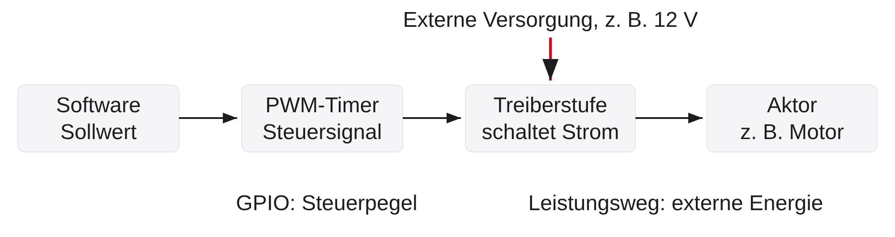{fig-alt="Software und Timer liefern ein Steuersignal an einen Treiber; eine separate Versorgung speist über den Treiber den Aktor."}

- Ein Kommando transportiert nicht die gesamte Aktorleistung
- Ohne Rückmeldung ist ein Tastverhältnis zunächst offene Steuerung

::: notes
Die Abbildung liest sich im Steuerpfad von links nach rechts: Software legt einen Sollwert fest, der Timer erzeugt das Steuersignal, der Treiber schaltet die Last. Ein separater Pfeil führt von der Versorgung zur Treiberstufe. Dieser Leistungsweg liefert die Energie des Aktors. Die Grafik ist ein Funktionsbild, keine vollständig verdrahtete Schaltung.

PWM bedeutet Pulse Width Modulation, Pulsweitenmodulation. Ein GPIO, General Purpose Input/Output, allgemein verwendbarer Ein- und Ausgangspin, liefert hier einen Steuerpegel. Ein Motor mit eigener Versorgung zieht seinen Laststrom über einen passenden Treiber, nicht durch den Prozessorpin. Spannungsbereiche, Stromgrenzen und gemeinsame Bezugspotenziale oder galvanische Trennung sind Eigenschaften der konkreten Verbindung.

Ein vorgegebenes Tastverhältnis ist eine offene Steuerung: Es legt ein Kommando fest, ohne die tatsächliche Bewegung oder Helligkeit zurückzumessen. Regelung würde zusätzlich einen Messwert mit dem Sollwert vergleichen und das Kommando anpassen. Eine Zahl fünfzig Prozent garantiert deshalb nicht fünfzig Prozent Drehzahl oder Leistung. Wir betrachten zunächst nur, welche Ausgangszeitanteile der Timer tatsächlich erzeugt.

Bei beispielhaften drei Komma drei Volt Steuerpegel und zwölf Volt Lastversorgung sind deshalb zwei Spannungsbereiche beteiligt. Die Verbindung dazwischen muss zur Treiberbeschaltung passen. Das Funktionsbild zeigt ihre Aufgabe, behauptet aber keine konkrete elektrische Kompatibilität beliebiger Pins und Treiber.
:::

## Zwei Pegel, viele Zeitanteile

- Ideales digitales Signal: LOW $0$ V, HIGH $3{,}3$ V
- PWM verändert die Dauer der Pegel, nicht ihre Höhe
- Die ungefilterte Leitung bleibt ein Schaltsignal
- Last und Wahrnehmung entscheiden über die Wirkung

::: notes
PWM bedeutet Pulse Width Modulation, Pulsweitenmodulation. Für unsere Signalrechnungen nehmen wir ideale Pegel von null und drei Komma drei Volt an. LOW bezeichnet den niedrigen, HIGH den hohen Pegel. Die Hardware schaltet zwischen diesen Pegeln. Wird die HIGH-Phase verkürzt, entstehen nicht automatisch niedrigere HIGH-Spitzen.

Die zeitliche Folge kann eine träge Last oder einen Filter anders beeinflussen als eine dauerhafte Spannung. Eine LED, Light Emitting Diode, Leuchtdiode, kann während aktiver Phasen Licht abgeben. Ein Motor enthält dagegen unter anderem Induktivität und mechanische Trägheit. Die einfache Zeitanteilsrechnung beschreibt daher zunächst das Kommando, nicht jede Lastreaktion.

Auch die menschliche Wahrnehmung ist keine lineare Spannungsmessung. Wir führen deshalb später zeitlichen Mittelwert, Effektivwert und wahrgenommene Helligkeit getrennt ein. Bevor wir solche Größen berechnen können, benötigen wir eine festgelegte Periode und ein nachvollziehbares Zählmodell.

Bei konstanten drei Komma drei Volt gibt es dagegen keine LOW-Phase. Eine mittlere Zahl unterhalb dieses Pegels kann sowohl ein wechselndes Rechteck als auch eine kleinere konstante Spannung beschreiben. Deshalb reicht eine einzelne Spannungszahl ohne Angabe der Signalform nicht aus.
:::

## Vom Takt zum Ausgang

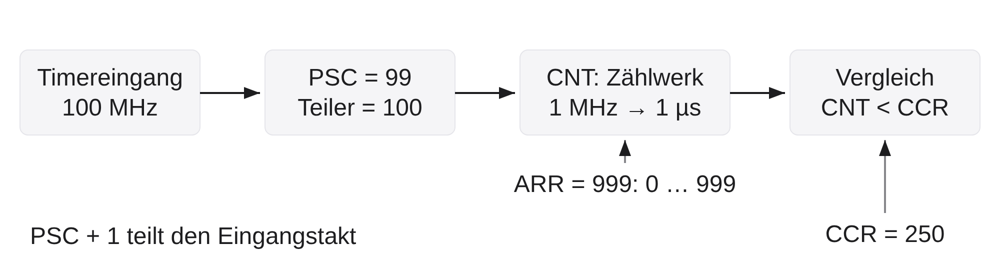{fig-alt="Timer-Eingangstakt durchläuft einen Vorteiler; der Zähler wird durch ARR begrenzt, sein Vergleich mit CCR steuert den Ausgang."}

GPT: Zählwerk, Periodengrenze und Vergleich arbeiten ohne Software pro Tick.

::: notes
GPT heißt General Purpose Timer, allgemein verwendbarer Peripherietimer. Die Abbildung zeigt seine funktionale Kette. Links liegt der Timer-Eingangstakt an. PSC, Prescaler, ist der programmierbare Vorteiler. CNT, Counter, ist der Zähler hinter diesem Teiler. ARR, Auto-Reload Register, bestimmt im Modell die obere Zählgrenze. CCR, Capture/Compare Register, liefert den Vergleichswert für die Ausgangssteuerung.

Die Pfeile zeigen Daten- und Steuerbeziehungen, keine gemessenen Laufzeiten. Für jeden weitergegebenen Zähltick verändert das Zählwerk seinen Zustand. Periodengrenze und Vergleich wirken in Hardware. Der Prozessor muss somit nicht für jedes einzelne Intervall einen Registerwert lesen und den Pin umschalten.

Der eigentliche Pin benötigt dennoch einen verbundenen Ausgangspfad, etwa über Pin-Mux, eine Funktionsauswahl am Pin, sowie passende Kanal- und Timerfreigaben. Diese zusätzlichen Bedingungen werden später separat konfiguriert. Zuerst bestimmen wir, wie schnell der Zähler läuft.

Im Hauptbeispiel erreicht alle hundert Eingangstakte ein Tick das Zählwerk. Tausend solcher Ticks bilden später eine Periode. Der Vorteiler verändert also die Zeitskala, ARR die Zahl der Intervalle und CCR ihre aktive Teilmenge. Erst zusammen beschreiben diese Einstellungen das Ausgangsmuster.
:::

## Der Vorteiler zählt mit

$$
f_\text{cnt}=\frac{f_\text{tim}}{PSC+1}
$$

| Timer-Eingang $f_\text{tim}$ | PSC | Zählfrequenz $f_\text{cnt}$ |
|----------------------------|-----|----------------------------|
| $100$ MHz | $0$ | $100$ MHz |
| $100$ MHz | $99$ | $1$ MHz |

Bei $1$ MHz dauert ein Zählintervall $1\,\mu$s.

::: notes
$f_\text{tim}$ ist die Frequenz am Timereingang, $f_\text{cnt}$ die Frequenz der Zählintervalle. PSC steht für Prescaler, Vorteilerregister. MHz bedeutet Megahertz, eine Million Taktperioden pro Sekunde. Die Registerkonvention PSC plus eins ist eine ausdrückliche Modellannahme; andere Hardware kann andere Teilerkodierungen verwenden.

PSC null teilt durch eins, verändert die Frequenz also nicht. PSC neunundneunzig teilt durch hundert: $100\,\mathrm{MHz}/100=1\,\mathrm{MHz}$. Ein Zählintervall dauert dann $1/f_\text{cnt}=10^{-6}$ Sekunden, eine Mikrosekunde. Ein größerer PSC-Wert verlängert die Intervalle, ohne die Zahl der Registerzustände zu ändern.

Die Timer-Eingangsfrequenz muss aus dem konkreten Taktbaum bestimmt werden. Sie ist nicht allein aus einer beworbenen Prozessortaktfrequenz ableitbar. In dieser Vorlesung ist sie mit hundert Megahertz vorgegeben, damit Perioden- und Pulsrechnungen zusammenpassen. Als Nächstes klären wir, wie viele Intervalle bis zum Neustart verstreichen.

Als Gegenprobe liefert PSC drei in derselben Konvention einen Teiler vier, nicht drei. Bei hundert Megahertz wären das fünfundzwanzig Megahertz Zählfrequenz. Der Registerwert und der tatsächliche Teilfaktor müssen daher beim Lesen eines Programms getrennt notiert werden.
:::

## ARR gilt einen vollen Tick

Kleines Up-Counting-Modell mit `ARR = 3`:

| Zeitpunkt in Zählticks | $0$ | $1$ | $2$ | $3$ | $4$ |
|------------------------|-----|-----|-----|-----|-----|
| CNT | $0$ | $1$ | $2$ | $3$ | $0$ |

$$
N=ARR+1=4,\qquad T=\frac{N}{f_\text{cnt}}
$$

::: notes
ARR bedeutet Auto-Reload Register, Periodengrenze. CNT ist Counter, der aktuelle Zählwert. Up-Counting heißt Aufwärtszählen. Das kleine Beispiel macht die Zählkonvention sichtbar: CNT hält null während des ersten Intervalls, eins während des zweiten, zwei während des dritten und drei während des vierten. Erst der nächste Tick startet wieder bei null.

$N$ ist die Zahl der Intervalle einer Periode, $T$ deren Zeitdauer und $f_\text{cnt}$ die Zählfrequenz. Bei ARR drei hat die Periode vier Intervalle, daher $N=ARR+1$, nicht ARR. Im Hauptbeispiel ARR neunhundertneunundneunzig gibt es entsprechend tausend Intervalle. Ein voller Zustand an der oberen Grenze ist nicht ein zusätzlicher Fehler, sondern Bestandteil des Modells.

Die Aussage muss bei konkreter Hardware für den gewählten Modus geprüft werden. Ein Datenblatt kann andere Grenz- oder Reloadregeln beschreiben. Für alle folgenden Up-Counting-Aufgaben bleibt jedoch dieselbe Konvention erhalten, damit Frequenz und Tastverhältnis nicht durch wechselnde Definitionen widersprüchlich werden.

Die letzte Null der Tabelle ist der Anfang der folgenden Periode. Würde man sowohl diese Null als auch die erste zum selben Zyklus zählen, käme man fälschlich auf fünf Intervalle. Für Zeitdiagramme sind die Perioden daher als direkt aneinandergrenzende, halboffene Abschnitte zu lesen.
:::

## Registerbreite begrenzt den Zählbereich

Ein $16$-Bit-Zähler hat $2^{16}=65536$ Zustände.

$$
T_\text{max}=\frac{65536}{f_\text{cnt}}
$$

- Bei $100$ MHz: $0{,}65536$ ms
- Bei $1$ MHz: $65{,}536$ ms
- Registerbreite und nutzbare PWM-Auflösung sind verschiedene Größen

::: notes
Ein Bit ist eine Binärstelle. Sechzehn Bit erlauben die Werte null bis fünfundsechzigtausendfünfhundertfünfunddreißig, insgesamt fünfundsechzigtausendfünfhundertsechsunddreißig Zustände. Im festgelegten Aufwärtszählmodell mit maximalem ARR, Auto-Reload Register, dauert eine Periode daher so viele Zählintervalle.

$T_\text{max}$ ist diese größte Periodendauer, $f_\text{cnt}$ die Zählfrequenz. Bei hundert Megahertz ergeben sich $65536/10^8=0{,}00065536$ Sekunden, also $0{,}65536$ Millisekunden. Bei einer Million Schritten pro Sekunde sind es $0{,}065536$ Sekunden, $65{,}536$ Millisekunden. Ein Vorteiler kann größere Zeitspannen ermöglichen, macht den einzelnen Tick dabei aber gröber.

PWM heißt Pulse Width Modulation, Pulsweitenmodulation. Ihr verfügbares Tastverhältnis hängt von den tatsächlich gewählten Periodenintervallen ab, nicht nur von der maximalen Registerbreite. Eine kurze Periode kann weit weniger als fünfundsechzigtausend Stufen enthalten. Außerdem haben manche Compare-Register andere Breiten oder Sonderregeln für konstante Ausgänge; diese prüfen wir bei den Endwerten.

Ein sechzehn Bit breites Register enthält nicht den Wert $65536$, sondern höchstens $65535$. Trotzdem sind es mit null zusammen $65536$ Zustände. Diese Unterscheidung zwischen höchstem Zahlenwert und Anzahl der Werte erklärt sowohl die Periodenformel als auch spätere Probleme beim Hundert-Prozent-Compare.
:::

## Zählmodi und Perioden

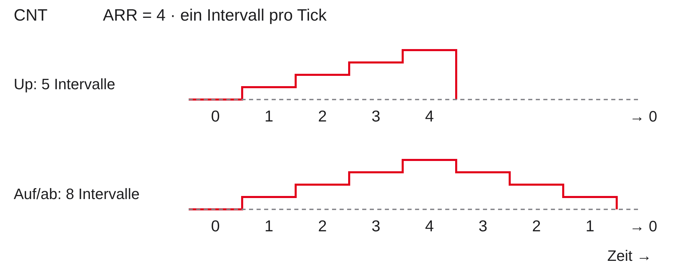{fig-alt="Bei ARR 4 hat der Aufwärtszähler fünf Intervalle; der modellierte Auf-und-ab-Zyklus 0,1,2,3,4,3,2,1 hat acht Intervalle."}

- Up und Down: hier jeweils $ARR+1$ Intervalle
- Center-Aligned: hier $2ARR$, ohne doppelte Endpunktintervalle

::: notes
Up-Counting bedeutet Aufwärtszählen, Down-Counting Abwärtszählen und Center-Aligned eine zentrierte Auf-und-ab-Folge. ARR, Auto-Reload Register, ist die obere Grenze. CNT bedeutet Counter, aktueller Zählwert. Die Abbildung zeigt diskrete Zählerstände über Zählticks, keine analogen Spannungen. Im kleinen Modell ARR vier ist die Up-Folge null, eins, zwei, drei, vier, dann erneut null. Sie hat fünf Intervalle.

Für die zentrierte Folge legen wir null, eins, zwei, drei, vier, drei, zwei, eins und erneut null fest. Das sind acht Intervalle. Die Endpunkte werden beim Richtungswechsel nicht als zwei volle aufeinanderfolgende Intervalle doppelt gezählt. N ist die Zahl der Periodenintervalle. Für positives ARR gilt in genau diesem Modell $N=2ARR$.

Bei einer Million Zählticks pro Sekunde ergeben ARR vier und Up-Modus zweihundert Kilohertz, der Center-Modus dagegen hundertfünfundzwanzig Kilohertz. Die Frequenzen unterscheiden sich nicht exakt um den Faktor zwei, weil auch die Zählkonvention verschieden ist. Center-Aligned-PWM und Endpunktverhalten sind hardwareabhängig; wir verwenden hierfür keine ungeprüfte Up-Formel. Das Hauptmodell bleibt Up-Counting.

Die senkrechte Richtung der Treppen bedeutet wachsender beziehungsweise fallender CNT-Wert; die gleich breiten waagerechten Abschnitte entsprechen jeweils einem Tick. Sie zeigen, dass beim Richtungswechsel keine zusätzliche Wartephase eingezeichnet ist. Das ist die hier ausdrücklich festgelegte Endpunktregel.
:::

## PWM: gleiche Periode, andere Pulsbreite

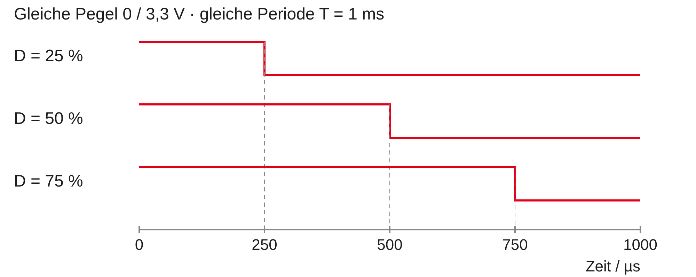{fig-alt="Drei Rechtecksignale mit gleicher Periode und 25, 50 und 75 Prozent HIGH-Anteil; die Pegelhöhe bleibt gleich."}

PWM: Pulse Width Modulation, Pulsweitenmodulation.

::: notes
PWM heißt Pulse Width Modulation, Pulsweitenmodulation. T bezeichnet im Diagramm die volle Periodendauer. Eine Pulsbreite ist die Zeitdauer der aktiven Phase innerhalb einer wiederholten Periode. Im Active-High-Beispiel entspricht aktiv dem hohen Spannungspegel. Die Abbildung zeigt drei alternative Rechteckfolgen mit gleicher Periode von einer Millisekunde, aber unterschiedlicher HIGH-Dauer.

Die horizontale Achse ist Zeit. Jede Bahn wechselt zwischen null und drei Komma drei Volt; die Pegel werden nicht verkleinert. Bei fünfundzwanzig Prozent bleibt der Ausgang eine Viertelmillisekunde HIGH und drei Viertelmillisekunden LOW. Bei fünfzig Prozent sind beide Phasen gleich lang, bei fünfundsiebzig Prozent ist die HIGH-Phase länger.

Die Darstellung ist idealisiert. Flankensteilheit, Treiberverluste und Taktabweichungen sind nicht modelliert. Sie zeigt daher die steuerbare Zeitaufteilung und keine allgemeine Motorleistung oder genaue Helligkeitswahrnehmung. Für belastbare Rechnungen benennen wir nun Periode, Frequenz und Tastverhältnis einzeln.

D steht im Diagramm für den dimensionslosen HIGH-Anteil dieses Active-High-Beispiels. Die drei Signalbahnen sind Alternativen, keine gleichzeitig gemessenen Kanäle. Vergleichen Sie jeweils die erste fallende Flanke: Sie liegt nach zweihundertfünfzig, fünfhundert beziehungsweise siebenhundertfünfzig Mikrosekunden.
:::

## Periode, Frequenz und Tastverhältnis

$$
f_\text{PWM}=\frac1T,\qquad D=\frac{t_\text{aktiv}}T
$$

Bei Active-High: $T=1$ ms, $t_\text{HIGH}=250\,\mu$s.

$$
f_\text{PWM}=1\ \mathrm{kHz},\qquad D=0{,}25=25\,\%
$$

::: notes
PWM ist Pulse Width Modulation, Pulsweitenmodulation. $T$ bezeichnet die Dauer einer vollständigen Periode, $f_\text{PWM}$ die Anzahl solcher Perioden pro Sekunde. $t_\text{aktiv}$ ist die aktive Zeit, $D$ das dimensionslose Tastverhältnis, auf Englisch Duty Cycle. Active-High bedeutet, dass die aktive Phase dem HIGH-Pegel entspricht; dann ist $t_\text{aktiv}=t_\text{HIGH}$.

Eine Millisekunde ist ein Tausendstel einer Sekunde. Die Frequenz ist daher tausend Hertz, ein Kilohertz. Zweihundertfünfzig Mikrosekunden sind eine Viertelmillisekunde. Die Division $250/1000=0{,}25$ ergibt fünfundzwanzig Prozent. Die restlichen siebenhundertfünfzig Mikrosekunden sind im Beispiel inaktiv.

Ein Tastverhältnis ist ein Zeitanteil und enthält keine eigene Spannungs- oder Leistungsdimension. Die Zahl fünfundzwanzig muss als Prozentwert erst durch hundert geteilt werden, bevor sie als Faktor in Formeln eingesetzt wird. Eine Frequenzänderung verändert die Periodendauer; eine Duty-Änderung kann bei gleicher Frequenz nur die Aufteilung verschieben. Die Timerregister sollen diese beiden Ziele nachvollziehbar einstellen.

Eine Kontrollrechnung ist $t_\text{aktiv}=DT$. Beim gleichen Anteil von einem Viertel und einer verdoppelten Periode wäre auch der Puls doppelt so lang. Prozentangabe und Pulsbreite sind somit nur bei festgelegter Periode eindeutig miteinander verknüpft.
:::

## Das durchgängige Timerbeispiel

$$
f_\text{tim}=100\,\mathrm{MHz},\quad PSC=99,\quad ARR=999
$$

$$
f_\text{cnt}=1\,\mathrm{MHz},\quad N=1000,\quad
f_\text{PWM}=\frac{f_\text{cnt}}N=1\,\mathrm{kHz}
$$

Welcher Registerwert bestimmt die aktive Dauer von $250\,\mu$s?

::: notes
$f_\text{tim}$ ist der Timer-Eingangstakt, PSC der Prescaler oder Vorteiler. Der Divisor ist hundert, somit $f_\text{cnt}=100\,\mathrm{MHz}/100=1\,\mathrm{MHz}$. ARR, Auto-Reload Register, ist neunhundertneunundneunzig. Mit der vereinbarten Zählweise ergibt das $N=ARR+1=1000$ Intervalle. Jedes dauert eine Mikrosekunde.

Die Periode beträgt tausend Mikrosekunden, eine Millisekunde. Daher ist die PWM-Frequenz, Wiederholrate der Pulsweitenmodulation, ein Kilohertz. Für eine aktive Dauer von zweihundertfünfzig Mikrosekunden benötigen wir zweihundertfünfzig aktive Zählintervalle. Der Compare-Wert CCR, Capture/Compare Register, wird im folgenden Active-High-Modell auf zweihundertfünfzig gesetzt.

Die Antwort entsteht aus zwei getrennten Rechnungen: Zähltick und Zahl der Intervalle. Sie kann nicht durch die Prozessorfrequenz allein oder durch eine vermeintliche Prozentzahl im Compare-Register ersetzt werden. Aufgabe 1 des Übungsblatts verwendet dieselben Annahmen und prüft ihre Grenzen.

Würde versehentlich ARR tausend eingestellt, gäbe es tausendein Intervalle. Bei unverändertem Zähltakt wären Frequenz und aktiver Anteil geringfügig kleiner: ungefähr $999{,}001$ Hertz und $24{,}975$ Prozent. Diese Abweichung zeigt, warum die obere Grenze einschließlich ihres vollen Intervalls mitgerechnet werden muss.
:::

## Compare erzeugt den HIGH-Anteil

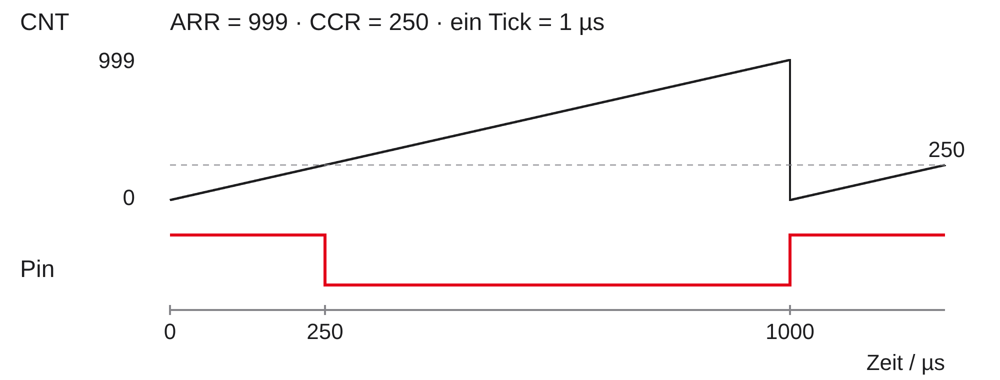{fig-alt="CNT zählt 0 bis 999; bei CCR 250 ist der Ausgang für Zählwerte 0 bis 249 HIGH und ab 250 LOW."}

$$
\mathrm{HIGH}\iff CNT<CCR,\qquad D=\frac{CCR}{ARR+1}
$$

::: notes
CNT bedeutet Counter, Zählwert. CCR ist das Capture/Compare Register, hier die Vergleichsschwelle. ARR ist das Auto-Reload Register, Periodengrenze. Im gewählten Active-High-Up-Counting-Modell wird der Ausgang durch den Vergleich CNT kleiner als CCR aktiviert. Ein Compare-Match ist Gleichheit der beiden Werte.

Die Abbildung zeigt den Zähler auf einer Zeitachse von null bis tausend Mikrosekunden und darunter den Ausgang. Bei CCR zweihundertfünfzig sind die Zählwerte null bis zweihundertneunundvierzig aktiv, also genau zweihundertfünfzig volle Intervalle. Bei CNT zweihundertfünfzig wird der Vergleich falsch. Bis einschließlich neunhundertneunundneunzig bleibt der Pin LOW; erst danach startet die neue Periode bei null.

Der Duty Cycle, Tastverhältnis $D$, ist somit $250/1000=25\,\%$. Ein Zählwert ist keine Dauer allein; seine Dauer stammt aus der Zählfrequenz. Der Ausgang braucht für diesen Vergleich keinen Compare-Interrupt und keine ISR, Interrupt Service Routine, pro Flanke. Die Hardwareverknüpfung mit dem Pin muss allerdings zuvor eingerichtet sein.

Die rote Signalbahn bezeichnet den digitalen Ausgang, die dunkle Treppe den Zähler. Die gestrichelte Schwelle dient zum Ablesen des Vergleichs. Sie ist keine zusätzliche elektrische Spannung; Zählerwert und Pinpegel sind unterschiedliche Größen mit unterschiedlichen Einheiten.
:::

## Null und hundert Prozent

Für $N=1000$ Intervalle:

| CCR | Aktive Intervalle | Tastverhältnis |
|-----|------------------|----------------|
| $0$ | $0$ | $0\,\%$ |
| $250$ | $250$ | $25\,\%$ |
| $1000$ | $1000$ | $100\,\%$ |

Endwerte und darstellbare Compare-Werte in der konkreten Hardware prüfen.

::: notes
CCR bedeutet Capture/Compare Register; es stellt hier die Vergleichsschwelle bereit. Im Modell gilt aktiv genau dann, wenn der Zählwert kleiner als CCR ist. Bei CCR null erfüllt kein Zählwert diese Bedingung. Bei CCR tausend sind alle Zählwerte null bis neunhundertneunundneunzig kleiner; der Ausgang bleibt konstant aktiv. Hundert Prozent ist hier also eine Konstante, kein periodisch schmaler LOW-Impuls.

Die Tabelle setzt voraus, dass CCR tausend als Wert darstellbar und für diesen Modus wirksam ist. Das funktioniert etwa bei einem ausreichend breiten Vergleichsregister im Hauptbeispiel. Am maximalen ARR, Auto-Reload Register, eines Sechzehn-Bit-Timers wäre $N=65536$ dagegen nicht in einem gleich breiten Compare-Register darstellbar. Dann kann ein spezieller erzwungener Ausgangsmodus oder eine andere dokumentierte Lösung nötig sein.

Die mathematische Grenze darf deshalb nicht blind in jeden Registertyp geschrieben werden. Active-High bedeutet bei null Prozent LOW und bei hundert Prozent HIGH; eine umgekehrte Polarität ändert die Pegel. Die folgenden Funktionsbeispiele liefern zunächst mathematische Compare-Werte, deren Hardwaredarstellung separat zu prüfen ist.

Bei null und hundert Prozent hat der konstante Pinpegel keine sichtbaren wiederkehrenden Flanken. Die intern eingestellte Timerperiode kann trotzdem bestehen. Eine Frequenzmessung allein am konstanten Ausgang könnte diese Einstellung daher nicht aus dem Signal rekonstruieren.
:::

## Frequenz ändern, Duty beibehalten

Gleiche Werte `ARR = 999` und `CCR = 250`:

| PSC | Zählfrequenz | PWM-Frequenz | Duty |
|-----|--------------|-------------|------|
| $99$ | $1$ MHz | $1$ kHz | $25\,\%$ |
| $199$ | $0{,}5$ MHz | $0{,}5$ kHz | $25\,\%$ |

HIGH dauert dann $250$ beziehungsweise $500\,\mu$s.

::: notes
PSC steht für Prescaler, Vorteiler. ARR, Auto-Reload Register, bleibt neunhundertneunundneunzig und bestimmt tausend Periodenintervalle. CCR, Capture/Compare Register, bleibt zweihundertfünfzig und bestimmt zweihundertfünfzig aktive Intervalle. Die Timer-Eingangsfrequenz bleibt hundert Megahertz.

PSC neunundneunzig teilt durch hundert, PSC hundertneunundneunzig durch zweihundert. Die Zählfrequenz halbiert sich daher von einer auf eine halbe Million Intervalle pro Sekunde. Die einzelne Intervalldauer verdoppelt sich von einer auf zwei Mikrosekunden. Die Pulsweitenmodulation, PWM, wiederholt damit nur noch fünfhundert statt tausend Perioden pro Sekunde.

Der Anteil aktiver Intervalle ist unverändert $250/1000=0{,}25$. Die absolute HIGH-Dauer wächst dagegen von zweihundertfünfzig auf fünfhundert Mikrosekunden. Die Tabelle trennt Anteil und Dauer. Für eine Anwendung wie einen Servo kann diese Dauer wesentlich sein, selbst wenn das Tastverhältnis gleich bleibt. Frequenz und aktive Zeit dürfen daher nicht allein über einen Prozentwert beurteilt werden.

Die mathematische PWM-Frequenz ist $f_\text{cnt}/N$ mit $N=ARR+1$. Das Tastverhältnis ist CCR geteilt durch dieselbe Intervallzahl. Der erste Ausdruck enthält die Zählfrequenz, der zweite nicht. Diese Formeln begründen direkt, weshalb eine reine Vorteileränderung den Anteil erhält.
:::

## Active-Low ist eine andere Polarität

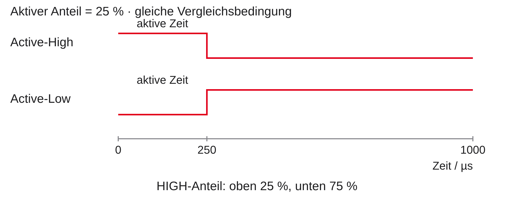{fig-alt="Bei gleicher aktiver Vergleichsphase ist Active-High 25 Prozent HIGH; Active-Low ist 25 Prozent LOW und 75 Prozent HIGH."}

$$
D_\text{HIGH}=
\begin{cases}
D_\text{aktiv} & \text{Active-High}\\
1-D_\text{aktiv} & \text{Active-Low}
\end{cases}
$$

::: notes
Polarität bezeichnet, welcher elektrische Pegel die aktive Phase repräsentiert. Active-High ist im Modell während CNT kleiner als CCR HIGH, Active-Low in dieser selben Phase LOW. CNT heißt Counter, Zählwert; CCR ist das Capture/Compare Register, die Compare-Schwelle. Beide Varianten können deshalb denselben aktiven Zeitanteil haben, obwohl ihre HIGH-Anteile verschieden sind.

Die Abbildung zeigt eine ganze Periode mit fünfundzwanzig Prozent aktiver Zeit. Oben ist diese erste Viertelperiode HIGH. Unten ist sie LOW; die übrigen drei Viertel sind HIGH. $D_\text{aktiv}$ bezeichnet den Anteil der aktiven Phase und $D_\text{HIGH}$ den Anteil des hohen Pegels. Bei Active-Low gilt $D_\text{HIGH}=1-0{,}25=0{,}75$.

Eine an einen Stromsenker angeschlossene Leuchtdiode kann gerade bei LOW eingeschaltet sein. Dann ist die Helligkeitssteuerung mit dem aktiven, nicht dem HIGH-Anteil zu verbinden. Eine bloße Aussage „größeres CCR heißt mehr HIGH“ wäre für diese Polarität falsch. Die Lastbeschaltung muss zum ausgewählten Ausgangsmodus passen.

Der Pegel darf nicht aus der roten Farbe abgeleitet werden: Entscheidend ist die obere beziehungsweise untere Lage der Signalbahn. Die Zeitachse ist in Mikrosekunden beschriftet. Beide aktiven Abschnitte dauern zweihundertfünfzig Mikrosekunden, unabhängig davon, welcher Pegel die Last aktiviert.
:::

## Zeitlicher Mittelwert ist keine neue Pulshöhe

Ideales Rechteck: $0$ und $V_H=3{,}3$ V, HIGH-Anteil $D_H=0{,}25$.

$$
\overline V=D_HV_H=0{,}825\ \mathrm{V}
$$

- Ungefiltert bleiben die Pegel $0$ und $3{,}3$ V
- Die Mittelwertzahl beschreibt das Zeitmittel
- Bei Active-Low den tatsächlichen HIGH-Anteil einsetzen

::: notes
$V_H$ bezeichnet den hohen Spannungspegel, $D_H$ den HIGH-Anteil und $\overline V$ den zeitlichen Mittelwert über eine ganze Periode. Im idealen Rechteck ist die Spannung während einer Viertelperiode drei Komma drei Volt und sonst null. Das gewichtete Zeitmittel ergibt $0{,}25\cdot3{,}3=0{,}825$ Volt.

Diese Zahl ersetzt die beiden tatsächlichen Leitungspegel nicht. Ohne Filter liegt am Pin keine konstante Spannung von null Komma achtzweifünf Volt an. Ein Messgerät kann je nach Messart und Bandbreite unterschiedliche Signalgrößen anzeigen. Für eine physikalische Interpretation muss die gemessene Größe benannt werden.

Die zuvor verwendete aktive Zeit ist bei Active-High gleich dem HIGH-Anteil. Bei Active-Low mit derselben aktiven Viertelperiode ist HIGH dagegen drei Viertel der Zeit. Dann wäre der Spannungsmittelwert $0{,}75\cdot3{,}3=2{,}475$ Volt, obwohl die aktive Lastzeit weiterhin fünfundzwanzig Prozent beträgt. Als Nächstes zeigt eine ohmsche Last, warum auch der Mittelwert nicht mit dem Effektivwert verwechselt werden darf.

Bei null Volt während LOW lässt sich das Zeitmittel auch als Summe zweier gewichteter Pegel schreiben: $\overline V=D_HV_H+(1-D_H)\cdot0$. Diese Darstellung erklärt, weshalb die tatsächliche HIGH-Dauer und nicht ein unabhängig davon benannter Helligkeitswunsch in die Spannungsrechnung eingeht.
:::

## Effektivwert und ohmsche Leistung

Für dasselbe ungefilterte Rechteck:

$$
V_\text{RMS}=V_H\sqrt{D_H}=1{,}65\ \mathrm{V}
$$

Ideale Spannungsquelle, Widerstand $R=1$ k$\Omega$:

$$
P=\frac{V_\text{RMS}^2}{R}
 =D_H\frac{V_H^2}{R}=2{,}7225\ \mathrm{mW}
$$

::: notes
RMS steht für Root Mean Square, Quadratwurzel des mittleren Quadrats, und bezeichnet den Effektivwert. Er vergleicht die Wirkung einer zeitlich veränderlichen Spannung an einem idealen ohmschen Widerstand mit der einer konstanten Spannung. $R$ ist der Widerstand, $P$ die mittlere Leistung. Ein Kiloohm entspricht tausend Ohm.

$D_H$ ist der HIGH-Anteil, $V_H$ der hohe Spannungspegel. Da die Spannung hier für den Anteil $D_H$ gleich $V_H$ und sonst null ist, beträgt ihr mittleres Quadrat $D_HV_H^2$. Die Quadratwurzel ergibt $V_\text{RMS}=3{,}3\sqrt{0{,}25}=1{,}65$ Volt. An tausend Ohm folgt $P=1{,}65^2/1000=0{,}0027225$ Watt, also $2{,}7225$ Milliwatt.

Eine tatsächlich konstante Spannung von $0{,}825$ Volt, dem vorigen Mittelwert, erzeugte dagegen nur $0{,}825^2/1000=0{,}680625$ Milliwatt. Der Mittelwert darf für das ungefilterte Rechteck daher nicht einfach quadriert werden. Die Rechnung setzt eine ideale Spannungsquelle und einen ohmschen Widerstand voraus, nicht ein beliebiges Stromvermögen eines Ausgangspins und nicht einen Motor mit Induktivität und Gegen-EMK. EMK bedeutet elektromotorische Kraft, hier die durch Bewegung erzeugte Gegenspannung.

Die Quadratwurzel wird erst nach der zeitlichen Mittelung gezogen. Bei den beiden Pegeln ist das mittlere Quadrat $0{,}25\cdot(3{,}3\,\mathrm V)^2$. Mit demselben Widerstand ist damit die volle Pulsleistung viermal so groß wie die Leistung der konstanten Mittelwertspannung.
:::

## RC-Filter: Mittelwert und Restwelligkeit

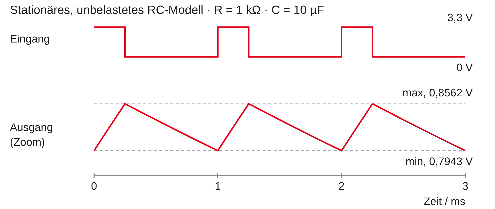{fig-alt="Ein unbelastetes RC-Modell glättet PWM; der vergrößert dargestellte Ausgang schwankt trotz Mittelwert 0,825 V um etwa 61,9 mV."}

$$
\tau=RC=10\ \mathrm{ms},\qquad f_c=\frac1{2\pi RC}\approx15{,}9\ \mathrm{Hz}
$$

::: notes
RC bezeichnet ein Widerstands-Kondensator-Glied. $R$ ist der Widerstand, $C$ die Kapazität, $\tau$ die Zeitkonstante und $f_c$ die Grenzfrequenz eines einfachen Tiefpasses. Ein Tiefpass dämpft schnelle Signalanteile stärker als langsame. PWM heißt Pulse Width Modulation, Pulsweitenmodulation. Das Diagramm zeigt den Eingang und darunter einen ausdrücklich vergrößerten Ausschnitt des gefilterten Ausgangs.

D ist hier der HIGH-Anteil, T die Periodendauer und V_H der hohe Pegel. Mit tausend Ohm und zehn Mikrofarad ist $\tau=0{,}01$ Sekunden, zehn Millisekunden. Die Grenzfrequenz ist ungefähr fünfzehn Komma neun Hertz. Bei einer Kilohertz-PWM ist die Periode eine Millisekunde, deutlich kürzer als die Zeitkonstante. Trotzdem wird der Ausgang nicht vollständig konstant.

Im idealen unbelasteten stationären Modell gilt mit $a=e^{-DT/\tau}$ und $b=e^{-(1-D)T/\tau}$ für die Spitzen $V_\text{max}=V_H(1-a)/(1-ab)$ und $V_\text{min}=bV_\text{max}$. $D=0{,}25$, $T=1$ ms und $V_H=3{,}3$ V ergeben ungefähr $0{,}8562$ und $0{,}7943$ Volt, rund $61{,}9$ Millivolt Restwelligkeit. Der Mittelwert bleibt $0{,}825$ Volt. Nach einem Sollwertsprung benötigt ein solcher Tiefpass für ungefähr fünfundneunzig Prozent der Änderung etwa drei Zeitkonstanten, dreißig Millisekunden. Belastung und reale Bauteile verändern diese Ergebnisse; das Filter ist kein Leistungstreiber.

Die obere rote Bahn zeigt den Eingang zwischen null und drei Komma drei Volt. Die untere ist ein Spannungszoom zwischen den beschrifteten Spitzen. Gleiche gezeichnete Höhen sind deshalb keine gleichen Voltwerte. Der Ausgang steigt während HIGH und sinkt während LOW exponentiell.
:::

## Frequenz und Auflösung konkurrieren

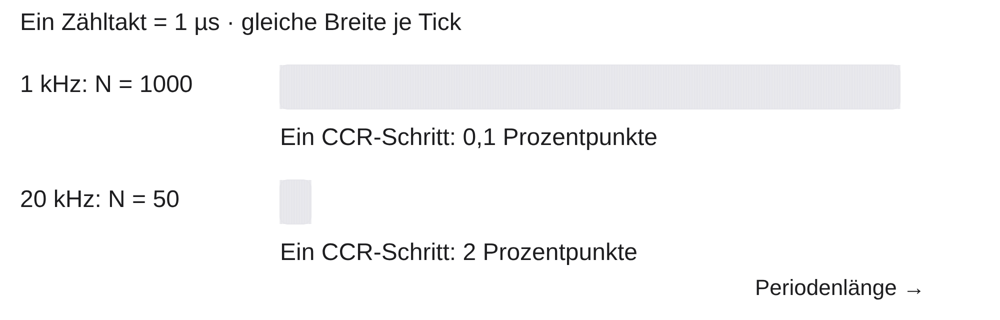{fig-alt="Bei einem MHz Zähltakt enthält eine 1-kHz-Periode 1000 Schritte, eine 20-kHz-Periode nur 50; die Duty-Schrittweite wird gröber."}

$$
N=\frac{f_\text{cnt}}{f_\text{PWM}},\qquad \Delta D=\frac1N
$$

::: notes
$f_\text{cnt}$ ist die Zählfrequenz, $f_\text{PWM}$ die Wiederholfrequenz der Pulsweitenmodulation. $N$ zählt Intervalle einer Periode. CCR bedeutet Capture/Compare Register und ist die Vergleichsschwelle. Die kleinste Änderung des mathematischen aktiven Anteils ist $\Delta D=1/N$, wenn der Vergleich um einen Tick verändert wird.

Bei einem Megahertz Zähltakt und einem Kilohertz Ausgangsfrequenz gibt es tausend Intervalle, ARR, Auto-Reload Register oder Periodengrenze, also neunhundertneunundneunzig. Die Schrittweite beträgt $0{,}001$, null Komma eins Prozentpunkte. Bei zwanzig Kilohertz bleiben nur fünfzig Intervalle, ARR neunundvierzig. Ein Schritt beträgt zwei Prozentpunkte. Die Abbildung zeigt diese Periodenraster und ihre unterschiedlichen Stufenanzahlen, keine gemessene Helligkeit.

Ein Sechzehn-Bit-Timer bietet bei einer kurzen gewählten Periode daher nicht automatisch sechzehn Bit nutzbare PWM-Auflösung. Eine Wunschfrequenz muss zudem mit einem ganzzahligen $N$ und den möglichen Teilern erreichbar sein; andernfalls entsteht eine quantisierte Näherung. Hardwaretakt und Zielauflösung sind gemeinsam auszulegen, bevor die Anwendung aus Prozentwerten Compare-Werte bildet.

Die beiden horizontalen Raster sind mit gleicher Breite je Zähltick gezeichnet. Die längere Periode bietet mehr mögliche Compare-Grenzen; sie ist keine längere Bearbeitungszeit des Prozessors. Ein Duty-Schritt beschreibt eine Änderung in Prozentpunkten, keine relative Prozentänderung des bisher eingestellten Werts.
:::

## Eine PWM-Frequenz begründet auswählen

- Last: gewünschter Stromverlauf oder Pulsprotokoll
- Wahrnehmung: Flimmern und Bewegung berücksichtigen
- Timer: erreichbare Frequenz und Compare-Schrittweite
- Treiber: Schaltaufwand und zulässige Betriebsbedingungen

::: notes
PWM steht für Pulse Width Modulation, Pulsweitenmodulation. Die gewünschte Frequenz ist kein universeller Parameter, der für jede LED oder jeden Motor gleich passt. LED heißt Light Emitting Diode, Leuchtdiode. Wahrnehmbares Flimmern hängt auch von Bewegung, Helligkeit und Beobachtung ab; ein einzelner Richtwert ist keine allgemeine Flimmerfreiheitsgarantie.

Ein Motorstrom hängt unter anderem von Induktivität, Treiber und Versorgung ab. Höhere Schaltfrequenz kann einen anderen Stromverlauf oder akustischen Eindruck erzeugen, erhöht aber gegebenenfalls Schaltverluste. Ein Servo kann dagegen eine dokumentierte Wiederholrate und Pulsbreitenspanne erwarten; dessen Signal ist ein Kommandoformat und kein einfaches Leistungs-Tastverhältnis.

Im Timer begrenzen Eingangstakt, Vorteiler und Zahl der Intervalle die erreichbare Auflösung. Compare bedeutet Vergleich zwischen Zählwert und Schwelle. Eine Frequenzwahl muss deshalb Lastanforderung, Treibereigenschaften und Zählmodell verbinden. Für unsere Rechnungen bleibt das Ein-Kilohertz-Hauptbeispiel erhalten; spätere Anwendungsbeispiele ändern es ausdrücklich, statt daraus allgemeine Hardwareempfehlungen abzuleiten.

Für ein vorgegebenes Protokoll ist zunächst dessen Signalformat einzuhalten. Für eine einfache Dimmaufgabe können dagegen mehrere Frequenzen sinnvoll sein. Die verbleibende Anzahl Compare-Stufen zeigt anschließend, wie fein die Software das aktive Zeitverhältnis einstellen kann.
:::

## Softwareflanken können verspätet sein

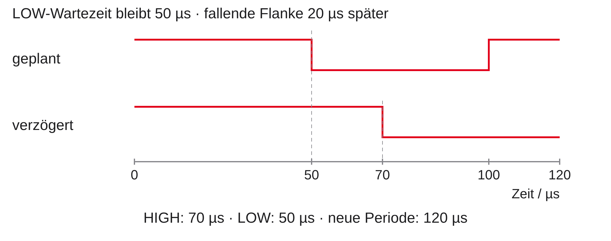{fig-alt="Geplant sind 50 µs HIGH und 50 µs LOW; eine um 20 µs verspätete fallende Flanke ergibt im Beispiel 70 µs HIGH und 50 µs LOW."}

$$
T'=120\,\mu\mathrm{s},\qquad D'=\frac{70}{120}\approx58{,}33\,\%
$$

::: notes
T mit Strich bezeichnet die veränderte Periode, D mit Strich ihren HIGH-Anteil. Bit-Banging bedeutet, dass Software die einzelnen Ausgangspegel selbst setzt. Busy Waiting ist beschäftigtes Warten zwischen diesen Änderungen. Ein Ablauf mit fünfzig Mikrosekunden HIGH und fünfzig Mikrosekunden LOW hätte ideal eine Hundert-Mikrosekunden-Periode, also zehn Kilohertz. Reale Funktions- und Schleifenkosten können schon ohne weitere Ereignisse hinzukommen.

Die Abbildung konstruiert eine zusätzliche Verzögerung der fallenden Flanke um zwanzig Mikrosekunden, während die anschließende LOW-Wartezeit unverändert fünfzig Mikrosekunden beträgt. HIGH dauert nun siebzig Mikrosekunden, die gesamte Periode hundertzwanzig und der HIGH-Anteil ungefähr achtundfünfzig Komma dreiunddreißig Prozent. Die Wiederholrate dieses konstruierten Ablaufs wäre etwa $8{,}33$ Kilohertz.

Eine ISR, Interrupt Service Routine, kann bei freigegebenen Interrupts trotz einer wartenden Hauptschleife laufen und solche Verschiebungen erzeugen. Jitter bezeichnet die Schwankung des Flankenzeitpunkts, nicht jede konstante Latenz. Werden beide Flanken eines einzelnen Pulses gleich um fünf Mikrosekunden verschoben, bleibt seine Breite unverändert; seine Lage verschiebt sich. Hardware-PWM entkoppelt diese Flanken von der Softwarebehandlung, sofern Timer und Ausgangspfad weiterlaufen.

Die roten Bahnen stehen für geplanten und verzögerten Verlauf. Die Zeitachse gibt Mikrosekunden an; sie zeigt unterschiedliche nächste Periodenanfänge. Der Vergleich ist ein konstruiertes Beispiel zur Ursachenanalyse, keine gemessene Aussage über einen bestimmten Prozessor oder Interrupt.
:::

## Hardwarevergleich und echter Pin

- Timerzählwerk und Compare erzeugen den internen Zustand
- Pin-Mux verbindet ihn mit einem Ausgang
- Kanal, Polarität und Timer benötigen passende Freigaben
- Ein laufendes Hardware-Signal ist nicht durch eine ISR pro Flanke erzeugt

::: notes
Compare ist der Hardwarevergleich zwischen CNT, Counter oder Zählwert, und CCR, Capture/Compare-Schwelle. Der daraus gebildete interne Ausgangszustand muss den Pin tatsächlich erreichen. Pin-Mux ist die Funktionsauswahl eines Pins; ein als allgemeiner Softwareausgang konfigurierter Pin muss nicht automatisch das Timersignal zeigen.

Ein PWM-Kanal, Kanal der Pulsweitenmodulation, benötigt passenden Modus, Polarität und Freigabe. Timer-Eingangstakt und Zählwerk müssen ebenfalls laufen. Ein Registerausschnitt, der nur PSC, Prescaler, ARR, Auto-Reload Register, und CCR beschreibt, ist daher kein vollständiger Treiber.

Die zeitliche Erzeugung benötigt in diesem Modell keine Interrupt Service Routine, ISR, bei jeder Flanke. Änderungen und Rückmeldungen können trotzdem Interrupts nutzen. Hardware-PWM ist gegenüber ISR-Latenzen entkoppelt, nicht gegenüber ausgefallenen Takten, falschen Einstellungen oder jeder realen Taktabweichung. Als Nächstes betrachten wir, wann ein neu geschriebener Compare-Wert aktiv werden soll.

Ein hilfreiches Gegenbeispiel ist ein korrekt laufender Zähler bei falscher Pinzuordnung. Seine interne Vergleichsentscheidung kann stimmen, während am betrachteten Anschluss kein PWM-Signal erscheint. Fehlerdiagnose muss daher sowohl Zeitmodell als auch Signalweg prüfen; richtige Frequenzrechnung ersetzt diese Verbindung nicht.
:::

## Compare-Änderung mitten in der Periode

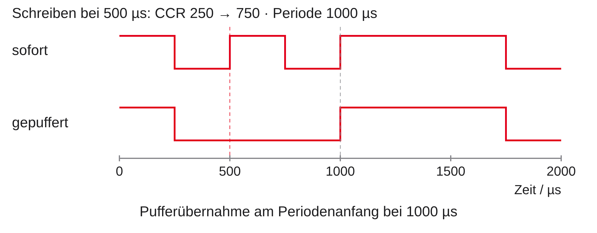{fig-alt="Ein ungepufferter Wechsel von CCR 250 auf 750 bei CNT 500 kann im gewählten Vergleichsmodell einen zweiten HIGH-Abschnitt erzeugen; Preload verschiebt die Übernahme an den Periodenbeginn."}

Preload: neuen Wert puffern und am vereinbarten Update-Ereignis übernehmen.

::: notes
CCR ist das Capture/Compare Register, hier die Vergleichsschwelle. CNT bezeichnet den Zählwert. Im zunächst betrachteten kontinuierlichen Vergleichsmodell war CCR zweihundertfünfzig. Die erste Viertelperiode ist HIGH, danach LOW. Wird bei CNT fünfhundert der aktive Wert sofort auf siebenhundertfünfzig geändert, gilt wieder CNT kleiner als CCR. Der Ausgang kann bis siebenhundertfünfzig erneut HIGH werden.

Die obere Bildbahn enthält dadurch zwei aktive Abschnitte von je zweihundertfünfzig Intervallen. Der Übergangszyklus hat insgesamt fünfzig Prozent HIGH, weder das alte gewünschte Tastverhältnis von fünfundzwanzig noch das neue von fünfundsiebzig Prozent. Dies ist eine explizite Eigenschaft unseres einfachen Vergleichsmodells; konkrete Timer können andere Latch- und Ereignisregeln besitzen. Latch bezeichnet hier das Speichern eines Zustands bis zu einem bestimmten Ereignis.

Preload bedeutet Vorladen in einen Puffer. In der unteren Bahn bleibt der aktive alte Wert bis zum Update-Ereignis erhalten; am folgenden Periodenbeginn übernimmt die Hardware den neuen Wert. Die Änderungsabsicht und der Übernahmezeitpunkt werden damit getrennt. Auch ARR, Auto-Reload Register oder Periodengrenze, und PSC, Prescaler oder Vorteiler, können gepufferte Regeln haben. Welche Register zusammen und wann wirksam werden, muss aus der Peripheriebeschreibung stammen.

Im Diagramm markiert die rote gestrichelte Linie den Schreibzeitpunkt, die graue den nächsten Periodenanfang. Die Achse ist in Mikrosekunden angegeben. Die zweite Periode besitzt in beiden Varianten den neuen aktiven Anteil; der Unterschied liegt im Übergangszyklus.
:::

## Vor der Ausgangsfreigabe konfigurieren

1. Treiber beziehungsweise Ausgang in den vorgesehenen Anfangszustand bringen
2. Timer-Takt, Zählmodus und Pinzuordnung einstellen
3. PSC, ARR, CCR und Polarität festlegen
4. Gepufferte Werte nach dokumentierter Regel übernehmen
5. Erst danach Kanal und Ausgang freigeben

::: notes
PSC bedeutet Prescaler, Vorteiler. ARR, Auto-Reload Register, legt im Modell die Periodengrenze fest. CCR, Capture/Compare Register, bestimmt die aktive Phase. Pinzuordnung verbindet die Timerfunktion mit dem gewünschten Anschluss. Die Initialisierung umfasst daher mehr als drei Registerwerte.

Ein angeschlossener Treiber kann eine eigene Enable-Leitung besitzen, eine Freigabe. Diese sollte während der Vorbereitung den für die Anwendung vorgesehenen Zustand halten. Ein Timerregister oder Pin kann nach Reset eine andere Funktion besitzen als im Normalbetrieb. Die Reihenfolge ist deshalb eine konzeptionelle Vorbereitung, kein universelles Hardware-Rezept.

Puffer- und Update-Regeln können erfordern, dass Werte ausdrücklich übernommen und alte Statusflags passend behandelt werden. Polarität, Kanalmodus und Ausgangsfreigabe dürfen nicht gegensätzlich wirken. Wir nehmen hier keinen bereits getesteten Geräteadressraum an. Die Folie legt die Verantwortlichkeiten offen, ohne eine erfundene Adresse als vollständigen Treiber auszugeben. Eine reine Prozentrechnung lässt sich dagegen unabhängig davon vollständig prüfen.

Für einen Motor kann eine passende Vorbereitung bedeuten, die Treiberfreigabe bis zur vollständigen Konfiguration zu sperren. Ob ein niedriger oder hoher Pegel diese Sperre bewirkt, bestimmt der Treiber. Eine pauschale Zuordnung von LOW zu sicher wäre ohne diese Information falsch.
:::

## Prozentwerte in Compare-Werte umsetzen

C-Lehrfunktion für eine $16$-Bit-Periodengrenze:

```c
uint32_t percent_to_ccr(uint32_t percent, uint16_t arr) {
    if (percent > 100u)
        percent = 100u;
    uint32_t n = (uint32_t)arr + 1u;
    return (percent * n + 50u) / 100u;
}
```

`ARR = 999`: $0,25,50,100\,\%$ ergeben $CCR=0,250,500,1000$.

::: notes
Die C-Funktion berechnet nur den mathematischen Compare-Wert, schreibt kein Gerät. `uint32_t` und `uint16_t` aus `stdint.h` sind vorzeichenlose Zweiunddreißig- und Sechzehn-Bit-Typen. `percent` ist eine gewünschte Prozentzahl und wird auf maximal hundert begrenzt. `arr` ist die modellierte Periodengrenze ARR, Auto-Reload Register. `n` enthält die Zahl der Intervalle $ARR+1$.

Die Addition von fünfzig vor der ganzzahligen Division durch hundert rundet zum nächstgelegenen Intervall, bei einem halben Intervall nach oben. Mit ARR neunhundertneunundneunzig ist `n` tausend. Fünfundzwanzig Prozent ergeben $(25\cdot1000+50)/100=250$ bei Ganzzahldivision. Bei ARR neunundvierzig und einem Prozent ergibt sich ein Compare-Wert von eins, also wegen der groben Auflösung tatsächlich zwei Prozent.

Für gültige Sechzehn-Bit-Grenzen und begrenzte Prozentwerte passen Zwischenwerte in `uint32_t`. Der Rückgabewert kann am oberen Ende fünfundsechzigtausendfünfhundertsechsunddreißig sein. Ob das echte CCR, Capture/Compare Register, diesen Hundert-Prozent-Wert unterstützt, muss gesondert geprüft werden. Die Funktion ist somit vollständig prüfbare Arithmetik mit ausdrücklich begrenztem Hardwareanspruch.

Für null Prozent liefert die Funktion trotz Rundung null; für hundert den Wert $N$. Die maximale Multiplikation ist $100\cdot65536=6553600$, danach kommen fünfzig hinzu. Das bleibt deutlich unter der Grenze eines vorzeichenlosen Zweiunddreißig-Bit-Werts und begründet die gewählte Zwischenwertbreite.
:::

## Drei Kanäle, eine Periode

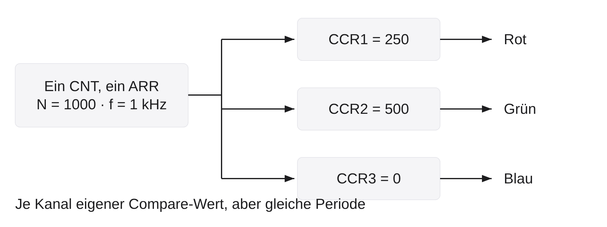{fig-alt="Ein Counter und ARR liefern das gemeinsame Raster an drei Compare-Kanäle für Rot, Grün und Blau; jeder Kanal hat einen eigenen Duty-Wert."}

- RGB: Red, Green, Blue, drei Leuchtdiodenzweige
- Separate Strombegrenzung je Zweig
- Gemeinsame Frequenz, unterschiedliche aktive Zeitanteile

::: notes
RGB bedeutet Red, Green, Blue, Rot, Grün, Blau. Eine RGB-LED, Light Emitting Diode, besteht aus Leuchtdioden verschiedener Spektren. Ein Timer kann mehrere Kanäle besitzen: CNT, Counter, und ARR, Auto-Reload Register, geben ein gemeinsames Periodenraster vor; CCR1, CCR2 und CCR3, Capture/Compare Register, legen unterschiedliche aktive Dauern fest.

Die Abbildung zeigt genau diese Verzweigung vom gemeinsamen Zähler zu drei Vergleichspfaden und Ausgängen. Die Namen der Farben sind Beschriftungen; die Zeichnung ist keine vollständige Anschluss- oder Widerstandsschaltung. Die Lasten benötigen jeweils passende Strombegrenzung und Treiberfähigkeiten.

Common Cathode, gemeinsame Kathode, und Common Anode, gemeinsame Anode, bezeichnen unterschiedliche Anschlussarten. Sie können eine andere aktive Polarität verlangen. Hundert Prozent Rot und fünfzig Prozent Grün können bei passender Beschaltung und Kalibrierung orange wirken; Spektrum, Ströme und Wahrnehmung verhindern aber eine allgemeine Farbgarantie. Für gleichmäßig empfundene Helligkeitsänderungen kommt zusätzlich eine Kennlinie in Betracht.

$N$ bezeichnet in der Grafik die Intervalle einer Periode, $f$ ihre Wiederholfrequenz. Bei Active-High entsprechen die gezeigten CCR-Werte fünfundzwanzig, fünfzig und null Prozent. Die neutrale Zeichenfarbe stellt keine Farbmischung dar; die drei Zweige werden nur über ihre Namen unterschieden.
:::

## Eine Kennlinie ist eine Modellentscheidung

Gewünschter normierter Helligkeitswert $b$, Lehrkennlinie:

$$
D=b^{2{,}2}
$$

| $b$ | $0$ | $0{,}25$ | $0{,}5$ | $0{,}75$ | $1$ |
|-----|-----|----------|---------|----------|-----|
| CCR bei $N=1000$ | $0$ | $47$ | $218$ | $531$ | $1000$ |

::: notes
$b$ ist ein normierter Eingabewert zwischen null und eins, der hier eine gewünschte Helligkeit repräsentiert. $D$ ist das aktive Tastverhältnis. Die Potenzkennlinie $D=b^{2{,}2}$ ist eine didaktische Gamma-Annahme, keine universelle Beschreibung jedes Auges oder jeder Leuchtdiode.

Für tausend Periodenintervalle ergibt sich der Compare-Wert näherungsweise als gerundetes $1000D$. Ein Viertel als Eingabewert ergibt $0{,}25^{2{,}2}\approx0{,}04737$, also CCR siebenundvierzig. Eine Hälfte ergibt ungefähr $0{,}21764$, also zweihundertachtzehn. Drei Viertel ergeben ungefähr $0{,}53105$, also fünfhunderteinunddreißig. Null und eins bleiben die Endwerte.

CCR bedeutet Capture/Compare Register, $N$ die Zahl der Periodenintervalle. Die Kennlinie verändert die Zuordnung zwischen Eingabe und elektrischer aktiver Zeit, nicht die PWM-Frequenz. PWM heißt Pulse Width Modulation, Pulsweitenmodulation. Reale Farbwiedergabe und Helligkeit benötigen gegebenenfalls Messung und Abgleich. Schon dieses einfache Beispiel zeigt, warum „fünfzig Prozent Eingabe“ und „fünfzig Prozent Duty“ nicht automatisch dasselbe sind.

Bei $b=0{,}5$ liefert das lineare Modell einen halben aktiven Anteil, die gewählte Potenzkennlinie dagegen nur etwa $0{,}218$. Das ist ein gezielter Unterschied in der Zuordnung, kein Rechenfehler. Welche Kennlinie die gewünschte Wahrnehmung trifft, kann nur für die konkrete Anwendung beurteilt werden.
:::

## Servo: Pulsbreite als Kommando

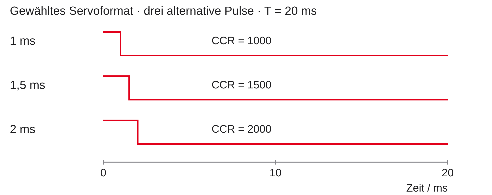{fig-alt="Das Servo-Lehrbeispiel zeigt drei alternative Pulse von 1,0, 1,5 und 2,0 ms auf einer gemeinsamen 20-ms-Zeitachse."}

Bei $1$ MHz Zähltakt: `ARR = 19999` und `CCR = 1000, 1500, 2000`.

::: notes
Ein Servo interpretiert ein Eingangssignal als Stellkommando. Im ausdrücklich gewählten Beispiel beträgt die Wiederholperiode zwanzig Millisekunden, also fünfzig Hertz. Die aktiven Pulsbreiten sind eine, eine Komma fünf und zwei Millisekunden. Die Grafik zeigt diese drei getrennten alternativen Pulse auf derselben Zeitachse. Die lange restliche LOW-Phase ist nicht einfach eine prozentuale Aussage über die Motorleistung.

Bei einer Million Zählticks pro Sekunde dauert jedes Intervall eine Mikrosekunde. Zwanzigtausend Intervalle benötigen im Up-Counting-Modell ARR neunzehntausendneunhundertneunundneunzig. CCR, Capture/Compare Register, tausend, tausendfünfhundert und zweitausend ergeben die genannten Pulsbreiten. Die HIGH-Anteile sind fünf, sieben Komma fünf und zehn Prozent.

Welche Winkel und Wiederholraten ein realer Servo akzeptiert, ist servospezifisch. Die oft genannten Pulse stehen hier nur für beispielhafte Stellbereiche, nicht für eine garantierte Null-, Neunzig- oder Hundertachtzig-Grad-Zuordnung. Leistung erhält der Servo über eine geeignete separate Versorgung; der Steuerpin liefert das Kommando.

ARR steht für Auto-Reload Register, die Periodengrenze. Die Zeitachse zeigt Millisekunden; die kurzen roten HIGH-Abschnitte sind maßstäblich viel kürzer als die volle Periode. Sie sind drei alternative Kommandos und kein einzelner Puls, der seine Breite während des Zeichnens ändert.
:::

## Motorstrom braucht eine Treiberstufe

- GPIO liefert den Steuerpegel
- Eine H-Brücke schaltet die externe Motorversorgung
- Induktiver Strom kann auch in einer inaktiven Phase weiterfließen
- Totzeit und Abschaltverhalten gehören zum Treiberentwurf

::: notes
GPIO heißt General Purpose Input/Output, allgemein verwendbarer Ein- und Ausgang. Sein zulässiges Strom- und Spannungsvermögen stammt vom Datenblatt. Ein Motorstrom darf nicht einfach durch einen solchen Steuerpin geleitet werden. Eine H-Brücke ist eine Treiberstruktur, die eine separate Versorgung geeignet an den Motor schaltet und auch die Stromrichtung beeinflussen kann.

DC bedeutet Direct Current, Gleichstrom. Bei einem Gleichstrommotor bestimmen Versorgung, Induktivität, Gegen-EMK, die als Gegenspannung wirksame elektromotorische Kraft, mechanische Last und Treiber gemeinsam den Strom und die Bewegung. Eine inaktive PWM-Phase, Phase der Pulsweitenmodulation, bedeutet daher nicht zwingend sofort null Motorstrom. Umlauf- beziehungsweise Freilaufpfade sind Teil der Leistungsschaltung.

In einer Halbbrücke dürfen die beiden gegensätzlichen Leistungsschalter nicht unzulässig gleichzeitig durchschalten. Totzeit bezeichnet eine Zeit ohne gleichzeitige Leitfähigkeit beim Umschalten. Das konkrete Verfahren gehört zum Treiber, nicht zu einer abstrakten Prozentfunktion. Aus, Bremsen und Halten sind verschiedene Aktoraktionen. Diese Unterscheidung wird beim Reset wichtig; ein Neustart allein wählt keine davon universell aus.

Ein PWM-Timer legt das Timing fest, aber nicht die zulässige Motorlast. Auch ein korrekt berechnetes Tastverhältnis kann an einer ungeeigneten Treiberstufe problematisch sein. Die Trennung von Signalrechnung und Leistungspfad verhindert, dass Registerwerte als vollständiger Motorentwurf verstanden werden.
:::

## Gleicher Duty, anderes Anwendungssignal

| Anwendung | Relevante Größe |
|-----------|-----------------|
| LED-Lehrmodell | aktive Lichtzeit und Strom |
| Servo-Lehrmodell | Pulsbreite und Wiederholperiode |
| Motor mit Treiber | Stromverlauf, Versorgung und Last |

Was bedeuten $7{,}5\,\%$ HIGH bei $20$ ms gegenüber $1$ ms Periode?

::: notes
Duty Cycle ist das Tastverhältnis. LED heißt Light Emitting Diode, Leuchtdiode. Bei einer LED-Last kann die aktive Zeit zusammen mit dem Zweigstrom die mittlere Lichtabgabe beeinflussen; Wahrnehmung und Kennlinie kommen hinzu. Ein Servo erwartet dagegen eine Pulsbreite innerhalb eines bestimmten Wiederholmusters. Ein Motorstrom braucht ein Modell der Treiber- und Lastwirkung.

Die Verständnisfrage hält den HIGH-Anteil bei sieben Komma fünf Prozent fest. Bei zwanzig Millisekunden Periode ergibt $t_H=0{,}075\cdot20=1{,}5$ Millisekunden. Bei einer Millisekunde Periode sind es $0{,}075$ Millisekunden, fünfundsiebzig Mikrosekunden. Der gleiche Anteil erzeugt somit sehr unterschiedliche Kommandopulse.

Die erste Variante passt zur mittleren Pulsbreite unseres Servo-Beispiels; die zweite darf ohne Servobeschreibung nicht als dasselbe Kommando interpretiert werden. Die Frage verbindet die früher getrennten Größen Periode, Anteil und Dauer. Sie bereitet Aufgabe 4 des Übungsblatts vor, bevor wir Sollwerte zeitlich verändern und die fortlaufende Anwendung überwachen.

$t_H$ bezeichnet die HIGH-Dauer, $D_H$ ihren Anteil und $T$ die volle Periode. Es gilt $t_H=D_HT$. Die Formel benötigt daher neben der Prozentangabe stets eine Zeitbasis; aus sieben Komma fünf Prozent allein folgt noch keine absolute Pulsdauer.
:::

## Sollwertänderung ist langsamer als der Träger

Lehrmodell:

| Zeitfunktion | Frequenz oder Intervall |
|--------------|------------------------|
| Hardware-PWM | $1$ kHz |
| `mtime`-Zeitquelle | $10$ MHz |
| Helligkeitsaktualisierung | alle $10$ ms |

Zehn Millisekunden entsprechen $100000$ `mtime`-Ticks.

::: notes
PWM bedeutet Pulse Width Modulation, Pulsweitenmodulation. Ihr Träger ist hier das jede Millisekunde wiederholte Hardwaremuster. `mtime`, Machine Time, liefert dagegen die Zeitquelle aus Vorlesung 3; deren Frequenz ist im Beispiel zehn Megahertz. Ein Helligkeitssollwert wird nur alle zehn Millisekunden geändert, also hundertmal pro Sekunde.

Zwischen zwei Sollwertänderungen liegen zehn volle PWM-Perioden. Der Timer erzeugt ihre Flanken selbst. Die Systemzeit hilft dem Hauptprogramm lediglich, den nächsten Änderungszustand zu berechnen. Bei zehn Millionen Timer-Ticks pro Sekunde entsprechen zehn Millisekunden hunderttausend Ticks. Diese dürfen nicht mit den eine Million Schritte pro Sekunde des PWM-Zählers hinter dem Vorteiler verwechselt werden.

Ein festes Raster sollte aus der gespeicherten Startzeit beziehungsweise den bisherigen Sollzeiten folgen. Bei einer Verspätung kann die Anwendung gezielt einen aktuellen Zustand berechnen und ausgelassene Zwischenwerte überspringen, statt das ganze Raster zu verschieben. Das ist eine gewählte Fading-Politik, keine Eigenschaft des Watchdogs. Die folgende reine Funktion macht diese Zustandsfolge überprüfbar.

Der Systemtakt im Beispiel ist eine Lehrannahme für die Zeitquelle, kein Automatismus aus dem PWM-Eingangstakt. Ein geeigneter Zeitwert muss auf RV32, der RISC-V-Variante mit Zweiunddreißig-Bit-Integerregistern, wie zuvor erläutert konsistent gelesen werden. Sonst kann bereits die Berechnung des aktuellen Schritts falsch sein.
:::

## Eine nicht blockierende Fading-Folge

Ein Schritt entspricht $10$ ms; Berechnung eines linearen Duty-Sollwerts:

```c
uint8_t fade_percent(uint64_t step) {
    uint32_t phase = (uint32_t)(step % 200u);
    return (uint8_t)(phase <= 100u ? phase : 200u - phase);
}
```

Schritte $0,100,200$ ergeben $0,100,0\,\%$; ein Zyklus dauert $2$ s.

::: notes
Die C-Lehrfunktion liefert eine Zustandsfolge, keinen kompletten Gerätezugriff. `uint8_t`, `uint32_t` und `uint64_t` aus `stdint.h` sind vorzeichenlose Typen mit acht, zweiunddreißig und vierundsechzig Bit. `step` ist die Zahl verstrichener Zehn-Millisekunden-Intervalle seit einem Start. Sie kann im betrachteten Zeitraum ohne Umlauf aus einem konsistenten Zeitwert und einem Startwert berechnet werden.

`phase` ist der Rest bei Division durch zweihundert und liegt zwischen null und hundertneunundneunzig. Bis hundert steigt das Ergebnis, danach ergibt `200 - phase` die fallende Hälfte. Schritte null, fünfundzwanzig, hundert, hundertfünfundzwanzig, hundertneunundneunzig und zweihundert liefern null, fünfundzwanzig, hundert, fünfundsiebzig, eins und wieder null Prozent. Zweihundert Schritte zu zehn Millisekunden ergeben zwei Sekunden pro vollständigem Zyklus.

Das Hauptprogramm kann den aktuellen Schritt berechnen, den Compare-Wert bilden und ihn über einen echten Treiber übernehmen lassen. Die Funktion wartet nicht und holt nicht künstlich jeden verpassten Zustand nach. Eine wahrnehmungsbezogene Kennlinie wäre ein eigener weiterer Schritt. Sie füttert auch keinen Watchdog; ein neuer Duty-Wert allein ist nicht der gesamte benötigte Fortschrittsnachweis.

Der Ausdruck mit Fragezeichen und Doppelpunkt ist der bedingte C-Operator: Er wählt abhängig vom Vergleich einen der beiden Ergebniszweige. Der Restoperator macht die Phase periodisch. Weil beide Zweige höchstens hundert liefern, passt das Ergebnis in den Acht-Bit-Rückgabetyp.
:::

## Was passiert, wenn das Hauptprogramm hängt?

- Bei weiterlaufendem Timer und Takt kann die letzte PWM weiterlaufen
- Neue Sollwerte und andere Arbeit bleiben aus
- Eine laufende ISR beweist nicht Fortschritt der Anwendung
- Überwachung muss den relevanten Fehler tatsächlich beobachten

::: notes
PWM ist Pulse Width Modulation, Pulsweitenmodulation. Die Hardware kann das zuletzt konfigurierte Muster selbstständig wiederholen. Wenn das Hauptprogramm in einer fehlerhaften Dauerschleife stecken bleibt, müssen Timer, Ausgangspfad und Versorgung deshalb nicht ebenfalls anhalten. Neue Fading-Werte bleiben aus, aber das alte Signal kann weiter am Pin stehen.

ISR bedeutet Interrupt Service Routine, Unterbrechungsbehandlung. Bei wirksamen Freigaben kann eine kurze Timer-ISR weiterhin laufen, obwohl das Hauptprogramm seine Aufgaben nicht mehr erledigt. Dies entspricht der Trennung von Pending, Freigabe und tatsächlicher Softwarearbeit aus Vorlesung 3.

Nicht jede `while(1)`-Schleife ist ein Fehler: Eine normale Hauptschleife ist häufig absichtlich endlos. Der Unterschied ist, ob sie die vereinbarten Verarbeitungsschritte weiter ausführt. Ein künstlicher Hänger ohne Rückkehr ist außerdem nicht automatisch ein Deadlock, der eine gegenseitige Warteabhängigkeit bezeichnet. Der Watchdog muss daher ein passendes Lebenszeichen überwachen, statt bloß irgendeine weiterlaufende Aktivität zu zählen.

Ein Beispiel ist eine Ausgabe, die vor dem Hänger auf fünfundsiebzig Prozent stand. Ein autonomer Timer kann dieses Muster weiter erzeugen, obwohl ein neuer Sensorwert nie mehr berechnet wird. Sichtbare Ausgangsaktivität beweist daher nicht automatisch die Aktualität ihrer zugrunde liegenden Entscheidung.
:::

## Der Watchdog überwacht eine Frist

- WDT: Watchdog Timer
- Ein gültiger Feed erneuert die Frist
- Im Basismodell führt Ablauf zu einem Reset
- Verhalten, Takt, Start und Abschaltbarkeit sind plattformabhängig

::: notes
WDT bedeutet Watchdog Timer, zeitbezogener Überwachungsbaustein. Ein Feed oder Refresh ist die von der Software veranlasste Erneuerung seiner Frist. Bleibt sie aus, läuft der Watchdog ab. Unser Basismodell löst dann einen Reset aus, ohne auf eine noch funktionierende ISR, Interrupt Service Routine, angewiesen zu sein.

Ein häufiges Hardwaremodell ist ein Abwärtszähler, der beim Start beziehungsweise Feed einen Wert lädt und anschließend bis zum Ablauf zählt. Ein anderes Modul kann zusätzlich eine Vorwarnung, andere Resetziele oder besondere Betriebszustände haben. Der Ausdruck Watchdog allein garantiert weder eine unabhängige Taktquelle noch, dass das ganze System stromlos wird.

Software muss den gültigen Feed durch die dokumentierte Sequenz auslösen. Eine dokumentierte Schlüssel- oder Schreibfolge ist Teil des konkreten Gerätemodells. Vor der Nutzung sind Timeout, Takt, Startverhalten, Debug- oder Schlafverhalten und mögliche Abschaltbarkeit zu verstehen. Zunächst legt eine Zeitachse offen, ab welchem Moment die Frist tatsächlich läuft.

Reset bedeutet hier einen Neustart der betroffenen Verarbeitungseinheit und ihrer dokumentierten Resetdomänen. Der Name beschreibt keine allgemeine Trennung einer externen Lastversorgung. Für eine zeitliche Rechnung muss zuerst bekannt sein, wann der letzte Feed erfolgreich war.
:::

## Die Frist beginnt beim letzten Feed

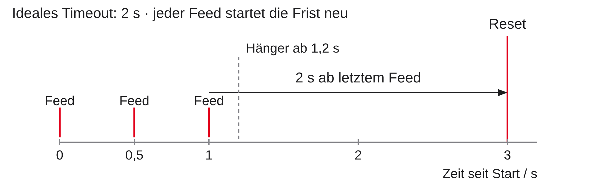{fig-alt="Gültige Feeds bei 0, 0,5 und 1,0 s setzen das ideale Zwei-Sekunden-Timeout jeweils neu; ohne weiteren Feed folgt Reset bei 3,0 s."}

Hänger ab $1{,}2$ s; nominaler Reset $1{,}0+2{,}0=3{,}0$ s.

::: notes
Feed bedeutet das gültige Auffrischen des Watchdog-Timers, WDT. Die horizontale Achse zeigt Zeit in Sekunden. Wir nehmen ein ideales Timeout von zwei Sekunden und gültige Feeds bei null, einer halben und einer Sekunde an. Jede erfolgreiche Erneuerung verschiebt die Frist erneut.

Der letzte Feed liegt bei einer Sekunde, daher endet das Timeout bei drei Sekunden. Ein Hänger ab einer Komma zwei Sekunden ist kein eigenes Startsignal des Watchdogs. Bis zur nominellen Auslösung verstreichen ab dem Hänger folglich $3-1{,}2=1{,}8$ Sekunden. Reset bei zwei Sekunden seit Systemstart oder bei drei Komma zwei Sekunden wäre für diesen Ablauf falsch.

Die Linien markieren getrennt Feed-Zeitpunkte, Fehlerbeginn und Fristende. Taktabweichungen und Ausgangsabschaltzeiten sind hier noch nicht eingerechnet. Ein Watchdog erkennt nicht den Hänger unmittelbar, sondern das Ausbleiben der nächsten vereinbarten Erneuerung. Die Software muss deshalb festlegen, was eine solche Erneuerung tatsächlich bestätigt.

Die Feedmarkierungen sind diskrete Auffrischungen, kein kontinuierliches Lebenszeichen. Der Pfeil spannt die zwei Sekunden ab dem letzten Feed auf. Eine noch geplante spätere Erneuerung zählt nicht: Erst die tatsächlich ausgeführte gültige Aktion ändert den Beginn der nächsten Frist.
:::

## Feed-Ort allein ist kein Gesundheitsnachweis

- Bedingungsloser Feed aus einer Tick-ISR kann einen Hänger verdecken
- Ein Feed in `main` ist ebenfalls nicht automatisch richtig
- Erst frische relevante Arbeit und Plausibilität prüfen
- Das Lebenszeichen muss seit dem letzten Feed neu entstanden sein

::: notes
main bezeichnet hier die C-Funktion mit dem Anwendungsablauf; die Hauptschleife erledigt dessen fortlaufende Arbeit. ISR heißt Interrupt Service Routine, Unterbrechungsbehandlung. Ein periodischer Timer kann eine ISR auch dann ausführen, wenn die Hauptschleife hängt. Füttert diese ISR den WDT, Watchdog Timer, bedingungslos weiter, wird der relevante Ausfall nicht erkannt. Ein einzelner Programmort entscheidet aber noch nicht über die Qualität der Überwachung.

Auch eine Endlosschleife im Hauptprogramm kann wiederholt eine Feed-Funktion aufrufen, ohne neue Sensordaten auszuwerten oder Ausgaben korrekt zu aktualisieren. Umgekehrt kann ein bewusst entworfener Supervisor, eine Überwachungsinstanz, Feeds veranlassen, wenn er die erforderlichen frischen Fortschrittsmeldungen wirklich prüft. Die pauschale Regel „nur am Ende von main“ genügt daher nicht.

Frisch bedeutet hier: Die geforderten Arbeitsschritte wurden seit der letzten bestätigten Überwachungsrunde erneut abgeschlossen. Plausibilität ergänzt die reine Erreichbarkeit eines Codepunkts, erkennt aber ebenfalls nicht jeden Fehler. Die nächste Folie beschreibt eine solche Runde als konkretes Zustandsmodell statt als unbegründeten Feed-Aufruf.

Beispielsweise kann die Eingangserfassung Fortschritt melden, während die Berechnung seit der vorigen Runde nichts Neues geliefert hat. Ein Feed allein aufgrund des neuen Eingangs würde dann genau den kritischen Stillstand verdecken. Die Meldungen müssen die gewählten gemeinsamen Anforderungen erfüllen.
:::

## Fortschritt als Überwachungsrunde

Eine Runde verlangt frische Ergebnisse aus:

1. Eingang erfassen und plausibilisieren
2. Steuerentscheidung berechnen
3. Neue Ausgabe erfolgreich übernehmen

Erst bei allen Meldungen und fälligem Service Feed erlauben; danach eine neue Runde beginnen.

::: notes
Eine Überwachungsrunde ist hier eine definierte Anwendungsepoche seit dem letzten Feed. Der WDT, Watchdog Timer, sieht nicht unmittelbar alle Rechenergebnisse. Eine Softwareüberwachung muss deshalb passende Meilensteine zusammenführen. Das Modell verlangt einen frischen Eingang, eine abgeschlossene Steuerentscheidung und eine erfolgreich übernommene Ausgabe.

Ein gespeichertes Wahrheitsbit aus einer alten Runde darf nicht dauerhaft weiter als neuer Fortschritt gelten. Nach einem gültigen Feed werden die Meldungen daher für die nächste Runde neu bewertet, beispielsweise durch neue Epochennummern oder gezielte Rücksetzung im korrekt synchronisierten Modell. Die genauen gemeinsamen Zugriffe müssen wie in Vorlesung 3 konsistent sein.

Service fällig bedeutet außerdem, dass der erlaubte Feed-Zeitpunkt erreicht ist. Ein Fenster-Watchdog kann zu frühes Auffrischen ablehnen. Erneuerung darf also nicht allein aus der schnellen Ausgabefunktion folgen. Dieses Zustandsmodell ist eine didaktische Überwachungsstrategie, kein vollständiger Nachweis funktionaler Sicherheit. Es macht jedoch sichtbar, weshalb eine alte Flag-Kombination oder ein weiterlaufender Tick allein den gewünschten Fortschritt nicht belegt.

Eine neue Eingangsmeldung zusammen mit einem alten Ausgabe-Flag genügt nicht für die nächste Runde. Das Beispiel verlangt drei neue Meldungen derselben Epoche. Ob die berechnete Entscheidung fachlich richtig ist, bleibt zusätzlich von der Plausibilitätsprüfung und dem Anwendungsmodell abhängig.
:::

## Eigener Takt und Feed-Fenster sind verschieden

| Eigenschaft | Beobachtetes Problem |
|-------------|----------------------|
| unabhängige Zeitquelle | Ausfall des überwachten Haupttakts |
| Feed-Fenster | zu frühe oder zu späte Erneuerung |

Eine Eigenschaft folgt nicht automatisch aus der anderen.

::: notes
Ein Watchdog benötigt eine fortschreitende Zeitbasis, um einen fehlenden Feed, ein fehlendes Auffrischen, zu erkennen. Bleiben Prozessor und Überwachung beim Ausfall derselben Taktquelle gemeinsam stehen, kann diese Anordnung genau diesen Fehler nicht mehr zeitlich erkennen. Eine geeignete unabhängige Zeitquelle erweitert daher die beobachtbaren Ausfälle.

Ein Fenster-Watchdog prüft dagegen das Alter seit dem letzten gültigen Feed. Er kann Erneuerung vor einem unteren Zeitlimit oder nach der Frist zurückweisen. Das sagt allein nichts darüber, woher sein Takt stammt. Ein unabhängiger Watchdog kann Fensterfunktionen haben, ein Fenster-Watchdog kann auch aus einem Systemtakt gespeist sein.

Ein Herstellerbeispiel ist der IWDG, Independent Watchdog, der STM32F4-Dokumentation mit LSI, Low-Speed Internal, internem langsamen Takt. Dessen WWDG, Window Watchdog, verwendet hingegen einen abgeleiteten Bustakt. Diese Bezeichnungen und Eigenschaften sind keine universellen RISC-V-Regeln. Weitere Betriebszustände wie Debug-Halt oder Schlaf können das Verhalten ebenfalls verändern und müssen zur konkreten Plattform dokumentiert werden.

RISC-V ist die Prozessor-Befehlssatzarchitektur, nicht die Festlegung dieser Peripheriemodule. Beim Herstellerbeispiel bezeichnet der Bustakt den Takt der betreffenden Peripherieanbindung. Damit sind eine unabhängige Uhr und ein zusätzliches Feed-Fenster zwei getrennt zu prüfende Merkmale.
:::

## Taktabweichung verändert das Timeout

Lehrmodell: nominal $T_0=2$ s, tatsächlicher Watchdog-Takt $\pm20\,\%$.

$$
T_\text{min}=\frac{2}{1{,}2}\approx1{,}667\ \mathrm{s},\qquad
T_\text{max}=\frac{2}{0{,}8}=2{,}5\ \mathrm{s}
$$

Gesunder maximaler Feed-Abstand muss unter dem kürzesten tatsächlichen Timeout liegen.

::: notes
$T_0$ ist der nominelle Timeout-Wert. Wir nehmen eine feste Zahl Watchdog-Zählschritte an. Die tatsächliche Dauer ist deshalb umgekehrt proportional zur Frequenz. Ein zwanzig Prozent schnellerer Takt liefert den frühesten Ablauf $T_\text{min}=2/1{,}2\approx1{,}667$ Sekunden. Ein zwanzig Prozent langsamerer liefert den spätesten $T_\text{max}=2/0{,}8=2{,}5$ Sekunden. Die Toleranz ist eine Lehrannahme, keine Angabe für ein bestimmtes Produkt.

Ein gesunder Programmablauf mit maximal einer Komma vier Sekunden bis zum Feed und zusätzlich null Komma zwei Sekunden begrenzter Verzögerung hätte insgesamt eine Komma sechs Sekunden Abstand. Das liegt in diesem Modell noch unter dem kürzesten Timeout. Eine bloße Aussage „unter zwei Sekunden“ wäre dagegen unzureichend.

Für die späteste Reaktion auf einen Fehler ist die andere Grenze relevant. Zum langsamen Timeout können Zeit bis zur Ausgangsabschaltung, Neustart oder andere Maßnahmen hinzukommen. Die Auslegung braucht somit sowohl eine Grenze gegen unbeabsichtigte Resets als auch eine Grenze für die Fehlerreaktion. Ein nomineller Wert allein erfüllt keine dieser beiden Aufgaben vollständig.

Ein Timeout ist die Dauer bis zur Reaktion nach ausbleibender Erneuerung. Die Prozentabweichung betrifft hier den Takt, nicht direkt die Dauer. Würde man einfach zwei Sekunden um zwanzig Prozent verkürzen oder verlängern, entstünden daher falsche Zeitgrenzen.
:::

## Ein Fenster erlaubt nicht jeden Feed

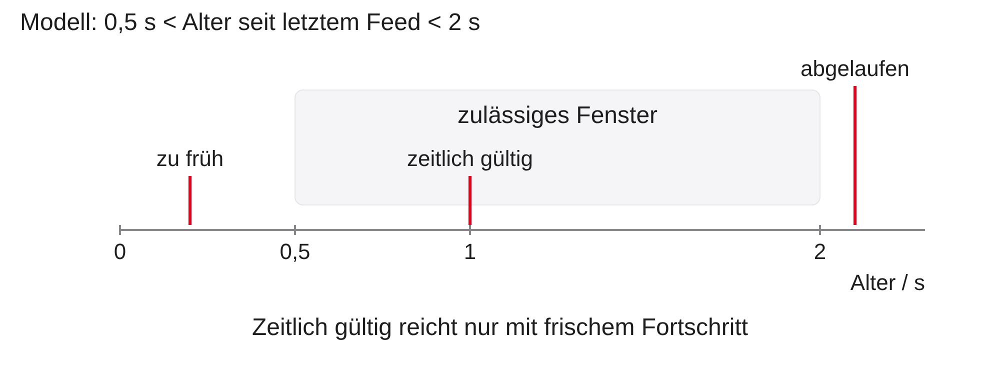{fig-alt="Im gewählten Modell sind Feed-Alter über 0,5 s und unter 2 s zulässig; 0,2 s ist zu früh, 1 s gültig, 2,1 s bereits abgelaufen."}

Modellbedingung: $0{,}5\ \mathrm{s}<t_\text{Alter}<2\ \mathrm{s}$.

Grenzwerte und genaue Aktionen sind im echten Gerät dokumentiert.

::: notes
$t_\text{Alter}$ ist die Zeit seit dem letzten gültigen Feed, dem Auffrischen des Watchdogs. Für diese Folie definieren wir ein offenes Fenster: älter als eine halbe und jünger als zwei Sekunden. Die Abbildung färbt die erlaubte Zone mit einer hellen Fläche und kennzeichnet konkrete Zeitpunkte. Die Farben ersetzen die Beschriftungen nicht.

Ein Feed nach null Komma zwei Sekunden ist zu früh. Einer nach einer Sekunde passt. Nach zwei Komma eins Sekunden ist die Frist bereits verstrichen; der Ablauf kann nicht nachträglich durch einen neuen Feed ungeschehen gemacht werden. Im gewählten Basismodell führen Fehlzeitpunkte zur Resetreaktion. Die exakten Randregeln und Aktionen eines Produkts können anders lauten.

Die Fensterprüfung erkennt bestimmte zu schnelle Abläufe, aber nicht jede Endlosschleife: Wenn fehlerhafte Software trotzdem im gültigen Zeitfenster füttert, bleibt ihr Verhalten zeitlich zulässig. Neue Fading-Ausgaben alle zehn Millisekunden sind außerdem keine Aufforderung, genauso oft zu füttern. Fortschrittsrunde und erlaubter Servicezeitpunkt müssen gemeinsam erfüllt werden.

Die markierte Ein-Sekunden-Stelle prüft nur den zeitlichen Teil. Fehlt gleichzeitig eine neue kritische Verarbeitung, muss die Anwendung den Feed dennoch zurückhalten. Das erlaubt, gültiges Fenster und tatsächlichen Fortschrittsnachweis als zwei getrennte Bedingungen zu formulieren.
:::

## Eine prüfbare Feed-Entscheidung

C-Lehrmodell mit exakt bekanntem Alter in Millisekunden:

```c
bool may_feed(uint32_t age_ms, bool fresh_progress) {
    return fresh_progress
        && age_ms > 500u
        && age_ms < 2000u;
}
```

Alter allein reicht nicht; Fortschritt allein reicht ebenfalls nicht.

::: notes
Die C-Funktion entscheidet nur über das didaktische Fenster, sie bedient kein Hardware-Register. `bool` aus `stdbool.h` ist ein Wahrheitswert. `uint32_t` aus `stdint.h` ist ein vorzeichenloser Zweiunddreißig-Bit-Typ. `age_ms` ist das exakt bekannte Alter seit dem letzten gültigen Feed in Millisekunden, `fresh_progress` die korrekt zusammengesetzte neue Fortschrittsmeldung.

Der Operator `&&` ist logisches Und. Die Rückgabe ist nur wahr, wenn die Meldung frisch ist und das Alter strikt größer als fünfhundert sowie kleiner als zweitausend Millisekunden ist. Bei tausend Millisekunden und frischem Fortschritt ist sie wahr; bei zweihundert oder zweitausendeinhundert falsch. Bei tausend ohne frischen Fortschritt ebenfalls falsch.

Eine tatsächliche Implementierung braucht dazu eine geeignete Zeitmessung, konsistente Meldungen, Sicherheitsabstand zu den realen Grenzen und die dokumentierte Feed-Sequenz. Eine veraltete Zeitprobe oder ein seit der vorigen Runde nicht erneuertes Wahrheitsbit wäre kein gültiger Ersatz. Nach einem wirklich erfolgreichen Feed muss die neue Runde beginnen. Der reine Prädikatstest weist diese Hardwarevoraussetzungen nicht nach.

Bei genau fünfhundert oder zweitausend Millisekunden ist das Ergebnis in diesem offenen Modell ebenfalls falsch. Die Funktion benutzt Integervergleich, keine ungenaue Gleitkommanäherung. Sie kann aber nicht feststellen, ob ihr Eingabewert noch aktuell ist; das muss der Aufrufer sicherstellen.
:::

## Reset und Aktorzustand

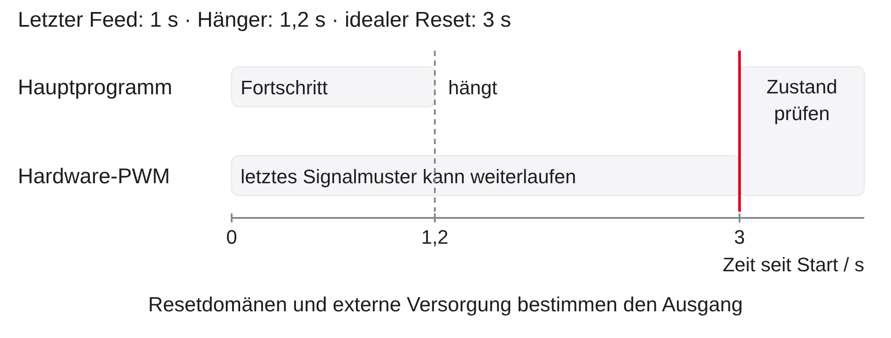{fig-alt="Zwischen Hängerbeginn 1,2 s und nominalem Watchdog-Reset 3 s kann die Hardware-PWM weiterlaufen; der Zustand während und nach Reset ist eine weitere Entwurfsfrage."}

- Erkennung, Abschaltung und Neustart sind getrennte Zeiten
- Eine externe Aktorversorgung wird durch CPU-Reset nicht automatisch getrennt

::: notes
PWM heißt Pulse Width Modulation, Pulsweitenmodulation. CPU bedeutet Central Processing Unit, Verarbeitungseinheit. Die Abbildung zeigt erneut den letzten Feed bei einer Sekunde, den Hänger bei einer Komma zwei und den idealen Reset bei drei Sekunden. Dazwischen kann bei laufendem Timer und Takt das letzte PWM-Muster weiter bestehen. Die gezeigte Dauer beträgt eine Komma acht Sekunden.

Ein Reset betrifft bestimmte Domänen eines Systems: Prozessor, Speicher oder Peripherie können unterschiedlich reagieren. Das ist nicht notwendigerweise ein Power-On-Reset, ein Neustart durch Einschalten der Versorgung. Eine externe Motorspannung kann weiterhin anliegen. Auch ein hochohmiger oder anders umkonfigurierter Steuerpin ist nicht automatisch die gewünschte Treiberfreigabe.

Ein definierter Ausgangszustand benötigt deshalb passende Pin- und Treibereigenschaften während Vorbereitung, Fehler und Reset. Bei einer Lampe kann Aus erwünscht sein, bei einem Motor sind Ausrollen, Bremsen oder Halten verschiedene Wirkungen. Der Watchdog wählt diese Anwendungspolitik nicht selbst aus. Die Grafik zeigt Zeit- und Verantwortungsgrenzen und keine zertifizierte Schutzschaltung.

Die waagerechten Flächen kennzeichnen Zeitabschnitte von Fortschritt beziehungsweise möglicher Signalerzeugung, nicht einzelne PWM-Pulse. Die rechte Fläche bleibt bewusst ohne festen Pegelwert. An dieser Grenze ist die konkrete Gerätebeschreibung nötig, um den Aktorzustand zu bestimmen.
:::

## Nach dem Reset die Ursache auswerten

Konzeptioneller Bootablauf:

1. Resetursache gemäß Gerätebeschreibung erfassen
2. Ausgang und Treiber in den vorgesehenen Anfangszustand bringen
3. Diagnose beziehungsweise Wiederanlaufpolitik anwenden
4. Erst nach Vorbereitung normale Ausgabe freigeben

::: notes
Ein Reset-Reason-Register oder Statusflag kann angeben, welche Resetursachen die Plattform gespeichert hat. Ein Watchdog-Flag ist ein Beispiel, aber weder Bitnummer noch Adresse noch Löschmethode sind universell. Einige Register erfordern besondere Quittierung; blindes Schreiben eines vermuteten Nullwerts ist kein allgemeines Verfahren.

Die Ursache sollte in der vorgesehenen Reihenfolge erfasst werden, bevor ihre Information verloren geht. Eine Diagnose kann einen ausgebliebenen Feed bestätigen, beweist jedoch nicht von allein die genaue Softwareursache. Auch Zeitmessung, fehlerhafte Feed-Sequenz oder eine falsche Konfiguration können relevant sein.

Wird nach jedem Watchdog-Reset derselbe fehlerhafte Ablauf unverändert wieder gestartet, kann eine Reset-Schleife entstehen. Ein Wiederanlaufkonzept kann deshalb begrenzte Versuche, einen Diagnosemodus oder einen anderen vorgesehenen Aktorzustand vorsehen. Welcher Zustand richtig ist, folgt aus der Anwendung. Ein Reset setzt außerdem nicht generell jedes RAM-Byte, Random Access Memory, Arbeitsspeicher, auf einen fest bekannten Wert. Die konkrete Resetdomäne muss geprüft werden.

Ein sinnvoller Diagnoseeintrag unterscheidet etwa Einschalten, externen Reset und Watchdogauslösung, soweit die Plattform diese Ursachen bereitstellt. Die Information erklärt einen Neustart, aber ohne zusätzliche Beobachtungen noch nicht die vorausgegangene fehlerhafte Instruktion oder die Ursache einer ausgebliebenen Fortschrittsmeldung.
:::

## Was ein Watchdog nicht nachweist

- Ein Feed prüft keine beliebige Rechenkorrektheit
- Ein gültiges Fenster erkennt nicht jeden falschen Programmablauf
- Ein Neustart beseitigt nicht automatisch die Ursache
- Funktionale Sicherheit benötigt mehr als diesen Überwachungsbaustein

::: notes
Der Watchdog beobachtet die Einhaltung seiner Feed-Regeln, also das vereinbarte Auffrischen und gegebenenfalls dessen Timing. Ein falscher Helligkeitswert kann weiterhin rechtzeitig gefüttert werden. Selbst eine fehlerhafte Schleife kann die Zeitfenster einhalten. Eine Fortschrittsüberwachung verbessert die Aussage des Lebenszeichens, ist aber ebenfalls an die Qualität der gewählten Prüfungen gebunden.

Verfügbarkeit durch einen Neustart und ein definierter Zustand bei einem Fehler sind verschiedene Ziele. Das erneute Ausführen derselben Firmware, der Gerätesoftware, kann dieselbe Ursache wieder treffen. Funktionale Sicherheit meint die begründete Beherrschung relevanter Fehlwirkungen eines Systems; sie lässt sich nicht allein aus einem Watchdog-Timeout oder einem kurzen Programmbeispiel ableiten.

Die Folie begrenzt die vorherigen Aussagen, ohne den Nutzen der Überwachung aufzuheben. Ein einfacher Timeout kann einen tatsächlich ausbleibenden Ablauf erkennen, eine geeignete Uhr kann bestimmte Taktfehler sichtbar machen und ein Fenster bestimmte zu frühe Feeds. Entscheidend bleibt, welche Fehler im Modell beobachtbar sind und welche zusätzliche Ausgangsstrategie die Anwendung besitzt.

Ein plausibler Sensorfehler kann zum Beispiel immer neue, aber falsche Werte liefern. Die Anwendung könnte daraufhin alle drei Fortschrittsschritte abschließen und zeitlich richtig füttern. Eine reine Aktualitätsprüfung würde dieses Fehlerbild nicht erkennen.
:::

## Optional: Modelle und Geräteausführung trennen

- Host-C: Prozentrechnung, Fading und Feed-Prädikat
- Papier: Timerzustände, Spannungen und Zeitfenster
- Renode: konkrete unterstützte Plattform und Firmware nötig
- Registeradressen und Pinverhalten nicht aus dem Lehrmodell erfinden

::: notes
Die drei reinen C-Funktionen berechnen einen Compare-Wert, einen Fading-Sollwert und ein Feed-Prädikat. Ihre Ergebnisse lassen sich mit einem Hostcompiler prüfen. Diese Prüfung enthält keinen Gerätezugriff, kein echtes PWM-Signal und keinen real ausgelösten Reset.

Renode ist ein Systemsimulator. Eine passende Untersuchung benötigt eine konkret benannte unterstützte Plattform mit Timer-, Ausgangs- und Watchdog-Modell sowie zugehöriger Firmware. Aus einer sichtbaren Datei oder einem erfundenen Registeroffset folgt noch keine vorhandene Simulation. Virtuelle Zeit und reale Chiplatenz sind ebenfalls unterschiedliche Nachweise.

Für die Pflichtaufgaben ist keine solche neue Toolchain erforderlich. Die Modelle sind vollständig auf Papier bearbeitbar und die reine Arithmetik kann separat geprüft werden. In dieser Überarbeitung liegt keine ausgeführte Renode-Firmware oder RISC-V-Peripheriemessung vor. Das ist die Grenze der Aussagen zu tatsächlichen Pinpegeln, Ausgangsströmen und Resetdomänen. Bei späterem Einsatz müssen diese Eigenschaften mit einer konkreten Plattform nachgewiesen werden.

Ein Host ist hier der Rechner, auf dem ein gewöhnlicher C-Compiler die Rechenfunktionen ausführt. Ein Prädikat ist eine Funktion mit Wahrheitswert als Ergebnis. PWM bedeutet Pulsweitenmodulation; ihre echten Flanken entstehen in diesen Hostfunktionen gerade nicht.
:::

## Abschlussquiz: Zeitanteile und Überwachung

- Zehn QuizAcademy-Fragen zu Vorlesung 4
- Zehn Minuten beantworten, fünf Minuten auswerten
- Mit Formel, Zählfolge oder Zustand begründen
- Antwortlänge liefert keinen zuverlässigen Hinweis

::: notes
Das Quiz behält die zehn vorhandenen Fragen. Geprüft werden Entscheidungen aus dem Foliensatz: Periodenintervalle, aktiver gegenüber hohem Zeitanteil, Spannungsmittelwert gegenüber Effektivwert, Softwareflanken und Bedingungen der Überwachung. Eine reine Wortwiederholung einer Definition ersetzt keine begründete Auswahl.

Die vorgesehenen fünfzehn Minuten teilen sich in zehn Minuten individuelle Bearbeitung und fünf Minuten gemeinsame Auswertung häufiger Fehler. Bei einer strittigen Antwort sollte der betreffende Zwischenwert oder Zustand genannt werden. Beispielsweise klärt $ARR+1$ die Periodenlänge und der letzte gültige Feed den Anfang der Watchdog-Frist.

Jede Frage besitzt genau eine richtige Option. Die Formulierungen und Längen sind so gestaltet, dass nicht immer die längste oder kürzeste Aussage stimmt. Erläuterungen beziehen sich auf das gewählte Lehrmodell und erfinden keine Hardwaremesswerte. Die Auswertung kann anschließend zu den entsprechenden Papieraufgaben zurückführen. Damit endet der Block mit begründeten Zusammenhängen statt bloß mit einzelnen Merksätzen.
:::

## Was Sie jetzt unterscheiden können

- Timer-Tick, PWM-Periode und Sollwertaktualisierung
- Aktive Zeit, HIGH-Anteil, Mittelwert und Effektivwert
- Gepufferte Änderungen und sofortige Compare-Wirkung
- Frische Fortschrittsrunde und bloßer Feed-Aufruf
- Watchdog-Reaktion und tatsächlicher Aktorzustand

::: notes
PWM bedeutet Pulse Width Modulation, Pulsweitenmodulation. Ihre Zeitgrößen folgen im gewählten Up-Counting-Modell aus Vorteiler, Periodenintervallen und Vergleich. Die physikalische Wirkung braucht zusätzlich Last-, Filter- oder Protokollannahmen. Ein Watchdog überwacht dagegen Feed-Bedingungen und kann auf deren Verletzung reagieren; er garantiert weder jede Rechenkorrektheit noch einen universellen Zustand des Aktors.

Die Grundlagen orientieren sich an Harris/Harris, Digital Design and Computer Architecture — RISC-V Edition. Für verbreitete Peripherieeigenschaften wurden die offiziellen STMicroelectronics-Quellen zu [Timern und PWM](https://github.com/STMicroelectronics/stm32f4xx-hal-driver/blob/master/Src/stm32f4xx_hal_tim.c), [unabhängigem Watchdog](https://github.com/STMicroelectronics/stm32f4xx-hal-driver/blob/master/Src/stm32f4xx_hal_iwdg.c) und [Fenster-Watchdog](https://github.com/STMicroelectronics/stm32f4xx-hal-driver/blob/master/Src/stm32f4xx_hal_wwdg.c) herangezogen. Sie sind Herstellerbeispiele aus einer anderen Prozessorplattform, keine RISC-V-Registerfestlegung.

Die Rechnungen bleiben daher klar benannte Modelle mit überprüfbaren Grenzen. Vorlesung 5 erweitert die Geräteanbindung um serielle Bussysteme; dort bleibt die Trennung von Daten, Steuersignal und zeitlicher Bearbeitung ebenfalls wichtig.
:::
