## Von Ausgaben zum Datenaustausch

- Vorlesung 4: Timer erzeugen wiederkehrende Ausgangssignale
- Heute: externe Bausteine konfigurieren und Daten empfangen
- Übertragene Bits brauchen Zeitregeln und eine Bedeutung
- Ein neuer Messwert entsteht erst nach erfolgreicher Verarbeitung

::: notes
Vorlesung 4 hat Ausgangssignale und ihre Überwachung behandelt. PWM, Pulse Width Modulation oder Pulsweitenmodulation, stellt aktive Zeitanteile ein. Bei einem Sensor wollen wir dagegen Zahlen übertragen: etwa einen Konfigurationswert schreiben oder eine Beschleunigung lesen. Der Unterschied liegt in der vereinbarten Bedeutung einer Bitfolge, nicht allein im Wechsel zwischen zwei Spannungspegeln.

Ein serielles Protokoll legt Regeln für Reihenfolge, Zeit und Teilnehmer fest. Ein angeschlossener Baustein besitzt außerdem einen eigenen Gerätevertrag: Welche Kommandos versteht er, welche Register enthält er und wie sind deren Daten kodiert? Erst beide Ebenen zusammen ermöglichen einen sinnvollen Datenaustausch.

Der Lernweg beginnt deshalb beim einzelnen Bit, führt über drei verbreitete Schnittstellen und endet bei einem vollständig nachvollziehbaren Sensortransfer. Die Fortschrittsidee aus Vorlesung 4 bleibt erhalten: Ein gestarteter Transfer ist noch kein neuer gültiger Messwert, und eine weiterlaufende Uhr ersetzt keine erfolgreiche Verarbeitung.
:::

## Voraussetzungen und Signalmodelle

- C-Integer, Bitoperationen und Gerätezugriffe aus den bisherigen Blöcken
- Zeitquelle, Polling und Interruptbehandlung aus Vorlesung 3
- LOW und HIGH im direkten Lehrmodell: $0$ und $3{,}3$ V
- Ideale Zeitdiagramme; reale Timinggrenzen gesondert prüfen

::: notes
Die Vorlesung setzt die bisher eingeführten Integerzahlen, Linksverschiebung, bitweises Oder und Gerätezugriffe voraus. MMIO bedeutet Memory-Mapped Input/Output: Peripherieregister werden im Adressraum des Prozessors angesprochen. Polling fragt ihren Zustand wiederholt ab; ein Interrupt meldet eine Anforderung zur späteren Behandlung. Diese Strategien wurden in Vorlesung 3 getrennt von der Hardwarezeit betrachtet.

LOW und HIGH bezeichnen niedrigen und hohen Leitungspegel. Für die direkten digitalen Beispiele nehmen wir null und drei Komma drei Volt sowie einen gemeinsamen Spannungsbezug an. Diese Zahlen gelten nicht automatisch für jede elektrische Schnittstelle. Die Signalbahnen zeigen ideale Pegel und vereinbarte Abtastzeitpunkte; Laufzeiten, Flankensteilheit und Toleranzen werden nur dort berücksichtigt, wo sie ausdrücklich vorgegeben sind.

Ein Bit ist eine Binärstelle, ein Byte besteht hier aus acht Bits. Hexadezimale Werte beginnen in C-Schreibweise mit `0x`. Die schriftliche Darstellung eines Bytes und die zeitliche Reihenfolge seiner übertragenen Bits sind getrennte Entscheidungen. Genau diese Unterscheidung benötigen wir zuerst, bevor Rahmen und Geräteadressen hinzukommen.
:::

## Vier Schulstunden: Ablauf

| Stunde | Vorlesung und Besprechung | Arbeitsphase |
|--------|---------------------------|--------------|
| 1 | Grundlagen und UART: 35 min | Aufgabe 1: 10 min |
| 2 | UART-Puffer und SPI: 30 min | Aufgaben 2–3: 15 min |
| 3 | I²C-Elektrik und Transaktionen: 30 min | Aufgaben 4–5: 15 min |
| 4 | Sensorwerte und Schnittstellenwahl: 15 min | Aufgabe 6: 15 min; Quiz: 15 min |

::: notes
Vier Schulstunden umfassen hundertachtzig Minuten, Pausen kommen hinzu. Der Ablauf sieht hundertzehn Minuten für Erklärung, Denkfragen und Lösungsbesprechung, fünfundfünfzig Minuten für angeleitete Papieraufgaben und fünfzehn Minuten für das Abschlussquiz vor. Die fünfzig Folien sind Gesprächsgrundlagen mit unterschiedlichen Bearbeitungszeiten.

UART heißt Universal Asynchronous Receiver-Transmitter und überträgt Rahmen ohne gemeinsame Taktleitung. SPI, Serial Peripheral Interface, verwendet einen vom Controller gelieferten Takt. I²C, Inter-Integrated Circuit, ergänzt auf gemeinsam genutzten Leitungen Adressierung und Quittungen. Die drei Schnittstellen werden schrittweise eingeführt; das Sensorbeispiel verwendet anschließend I²C.

Die sechs Aufgaben folgen diesem Lernweg. Im Unterricht werden ausgewählte Rechenschritte gemeinsam angeleitet. Für vollständiges selbstständiges Bearbeiten einschließlich Begründungen nennt das Blatt einen längeren Richtwert. Die letzte Phase verbindet die übertragenen Bytes mit ihrer Bedeutung und prüft, welche Schnittstelle zu einem vorgegebenen Bedarf passt. Dadurch wird das Quiz aus erklärten Zusammenhängen beantwortbar.
:::

## Drei Ebenen, drei Adressarten

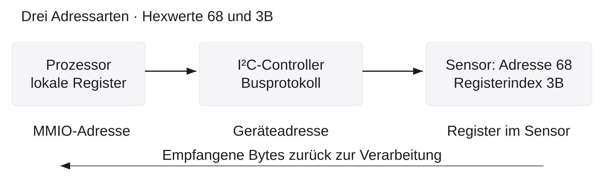{fig-alt="Der Prozessor greift auf seinen Kommunikationscontroller zu; der Bus adressiert einen Sensor, dessen Register anschließend ausgewählt werden."}

- Prozessoradresse: Kommunikationscontroller im eigenen Adressraum
- Geräteadresse: ausgewählter Teilnehmer
- Registerindex: Datenstelle innerhalb dieses Teilnehmers

::: notes
Die Abbildung liest sich vom Prozessor über den Kommunikationscontroller zum Sensor. Der Prozessor bedient eigene Peripherieregister durch MMIO, Memory-Mapped Input/Output. Die dafür benötigte Prozessoradresse ist plattformspezifisch. Sie wird nicht als solche über die Sensorleitung übertragen.

I²C bedeutet Inter-Integrated Circuit. Auf diesem Bus wählt die im Beispiel sieben Bit breite Geräteadresse `0x68` den Sensor aus. Danach kann ein übertragenes Byte `0x3B` im Sensor als Registerindex interpretiert werden. Dieser Index ist keine zweite Geräteadresse und keine direkt mit einer Prozessor-Ladeinstruktion erreichbare Speicherstelle. Unser Sensorbeispiel verwendet ihn als Anfang der Beschleunigungsregister.

Die Pfeile zeigen die getrennten Zuständigkeiten, keine vollständig verdrahtete Platine. Der Controller setzt Prozessoraufträge in ein Busprotokoll um; der Sensor interpretiert die empfangenen Felder gemäß seiner Registerbeschreibung. Eine richtige lokale Registeradresse reicht daher nicht, wenn Geräteadresse oder Protokollablauf falsch sind. Umgekehrt sagt eine gültige Busadresse noch nichts darüber aus, welche interne Sensorzahl gelesen wird. Diese Trennung bleibt beim späteren Lesen mit wiederholtem Start zentral.
:::

## Wortdarstellung und Bitfolge

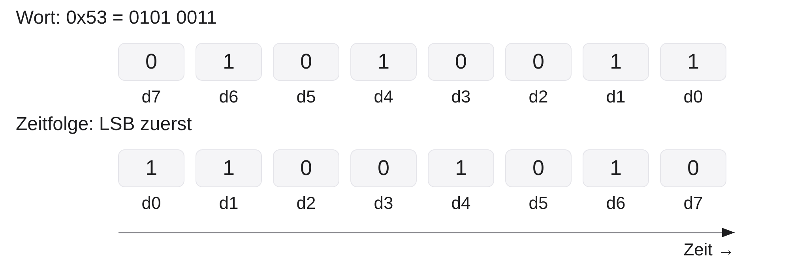{fig-alt="Das Byte 0x53 steht schriftlich als 01010011; bei niedrigstem Bit zuerst verlassen die Bits in der Reihenfolge 11001010 das Wort."}

- Ein Schieberegister kann Bits nacheinander ausgeben
- Die Übertragungsreihenfolge muss vereinbart sein
- Weniger Leitungen bedeuten nicht automatisch mehr Nutzdaten pro Sekunde

::: notes
Ein Schieberegister speichert mehrere Bits und verschiebt sie bei einem Schritt um eine Position. Es verbindet damit eine parallel vorliegende Zahl mit einer zeitlichen Bitfolge. In der Abbildung steht `0x53` in der üblichen schriftlichen Reihenfolge mit Bit sieben links und Bit null rechts: `0101 0011`.

LSB bedeutet Least Significant Bit, niedrigstwertiges Bit; MSB heißt Most Significant Bit, höchstwertiges Bit. Bei LSB zuerst verlassen die Bits null bis sieben das Wort in der Folge eins, eins, null, null, eins, null, eins, null. Die untere Pfeilrichtung der Grafik ist die Zeitrichtung. Die schriftliche Zahl selbst wird dadurch nicht zu einem anderen Zahlenwert.

Parallele Übertragung benötigt mehrere gleichzeitig ausgewertete Signalleitungen. Serielle Übertragung legt Bits nacheinander auf wenige Leitungen; ein Empfänger baut daraus wieder ein Wort. Seine Reihenfolge muss zum Sender passen. Laufzeiten und gegenseitige Einkopplung bleiben auch bei seriellen Leitungen vorhanden. Welche Variante mehr Nutzdaten liefert, hängt deshalb von Takt, Kodierung, Rahmen und Leitungsanzahl ab, nicht allein vom Wort „seriell“. Im nächsten Schritt kommt die zeitliche Zuordnung hinzu.

$d_i$ bezeichnet in der Grafik die Bitstelle mit Gewicht $2^i$. Der Wert an Stelle sechs trägt bei diesem Byte vierundsechzig bei, unabhängig davon, wann er auf der Leitung ankommt.
:::

## Wer bestimmt den Abtastzeitpunkt?

| Zeitmodell | Gemeinsame Regel |
|------------|------------------|
| synchron | separate Taktleitung und vereinbarte Flanke |
| asynchron | vereinbarte Bitdauer und Rahmenanfang |

Auch mit Taktleitung brauchen Daten ein gültiges Zeitfenster.

::: notes
Synchron bedeutet hier, dass eine zusätzliche Taktleitung die Übertragungsschritte begleitet. Eine Flanke ist der Wechsel zwischen LOW und HIGH oder umgekehrt. Sender und Empfänger vereinbaren, auf welcher Flanke Daten übernommen werden. Das Signal muss um diesen Zeitpunkt ausreichend stabil sein; der Takt beseitigt keine elektrischen Laufzeiten.

Asynchron bedeutet dagegen, dass keine gemeinsame Taktleitung mitgeführt wird. Beide Seiten benötigen eine vereinbarte Bitdauer und ein Ereignis, das den Rahmenanfang erkennbar macht. Eine lange HIGH-Phase allein verrät nicht, ob sie ein oder mehrere Einsbits enthält. Erst das Zeitraster liefert diese Zuordnung.

Das sind Eigenschaften der Signalübertragung, keine Aussage darüber, ob ein C-Programm blockiert. Ein asynchroner Draht kann durch blockierendes Polling bedient werden; eine synchrone Übertragung kann per Interrupt begleitet werden. Ebenso sind Taktart und Richtung unabhängig: Eine eigene Taktleitung erzwingt weder nur Senden noch gleichzeitiges Senden und Empfangen. Wir vergleichen deshalb zunächst Richtungen und Teilnehmerorganisation, bevor die einzelnen Protokolle ihre Zeitregeln konkretisieren.
:::

## Richtungen und Teilnehmer

| Schnittstelle im Grundmodell | Takt | Datenrichtungen | Auswahl |
|------------------------------|------|-----------------|---------|
| UART | eigene Bitzeit | gleichzeitig möglich | zwei Endpunkte |
| SPI | Controller | gleichzeitig möglich | Auswahlleitung |
| I²C | Controller | nacheinander | Geräteadresse |

Versorgung und Spannungsbezug gehören zusätzlich zur Verbindung.

::: notes
UART bedeutet Universal Asynchronous Receiver-Transmitter, asynchroner Sender und Empfänger. Im direkten Grundmodell verbindet es zwei Endpunkte mit getrennten Datenrichtungen. SPI heißt Serial Peripheral Interface und besitzt im betrachteten Vier-Signal-Modell ebenfalls getrennte Datenleitungen, aber eine gemeinsame Taktquelle. I²C steht für Inter-Integrated Circuit und teilt eine Datenleitung zwischen Senden und Empfangen.

Full-Duplex bezeichnet gleichzeitig mögliche Gegenrichtungen. Half-Duplex erlaubt beide Richtungen nacheinander auf einem gemeinsamen Pfad. Simplex würde nur eine Richtung verwenden. Eine Anwendung darf eine eigentlich duplexfähige Schnittstelle auch nur zum Senden nutzen; die Fähigkeit beschreibt nicht ihre momentane Auslastung.

Controller nennt hier den aktiven Takt- und Transferorganisator, Target den angesprochenen Teilnehmer. Ältere Datenblätter verwenden dafür Master und Slave. Die Tabelle beschreibt bewusst die hier eingeführten Grundmodelle, nicht jede Sondervariante oder zusätzliche obere Protokollschicht. Eine Signalleitungszahl enthält außerdem weder Versorgung noch gemeinsame Bezugspotenziale automatisch. Zuerst betrachten wir die Verbindung, die ohne Taktleitung auskommen muss.
:::

## UART: zwei Endpunkte verbinden

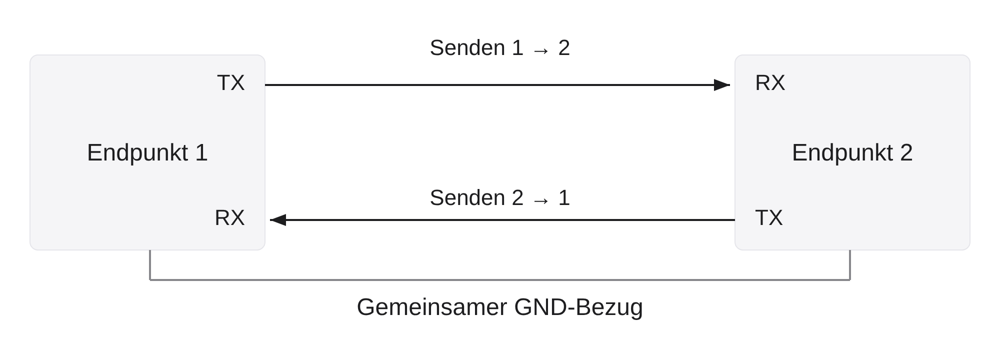{fig-alt="TX des ersten Endpunkts führt zu RX des zweiten; die Rückrichtung hat einen eigenen Pfad und beide teilen den Spannungsbezug."}

UART: Universal Asynchronous Receiver-Transmitter.

::: notes
UART bedeutet Universal Asynchronous Receiver-Transmitter, universeller asynchroner Sender und Empfänger. TX steht für Transmit, Senden, RX für Receive, Empfangen. Die Abbildung verbindet TX des ersten Geräts mit RX des zweiten und die Rückrichtung entsprechend mit einer zweiten Leitung. Jeder Sendepfad hat damit genau einen zugehörigen Empfänger im Grundmodell.

GND bedeutet Ground, gemeinsamer Spannungsbezug. Die untere Verbindung ist für unser direktes, nicht galvanisch getrenntes Pegelmodell erforderlich; sie zählt nicht als Datenleitung. Versorgung, Steckverbinder und zusätzliche Flusssteuerung sind nicht eingezeichnet. Die zwei Datenpfeile ermöglichen Full-Duplex, also gleichzeitig laufende Gegenrichtungen.

Die UART-Funktion bildet Rahmen und rekonstruiert ihre Datenbits. Sie bestimmt damit noch nicht, welche elektrischen Pegel ein externes Kabel verwendet. Für die folgenden Zeitdiagramme setzen wir nicht invertierte Pegel null und drei Komma drei Volt voraus. Ohne passendes Pegelmodell kann eine logisch richtige TX-RX-Zuordnung trotzdem ungeeignet sein. Zunächst müssen beide Endpunkte außerdem Format und Bitzeit vereinbaren; erst dann kann ein HIGH-Intervall eindeutig einem Bit zugeordnet werden.
:::

## Ein Byte hat zwei Leserichtungen

`0x53 = 0101 0011` in schriftlicher MSB-Reihenfolge.

UART-Lehrmodell, LSB zuerst:

| Datenbit | $d_0$ | $d_1$ | $d_2$ | $d_3$ | $d_4$ | $d_5$ | $d_6$ | $d_7$ |
|----------|-------|-------|-------|-------|-------|-------|-------|-------|
| Wert | $1$ | $1$ | $0$ | $0$ | $1$ | $0$ | $1$ | $0$ |

Die erste übertragene Stelle ist nicht die linke Stelle der üblichen Wortschreibweise.

::: notes
UART heißt Universal Asynchronous Receiver-Transmitter. Im gewählten Rahmenmodell sendet es das niedrigstwertige Datenbit zuerst. LSB bedeutet Least Significant Bit, MSB Most Significant Bit. Die Datenbitbezeichnung $d_i$ nennt die Stelle mit Gewicht $2^i$; $i$ läuft hier von null bis sieben.

`0x53` entspricht dezimal dreiundachtzig: $64+16+2+1$. Deshalb sind die Stellen sechs, vier, eins und null gesetzt. Die übliche Binärschreibweise zeigt die Gewichte absteigend und lautet null, eins, null, eins, null, null, eins, eins. Die zeitliche Tabelle liest dagegen die Stellen null bis sieben und kehrt damit die Leserichtung um, nicht die Bedeutung der Zahl.

Beim Dekodieren wird jedes empfangene Bit wieder mit seinem vereinbarten Stellengewicht verbunden. Wer die zeitliche Folge unverändert als schriftliche MSB-Folge liest, erhielte fälschlich `0xCA`. Diese Verwechslung ist eine typische Papieraufgabe. Die Tabelle enthält nur die acht Nutzdatenbits; Start und Stop des eigentlichen Rahmens fehlen noch und werden nicht zu den Stellengewichten addiert.
:::

## Ein 8N1-Rahmen auf der Leitung

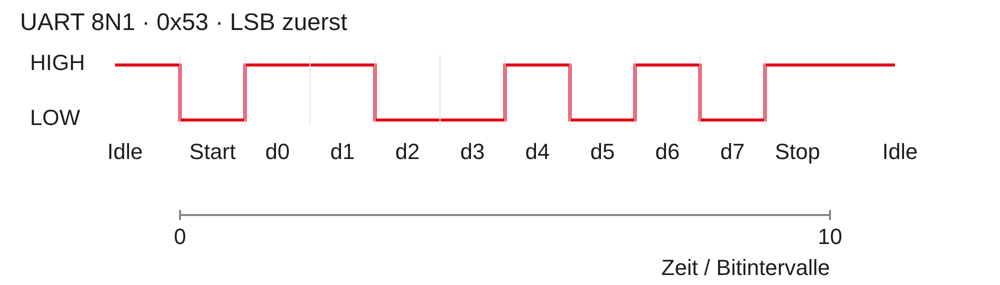{fig-alt="Der UART-Rahmen für 0x53 besteht aus Start LOW, acht Datenbits niedrigstwertig zuerst und Stop HIGH; Idle ist HIGH."}

8N1: acht Datenbits, keine Parität, ein Stopbit.

::: notes
UART bedeutet Universal Asynchronous Receiver-Transmitter. Ein Frame oder Rahmen ist die begrenzte Übertragungseinheit auf dieser Leitung. 8N1 bezeichnet acht Datenbits, N für No Parity oder keine Parität und ein Stopbit. Damit umfasst der Rahmen zehn Bitintervalle: eines für Start, acht für Daten und eines für Stop.

Die Grafik liest sich von links nach rechts in Zeitrichtung. Idle ist der Ruhezustand HIGH. Das Startbit zieht die Leitung LOW. Danach folgen die Datenbits $d_0$ bis $d_7$ mit niedrigstem Stellengewicht zuerst. Für `0x53` lautet ihre Folge eins, eins, null, null, eins, null, eins, null. Das Stopbit ist HIGH und gehört zum Rahmen, aber nicht zur Nutzdatenzahl.

Die hohe Lage der roten Bahn bedeutet HIGH, die niedrige LOW. Gleiche benachbarte Bits erzeugen keine zusätzliche Flanke; ihre Grenzen bleiben durch die vereinbarte Bitdauer bestimmt. Ein weiterer Rahmen darf direkt nach dem vollständigen Stopintervall beginnen. Deshalb ist keine zusätzliche Idle-Pause nötig, aber ein korrekter Rahmenabschluss sehr wohl. Aus diesen zehn Intervallen folgt die Nutzdatenrate.

LSB bedeutet Least Significant Bit, niedrigstwertiges Bit. Die waagerechten Grenzen teilen zehn gleich lange Rahmenintervalle ab; sie sind auch dann vorhanden, wenn benachbarte Pegel gleich bleiben und keine neue Flanke sichtbar wird.
:::

## Bitzeit ist nicht Bytezeit

Bei $B=115200$ Baud und einem Bit je Symbol:

$$
T_b=\frac1B\approx8{,}681\,\mu\mathrm{s}
$$

$$
T_f=10T_b\approx86{,}806\,\mu\mathrm{s},\qquad
r=\frac B{10}=11520\ \mathrm{Byte/s}
$$

::: notes
Baud bezeichnet Symbole pro Sekunde. Unser binäres UART-Modell, Modell des Universal Asynchronous Receiver-Transmitter, trägt ein Bit pro Symbol; hier sind Symbolrate und Leitungsbitrate daher zahlenmäßig gleich. $B$ ist diese Rate, $T_b$ die Bitdauer und $T_f$ die Dauer eines vollständigen 8N1-Rahmens. 8N1 umfasst acht Datenbits, keine Parität und ein Stopbit.

Bei $B=115200$ ergibt $1/B$ ungefähr $8{,}68056$ Mikrosekunden. Zehn Bitintervalle dauern ungefähr $86{,}80556$ Mikrosekunden. Da jeder Rahmen ein Nutzdatenbyte trägt, ist die theoretische Bytezahl pro Sekunde $r=B/10=11520$. Die Rechnung setzt lückenlos aufeinanderfolgende Rahmen und keine zusätzlichen Protokollfelder voraus.

Acht Datenbits pro Rahmen bedeuten $92160$ Nutzdatenbits pro Sekunde, nicht $115200$ Nutzdatenbytes. Ein zusätzlicher Anwendungsheader oder eine Sendepause senkt die Nutzrate weiter. Die Einheit muss deshalb neben jeder Zahl stehen. Aufgabe 1 verwendet genau dieses Modell. Es erklärt auch, wie viel Reaktionszeit zwischen empfangenen Bytes verbleibt, bevor Puffer betrachtet werden.

Die rechnerische Auslastung durch Nutzdaten beträgt acht von zehn Intervallen, also achtzig Prozent. Start und Stop transportieren keine zusätzlichen Datenstellen, ermöglichen aber erst die zeitliche Zuordnung der acht Stellen.
:::

## Parität kostet Zeit und prüft wenig

`0x53` enthält vier Einsbits.

| Format | Paritätsbit | Intervalle pro Rahmen |
|--------|-------------|-----------------------|
| 8N1 | keines | $10$ |
| 8E1 | $0$ | $11$ |
| 8O1 | $1$ | $11$ |

Ein Paritätsbit erkennt nicht jede Veränderung der Daten.

::: notes
UART heißt Universal Asynchronous Receiver-Transmitter. E steht für Even Parity, gerade Parität, O für Odd Parity, ungerade Parität. Das optionale Paritätsbit ergänzt die acht Datenbits so, dass die Gesamtzahl gesetzter Bits gerade beziehungsweise ungerade ist. N bedeutet keine Parität.

`0x53` besitzt vier Einsbits. Bei gerader Parität wird deshalb null ergänzt, bei ungerader eins. Mit einem Startbit, acht Datenbits, einem Paritätsbit und einem Stopbit enthalten 8E1 und 8O1 elf Intervalle. Bei $115200$ Baud beträgt die maximale Nutzrate dann $115200/11\approx10472{,}7$ Byte pro Sekunde, weniger als die $11520$ des 8N1-Modells.

Parität prüft nur gerade gegen ungerade Anzahl der Bitänderungen. Ein einzelnes gekipptes Bit wird bei sonst korrekter Zuordnung erkannt; zwei gekippte Bits können die gleiche Parität erhalten. Die Prüfung rekonstruiert außerdem nicht das ursprüngliche Byte und ersetzt kein korrektes Timing. Ein Paritätsfehler und ein ungültiger Stoppegel sind unterschiedliche Fehlerarten. Bevor solche Statusmeldungen sinnvoll werden, muss der Empfänger seine Abtastzeitpunkte passend zum Rahmenanfang setzen.
:::

## Von der Startflanke zu den Samples

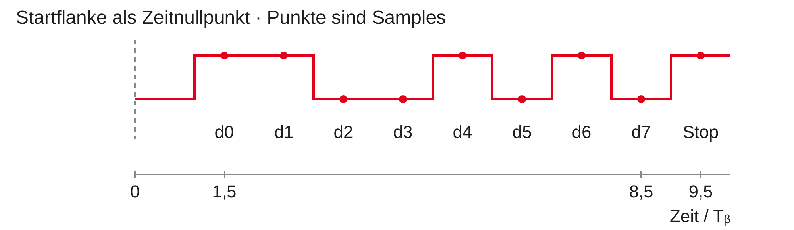{fig-alt="Ab der Startflanke liegen die Datenabtastungen bei 1,5 bis 8,5 Bitzeiten; die Stopabtastung liegt bei 9,5 Bitzeiten."}

Samples sind Abtastungen, keine zusätzlichen übertragenen Bits.

::: notes
UART bedeutet Universal Asynchronous Receiver-Transmitter. Im idealen 8N1-Modell erkennt der Empfänger zunächst die fallende Startflanke. Ein Sample ist eine Abtastung des Leitungspegels. Die Grafik gibt die Zeit relativ zu dieser Flanke in Einheiten einer Bitdauer $T_b$ an.

Das Startintervall reicht von null bis einer Bitzeit. Das erste Datenbit liegt danach zwischen eins und zwei und wird ideal bei $1{,}5T_b$ abgetastet. Die weiteren Datenmitten folgen in Abständen von einer Bitzeit bis $8{,}5T_b$. Das Stopintervall liegt zwischen neun und zehn; seine Mitte ist $9{,}5T_b$. Punkte markieren die Abtastungen, die rote Bahn den tatsächlichen Leitungspegel.

Eine Startflanke richtet die zeitliche Phase neu aus. Sie kalibriert nicht automatisch den Oszillator und garantiert keine dauerhaft exakt gleiche Bitdauer auf beiden Geräten. Ein realer Empfänger kann den Start prüfen, mehrfach abtasten und Erkennungsverzögerungen besitzen. Die Mitte ist deshalb ein nachvollziehbares Grundmodell, kein universeller interner Ablauf. Unterschiedliche Bitdauern verschieben nun die späteren Punkte innerhalb dieses Rahmens.

8N1 steht auch hier für acht Datenbits, keine Parität und ein Stopbit. Die Samplepunkte sind innerhalb derselben zehn Intervalle angeordnet, nicht erst nach dem Ende der Übertragung.
:::

## Taktabweichung wächst im Rahmen

Ideales Modell mit Sender-Bitzeit $T_s$ und Empfänger-Bitzeit $T_r$:

$$
t_{\mathrm{Stop,Sample}}=9{,}5T_r
$$

- $T_r=1{,}03T_s$: Sample bei $9{,}785T_s$, im Stopintervall
- $T_r=1{,}06T_s$: Sample bei $10{,}07T_s$, außerhalb
- Der nächste Start richtet die Phase neu aus

::: notes
$T_s$ ist die Bitdauer des Senders, $T_r$ die vom Empfänger verwendete Bitdauer. UART, Universal Asynchronous Receiver-Transmitter, führt keine gemeinsame Taktleitung mit. Wir nehmen hier eine genau erkannte Startflanke und ein vollständiges 8N1-Stopintervall von $9T_s$ bis $10T_s$ an.

Bei drei Prozent längerer Empfänger-Bitzeit liegt sein Stop-Sample bei $9{,}5\cdot1{,}03T_s=9{,}785T_s$. Es liegt noch innerhalb dieses idealen Intervalls. Bei sechs Prozent werden es $10{,}07T_s$; bei direkt anschließendem Rahmen könnte dort bereits dessen LOW-Startbit stehen. Auch Datenabtastungen wandern, weshalb die Stopprüfung allein nicht jede falsch gelesene Zahl erkennt.

Dieses Beispiel zeigt aufsummierten Zeitfehler, keinen allgemein erlaubten UART-Toleranzwert. Erkennung, Überabtastung, Taktteiler und Störungen verkleinern oder verändern das reale Budget. Ein HIGH-Stopbit prüft den Abschluss, korrigiert aber nicht nachträglich die Bitzeit. Erst die nächste erkannte Startflanke richtet die Phase wieder aus. Die oft verwendete Aussage „Start kalibriert den Takt“ wäre daher zu stark; sinnvoll ist „Start synchronisiert den Rahmenanfang“.

8N1 bezeichnet acht Datenbits ohne Parität und ein Stopbit. Die ausgewählten Prozentwerte betreffen die Bitdauer. Ein längeres Empfängerintervall entspricht einer niedrigeren Empfängerrate; Zeitabweichung und Ratenabweichung sind nicht mit demselben Vorzeichen einzusetzen.
:::

## Überabtastung und Fehlerstatus

- Mehrere Samples pro Bit können die Startflanke genauer einordnen
- Ein Mehrheitsentscheid kann kurze Störungen abfangen
- Parity Error: Paritätsbedingung verletzt
- Framing Error: erwartetes Stopintervall nicht gültig
- Overrun: empfangene Daten finden keinen freien Platz

::: notes
UART steht für Universal Asynchronous Receiver-Transmitter. Oversampling oder Überabtastung verwendet mehrere Zeitpunkte innerhalb einer Bitdauer, zum Beispiel sechzehn. Welche Samples ein Empfänger tatsächlich auswertet, ist gerätespezifisch. Ein Mehrheitsentscheid nahe der Bitmitte kann einzelne kurze Pegelstörungen überstimmen, beseitigt aber nicht jede längere Störung oder jeden Taktfehler.

Parity Error bezeichnet eine verletzte Paritätsbedingung. Framing Error meldet im betrachteten Modell einen unerwarteten Pegel im Stopbereich. Overrun ist ein Überlauf beim Empfang: Ein neues fertiges Datum kann mangels freien Speicherplatzes nicht regulär übernommen werden. Die drei Meldungen beschreiben somit verschiedene Ursachen.

Der Treiber muss Status und Daten gemeinsam nach den Regeln des Controllers auswerten. Die Hardware kann bei Fehlern Daten behalten, verwerfen oder besondere Löschzugriffe verlangen; hier wird kein konkretes Registerlayout angenommen. Ein fehlerfrei erfasster Rahmen kann außerdem später durch zu langsame Software verloren gehen. Deshalb genügt korrekte Leitungssynchronisation nicht. Als nächste Ebene betrachten wir den Empfangspuffer und berechnen, wann die Software wieder Platz schaffen muss.
:::

## Ein FIFO gibt begrenzten Spielraum

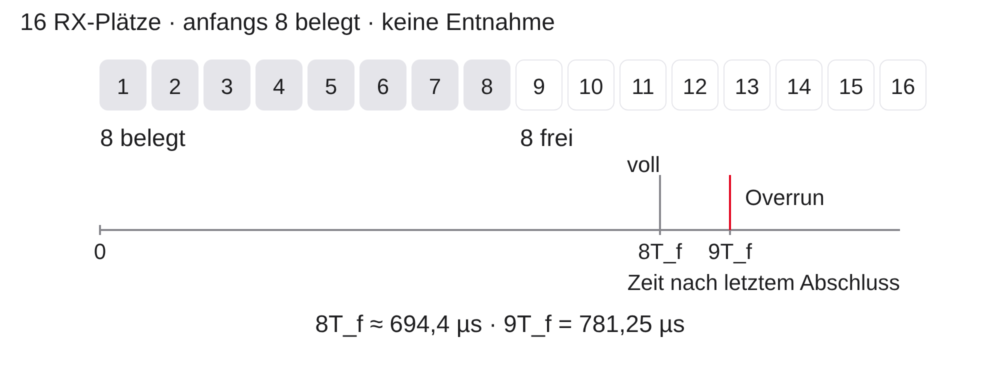{fig-alt="Ein FIFO mit 16 Plätzen enthält zunächst acht Bytes; nach acht weiteren 8N1-Rahmen ist er voll, der neunte weitere Rahmen würde ohne Entnahme überlaufen."}

Bei $115200$ Baud: acht weitere Rahmen dauern etwa $694{,}4\,\mu$s.

::: notes
FIFO bedeutet First In, First Out: Das zuerst eingegangene Byte wird zuerst entnommen. RX heißt Receive, Empfang; UART steht für Universal Asynchronous Receiver-Transmitter. Die Grafik zeigt ein didaktisches RX-FIFO mit sechzehn Byteplätzen. Unmittelbar nach einem abgeschlossenen Rahmen bei Zeit null sind acht Plätze belegt und acht frei.

Für lückenlose 8N1-Rahmen bei $115200$ Baud dauert jeder neue Abschluss $T_f=10/115200$ Sekunden. Nach acht weiteren Abschlüssen, ungefähr $694{,}4$ Mikrosekunden, sind alle sechzehn Plätze belegt. Der neunte weitere Abschluss bei $781{,}25$ Mikrosekunden würde ohne Entnahme einen Overrun verursachen. „Voll“ und „bereits überlaufen“ sind also verschiedene Zustände.

Eine sinnvolle konservative Servicefrist liegt vor dem Vollwerden und berücksichtigt zusätzliche Verzögerungen. Ohne genaue Kenntnis der Rahmenphase lässt sich der nächste Abschluss nicht einfach als eine volle Bytezeit in die Zukunft verschieben. Die Rechnung garantiert außerdem nur Pufferplatz, keine gesamte Anwendungsreaktion. Ein Schwelleninterrupt kann Software frühzeitig informieren; tatsächlicher Platz entsteht erst durch Entnahme. Aufgabe 2 prüft genau diese Zustands- und Zeitunterscheidung.

8N1 heißt acht Datenbits ohne Parität und ein Stopbit. Der Diagrammzustand bei Zeit null ist ausdrücklich nach einem Abschluss gegeben. So lassen sich Vollwerden und nächster nicht mehr speicherbarer Abschluss getrennt zählen.
:::

## Hardwareempfang und Softwarearbeit

- UART-Hardware rekonstruiert die Rahmen
- Polling oder Interrupt meldet verfügbare Daten
- Eine kurze Behandlung kann Bytes in einen Puffer übernehmen
- Die Anwendung wertet Inhalt und Fehler später aus

::: notes
UART heißt Universal Asynchronous Receiver-Transmitter. Seine Hardware erkennt Rahmen unabhängig davon, ob die Anwendung gerade die empfangene Zahl interpretiert. Polling fragt den Empfangszustand wiederholt ab. Eine ISR, Interrupt Service Routine, kann stattdessen nach einer Anforderung kurz den Gerätestatus behandeln und Bytes in einen geeigneten Puffer übernehmen.

Aus Vorlesung 3 kennen Sie die Trennung zwischen einer anstehenden Anforderung, ihren Freigaben und der tatsächlichen Bearbeitung. Auf einer RISC-V-Plattform mit PLIC, Platform-Level Interrupt Controller, wäre ein UART-Interrupt eine externe Gerätequelle. Dessen Gerätekennung ist nicht ein eigener UART-Code im Trap-Ursachenregister des Prozessors.

Ein Hardware-FIFO, First In, First Out, und ein zusätzlicher Softwarepuffer können verschiedene Fristen abfangen, sind aber beide endlich. Neue Bytes müssen an beiden Übergängen rechtzeitig weitergegeben werden. Gemeinsam genutzte Puffer benötigen passende Synchronisation; `volatile` allein löst diese Aufgabe nicht. Eine laufende Empfangs-ISR beweist zudem nicht, dass die Anwendung frische Daten verarbeitet. Das verbindet die Pufferrechnung mit dem Fortschrittsnachweis aus Vorlesung 4.
:::

## UART-Rahmen und elektrische Pegel

- Das Rahmenformat beschreibt Start, Daten und Stop
- Ein direkter Digitalpin ist keine RS-232-Schnittstelle
- Pegelwandler oder Transceiver verbinden unterschiedliche elektrische Bereiche
- Format, Bitzeit und elektrische Verträglichkeit müssen zusammenpassen

::: notes
UART bedeutet Universal Asynchronous Receiver-Transmitter und beschreibt die asynchrone Rahmenbildung. RS-232 ist eine elektrische Schnittstellenspezifikation mit anderen Spannungsbereichen und einer anderen Pegelzuordnung als unser direkter Null-/Drei-Komma-Drei-Volt-Pin. Ein direktes Verbinden dieser Bereiche wäre daher nicht aus einem passenden 8N1-Format ableitbar.

Ein Pegelwandler setzt elektrische Spannungsbereiche um. Ein Transceiver verbindet Sender und Empfänger mit einer vorgesehenen Leitungsschnittstelle. Welche zusätzlichen Funktionen erforderlich sind, hängt von den beteiligten Bausteinen ab. Ein USB-UART-Adapter, Adapter zwischen Universal Serial Bus und UART, kann beispielsweise die Computeranbindung übernehmen, muss aber ebenfalls passende Anschlusspegel besitzen.

Ein übliches UART-Frame enthält auch keine eigene Geräteadresse und keine automatische Ende-zu-Ende-Quittung. Eine höhere Anwendungsschicht darf solche Felder ergänzen, bezahlt sie jedoch mit zusätzlichen Bytes und Zeit. Diese Aussage gilt nicht als Verbot adressierter UART-basierter Protokolle. Für mehrere getaktete Peripheriebausteine betrachten wir nun eine Schnittstelle mit gemeinsamer Taktleitung und separater Teilnehmerauswahl.
:::

## SPI: Takt und Daten gemeinsam planen

SPI: Serial Peripheral Interface.

- Controller liefert die Taktleitung SCK
- Eine vereinbarte Flanke übernimmt ein Datenbit
- Die andere kann das nächste Bit vorbereiten
- Bitreihenfolge und Transferrahmen bleiben Gerätevereinbarungen

::: notes
SPI heißt Serial Peripheral Interface, serielle Peripherieschnittstelle. SCK bedeutet Serial Clock, serieller Takt. Im Grundmodell organisiert ein Controller den Transfer und ein Target beantwortet ihn. Beide sehen dieselbe Taktfolge; der Empfänger muss die einzelnen Bitmitten daher nicht wie beim asynchronen Rahmen aus einer eigenen Baud-Uhr schätzen.

Das Datenbit muss trotzdem rechtzeitig am Empfänger vorliegen. Eine Flanke dient zum Abtasten, die andere kann zum Bereitstellen des nächsten Bits verwendet werden. Die konkrete Zuordnung folgt aus dem gewählten SPI-Modus. Laufzeit, Datenbereitstellungsverzögerung und Empfängeranforderungen begrenzen weiterhin die nutzbare Frequenz.

Ein Bit pro vollständiger Taktperiode bedeutet im Grundmodell eine Leitungsbitrate in gleicher Zahlenhöhe wie die SCK-Frequenz. Das ist keine Nutzdatenbyte-Rate und noch keine Zusage über ein Gerätekommando. SPI legt insbesondere nicht universell fest, ob höchstes oder niedrigstes Stellengewicht zuerst gesendet wird oder wie ein Sensorregister auszuwählen ist. Zunächst zeigt die Verdrahtung, warum in beiden Richtungen gleichzeitig Bits laufen können.
:::

## Vier SPI-Signale, zwei Datenpfade

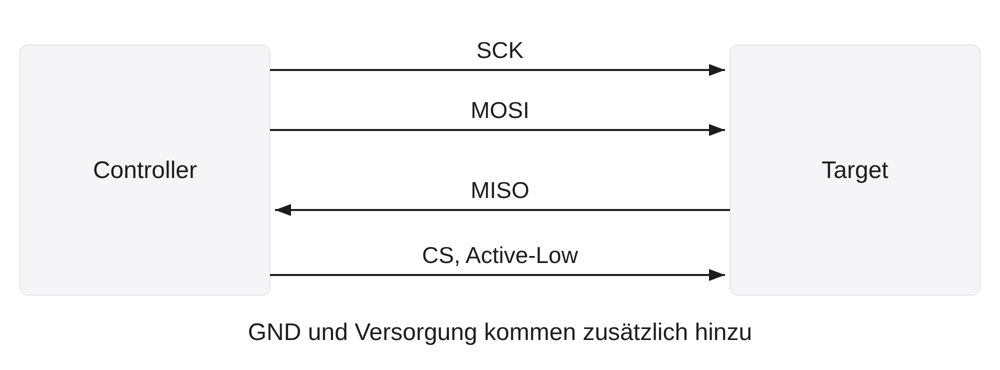{fig-alt="Der Controller liefert SCK, MOSI und die Auswahl CS; das Target liefert MISO auf einem getrennten Rückpfad."}

Das Vier-Signal-Modell zählt GND und Versorgung zusätzlich.

::: notes
SPI steht für Serial Peripheral Interface. SCK heißt Serial Clock und trägt den Takt vom Controller zum Target. MOSI bedeutet Master Out, Slave In, Daten vom Controller zum Target. MISO heißt Master In, Slave Out und ist die Rückrichtung. Die historischen Namensbestandteile bleiben häufig als Pinbezeichnungen erhalten, auch wenn wir Controller und Target sagen.

CS steht für Chip Select, Bausteinauswahl. Im gewählten Modell ist diese Leitung Active-Low: Ein niedriger Pegel aktiviert das Target. Die Abbildung zeigt die drei ausgehenden Beziehungen und den eigenen MISO-Rückpfad mit Pfeilrichtungen. GND, Ground oder Spannungsbezug, und eine geeignete Versorgung kommen elektrisch hinzu; die Zeichnung zählt nur die vier Protokollsignale.

MOSI und MISO können gleichzeitig Daten transportieren, also Full-Duplex. Das bedeutet nicht, dass jede gleichzeitig empfangene Zahl bereits sinnvolle Nutzinformation ist. Die Interpretation hängt vom Geräteprotokoll und dessen Transferphase ab. Ein Target gibt im Grundmodell auch nicht ohne Auswahl und Takt eine vollständige Nachricht aus. Die beiden Schieberegister zeigen als Nächstes, was während eines gemeinsamen Takts tatsächlich geschieht.
:::

## Pro Takt zwei Bits bewegen

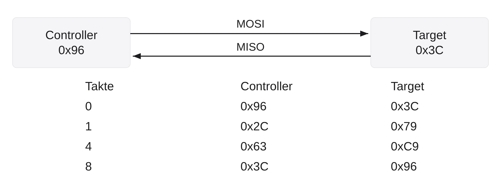{fig-alt="Zwei Acht-Bit-Schieberegister mit Anfangswerten 0x96 und 0x3C tauschen pro Takt ihre höchsten Bits; nach vier Takten stehen 0x63 und 0xC9, nach acht die vertauschten Anfangswerte."}

Links-Schiebe-Modell, MSB zuerst: beide Eingangsbits vor dem Schieben erfassen.

::: notes
SPI bedeutet Serial Peripheral Interface. MSB ist Most Significant Bit, das höchstwertige Bit. Die Grafik beschreibt zwei acht Bit breite Modell-Schieberegister: Anfangs enthält der Controller `0x96`, das Target `0x3C`. MOSI, Master Out Slave In, trägt das bisherige obere Controllerbit; MISO, Master In Slave Out, das bisherige obere Targetbit.

Bei jedem Modellschritt werden zunächst beide oberen Bits erfasst. Danach werden beide Register nach links geschoben, auf acht Stellen begrenzt und rechts mit dem jeweils erfassten Gegenbit ergänzt. Nach einem Takt entstehen `0x2C` und `0x79`, nach vier `0x63` und `0xC9`. Nach acht Takten besitzt jedes Register den vollständigen ursprünglichen Wert der anderen Seite.

Die Pfeile zeigen den gleichzeitigen Austausch, die Zwischenzeilen den Zustand nach ganzen Takten. Es handelt sich um ein Rechenmodell, nicht um garantiert lesbare Zwischenwerte realer Datenregister. Würde man das zweite Gegenbit erst nach dem ersten Registerupdate bestimmen, wäre der Modelltausch fehlerhaft. Aufgabe 3 nutzt diese Regel; anschließend unterscheiden wir gleichzeitig geschobene Bits von tatsächlich benötigter Antwortinformation.
:::

## Lesen benötigt ebenfalls Takt

Gewählter Gerätevertrag:

| Übertragenes Byte | $1$ | $2$ | $3$ | $4$ |
|-------------------|-----|-----|-----|-----|
| Controller sendet | `A5` | `00` | `00` | `00` |
| Target liefert | ignoriert | `AA` | `BB` | `CC` |

Die drei `00`-Bytes sind Dummy-Daten für die Antwortphase.

::: notes
SPI heißt Serial Peripheral Interface. Ein Dummy-Byte ist hier ein beliebiger erlaubter Platzhalter, dessen Übertragung die nötigen Taktimpulse erzeugt. Unser ausdrücklich gewähltes Spielprotokoll erwartet zuerst das Kommando `0xA5` und liefert in den drei folgenden Bytezeiten die Antwort `AA BB CC`. Dies ist keine Behauptung über ein bestimmtes Flash- oder Sensorkommando.

Im Vier-Signal-Modell laufen ausgehende und eingehende Bits gleichzeitig. Während der Controller drei Nullbytes sendet, liest er die drei Antwortbytes. Ein Dummy-Byte ist daher nicht automatisch eine zusätzliche Pause vor jedem gelesenen Byte. Das erste empfangene Byte wird laut diesem Vertrag ignoriert; sein Zahlenwert wird hier nicht festgelegt.

Die gesamte Transaktion benötigt vier Bytezeiten, also zweiunddreißig Taktperioden bei acht Bits pro Byte. Ohne diese Takte würde das Target seine Antwort nicht vollständig herausschieben. Der Controller muss außerdem die Auswahl über die vorgesehene Kommando- und Antwortphase halten. Der Gerätevertrag bestimmt, welche Phasen es gibt; die SPI-Leitungen allein verraten diese Struktur nicht.
:::

## Chip Select organisiert mehrere Targets

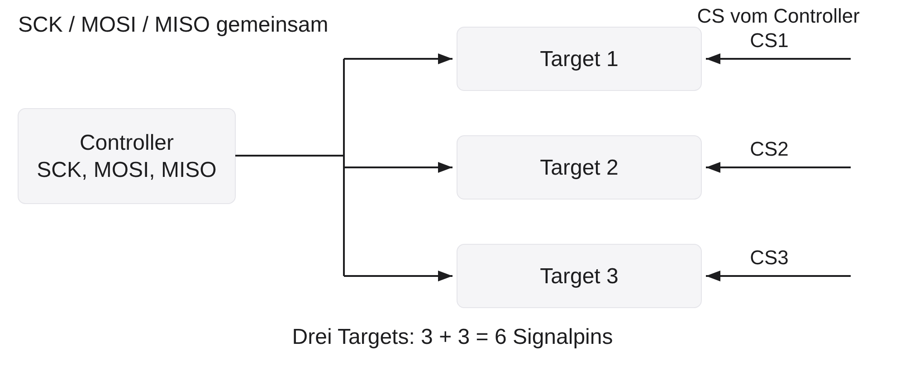{fig-alt="Drei Targets teilen SCK, MOSI und MISO, erhalten aber getrennte Auswahlleitungen; nur das ausgewählte Target darf den gemeinsamen Rückpfad treiben."}

Bei $n$ Targets: $3+n$ Signalpins im gewählten Sternmodell.

::: notes
SPI bedeutet Serial Peripheral Interface. SCK ist Serial Clock, MOSI Master Out Slave In und MISO Master In Slave Out. Diese drei Signale können im gezeichneten Sternmodell von mehreren Targets gemeinsam verwendet werden. CS heißt Chip Select; jeder Baustein besitzt hier eine eigene Auswahlleitung vom Controller.

Nur das ausgewählte Target darf MISO treiben. Die übrigen müssen ihren Ausgang entsprechend ihrer Gerätebeschreibung hochohmig schalten, also elektrisch freigeben. Zwei gleichzeitig aktivierte, gegensätzlich treibende Ausgänge wären ein Konflikt. Eine gemeinsame Verdrahtung ist daher nur dann geeignet, wenn Auswahl und Freigabeverhalten aller Bausteine zusammenpassen.

Die Grafik zeichnet die gemeinsamen Beziehungen als Sammelpfad und die Auswahlbeziehungen gesondert. Bei drei Targets braucht der Controller sechs Signalpins, bei zehn dreizehn. GND, Ground oder Spannungsbezug, und Versorgung zählen zusätzlich. Diese Zahl gilt für das Modell mit einem CS je Target, nicht für jede SPI-Variante. Eine Kettentopologie kann Auswahlpins sparen, verlangt aber ausdrücklich dafür geeignete Bausteine und eine andere Reihenfolge der Daten.
:::

## Daisy-Chain mit drei Stufen

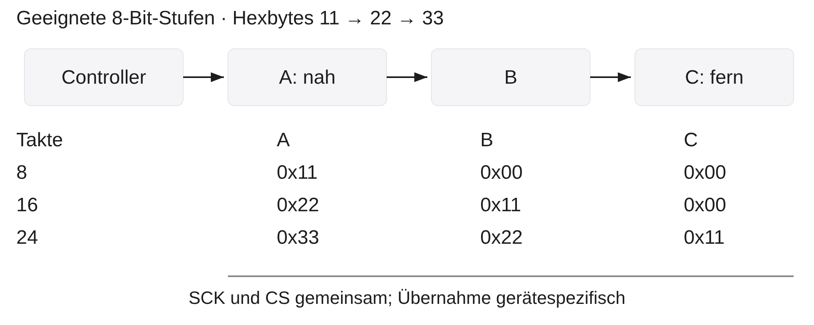{fig-alt="Drei geeignete Acht-Bit-Schieberegister liegen in Serie; die zuerst eingeschobenen Bits wandern zum entferntesten Baustein."}

- Drei Acht-Bit-Stufen: $24$ Takte zum Laden
- Beliebige SPI-Sensoren sind nicht automatisch verkettbar

::: notes
Daisy-Chain bedeutet eine hintereinander geschaltete Kette. SPI ist Serial Peripheral Interface. Im gezeichneten Lehrmodell durchlaufen Daten drei geeignete acht Bit breite Schiebestufen. Die Taktleitung SCK, Serial Clock, und CS, Chip Select, erreichen die Stufen gemeinsam; ihre speziellen Gerätefunktionen unterstützen das Weiterreichen und anschließende Übernehmen.

Die nahe Stufe heißt A, danach folgen B und C. Anfangs sind alle null. Sendet der Controller die hexadezimalen Bytes `11 22 33` mit höchstem Bit zuerst, enthält A nach acht Takten `11`. Nach sechzehn enthalten A und B `22` und `11`. Nach vierundzwanzig stehen in A, B und C `33`, `22` und `11`. Das zuerst gesendete Byte ist damit am weitesten gewandert.

Die Pfeile zeigen diese Weitergabe, keine automatische Adressierung. Welche Auswahlflanke die Ausgabe übernimmt und ob ein Rückpfad existiert, bestimmt der Baustein. Ein Sensor, der eigene Kommandos interpretieren soll, unterstützt diese reine Schiebekette nicht automatisch. Der Vorteil weniger Auswahlpins wird im Modell mit längeren Transfers und einer anderen Zuordnung bezahlt.
:::

## CPOL und CPHA vereinbaren Flanken

| Modus | CPOL | CPHA | Abtastung |
|-------|------|------|-----------|
| $0$ | $0$ | $0$ | steigend |
| $1$ | $0$ | $1$ | fallend |
| $2$ | $1$ | $0$ | fallend |
| $3$ | $1$ | $1$ | steigend |

CPOL bestimmt den Ruhepegel; CPHA die erste oder zweite Flanke.

::: notes
SPI bedeutet Serial Peripheral Interface. CPOL heißt Clock Polarity, Taktpolarität: null legt den SCK-Ruhepegel LOW fest, eins HIGH. SCK ist Serial Clock, Taktleitung. CPHA bedeutet Clock Phase, Taktphase: null wählt die erste Flanke eines Bitzyklus zum Abtasten, eins die zweite.

Eine erste Flanke führt immer vom Ruhepegel weg. Bei CPOL null ist sie steigend, bei CPOL eins fallend. Die zweite führt zum Ruhepegel zurück. Deshalb sind Modus null und drei beide mit steigender Abtastung vereinbar, besitzen aber unterschiedliche Ruhepegel und Phasen. Die vier Kombinationen sind in der Tabelle vollständig aufgelistet.

Der Modus legt nicht die Bitreihenfolge, Chipauswahlpolarität oder ein Sensorkommando fest. Auch eine richtige Verdrahtung genügt nicht, wenn Controller und Target verschiedene Flanken verwenden. Bei CPHA null muss das erste Datenbit schon vor der ersten Abtastflanke gültig sein; bei CPHA eins kann es mit der ersten Flanke vorbereitet werden. Das nächste Diagramm zeigt die Flankenwahl ohne diese unterschiedlichen Begriffe zusammenzuziehen.
:::

## Vier Modi im Zeitdiagramm

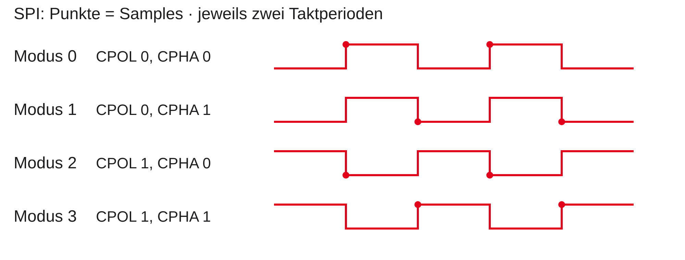{fig-alt="Vier SPI-Taktbahnen zeigen Ruhepegel und Abtastpunkte: Modus 0 steigend, 1 fallend, 2 fallend, 3 steigend."}

Punkte markieren Samples; die übrige Flanke dient dem Datenwechsel.

::: notes
SPI steht für Serial Peripheral Interface. SCK ist Serial Clock, die Taktleitung. CPOL, Clock Polarity, bestimmt deren Ruhepegel; CPHA, Clock Phase, wählt erste oder zweite Flanke zum Abtasten. Die Abbildung zeigt für jede Kombination zwei vollständige Taktperioden.

Bei CPOL null beginnt die erste Flanke steigend, bei eins fallend. Die roten Punkte markieren die jeweils ausgewählte Abtastflanke. Modus null hat LOW als Ruhepegel und tastet auf der ersten, steigenden Flanke ab. Modus eins tastet auf der zweiten, fallenden ab. Bei Modus zwei ist der Ruhepegel HIGH und die erste Flanke fallend; Modus drei verwendet die zweite, steigende.

Die Darstellung enthält bewusst nur den Takt und die Sample-Markierungen. Sie behauptet keine zusätzlichen übertragenen Datenbits an den Punkten. Daten müssen vor und nach diesen Zeitpunkten gültig sein. Für CPHA null ist daher das erste Bit vor der ersten Flanke bereitzustellen; für CPHA eins kann die erste Flanke zur Vorbereitung dienen. Beide Teilnehmer müssen sich auf denselben Modus verständigen, und anschließend muss ihr reales Timingbudget eingehalten werden.
:::

## Ein Takt braucht ein Timingbudget

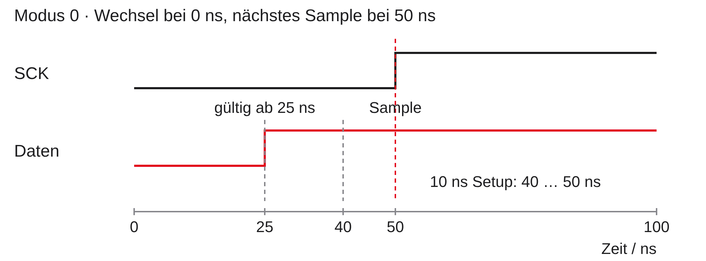{fig-alt="Nach einer Datenwechsel-Flanke benötigen Bereitstellung und Leitungsversatz 25 ns; zehn ns Setup vor der nächsten Abtastflanke lassen bei 50 ns Halbperiode 15 ns Reserve."}

Lehrbudget: $18+7+10=35$ ns; bei $10$ MHz stehen $50$ ns zur Verfügung.

::: notes
SPI bedeutet Serial Peripheral Interface. Eine Setup-Zeit ist die Mindestdauer, während der Daten vor dem Sample stabil sein müssen. Die Hold-Zeit betrifft die Mindestdauer danach. Das Diagramm verwendet Modus null: Die fallende SCK-Flanke, Flanke des Serial Clock, bereitet Daten vor, die nächste steigende tastet sie ab.

Wir legen achtzehn Nanosekunden Datenbereitstellung, sieben Nanosekunden zusätzlichen Leitungs- beziehungsweise Taktversatz und zehn Nanosekunden Empfänger-Setup vor. Diese Werte sind Lehrannahmen. Zusammen sind es fünfunddreißig Nanosekunden. Bei zehn Megahertz dauert eine volle Periode hundert Nanosekunden, die Hälfte fünfzig. Der Abtastzeitpunkt liegt somit fünfzehn Nanosekunden nach dem spätesten erforderlichen Zeitpunkt.

Bei zwanzig Megahertz wären nur fünfundzwanzig Nanosekunden verfügbar; dasselbe Budget wäre verletzt. Ein passender SPI-Modus garantiert daher nicht jede Taktrate. Die Grafik markiert Datenbereitstellung, Setup-Grenze und Sample auf einer Nanosekundenachse. Hold-Zeit, erste Bitbereitstellung, Ausgangsfreigabe und Auswahlgrenzen müssen zusätzlich geprüft werden. Unsere Rechnung zeigt eine notwendige Budgetprüfung, keinen vollständigen Nachweis eines realen Transfers.
:::

## SCK-Rate ist nicht Nutzdatenrate

Spielprotokoll: ein Kommandobyte und drei Antwortbytes.

Bei $f_{\mathrm{SCK}}=10$ MHz ohne Pausen:

$$
T=\frac{4\cdot8}{f_{\mathrm{SCK}}}=3{,}2\,\mu\mathrm{s}
$$

$$
r=\frac{3\ \mathrm{Byte}}T=937500\ \mathrm{Byte/s}
$$

Nutzdatenanteil: $3/4=75\,\%$ der Bytezeiten.

::: notes
SPI heißt Serial Peripheral Interface, SCK Serial Clock. $f_{\mathrm{SCK}}$ ist die Taktfrequenz, $T$ die Dauer der gewählten Transaktion und $r$ ihre Nutzdatenrate. Das zuvor eingeführte Spielprotokoll enthält vier Bytezeiten: ein Kommando und drei gleichzeitig mit Dummy-Daten abgeholte Antwortbytes.

Mit acht Bits je Byte sind zweiunddreißig Takte nötig. Zehn Megahertz entsprechen zehn Millionen Taktperioden pro Sekunde. Die Division ergibt $32/10^7=3{,}2$ Mikrosekunden. Drei Nutzdatenbytes in dieser Zeit ergeben $937500$ Byte pro Sekunde. Die reine Leitungsrate von zehn Millionen Bits entspräche ohne Protokollaufwand dagegen $1250000$ Byte pro Sekunde.

Die Rechnung nimmt ein Bit pro Takt und keine Pausen, Auswahlwartezeiten oder Softwarelücken an. Der Nutzdatenanteil beträgt deshalb genau drei Viertel; zusätzliche Vorgaben würden die tatsächliche Rate senken. MOSI, Master Out Slave In, und MISO, Master In Slave Out, bewegen trotzdem in jeder Bytezeit gleichzeitig Bits. Full-Duplex verdoppelt nicht automatisch die für diesen Auftrag nutzbare Antwortmenge. Aufgabe 3 trennt entsprechend Taktzahl, Transferzeit und sinnvolle Daten.
:::

## SPI braucht einen Gerätevertrag

Vor einem Transfer klären:

- Auswahlpolarität und zulässiger Auswahlrahmen
- Taktmodus, Bitreihenfolge und Timinggrenzen
- Kommando- und Antwortphasen
- Erkennbare Fehler und erlaubte Wiederholung

::: notes
SPI bedeutet Serial Peripheral Interface. Die Schnittstelle stellt im Grundmodell Takt, Auswahl und zwei Datenpfade bereit. Sie definiert kein universelles Sensorregisterformat und besitzt kein allgemein vorgeschriebenes Quittungsbit nach jedem Byte. Ein Gerät kann solche Prüfungen oder Statusinformationen über sein eigenes Protokoll ergänzen.

Ein plausibel aussehendes Empfangsbyte beweist deshalb nicht automatisch, dass das richtige Target geantwortet hat. Beispielsweise kann ein freigegebener Rückpfad einen durch die Beschaltung bestimmten Pegel liefern. Ebenso kann ein falscher Modus Bits verschieben, obwohl die Verdrahtung stimmt. Die Diagnose muss Auswahl, Zeitverhalten und Kommandointerpretation gemeinsam betrachten.

Eine Wiederholung kann bei einem reinen Leseauftrag zulässig sein, bei einem schreibenden oder auslösenden Kommando aber eine zusätzliche Wirkung erzeugen. Das muss der Gerätevertrag klären. Hier bleibt der Unterschied zwischen Schieben und sinnvoller Transaktion entscheidend. Für viele langsamere Teilnehmer betrachten wir nun I²C: Dort gehören eine übertragene Geräteadresse und regelmäßige Quittungsintervalle bereits zum Busprotokoll. Auch diese Quittungen ersetzen später nicht die Prüfung des eigentlichen Inhalts.
:::

## I²C: zwei gemeinsame Signale

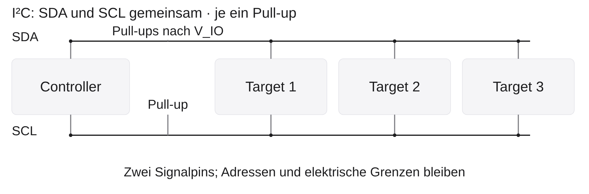{fig-alt="Ein Controller und drei adressierte Targets teilen SDA und SCL; beide Leitungen besitzen eigene Pull-ups."}

I²C: Inter-Integrated Circuit; SDA Daten, SCL Takt.

::: notes
I²C bedeutet Inter-Integrated Circuit, Verbindung zwischen integrierten Schaltungen. SDA heißt Serial Data, serielle Datenleitung, SCL Serial Clock, serielle Taktleitung. Ein Controller organisiert den Transfer; mehrere Targets können dieselben beiden Signale verwenden. Ältere Dokumente nennen diese Rollen Master und Slave.

Die Abbildung zeigt parallel angeschlossene Teilnehmer, keine hintereinander geschobene Datenkette. Die Geräteadresse unterscheidet die Targets. Deshalb braucht der Controller im Grundmodell nicht für jedes Gerät einen eigenen Auswahlpin. GND, Ground oder Spannungsbezug, und Versorgung sind zusätzlich erforderlich und nicht in der Zweier-Signalzahl enthalten.

Ein gemeinsamer Bus hat trotzdem Grenzen. Geräte mit gleicher unveränderlicher Adresse sind nicht einzeln durch die Adresse unterscheidbar. Mehr Teilnehmer erhöhen häufig die Leitungskapazität; zusätzliche Pull-ups können außerdem den Gesamtwiderstand verändern. Zwei Pins bedeuten daher nicht unbegrenzt viele beliebige Geräte. Da mehrere Teilnehmer auf dieselbe Leitung wirken, muss besonders die elektrische Treiberart passen. Als Nächstes erklären wir, wie eine logisch gesendete Eins ohne aktiv gegen einen anderen Teilnehmer getriebenes HIGH entsteht.

$V_{\mathrm{IO}}$ bezeichnet im Diagramm die Pull-up-Versorgung. Die Verbindungen zeigen funktionale Busbeziehungen; sie sind kein vollständiger Anschlussplan mit Spannungsgrenzen, Versorgung und Schutzbeschaltung.
:::

## Open-Drain: LOW treiben, HIGH freigeben

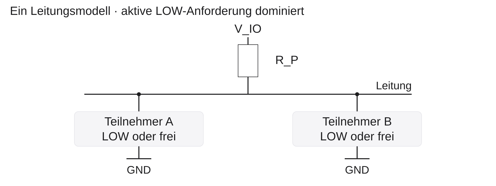{fig-alt="Ein Pull-up speist die gemeinsame Leitung; jeder Teilnehmer zieht sie nur nach Masse oder gibt sie frei. Eine LOW-Anforderung dominiert."}

| Teilnehmer A | Teilnehmer B | Leitung |
|--------------|--------------|---------|
| frei | frei | HIGH |
| zieht LOW | frei oder zieht LOW | LOW |

::: notes
Open-Drain bezeichnet einen Ausgang, der aktiv nach LOW ziehen oder elektrisch freigeben kann. Er treibt hier kein aktives HIGH. Ein Pull-up-Widerstand verbindet die Leitung mit der Versorgung und hebt ihren Pegel an, wenn alle Teilnehmer loslassen. Die Grafik ist ein funktionales elektrisches Lehrschema für eine einzelne gemeinsame Leitung.

I²C bedeutet Inter-Integrated Circuit. Bei SDA, Serial Data, und SCL, Serial Clock, ermöglicht dieses Prinzip mehreren Teilnehmern, LOW anzufordern. Gibt A frei und zieht B LOW, wird die Leitung LOW. Eine logisch gesendete Eins bedeutet daher Freigeben, nicht das Erzwingen eines hohen Pegels gegen B. Die Tabelle beschreibt das als dominantes LOW; Wired-AND nennt die entsprechende logische Verknüpfung der freigegebenen Eins-Anforderungen.

Bei Push-Pull treiben Ausgänge sowohl LOW als auch HIGH aktiv. Gegensätzliche aktive Treiber an derselben Leitung könnten einen Stromkonflikt erzeugen. Open-Drain begrenzt diesen Konflikt durch den Pull-up, ersetzt aber keine Spannungs- und Stromauslegung. Der Widerstand muss zugleich einen schnellen Pegelanstieg und einen zulässigen LOW-Strom ermöglichen. Genau daraus entsteht die nächste Dimensionierungsaufgabe.

$R_P$ benennt den Pull-up-Widerstand, $V_{\mathrm{IO}}$ seine Versorgung und GND, Ground, den Spannungsbezug. Die beiden unteren Zweige wirken auf dieselbe Leitung. Ihr Zustand bestimmt gemeinsam den Pegel, nicht eine Addition der gesendeten Zahlen.
:::

## Der Pull-up lädt eine Kapazität

Lehrmodell: $C_B=100$ pF, $R_P=2{,}2$ k$\Omega$.

Anstiegszeit zwischen $30\,\%$ und $70\,\%$ des Endpegels:

$$
t_r\approx0{,}8473R_PC_B\approx186{,}4\ \mathrm{ns}
$$

Ein kleinerer Widerstand beschleunigt den Anstieg und erhöht den LOW-Strom.

::: notes
$R_P$ ist der Pull-up-Widerstand, $C_B$ die zusammengefasste Buskapazität und $t_r$ die Anstiegszeit zwischen dreißig und siebzig Prozent des Endpegels. pF bedeutet Pikofarad, $10^{-12}$ Farad; k$\Omega$ bezeichnet Kiloohm. Nach dem Loslassen lädt der Widerstand die Kapazität näherungsweise exponentiell.

Im einfachen Widerstands-Kapazitäts-Modell gilt $V(t)=V_{\mathrm{IO}}(1-e^{-t/(R_PC_B)})$. Die Differenz der Zeitpunkte für siebzig und dreißig Prozent ist $R_PC_B\ln(0{,}7/0{,}3)$, ungefähr $0{,}8473R_PC_B$. Die Versorgung $V_{\mathrm{IO}}$ kürzt sich bei diesen relativen Schwellen heraus.

Zweitausendzweihundert Ohm mal hundert Pikofarad ergeben $220$ Nanosekunden Zeitkonstante. Die betrachtete Anstiegszeit ist rund $186{,}4$ Nanosekunden. Sie ist nicht die Zeit bis zu hundert Prozent und nicht die vollständige Taktperiode. Ein kleinerer Widerstand lädt schneller, lässt beim LOW-Ziehen aber mehr Strom fließen. I²C, Inter-Integrated Circuit, braucht deshalb nicht bloß „irgendeinen Widerstand von wenigen Kiloohm“, sondern einen Bereich, der beide Anforderungen erfüllt.

$t$ ist die Zeit seit dem idealisierten Loslassen bei null Volt, $V(t)$ die momentane Spannung. $\ln$ bezeichnet den natürlichen Logarithmus. Die Anstiegszeit wird zwischen zwei relativen Schwellen gemessen, weil die exponentielle Kurve ihren Endwert erst asymptotisch erreicht.
:::

## Zwei Grenzen für den Widerstand

Lehrvorgaben: $V_{\mathrm{IO}}=3{,}3$ V; der Ausgang garantiert
$V_{\mathrm{OL}}\leq0{,}4$ V bei $I_{\mathrm{OL}}=3$ mA.
Außerdem gilt $t_{r,\max}=300$ ns.

$$
R_{\min}=\frac{3{,}3-0{,}4}{0{,}003}\approx967\ \Omega
$$

$$
R_{\max}=\frac{300\,\mathrm{ns}}{0{,}8473\cdot100\,\mathrm{pF}}
\approx3{,}54\ \mathrm{k}\Omega
$$

$2{,}2$ k$\Omega$ passt; $4{,}7$ k$\Omega$ ist im Modell zu langsam.

::: notes
$V_{\mathrm{IO}}$ ist die Versorgung des Pull-ups, $V_{\mathrm{OL,max}}$ die garantierte obere LOW-Spannung beim spezifizierten Sinkstrom $I_{\mathrm{OL}}$. Sinken bedeutet Strom aus der Leitung aufnehmen und nach Masse führen. Die Untergrenze folgt aus dieser Treiberfähigkeit: Am Grenzpegel darf der Pull-up nicht mehr als den spezifizierten Strom verlangen. $(3{,}3-0{,}4)/0{,}003$ ergibt ungefähr $966{,}7$ Ohm. Die drei Milliampere sind hier ein Referenzpunkt der garantierten LOW-Kennlinie, kein absoluter Maximalstrom des Pins. Soll zusätzlich eine harte Stromgrenze auch bei null Volt am Ausgang eingehalten werden, wäre separat $R_P\geq V_{\mathrm{IO}}/I_{\mathrm{abs,max}}$ zu prüfen; $I_{\mathrm{abs,max}}$ bezeichnet diese gesonderte Grenze.

Die maximale Größe folgt aus der vorgegebenen Anstiegsgrenze $t_{r,\max}$ und Buskapazität $C_B$. Mit dreihundert Nanosekunden und hundert Pikofarad ergeben sich etwa $3540{,}7$ Ohm. Der betrachtete Bereich ist somit ungefähr $967$ Ohm bis $3{,}54$ Kiloohm. Diese Lehrvorgaben orientieren sich am I²C-Fast-Mode; I²C heißt Inter-Integrated Circuit. Sie sind keine vollständige Auslegung für beliebige Teilnehmer.

Mit $2{,}2$ Kiloohm liegen Anstieg und LOW-Strom innerhalb der Vorgaben. $4{,}7$ Kiloohm ergeben etwa $398{,}2$ Nanosekunden und überschreiten die Zeitgrenze. Parallele Pull-ups müssen als Gesamtwiderstand berücksichtigt werden. Steigt die Kapazität auf vierhundert Pikofarad, sinkt die obere Grenze sogar unter die untere; dann reicht eine bloße Widerstandswahl unter denselben Vorgaben nicht aus.
:::

## START und STOP sind besondere Übergänge

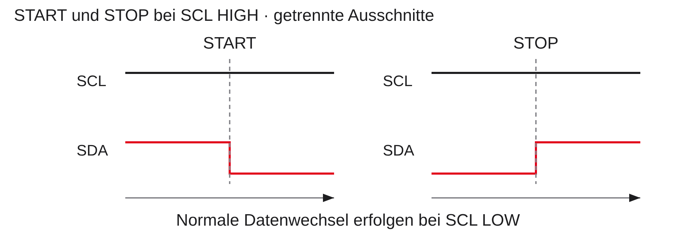{fig-alt="START ist eine fallende SDA-Flanke bei SCL HIGH, STOP eine steigende SDA-Flanke bei SCL HIGH; normale Datenwechsel liegen in der LOW-Taktphase."}

Normale Daten bleiben während SCL HIGH stabil.

::: notes
I²C bedeutet Inter-Integrated Circuit. SDA heißt Serial Data, Datenleitung, SCL Serial Clock, Taktleitung. START bezeichnet den Transferbeginn: SDA fällt, während SCL HIGH ist. STOP ist der Abschluss: SDA steigt bei SCL HIGH. Die Abbildung zeigt diese beiden Sonderbedingungen getrennt auf einer gemeinsamen Zeitrichtung.

Während normaler Datentakte bleibt SDA im HIGH-Abschnitt von SCL stabil. Änderungen zum nächsten Datenbit erfolgen grundsätzlich in der LOW-Phase. Deshalb kann der Empfänger eine SDA-Änderung bei HIGH als besondere Busbedingung interpretieren, statt als gewöhnliches neues Bit. Die Signalhöhen sind logische Pegel, keine Aussagen über einen Sensorwert.

Ein Repeated START, wiederholter Start, setzt eine neue adressierte Phase fort, ohne vorher STOP und Busfreigabe zu erzeugen. Genau das nutzen wir später zum Wechsel vom Registerzeiger-Schreiben zum Lesen. START weckt aber nicht universell einen schlafenden Sensor; ein erforderliches Aufweckkommando gehört zu dessen Gerätebeschreibung. Ebenso garantiert eine gesendete STOP-Absicht noch keinen vollständig abgeschlossenen Transfer, falls der Controller oder die Leitung fehlerhaft ist. Status und begrenzte Wartezeit bleiben nötig.
:::

## Adresse, Richtungsbit und Registerindex

Sieben-Bit-Geräteadresse `0x68`:

$$
b_{\mathrm{Adr}}=(a_7\ll1)\mathbin{|}r
$$

| Richtung | $r$ | übertragenes Adressbyte |
|----------|-----|-------------------------|
| Write | $0$ | `0xD0` |
| Read | $1$ | `0xD1` |

`0x3B` ist anschließend ein Registerindex im Sensor.

::: notes
I²C, Inter-Integrated Circuit, besitzt im betrachteten Grundformat eine sieben Bit breite Geräteadresse. $a_7$ ist diese Adresse, $r$ das Richtungsbit: null für Write, Schreiben, eins für Read, Lesen. $b_{\mathrm{Adr}}$ bezeichnet das erste vollständige Adressbyte. Der Operator $\ll1$ verschiebt um eine Stelle nach links; das bitweise Oder ergänzt rechts das Richtungsbit.

`0x68` ist binär `1101000`. Nach dem Verschieben entsteht `11010000`, also `0xD0`. Mit gesetztem Richtungsbit wird daraus `11010001`, `0xD1`. Beide Bytes adressieren dasselbe Gerät. Ein Treiberinterface kann entweder die sieben Bit oder bereits dieses Byte erwarten; sein dokumentierter Vertrag entscheidet, nicht die Schreibweise einer zufällig verwendeten Variablen.

Der danach übertragene Registerindex `0x3B` wählt erst eine Datenstelle im angesprochenen Sensor. Er ist keine Prozessoradresse. Sieben Bit bieten mathematisch hundertachtundzwanzig Muster, davon sind aber Bereiche reserviert; auch zusätzliche Adressformate existieren. Wir verwenden hier ausdrücklich das einfache Sieben-Bit-Modell und die angegebene Lehradresse, ohne daraus eine unbegrenzte Zahl frei nutzbarer Targets abzuleiten.
:::

## Ein Write wird byteweise quittiert

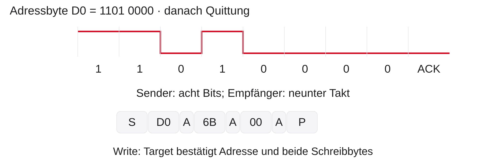{fig-alt="Acht Bits des Schreibadressbytes D0 werden von einem neunten ACK-Takt gefolgt; das Sensor-Aufweckschema ist START, D0, ACK, 6B, ACK, 00, ACK, STOP."}

Sender gibt SDA im neunten Takt frei; Empfänger quittiert LOW.

::: notes
I²C heißt Inter-Integrated Circuit. SDA, Serial Data, trägt Bits und Quittung. ACK bedeutet Acknowledge, Bestätigung, NACK Not Acknowledge, keine Bestätigung. Nach acht Datenbits folgt ein neuntes Taktintervall. Der Sender gibt SDA dafür frei; der Empfänger kann LOW als ACK anfordern. Bleibt die Leitung freigegeben und HIGH, wird NACK gelesen.

Die Grafik zeigt das Adressbyte `0xD0` mit höchstem Bit zuerst und anschließend den Quittungstakt. Darunter steht die vollständige Aufweckfolge unseres Sensorvertrags: S für START, Adresse Write, A für ACK, Register `0x6B`, ACK, Daten `0x00`, ACK und P für STOP. Der Sensor bestätigt sowohl die eigene Adresse als auch die empfangenen Schreibbytes.

Diese drei Bytephasen benötigen siebenundzwanzig SCL-Takte, Takte des Serial Clock. Bei vierhundert Kilohertz sind das mindestens $67{,}5$ Mikrosekunden, zusätzlich kommen Bedingungen, Pausen und mögliche Verzögerungen hinzu. Ein NACK in dieser Schreibfolge ist eine zu behandelnde Ablehnung, nicht ein erfolgreicher Abschluss. Beim folgenden Lesen wechseln jedoch die Rollen für die Datenquittung.
:::

## Register lesen mit Repeated START

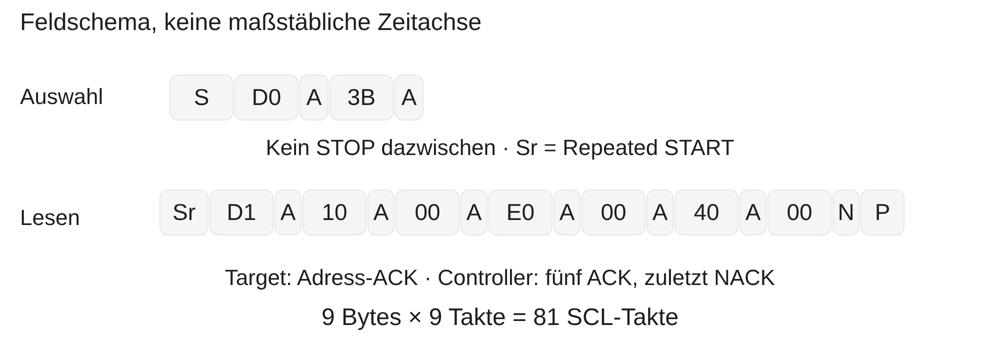{fig-alt="Der Controller schreibt D0 und Registerindex 3B, wechselt mit Repeated START zu D1 und liest sechs Bytes; die ersten fünf werden bestätigt, das letzte mit NACK abgeschlossen."}

Kein STOP zwischen Registerauswahl und Lesephase.

::: notes
I²C bedeutet Inter-Integrated Circuit. Ein Burst ist hier das zusammenhängende Lesen mehrerer aufeinanderfolgender Registerbytes. Zuerst sendet der Controller START, das Schreibadressbyte `0xD0` und Registerindex `0x3B`. Das Target bestätigt beide Bytes mit ACK, Acknowledge.

Sr in der Grafik steht für Repeated START, wiederholter Start. Ohne vorheriges STOP folgt nun `0xD1` als Leseadressbyte; auch diese Adresse bestätigt das Target. Danach liefert es die sechs vorgegebenen Datenbytes `10 00 E0 00 40 00`. Der Controller bestätigt die ersten fünf mit ACK und gibt beim letzten Quittungstakt SDA, Serial Data, für NACK, Not Acknowledge, frei. Anschließend erzeugt er STOP, in der Grafik P.

Die Feldbreiten zeigen die Rollenfolge und sind keine maßstäblichen Zeitdauern. Insgesamt werden neun Bytes mit jeweils einem neunten Takt übertragen: ein Schreibadressbyte, ein Registerindex, ein Leseadressbyte und sechs Datenbytes. Das sind einundachtzig SCL-Takte, Takte des Serial Clock, ideal mindestens $202{,}5$ Mikrosekunden bei vierhundert Kilohertz. Wiederholter Start hält den Auftrag zusammen; Datensatzkonsistenz verlangt zusätzlich passende Registereigenschaften des Sensors.
:::

## NACK hat eine Rolle und einen Zeitpunkt

| Situation | Quittung erzeugt durch | Bedeutung |
|-----------|------------------------|-----------|
| Adresse | Target | ACK: angesprochen und bestätigt |
| Schreibdaten | Target | ACK: Byte bestätigt |
| weitere Lesedaten | Controller | ACK: nächstes Byte gewünscht |
| letzte Lesedaten | Controller | NACK: normale Datenphase beendet |

Ein Adress-NACK ist eine Ablehnung, keine eindeutige Diagnose ihrer Ursache.

::: notes
ACK bedeutet Acknowledge, Bestätigung, NACK Not Acknowledge, keine Bestätigung. I²C steht für Inter-Integrated Circuit. Entscheidend sind die Richtung des jeweiligen Bytes und die Rolle seines Empfängers. Bei Adresse und Schreibdaten ist das Target der Empfänger und quittiert. Bei gelesenen Daten ist der Controller der Empfänger und erzeugt ACK oder NACK.

Ein Address-NACK kann etwa bedeuten, dass kein passender Teilnehmer antwortet oder ein angesprochenes Gerät momentan nicht bereit ist. Er beweist nicht eindeutig, dass ein bestimmter Chip physisch fehlt. Ein unerwarteter Data-NACK beim Schreiben ist ebenfalls zu behandeln. Dagegen gehört der vom Controller beabsichtigte NACK nach dem letzten Lesebyte zur normalen erfolgreichen Sequenz.

Ein Treiber darf deshalb nicht jeden hohen neunten Pegel pauschal als Fehler melden. Er muss wissen, welche Phase er gerade bearbeitet und welche Antwort dort vorgesehen ist. Umgekehrt ist ein ACK keine Prüfung der sachlichen Richtigkeit späterer Sensordaten. Die Tabelle trennt Busbestätigung, geordnetes Leseende und Inhaltsvalidierung. Danach betrachten wir Verzögerungen, bei denen selbst die nächste Taktflanke nicht zum geplanten Zeitpunkt sichtbar wird.
:::

## Clock Stretching verlängert die LOW-Phase

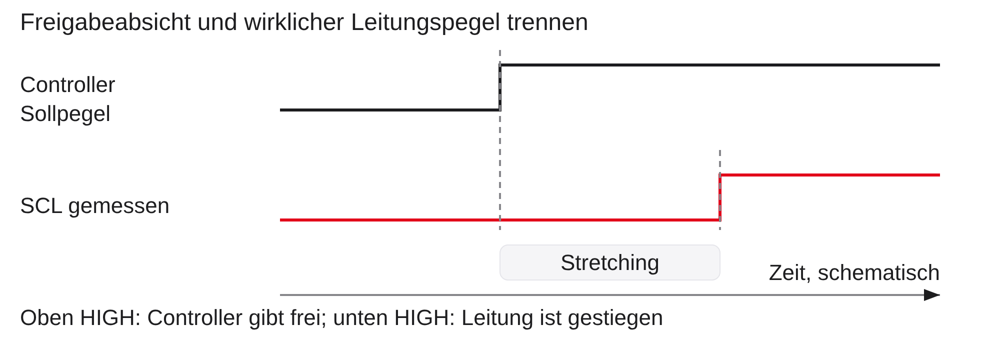{fig-alt="Der Controller gibt SCL frei, aber das Target hält die Taktleitung zunächst weiter LOW; erst nach Freigabe steigt die tatsächlich gemessene Leitung."}

Tatsächlichen SCL-Pegel beobachten; Warten durch eine Deadline begrenzen.

::: notes
I²C bedeutet Inter-Integrated Circuit. SCL ist Serial Clock, die gemeinsame Taktleitung. Clock Stretching bezeichnet das Verlängern einer LOW-Phase durch einen Teilnehmer. Wegen Open-Drain, aktiv LOW oder freigegeben, steigt SCL erst, wenn alle beteiligten Ausgänge loslassen.

Die horizontale Zeitachse ist schematisch und enthält keine gemessene Dauer. Die Abbildung trennt die Freigabeabsicht des Controllers vom tatsächlich gemessenen Leitungspegel. Ein Target kann weiter LOW halten, obwohl der Controller bereits HIGH erwartet. Erst nach dessen Freigabe und dem anschließenden Pull-up-Anstieg beginnt die reale HIGH-Phase. Der Controller darf diesen Zeitraum nicht einfach als schon abgelaufenen HIGH-Takt verbuchen.

Eine Deadline ist ein vorgegebener spätester Zeitpunkt, bis zu dem ein erwarteter Zustand eintreten muss. Fehlt er, meldet der Treiber einen Fehler und behandelt seinen Zustand begrenzt weiter. Nicht jeder Controller unterstützt jede Stretching-Situation; das ist vor Nutzung zu prüfen. Ein dauerndes Warten auf SCL könnte sonst die Anwendung blockieren. Ein Watchdog erkennt ausbleibenden relevanten Fortschritt nur bei sinnvoller Feedstrategie. Ein Reset des Prozessors setzt einen extern weiter versorgten Sensor außerdem nicht automatisch zurück.
:::

## Arbitration: eine Eins kann verlieren

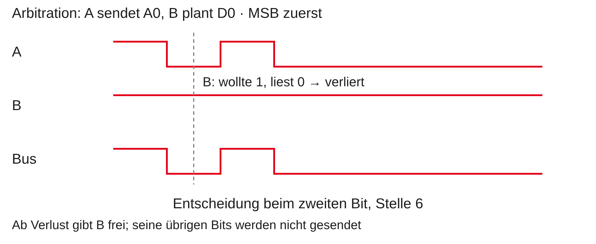{fig-alt="Zwei Controller senden A0 und D0. Beim zweiten Bit will A LOW und B eine freigegebene Eins; die Leitung bleibt LOW und B verliert."}

Wer eine freigegebene Eins senden wollte und LOW liest, beendet seine Beteiligung.

::: notes
I²C heißt Inter-Integrated Circuit. Arbitration ist die Entscheidung zwischen gleichzeitig aktiven Controllern. Dominantes LOW bedeutet, dass ein ziehender Open-Drain-Ausgang eine freigegebene Eins überstimmt. SDA, Serial Data, kann deshalb während der eigenen Ausgabe zurückgelesen werden.

Im Diagramm sendet Controller A das Schreibadressbyte `0xA0`, binär `1010 0000`, B dagegen `0xD0`, `1101 0000`. Beide beginnen mit eins. Beim zweiten Bit, Stelle sechs, zieht A LOW; B gibt für seine Eins frei und liest trotzdem null. B verliert an genau diesem ersten Unterschied und gibt seine Beteiligung auf. A kann seine Nachricht fortsetzen.

Die Grafik zeigt die Bitentscheidung, kein vollständiges Mehrcontroller-Timingmodell. Taktkoordination und konkrete Controllerunterstützung sind ebenfalls erforderlich. Nach einem Arbitration-Verlust darf der Verlierer nicht blind STOP erzeugen, weil er den laufenden Gewinnertransfer damit stören würde. Eine spätere Wiederholung wartet auf passenden Buszustand und folgt dem Gerätevertrag. Dies ist ein anderer Fehlerpfad als eine Ablehnung durch das adressierte Target; beide dürfen nicht durch dieselbe pauschale Aufräumaktion verwechselt werden.

MSB heißt Most Significant Bit, höchstwertiges Bit. Die A- und B-Bahnen zeigen Zieh- oder Freigabeanforderungen, die Busbahn den gemeinsamen Pegel. B bleibt nach dem Verlust freigegeben; seine übrigen geplanten Bits werden nicht mehr ausgegeben.
:::

## Ein Sensor hat einen Registervertrag

MPU-6050-Beispiel, ausdrücklich vorgegebene Konfiguration:

| Register | Aufgabe |
|----------|---------|
| `0x6B` | Power Management; `00` beendet hier Sleep |
| `0x1C` | Beschleunigungsbereich; `00` wählt hier $\pm2g$ |
| `0x3B … 0x40` | X, Y, Z: jeweils High- und Low-Byte |

Aufwecken allein garantiert keinen sofort verfügbaren frischen Datensatz.

::: notes
Der MPU-6050 ist ein Beispiel für einen digitalen Bewegungssensor. Die hier verwendeten Registerwerte werden als konkreter Gerätevertrag vorgegeben. `0x6B` ist das Power-Management-Register; im Beispiel beendet `0x00` den Schlafzustand. `0x1C` bestimmt den Beschleunigungsbereich, hier mit null für plus/minus zwei $g$. $g$ bezeichnet eine Beschleunigungseinheit entsprechend der Normfallbeschleunigung.

Die sechs Register ab `0x3B` enthalten die drei Beschleunigungsachsen X, Y und Z mit jeweils höherwertigem Byte zuerst. Das ist kein fertig berechneter Neigungswinkel. Gyroskop- oder Temperaturwerte sind nicht Bestandteil unseres Sechs-Byte-Auftrags. Der Sensorindex wählt Daten innerhalb des bereits über die I²C-Adresse, Inter-Integrated-Circuit-Adresse, angesprochenen Geräts.

Startzeit, Datenbereitschaft und Konsistenz zusammenhängender Register sind produktspezifisch. Für die Papierrechnungen legen wir die sechs Bytes während des gesamten Bursts stabil vor. Bei echter Hardware muss die Registerbeschreibung bestätigen, wann Werte frisch sind und wie zusammengehörige Bytes gelesen werden. Ein Burst allein garantiert nicht für jeden Sensor einen gemeinsamen Messzeitpunkt. Erst nach erfolgreichem Transfer und diesen Voraussetzungen darf die Anwendung die Daten als neuen Datensatz verwenden.
:::

## Zwei Bytes als Zweierkomplement lesen

Portable C-Rechenfunktion für High-Byte zuerst:

```c
int32_t decode_s16_be(uint8_t high, uint8_t low) {
    uint32_t u = ((uint32_t)high << 8) | low;
    if (u >= 0x8000u)
        return (int32_t)u - 65536;
    return (int32_t)u;
}
```

`E0 00`: unsigned $57344$, signed $57344-65536=-8192$.

::: notes
Big Endian bedeutet hier höherwertiges Byte zuerst in der übertragenen Folge. Die Funktion `decode_s16_be` dekodiert eine sechzehn Bit breite Zweierkomplementzahl. `uint8_t` und `uint32_t` aus `stdint.h` sind vorzeichenlose Acht- und Zweiunddreißig-Bit-Typen; `int32_t` ist ein vorzeichenbehafteter Zweiunddreißig-Bit-Typ.

Die Linksverschiebung setzt `high` in die Stellen acht bis fünfzehn, das bitweise Oder ergänzt `low`. `u` liegt zwischen null und $65535$. Bis $32767$ entspricht der Wert direkt der positiven Zahl. Ab `0x8000` ist Bit fünfzehn gesetzt; Subtraktion von $65536$ liefert das negative Zweierkomplementergebnis. `E0 00` wird so zu $57344-65536=-8192$.

Jede Umwandlung nach `int32_t` liegt vor der Subtraktion im darstellbaren Bereich. Deshalb wird kein außerhalb des Zielbereichs liegender Unsigned-Wert direkt nach `int16_t` gecastet, dessen Behandlung in C11 implementationsabhängig wäre. Ein Bytepuffer-Cast auf einen Zahlenzeiger würde außerdem Bytefolge und Ausrichtung nicht festlegen. Die Funktion ist reine, vollständig prüfbare Arithmetik; sie enthält weder einen Sensorzugriff noch eine Aussage über die Speicher-Bytefolge des ausführenden Prozessors.
:::

## Rohzahl und physikalische Einheit

Vorgegebener Bereich $\pm2g$: $s=16384$ Zählschritte pro $g$.

| Bytes | Rohwert $q$ | $q/s$ |
|-------|-------------|-------|
| `10 00` | $4096$ | $+0{,}25g$ |
| `E0 00` | $-8192$ | $-0{,}5g$ |
| `40 00` | $16384$ | $+1g$ |

Ein Beschleunigungswert ist nicht ohne weitere Annahmen ein Winkel.

::: notes
$q$ ist der dekodierte vorzeichenbehaftete Rohwert, $s$ der Skalenfaktor in Zählschritten pro Beschleunigungseinheit. $g$ steht hier für die Normfallbeschleunigung, ungefähr $9{,}80665$ Meter pro Quadratsekunde. Die Geräteangabe $16384$ LSB pro $g$ bedeutet Schritte des niedrigstwertigen Bits, Least Significant Bit, pro dieser Einheit.

Die Bytes werden zunächst in der vorgegebenen High-Low-Reihenfolge zusammengesetzt und als Zweierkomplement interpretiert. `10 00` ergibt $4096$, `E0 00` ergibt $-8192$ und `40 00` ergibt $16384$. Division durch $16384$ liefert ein Viertel, minus eine Hälfte und eins, jeweils in $g$. Die Bytefolge ist ein didaktischer Datensatz, keine behauptete Messung einer ruhenden Lage.

Ein anderer eingestellter Messbereich kann einen anderen Skalenfaktor verlangen. Erfolgreicher Busverkehr allein bestätigt diese Konfiguration nicht. Auch Neigung lässt sich nicht allgemein als direkt gelesener Registerinhalt verstehen: Weitere Bewegungen beeinflussen Beschleunigung, und eine Winkelableitung benötigt passende physikalische Annahmen. Aufgabe 6 verbindet deshalb zuerst korrektes Dekodieren, Einheit und gültigen Transfer, statt aus einzelnen Bytes unmittelbar eine Lagegarantie abzuleiten.
:::

## Erfolg prüfen, dann Daten übernehmen

Reines C-Verarbeitungsmodell; getrennte gültige Puffer, exklusiver Zugriff:

```c
bool decode_accel_xyz(const uint8_t bytes[6],
                      bool transfer_ok, int32_t out[3]) {
    if (!transfer_ok) return false;
    for (unsigned i = 0; i < 3u; ++i)
        out[i] = decode_s16_be(
            bytes[2u*i], bytes[2u*i+1u]);
    return true;
}
```

Bei Transferfehler bleiben die bisherigen Ausgabewerte erhalten.

::: notes
Die C-Funktion verwendet `decode_s16_be` aus der vorigen Dekodierfolie. `bytes` bezeichnet sechs bereits empfangene Bytes, `transfer_ok` einen wahrheitswertigen Gesamterfolg und `out` drei vorzeichenbehaftete Rohwerte. `bool` aus `stdbool.h` ist ein Wahrheitswert; `uint8_t` und `int32_t` aus `stdint.h` sind Acht-Bit-Unsigned- und Zweiunddreißig-Bit-Signed-Typen.

Bei falschem Erfolgsstatus kehrt die Funktion zurück, ohne Daten zu lesen oder Ausgabe zu ändern. Bei Erfolg verarbeitet sie die Bytepaare null/eins, zwei/drei und vier/fünf. Das Modell setzt ausreichende, gültige, nicht überlappende Puffer und exklusiven Zugriff voraus. Arraygrößen in C-Funktionsparametern garantieren deren tatsächliche Speichergröße nicht. Die drei Zuweisungen sind auch keine atomare Veröffentlichung gegenüber gleichzeitigen Lesern.

Der Gerätetreiber darf `transfer_ok` erst nach der vollständigen erwarteten Transaktion setzen: richtige Quittungen, alle Bytes und abgeschlossener Endzustand. Unerwarteter NACK, Not Acknowledge, Timeout oder Arbitration-Verlust sind getrennte Fehlerpfade. Jede Wartephase braucht eine Deadline und passende begrenzte Bereinigung; nach Arbitration-Verlust kein blindes STOP. Null und `0xFF` können gültige Datenbytes sein und taugen nicht als Fehlerersatz. Ein neuer Fortschrittsnachweis entsteht erst aus tatsächlich erfolgreicher, geeigneter Verarbeitung.

Ein gleichzeitiger Leser könnte während der drei Zuweisungen einen Zwischenstand sehen. Die Vorbedingung exklusiven Zugriffs ist deshalb Teil dieses Rechenmodells und müsste bei einem gemeinsamen Puffer durch geeignete Synchronisation ersetzt werden.
:::

## Differenz und gemeinsamer Pegel

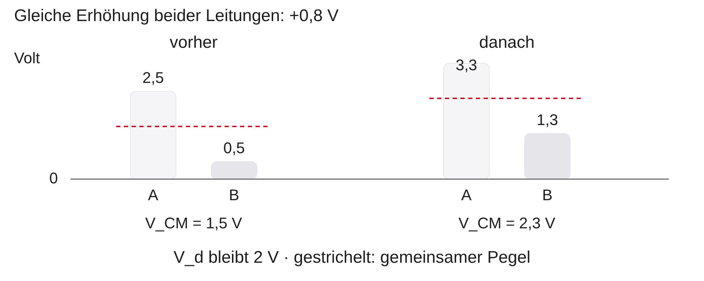{fig-alt="Anfangs sind A und B bei 2,5 und 0,5 V. Eine gleiche Erhöhung um 0,8 V lässt ihre Differenz bei 2 V und erhöht den gemeinsamen Pegel von 1,5 auf 2,3 V."}

$$
V_d=V_A-V_B,\qquad V_{\mathrm{CM}}=\frac{V_A+V_B}{2}
$$

::: notes
Single-Ended bezeichnet die Auswertung einer Signalspannung gegen einen gemeinsamen Bezug. Bei differentieller Übertragung wird dagegen die Differenz $V_d$ zwischen den beiden Leitungen A und B ausgewertet. $V_A$ und $V_B$ sind deren einzelne Spannungen gegen den Bezug, $V_{\mathrm{CM}}$ ist der Common-Mode- oder Gleichtaktpegel, ihr Mittel.

Die Abbildung zeigt zunächst $2{,}5$ und $0{,}5$ Volt. Die Differenz ist zwei Volt, der gemeinsame Pegel eine Komma fünf. Addiert eine Störung auf beide Leitungen je null Komma acht Volt, entstehen $3{,}3$ und $1{,}3$ Volt. Ihre Differenz bleibt zwei, der gemeinsame Pegel steigt auf zwei Komma drei Volt. Die senkrechte Achse gibt Volt an; die zweite Gruppe ist derselbe Zustand mit gemeinsamem Versatz.

Das ist eine ideale Gleichtaktrechnung, keine garantierte Störfestigkeit. Ein Empfänger besitzt einen endlichen zulässigen Common-Mode-Bereich und reale Unterdrückung. Ungleiche Einkopplung verändert zudem die Differenz. Die Leitungen müssen auch nicht immer als exakte logische Gegenteile schalten; entscheidend ist die definierte Differenzinformation. Ein geeigneter Leitungspfad unterstützt die möglichst ähnliche Einkopplung.
:::

## Leitungstechnik und Protokoll trennen

- Twisted Pair: verdrilltes Aderpaar für ähnliche Einkopplung
- RS-485: elektrische Schnittstelle, etwa unter einem UART-basierten Protokoll
- CAN: Controller Area Network mit eigenen Nachrichtenregeln
- Ein Transceiver ist kein Ersatz für Adressierung und Fehlerbehandlung

::: notes
Twisted Pair bedeutet verdrilltes Aderpaar. Eng benachbarte, regelmäßig vertauschte Adern können eine ähnlichere Störungseinkopplung und kleinere wirksame Schleifenflächen ermöglichen. EMI heißt Electromagnetic Interference, elektromagnetische Störung. Die ideale gemeinsame Einkopplung aus der vorigen Folie ist ein nützliches Modell, aber nicht für jede Leitung und Störquelle exakt erfüllt.

RS-485 beschreibt eine differentielle elektrische Schnittstelle. Ein geeigneter Transceiver setzt beispielsweise die lokalen Datenpfade eines UART, Universal Asynchronous Receiver-Transmitter, auf einen differentiellen Leitungspfad um. UART-Rahmen oder ein darüberliegendes Nachrichtenprotokoll legen weiterhin Datenformat und Bedeutung fest. Reichweite und Bitrate müssen gemeinsam mit Leitung und Abschluss betrachtet werden.

CAN steht für Controller Area Network. Es besitzt eigene Nachrichten- und Busregeln einschließlich Arbitration und verwendet eine passende elektrische Schnittstelle; es ist nicht bloß ein UART mit zwei Adern. Diese beiden Beispiele trennen physikalische Übertragung von Protokollorganisation. Eine höhere elektrische Störfestigkeit beweist weder die richtige Zieladresse noch die Aktualität eines Messwerts. Damit können wir Schnittstellen anhand konkreter Anforderungen auswählen, statt aus „differentiell“ eine universelle Eignung abzuleiten.
:::

## Die Schnittstelle aus dem Bedarf wählen

| Bedarf im Lehrszenario | mögliche Wahl | zu prüfen |
|-----------------------|---------------|-----------|
| Terminal mit zwei Endpunkten | UART | Rahmen, Bitzeit, Pegel |
| wenige schnelle Peripheriebausteine | SPI | Auswahl, Modus, Timing |
| mehrere langsame Platinen-Sensoren | I²C | Adressen, Pull-ups, Fristen |
| externer Leitungspfad | geeigneter Transceiver | Pegel, Bezug, Leitung |

Die Wahl folgt aus Anforderungen, nicht aus einer pauschalen Geschwindigkeitsrangliste.

::: notes
UART heißt Universal Asynchronous Receiver-Transmitter. SPI ist Serial Peripheral Interface und I²C Inter-Integrated Circuit. Die Tabelle ordnet typische Lehranforderungen zu, keine ausschließlichen Einsatzverbote. Ein Terminal kann gut mit UART-Rahmen arbeiten, ein schneller ausgewählter Baustein mit SPI und ein adressiertes kleines Sensornetz mit I²C.

Die jeweilige Prüfspalte gehört zur Entscheidung. Eine Wunschdatenrate muss beim UART den Rahmenaufwand enthalten, bei SPI Kommando- und Antwortphasen, bei I²C außerdem Adressen und neunte Quittungstakte. Mehrere I²C-Teilnehmer brauchen unterscheidbare Adressen und eine passende gemeinsame elektrische Auslegung. Wenige SPI-Targets müssen immer noch das Auswahl- und Freigabeverhalten beherrschen.

Ein externer Leitungspfad kann zusätzliche Transceiver benötigen, also passende elektrische Sender-/Empfängerbausteine. Das bestimmt noch nicht das vollständige Nachrichtenprotokoll. Die drei Schnittstellen sind daher entlang von Teilnehmern, Pins, Zeitbudget, Nutzdatenbedarf und Fehlerreaktion zu vergleichen. Eine Tabelle mit bloßen Höchstfrequenzen wäre unzureichend. Aufgabe 6 fordert eine kurze begründete Entscheidung unter benannten Annahmen und verbindet sie mit der Dekodierung eines neuen Sensorfalls.
:::

## Modelle und Geräteprüfung

- Host-C prüft Bytearithmetik und Datenübernahme
- Papier prüft Rahmen, Flanken, Adressen und Quittungsrollen
- Renode benötigt ein tatsächlich unterstütztes Geräte- und Plattformmodell
- Elektrische Flanken und reale Fristen brauchen weitere Nachweise

::: notes
Ein Host ist der Rechner, auf dem ein gewöhnlicher C-Compiler die beiden Rechenfunktionen ausführt. Damit können Bytezusammensetzung, Zweierkomplementgrenzen und das unveränderte Ergebnis bei Fehlerstatus geprüft werden. Ein solcher Lauf erzeugt keine I²C-Flanken; I²C bedeutet Inter-Integrated Circuit.

Renode ist ein Systemsimulator. Eine tatsächliche Untersuchung benötigt eine benannte unterstützte Plattform, deren Kommunikationscontroller und Sensor sowie eine passende Firmware. Aus einem erfundenen Typnamen oder Registeroffset folgt keine vorhandene Simulation. Virtuelle Registertransfers könnten Protokollfehler aufdecken, beweisen aber nicht die realen Pull-up-Anstiegszeiten oder ein Hardware-Timingbudget.

Die Pflichtaufgaben erfordern deshalb keine neue Toolchain. Ihre Modelle sind vollständig auf Papier nachvollziehbar; der optionale Hostteil prüft reine Verarbeitung. Geräteadressen, Treiberzugriffe und elektrische Anschlüsse müssten vor einer echten Ausführung konkret dokumentiert sein. Für diese Überarbeitung wird keine ausgeführte RISC-V-Sensorfirmware behauptet. Das ist die Grenze zwischen geprüfter C-Arithmetik und einem tatsächlich beobachteten externen Datenaustausch. Beide Nachweisarten beantworten unterschiedliche Fragen.
:::

## Abschlussquiz: Abläufe begründen

- Zehn QuizAcademy-Fragen zu Vorlesung 5
- Zehn Minuten bearbeiten, fünf Minuten besprechen
- Mit Bitgewicht, Taktzahl oder Teilnehmerrolle begründen
- Antwortlänge liefert keinen zuverlässigen Hinweis

::: notes
Das Quiz behält die zehn vorhandenen Fragen. Sie prüfen die in diesem Block eingeführten Zusammenhänge: Nutzrate statt bloßer Bitrate, SPI-Schiebeverhalten, adressierte I²C-Phasen, Quittungsrollen, Moduswahl und Gleichtaktwirkung. SPI steht für Serial Peripheral Interface, I²C für Inter-Integrated Circuit.

Die vorgesehenen fünfzehn Minuten teilen sich in zehn Minuten individuelle Auswahl und fünf Minuten Auswertung. Bei einer strittigen Option sollte der konkrete Zwischenwert genannt werden: etwa zehn Intervalle je UART-Rahmen, Universal-Asynchronous-Receiver-Transmitter-Rahmen, oder die Rolle des Empfängers beim neunten I²C-Takt. Diese Begründungen führen zurück zu den Diagrammen und Papieraufgaben.

Jede Frage besitzt vier Optionen und genau eine richtige Antwort. Die Optionen sind ähnlich lang und verwenden nur eingeführte Annahmen; die längste Option ist weder immer richtig noch immer falsch. Die Erläuterung klärt die jeweilige Verwechslung. Ziel ist, eine Folge selbst rekonstruieren zu können, statt allein Schnittstellennamen oder einzelne Zahlen wiederzuerkennen.
:::

## Was Sie jetzt nachvollziehen können

- Bitreihenfolge, Rahmenzeit und Nutzdatenrate
- Abtastflanke, Datenfenster und Teilnehmerauswahl
- Geräteadresse, Registerindex und Quittungsrolle
- Vorzeichen, Skalierung und gültiger Datensatz
- Elektrische Übertragung und Nachrichtenprotokoll

::: notes
Die Vorlesung hat den Weg von einer Bitfolge bis zu ihrer fachlichen Bedeutung aufgebaut. Eine Datenzahl benötigt zunächst eine vereinbarte Stellenfolge, anschließend gültige Zeitfenster und schließlich den richtigen Gerätevertrag. Ein fehlerfrei geschobenes Byte ist noch kein frisch bestätigter Messwert.

Die Grundlagen orientieren sich an Harris/Harris, Digital Design and Computer Architecture — RISC-V Edition. Ergänzende Quellen sind die [Linux-Dokumentation zum I²C-Protokoll](https://github.com/torvalds/linux/blob/master/Documentation/i2c/i2c-protocol.rst), die [SPI-Übersicht](https://github.com/torvalds/linux/blob/master/Documentation/spi/spi-summary.rst) und die [Adafruit-MPU6050-Registerdefinitionen](https://github.com/adafruit/Adafruit_MPU6050/blob/master/Adafruit_MPU6050.h). I²C heißt Inter-Integrated Circuit, SPI Serial Peripheral Interface. Die Quellen erläutern Protokoll beziehungsweise Gerätebeispiel, legen aber keine RISC-V-Peripherieregister fest.

Vorlesung 6 behandelt DMA, Direct Memory Access, direkte Transfers zwischen Speicher und Peripherie durch Hardware. Die heute eingeführten Protokollregeln bleiben dabei erforderlich; eine andere Datenbewegung ersetzt weder Auswahl noch Quittung noch gültige Puffer.
:::
