## Vom Datenprotokoll zur Datenbewegung

- Vorlesung 5: vollständige Transfers und gültige Sensorwerte
- Heute: Daten zwischen Speicher und Peripherie bewegen lassen
- DMA übernimmt Kopierarbeit, nicht die Bedeutung der Daten
- Vorbereitung, Besitz und Abschluss bleiben Softwareaufgaben

::: notes
Vorlesung 5 hat erklärt, wie Bits über UART, Universal Asynchronous Receiver-Transmitter, SPI, Serial Peripheral Interface, und I²C, Inter-Integrated Circuit, übertragen und anschließend interpretiert werden. Ein gültiger Datensatz verlangt mehr als eine gestartete Übertragung. Genau diese Trennung bleibt heute erhalten.

DMA heißt Direct Memory Access, direkter Speicherzugriff. Eine Hardwareeinheit kann Daten zwischen Speicher und Peripherie bewegen, ohne dass der Prozessor jedes Element durch seine allgemeinen Register kopiert. Dies ist eine weitere Arbeitsteilung, nachdem Timer und serielle Controller bereits selbstständig Signale erzeugen konnten.

Die Anwendung legt weiterhin fest, welche Daten gebraucht werden, wann sie gültig sind und wer einen Puffer verwenden darf. Eine fertige Speicherbewegung ist auch nicht automatisch ein abgeschlossenes Leitungsprotokoll. Der Lernweg führt deshalb vom Datenbedarf über einen beschreibbaren Transferauftrag zur sicheren Pufferübergabe. Cache-Sichtbarkeit und fortlaufende Datenströme werden anschließend als zusätzliche Bedingungen behandelt.
:::

## Voraussetzungen und Lehrmodell

- C-Integer, Arrays und Gerätezugriffe
- Cache und Write-Back aus Vorlesung 2
- Interrupts, Fristen und gemeinsame Zustände aus Vorlesung 3
- Serielle Rahmen und Quittungen aus Vorlesung 5
- DMA-Funktionen sind Plattformmerkmale, kein RISC-V-Registerstandard

::: notes
Die Vorlesung setzt die bisher eingeführten Integerzahlen, Arrays, Gerätezugriffe und Zeitrechnungen voraus. MMIO bedeutet Memory-Mapped Input/Output: Gerätefunktionen werden über Register im Prozessoradressraum bedient. Ein Cache speichert lokale Kopien von Speicherblöcken; bei Write-Back können neue Werte zunächst nur in dieser Kopie liegen. Diese Begriffe stammen aus den vorherigen Blöcken.

DMA bedeutet Direct Memory Access. Für Adressrechnungen verwenden wir ausdrücklich vorgegebene zweiunddreißig Bit breite, vom DMA erreichbare Modelladressen. Transferelemente haben dort gleiche Quell- und Zielbreite von einem, zwei oder vier Bytes. Andere Hardware kann andere Breiten, Zählerregeln und Adressübersetzungen besitzen.

Für die Cachebeispiele nehmen wir einen nicht kohärenten Write-Back-Daten-Cache und zweiunddreißig Bytes je Cachezeile an. Nicht kohärent bedeutet hier, dass der DMA die private Cachekopie nicht automatisch mitbeobachtet. Zeitwerte und Geräteadressen sind Rechenannahmen, keine Messungen. RISC-V bezeichnet die Prozessor-Befehlssatzarchitektur; DMA-Kanäle, Request-Zuordnung und Abschlussstatus sind davon getrennte Plattformmerkmale. Die Annahmen werden bei jedem Spezialfall ausdrücklich ergänzt.

RISC in RISC-V steht für Reduced Instruction Set Computer, Rechner mit reduziertem Befehlssatz.
:::

## Vier Schulstunden: Ablauf

| Stunde | Vorlesung und Besprechung | Arbeitsphase |
|--------|---------------------------|--------------|
| 1 | Bedarf, CPU-Aufwand und Datenpfad: 35 min | Aufgabe 1: 10 min |
| 2 | Transferauftrag und Lebenszyklus: 30 min | Aufgaben 2–3: 15 min |
| 3 | Cache und Busübertragung: 30 min | Aufgabe 4: 15 min |
| 4 | Streams und Anwendungen: 15 min | Aufgaben 5–6: 15 min; Quiz: 15 min |

::: notes
Vier Schulstunden entsprechen hundertachtzig Minuten Unterricht; Pausen kommen hinzu. Der Plan enthält hundertzehn Minuten Erklärung, Denkfragen und Besprechung, fünfundfünfzig Minuten angeleitete Papierübungen und fünfzehn Minuten Abschlussquiz. Die fünfzig Folien haben unterschiedliche Bearbeitungszeiten: Rechenbeispiele und Besitzwechsel benötigen mehr Gespräch als ein kurzer Überblick.

CPU bedeutet Central Processing Unit, Prozessor. DMA, Direct Memory Access, wird zunächst als Entlastung von dessen Kopierarbeit eingeführt. Danach beschreiben wir einen Auftrag über Quelle, Ziel, Breite und Länge. Cache-Sichtbarkeit und Buskonkurrenz erklären, weshalb die Entlastung nicht mit beliebiger Geschwindigkeit oder sofortiger Datenfreigabe gleichgesetzt werden darf.

Die sechs Aufgaben folgen dieser Reihenfolge. Im Unterricht werden die wichtigsten Schritte angeleitet; vollständiges selbstständiges Bearbeiten einschließlich Begründungen benötigt den längeren Richtwert des Übungsblatts. Der letzte Abschnitt behandelt fortlaufende Streams und überträgt die Regeln auf eine Rechteckkopie. Das Quiz prüft die bereits erklärten Unterscheidungen und benötigt keine zusätzliche Simulatorplattform.
:::

## Drei Budgets getrennt prüfen

| Budget | Frage |
|--------|-------|
| Leitungsbandbreite | Wie viele Nutzdaten passen durch das Protokoll? |
| CPU-Aufwand | Wie viele Takte kostet die Bedienung? |
| Speicher und Bus | Wann bekommt ein Transfer seine Zugriffe? |

Eine Verbesserung eines Budgets erfüllt die anderen nicht automatisch.

::: notes
CPU heißt Central Processing Unit, Prozessor. Sein Zeitbudget beschreibt verfügbare Verarbeitungstakte für Bedienung und Anwendung. Die Leitungsbandbreite ist dagegen die pro Zeit übertragbare Datenmenge. Das Speicher- beziehungsweise Busbudget berücksichtigt, dass verschiedene Hardwareeinheiten Zugriffe auf dieselbe Ressource beanspruchen können.

Ein schneller Kopierer kann eine langsame Leitung nicht beliebig beschleunigen. Ebenso beweist eine ausreichend schnelle Leitung nicht, dass eine Software pro Byte rechtzeitig reagieren kann. DMA, Direct Memory Access, adressiert zunächst den zweiten Punkt: Der Prozessor muss nicht jeden Transfer mit einer eigenen Lade- und Speicherfolge begleiten. Trotzdem benötigt die Hardware Zugriff auf Speicher und Peripherie.

Diese Trennung macht Rechnungen prüfbar. Wir bestimmen zuerst einen Display-Datenbedarf, vergleichen ihn mit einer idealen seriellen Obergrenze und berechnen anschließend einen angenommenen Interruptaufwand. Alle drei Zahlen beschreiben unterschiedliche Grenzen. Eine Aussage wie „DMA ist schneller“ wäre ohne benanntes Budget unvollständig. Die spätere Busarbitration kann auch erklären, weshalb der Prozessor bei einer ausgelagerten Übertragung weiterhin Verzögerungen erlebt.
:::

## Wie groß ist ein Vollbild?

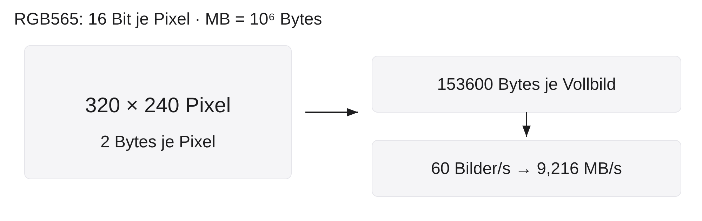{fig-alt="Ein Bild mit 320 mal 240 Pixeln und zwei Bytes je Pixel enthält 153600 Bytes; 60 Bilder je Sekunde verlangen 9,216 MB/s."}

RGB565: $5+6+5=16$ Bit, hier $2$ Byte je Pixel.

$$
B_{\mathrm{Bild}}=320\cdot240\cdot2=153600\ \mathrm{Byte}
$$

::: notes
RGB bedeutet Red, Green, Blue, Rot, Grün und Blau. RGB565 kodiert die drei Farbanteile mit fünf, sechs und fünf Bits, insgesamt sechzehn Bits pro Pixel. Für unser gepacktes Modell sind das zwei Bytes. Ein Pixel ist ein Bildpunkt; weder zusätzliche Zeilenabstände noch Steuerkommandos sind in dieser Nutzdatenmenge enthalten.

Die Abbildung zeigt Bildbreite, Höhe und daraus entstehenden Speicherbedarf. $B_{\mathrm{Bild}}$ ist die Bytezahl eines vollständigen Bildes. Dreihundertzwanzig mal zweihundertvierzig ergeben sechsundsiebzigtausendachthundert Pixel. Mit zwei Bytes je Pixel folgen einhundertdreiundfünfzigtausendsechshundert Bytes. Bei sechzig vollständigen Bildern pro Sekunde werden $9216000$ Bytes pro Sekunde gebraucht.

MB bezeichnet hier dezimal eine Million Bytes. Der Bedarf ist somit $9{,}216$ MB pro Sekunde. Das ist keine Aussage über komprimierte Bilder oder die Größe nur geänderter Ausschnitte. Die gezeichneten Zahlen sind Rechenannahmen, keine Displaymessung. Der nächste Vergleich fragt, ob die Leitung allein diesen Vollbildstrom tragen könnte, selbst bei perfekter Versorgung mit Bytes.

Lesen Sie die Grafik von links nach rechts: Die graue Bildfläche steht für die zweidimensionale Pixelmenge, der erste Pfeil für ihre Umrechnung in Bytes. Der Pfeil nach unten ergänzt die zeitliche Wiederholung. Weder die gezeichnete Fläche noch die Kastenbreite ist eine quantitative Skala.
:::

## DMA hebt die Leitungsgrenze nicht auf

SPI-Lehrmodell: ein Bit je SCK-Takt, keine Pausen.

| SCK | ideale Byte-Rate | maximale Vollbilder/s |
|-----|------------------|------------------------|
| $10$ MHz | $1{,}25$ MB/s | $\approx8{,}14$ |
| $50$ MHz | $6{,}25$ MB/s | $\approx40{,}69$ |

Für $60$ Vollbilder/s wären allein $73{,}728$ Mbit/s Nutzdaten nötig.

::: notes
SPI heißt Serial Peripheral Interface, SCK Serial Clock. Im gegebenen Modell trägt eine vollständige Taktperiode ein Bit. Division der Taktfrequenz durch acht liefert die ideale Byte-Rate. Bei zehn Megahertz sind das $1250000$ Byte pro Sekunde, bei fünfzig Megahertz $6250000$. MB ist hier dezimal eine Million Bytes.

Das vorherige Bild enthält $153600$ Bytes. Daher sind die idealen Vollbildraten $1250000/153600\approx8{,}138$ beziehungsweise $6250000/153600\approx40{,}690$ pro Sekunde. FPS bedeutet Frames Per Second, Bilder pro Sekunde. Sechzig Vollbilder würden $9{,}216$ MB pro Sekunde oder $73{,}728$ Millionen Bits verlangen.

DMA, Direct Memory Access, kann Bytes rechtzeitig bereitstellen, aber diese Leitungsobergrenze nicht überschreiten. Kommandos, Auswahlzeiten und Lücken würden die Nutzrate weiter verringern. Die Zahlen sind keine bereits erzielte Bildrate. Teilbilder, andere Formate oder eine andere Schnittstelle könnten den Bedarf verändern; unser Vergleich bleibt ausdrücklich beim unkomprimierten Vollbildmodell. Danach prüfen wir unabhängig davon, welchen Aufwand die Bedienung auf dem Prozessor verursacht.
:::

## Polling beschäftigt den Aufruf

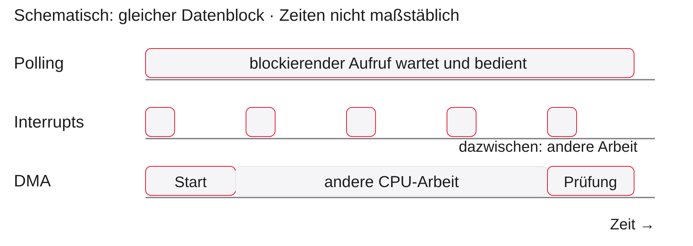{fig-alt="Schematische Zeitabschnitte vergleichen blockierendes Polling, kurze Interruptbedienung und DMA mit Vorbereitung, paralleler Arbeit und Abschluss."}

Blockierendes Polling wartet; aktivierte Interrupts können trotzdem laufen.

::: notes
Polling fragt den Zustand eines Geräts wiederholt ab. Busy Waiting bedeutet, dass der aufrufende Ablauf während des Wartens Prozessorzeit beansprucht. CPU heißt Central Processing Unit. In der Abbildung ist der Vergleichsaufruf ausdrücklich so definiert, dass er bis zum Leitungsabschluss wartet; andere Schnittstellenaufrufe könnten bereits nach dem letzten Registerschreiben zurückkehren.

Die Zeitrichtung verläuft von links nach rechts. Jede Bahn zeigt die CPU-Bedienung einer Transferart; die Leitung läuft im Hintergrund und besitzt hier keine eigene Bahn. Beim blockierenden Polling besteht die Bahn überwiegend aus Warten und Kopieren. Kurze Interruptbehandlung lässt dazwischen Anwendungsschritte zu. DMA, Direct Memory Access, verwendet dagegen Vorbereitung, eigenständige Datenbewegung und spätere Abschlussarbeit. Die Flächen sind schematisch, keine gemessenen Latenzen.

Eine wartende Hauptschleife verhindert nicht automatisch jeden Interrupt. Freigaben und Behandlung aus Vorlesung 3 bleiben maßgeblich. Umgekehrt kann zu häufige Interruptbedienung den gewonnenen Spielraum wieder verbrauchen. Das Bild erklärt die Aufgabenverteilung; es garantiert noch keinen zeitlichen Gewinn. Deshalb berechnen wir als Nächstes einen bewusst vorgegebenen festen Interruptaufwand.

Die roten Umrandungen kennzeichnen CPU-Bedienungsabschnitte, nicht Leitungssignale. Beim DMA liegt dazwischen ein grauer Abschnitt für andere CPU-Arbeit. Auch in diesen freien Abschnitten kann die Speicherarbitration Wartezeit verursachen; die Zeichnung verspricht deshalb keine vollkommen unabhängige Ausführung.
:::

## Interruptaufwand hat eine Obergrenze

Lehrannahmen: CPU $100$ MHz, $150$ feste Takte je Interrupt.
SPI $10$ MHz liefert ideal $1{,}25$ Millionen Byte/s.

| Bytes pro Meldung | Meldungen/s | fester CPU-Bedarf |
|-------------------|-------------|-------------------|
| $1$ | $1250000$ | $187{,}5\,\%$ |
| $16$ | $78125$ | $\approx11{,}72\,\%$ |

Zusätzliche Kopier- und Anwendungsarbeit ist noch nicht enthalten.

::: notes
CPU heißt Central Processing Unit. SPI bedeutet Serial Peripheral Interface. Wir nehmen hundert Millionen verfügbare CPU-Takte pro Sekunde und einen festen Overhead, zusätzlichen Bedienungsaufwand, von einhundertfünfzig Takten je Meldung an. Diese Taktzahl ist eine Modellvorgabe, kein gemessener Interruptpreis eines RISC-V-Kerns. RISC-V bezeichnet dessen Prozessor-Befehlssatzarchitektur.

Bei einem Ereignis pro Byte wäre die angebotene Meldungsrate $1250000$ pro Sekunde. Multiplikation mit hundertfünfzig ergibt $187500000$ benötigte Takte pro Sekunde, also hundertsiebenundachtzig Komma fünf Prozent des Budgets. Das ist ein nicht erfüllbarer Bedarf, keine tatsächlich erreichbare CPU-Auslastung. Daten würden sich verzögern, Meldungen könnten zusammenfallen oder die Übertragung müsste langsamer werden.

Bei einer Meldung je sechzehn Bytes entstehen nur $78125$ Meldungen und $11718750$ feste Takte, ungefähr elf Komma zweiundsiebzig Prozent. Kopierarbeit pro Byte und andere Aufgaben kommen hinzu. Ein FIFO, First In First Out, kann solche Bündelung ermöglichen, bleibt aber endlich. Die Rechnung begründet die Suche nach einer Hardware-Datenbewegung, ohne jede hohe Leitungsrate automatisch als erfolgreichen Interruptbetrieb auszugeben.

RISC in RISC-V steht für Reduced Instruction Set Computer, Rechner mit reduziertem Befehlssatz.
:::

## DMA verändert den Kopierpfad

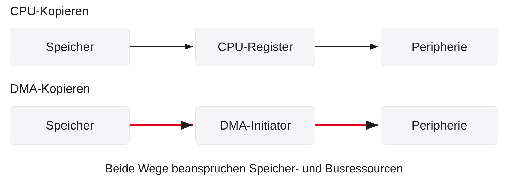{fig-alt="Beim CPU-Kopieren laufen Daten durch Prozessorregister, beim DMA über einen eigenen Initiator zwischen Speicher und Peripherie; beide nutzen gemeinsame Ressourcen."}

DMA: Direct Memory Access; DMAC: Direct Memory Access Controller.

::: notes
DMA heißt Direct Memory Access, direkter Speicherzugriff; DMAC ist der Direct Memory Access Controller, die organisierende Hardwareeinheit. CPU bedeutet Central Processing Unit. Die Abbildung stellt zwei Datenpfade gegenüber. Ohne ausgelagerte Kopierarbeit liest die CPU Speicher und schreibt ein Peripherieregister. Mit DMA führt ein eigener Initiator diese Zugriffe aus.

Die Pfeile kennzeichnen Datenbewegung vom Speicher zur Peripherie. Der Vorbereitungsauftrag durch die CPU ist für beide Wege nötig, aber hier nicht als zusätzlicher Pfeil eingezeichnet. Der Pfad muss nicht durch die allgemeinen CPU-Datenregister laufen. Speicher und Peripherie sind trotzdem tatsächliche Zugriffsziele; „direkt“ bedeutet nicht, dass ein beliebiger Sensor ohne Protokoll an jeden Speicher schreiben darf.

Die CPU programmiert einen Auftrag und bearbeitet dessen Erfolg oder Fehler. Sie darf währenddessen andere Aufgaben übernehmen, soweit deren Speicherzugriffe und Fristen es erlauben. Ein Cache-Hit kann lokal bedient werden, ein konkurrierender Speicherzugriff muss eventuell warten. Deshalb ist CPU-Entlastung nicht mit vollständiger Ressourcenunabhängigkeit gleichzusetzen. Das Bild bildet die Grundlage für Quelle, Ziel und Zähler des späteren Auftrags, nicht einen Nachweis beliebiger Parallelgeschwindigkeit.

Oben laufen schwarze Pfeile über CPU-Register, unten rote Pfeile über den DMA-Initiator. Beide Reihen werden von links nach rechts gelesen. Die Farbe hebt den ausgelagerten Datenweg hervor; sie kennzeichnet weder eine andere Datenkodierung noch eine höhere Leitungsgeschwindigkeit.
:::

## Kopieren ist keine Interpretation

- DMAC bewegt vorgegebene Elemente
- Registerzugriff und Nutzdatenbedeutung sind verschiedene Ebenen
- Vorzeichen, Skalierung und Plausibilität bleiben Anwendungsschritte
- Zusätzliche Rechenfunktionen wären eigene Hardwaremerkmale

::: notes
DMAC bedeutet Direct Memory Access Controller. Sein Grundauftrag lautet, eine bestimmte Zahl von Elementen zwischen erreichbaren Adressen zu bewegen. Ein Element kann beispielsweise ein Byte oder ein sechzehn Bit breites Sample sein. Das ist zunächst keine allgemeine Programmausführung und keine automatische fachliche Auswertung.

Aus Vorlesung 5 kennen Sie sechs Sensorbytes, die anschließend als drei vorzeichenbehaftete Werte mit High-Byte zuerst interpretiert werden. DMA, Direct Memory Access, könnte deren Bewegung unterstützen. Der Skalenfaktor und die Entscheidung, ob sie frisch und plausibel sind, entstehen dadurch jedoch nicht automatisch. Ebenso erzeugt eine Kopie eines Bildpuffers keine neue Farbkonvertierung, sofern die Hardware diese Funktion nicht ausdrücklich besitzt.

Einige spezialisierte Beschleuniger kombinieren Datenbewegung und zusätzliche Operationen. Solche Fähigkeiten sind dann zu benennen und aus der Gerätebeschreibung abzuleiten. Unser Grundmodell betrachtet gleiche Quell- und Zielbreite ohne Transformation. Es macht die Zuständigkeiten klar: Die Hardware führt den vorbereiteten Transport aus, die Anwendung entscheidet über Inhalt, Nutzung und Fehlerreaktion.
:::

## Initiatoren treffen auf einen Arbiter

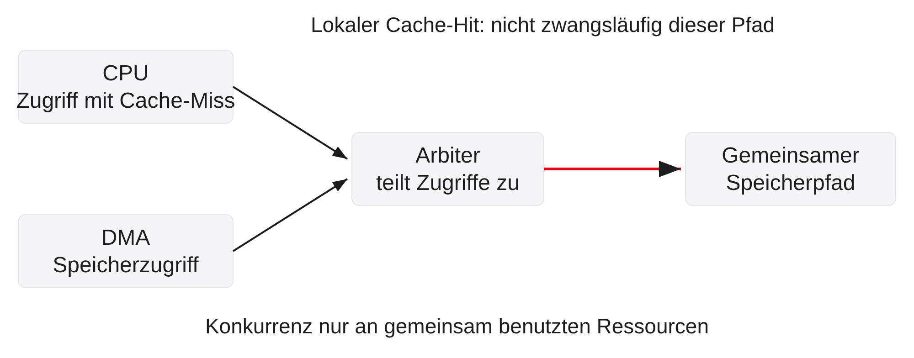{fig-alt="CPU und DMA initiieren Zugriffe; ein Arbiter entscheidet über einen gemeinsam genutzten Speicherpfad. Ein lokaler Cache-Hit nutzt diesen Pfad nicht zwangsläufig."}

Bus-Mastering: einen Zugriff selbst anfordern und organisieren.

::: notes
CPU heißt Central Processing Unit, DMA Direct Memory Access. Ein Bus-Master oder Initiator kann selbst Transaktionen anfordern. Ein Target beantwortet solche Zugriffe, beispielsweise ein Speicher oder ein Peripherieregister. Bus-Mastering beschreibt diese Rolle, nicht eine automatisch höchste Priorität.

Ein Arbiter entscheidet, welcher konkurrierende Auftrag eine gemeinsam genutzte Ressource erhält. In der Abbildung führen CPU- und DMA-Anforderungen zu diesem Entscheider und anschließend zum Speicherpfad. Der Hinweis über den Kästen verdeutlicht, dass ein lokaler Cache-Hit nicht zwangsläufig diesen gemeinsamen Pfad benötigt. Die Pfeile sind Funktionsbeziehungen, keine Messung eines bestimmten SoCs, System-on-Chip.

Feste Priorität, Round-Robin oder andere Regeln sind mögliche Verfahren. Bei Round-Robin werden wartende Teilnehmer nach einer Umlaufregel berücksichtigt. Eine konkrete Plattform kann mehrere Bussegmente und Speicherports besitzen; das Ein-Pfad-Modell vereinfacht diese Topologie ausdrücklich. DMA ist daher kein garantierter alleiniger Busbesitzer. Die Software muss sowohl Transferanforderungen als auch Auswirkungen auf andere Zugriffe berücksichtigen, bevor eine Echtzeitfrist aus einer bloßen Bytezahl abgeleitet wird.

Die schwarzen Pfeile führen zwei Anforderungen zum Arbiter. Der rote Pfeil dahinter markiert den einen gemeinsam zugeteilten Pfad. Die Zeichnung sagt nicht, dass die Hardware die Anfragen gleichzeitig bedienen kann; genau diese Konkurrenz muss die Zuteilungsregel auflösen.
:::

## Kanalpriorität ist nicht Buspriorität

- Mehrere DMA-Kanäle besitzen getrennte Aufträge
- Eine Request-Zuordnung verbindet Peripherie und Kanal
- Der interne Entscheider wählt zwischen Kanalaufträgen
- Der Systembus entscheidet zusätzlich zwischen Initiatoren

::: notes
DMA bedeutet Direct Memory Access. Ein Kanal hält im Modell einen eigenen Auftrag mit Quelle, Ziel, Anzahl und Steuerung. Mehrere Kanäle können denselben DMA-Controller verwenden. Ein interner Arbiter wählt dann zwischen gleichzeitig bereiten Kanalzugriffen. Diese Entscheidung ist von der späteren Buszuteilung zwischen CPU, Central Processing Unit, und DMA-Initiator zu unterscheiden.

Ein Request ist eine Transferanforderung der Peripherie. Manche Plattformen besitzen einen DMAMUX, Direct Memory Access Multiplexer, eine Zuordnungsmatrix zwischen solchen Anforderungen und Kanälen. Andere verwenden feste Verbindungen. Ein richtiger Zielregisterwert genügt daher nicht, wenn die ausgewählte Anforderungsquelle nicht passt.

Kanalpriorität bedeutet nicht automatisch Vorrang vor dem Prozessor am gesamten Systembus. Ebenso legt eine Interruptpriorität aus Vorlesung 3 nicht allein die Reihenfolge der Datenbewegung fest. Zuordnung, interne Transferwahl, Systembuszugriff und Interruptbehandlung sind verschiedene Entscheidungen. Die konkrete Kanalanzahl und Tabellen sind Plattformmerkmale. Das Grundmodell zeigt die Ebenen, ohne eine erfundene Registerbelegung als funktionsfähigen Treiber auszugeben.
:::

## Cycle Stealing betrifft Konkurrenz

- DMA belegt zeitweise eine gemeinsam genutzte Ressource
- Ein konkurrierender CPU-Zugriff kann warten
- Ein lokaler Cache-Hit muss dadurch nicht stoppen
- Burstlänge und Zuteilungspolitik beeinflussen Wartezeiten

::: notes
DMA heißt Direct Memory Access, CPU Central Processing Unit. Cycle Stealing bezeichnet hier das Verwenden von Bus- beziehungsweise Speicherzyklen durch den DMA-Initiator. Der Name bedeutet nicht, dass bei jedem einzelnen DMA-Element jede CPU-Instruktion zwangsläufig einen Takt angehalten wird.

Ein Beispiel ist eine Rechnung, deren benötigte Daten im lokalen Cache liegen. Sie kann ohne einen Zugriff auf den gerade gemeinsam belegten Speicherpfad weiterlaufen. Benötigt die CPU dagegen gleichzeitig denselben Port für einen fehlenden Cacheblock, muss die Busentscheidung eine Reihenfolge herstellen. Dabei können Wartezyklen entstehen.

Das Verhalten hängt von Topologie, Cachetreffern, Auftrag und Arbiterregel ab. Eine hohe Kanalpriorität kann eine andere Frist verbessern und gleichzeitig CPU-Wartezeiten erhöhen. Zusammenhängende Bursts können die Ressource länger am Stück beanspruchen; einzelne Zugriffe können mehr Zuteilungsaufwand verursachen. Diese qualitativen Aussagen sind keine allgemeine Formel für einen bestimmten Prozessorstall. Der nächste Baustein erklärt, warum der DMA zusätzlich die Bereitschaft seiner Peripherie beachten muss.
:::

## Request ist nicht die Busquittung

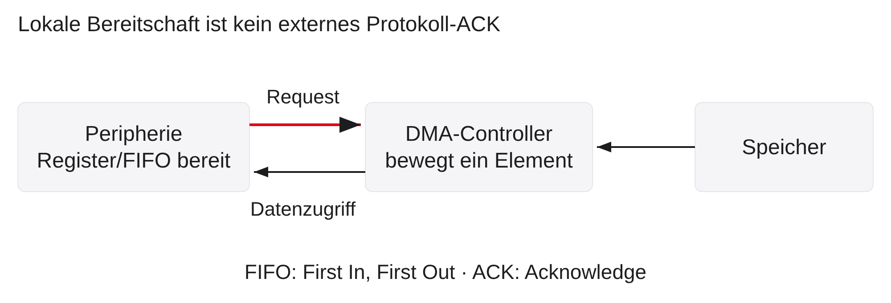{fig-alt="Eine Peripherie meldet lokalen Transferbedarf an den DMA-Controller; dieser bewegt ein Element. Diese Bereitschaft ist getrennt von einer seriellen ACK-Quittung des externen Targets."}

Lokale Registerbereitschaft und externe Protokollbestätigung trennen.

::: notes
DMA steht für Direct Memory Access. Ein Hardware-Request ist eine lokale Anforderung, etwa weil ein Sendepuffer Platz besitzt oder ein Empfangselement bereitliegt. DREQ bedeutet DMA Request; DACK, DMA Acknowledge, bezeichnet in manchen Beschreibungen eine lokale Bestätigung. Nicht jede Plattform verwendet diese Namen oder getrennte sichtbare Signale.

Die Abbildung zeigt die Bereitschaft von Peripherie und DMA-Controller sowie den anschließenden Elementzugriff. Ein FIFO, First In First Out, kann dafür mehrere freie oder belegte Plätze besitzen. „Bereit zum Schreiben“ ist nicht dasselbe wie „Leitung sendet nichts mehr“.

ACK heißt Acknowledge, Quittung. Das ACK eines externen I²C-Targets, Inter-Integrated-Circuit-Targets, aus Vorlesung 5 bestätigt eine andere Ebene: ein übertragenes Adress- oder Datenbyte. Ein lokaler DMA-Zugriff auf ein Controllerregister beweist diese externe Bestätigung nicht. Die Zuordnung zwischen Hardwareanforderung und Kanal muss außerdem stimmen. Erst mit erreichbarem Datenregister, passender Breite und richtigem Request entsteht ein sinnvoll gepaceter Transferauftrag.

Gezeichnet ist ein Sendefall: Der rote Requestpfeil läuft von der Peripherie links zum DMA in der Mitte. Schwarze Datenpfeile laufen dagegen vom Speicher rechts über DMA zum Peripherieregister links. Anforderung und Nutzdaten besitzen hier also unterschiedliche Richtungen.
:::

## Senden: Quelle wandert, Ziel bleibt

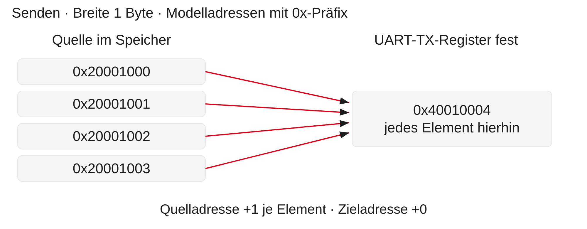{fig-alt="Vier Bytezugriffe lesen die Modelladressen 20001000 bis 20001003 und schreiben stets dasselbe UART-TX-Register 40010004."}

Lehrmodell: ein Byte je Element, Quelle `0x20001000`,
festes Ziel `0x40010004`.

::: notes
DMA bedeutet Direct Memory Access. UART heißt Universal Asynchronous Receiver-Transmitter, TX Transmit oder Senden. Für dieses ausdrücklich fiktive Adressmodell liegt ein Bytearray bei `0x20001000` und ein für Bytezugriffe geeignetes UART-Senderegister bei `0x40010004`. Beide Werte sind vom DMA aus erreichbare Modelladressen, keine Angaben einer Kursplatine.

Die Abbildung zeigt vier nacheinander bewegte Elemente. Die Quelle steigt jeweils um ein Byte: `...1000`, `...1001`, `...1002`, `...1003`. Das Ziel bleibt bei jedem Element identisch. Eine Zielinkrementierung würde benachbarte Geräteadressen ansprechen, nicht „das nächste Zeichen“ desselben Sendepfads.

Ein Gerätedatenregister ist kein gewöhnliches Array im RAM, Random Access Memory. Zugriffe können Nebenwirkungen haben und müssen in der unterstützten Breite erfolgen. Die lokale Anforderung taktet die Bereitstellung entsprechend freiem Platz. Nach dem letzten Registerschreiben kann die Peripherie noch senden. Quelle, Ziel, Breite, Inkrement und Abschlussbedingung gehören deshalb zusammen; die Pfeilrichtung allein beschreibt noch keinen vollständigen Auftrag.

Die roten Pfeile bündeln verschiedene Quellstellen links zu demselben Ziel rechts. Die senkrechte Anordnung listet aufeinanderfolgende Zugriffe von oben nach unten; sie ist keine Darstellung vier gleichzeitiger Leitungen. Jede Adresse bezeichnet den Anfang des jeweiligen Ein-Byte-Zugriffs.
:::

## Empfangen: Register fest, Array wächst

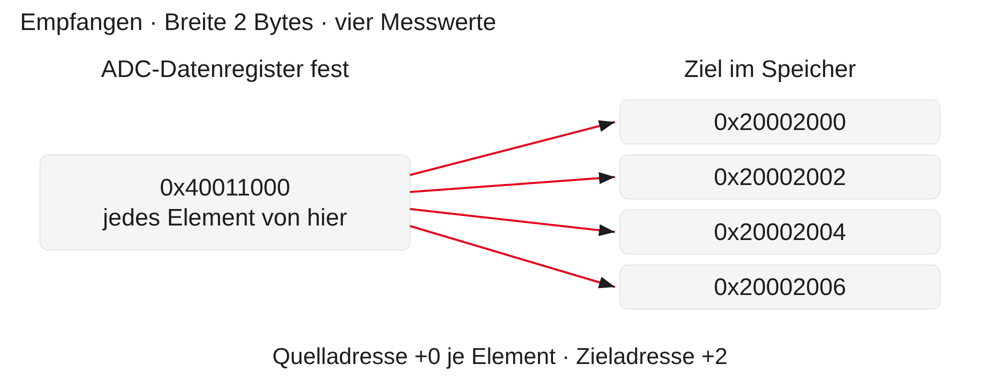{fig-alt="Ein ADC-Datenregister bleibt bei 40011000, während vier Sechzehn-Bit-Elemente an 20002000, 20002002, 20002004 und 20002006 gespeichert werden."}

Lehrmodell: $16$ Bit je Element; Quelladresse konstant.

::: notes
DMA heißt Direct Memory Access. ADC bedeutet Analog-to-Digital Converter, Analog-Digital-Wandler. Sein Modell-Datenregister bei `0x40011000` liefert hier ein sechzehn Bit breites Element pro passender Anforderung. Diese Adresse und die erlaubte Zugriffsbreite sind ausdrückliche Lehrvorgaben.

Das Zielarray beginnt bei `0x20002000`. Jedes Element benötigt zwei Bytes, daher steigen die Zieladressen auf `...2002`, `...2004` und `...2006`. Die Quelle bleibt bei jedem Zugriff dasselbe Datenregister. Eine Quellinkrementierung könnte ein Status- oder Steuerregister statt des nächsten Samples lesen. Ein MMIO-Zugriff, Memory-Mapped-Input/Output-Zugriff, kann außerdem ein Datum entnehmen oder einen Gerätestatus verändern.

Die Grafik liest sich vom festen Register zu den aufeinanderfolgenden Speicherstellen. Vier Elemente belegen acht Bytes. Das nächste noch freie Ziel läge bei `...2008`, die letzte beschriebene Byteadresse bei `...2007`. Bei acht Elementen wären es sechzehn Bytes. Dieses Beispiel trennt Elementanzahl und Bytezahl, bevor der Auftrag über eine Transferlänge beschrieben wird.

Die roten Pfeile laufen vom einzelnen Register links zu den Speicherstellen rechts. Die rechte Liste ist zeitlich von oben nach unten zu lesen. Jede Adresse beginnt ein Zwei-Byte-Element, dessen zweites Byte im gleichen Eintrag mitgemeint ist.
:::

## Speicher zu Speicher

- Beide Seiten können im Modell inkrementieren
- Quelle und Ziel müssen erreichbar und passend ausgerichtet sein
- Hardwareunterstützung ist nicht für jeden Kanal selbstverständlich
- Überlappende Bereiche brauchen eine ausdrücklich geeignete Kopierregel

::: notes
DMA steht für Direct Memory Access. Bei Memory-to-Memory, Speicher zu Speicher, können Quelle und Ziel nach jedem gleich breiten Element steigen. Anders als ein Peripherieregister sind hier beide Seiten Arrays oder Speicherbereiche. Eine lokale Peripherieanforderung ist für einen solchen Auftrag nicht in jeder Architektur erforderlich.

Das bedeutet nicht, dass jeder Controller oder Kanal diese Betriebsart unterstützt. Adressbereiche, Breite, Buszugriff und mögliche Kopierfunktionen sind vor dem Start zu prüfen. Auch ein Prozessorzeiger beweist noch keine Erreichbarkeit aus Sicht des Geräts. Diese Adresssicht unterscheiden wir später ausdrücklich.

Eine normale vorwärts laufende Kopie kann bei überlappenden Bereichen Daten überschreiben, bevor sie als Quelle gelesen wurden. Beispiel: Zwei Plätze sollen innerhalb desselben Arrays um eine Position nach rechts verschoben werden. Wird links begonnen, kann das erste neue Ziel bereits die nächste noch benötigte Quelle ersetzen. Die DMA-Grundfunktion ist daher nicht automatisch ein allgemeiner Ersatz für `memmove`, eine überlappungssichere Speicherkopie. Unser Hauptmodell verwendet getrennte gültige Bereiche und verlagert nur die Datenbewegung.
:::

## Breite und Anzahl bestimmen Bytes

Gleiche Quell- und Zielbreite $w$ im Lehrmodell:

$$
B=Nw
$$

| Elemente $N$ | Breite $w$ | Bytezahl $B$ |
|---------------|------------|--------------|
| $8$ | $1$ Byte | $8$ |
| $8$ | $2$ Byte | $16$ |
| $8$ | $4$ Byte | $32$ |

Ein Zähler für Elemente ist kein universeller Bytezähler.

::: notes
DMA heißt Direct Memory Access. $N$ bezeichnet die Zahl der Transferelemente, $w$ deren Breite in Bytes und $B$ die gesamte Bytezahl. Ein Element kann im Modell acht, sechzehn oder zweiunddreißig Bit breit sein. Ein Byte enthält acht Bits, sodass diese Breiten einem, zwei oder vier Bytes entsprechen.

Acht Sechzehn-Bit-Samples benötigen daher $8\cdot2=16$ Bytes. Würde ein Treiber irrtümlich die Bytezahl sechzehn als Elementzahl programmieren, bewegte das gleiche Breitenmodell zweiunddreißig Bytes und könnte den vorgesehenen Zielbereich überschreiten. Die Bedeutung eines Registerfelds COUNT muss deshalb aus der konkreten Beschreibung stammen.

Manche Hardware besitzt unterschiedliche Quell- und Zielbreiten sowie Packfunktionen. Dann genügt unsere einfache Formel nicht zur vollständigen Beschreibung aller Zugriffe. Auch die Zahl der Bus-Requests kann von der Elementzahl abweichen. Hier legen wir gleiche Breiten und die elementweise Zählung fest. Diese klare Konvention verbindet Inkrementschritt, Speicherbedarf und Zählerlimit; sie wird in Aufgabe 2 durchgehend verwendet.
:::

## Ein Zählerlimit verlangt mehrere Blöcke

Lehrlimit: maximal $L=65535$ Elemente je Normalauftrag.

Bei $1000000$ Byte und Ein-Byte-Elementen:

$$
K=\left\lceil\frac{1000000}{65535}\right\rceil=16
$$

$$
1000000=15\cdot65535+16975
$$

`COUNT = 0` ist kein universelles Rezept für einen leeren Hardwareauftrag.

::: notes
DMA ist Direct Memory Access. $L$ ist die maximale Elementzahl pro Auftrag, $K$ die erforderliche Anzahl Blöcke. Die aufgerundete Division zählt auch einen noch nicht vollen letzten Block. Wir setzen das Limit fünfundsechzigtausendfünfhundertfünfunddreißig ausdrücklich als Lehrvorgabe fest; es ist keine universelle Eigenschaft der Prozessor-Befehlssatzarchitektur RISC-V.

Bei Ein-Byte-Elementen sind eine Million Bytes genau eine Million Elemente. Fünfzehn volle Blöcke ergeben $983025$ Elemente, übrig bleiben $16975$. Daher werden sechzehn Aufträge gebraucht. Die jeweilige Quelle muss passend weitergeführt und der gesamte Puffer bis zur dokumentierten Freigabe gültig gehalten werden.

Ein anderer Zähler könnte null speziell interpretieren oder eine andere Einheit verwenden. Eine Softwarelänge null sollte deshalb als eigener Fall behandelt werden, statt blind einen Geräteauftrag mit COUNT null zu starten. Ebenso beweist ein späterer Restzähler null allein weder korrekte Cache-Sichtbarkeit noch einen fehlerfreien Abschluss. Der nächste reine C-Helfer berechnet nur die Größe eines solchen nächsten Blocks und bedient bewusst keine Hardware.

RISC in RISC-V steht für Reduced Instruction Set Computer, Rechner mit reduziertem Befehlssatz.
:::

## Den nächsten Block berechnen

Reine C-Funktion:

```c
uint16_t next_block(uint32_t remaining, uint16_t limit) {
    if (remaining < limit)
        return (uint16_t)remaining;
    return limit;
}
```

Bei Limit $65535$: erst volle Blöcke, zuletzt $16975$ Elemente.

::: notes
Die C-Funktion `next_block` liefert den kleineren Wert aus verbleibender Elementzahl und vorgegebenem Limit. `uint32_t` und `uint16_t` aus `stdint.h` sind vorzeichenlose Zweiunddreißig- und Sechzehn-Bit-Typen. `remaining` ist die noch nicht eingeplante Elementzahl, `limit` das zulässige Auftragsmaximum.

Ist `remaining` kleiner, passt es auch in den Sechzehn-Bit-Rückgabetyp, weil `limit` selbst höchstens $65535$ ist. Sonst wird `limit` zurückgegeben. Beispielsweise liefert `next_block(70000, 65535)` den Wert $65535$, danach bleiben rechnerisch $4465$ Elemente. Dieser Rest muss der Aufrufer selbst verwalten; die Funktion verändert ihre Eingabe nicht. Bei einer Million verbleibenden Elementen und Limit $65535$ entstehen zunächst volle Blöcke. Nach fünfzehn Abzügen bleiben $16975$, die die nächste Rückgabe bilden.

Für tatsächliche Arbeit muss der Aufrufer ein positives gültiges Limit verwenden, nur positive Rückgaben starten und den Rest nach bestätigter Planung beziehungsweise Bearbeitung konsistent fortführen. Bei Rest null oder Limit null liefert die Funktion null; daraus entsteht gerade keine Erlaubnis, ein Hardwarefeld mit null zu starten. Die Funktion enthält keinen Gerätezugriff, keine Adressübersetzung und keine Cache-Wartung. Ihre vollständig prüfbare Arithmetik ist nur ein Teil der späteren Lebenszyklusregeln.
:::

## Ausrichtung ist eine eigene Anforderung

- Vier-Byte-Elemente: im Modell Startadresse durch $4$ teilbar
- `0x20001000` passt, `0x20001001` nicht
- Gerätezugriffsbreite und Puffergröße ebenfalls prüfen
- Cachezeilen-Ausrichtung kann zusätzlich strenger sein

::: notes
DMA bedeutet Direct Memory Access. Alignment oder Ausrichtung beschreibt hier eine Adresse auf einer zur Elementbreite passenden Grenze. Bei vier Byte breiten Elementen verlangen wir im Modell ein Vielfaches von vier. `0x20001000` erfüllt dies, die unmittelbar folgende Adresse `0x20001001` nicht.

Diese Regel ist eine ausdrücklich vorgegebene Controlleranforderung. Eine CPU, Central Processing Unit, könnte manche unausgerichteten Zugriffe selbst bearbeiten; daraus folgt keine Unterstützung durch ihren DMA-Controller. Ein Compilerattribut oder eine geeignete Speicherzuteilung kann einen Puffer ausrichten, aber keine unpassende Peripherieregisterbreite ändern.

Auch ausreichend viel Speicher und tatsächliche DMA-Erreichbarkeit sind gesondert zu prüfen. Bei nicht kohärenten Caches arbeitet die Wartung häufig mit ganzen Cachezeilen, etwa zweiunddreißig Bytes. Vier-Byte-Ausrichtung erfüllt diese strengere Grenze nicht automatisch. Deshalb unterscheiden wir Elementausrichtung, Cachezeilengrenze und die Geräteadresse. Der nächste Abschnitt erklärt, warum eine passend aussehende C-Zeigerzahl zudem nicht ohne Prüfung zum Geräteadresswert wird.
:::

## CPU-Zeiger und Geräteadresse

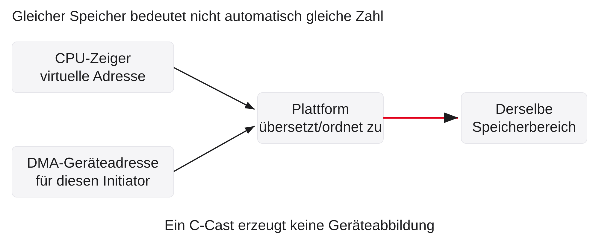{fig-alt="Ein CPU-Zeiger und eine DMA-Geräteadresse können durch Plattformabbildung auf denselben Speicher zeigen, sind aber nicht automatisch dieselbe Zahl."}

Ein Cast nach `uint32_t` erzeugt keine geprüfte DMA-Abbildung.

::: notes
CPU heißt Central Processing Unit, DMA Direct Memory Access. Ein C-Zeiger gehört zunächst zur Adresssicht des ausführenden Programms. Eine DMA-Adresse gehört zur Sicht des Geräts beziehungsweise seines Businitiators. Sie können bei einer einfachen Plattform identisch sein, müssen es aber nicht.

Die Abbildung zeigt beide Sichten und ihre Verbindung zu einem Speicherbereich. Eine Plattform kann übersetzen oder Bereiche nur für bestimmte Initiatoren erreichbar machen. IOMMU bedeutet Input/Output Memory Management Unit, eine mögliche Adressübersetzung für Geräte; nicht jedes System besitzt sie. Unser Rechenmodell verwendet ausdrücklich bereits gültige DMA-Adressen und keine solche Übersetzungsaufgabe.

Ein bloßer Cast eines Zeigers nach `uint32_t` prüft diese Eigenschaften nicht und könnte auf einem breiteren Host sogar wichtige Adressbits abschneiden. `uintptr_t` ist, wenn verfügbar, ein Integer-Typ für die Darstellung eines Prozessorzeigers; auch er ist keine automatische Geräteabbildung. Vor einem echten Start sind daher Adresssicht, Reichweite und Breite des Gerätefelds zu klären. Aus einer hexadezimalen Zahl allein folgt weder Gültigkeit noch Cache-Sichtbarkeit.

Schwarze Pfeile verbinden die beiden Adresssichten links mit der Plattformzuordnung in der Mitte. Der rote Pfeil führt zum gemeinsamen Speicher rechts. Die Kästen stellen Rollen dar, keine garantierten zusätzlichen Hardwareblöcke; auch eine einfache Identitätsabbildung könnte den Plattformvertrag erfüllen.
:::

## Pufferbesitz hat einen Lebenszyklus

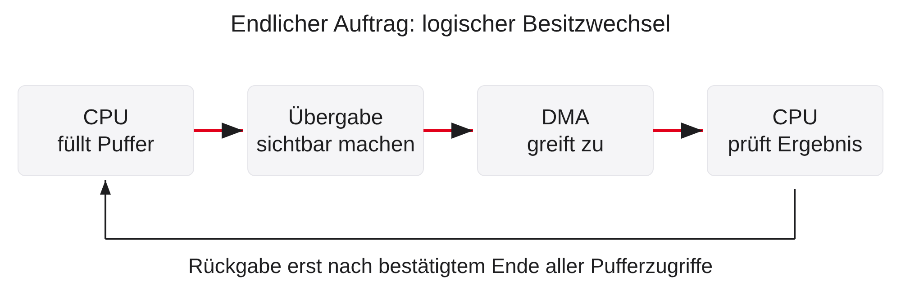{fig-alt="Ein Puffer wird von der CPU vorbereitet, an den DMA übergeben, während dessen Zugriff geschützt und erst nach geprüftem Abschluss wieder freigegeben."}

Asynchrone Rückkehr ist keine Freigabe des Puffers.

::: notes
CPU bedeutet Central Processing Unit, DMA Direct Memory Access. Besitz bezeichnet hier die Berechtigung, einen Puffer zu verändern oder dessen Inhalt als gültig zu verwenden. Vor dem Start bereitet die CPU Daten und Auftrag vor. Danach gelten bis zur dokumentierten Rückgabe die Zugriffsrechte des DMA.

Die Grafik wird von links nach rechts gelesen: vorbereiten, sichtbar übergeben, DMA-Nutzung und Ergebnisprüfung. Die untere Rückverbindung steht für eine bestätigte Rückgabe, nicht für eine automatische Freigabe nach jedem Fehler. Bei einem Sendeauftrag darf die Anwendung die Quelle nicht während des Lesens verändern. Bei Empfang darf sie nicht vor Abschluss schon beliebige neue Elemente als vollständigen Datensatz lesen. Eine kohärente Cachehardware würde solche logischen Besitzregeln ebenfalls nicht aufheben.

Ein lokales Array auf dem Funktionsstack kann nach Rückkehr seine gültige Lebensdauer verlieren, obwohl der DMA noch darauf zugreift. Deshalb muss Speicher über die gesamte tatsächliche Nutzung bestehen und vor Wiederverwendung geschützt sein. Ein gestarteter Auftrag ist nur die Übergabeabsicht; ein Status muss Erfolg, Fehler und verbleibende Aktivität unterscheiden. Diese Lebenszyklusregel verbindet die Byte-Rechenmodelle mit einer nachvollziehbaren Reihenfolge für die Initialisierung.

Die roten Übergänge markieren die geordnete Verantwortungsübergabe, nicht gemessene Transferzeiten. Die schwarze Rückverbindung unter den Kästen schließt den endlichen Lebenszyklus. Bei einem fortlaufenden Ring wird später nur ein geeigneter Teilbereich zeitweise zurückgegeben; dieser normale Gesamtzyklus kann nicht unverändert darauf übertragen werden.
:::

## Vorbereiten, dann freigeben

Konzeptionelle Startfolge:

1. Kanal stillsetzen und dokumentierten Ruhezustand bestätigen
2. Puffer, Adressen, Breiten und Request-Zuordnung prüfen
3. Quelle, Ziel, Anzahl und Modi einstellen
4. Alte Statusmeldungen passend behandeln; Sichtbarkeit herstellen
5. Erst danach Kanal und Request-Pfad freigeben

::: notes
DMA heißt Direct Memory Access. Ein Request-Pfad ist die Zuordnung der lokalen Peripherieanforderung zum Kanal. Die Reihenfolge ist ein konzeptionelles Vorgehen, kein universelles Registerrezept. Einige Plattformen verlangen andere Freigabeschritte oder besondere Bedingungen während der Konfiguration.

Ein gerade aktiver Kanal darf nicht beliebig umprogrammiert werden. Ebenso kann eine alte Abschlussmeldung sonst irrtümlich als Erfolg des neuen Auftrags erscheinen. Statusbits besitzen dokumentierte Löschregeln; ein Write-One-to-Clear-Bit wird durch Schreiben einer Eins quittiert und ist kein gewöhnlicher Speicherwert für beliebiges Read-Modify-Write, Lesen, Verändern und Zurückschreiben. Diese Zugriffsunterscheidung knüpft an Vorlesung 3 an.

Vor der Freigabe müssen neue Daten und Auftragsfelder in der benötigten Sicht vorliegen. Cache-Wartung und eine Plattformregel für Zugriffsreihenfolge können dafür nötig sein. Die CPU, Central Processing Unit, bleibt für diesen Vertragsabschluss verantwortlich. Welche Registeradressen, Statusbits oder Barrieren tatsächlich verwendet werden, muss aus dem Gerätetreiber stammen. Das Modell enthält deshalb vollständige Verantwortlichkeiten, ohne erfundene Bitpositionen als ausführbaren Treiber auszugeben.
:::

## Eine Meldung ist noch kein Gesamterfolg

| Meldung im Modell | mögliche Aussage |
|-------------------|------------------|
| HT | erste Hälfte erreicht |
| TC | Normalauftrag nach DMA-Regeln beendet |
| TE | Transferfehler |

Richtung, Betriebsart und Gerätestatus bestimmen die weitere Freigabe.

::: notes
DMA bedeutet Direct Memory Access. HT steht für Half Transfer, Halbtransfer; TC für Transfer Complete, Transferabschluss; TE für Transfer Error, Übertragungsfehler. Die genaue Definition, Verfügbarkeit und Quittierung dieser Meldungen ist plattformspezifisch.

Im endlichen Normalauftrag kann ein dokumentierter erfolgreicher DMA-Abschluss die Nutzung eines Sendepuffers beenden, obwohl der Peripherieausgang noch Restdaten sendet. Im Circular-Modus kann derselbe TC-Zeitpunkt dagegen den Umlauf markieren, während die Hardware unmittelbar weiterarbeitet. Die ganze Pufferfläche wird dadurch nicht automatisch frei. Ein Fehlerstatus ist wiederum kein erfolgreiches Ende mit gültigem vollständigem Empfangsdatensatz.

Die Software muss daher Betriebsart, Fehler und verbleibende Aktivität auswerten. Ein Restzähler null oder ein einzelnes Interruptbit ist kein allgemeiner Ersatz dafür. Die Tabelle nennt mögliche Rollen und keine universellen Registerbits. Die nächste Zeitachse trennt die besonders leicht verwechselten Abschlüsse: Ende der DMA-Datenbewegung und Ende der tatsächlich ausgegebenen seriellen Leitung.
:::

## DMA-Abschluss und Leitungsende

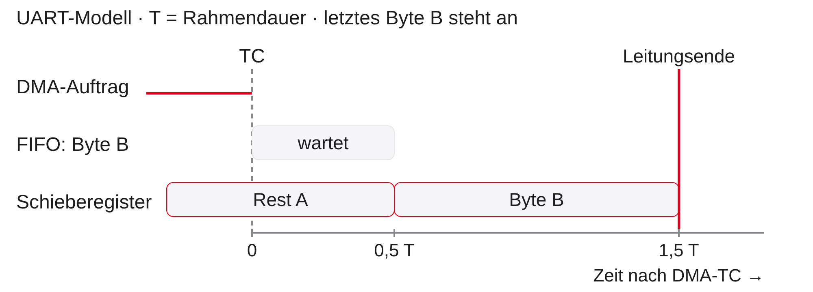{fig-alt="Im UART-Lehrbeispiel ist DMA bei Zeit null fertig, während ein Byte noch im Schieberegister und das letzte Byte im FIFO liegen; die Leitung endet erst später."}

Endlicher Normalauftrag: Pufferfreigabe und externe Leitungsfreigabe getrennt prüfen.

::: notes
DMA heißt Direct Memory Access. UART bedeutet Universal Asynchronous Receiver-Transmitter, FIFO First In First Out. Die Grafik verwendet einen konstruierten Zustand: Bei Zeit null hat der endliche DMA-Auftrag sein letztes Byte B in die Peripherie geschrieben und meldet dokumentierten Erfolg. Byte A wird bereits gesendet und benötigt noch eine halbe Rahmenzeit.

$T$ bezeichnet eine 8N1-Rahmenzeit mit einem Startbit, acht Datenbits, keiner Parität und einem Stopbit. Nach einer halben Rahmenzeit übernimmt das Schieberegister B aus dem FIFO; der FIFO ist dann leer, aber B sendet noch eine volle Rahmenzeit. Erst bei $1{,}5T$ endet in diesem lückenlosen Modell die Leitungsausgabe.

TC bedeutet Transfer Complete. Es kann somit früher auftreten als FIFO-leer und früher als Leitungsende. Bei diesem Normalauftrag darf die Quelle nach bestätigtem Ende der DMA-Nutzung wieder der Anwendung gehören; die externe Verbindung benötigt ihren eigenen Abschlussnachweis. Das Diagramm ist keine reale Timingmessung und setzt keinen weiteren Stopp der UART-Ausgabe voraus. Rückgabe eines Sendepuffers und Rücknahme einer Leitungsfreigabe sind verschiedene Entscheidungen.

Die waagerechte Achse zählt Zeit seit DMA-TC in Einheiten von $T$. Die graue gestrichelte Linie markiert Zeit null, die rote senkrechte Linie das Leitungsende. Rote Umrandungen zeigen die aktive Ausgabe im Schieberegister; die graue FIFO-Fläche zeigt dagegen nur das wartende Byte.
:::

## Das Protokoll bleibt zuständig

- SPI: Auswahlrahmen und Leitungsabschluss beachten
- I²C: Adressen, Quittungen und abschließenden NACK nicht ersetzen
- UART: Rahmenbildung bleibt Aufgabe der Peripherie
- DMA-Erfolg prüft keine beliebige Nutzdatenplausibilität

::: notes
SPI steht für Serial Peripheral Interface, I²C für Inter-Integrated Circuit und UART für Universal Asynchronous Receiver-Transmitter. DMA, Direct Memory Access, übernimmt die Datenbewegung zwischen Speicher und einem Controllerpfad. Welche Protokollphasen der Controller zusätzlich automatisch ausführt, ist eine eigene Gerätefähigkeit.

Bei SPI muss CS, Chip Select oder Bausteinauswahl, für den vorgesehenen Transferrahmen passen. Wird die Auswahl allein aufgrund eines frühen DMA-TC, Transfer Complete, zurückgenommen, könnten noch auszugebende Bits abgeschnitten werden. Bei I²C müssen Registerzeiger, Richtungswechsel, ACK, Acknowledge, und der letzte NACK, Not Acknowledge, korrekt entstehen. Sechs bewegte Datenbytes ersetzen diese Phasen nicht.

Der Zusammenhang knüpft an Vorlesung 5 an: Ein Transportstatus ist weder eine universelle Ende-zu-Ende-Prüfung noch eine Interpretation des Inhalts. Die Anwendung braucht einen passenden Controller- und Gerätevertrag und muss nach tatsächlichem Gesamterfolg Vorzeichen, Einheit und Aktualität berücksichtigen. Ein DMA-Request ist nur die lokale Bereitschaft. Die nächste Folie behandelt entsprechend Fehler, bei denen der geplante Besitzwechsel noch nicht vollzogen werden darf.
:::

## Fehler und Timeout richtig behandeln

- Fehlerstatus und bereits übertragenen Anteil erfassen
- Weiteren Zugriff dokumentiert beenden
- Vor Pufferfreigabe Stillstand beziehungsweise Besitzrückgabe bestätigen
- Unvollständige Empfangsdaten nicht als neuen Datensatz ausgeben

::: notes
DMA bedeutet Direct Memory Access. Ein Timeout meldet, dass ein erwarteter Zustand nicht rechtzeitig eingetreten ist. Es stoppt nicht allein durch seine Benennung jeden laufenden Speicherzugriff. Auch ein Transferfehler kann einen teilweise bewegten Puffer und eine noch zu behandelnde Peripherie hinterlassen.

Die Software muss Requests und Kanal nach dokumentierter Regel beenden und prüfen, wann keine weiteren relevanten Zugriffe mehr möglich sind. Eine Deadline begrenzt das Warten. Wird diese Grenze selbst bei der Bereinigung verpasst, darf die Anwendung den weiterhin möglicherweise genutzten Speicher nicht blind wiederverwenden. Fehlerdiagnose und nachgewiesene Pufferfreigabe sind getrennte Ergebnisse.

Für Empfang bleiben Teilwerte zunächst unbestätigt. Ein alter gültiger Datensatz kann erhalten bleiben, ist dadurch aber kein neuer Fortschritt. Ein CPU-Reset, Reset der Central Processing Unit, setzt außerdem einen extern versorgten Sensor nicht automatisch zurück. Diese Aussage kennen Sie aus den vorherigen Blöcken. Der genaue Stopp- und Wiederanlaufpfad ist plattformspezifisch; die Folie beschreibt vollständige Zuständigkeiten statt einer erfundenen universellen Abbruchfunktion.
:::

## MiB, MB und CPU-Zeit trennen

SPI $10$ MHz, ein Bit je Takt, keine Pausen:

$$
1\ \mathrm{MiB}=1048576\ \mathrm{Byte},\qquad
T_{\min}=\frac{8\cdot1048576}{10^7}\approx0{,}838861\ \mathrm{s}
$$

Dezimal $1$ MB braucht ideal $0{,}8$ s.

DMA spart Kopierbedienung; Setup, Abschluss und Buskonkurrenz bleiben.

::: notes
MiB heißt Mebibyte und bezeichnet $2^{20}$ Bytes, also $1048576$. MB bedeutet hier dezimal $10^6$ Bytes. SPI ist Serial Peripheral Interface. Bei zehn Millionen Takten pro Sekunde und einem Bit je Takt benötigt ein Mebibyte mindestens $8388608/10^7=0{,}8388608$ Sekunden Leitungszeit.

Der Vergleich mit einer Million Bytes ergibt $0{,}8$ Sekunden. Bei hundert Megahertz CPU-Takt, Takt der Central Processing Unit, entsprechen diese $0{,}8$ Sekunden achtzig Millionen verfügbaren Takten. Ein vergleichender blockierender Aufruf, der ausdrücklich bis zum Leitungsende wartet, bleibt ungefähr über diese ideale Zeit beschäftigt. Ein anderer Aufruf könnte bereits früher nach dem letzten Registerschreiben zurückkehren.

DMA, Direct Memory Access, übernimmt die laufende Kopierbedienung. Damit bleibt die CPU nicht automatisch frei von jeder zusätzlichen Arbeit oder Verzögerung: Vorbereitung, Cache-Wartung, Statusauswertung und gemeinsame Buszugriffe kosten weiterhin Zeit. Die Berechnung vergleicht Einheiten und Zuständigkeiten, nicht gemessene Laufzeiten zweier Firmwares. Der nächste Abschnitt erklärt die besonders wichtigen Unterschiede zwischen Speicherinhalt und privater Cachekopie.
:::

## Nicht kohärent: zwei Sichten auf Daten

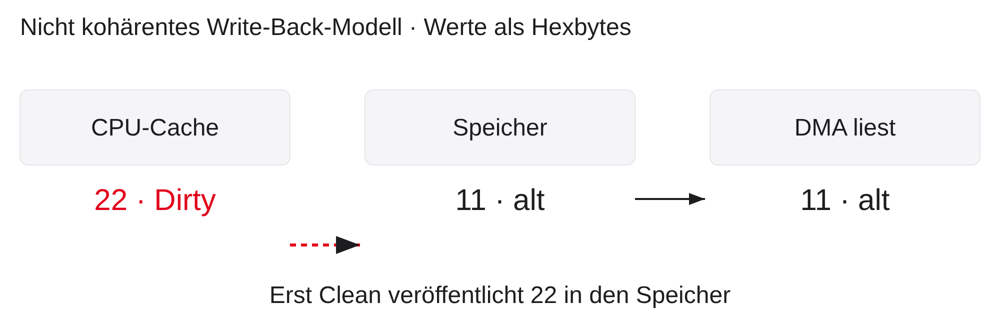{fig-alt="Die CPU verändert ihre Write-Back-Cachekopie von 11 auf 22, der Speicher bleibt zunächst 11; im nicht kohärenten Modell liest DMA die alte Speicherkopie."}

Voraussetzung hier: privater Write-Back-Cache ohne automatische DMA-Kohärenz.

::: notes
CPU bedeutet Central Processing Unit, DMA Direct Memory Access. Ein Write-Back-Cache kann einen Store zunächst nur in seiner lokalen Cachezeile speichern. Dirty bedeutet, dass diese Kopie gegenüber dem darunterliegenden Speicher verändert ist. Nicht kohärent heißt im gegebenen Modell, dass DMA-Zugriffe diese private Änderung nicht automatisch mitbeobachten.

Die Abbildung zeigt einen ursprünglichen Wert `0x11`. Nach einem CPU-Store besitzt der Cache `0x22` und ist dirty, während der Speicher noch `0x11` enthält. Ein DMA-Lesezugriff auf diesen Speicher erhält deshalb den alten Wert. Eine richtige Quelladresse schützt nicht vor dieser Sichtbarkeitslücke.

Das ist ein bewusst ausgewähltes Plattformmodell, keine Aussage, dass jeder Mikrocontroller einen Daten-Cache besitzt oder jeder DMA nicht kohärent ist. Vorlesung 2 hat Write-Back und Dirty-Zeilen erklärt; heute kommt ein anderer Beobachter hinzu. Korrekte Datenübertragung verlangt nun sowohl die logische Pufferübergabe als auch die geeignete Sichtbarkeit zwischen beiden Beobachtern. Für das Senden wird deshalb vor dem Start der aktuelle Wert veröffentlicht.

Lesen Sie die drei Spalten von links nach rechts als Cachekopie, Speicherwert und DMA-Beobachtung. Rot hebt die neue, noch nicht veröffentlichte Kopie hervor. Der gestrichelte Pfeil steht für ein erst noch erforderliches Clean, während der schwarze Pfeil den aktuellen DMA-Leseweg zeigt.
:::

## Senden: veröffentlichen, dann einfrieren

- Neue Daten im CPU-Puffer vollständig vorbereiten
- Nicht kohärentes Modell: relevante Dirty-Zeilen nach unten schreiben
- Plattformregel für Sichtbarkeit und Reihenfolge erfüllen
- Quelle bis zur dokumentierten DMA-Freigabe unverändert lassen

::: notes
CPU heißt Central Processing Unit, DMA Direct Memory Access. Bei einem Sendeauftrag benötigt der DMA die von der CPU zuletzt erzeugten Quellwerte. Clean bezeichnet das Zurückschreiben veränderter Cachezeilen in den darunterliegenden Speicher. Im Beispiel der vorigen Folie muss so `0x22` auch dort ankommen, bevor der DMA seine Quelle liest.

Clean ist jedoch keine Sperre gegen weitere Änderungen. Schreibt die CPU danach während des Transfers erneut in den Puffer, kann der DMA einen gemischten zeitlichen Zustand lesen. Logischer Besitz und Cache-Sichtbarkeit sind deshalb eigenständige Anforderungen. Die Quelle wird für die tatsächliche DMA-Nutzung eingefroren, nicht nur für den Augenblick des Starts.

Eine Plattformregel für Reihenfolge stellt zusätzlich sicher, dass Daten und Auftragsfelder vor ihrer Freigabe in der erforderlichen Ordnung sichtbar werden. Die genaue Wartung und Barriere sind keine universellen C-Funktionsnamen. Bei kohärenter Hardware kann die explizite Cacheaktion entfallen, während Besitz und Reihenfolge relevant bleiben. Der Empfang benötigt eine andere Betrachtung: Dort kann eine alte CPU-Kopie sowohl falsche Lesewerte als auch spätere zerstörende Rückschreibungen verursachen.
:::

## Empfang: Dirty-Daten können zurückschlagen

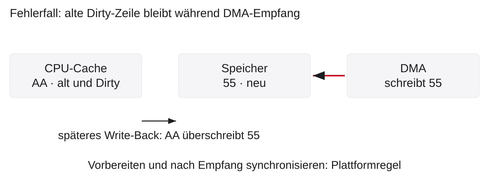{fig-alt="DMA schreibt 55 in den Speicher, während eine alte Dirty-Cachekopie AA besteht; ein späteres Write-Back könnte 55 wieder überschreiben."}

Vor Übergabe vorbereiten; nach erfolgreichem Empfang für CPU-Lesen synchronisieren.

::: notes
DMA bedeutet Direct Memory Access, CPU Central Processing Unit. Die Grafik zeigt den Empfangsfall im nicht kohärenten Write-Back-Modell. Der DMA schreibt einen neuen Wert `0x55` in den Speicher. Eine alte gültige Cachekopie `0xAA` kann bei einem CPU-Read weiter als Treffer erscheinen. Stale Data bedeutet solche veralteten Daten.

Ist die alte Cachezeile zusätzlich dirty, kann sie später `0xAA` zurückschreiben und dadurch den bereits empfangenen Wert im Speicher zerstören. Nur die Aussage „nach dem Transfer invalidieren“ schützt deshalb nicht vor jeder vorherigen oder zwischenzeitlichen Rückschreibung. Der Bereich muss schon vor der Übergabe so vorbereitet sein, dass keine schädliche Dirty-Kopie während der DMA-Nutzung nachwirkt.

Nach bestätigtem Abschluss muss die CPU die neue Speicherkopie entsprechend der Plattformregel lesen können. Invalidate verwirft eine lokale gültige Kopie; welche Kombination mit Clean und weiteren Synchronisationsschritten erforderlich ist, bestimmt die Plattform. Blindes spätes Clean einer alten Dirty-Zeile wäre im gezeigten Zustand gerade falsch. Während DMA den Empfangsbereich besitzt, darf die Anwendung dort außerdem keine konkurrierenden Stores erzeugen.

Der rote Pfeil läuft vom DMA rechts zum Speicher in der Mitte und steht für den neuen Empfangswert. Der schwarze Pfeil darunter warnt vor dem späteren Rückschreiben von links nach rechts. Die Hexwerte sind Beispielbytes, keine Adressen oder Statusflags.
:::

## Clean, Invalidate und Reihenfolge

| Maßnahme | Bedeutung im Grundmodell |
|----------|--------------------------|
| Clean | Dirty-Inhalt nach unten schreiben |
| Invalidate | lokale Kopie ungültig machen |
| Ordnungsbarriere | erforderliche Zugriffsreihenfolge sichern |

Eine Barriere ist kein universeller Cache-Flush und keine Pufferbesitzrückgabe.

::: notes
Clean bedeutet das Zurückschreiben veränderter Cachezeilen in die darunterliegende Speichersicht. Invalidate verwirft die lokale Gültigkeit einer Kopie. Dirty heißt verändert; ein ungeeignetes Verwerfen kann benötigte Änderungen verlieren. Manche konkreten Operationen kombinieren Aktionen oder besitzen zusätzliche Regeln. Deshalb ist „Flush“ ohne Definition ein mehrdeutiger Ausdruck.

DMA ist Direct Memory Access. TX, Transmit oder Senden, benötigt im nicht kohärenten Modell die aktuellen Quellwerte vor dem Start. RX, Receive oder Empfangen, benötigt Vorbereitung gegen spätere zerstörende Rückschreibung und nach Abschluss eine passende erneute Lesesicht. Diese Richtungen dürfen nicht durch ein pauschales identisches Wartungsrezept ersetzt werden.

Eine Ordnungsbarriere stellt eine benötigte Reihenfolge her. Der Befehl `fence` der Prozessor-Befehlssatzarchitektur RISC-V ist kein allgemeiner Beweis, dass jede Dirty-Cachezeile bereits zum DMA-Speicher zurückgeschrieben wurde. Cachefunktionen sind Fähigkeiten der Architektur beziehungsweise Plattform und ihres Treibers. Ebenso beendet eine Barriere nicht jeden laufenden DMA-Zugriff. Daten, Zugriffsort, Reihenfolge und logischer Besitz sind getrennt nachzuweisen. Im nächsten Beispiel wird zudem sichtbar, dass die Wartung mehr Bytes erfassen kann als der eigentliche Puffer.

RISC in RISC-V steht für Reduced Instruction Set Computer, Rechner mit reduziertem Befehlssatz.
:::

## Die Cachezeile ist größer als der Puffer

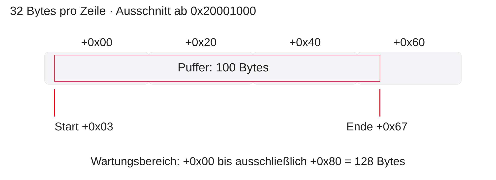{fig-alt="Ein 100-Byte-Puffer ab Adresse 20001003 berührt vier 32-Byte-Cachezeilen; der umschließende Bereich ist 20001000 bis ausschließlich 20001080."}

Lehrmodell: $32$ Byte je Zeile.

`0x20001003` plus $100$ Byte berührt $128$ Byte Cachebereich.

::: notes
Eine Cachezeile ist die zusammen verwaltete Kopiereinheit des Caches. Für diese Rechnung beträgt ihre Größe zweiunddreißig Bytes. Der eigentliche Datenbereich beginnt bei `0x20001003` und enthält hundert Bytes, endet also ausschließlich bei `0x20001067`. „Ausschließlich“ bedeutet, dass die letzte enthaltene Byteadresse eine Position davor liegt, hier `...1066`.

Die Abbildung markiert den Datenbereich innerhalb vier aufeinanderfolgender Cachezeilen. Der abgerundete Anfang ist `0x20001000`, das aufgerundete Ende `0x20001080`. Die Differenz ist $128$ Bytes. Drei Bytes vor und fünfundzwanzig Bytes hinter dem Datenbereich gehören damit ebenfalls zu den erfassten Zeilen.

DMA heißt Direct Memory Access. Werden daneben andere veränderte Daten gehalten, kann eine ungeeignete Wartung auch deren Zustand beeinflussen. Nur die Pufferanfangsadresse auszurichten genügt deshalb nicht immer; Zeilen können am Ende geteilt bleiben. Getrennte, passend reservierte ganze Zeilen vereinfachen die Besitzregeln. Die Rechnung beschreibt Bereichsgeometrie und noch keine ausgeführte Cacheoperation. Diese Geometrie lässt sich unabhängig von der Plattform mit einer reinen Integerfunktion prüfen.

Von links nach rechts steigen die Byteadressen. Die grauen Rechtecke sind ganze Zeilen, die rote Umrandung ist nur der Nutzdatenbereich. Die Beschriftungen geben Offsets zur gemeinsamen Basisadresse an, etwa $\texttt{0x20}=32$ Bytes; gleiche Zeichnungsbreiten stehen hier für gleiche Zeilenlängen.
:::

## Ein exklusives Ende aufrunden

C-Rechenmodell für $32$-Byte-Zeilen:

```c
uint64_t covered_end(uint32_t start, uint32_t bytes) {
    uint64_t end = (uint64_t)start + bytes;
    return (end + 31u) & ~UINT64_C(31);
}
```

Vorbedingungen für Nutzung: positive Länge, gültiger ursprünglicher Adressbereich.

::: notes
Die C-Funktion `covered_end` berechnet das auf zweiunddreißig Bytes aufgerundete exklusive Ende. `start` und `bytes` sind Startadresse und Bytezahl. `uint32_t` und `uint64_t` aus `stdint.h` sind vorzeichenlose Typen mit zweiunddreißig beziehungsweise vierundsechzig Bit. `UINT64_C` erzeugt eine passend breite Integerkonstante.

Der Ausdruck `end + 31` verschiebt einen nicht ausgerichteten Endpunkt in die nächste Zeile. Das bitweise Komplement `~` von einunddreißig besitzt in den untersten fünf Stellen null; das bitweise Und `&` setzt diese Stellen auf null. Ein bereits ausgerichtetes Ende bleibt erhalten. Für `start = 0x20001003` und hundert Bytes ist `end` zunächst `0x20001067`, die Rückgabe `0x20001080`.

Der Cast vor der Addition stellt sicher, dass schon das Addieren in vierundsechzig Bit stattfindet. Eine erst nach der Addition vorgenommene Konvertierung wäre dafür zu spät. Die breite Addition verhindert einen Zweiunddreißig-Bit-Umlauf während der Geometrieberechnung. Das Ergebnis kann als exklusiver Endpunkt auch $2^{32}$ darstellen. Die Funktion prüft weder reale Adressabbildung noch Pufferbesitz und führt keine Cache-Wartung aus. Eine leere Länge wird vom Aufrufer als eigener Fall behandelt; für die Verwendung des Bereichs sind positive Länge und ein gültiger ursprünglicher Bereich ausdrücklich vorausgesetzt.
:::

## Kohärent, ungecacht und erreichbar

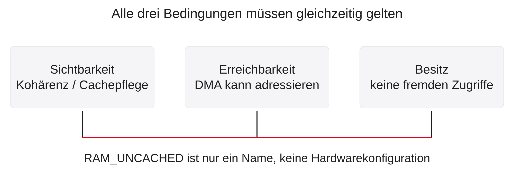{fig-alt="Cache-Sichtbarkeit, DMA-Erreichbarkeit und logischer Pufferbesitz sind getrennte Anforderungen; ein Linkername allein legt keine Speichereigenschaften fest."}

Ein Abschnittsname im Linkerskript macht Speicher nicht automatisch ungecacht.

::: notes
DMA bedeutet Direct Memory Access. Kohärente Sichtbarkeit heißt, dass CPU und DMA nach den geltenden Plattformregeln eine abgestimmte Speichersicht erhalten; CPU steht für Central Processing Unit. Ein ungecachter Bereich kann private Cachekopien vermeiden, sofern die Plattform diesen Bereich tatsächlich so bereitstellt. Beide Wege ersetzen nicht automatisch Zugriffsreihenfolge und Pufferbesitz.

Ein Linkerskript ordnet Abschnitte Adressen zu. Die Bezeichnung `RAM_UNCACHED` ist lediglich ein Name, keine Hardwareaktion. RAM heißt Random Access Memory. PMP, Physical Memory Protection, in der Prozessor-Befehlssatzarchitektur RISC-V regelt Zugriffsrechte; Cacheability wird dadurch nicht allgemein gesetzt. PMA, Physical Memory Attributes, bezeichnet physikalische Speichereigenschaften, deren Bereitstellung plattformabhängig ist.

Die Abbildung zeigt getrennte Prüffragen: Ist die Sichtbarkeit passend, kann der DMA den Bereich erreichen und ist seine Nutzung während des Auftrags geschützt? Ein ungecachter Bereich könnte dennoch außerhalb des Geräteadressbereichs liegen. Mehrere Abbildungen desselben Speichers können weitere Konsistenzprobleme erzeugen. Die konkrete Speicherzuteilung muss daher den dokumentierten Plattformvertrag erfüllen; ein hübscher Abschnittsname oder ein bloßer Zeiger-Cast reicht nicht.

Die drei grauen Kästen sind gleichrangige Prüffragen. Der rote gemeinsame Balken verbindet notwendige Bedingungen, keine zeitliche Reihenfolge. Beispielsweise scheitert ein sichtbarer, exklusiver Puffer dennoch, wenn der DMA seine Speicherbank nicht adressieren kann.

RISC in RISC-V steht für Reduced Instruction Set Computer, Rechner mit reduziertem Befehlssatz.
:::

## Ein Burst spart nicht jede Wartezeit

Lehrmodell für $16$ Word-Elemente, je Read und Write ein Zyklus,
Zuteilung zwei Zyklen:

$$
C_{\mathrm{single}}=16(2+1+1)=64
$$

$$
C_{\mathrm{burst}}=2+16(1+1)=34
$$

Längere zusammenhängende Belegung kann andere Initiatoren länger warten lassen.

::: notes
DMA heißt Direct Memory Access. Ein Burst ist eine zusammenhängende Folge von Elementzugriffen. Ein Word ist hier ein vier Byte breites Element. $C_{\mathrm{single}}$ und $C_{\mathrm{burst}}$ sind angenommene Buszyklen, keine CPU-Befehlszahlen oder gemessenen Controllerlaufzeiten.

Im vereinfachten Ein-Ressourcen-Modell kostet jede neue Zuteilung zwei Zyklen, jedes Lesen und Schreiben jeweils einen. Sechzehn einzeln zugeteilte Kopien kosten daher sechzehn mal vier, vierundsechzig Zyklen. Ein gemeinsam zugeteilter Burst kostet zwei plus zweiunddreißig, vierunddreißig Zyklen. Der Nutzumfang ist in beiden Fällen sechzehn Words, vierundsechzig Bytes.

Die ersparte erneute Zuteilung kann den Kopierdurchsatz verbessern. Die länger zusammenhängend belegte Ressource kann gleichzeitig die Wartezeit einer konkurrierenden CPU, Central Processing Unit, erhöhen. Reale Busse können Zugriffe überlappen oder anders bündeln. Das Modell begründet deshalb eine Kosten-Wartezeit-Abwägung, keine universelle Prozentbeschleunigung. Speichertechnik und Peripherietempo fügen anschließend weitere Bedingungen hinzu; insbesondere muss ein langsamer Ausgang nicht jedem schnellen Speicherburst unmittelbar folgen können.
:::

## Ein FIFO verbindet unterschiedliche Tempi

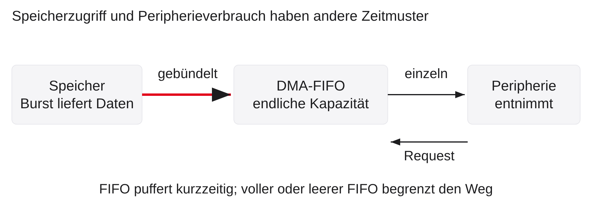{fig-alt="Ein Speicherburst füllt einen endlichen DMA-FIFO, aus dem die Peripherie entsprechend ihren lokalen Requests versorgt wird."}

Ein Zwischenpuffer entkoppelt Schritte, erzeugt aber keine unbegrenzte Bandbreite.

::: notes
FIFO bedeutet First In, First Out. DMA steht für Direct Memory Access. Ein interner FIFO kann mehrere schnell aus dem Speicher geholte Elemente halten, während die Peripherie sie langsamer übernimmt. In der Abbildung führt ein Burst vom Speicher in den Puffer; separate lokale Requests bestimmen die Entnahme zum Ausgang.

Der Bus kann nach dem Holen wieder für andere Initiatoren verfügbar sein. Der FIFO muss trotzdem rechtzeitig geleert beziehungsweise bei Empfang gefüllt werden. Seine Kapazität begrenzt die Entkopplung. Eine auf Dauer langsamere Leitung wird durch einen größeren Puffer nicht dauerhaft zu einer schnelleren Nutzdatenquelle.

Bei SRAM, Static Random Access Memory, kann Bündelung unter anderem wiederholte Zuteilung sparen. DRAM, Dynamic Random Access Memory, besitzt zusätzlich Zeilen- und Spaltenzugriffe. Bereits offene Zeilen können auch mehrere getrennte Zugriffe bedienen; „ein Einzelzugriff öffnet immer eine neue Zeile“ wäre falsch. Burstverhalten hängt daher von Speicherabbildung, Politik und Controller ab. Das Bild erklärt den Zwischenpuffer, ohne eine universelle DRAM-Zeilenfolge oder unbegrenzte parallele Übertragung zu behaupten.

Der breite rote Pfeil markiert gebündelten Datennachschub von links nach rechts. Der schwarze Datenpfeil zeigt die einzelne Weitergabe zur Peripherie. Deren Request läuft in Gegenrichtung zurück zum DMA. Die Pufferfüllung bleibt zwischen leer und voll, statt den langsameren Ausgang dauerhaft zu überholen.
:::

## Deskriptoren verketten Aufträge

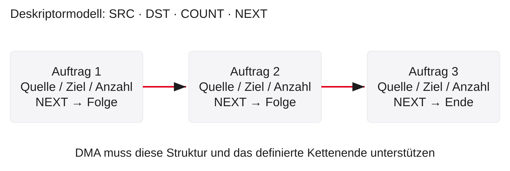{fig-alt="Drei Deskriptoren enthalten Quelle, Ziel, Anzahl und Verweis auf den Folgeauftrag; ein geeigneter DMA-Controller kann diese Auftragskette abarbeiten."}

Scatter-Gather benötigt ausdrückliche Hardwareunterstützung.

::: notes
DMA bedeutet Direct Memory Access. Ein Deskriptor ist eine im Speicher abgelegte Auftragsbeschreibung. SRC steht hier für Source, Quelle, DST für Destination, Ziel, COUNT für Elementanzahl und NEXT für einen Verweis auf den Folgeauftrag. Das sind Schemanamen, keine zugesagte Struktur eines bestimmten Controllers.

Scatter-Gather beschreibt das Zusammenführen oder Verteilen von Daten aus mehreren Speicherbereichen. Die Abbildung verknüpft drei Aufträge. Eine geeignete Hardware kann den nächsten Deskriptor selbst lesen, sodass Software nicht nach jedem einzelnen Block zwingend neu konfigurieren muss. Das bedeutet nicht, dass jeder DMA-Kanal diese Betriebsart besitzt.

Auch Deskriptoren sind Speicher, den ein anderer Initiator beobachtet. Ihre Adressen, Ausrichtung, Sichtbarkeit und Lebensdauer müssen deshalb passen. Die CPU, Central Processing Unit, darf einen gerade genutzten Auftrag nicht beliebig verändern. Wo eine Kette endet und wann Teilpuffer freigegeben werden, bestimmt der Controllervertrag. Die Kette spart wiederholte Vorbereitungsarbeit, hebt weder das Leitungsbudget noch die Cache- und Besitzregeln auf. Eine andere Erweiterung beschreibt anschließend regelmäßige Zeilenabstände in Bilddaten.

Die Kette wird von links nach rechts gelesen. Rote Pfeile stehen für die NEXT-Verweise und nicht für Nutzdaten zwischen den Kästen. Der letzte Eintrag endet im Schema ausdrücklich; wie dieses Ende kodiert wird, bleibt dem dokumentierten Controllerformat vorbehalten.
:::

## Ein Rechteck ist nicht linear gepackt

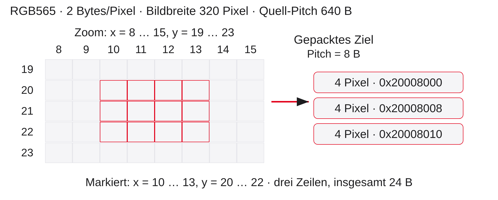{fig-alt="Ein Ausschnitt mit vier Pixeln je Zeile und drei Zeilen liegt in einem 320-Pixel-RGB565-Bild; die Quelle hat 640 Byte Pitch, das gepackte Ziel acht Byte Pitch."}

Quelle: Start `0x20004214`, Pitch $640$ Byte, Zeileninhalt $8$ Byte.

::: notes
RGB565 ist die sechzehn Bit breite Kodierung von Red, Green und Blue mit fünf, sechs und fünf Bits. Ein Pixel benötigt hier zwei Bytes. Das volle Bild hat dreihundertzwanzig Pixel je Zeile, also $640$ Bytes Pitch. Pitch bedeutet Abstand zwischen den Anfängen aufeinanderfolgender Zeilen.

Die Abbildung zeigt ausdrücklich einen Ausschnitt der Pixelkoordinaten. Das Rechteck beginnt bei $x=10$, $y=20$, ist vier Pixel breit und drei Zeilen hoch. Für die Startformel bezeichnet $B$ die Bildbasis, $P$ den Quell-Pitch in Bytes und $x,y$ die Pixelkoordinaten. Bei Bildbasis `0x20001000` ergibt der Start $B+yP+2x$, also `0x20001000` plus $12800$ plus $20$, `0x20004214`. Jede kopierte Zeile enthält acht Bytes.

Zum nächsten Quellzeilenanfang sind es $640$ Bytes, nach den acht kopierten Bytes daher noch $632$ zu überspringen. Ein gepacktes Ziel ab `0x20008000` verwendet dagegen acht Bytes Pitch. Insgesamt sind es vierundzwanzig Nutzbytes. DMA heißt Direct Memory Access; 2D bedeutet zweidimensional. Ein geeigneter 2D-DMA kann solche Strides, Zeilenabstände, unterstützen; alternativ sind getrennte Zeilenaufträge möglich. Die Fähigkeit ist ein Plattformmerkmal und keine automatische Eigenschaft jedes normalen DMA-Kanals.

Im linken Zoom steigen die $x$-Koordinaten nach rechts und die $y$-Koordinaten nach unten. Rote Umrandungen markieren die zwölf ausgewählten Pixel. Rechts stehen drei gepackte Zielzeilen; der Pfeil veranschaulicht die Kopie. Die Zieladressen unterscheiden sich um acht Bytes, nicht um den Quell-Pitch.
:::

## Circular Mode wiederholt Adressen

- Ein endlicher Puffer wird im Kreis genutzt
- Im Lehrmodell laden Zähler und Adresse nach $N$ Elementen neu
- Nachschub oder Verarbeitung bleibt Softwarearbeit
- Ein Umlauf erzeugt nicht automatisch neue gültige Inhalte

::: notes
DMA heißt Direct Memory Access. Circular Mode oder Ringmodus verwendet einen festen Puffer wiederholt. Im ausdrücklich gewählten Modell setzt die Hardware nach $N$ Elementen Adresse und Restzähler auf den Anfangszustand zurück und arbeitet weiter. Die konkrete Unterstützung und Statusdefinition muss eine reale Plattform bereitstellen.

Beim Senden liest die Hardware nach einem Umlauf dieselben Speicherstellen erneut. Hat die Anwendung sie nicht passend erneuert, werden alte Daten wiederholt. Beim Empfang überschreibt die Hardware nach dem Umlauf ältere Werte; diese könnten noch nicht verarbeitet sein. Ein Ring organisiert also Speicheradressen, nicht automatisch die Aktualität seiner Daten.

TC, Transfer Complete, kann in diesem Modus einen Umlauf markieren, ohne den Zugriff auf den gesamten Puffer zu beenden. Ein momentaner Positionswert wiederholt sich außerdem bei jedem Umlauf. Daraus folgt noch keine Gesamtzahl erzeugter oder verbrauchter Elemente. Für die Software sind Besitz, rechtzeitige Verarbeitung und ein nachvollziehbarer Fortschrittszustand nötig. Das nächste kleine Ringbeispiel trennt deshalb absolute Mengen von bloßen Positionsresten.
:::

## Gleiche Ringposition, anderer Rückstand

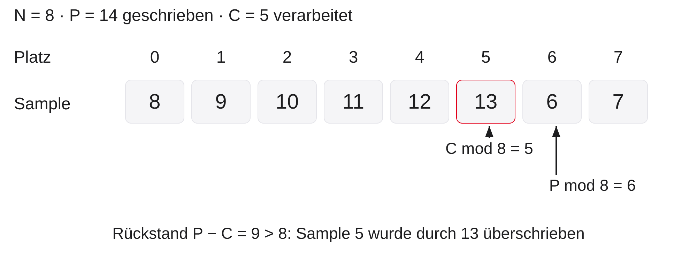{fig-alt="Ein Ring mit acht Plätzen enthält bei 14 erzeugten und fünf verarbeiteten Samples neun ausstehende Elemente; eines wurde schon überschrieben, obwohl die Positionsdifferenz modulo acht nur eins ist."}

$$
N=8,\quad P=14,\quad C=5,\quad P-C=9>N
$$

::: notes
$N$ ist die Ringkapazität, $P$ die insgesamt erzeugte und $C$ die bereits verarbeitete Elementzahl. Diese Größen sind im Rechenmodell konsistent bekannte Gesamtzahlen. Beim Empfang beträgt der Rückstand $P-C$. Übersteigt er die Kapazität, wurden noch benötigte ältere Daten überschrieben: Overrun.

Vierzehn erzeugte Elemente tragen die laufenden Nummern null bis dreizehn. Fünf verarbeitete sind null bis vier; benötigt wären noch fünf bis dreizehn, neun Stück. Der Acht-Plätze-Ring hält aber nur sechs bis dreizehn. Sample fünf wurde in Platz fünf durch Sample dreizehn ersetzt. Die Abbildung zeigt die Platznummern und dort vorhandenen Samplezahlen.

Die Positionsdifferenz modulo acht wäre nur eins und verrät den verlorenen Umlauf nicht. Beim Senden heißt fehlender rechtzeitiger Nachschub Underrun; alte oder fehlende Daten können ausgegeben werden. Ein Hardwareflag oder ein zurückgesetzter Restzähler liefert nicht automatisch verlässliche Gesamtzahlen. Überwachter Fortschritt und begrenzte Bearbeitungsfristen sind daher erforderlich. Für eine einfachere planbare Übergabe teilen wir den Puffer anschließend in zwei Bereiche.

Die Plätze stehen links nach rechts in aufsteigender Reihenfolge. Die rote Umrandung an Platz fünf markiert den Konflikt: Dort erwartet der Verbraucher Sample fünf, findet aber schon dreizehn. Die Pfeile zeigen die nächsten logischen Positionen, keine sicheren vollständigen Fortschrittszähler.
:::

## Ping-Pong: zwei Bereiche mit Rollen

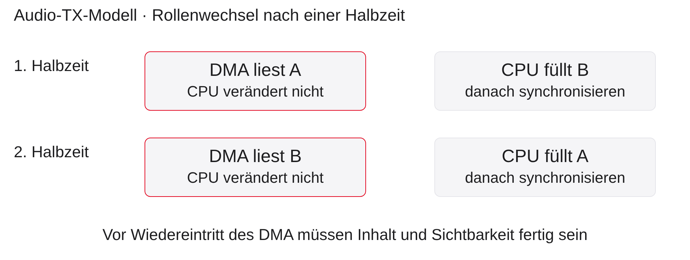{fig-alt="Bei einem Audio-Sender liest DMA abwechselnd Hälfte A und B; die CPU darf jeweils die gerade verlassene Hälfte vor deren Wiederverwendung nachfüllen."}

Getrennte Speicherbereiche verhindern den Konflikt nur bei rechtzeitigem Besitzwechsel.

::: notes
DMA bedeutet Direct Memory Access, CPU Central Processing Unit und TX Transmit, Senden. Ping-Pong oder Double Buffering verwendet zwei wechselnde Pufferbereiche. Unsere Grafik zeigt eine Sendeanwendung mit einem Ring, der logisch in A und B geteilt ist. Während die Hardware A liest, darf die CPU B vorbereiten; nach dem Wechsel werden die Rollen getauscht.

Eine spezielle Hardware-Double-Buffer-Funktion mit zwei getrennten Basisadressen ist eine mögliche andere Implementierung. Sie ist nicht automatisch dieselbe Funktion wie ein einzelner Ring mit zwei Hälften. Die gemeinsame Strategie besteht in getrennten aktiven und bearbeitbaren Bereichen mit nachvollziehbarem Wechsel.

Die erste und zweite Zeile zeigen aufeinanderfolgende Halbzeiten von oben nach unten. Innerhalb einer Zeile stehen links die vom DMA gelesene und rechts die von der CPU vorbereitete Hälfte. Aus dem Bild allein folgt keine unbeschränkte Freigabezeit. Der verlassene Bereich wird später wieder zur Quelle, und die CPU muss vor diesem Zeitpunkt fertig sein. Bei nicht kohärenten Speichern kommt die Sichtbarkeitsherstellung hinzu. Die nächste Rechnung bestimmt daher nicht nur die Audio-Rate, sondern die tatsächlich verfügbare Zeit bis zur Wiederverwendung.

Rot umrandet ist jeweils die aktiv gelesene Hälfte; grau bleibt die bearbeitbare Gegenhälfte. Zwei Bereiche allein verhindern also noch keinen Fehler: Erst die eingehaltene Nachfüllfrist stellt sicher, dass die Rollen beim folgenden Wechsel tatsächlich getauscht werden dürfen.
:::

## Ein Nachfüllfenster berechnen

Audio-Lehrmodell: mono, $16$ Bit, $44100$ Samples/s,
$2048$ Byte je Hälfte.

$$
T_H=\frac{2048/2}{44100}\approx23{,}22\ \mathrm{ms}
$$

Latenz $3$ ms + Nachfüllen $18$ ms + Synchronisation $1$ ms
$=22$ ms; Reserve ungefähr $1{,}22$ ms.

::: notes
Mono bedeutet ein Kanal. Ein sechzehn Bit breites Sample belegt zwei Bytes; die Datenrate ist daher $44100\cdot2=88200$ Byte pro Sekunde. Jede Hälfte besitzt $2048$ Bytes oder $1024$ Samples. $T_H$ ist die Zeit für eine Hälfte und beträgt $1024/44100\approx0{,}02321995$ Sekunden.

Nach dem Verlassen von A liest der DMA, Direct Memory Access, zunächst B. Für das Nachfüllen von A bleibt im idealen kontinuierlichen Modell somit ungefähr eine Halbzeit. Nicht nur die Kopierarbeit zählt: Die angenommene Signallatenz von drei Millisekunden, achtzehn Millisekunden Arbeit und eine Millisekunde Sichtbarkeit ergeben zusammen zweiundzwanzig Millisekunden. Es bleiben etwa eine Komma zweiundzwanzig Millisekunden Reserve.

Dreißig Millisekunden reine Nachfüllarbeit würden dieses Fenster schon ohne zusätzliche Latenz verfehlen. Größere Bereiche vergrößern das Zeitfenster und den Speicherbedarf, können aber zusätzliche Datenlatenz bedeuten. Die Zahlen sind ein deterministisches Lehrbudget, keine garantierte Audiomessung. Eine gemeldete Hälfte darf nur dann bearbeitet werden, wenn ihre Phase und die restliche Frist noch passen; ein altes Flag genügt dafür nicht.
:::

## Ein spätes Flag macht keine Hälfte frei

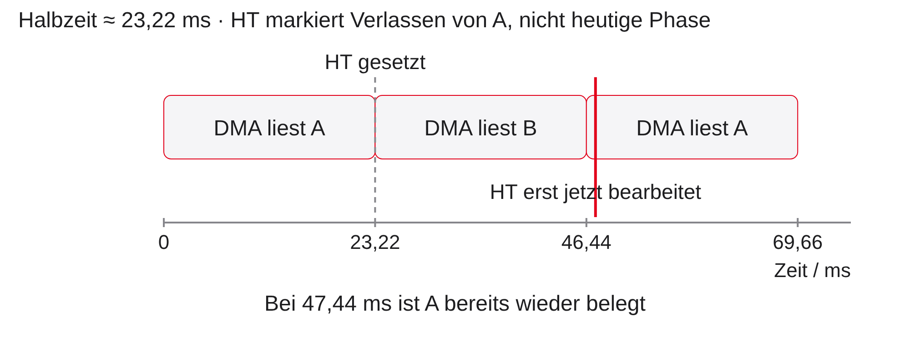{fig-alt="HT wird beim Verlassen von A nach einer Halbzeit gesetzt; bei Bearbeitung erst nach einem ganzen Umlauf plus einer Millisekunde liest DMA bereits wieder A."}

ISR meldet kurz; Anwendung prüft aktuelle Phase und verbleibendes Budget.

::: notes
HT bedeutet Half Transfer, Halbtransfer, TC Transfer Complete und ISR Interrupt Service Routine. DMA steht für Direct Memory Access. Im gegebenen Ringmodell entsteht HT, wenn die Hardware A verlässt und B beginnt. TC markiert nach B den Umlauf; danach liest die Hardware wieder A.

Die Grafik setzt die Halbzeit auf ungefähr $23{,}22$ Millisekunden. Ein erstes HT bei dieser Zeit bleibt unbedient. Wird es erst bei ungefähr $47{,}44$ Millisekunden ausgewertet, ist ein ganzer Umlauf von $46{,}44$ Millisekunden bereits vorbei und A wieder aktiv. Ein Nachfüllen von A allein aufgrund dieses Flags würde den Besitzvertrag verletzen.

Ein Statusbit kann mehrere gleichartige Ereignisse zusammenfassen. Auch das Zählen behandelter Interrupts rekonstruiert deshalb nicht automatisch jede vergangene Grenze. Die Anwendung benötigt eine geeignet überwachte Phase und genügend Zeit für den gesamten nächsten Arbeitsschritt. Eine kurze ISR kann melden und dokumentiert quittieren, während längere Arbeit später erfolgt. Gemeinsam genutzte Meldungen brauchen passende Synchronisation; `volatile` allein verhindert weder verlorene Hinweise noch einen zu späten Zugriff.

Die horizontale Achse ist Zeit in Millisekunden. Die drei Bereiche zeigen die aufeinanderfolgenden aktiven Hälften A, B und A. Die graue gestrichelte Linie markiert das frühere HT-Ereignis, die rote Linie die späte Bearbeitung; rechts von der zweiten Halbzeitgrenze besitzt DMA bereits wieder A.
:::

## Ein Timeout gibt den Puffer nicht zurück

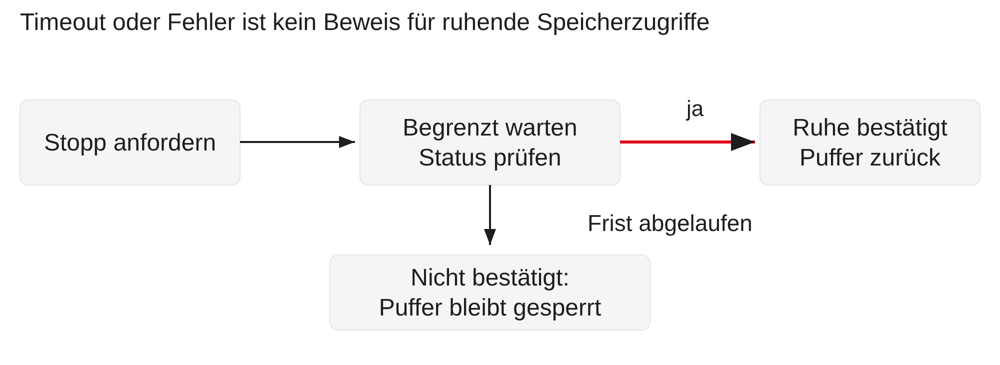{fig-alt="Ein begrenzter Abbruchpfad unterscheidet Stoppanfrage, bestätigten ruhenden DMA und erst danach die Rückgabe des Puffers; ein weiter aktiver Kanal bleibt ein ungeklärter Besitz."}

Erst bestätigter Stillstand beziehungsweise dokumentierte Besitzrückgabe erlaubt Wiederverwendung.

::: notes
DMA heißt Direct Memory Access. Die Abbildung beschreibt einen konzeptionellen Fehlerpfad. Nach Fehler oder verpasster Frist wird eine geeignete Stoppaktion angefordert. Erst ein dokumentierter Zustand ohne weitere relevante Zugriffe erlaubt die Rückgabe des Puffers. „Stopp angefordert“ und „wirklich gestoppt“ sind nicht identisch.

Eine Bereinigung benötigt ebenfalls eine begrenzte Frist. Fehlt die Bestätigung, muss dieser Zustand als ungeklärte Nutzung behandelt werden; dieselben Speicherstellen dürfen nicht einfach für einen neuen Auftrag überschrieben werden. Welche weitergehende Reaktion sinnvoll und technisch möglich ist, bestimmt die Plattform. Die Grafik enthält keine erfundene Reset- oder Abbruch-API; API bedeutet Application Programming Interface, Programmierschnittstelle.

Beim Senden kann auch nach ruhendem DMA noch die Peripherieleitung aktiv sein. Beim Empfang können Teilwerte vorliegen, die nicht als neuer vollständiger Datensatz veröffentlicht werden dürfen. Ein Watchdog beobachtet vereinbarte Fortschritte, ersetzt diese Zustandsprüfung aber nicht. Der Zusammenhang ergänzt die Fristen aus Vorlesung 3 und die Gültigkeitsprüfung aus Vorlesung 5. Das Ziel ist eine nachvollziehbare Besitzentscheidung, nicht bloß das Verlassen einer wartenden Schleife.

Die Pfeile werden vom Stoppauftrag links zur Statusprüfung in der Mitte gelesen. Nur der rote Ja-Pfad erreicht die Rückgabe rechts. Der schwarze Abzweig nach unten beschreibt die abgelaufene Bereinigungsfrist und hält den Puffer gesperrt; Zeitablauf ist kein Ersatz für Stillstand.
:::

## DMA aus dem Bedarf auswählen

| Bedarf | zu prüfender Schwerpunkt |
|--------|---------------------------|
| wenige Sensorbytes | Aufwand, Frist und Fehlerreaktion |
| großes Display-Vollbild | CPU-Bedienung und Leitungsbandbreite |
| kontinuierlicher Audiostrom | Halbzeit, Nachschub und Besitzwechsel |
| mehrere Speicherblöcke | Erreichbarkeit und Auftragsorganisation |

Wenig Daten verbieten DMA nicht; viel Daten garantieren keinen ausreichenden Ausgang.

::: notes
DMA bedeutet Direct Memory Access. Die Auswahl hängt von CPU-Aufwand, benötigter Latenz, Hardwarefähigkeiten und Speichervertrag ab; CPU heißt Central Processing Unit. Ein kleiner Sensortransfer kann mit begrenztem Polling oder Interruptbedienung gut passen. DMA kann trotzdem sinnvoll sein, wenn andere Fristen oder die Plattformorganisation dafür sprechen.

Ein großes Displaybild kann die Kopierbedienung belasten und zugleich eine zu langsame Leitung überfordern. DMA löst nur den ersten Punkt direkt. Ein kontinuierlicher Audiostrom braucht außerdem geeigneten Nachschub und einen rechtzeitigen Wechsel der Pufferrollen. Mehrere verstreute Speicherblöcke können eine unterstützte Deskriptorkette nutzen, müssen aber erreichbar und sichtbar bleiben.

Ein nominell schnellerer Transport allein beantwortet diese Fragen nicht. Vorbereitung, Abschluss und mögliche Busstalls gehören zum Vergleich. Eine universelle Bytezahl, ab der DMA immer besser wäre, wird deshalb nicht behauptet. Die Tabelle verbindet die bisher getrennten Modelle, bevor die Papieraufgaben ihre Grenzen prüfen. Eine begründete Lösung benennt, welches Budget tatsächlich eng ist und welche Voraussetzung die vorgeschlagene Arbeitsteilung benötigt.
:::

## Rechenmodell und Geräteausführung

- Host-C: Blockgröße und Cachebereichsgeometrie
- Papier: Adressfolgen, Bandbreiten, Besitz und Zeitfenster
- Renode: konkrete unterstützte Plattform und Controller nötig
- Keine Registeradressen oder erfolgreichen Hardwareläufe aus einem Schema ableiten

::: notes
Ein Host ist der Rechner, auf dem ein gewöhnlicher C-Compiler die beiden reinen Rechenfunktionen ausführt. Damit lassen sich Blockgrenzen, Integerbereiche und aufgerundete Cacheenden prüfen. Diese Ausführung bewegt keine echten Daten über einen DMA-Kanal; DMA steht für Direct Memory Access.

Renode ist ein Systemsimulator. Eine Untersuchung benötigt eine tatsächlich unterstützte Plattform mit passendem Controller- und Peripheriemodell sowie Firmware. Ein bloßer Registeroffset oder ein erfundener Typname erzeugt diese Unterstützung nicht. Selbst korrekt simulierte Registerzugriffe würden reale Cache-Effekte, Busarbitration und elektrische Leitungszeiten nur nachweisen, wenn das verwendete Modell sie tatsächlich abbildet.

Die Pflichtaufgaben benötigen daher keine zusätzliche Toolchain. Eine echte Firmware für die Prozessor-Befehlssatzarchitektur RISC-V müsste außerdem ihren Startablauf, Gerätezugriffe, Interruptpfad und Speichervertrag konkret erfüllen. Für diese Überarbeitung wird keine ausgeführte DMA-Firmware behauptet. Die getrennten Nachweisarten erklären, warum ein bestandener Integer-Test hilfreich ist, aber keine fertige Plattforminitialisierung ersetzt. Ein späterer Geräteversuch kann auf den sauber benannten Voraussetzungen aufbauen.

RISC in RISC-V steht für Reduced Instruction Set Computer, Rechner mit reduziertem Befehlssatz.
:::

## Abschlussquiz: Grenzen begründen

- Zehn QuizAcademy-Fragen zu Vorlesung 6
- Zehn Minuten beantworten, fünf Minuten auswerten
- Bytezahl, Beobachter oder Pufferphase nennen
- Antwortlänge liefert keinen zuverlässigen Hinweis

::: notes
Das Quiz behält seine zehn Fragen. Es prüft die bereits erklärten Unterscheidungen: Leitungsrate gegenüber CPU-Entlastung, Elementzahl gegenüber Bytezahl, feste Peripherieadresse gegenüber Arrayinkrement, Cache-Sichtbarkeit sowie DMA-Abschluss gegenüber Puffer- oder Leitungsfreigabe. CPU bedeutet Central Processing Unit, DMA Direct Memory Access.

Die vorgesehenen fünfzehn Minuten teilen sich in zehn Minuten individuelle Bearbeitung und fünf Minuten gemeinsame Auswertung. Bei Unsicherheit sollte eine konkrete Modellgröße genannt werden. Beispielsweise ergibt eine Byte-Rate geteilt durch 153600 Bytes je Bild die ideale Vollbildrate; die aktuelle Ringphase erklärt dagegen einen erlaubten Nachfüllzugriff.

Jede Frage besitzt vier Optionen und genau eine richtige. Die Antworten bleiben in vergleichbaren Längen und benutzen nur Inhalte dieses Blocks. Die längste Aussage ist weder immer richtig noch immer falsch. Erläuterungen benennen die jeweilige Verwechslung und können zu den passenden Papieraufgaben zurückführen. So wird eine Entscheidung aus Bedingungen begründet und nicht aus einer zufälligen Formulierungslänge erraten.
:::

## Was Sie jetzt unterscheiden können

- Kopierarbeit, Leitungsrate und Buskonkurrenz
- Elemente, Bytes, Adresssicht und Lebensdauer
- Clean, Invalidate, Reihenfolge und Pufferbesitz
- Normalabschluss, Umlauf und externe Ausgabe
- Aktuelle Phase und bloße Statusmeldung

::: notes
DMA bedeutet Direct Memory Access. Seine Entlastung entsteht durch eine andere Aufgabenverteilung bei der Datenbewegung. Ein vollständiger Auftrag braucht gültige erreichbare Adressen, passende Breiten, begrenzte Länge und einen dokumentierten Lebenszyklus. Die Cache- und Streambeispiele zeigen, dass Sichtbarkeit und zeitlicher Besitz genauso wichtig sind wie die Kopiermenge.

Die Grundlagen orientieren sich an Harris/Harris, Digital Design and Computer Architecture — RISC-V Edition. Ergänzend wurden die [Linux-DMA-Einführung](https://github.com/torvalds/linux/blob/master/Documentation/core-api/dma-api-howto.rst), die [DMA-API-Dokumentation](https://github.com/torvalds/linux/blob/master/Documentation/core-api/dma-api.rst) und ein [STMicroelectronics-DMA-Treiberbeispiel](https://github.com/STMicroelectronics/stm32f4xx-hal-driver/blob/master/Src/stm32f4xx_hal_dma.c) herangezogen. API bedeutet Application Programming Interface, Programmierschnittstelle. Diese Quellen beschreiben Plattformverträge beziehungsweise Herstellerbeispiele, keine universellen Register der Prozessor-Befehlssatzarchitektur RISC-V.

Vorlesung 7 behandelt moderne Prozessorarchitekturen und parallele Bearbeitung von Befehlen. Auch dort sind tatsächlich erreichbare Parallelität und gemeinsam genutzte Ressourcen zu unterscheiden; zwei gleichzeitig mögliche Aktivitäten verdoppeln nicht automatisch den Durchsatz.

RISC in RISC-V steht für Reduced Instruction Set Computer, Rechner mit reduziertem Befehlssatz.
:::
