## Zwei Recheneinheiten – doppelt so schnell?

::: {.section-label}
Einstieg · Die Breitenfrage
:::

Ein einzelner Prozessorkern erhält bei gleichem Takt eine zweite Addiereinheit.

- Wird jedes Programm damit doppelt so schnell?
- Was ändert sich, wenn jede Summe die vorherige benötigt?
- Welche Information fehlt für eine begründete Zeitangabe?

Zwei Minuten: Vorhersage und Begründung zu zweit sammeln.

::: notes
Ein Prozessor kann zusätzliche Rechenhardware besitzen, ohne jede Aufgabe entsprechend zu beschleunigen. Die Einstiegsfrage vergleicht dafür einen gedachten einzelnen Kern vor und nach der Ergänzung einer zweiten passenden Addiereinheit; der Takt bleibt unverändert. Sie verlangt noch keine Kenntnis einer realen superskalaren Mikroarchitektur. Aus C-Ausdrücken, Registern und Speicherzugriffen ist bereits bekannt, dass eine Rechnung ihre Eingabewerte benötigt. Daran lässt sich eine begründete Vermutung entwickeln.

Zwei voneinander unabhängige Summen könnten gleichzeitig entstehen, sofern beide Einheiten passende Operanden erhalten. Braucht die zweite Summe dagegen erst das Ergebnis der ersten, beseitigt die zweite Einheit diesen Wertfluss nicht. Außerdem fehlen Angaben darüber, wie viele Befehle der Kern pro Takt überhaupt vorbereitet, startet und endgültig bestätigt. Auch Speicherwartezeiten und die Länge des betrachteten Programms können den Zeitgewinn begrenzen.

Die Aussage „zweimal Hardware bedeutet halbe Zeit“ ist deshalb keine allgemeine Regel. Die ebenfalls naheliegende Aussage „ein Programm kann immer nur einen Befehl bearbeiten“ ist ebenso zu eng: Interne Arbeitsschritte lassen sich überlappen und unabhängige Operationen unter geeigneten Bedingungen gleichzeitig starten. Die folgenden Abschnitte entwickeln diese Bedingungen schrittweise. Am Ende wird die Ausgangsfrage mit einer unabhängigen Befehlsgruppe, einer abhängigen Kette und einem begrenzten Bestätigungspfad erneut beantwortet.
:::

## Vom Speicherzugriff zur Befehlsparallelität

::: {.section-label}
Einstieg · Ein Kern und zusätzliche Rechenhardware
:::

- Vorlesungen 1–3: Speicher, Caches und korrekte Unterbrechung
- Heute: mehrere Befehle innerhalb eines CPU-Kerns bearbeiten
- Unabhängige Arbeit kann Wartezeit überlappen
- Der sichtbare Programmzustand muss weiterhin korrekt bleiben

::: notes
CPU bedeutet Central Processing Unit, Prozessor. Die bisherigen Einheiten haben Speicherzugriffe, Cachekopien und die korrekte Behandlung von Interrupts und Exceptions erklärt. Nun wird der Blick nach innen gerichtet: Wie kann ein einzelner CPU-Kern mehrere Schritte und Befehle überlappen, ohne den sichtbaren Programmzustand zu verfälschen?

Ein Prozessor muss nicht warten, bis ein Befehl vollständig abgeschlossen ist, bevor irgendein Schritt eines nächsten beginnt. Er kann Stufen verschiedener Befehle überlappen und unter zusätzlichen Voraussetzungen unabhängige Rechnungen vorziehen. Welche Werte gebraucht werden und welche Ressourcen bereitstehen, entscheidet dabei über den möglichen Gewinn. Eine Kenntnis der vorerst ausgelassenen Themen zu Aktorik, Bussen oder DMA ist dafür nicht nötig.

Die Anwendung soll dieselben korrekten Ergebnisse und einen nachvollziehbaren Zustand bei einem Fehler erhalten. Deshalb baut die Einheit zunächst einfache Zeitmodelle auf, bevor sie Breite, Abhängigkeiten und eine veränderte Startreihenfolge betrachtet. Anschließend wird erklärt, wie geordnete Bestätigung und vorhergesagter Kontrollfluss zusammenpassen. Die neue Einstiegsfrage dient dabei als roter Faden: Zusätzliche interne Aktivität ist eine Möglichkeit, aber keine automatische Halbierung jeder Programmlaufzeit.
:::

## Voraussetzungen und drei Zeitmodelle

::: {.section-label}
Einstieg · Ein Kern und zusätzliche Rechenhardware
:::

- C-Integer, Arrays und einfache Registeroperationen
- Cachetreffer und Speicherwartezeiten aus Vorlesung 2
- Interrupts und Exceptions aus Vorlesung 3
- M1: fünf skalare Stufen; M2: kurzer Breitenvergleich
- M3: vier Befehle mit festgelegtem Issue und Retire

::: notes
Für den Lernweg genügen Integerzahlen, C-Arrays und grundlegende Registeroperationen sowie Cachekopien und Unterbrechungen aus den Vorlesungen 1 bis 3. Der Befehlspfad wird hier vollständig eingeführt. Ein Cache-Miss bedeutet, dass ein benötigter Speicherblock nicht in der betrachteten Cacheebene bereitliegt und weiter beschafft werden muss. Keine bestimmte superskalare Umsetzung wird als bekannt vorausgesetzt.

M1 ist das Fünf-Stufen-Modell mit höchstens einem neuen Befehl je Takt. M2 ist ein bewusst verkürzter Vergleich mit einer Rechenphase und geordneter Bestätigung frühestens im Folgetakt. Seine ausdrücklich benannten Varianten ergänzen Abhängigkeiten, ohne diese Zeitgrenzen zu ändern. M3 verfolgt eine andere Vier-Befehle-Folge mit einer fest vorgegebenen langsamen Ladeoperation und vergleicht die Auswahlreihenfolge. Zeiten aus diesen Modellen dürfen nicht stillschweigend vermischt werden.

Issue bedeutet hier Start einer ausgewählten Operation in einer Ausführungseinheit. Retire oder Commit ist die endgültige architektonische Bestätigung; vorher kann eine Operation intern schon fertig sein. Alle Latenzen, Breiten und Anfangswerte sind Lehrannahmen. Modellrechnung, tatsächlich übersetzter C-Code und gemessenes reales Prozessorverhalten bleiben getrennte Nachweise. Genau diese Trennung macht eine Zahl wie „zwei Befehle je Takt“ überprüfbar.
:::

## Vier Schulstunden: Ablauf

::: {.section-label}
Einstieg · Ein Kern und zusätzliche Rechenhardware
:::

| Stunde | Erklärung und Besprechung | Arbeitsphase |
|--------|---------------------------|--------------|
| 1 | Befehlsweg, Pipeline und Metriken: 35 min | Aufgabe 1: 10 min |
| 2 | Breite, Ressourcen und Abhängigkeiten: 30 min | Aufgabe 2: 15 min |
| 3 | Reihenfolge, Bestätigung und Vorhersage: 30 min | Aufgaben 3–4: 15 min |
| 4 | Spekulation und Compiler: 15 min | Aufgaben 5–6: 15 min; Quiz: 15 min |

::: notes
Vier Schulstunden umfassen hundertachtzig Minuten ohne zusätzliche Pausen. Die Planung sieht hundertzehn Minuten für Erklärung, Einstiegsdiskussion, Denkfragen und Lösungsbesprechung vor, fünfundfünfzig Minuten für angeleitete Papierarbeit und fünfzehn Minuten für das Quiz. Die siebzig Folien umfassen kurze Abschnittsorientierungen und zusätzliche Grundlagen; sie verlangen deshalb nicht siebzig gleich lange Einzelvorträge.

Der Schwerpunkt der ersten beiden Stunden liegt auf dem Befehlsweg, Pipelineüberlappung und der Frage, wann zusätzliche Ausgabebreite tatsächlich nutzbar wird. Die dritte Stunde verbindet die benannten Registerversionen mit geordneter Bestätigung und Sprungvorhersage. Im letzten Teil werden Spekulationsfolgen, Compileränderungen und die Grenzen eines Funktionsnachweises zusammengeführt. Die detaillierten Abschnitte zu gemeinsam genutzten Vorhersagetabellen, Schutzmaßnahmen und dem Hostversuch sind als Vertiefung zur selbstständigen Lektüre gekennzeichnet, falls die gemeinsame Besprechung mehr Grundlagenzeit benötigt.

Die Arbeitsphasen wählen passende Teilaufgaben aus. Das vollständige selbstständige Übungsblatt hat seinen eigenen längeren Zeitrichtwert; nicht jeder Lösungsweg wird vollständig in den Präsenzphasen ausgearbeitet. Zeitdiagramme und Registerversionen brauchen mehr gemeinsame Betrachtung als kurze Wiederholungen. Die Lernnotizen enthalten die vollständigen Begründungen zum Nachlesen, während die Papieraufgaben die eigenständige Übertragung auf neue Befehle und Zahlen verlangen.
:::

## 1 · Vom Programm zur Pipeline {.section-divider}

Wie entstehen aus einem Programm einzelne Arbeitsschritte?

Befehlssatz → Datenpfad → Überlappung → Laufzeit

::: notes
Eine Laufzeit kann erst erklärt werden, wenn die Arbeitsschritte und ihre Reihenfolge bekannt sind. Der erste Abschnitt beginnt deshalb beim einzelnen Maschinenbefehl. Der Befehlssatz beschreibt dessen Wirkung auf Register und Speicher; die Mikroarchitektur realisiert diese Wirkung mit Rechenplätzen, Verbindungen und zeitlich aufgeteilten Schritten.

Eine Pipeline lässt verschiedene Befehle gleichzeitig an unterschiedlichen Schritten arbeiten. Sie verkürzt damit nicht automatisch die Durchlaufdauer des einzelnen Befehls, erhöht unter günstigen Bedingungen aber die Ergebnisrate. Die Unterscheidung von Latenz und Durchsatz wird zunächst an einem kleinen vollständig benannten Modell entwickelt. Danach lassen sich Zeitfenster, Taktzahlen und die Kenngrößen IPC und CPI nachvollziehbar vergleichen.

Vorausgesetzt werden die Speicher- und Registergrundlagen aus den bisherigen Einheiten. Eine spezielle Datenübertragungshardware oder eine Kenntnis von DMA ist für diesen Lernweg nicht erforderlich. Der Blick richtet sich auf die Ausführung von Befehlen innerhalb eines einzelnen Kerns.
:::

## Befehlssatz und Mikroarchitektur trennen

::: {.section-label}
1 / 5 · Befehlsweg und Pipeline
:::

| Ebene | Beispiel |
|-------|----------|
| ISA | `add` berechnet ein Registerergebnis |
| Mikroarchitektur | eine oder mehrere Recheneinheiten |
| Beobachtung | Laufzeit eines bestimmten Programms |

Gleicher Befehlssatz bedeutet nicht gleiche Taktzahl.

::: notes
ISA bedeutet Instruction Set Architecture, Befehlssatzarchitektur: die für Software beschriebene Schnittstelle mit Befehlen, Registern und ihren Wirkungen. CPU heißt Central Processing Unit. Die Mikroarchitektur ist die konkrete interne Umsetzung dieser Schnittstelle, beispielsweise mit bestimmten Stufen, Puffern und Recheneinheiten.

RISC-V ist die verwendete Befehlssatzfamilie; RISC steht für Reduced Instruction Set Computer, Rechner mit reduziertem Befehlssatz. Ein Basis-Integerbefehl `add` schreibt die Summe zweier Registeroperanden. Ob diese Summe nach einer oder mehreren internen Phasen fertig wird, ist nicht allein aus dem Befehlsnamen abzulesen.

Zwei Kerne können daher dasselbe Programm korrekt ausführen und unterschiedliche Laufzeiten besitzen. Eine Compilerübersetzung zeigt die ausgewählten Maschinenbefehle, aber noch keine vollständige Ausführungsgeschichte. Ein Zeitdiagramm muss zusätzlich die angenommene Mikroarchitektur benennen. Diese Trennung ist aus den Cachebeispielen vertraut: Eine richtige Adresse sagt ebenso wenig über jede Wartezeit aus wie ein richtiger Befehl über seine konkrete Ausführung. Zuerst klären wir deshalb die grundlegenden Register- und Speicheroperationen.
:::

## Vom C-Ausdruck zum Maschinenbefehl

::: {.section-label}
1 / 5 · Befehlsweg und Pipeline
:::

```c
u = a + b;
v = c + d;
z = u + v;
```

- Namen stehen für Werte; `z` benötigt zwei zuvor erzeugte Summen
- Eine C-Zeile ist keine feste Anzahl von Maschinenbefehlen
- Für das Zeitmodell werden konkrete Registeroperationen festgelegt

::: notes
Ein C-Programm beschreibt zunächst, welches Ergebnis berechnet werden soll. Die drei Zeilen erzeugen zwei Teilsummen und anschließend deren Summe. Die ersten beiden Rechnungen können bei unveränderten, bereits vorhandenen Eingaben voneinander unabhängig sein. Die dritte benötigt dagegen die Ergebnisse beider Vorgänger. Diese Wertebeziehung besteht unabhängig davon, welche konkrete Maschine das Programm ausführt.

Der Ausschnitt ist hier mathematisches Lehrschema, kein vollständiges C-Programm mit festgelegten Datentypen und Speicherorten. Für eine tatsächliche C-Ausführung müssten insbesondere Typen, Wertebereiche und mögliche Aliase benannt werden. Der Compiler kann Variablen in Registern halten, Speicherzugriffe ergänzen oder Ausdrücke umformen, soweit die Sprachregeln dies erlauben. Deshalb lässt sich aus drei Quelltextzeilen keine allgemeine Taktzahl ablesen.

Die folgenden Befehlsbeispiele legen ihre Register, Anfangswerte und Operationen ausdrücklich fest. Dadurch werden die benötigten Eingaben und produzierten Ergebnisse nachvollziehbar. Erst danach kommt ein Zeitmodell hinzu. Die gedankliche Reihenfolge lautet somit: fachliche Rechnung verstehen, konkrete Befehlswirkung festlegen und deren interne Bearbeitung unter benannten Hardwareannahmen verfolgen.
:::

## Werte brauchen Rechenplätze und Wege {.compact-figure}

::: {.section-label}
1 / 5 · Befehlsweg und Pipeline
:::

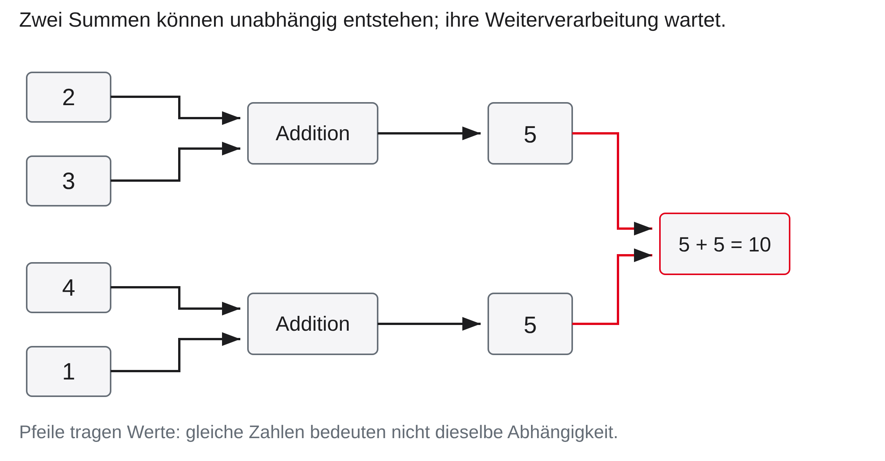{fig-alt="Zwei getrennte Additionen berechnen 2 plus 3 und 4 plus 1 jeweils zu fünf. Eine dritte Addition benötigt beide Teilsummen und erzeugt zehn."}

Pfeile beschreiben Werteabhängigkeiten, noch keine Takte.

::: notes
Der Datenpfad eines Prozessors verbindet gespeicherte Werte, Recheneinheiten und Ergebnisplätze. Eine ALU, Arithmetic Logic Unit, führt arithmetische und logische Operationen aus. Register halten die Operanden und Ergebnisse, Ports und Verbindungen ermöglichen deren Übergabe. Zwei vorhandene ALUs können daher nur dann zwei passende Rechnungen bedienen, wenn beide ihre Eingaben rechtzeitig erhalten und die Ergebnisse abgelegt werden können.

Der Wertefluss veranschaulicht diese Voraussetzung ohne bereits eine Mikroarchitektur festzulegen. Oben entsteht aus zwei und drei die Summe fünf, unten aus vier und eins ebenfalls fünf. Die beiden Ergebnisse haben denselben Zahlenwert, sind aber zwei unabhängig erzeugte Operanden. Die gemeinsame Schlussaddition benötigt beide und ergibt zehn. Die Pfeile kennzeichnen Datenabhängigkeiten; die Zeichnung ist keine elektrische Schaltung und kein Zeitdiagramm.

Die parallelen Zweige begründen eine Möglichkeit, keine garantierte gleichzeitige Ausführung. Mit nur einer passenden Einheit werden die beiden Teilsummen nacheinander berechnet. Mit zwei Einheiten können andere Engpässe bleiben, etwa zu wenige Registerports. Unabhängig von dieser Hardware kann die Schlussaddition nicht auf das Vorliegen beider Ergebnisse verzichten. Datenfluss und Ressourcenkapazität müssen deshalb getrennt untersucht werden.
:::

## Was Load und Add bedeuten

::: {.section-label}
1 / 5 · Befehlsweg und Pipeline
:::

RV32I-Lehrfolge; `s1` zeigt auf ein gültiges ausgerichtetes Wort:

```asm
lw  t0, 0(s1)
add t1, t0, t2
```

Bei Speicherwert $10$ und `t2` $=1$: `t0` $=10$, danach `t1` $=11$.

::: notes
Die Trennung von gewünschter Rechnung und Hardwareumsetzung wird nun an zwei konkreten Maschinenbefehlen sichtbar.

Der Ausschnitt verwendet RISC-V-Assembler. RISC bedeutet Reduced Instruction Set Computer. RV32I bezeichnet die Zweiunddreißig-Bit-Basis für Integerbefehle. Sie besitzt zweiunddreißig architektonische Integerregisternamen `x0` bis `x31`; `x0` liefert konstant null. `t0`, `t1`, `t2` und `s1` sind gebräuchliche alternative Namen, keine zusätzlichen Register.

`lw` bedeutet Load Word: ein vier Byte breites Wort von der Adresse Basisregister `s1` plus Offset null laden. Wir setzen einen gültigen ausgerichteten Speicherbereich voraus. Bei dem gewählten positiven Beispielwert zehn wird `t0` zehn. `add` addiert den Inhalt von `t0` und `t2` und schreibt das Zweiunddreißig-Bit-Ergebnis nach `t1`. Bei `t2 = 1` entsteht elf.

Der zweite Befehl benötigt also einen Wert, den der erste erst beschaffen muss. Ein Cache-Miss kann dieses Bereitstehen verzögern. Die Folge ist ein semantisches Beispiel, keine ausgeführte Firmware. Anfangswerte und Speicherzugriff sind ausdrücklich gegeben. Wie der Prozessor die benötigten Schritte überlappen kann, beschreibt nun ein einfaches Stufenmodell.
:::

## Fünf Stufen mit eigenen Aufgaben

::: {.section-label}
1 / 5 · Befehlsweg und Pipeline
:::

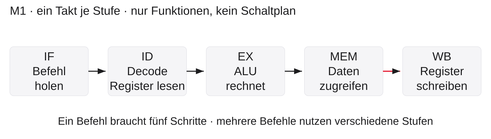{fig-alt="Fünf Funktionsstufen: IF holt einen Befehl, ID dekodiert und liest Register, EX rechnet, MEM bedient Datenzugriffe und WB schreibt das Ergebnis zurück."}

M1: höchstens ein neuer Befehl je Takt; Stufen verschiedener Befehle überlappen.

::: notes
Die einzelnen Befehlswirkungen lassen sich in wiederkehrende interne Aufgaben zerlegen.

CPU bedeutet Central Processing Unit, RISC in RISC-V Reduced Instruction Set Computer. M1 ist ein didaktisches Fünf-Stufen-Modell, keine vorgeschriebene Umsetzung jedes RISC-V-Kerns. IF steht für Instruction Fetch, Befehl holen. ID heißt Instruction Decode, dekodieren; hier werden auch Register gelesen. EX, Execute, führt beispielsweise eine arithmetische Rechnung aus. MEM, Memory, ist die Phase eines Datenzugriffs. WB, Write Back, schreibt ein Registerergebnis zurück.

ALU heißt Arithmetic Logic Unit, arithmetisch-logische Einheit. Sie berechnet in EX unter anderem Summen und Speicheradressen. Ein reiner Additionsbefehl benötigt keinen Nutzdatenzugriff in MEM, durchläuft im gleich langen Modell aber trotzdem diese Phase.

Die Abbildung wird von links nach rechts gelesen. Graue Kästen sind Stufen, Pfeile ihre Weitergabe; die rote Kennzeichnung hebt nur den Ergebnisweg hervor. Jede Stufe darf in einem Takt an einem anderen Befehl arbeiten. Das ist wie mehrere Arbeitsplätze an aufeinanderfolgenden Werkstücken: Ein Werkstück braucht mehrere Schritte, dennoch können nach dem Anlaufen regelmäßig Ergebnisse erscheinen. Durchlaufdauer und Ergebnisrate sind deshalb zu unterscheiden.
:::

## Durchlaufdauer und Ergebnisrate unterscheiden

::: {.section-label}
1 / 5 · Befehlsweg und Pipeline
:::

M1: fünf Ein-Takt-Stufen, keine Wartezyklen.

| Betrachtung | Frage | Idealer Wert |
|---|---|---|
| einzelner Befehl | Wie lange vom Start bis zum Ende? | fünf Takte |
| gefüllte Pipeline | Wie oft kann ein Ergebnis folgen? | eines je Takt |

Eine hohe Rate macht den Weg eines einzelnen Befehls nicht kürzer.

::: notes
Ein einzelner Befehl durchläuft im Modell M1 die fünf Schritte Holen, Dekodieren, Ausführen, Speicherphase und Rückschreiben. Jeder Schritt dauert genau einen Takt. Vom Beginn des ersten bis zum Ende des fünften Takts vergehen somit fünf Takte. Diese Durchlaufdauer oder Latenz beschreibt den Weg dieses einen Befehls.

Wenn unterschiedliche Befehle gleichzeitig in verschiedenen Stufen stehen, muss die nächste Ausgabe dagegen nicht weitere fünf Takte warten. Nach dem Füllen kann unter den idealen Voraussetzungen jeder Takt eine weitere letzte Stufe beenden. Der Durchsatz beträgt dann einen Befehl je Takt. Der Abstand zweier Ergebnisse und die Wartezeit auf ein einzelnes Ergebnis sind unterschiedliche Größen.

Die Aussage benötigt die angegebenen Grenzen: gleich lange Stufen, unabhängige Operationen, passende Ressourcen und keine Speicherwartezeit. Ein noch fehlender Operand oder ein belegter Speicherzugriff kann das Raster unterbrechen. Auch der gefüllte Abschnitt ist nicht das gesamte Programmfenster. Die nächste Gegenüberstellung hält die einzelnen Schritte unverändert und zeigt gerade dadurch, welchen Unterschied ihre Überlappung macht.
:::

## Vier Befehle: nacheinander oder überlappt?

::: {.section-label}
1 / 5 · Befehlsweg und Pipeline
:::

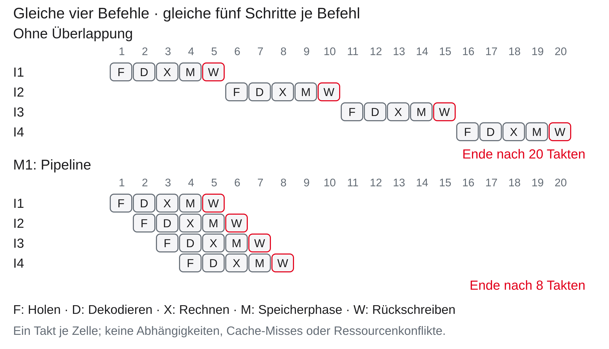{fig-alt="Vier Befehle mit fünf Schritten benötigen ohne Überlappung 20 Takte. In der M1-Pipeline beginnen sie in Takten 1 bis 4 und enden in 5 bis 8, insgesamt acht Takte."}

::: notes
Die beiden Bahnen führen dieselben vier unabhängigen Befehle mit denselben fünf Ein-Takt-Schritten aus. Oben beginnt der nächste Befehl erst nach dem vollständigen Ende seines Vorgängers. Viermal fünf ergibt zwanzig Takte. Dabei sind viele Stufen ungenutzt, während eine andere Stufe an dem gerade bearbeiteten Befehl arbeitet.

Unten beginnt M1 in jedem Takt einen weiteren Befehl. I1 belegt die Takte eins bis fünf, I2 zwei bis sechs, I3 drei bis sieben und I4 vier bis acht. Das Fenster vom ersten Start bis zum letzten Rückschreiben umfasst acht Takte. Innerhalb jeder Zeile bleiben die fünf Schritte unverändert; in einer Spalte stehen dagegen gleichzeitig aktive Stufen unterschiedlicher Befehle. Die roten Ränder markieren das jeweilige Rückschreiben.

Die Abkürzungen F, D, X, M und W stehen für Holen, Dekodieren, Rechnen, Speicherphase und Rückschreiben. Das Raster ist aus den Modellzeiten berechnet, keine Messung. Cache-Misses, Abhängigkeiten und Ressourcenkonflikte sind ausgeschlossen. Acht statt zwanzig Takte zeigen den Nutzen der Überlappung in diesem Fall, nicht eine universelle Beschleunigung jedes Programms. Insbesondere startet weiterhin höchstens ein Befehl pro Takt: Die Pipeline ist hier noch skalar.
:::

## Überlappung ist bereits Parallelität

::: {.section-label}
1 / 5 · Befehlsweg und Pipeline
:::

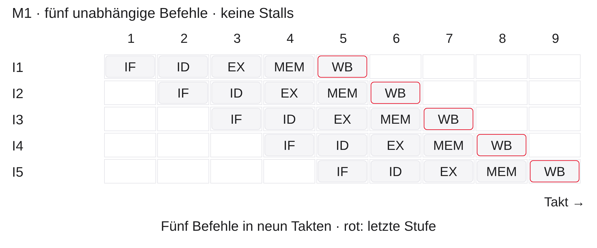{fig-alt="Fünf unabhängige Befehle durchlaufen die fünf Stufen diagonal über neun Takte. Ab Takt fünf beendet pro Takt einer die letzte Stufe."}

M1: fünf unabhängige Befehle, keine Wartezyklen.

::: notes
Die bisher getrennten Aufgaben werden nun gleichzeitig mit unterschiedlichen Befehlen belegt.

IF bedeutet Instruction Fetch, ID Instruction Decode, EX Execute, MEM Memory und WB Write Back. Die Stufen holen, dekodieren, rechnen, bedienen gegebenenfalls den Datenspeicher und schreiben das Ergebnis zurück. Das Modell betrachtet fünf unabhängige Befehle, sodass keiner einen noch fehlenden Wert seines Vorgängers braucht. Strukturelle Konflikte und Cache-Misses sind hier ausgeschlossen.

Die waagerechte Achse zählt Takte eins bis neun, die senkrechte listet Befehle I1 bis I5. Eine Zeile verfolgt nach rechts den Weg eines Befehls; eine Spalte verbindet die im selben Takt besetzten Stufen. Graue Zellen zeigen die Bearbeitung; rot umrandet ist die letzte Phase. Ein Kästchen dauert einen Takt.

I1 erreicht WB in Takt fünf, I2 in sechs, I5 in neun. Obwohl zwischen dem ersten Start und letzten Ende neun Takte liegen, erscheinen im gefüllten Abschnitt Ergebnisse mit Abstand eins. Die Abbildung ist keine höhere Startbreite: Noch immer beginnt höchstens ein Befehl pro Takt. Für kurze Programme muss das Anlaufen in die mittlere Rate einbezogen werden.
:::

## Das kurze Fenster enthält Füllen und Leeren

::: {.section-label}
1 / 5 · Befehlsweg und Pipeline
:::

Für $N$ unabhängige Befehle und $k$ gleich lange Stufen in M1:

$$
C=N+k-1
$$

Bei $N=5$, $k=5$: $C=9$ Takte, nicht fünf.

Bei $N=100$: $C=104$ Takte.

::: notes
Aus dem Belegungsraster ergibt sich eine einfache Formel für ein vollständig ideales endliches Fenster.

$N$ ist die positive Anzahl betrachteter Befehle, $k$ die Anzahl Stufen und $C$ die Taktzahl vom ersten Start bis zum Ende des letzten Befehls. Jeder Befehl benötigt in M1 genau einen Takt je Stufe; neue Befehle beginnen im Abstand eines Takts. Es gibt keine Abhängigkeit, keinen Ressourcenstau und keinen Cache-Miss.

Der erste Befehl endet nach $k$ Takten. Jeder der verbleibenden $N-1$ Befehle endet einen Takt später als sein Vorgänger. Zusammen sind das $k+(N-1)=N+k-1$. Fünf Befehle und fünf Stufen ergeben neun Takte. Bei hundert Befehlen ergeben sich hundertvier Takte; der zusätzliche Anlauf fällt relativ weniger ins Gewicht.

Das ist eine Rechnung über ein endliches Zeitfenster. Die langfristige Rate kann sich einem Ergebnis je Takt nähern, ohne dass ein einzelner Befehl nur eine Stufe braucht. Bei null Befehlen ist diese Formel kein gültiges Zeitmodell; es wird gar keine Befehlsfolge bearbeitet. Der nächste Fall ergänzt eine konkrete Wartebedingung und zeigt, weshalb die Idealformel dann nicht genügt.
:::

## Forwarding verkürzt Warten, nicht die Abhängigkeit

::: {.section-label}
1 / 5 · Befehlsweg und Pipeline
:::

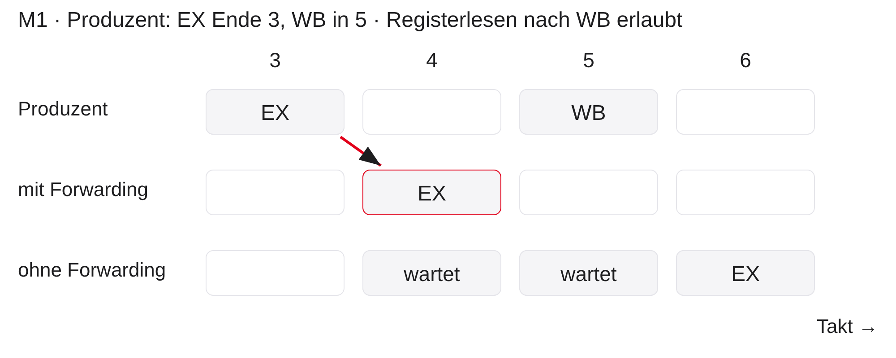{fig-alt="Ein ALU-Ergebnis entsteht Ende Takt drei. Mit Forwarding nutzt der Verbraucher es in EX Takt vier, ohne Forwarding liest er erst bei WB Takt fünf und rechnet in Takt sechs."}

M1: Registerschreiben und anschließendes Lesen im selben Takt erlaubt.

::: notes
Ein noch fehlender Wert verletzt eine der Voraussetzungen der Idealformel.

ALU bedeutet Arithmetic Logic Unit, arithmetisch-logische Einheit. EX heißt Execute, Rechenphase, WB Write Back, Register-Rückschreiben. RAW steht für Read After Write: Ein jüngerer Leser benötigt den Wert eines älteren Schreibers. Forwarding oder Bypassing ist die direkte Weiterleitung eines bereits erzeugten Ergebnisses zur nächsten benötigenden Phase, bevor es den normalen Registerweg abgeschlossen hat.

Im Beispiel rechnet der Produzent in Takt drei; das Ergebnis ist am Taktende fertig. Mit einer passenden Weiterleitung kann der Verbraucher es für EX in Takt vier nutzen. Ohne diese Verbindung kommt der Wert erst in WB Takt fünf ins Registerfile. Wir erlauben dort Schreiben vor dem Lesen im selben Takt; der Verbraucher startet EX dann in sechs.

Die horizontale Achse ist Zeit in Takten. Der rote Pfeil zeigt die direkte Ergebnisweitergabe, graue Warteplätze die zwei verlorenen EX-Startgelegenheiten vier und fünf. In einer sonst unabhängigen Fünf-Befehle-Folge mit diesem einen Konflikt steigt das Fenster von neun auf elf Takte. Ein später Load kann andere Regeln verlangen. Forwarding erzeugt jedenfalls kein Ergebnis vor dessen Rechnung.
:::

## IPC und CPI brauchen dieselbe Zählbasis

::: {.section-label}
1 / 5 · Befehlsweg und Pipeline
:::

Retired ISA-Befehle $N>0$, Core-Takte $C>0$, dasselbe Fenster:

$$
\mathrm{IPC}=\frac{N}{C},\qquad
\mathrm{CPI}=\frac{C}{N}=\frac{1}{\mathrm{IPC}}
$$

M1 mit fünf Befehlen: IPC $=5/9$, CPI $=9/5=1{,}8$.

::: notes
Eine Leistungszahl benötigt dieselben präzisen Fenstergrenzen wie ein Zeitdiagramm.

IPC heißt Instructions Per Cycle, Befehle pro Takt, CPI Cycles Per Instruction, Takte pro Befehl. ISA steht für Instruction Set Architecture, Befehlssatzarchitektur. Wir zählen endgültig bestätigte ISA-Befehle und Kerntakte innerhalb desselben Fensters. Retired bedeutet in diesem Zusammenhang bestätigt. Core bezeichnet den einzelnen Kern.

In unserem einfachen M1 werden fünf Befehle nach neun Takten erfolgreich beendet. Die mittlere Rate ist $5/9\approx0{,}556$, ihr Kehrwert $9/5=1{,}8$. Der spätere gefüllte Abschnitt mit einem Ende pro Takt ersetzt dieses ganze Fenster nicht. Ein einzelner Takt mit mehreren Abschlüssen ist ebenfalls noch keine mittlere Programmratenangabe.

Manche Prozessoren zerlegen einen ISA-Befehl in mehrere interne Mikrooperationen. Deren Zählung ist eine andere Größe und darf nicht unbemerkt als ISA-IPC eingesetzt werden. Auch unterschiedliche Messzeiträume, aktive statt vergangene Takte oder verschieden gezählte Befehle zerstören den Kehrwertvergleich. Für leere Fenster ist die Division nicht definiert. Erst eine benannte Zählbasis macht aus einem IPC-Wert eine überprüfbare Aussage; für Laufzeit brauchen wir außerdem die Frequenz.
:::

## Höheres IPC muss nicht kürzere Laufzeit bedeuten

::: {.section-label}
1 / 5 · Befehlsweg und Pipeline
:::

Bei konstanter Frequenz $f$:

$$
T=\frac{N\cdot\mathrm{CPI}}{f}
$$

| Übersetzung | Befehle $N$ | CPI | Takte |
|-------------|-------------|-----|-------|
| A | $100$ | $1$ | $100$ |
| B | $150$ | $0{,}8$ | $120$ |

Bei $100$ MHz: $1\,\mu$s gegenüber $1{,}2\,\mu$s.

::: notes
Zur gemittelten Befehlsrate kommen die Befehlsmenge und der Takt hinzu.

IPC bedeutet Instructions Per Cycle, CPI Cycles Per Instruction. $T$ ist die betrachtete Laufzeit in Sekunden, $N$ die Zahl endgültig bestätigter Befehle und $f$ die konstante Kerntaktfrequenz in Hertz, Takten pro Sekunde. Das Produkt $N\cdot\mathrm{CPI}$ liefert die Taktzahl; Division durch $f$ die Zeit.

Die zwei Zeilen sind Modellübersetzungen derselben fachlichen Aufgabe, keine gemessenen Compilerresultate. A braucht hundert Befehle zu einem Takt im Mittel, also hundert Takte. B braucht hundertfünfzig zu acht Zehnteln, also hundertzwanzig Takte. Ihr IPC wäre $1/0{,}8=1{,}25$ und damit höher, dennoch ist das betrachtete Fenster länger.

Bei hundert Millionen Takten pro Sekunde entsprechen die beiden Mengen einer beziehungsweise einer Komma zwei Mikrosekunden. Eine Optimierung kann sowohl die Befehlszahl als auch den mittleren Aufwand ändern. Auch Frequenzwechsel oder andere Arbeit würden den direkten Vergleich beeinflussen. Für eine begründete Leistungsbewertung müssen daher Aufgabe, Zählfenster, Frequenz und Befehlsmenge feststehen. Eine größere interne Breite ist keine kostenlose Alternative zu dieser Prüfung.
:::

## Mehr Takt und mehr Breite kosten Energie

::: {.section-label}
1 / 5 · Befehlsweg und Pipeline
:::

Vereinfachte dynamische Leistung:

$$
P_{\mathrm{dyn}}\approx\alpha C_{\mathrm{eff}}V^2f
$$

Bei festem $\alpha,C_{\mathrm{eff}}$:
$1{,}5$-facher Takt und $1{,}1$-fache Spannung ergeben Faktor $1{,}815$.

Leckleistung und zusätzliche Hardware sind getrennt zu betrachten.

::: notes
Auch eine technisch mögliche Beschleunigung hat einen Ressourcen- und Energiepreis.

$P_{\mathrm{dyn}}$ bezeichnet die dynamische Schaltleistung in Watt. $\alpha$ ist ein dimensionsloser Aktivitätsfaktor, $C_{\mathrm{eff}}$ eine effektiv geschaltete Kapazität in Farad, $V$ die Versorgungsspannung in Volt und $f$ die Frequenz in Hertz. Die Formel beschreibt ein vereinfachtes Schaltmodell und keine vollständige Leistungsaufnahme des Prozessors.

Wenn Aktivität und Kapazität unverändert bleiben, multipliziert eine höhere Frequenz die Leistung linear, die Spannung geht quadratisch ein. Mit den angenommenen Faktoren entsteht $1{,}5\cdot1{,}1^2=1{,}815$, also einundachtzig Komma fünf Prozent mehr dynamische Leistung. Leckleistung wird damit nicht mitberechnet. Die Formel liefert auch keine universelle maximale Gigahertzfrequenz.

CPU bedeutet Central Processing Unit. Ein breiterer CPU-Kern benötigt beispielsweise zusätzliche Registerports, Auswahlhardware und Weiterleitungswege. Das kann Kapazität und Aktivität verändern; diese sind im Verhältnisbeispiel ausdrücklich festgehalten, im realen Umbau aber nicht automatisch konstant. Energie, Fläche und Reaktionszeit bleiben daher Abwägungen. Um vorhandene Ressourcen besser zu nutzen, müssen zuerst unabhängige Rechnungen im Programm gefunden werden.
:::

## 2 · Breite und Abhängigkeiten {.section-divider}

Wann können mehrere Operationen gleichzeitig starten?

Wertefluss → Ressourcen → Ausgabebreite

::: notes
Das Pipeline-Modell überlappt bisher unterschiedliche Schritte verschiedener Befehle. Eine weitere Möglichkeit besteht darin, in einem Takt mehrere passende Operationen zu starten. Dafür benötigt der Kern nicht nur mehrere Recheneinheiten, sondern auch unabhängige oder bereits ausreichend vorbereitete Operanden und einen passenden gesamten Befehlsweg.

Dieser Abschnitt entwickelt zunächst den Wertefluss: Welche Operation erzeugt einen Wert, den eine andere wirklich braucht? Davon sind Konflikte zu unterscheiden, die durch das Wiederverwenden desselben Registernamens entstehen. Anschließend wird die Breite des Kerns betrachtet. Die Anzahl geholter Bytes, dekodierter Befehle, gestarteter Operationen und endgültig bestätigter Befehle sind verschiedene Kapazitäten.

Mit kurzen Beispielen lässt sich daraus eine vollständige Aussage über einen Doppelstart herleiten. Zwei Einheiten können zwei passende Rechnungen bedienen, aber keine fehlenden Eingabewerte vorzeitig erzeugen und keinen dauerhaft langsameren Ausgang beliebig überholen. Erst diese Begrenzungen machen den Begriff Superskalarität als Systembeschreibung brauchbar.
:::

## ILP ist verfügbare Unabhängigkeit

::: {.section-label}
2 / 5 · Breite und Abhängigkeiten
:::

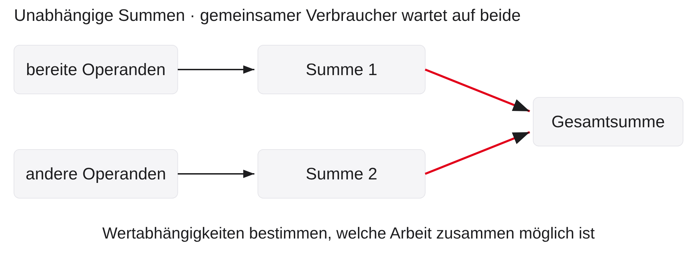{fig-alt="Zwei unabhängige Additionen bilden getrennte Datenwege; eine dritte Addition braucht beide Ergebnisse und verbindet sie erst danach."}

Bereite Operanden und passende Ressourcen bestimmen den möglichen Start.

::: notes
Die Voraussetzung eines Doppelstarts beginnt beim Programm selbst: Es muss unabhängige Arbeit enthalten.

ILP bedeutet Instruction-Level Parallelism, Parallelität zwischen Befehlen desselben Programms. ALU heißt Arithmetic Logic Unit, arithmetisch-logische Einheit. ILP beschreibt hier, welche Operationen nicht aufeinander angewiesen sind; die tatsächlich erreichte Rate hängt zusätzlich von Ausführungseinheiten und Auswahlbreite ab.

Die Grafik zeigt zwei getrennte Summen aus bereits bereiten Registerwerten. Diese können unter passenden Bedingungen gleichzeitig in zwei ALUs entstehen. Die anschließende Summe braucht beide Ergebnisse. Die schwarzen Pfeile sind Wertabhängigkeiten, die rote Zusammenführung markiert den ersten gemeinsamen Verbraucher. Die Wege verlaufen vom jeweiligen Eingabepaar links zur Zusammenführung rechts.

Zwei C-Zeilen sind noch kein Beweis für zwei unabhängige Maschinenbefehle. Arrayzugriffe können Loads enthalten, Zeiger können auf denselben Speicher zeigen und eine Multiplikation kann eine andere Einheit benötigen. Das gezeichnete Beispiel setzt deshalb ausdrücklich bereite Registeroperanden voraus. Mehr Hardware beseitigt die Kante zur letzten Summe nicht. Wir unterscheiden anschließend eine echte Wertabhängigkeit von Konflikten, die nur durch wiederverwendete Registernamen entstehen.
:::

## RAW: Der Leser braucht den erzeugten Wert

::: {.section-label}
2 / 5 · Breite und Abhängigkeiten
:::

RISC-V-Lehrfolge A–D, zunächst A und B:

```asm
lw  t0, 0(s1)     # A
add t1, t0, t2    # B
```

Bei Speicherwert $10$ und `t2` $=1$ muss B den Wert $10$ verwenden.

::: notes
Die erste Abhängigkeitsart betrifft einen tatsächlich benötigten erzeugten Wert.

RAW bedeutet Read After Write, Lesen nach Schreiben. Eine echte Wertabhängigkeit verbindet den Produzenten A mit dem Verbraucher B. RISC in RISC-V steht für Reduced Instruction Set Computer; der Ausschnitt verwendet dessen RV32I-Basis, Zweiunddreißig-Bit-Integerbefehle. `lw` lädt ein vier Byte breites Wort aus einem gültigen ausgerichteten Speicherbereich, `add` addiert Registerwerte.

`s1` ist das Basisregister der Modelladresse, `t0` das Ziel von A und eine Quelle von B. `t2` enthält eins, `t1` erhält das Ergebnis. Bei geladenen zehn entsteht elf. Solange A den Wert nicht geliefert hat, kann B diese Rechnung nicht korrekt abschließen. Ein alter Inhalt desselben Registernamens wäre kein Ersatz.

Forwarding kann den bereits bereiten Wert früher weitergeben; Renaming kann ihn unter einem anderen internen Namen festhalten. Keine dieser Techniken berechnet ihn vor dem Load. Der Konflikt hängt also an der fachlich benötigten Information, nicht bloß an einer Schreibweise. Die Folge wird um zwei Befehle ergänzt, damit auch alte und neue Versionen desselben Namens verfolgt werden können.
:::

## WAR: Der ältere Leser braucht die alte Version

::: {.section-label}
2 / 5 · Breite und Abhängigkeiten
:::

```asm
add t1, t0, t2    # B liest t0
sub t0, t4, t5    # C schreibt neues t0
```

B braucht den Loadwert $10$; C erzeugt aus $8-3$ den neuen Wert $5$.

::: notes
Nicht jeder Konflikt verbindet dagegen zwei Rechnungen durch ein neues Ergebnis.

WAR bedeutet Write After Read, Schreiben nach Lesen. B ist im Programm der ältere Leser von `t0`, C der jüngere Schreiber desselben Namens. RISC-V-Assembler bezeichnet `add` als Registeraddition und `sub` als Subtraktion. RISC heißt Reduced Instruction Set Computer, RV32I die Zweiunddreißig-Bit-Integerbasis.

Für das durchgehende Beispiel enthält `t2` eins, `t4` acht und `t5` drei. B soll den geladenen Wert zehn zu elf ergänzen und in `t1` schreiben. C erzeugt davon unabhängig fünf als neue Version von `t0`. Würde eine einfache Umsetzung dieses fünf zu früh über den alten Wert schreiben, könnte B fälschlich sechs berechnen.

B benötigt gerade nicht das neue Ergebnis von C. Der Konflikt ist deshalb eine Namensabhängigkeit und kein zusätzlicher Wertfluss von C nach B. Unterschiedliche physische Speicherplätze für beide Versionen können ihn lösen. Der Leser muss dabei seinen alten Quellnamen behalten; ein späterer Blick auf die zuletzt gültige Abbildung genügt nicht. Diese Anforderung motiviert die kommende Umbenennung.
:::

## WAW: Der jüngere Schreiber bestimmt den Endwert

::: {.section-label}
2 / 5 · Breite und Abhängigkeiten
:::

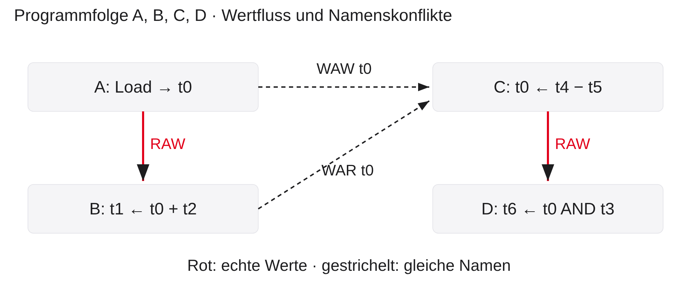{fig-alt="A nach B und C nach D sind RAW-Wertabhängigkeiten. A und C schreiben beide t0, während B die vorherige Version liest: zusätzlich WAW und WAR."}

A lädt `t0` $=10$, C schreibt später `t0` $=5$.

::: notes
Auch zwei Schreiber desselben Namens können unabhängig rechnen und trotzdem eine feste endgültige Reihenfolge benötigen.

WAW bedeutet Write After Write, Schreiben nach Schreiben. A und C schreiben denselben architektonischen Registernamen `t0`. Im sichtbaren Endzustand muss der Wert des jüngeren C gelten: fünf. Ihre Berechnung braucht aber nicht gegenseitig ihr Ergebnis. Das ist ein Namenskonflikt, der mit getrennten physischen Zielen entkoppelt werden kann.

RAW heißt Read After Write, Wertfluss vom Schreiber zum Leser, WAR Write After Read, Schutz einer älteren gelesenen Version vor einem jüngeren Überschreiben. Die Abbildung zeigt die vollständige Folge: A lädt `t0`, B addiert daraus nach `t1`, C subtrahiert nach `t0`, D verknüpft dieses neue `t0` bitweise mit `t3` nach `t6`. AND bedeutet bitweises Und. Bei `t3 = 7` ergibt D aus fünf bitweise Und sieben wieder fünf.

Rote durchgezogene Pfeile sind die echten Kanten A nach B und C nach D. Schwarze gestrichelte Pfeile zeigen WAR und WAW. Die Grafik gruppiert A und B links sowie C und D rechts; die Programmfolge bleibt A, B, C, D. Der gestrichelte WAR-Pfeil läuft deshalb von B zum höher gezeichneten C. Die Umsetzung muss richtige Versionen lesen und die endgültige Version bestätigen; sie muss nicht jede interne Fertigstellung derselben Namensschreiber in Programmreihenfolge erzwingen.
:::

## Skalar und superskalar zählen verschiedene Starts

::: {.section-label}
2 / 5 · Breite und Abhängigkeiten
:::

| Kernmodell | Höchstens neue Operationen je Takt |
|---|---:|
| skalar | eine |
| zweifach superskalar | zwei |

- Eine skalare Pipeline kann trotzdem mehrere Befehle gleichzeitig enthalten
- Breite bezeichnet eine Kapazität, keine garantierte Auslastung

::: notes
Eine gefüllte Pipeline enthält mehrere Befehle gleichzeitig, obwohl sie nur einen neuen pro Takt aufnimmt. Skalar bedeutet in diesem Zusammenhang, dass die betrachtete Start- beziehungsweise Ausgabebreite auf eins begrenzt ist. Die Parallelität liegt bereits in der gleichzeitigen Bearbeitung verschiedener Stufen.

Eine superskalare Umsetzung besitzt darüber hinaus die Fähigkeit, mehrere passende Operationen in einem Takt auszugeben. In einem zweifachen Lehrmodell können beispielsweise zwei unabhängige Registeradditionen gleichzeitig in zwei ALUs starten. ALU bedeutet Arithmetic Logic Unit, arithmetisch-logische Einheit. Das Zeitverhalten einzelner Operationen folgt weiterhin den angegebenen Latenzen.

Die Wörter „höchstens“ und „passend“ sind wesentlich. Ein zweifacher Kern muss nicht in jedem Takt zwei Starts erreichen. Fehlt ein Operand, stimmt der Operationstyp nicht mit einer freien Einheit überein oder liefert das Frontend zu wenig Arbeit, bleibt ein Platz ungenutzt. Mehr Breite ist somit eine technische Möglichkeit. Wie viel davon das Programm tatsächlich nutzt, entscheidet der gemeinsame Zustand von Daten und Ressourcen.
:::

## Zwei bereite Rechnungen – ein gemeinsamer Nutzer

::: {.section-label}
2 / 5 · Breite und Abhängigkeiten
:::

RV32I-Lehrfolge; alle `a`-Quellen liegen bereits bereit:

```asm
add t0, a0, a1    # I1: 2 + 3 = 5
add t1, a2, a3    # I2: 4 + 1 = 5
add t2, t0, t1    # I3: braucht I1 und I2
xor t3, a4, a5    # I4: 6 XOR 3 = 5
```

Welche Operationen benötigen tatsächlich ein anderes Ergebnis?

::: notes
Die vier Registeroperationen konkretisieren den vorherigen Wertefluss. Verwendet wird die RV32I-Integerbasis von RISC-V. Die Namen `a0` bis `a5` bezeichnen Register mit den vorgegebenen Werten zwei, drei, vier, eins, sechs und drei. `add` berechnet eine Registersumme; `xor` verknüpft die Bits exklusiv-oder. Die kleinen gewählten Werte vermeiden eine zusätzliche Überlaufdiskussion. Speicherzugriffe sind nicht Bestandteil dieser Folge.

I1 und I2 lesen verschiedene schon bereite Quellen und schreiben verschiedene Ziele. Zwischen ihnen besteht kein Wertfluss. I3 liest dagegen genau die von I1 und I2 erzeugten Versionen von `t0` und `t1`; seine Summe zehn kann erst aus beiden Ergebnissen entstehen. I4 ist von allen drei Additionen unabhängig und liefert aus sechs exklusiv-oder drei den Wert fünf.

Noch legt diese Feststellung keinen Taktplan fest. Ein einfacher geordneter Auswahlweg darf I3 nicht überspringen, wenn I3 warten müsste; ein anderer Auswahlweg könnte I4 vorziehen. Zwei Starts im selben Takt benötigen außerdem passende Einheiten und Ports. Der spätere vollständig benannte M2-Ablauf verwendet diese Folge, um Datenabhängigkeit, Start und Bestätigung getrennt nachzuverfolgen.
:::

## Zwei ALUs sind noch kein vollständiger breiter Kern

::: {.section-label}
2 / 5 · Breite und Abhängigkeiten
:::

Für einen Doppelstart müssen gleichzeitig passen:

- zwei vorbereitete Operationen mit verfügbaren Operanden
- zwei freie passende Ausführungsmöglichkeiten
- genügend Operandenzugriffe und Ergebniswege
- Platz für spätere geordnete Bestätigung

Zwei Loads passen nicht automatisch in eine einzige Load/Store-Einheit.

::: notes
Die Anzahl arithmetischer Einheiten beschreibt nur einen Teil des Befehlswegs. Schon vor der Ausführung müssen genügend Befehle geholt und dekodiert worden sein. Für zwei Additionen mit je zwei Registerquellen müssen im gewählten Modell die vier Operandenzugriffe oder gleichwertige bereits bereitgestellte Werte möglich sein. Auch die Ablage und Weiterleitung der Ergebnisse besitzt eine endliche Kapazität.

ALU bedeutet Arithmetic Logic Unit; eine LSU, Load/Store Unit, bearbeitet Lade- und Speicheroperationen. Zwei freie ALUs sind kein Ersatz für eine zweite Startmöglichkeit in der LSU. Zwei Loads können daher trotz sonstiger Unabhängigkeit um eine einzelne LSU konkurrieren. Umgekehrt genügt ein freier Ladeport keiner Addition, wenn ihr benötigtes Registerergebnis noch nicht bereitliegt.

Für jedes Zeitmodell werden diese Möglichkeiten ausdrücklich festgelegt. Die folgenden kurzen Breitenbeispiele erlauben zwei passende ALU-Operationen und genügend Operandenzufuhr; strukturelle Konflikte sind dort ausgeschlossen. Diese Annahme ist keine Bauvorschrift oder Messung eines bestimmten Prozessors. Gerade die vollständige Nennung der Randbedingungen verhindert, dass aus „zwei Recheneinheiten“ unbemerkt „jedes beliebige Befehlspaar startet gleichzeitig“ wird.
:::

## Der engste Abschnitt begrenzt die dauerhafte Rate

::: {.section-label}
2 / 5 · Breite und Abhängigkeiten
:::

Fiktiver Befehlsweg, jeweils höchstens pro Takt:

| Holen | Dekodieren | Starten | Bestätigen |
|---:|---:|---:|---:|
| vier Befehle | zwei | zwei | einer |

Endliche Puffer können kurze Unterschiede abfangen, nicht dauernd wachsen.

::: notes
Das Frontend holt und dekodiert Befehle, die Auswahl startet daraus passende Operationen, und Retire bestätigt ihre endgültigen Programmwirkungen. Jede dieser Stationen kann eine andere Breite besitzen. Die Tabelle beschreibt einen fiktiven Weg, in dem die Größen bereits einheitlich als vollständige Befehle pro Takt gezählt werden. Variable Befehlslängen und interne Mikrooperationen sind für diese erste Betrachtung ausgeblendet.

Obwohl zwei Operationen pro Takt starten können, darf langfristig höchstens ein Befehl pro Takt bestätigt werden, solange dies der einzige Bestätigungspfad bleibt. Andernfalls würden mehr fertige Ergebnisse ankommen als abfließen. Ein endlicher Puffer würde sich füllen und die vorgelagerte Arbeit schließlich anhalten. Ein kurzer Doppelstart widerspricht dieser dauerhaften Grenze nicht.

Die kleinste Tabellenkapazität ist hier somit eine obere Grenze der mittleren bestätigten Rate. Das Programm kann wegen Abhängigkeiten, Cache-Misses oder falschem Kontrollfluss noch darunter liegen. Der Vergleich stellt weder eine gemessene Leistungszahl noch eine allgemeine Formel für alle realen Kerne dar. Er erklärt vielmehr, weshalb Fetch-, Decode-, Issue- und Retire-Breite getrennt angegeben werden müssen.
:::

## Superskalar, Vektor und Multicore auseinanderhalten

::: {.section-label}
2 / 5 · Breite und Abhängigkeiten
:::

| Begriff | Parallel bearbeitete Arbeit |
|---|---|
| superskalar | mehrere Befehle eines Befehlsstroms |
| Vektor / SIMD | dieselbe Operation auf mehreren Datenelementen |
| Multicore | mehrere Kerne mit eigenen Ausführungskontexten |

Heute: Parallelität innerhalb eines Kerns; die anderen Ebenen folgen später.

::: notes
Mehrere Formen von Parallelität können im selben System vorkommen, beantworten aber unterschiedliche Fragen. Superskalarität betrifft die Fähigkeit eines Kerns, mehrere Operationen aus einem Befehlsstrom im selben Takt auszugeben. Unterschiedliche Befehle können dabei etwa eine Addition und eine bitweise Verknüpfung ausführen.

SIMD bedeutet Single Instruction, Multiple Data: Eine Operation wird auf mehrere Datenelemente angewendet. Vektorbefehle beschreiben eine verwandte Datenparallelität mit architekturabhängigen Längenregeln. Damit wird nicht einfach dieselbe Anzahl einzelner skalarer ISA-Befehle bezeichnet. ISA heißt Instruction Set Architecture, Befehlssatzarchitektur. Diese Unterscheidung ist eine Vorbereitung für die nächste Einheit, keine Voraussetzung über dortige Vektorregister.

Multicore bezeichnet mehrere Prozessorkerne. Jeder Kern kann selbst skalar oder superskalar sein. Ein physischer Kern kann außerdem mehrere Hardware-Ausführungskontexte besitzen; deren zusätzliche Verwaltung wird hier nicht benötigt. In den Zeitmodellen dieser Einheit wird ein einzelner Befehlsstrom auf einem Kern betrachtet. Eine breite interne Befehlsausgabe ist daher keine Behauptung darüber, dass das Anwendungsprogramm bereits auf mehrere Kerne verteilt wäre.
:::

## Superskalarität beschreibt Breite

::: {.section-label}
2 / 5 · Breite und Abhängigkeiten
:::

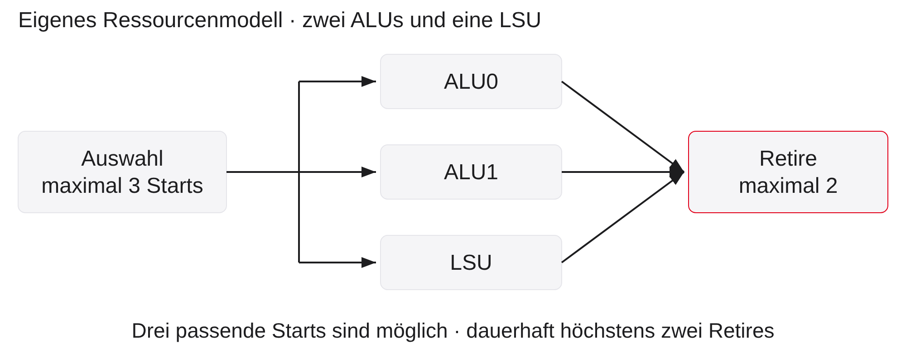{fig-alt="Ein Auswahlweg verteilt passende Operationen auf zwei ALUs und eine Load-Store-Einheit. Endgültig bestätigt werden im Modell höchstens zwei Befehle je Takt."}

Mehrere Starts pro Takt setzen passende Befehle und Ressourcen voraus.

::: notes
Mit diesen Voraussetzungen lässt sich die maximal mögliche Startbreite präziser beschreiben.

Superskalar heißt, dass eine Umsetzung mehrere Befehle in einem Takt ausgeben kann. Issue ist dieser ausgewählte Start, Retire die spätere endgültige Bestätigung. ALU bedeutet Arithmetic Logic Unit, LSU Load/Store Unit, Einheit für Laden und Speichern. CPU heißt Central Processing Unit.

Die Abbildung zeigt ein fiktives Ressourcenmodell mit zwei ALUs und einer LSU. Von der Auswahl in der Mitte führen Pfeile zu diesen unterschiedlichen Einheiten. Der rote Rand am Bestätigungsfeld markiert die auf zwei begrenzte Retire-Breite. Drei fertig werdende Ergebnisse pro Takt könnten diese Grenze nicht dauerhaft umgehen; ein endlicher Zwischenpuffer würde sich füllen.

Zwei unabhängige Adds passen möglicherweise zusammen, zwei Loads dagegen nicht in dieselbe einzelne LSU-Startgelegenheit. Die Ports und unterstützten Operationstypen müssen stimmen. Superskalarität ist auch nicht gleich Out-of-Order: Ein breiter Kern kann die Startreihenfolge weiterhin am Programm orientieren. Um Breite ohne andere Änderungen zu vergleichen, verwendet der anschließende Breitenvergleich ein ausdrücklich verkürztes Zeitmodell.
:::

## Ein Taktvertrag für die kurzen Breitenbeispiele

::: {.section-label}
2 / 5 · Breite und Abhängigkeiten
:::

M2 und seine ausdrücklich benannten Varianten:

1. Operanden müssen am Taktbeginn vorliegen; dort startet die Operation.
2. Das ALU-Ergebnis liegt am Ende desselben Takts vor.
3. Ein Nutzer kann es frühestens im nächsten Takt verwenden.
4. Retire erfolgt geordnet, ebenfalls frühestens im Folgetakt.

Fetch und Decode sind davor abgeschlossen; genügend Registerports sind angenommen.

::: notes
Ein Zeitplan ist nur eindeutig, wenn auch die Grenzen innerhalb eines Takts vereinbart sind. M2 ist ein bewusst verkürztes Lehrmodell für Breite. Seine Befehle sind vor dem ersten betrachteten Takt bereits vorbereitet. Ihre Ausführung ist daher nicht mit der vollständigen Fünf-Stufen-Pipeline M1 gleichzusetzen. Auch die später in M3 angenommene langsame Ladeoperation gehört nicht zu diesem kurzen ALU-Modell.

Die Auswahl prüft zu Beginn eines Takts, welche Operanden bereitstehen. Passende ALU-Operationen können dann starten und liefern ihre Ergebnisse am Taktende. Ein abhängiger Nutzer beginnt frühestens im Folgetakt. Eine passende Weiterleitung dieser Ergebnisse ist angenommen; sie hängt nicht davon ab, ob derselbe Wert schon endgültig bestätigt wurde. Genügend Registerports und Ergebniswege verhindern hier zusätzliche strukturelle Wartezeiten.

Die endgültige Bestätigung, Retire oder Commit, erfolgt in Programmreihenfolge und frühestens im Takt nach der Fertigstellung. Ihre maximale Breite wird im jeweiligen Vergleich genannt. In einem Takt können dadurch ältere Befehle bestätigt und andere passende Operationen gestartet werden. Der Vertrag beschreibt nur die angenommenen Vorgänge; insbesondere behauptet er keine allgemein eintaktige Ausführung eines Loads und keine vermessene reale Prozessorpipeline.
:::

## Ein Doppelstart mit abhängigem Verbraucher

::: {.section-label}
2 / 5 · Breite und Abhängigkeiten
:::

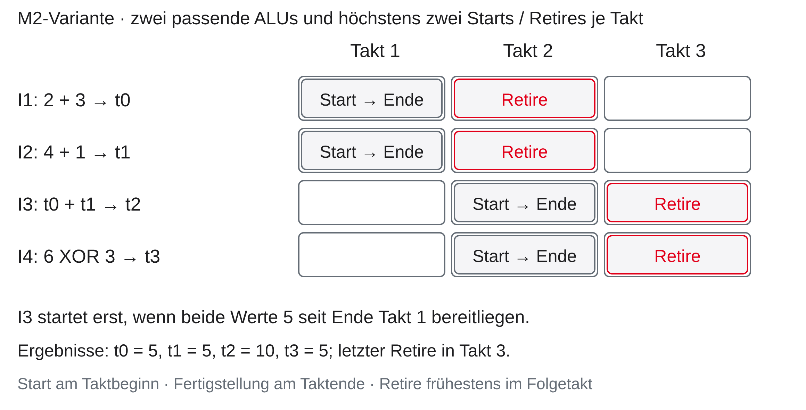{fig-alt="M2-Variante: I1 und I2 starten in Takt eins, I3 und I4 in zwei. Retire erfolgt paarweise in zwei und drei. I3 verwendet die seit Ende eins verfügbaren beiden Summen."}

::: notes
Diese Variante des kurzen M2-Vertrags verwendet die zuvor eingeführten vier Registeroperationen. Zwei passende ALUs erlauben höchstens zwei Starts pro Takt; auch Retire ist auf zwei begrenzt. Die Auswahl bleibt in Programmreihenfolge. Alle ursprünglichen `a`-Quellen sind bereit, und das Ergebnis einer Operation kann ab dem nächsten Takt weitergeleitet werden.

I1 und I2 starten zu Beginn von Takt eins. Ihre beiden Summen fünf liegen erst am Ende dieses Takts vor. I3 kann deshalb nicht mit ihnen im selben Takt rechnen, wohl aber zu Beginn von Takt zwei. I4 ist unabhängig und passt als nächste Operation daneben. Am Ende von zwei liegen zehn in `t2` und fünf in `t3` als intern erzeugte Ergebnisse bereit. `xor` bezeichnet das bitweise Exklusiv-Oder, sechs XOR drei ergibt fünf.

Die roten Retirefelder liegen für I1 und I2 in Takt zwei, für I3 und I4 in drei. Das Fenster vom ersten Start bis zur letzten Bestätigung umfasst somit drei Takte. Vier bestätigte Befehle ergeben im gesamten kurzen Fenster IPC gleich vier Drittel, nicht zwei. Im Vergleich mit vier anfänglich unabhängigen Operationen genügt hier bereits eine Abhängigkeitstiefe von zwei Starttakten, ohne die zweite ALU in diesen Takten ungenutzt lassen zu müssen. Das ist ein vollständig begrenzter Modellfall, keine allgemeine Aussage für jede Registerfolge.
:::

## Eine abhängige Kette lässt die zweite ALU frei

::: {.section-label}
2 / 5 · Breite und Abhängigkeiten
:::

M2-Variante: vier Additionen, jede benötigt das vorangehende Ergebnis.

| Befehl | Start | Fertig am Ende | Retire |
|---|---:|---:|---:|
| I1 | 1 | 1 | 2 |
| I2 | 2 | 2 | 3 |
| I3 | 3 | 3 | 4 |
| I4 | 4 | 4 | 5 |

Trotz zwei ALUs: fünf Takte bis zum letzten Retire.

::: notes
Die Hardware bleibt dieselbe wie im vorherigen Doppelstart: zwei passende ALUs, bis zu zwei Starts und bis zu zwei geordnete Bestätigungen je Takt. Verändert wird ausschließlich der Wertefluss. Jede der vier Additionen benötigt das Ergebnis ihrer unmittelbaren Vorgängerin; weitere Eingaben stehen zu Beginn bereit. Es gibt keine anderen Operationen, mit denen sich die freien Startplätze belegen ließen.

I1 beginnt in eins und wird am Ende von eins fertig. Erst zu Beginn von zwei kann I2 den erzeugten Wert nutzen. Dieselbe Regel verschiebt I3 auf drei und I4 auf vier. Wegen der getrennten Bestätigungsregel folgen die Retires in zwei bis fünf. Der zweite Startplatz bleibt in jedem dieser Takte frei, obwohl die zusätzliche ALU vorhanden ist.

Die gesamte bestätigte Rate beträgt vier Befehle durch fünf Takte, also IPC gleich null Komma acht. Das ist kein Widerspruch zu einer maximalen Breite von zwei. Eine Kapazität ist eine Obergrenze und keine zugesicherte Auslastung. Gerade dieses Gegenbeispiel beantwortet einen Teil der Einstiegsfrage: Wo die Arbeit eine einzelne echte Wertkette bildet, verkürzt mehr gleiche Hardware die nötige Ergebnisfolge nicht automatisch.
:::

## Vier Befehle: breit starten und breit bestätigen

::: {.section-label}
2 / 5 · Breite und Abhängigkeiten
:::

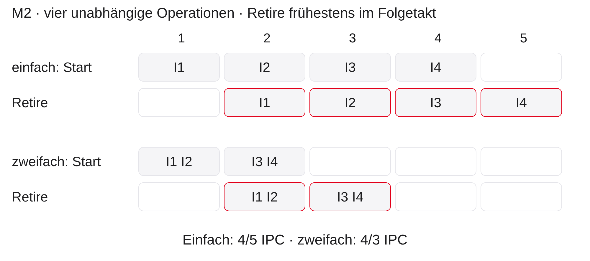{fig-alt="M2 vergleicht vier unabhängige Ein-Takt-Operationen. Ein Start und ein Retire je Takt benötigen fünf Takte, zwei Starts und zwei Retires drei."}

M2: Ergebnis am Starttaktende, Retire frühestens im Folgetakt.

::: notes
Der nächste Vergleich hält die Arbeit unabhängig und verändert nur die angegebene Breite.

IPC bedeutet Instructions Per Cycle, bestätigte Befehle pro Takt. Issue ist der Start, Retire oder Commit die endgültige Bestätigung. M2 ist bewusst nicht die Fünf-Stufen-Pipeline M1. Alle vier Befehle sind zu Beginn bereit, haben keine gegenseitige Abhängigkeit und benötigen je einen Rechentakt. Bestätigung erfolgt frühestens im nächsten Takt.

Im skalaren Vergleich starten I1 bis I4 in eins bis vier und werden in zwei bis fünf bestätigt. Das betrachtete Fenster umfasst fünf Takte, also $4/5=0{,}8$ IPC. In der zweifachen Variante starten die Paare I1/I2 in eins und I3/I4 in zwei. Ihre Bestätigung folgt in zwei beziehungsweise drei, insgesamt $4/3\approx1{,}333$ IPC.

Die waagerechte Richtung zählt Takte. Graue Markierungen sind Starts, rote Bestätigungen; beide Bahnen zählen dieselben vier Befehle. Zwei Bestätigungen in einem einzelnen Takt erlauben daher nicht, das ganze kurze Fenster als IPC zwei zu bezeichnen. Startbreite, Bestätigungsbreite und Fenstergrenzen sind eigene Angaben. Der Vergleich isoliert diese Breiten, statt mit einem anderen Pipelineaufbau eine scheinbare Beschleunigung zu erzeugen.
:::

## Latenz und Initiationsintervall sind verschieden

::: {.section-label}
2 / 5 · Breite und Abhängigkeiten
:::

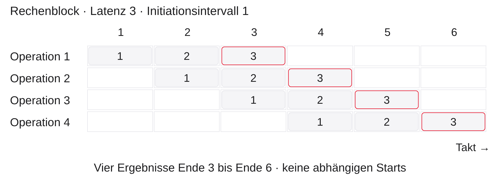{fig-alt="Vier unabhängige Operationen beginnen in Takten eins bis vier und belegen jeweils drei interne Rechenphasen. Ergebnisse entstehen an den Enden von drei bis sechs."}

Lehrblock: Latenz $3$ Takte, neuer Start alle $1$ Takt.

::: notes
Startkapazität und die Wartezeit auf ein Ergebnis bleiben auch innerhalb einer Einheit verschiedene Größen.

Latenz ist hier die Zeit vom Operationsstart am Taktbeginn bis zur Fertigstellung am Ende der dritten Phase: drei Takte. Das Initiationsintervall ist der Mindestabstand aufeinanderfolgender Starts. Ein vollständig pipelinierter Rechenblock kann ein Intervall von einem Takt besitzen, obwohl jedes einzelne Ergebnis erst später fertig wird.

Die Grafik liest sich zeilenweise von links nach rechts. Vier unabhängige Operationen starten in eins, zwei, drei und vier. Ihre drei grauen Rechenphasen enden in drei, vier, fünf und sechs; rot ist jeweils das Ergebnisende. Ein abhängiger Verbraucher könnte das erste Resultat im Modell erst ab Takt vier nutzen.

Nach dem Füllen entsteht ein Ergebnis pro Takt, nicht nur alle drei Takte. Das ist keine Garantie für eine Kette abhängiger Multiplikationen. RISC in RISC-V heißt Reduced Instruction Set Computer. Ein Maschinenbefehl `mul` braucht dort eine passende Multiplikationserweiterung, nicht nur die RV32I-Integerbasis. Die Zeichnung ist deshalb als abstrakter Rechenblock bezeichnet. Durchsatz, Einzelwartezeit und vorhandener Befehlssatz sind verschiedene Voraussetzungen einer tatsächlichen Ausführung.
:::

## Fetch-Bytes sind keine feste Befehlszahl

::: {.section-label}
2 / 5 · Breite und Abhängigkeiten
:::

- $16$ vollständig ausgerichtete Bytes: vier 32-Bit-Befehle
- Mit nur 16-Bit-Befehlen wären es acht
- Mischungen und Grenzen verändern die Aufteilung
- Decode-, Issue- und Retire-Breite bleiben getrennte Limits

::: notes
Schon vor der Ausführung kann die Lieferung und Entschlüsselung neuer Befehle einen Engpass bilden.

Fetch bedeutet Befehlsholen, Decode dessen Entschlüsselung, Issue Start in einer ausgewählten Einheit und Retire endgültige Bestätigung. Die Bytezahl eines Fetchpakets ist deshalb keine automatische Anzahl pro Takt bestätigter Befehle.

RISC-V ist die Befehlssatzfamilie; RISC bedeutet Reduced Instruction Set Computer. Im Grundmodell RV32I sind die betrachteten Befehle zweiunddreißig Bit oder vier Bytes breit. Ein passend an vollständigen Befehlen beginnender sechzehn-Byte-Abschnitt enthält dann vier Stück. Die optionale C-Erweiterung unterstützt komprimierte Befehle mit sechzehn Bit, also zwei Bytes; bei ausschließlich solchen Befehlen wären es acht. C bezeichnet hier eine Befehlssatzerweiterung, nicht die Programmiersprache.

Mischungen, Fetchgrenzen, Sprungziele und fehlende Cacheblöcke können die tatsächliche Lieferung verändern. Selbst acht geholte Befehle werden bei einer Decode-Breite von drei nicht sofort alle dekodiert. Ein früher Puffer kann unterschiedliche Breiten kurzzeitig entkoppeln, aber den langsamsten dauerhaften Abschnitt nicht unbegrenzt überholen. Die bereits betrachtete Bestätigungsgrenze begründet dieselbe Sicht auf endliche Puffer: Ein langsamer Abfluss lässt sich nicht unbegrenzt durch Vorrat davor ausgleichen. Als nächste Frage bleibt, welche bereiten Befehle überhaupt ausgewählt werden dürfen.
:::

## 3 · Vorziehen und geordnet bestätigen {.section-divider}

Wie bleibt die Programmwirkung richtig, wenn intern anders gerechnet wird?

Auswahl → Registerversionen → Bestätigung

::: notes
Breite beantwortet die Frage, wie viel Arbeit im selben Takt beginnen kann. Eine davon getrennte Frage betrifft die Auswahlreihenfolge: Muss der Kern beim nächsten wartenden Befehl stehen bleiben, oder darf er jüngere bereite Arbeit vorziehen? Diese zweite Entscheidung führt zur Out-of-Order-Ausführung.

Ein vorgezogener Befehl darf dabei keinen falschen Wert lesen und einen älteren Leser nicht durch eine neue Registerversion stören. Registerumbenennung bindet deshalb Quellen an die passenden Versionen. Die spätere endgültige Bestätigung folgt weiterhin einer kontrollierten Programmordnung. So kann ein Fehlerzustand zu einer gültigen Stelle im Programm gehören, obwohl intern bereits weitere Rechnungen fertig geworden sind.

Der Abschnitt vergleicht zwei vollständig festgelegte Zeitpläne und erläutert die dafür notwendige Verwaltung. Rechnen, Fertigwerden, Bestätigen und externes Sichtbarwerden einer Speicherwirkung werden bewusst unterschieden. Diese Trennung verbindet die internen Zeitmodelle mit den bereits bekannten Interrupts, Exceptions und Cachezuständen.
:::

## Breite und Auswahlreihenfolge sind zwei Achsen

::: {.section-label}
3 / 5 · Reihenfolge und Bestätigung
:::

| | Startbreite eins | Startbreite größer eins |
|---|---|---|
| Programmreihenfolge beibehalten | skalar, In-Order | superskalar, In-Order |
| jüngere bereite Arbeit vorziehen | skalar, Out-of-Order | superskalar, Out-of-Order |

Breiter starten und früher andere Arbeit auswählen sind verschiedene Entscheidungen.

::: notes
Die bisherigen Beispiele änderten die Zahl möglicher gleichzeitiger Starts. Nun kommt die Frage hinzu, welcher Kandidat ausgewählt werden darf. In-Order bedeutet in unserem Auswahlmodell, dass die Programmreihenfolge den nächsten möglichen Start festlegt. Wartet dieser Befehl, kann auch ein jüngerer unabhängiger Kandidat aufgehalten werden.

Out-of-Order erlaubt dagegen, einen jüngeren bereiten Kandidaten zu wählen, sofern Abhängigkeiten, Ressourcen und die erforderliche Verwaltung dies zulassen. Dafür genügt bereits eine Startbreite von eins. Der Kern kann beispielsweise in einem Takt eine unabhängige Addition beginnen, während ein älterer Load noch auf Daten wartet. Er muss nicht zwei Starts im selben Takt ausführen, um die Reihenfolge zu verändern.

Die vier Tabellenfelder sind daher logisch verschiedene Kombinationen. Sie beschreiben Möglichkeiten, nicht vier vermessene Prozessoren oder eine automatische Rangliste. Im folgenden M3-Vergleich bleibt die Startbreite ausdrücklich eins; nur die Auswahlreihenfolge ändert sich. Damit ist er von den kurzen M2-Breitenvergleichen getrennt. Geordnete endgültige Bestätigung bleibt eine zusätzliche Anforderung, auch wenn die Startreihenfolge intern verändert wird.
:::

## Out-of-Order ändert die Startreihenfolge

::: {.section-label}
3 / 5 · Reihenfolge und Bestätigung
:::

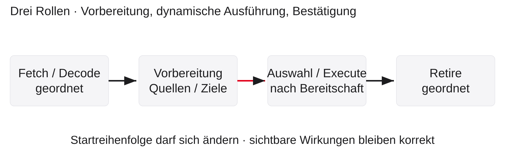{fig-alt="Befehle werden geordnet geholt und vorbereitet, anschließend nach Bereitschaft ausgeführt und zuletzt wieder in Programmordnung bestätigt."}

Ein Kern mit Issue-Breite eins kann bereits Out-of-Order arbeiten.

::: notes
Nun wird bei unveränderter Startbreite die Auswahl selbst betrachtet.

OoO bedeutet Out-of-Order Execution, Ausführung außerhalb der ursprünglichen Reihenfolge. CPU heißt Central Processing Unit. Gemeint ist hier, dass ein jüngerer bereiter Befehl seine Operation starten darf, obwohl ein älterer auf einen Operanden wartet. Die Hardware bleibt getaktet; „außerhalb der Reihenfolge“ bedeutet nicht asynchron ohne Takt.

Die Grafik trennt drei Aufgaben. Links werden der vorhergesagte Befehlsstrom geholt, dekodiert und vorbereitet; Fetch heißt Holen und Decode Dekodieren. Execute heißt Ausführen. Die mittlere Auswahl darf nach Datenbereitschaft und Ressourcen entscheiden. Rechts werden endgültige Wirkungen wieder in Programmordnung bestätigt. Rote Pfeile heben die veränderte Auswahl hervor, schwarze die geordnete Weitergabe. Das Modell braucht dafür Zustand über mehrere noch nicht bestätigte Befehle.

Breite und Reihenfolge sind unabhängig: Ein Start je Takt kann jüngere Arbeit vorziehen, und mehrere Starts je Takt können trotzdem streng den nächsten Programmplatz verlangen. Out-of-Order überlappt verfügbare Arbeit mit Wartezeit; es entfernt keine benötigten Werte. Damit ältere und jüngere Namensversionen nicht verwechselt werden, wird vor der Auswahl zunächst die Registerabbildung festgelegt.
:::

## Architekturregister und physische Versionen

::: {.section-label}
3 / 5 · Reihenfolge und Bestätigung
:::

- RV32I: $32$ sichtbare Integernamen; `x0` ist fest null
- Physische Register speichern interne Versionen
- Eine Abbildung verbindet Namen und aktuelle Version
- Mehr interne Plätze ändern den sichtbaren Befehlssatz nicht

::: notes
Eine veränderte Auswahl setzt voraus, dass ältere und jüngere Registerwerte unterscheidbar bleiben.

ISA heißt Instruction Set Architecture, Befehlssatzarchitektur. RISC in RISC-V bedeutet Reduced Instruction Set Computer. RV32I bezeichnet deren Zweiunddreißig-Bit-Integerbasis mit zweiunddreißig Registernamen. Einunddreißig sind beschreibbar, `x0` ist die feste Null. Die Bitbreite im Namen ist nicht die Registeranzahl.

Ein architektonischer Name wie `t0` benennt den Wert, den ein Programm an einer gültigen Grenze sehen soll. Ein physisches Register ist ein interner Speicherplatz für eine bestimmte Version. Eine Umsetzung kann mehr solche Plätze als sichtbare Namen besitzen. Eine universelle Mindestzahl, etwa über hundert, wird daraus nicht abgeleitet.

Renaming heißt Registerumbenennung. Statt einen alten Platz sofort zu überschreiben, reserviert ein jüngerer Schreiber einen anderen. Quellen erhalten beim Vorbereiten die passenden bisherigen Versionskennungen. Die spekulative aktuelle Abbildung und der bereits bestätigte Programmzustand sind dabei nicht zwangsläufig identisch. Befehle ohne Registerziel und die feste Null benötigen kein gewöhnliches neues Ziel. Der nächste konkrete Ablauf zeigt, warum Quellen vor dem Aktualisieren ihrer Zielabbildung festgehalten werden.
:::

## Renaming: Quellen festhalten, neues Ziel vergeben

::: {.section-label}
3 / 5 · Reihenfolge und Bestätigung
:::

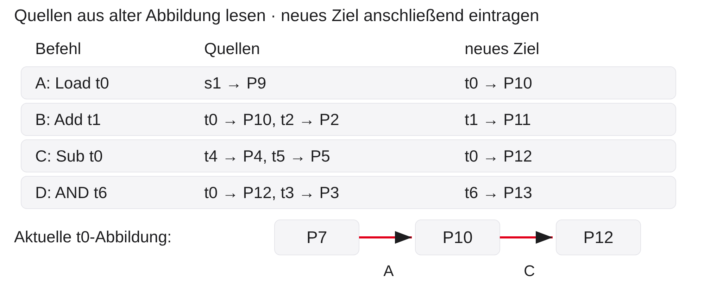{fig-alt="A bis D erhalten Ziele P10 bis P13. B liest die von A erzeugte Quelle P10, D die von C erzeugte Quelle P12; t0 wird zunächst P10 und danach P12 zugeordnet."}

Start: `t0` $\mapsto$ P7; freie Ziele P10, P11, P12, P13.

::: notes
Die Registerversionen lassen sich für die vollständige Folge A bis D schrittweise festhalten.

Renaming ist die Registerumbenennung auf physische Versionen. Die Kennung P mit Zahl bezeichnet hier einen physischen Platz, keinen weiteren architektonischen Registerbefehl. Die Folge A bis D ist das Namensbeispiel: A lädt `t0`, B addiert nach `t1`, C subtrahiert nach `t0` und D verknüpft nach `t6`. Die übrigen Quellen besitzen bereits feste Abbildungen: `s1` auf P9, `t2` auf P2, `t3` auf P3, `t4` auf P4 und `t5` auf P5. Add heißt Addition, Sub Subtraktion, Load Laden und AND bitweises Und.

Die grauen Zeilen folgen von oben nach unten der Programmreihenfolge. A erhält P10. B hält als Quelle P10 fest und erhält P11 als Ziel. C erhält P12; die aktuelle Abbildung für `t0` wandert damit zu P12. D liest diese neue Quelle P12 und erhält P13. Der rote Versionsweg unten zeigt `t0` von P7 über P10 zu P12.

Quellen werden jeweils aus der zum Programmplatz passenden Abbildung gelesen, bevor das neue Ziel eingetragen wird. B behält P10 auch dann, wenn C inzwischen vorbereitet ist. RAW, Read After Write, bleibt deshalb als echte Quelle-Ziel-Abhängigkeit bestehen. WAR, Write After Read, und WAW, Write After Write, kollidieren nicht mehr auf einem einzigen Speicherplatz. Die verschiedenen Versionen müssen allerdings lange genug erhalten bleiben.
:::

## Die aktuelle Abbildung ersetzt keinen alten Quelltag

::: {.section-label}
3 / 5 · Reihenfolge und Bestätigung
:::

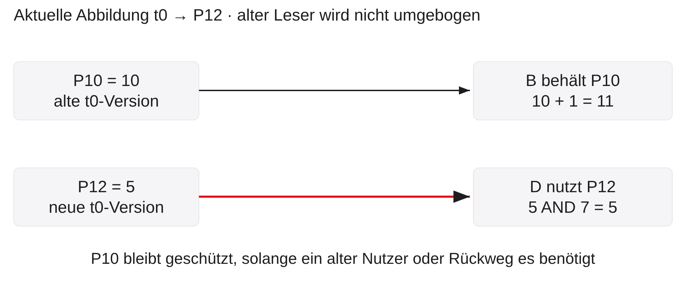{fig-alt="B behält Quelle P10 mit dem Loadwert zehn, obwohl die neuere Abbildung t0 bereits auf P12 mit fünf zeigt. D liest P12. Beide Leser erhalten verschiedene richtige Versionen."}

B berechnet $10+1=11$; D berechnet $5\ \mathrm{AND}\ 7=5$.

::: notes
Die gespeicherte Quellenkennung muss anschließend für den gesamten wartenden Leser gelten.

Ein Tag ist hier eine Kennung eines physischen Registers. PRF bedeutet Physical Register File, physische Registerdatei. Sie speichert im gewählten Modell die Zahlenwerte verschiedener noch benötigter Versionen. Die aktuelle spekulative Abbildung von `t0` kann schon P12 nennen, während ein älterer Leser B weiterhin P10 benötigt.

Die Abbildung zeigt links diese beiden Plätze und rechts die zugehörigen Verbraucher. Schwarze Pfeile verbinden P10 mit B, rote P12 mit D. A liefert später zehn nach P10; C hat fünf nach P12 geschrieben. B erhält deshalb elf, D mit seiner anderen Quelle `t3 = 7` den Wert fünf. AND bedeutet bitweises Und: Nur Stellen mit einer Eins in beiden Operanden bleiben eins.

Ein Versionswechsel gibt P10 nicht sofort zur Wiederverwendung frei. In einem üblichen Modell kann die durch einen Schreiber ersetzte alte Version erst bei seiner geordneten Bestätigung und nach gesicherter Lebensdauer freigegeben werden. Ein Fehlerpfad muss ebenfalls die gültige Abbildung wiederherstellen können. Renaming löst den Namenskonflikt durch zusätzliche Plätze und Verwaltung, nicht durch Ignorieren älterer Leser.
:::

## Bereit heißt noch nicht ausgewählt

::: {.section-label}
3 / 5 · Reihenfolge und Bestätigung
:::

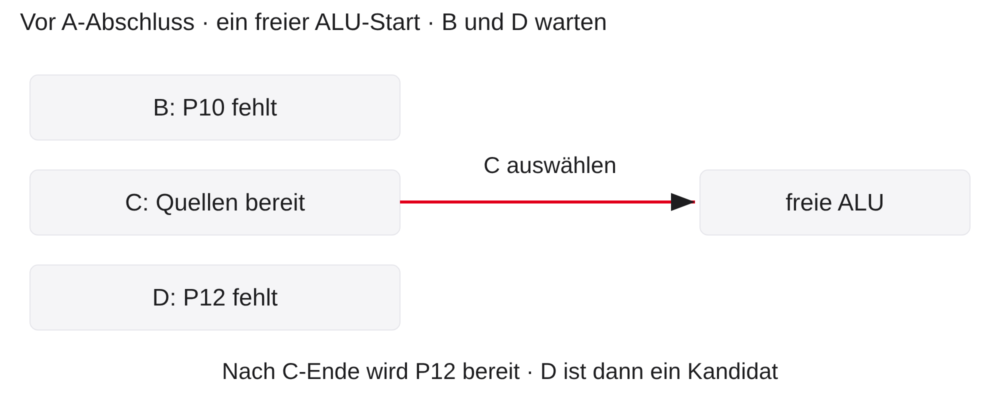{fig-alt="Eine Issue-Queue enthält B mit fehlendem P10, C mit bereiten Quellen und D mit fehlendem P12. Ein Scheduler wählt C für die freie ALU; nach dessen Ende kann D bereit werden."}

Operanden, freie Einheit, Port und Startbudget gemeinsam prüfen.

::: notes
Eine gültige Version kann dennoch auf ihre Auswahl warten, wenn andere Ressourcen bereits belegt sind.

Eine Issue Queue ist ein Auswahlpuffer für vorbereitete Operationen; verteilte Reservation Stations, Reservierungsstationen, sind eine mögliche andere Anordnung. ALU bedeutet Arithmetic Logic Unit, arithmetisch-logische Einheit. Der Scheduler ist die Auswahlhardware. Er berücksichtigt Operandenbereitschaft und verfügbare Startmöglichkeiten.

Im Bild wartet B auf P10 aus dem langsamen Load. C hat beide Quellen und kann in die einzelne freie ALU starten. D braucht P12, also das Ergebnis von C, und wird erst nach dessen Fertigstellung bereit. Der rote Auswahlpfeil führt nach rechts zur freien Ausführungseinheit. Graue Zeilen mit fehlender Quelle sind keine sofort ausführbaren Kandidaten.

Wenn C fertig wird, markiert die Umsetzung seinen Zieltag bereit. Ein Nutzer kann den Wert aus der physischen Datei oder über einen Bypass erhalten. Diese Weckinformation ist noch keine Garantie, dass alle Nutzer im selben Takt starten; ein Port oder das Issue-Budget kann belegt sein. Die Zeichnung behauptet keinen einzelnen universellen Datenbus für jede Architektur. Für einen vollständigen Zeitvergleich werden jetzt Breiten, Latenzen und die Bestätigungsregel ausdrücklich festgelegt.
:::

## Ein festes Modell für den Reihenfolgevergleich

::: {.section-label}
3 / 5 · Reihenfolge und Bestätigung
:::

M3 beginnt beim ersten Issue; A–D sind bereits dekodiert und umbenannt.

| Eigenschaft | Lehrannahme |
|-------------|-------------|
| Issue | maximal $1$ je Takt |
| Einheiten | eine ALU, eine LSU |
| A: Load | Ergebnis Ende Takt $4$ |
| übrige Operationen | Ergebnis Ende ihres Starttakts |
| Retire | maximal $2$, geordnet, frühestens im Folgetakt |

::: notes
Befehlsbreite und Startreihenfolge sind unabhängige Eigenschaften. Um nur den Nutzen einer anderen Startreihenfolge zu untersuchen, verwendet das dritte Lehrmodell, M3, weiterhin höchstens einen Start pro Takt. Issue bezeichnet diesen Start, Retire die endgültige Bestätigung. Als Recheneinheiten stehen eine ALU, Arithmetic Logic Unit oder arithmetisch-logische Einheit, und eine LSU, Load/Store Unit oder Lade-/Speichereinheit, bereit. Ein breiterer Kern wird mit diesem Modell nicht unterstellt.

Die bekannte Programmfolge besteht aus A, einem Load nach `t0`, B, einer davon abhängigen Addition nach `t1`, C, einer Subtraktion nach einer neuen `t0`-Version, und D, einem bitweisen Und nach `t6`. Durch Renaming sind die beiden Versionen von `t0` getrennt. A muss deshalb nicht abgewartet werden, um C zu berechnen; B bleibt trotzdem an den Wert aus A gebunden.

Das Zeitfenster beginnt beim ersten Issue. Vor Takt eins sind alle vier Befehle bereits dekodiert, umbenannt und zur Auswahl aufgenommen. A startet in Takt eins und liefert wegen der angenommenen Speicherwartezeit sein Ergebnis erst am Ende von Takt vier. Ein ALU-Ergebnis liegt jeweils am Ende seines Starttakts vor; ein abhängiger Nutzer kann frühestens im nächsten Takt starten. Retire bestätigt höchstens zwei Befehle je Takt, frühestens im Folgetakt ihrer Fertigstellung und stets nach allen älteren Befehlen.

Beide Vergleichsvarianten besitzen genau diese Ressourcen und Latenzen. In-Order darf den blockierten nächsten Befehl nicht überspringen, Out-of-Order darf einen jüngeren bereiten Befehl auswählen. Die gemeinsame Vorbereitung vor dem ersten Start wird nicht mitgezählt. Damit ist die folgende Differenz eine Aussage über dieses begrenzte Fenster, nicht über die vollständige Laufzeit einer Anwendung auf einem beliebigen Prozessor.
:::

## In-Order: B blockiert die jüngeren Starts

::: {.section-label}
3 / 5 · Reihenfolge und Bestätigung
:::

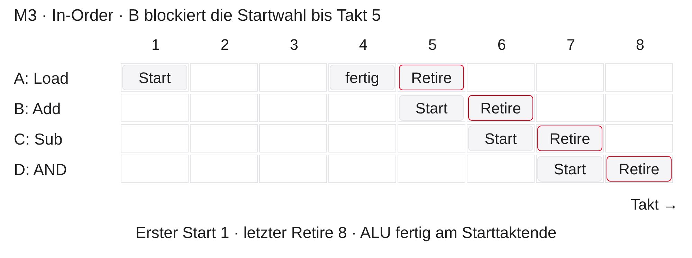{fig-alt="M3: A startet in eins, B wartet bis fünf, C startet in sechs und D in sieben. Retire erfolgt für A in fünf, B in sechs, C in sieben und D in acht."}

Fenster: erster Start in Takt $1$ bis letzter Retire in Takt $8$.

::: notes
In-Order Issue startet streng nach der Programmfolge. Für M3 bedeutet das: Nach dem Load A muss zunächst die Addition B ausgewählt werden. B benötigt jedoch den von A erzeugten Wert. Dass C unabhängig davon rechnen könnte, hilft in dieser Variante nicht, weil die Auswahl den älteren blockierten Befehl nicht überspringt.

A startet in Takt eins und liefert seinen Wert erst am Ende von Takt vier. In den Takten zwei, drei und vier entsteht deshalb kein weiterer Start. B beginnt in fünf, C in sechs und D in sieben. Die ALU, Arithmetic Logic Unit, liefert das Ergebnis jeweils am Ende des Starttakts. Die LSU, Load/Store Unit, übernimmt den Load. Das Addieren heißt im Befehl Add, die Subtraktion Sub und das bitweise Und AND.

Retire, die geordnete endgültige Bestätigung, darf im Modell frühestens im Folgetakt der Fertigstellung erfolgen. A wird deshalb in fünf bestätigt, B in sechs, C in sieben und D in acht. Die Möglichkeit von höchstens zwei Bestätigungen je Takt verkürzt diese Folge nicht, weil die Befehle hier erst nacheinander bereit werden.

Im Diagramm stehen Programmzeilen senkrecht und Takte waagerecht. Startflächen, Bereitschaftsmarken und rot umrandete Retiremarken kennzeichnen verschiedene Ereignisse. Gestrichelte Warteabschnitte sind keine zusätzlichen Befehle. Das Fenster vom ersten Start bis zum letzten Retire umfasst acht Takte. Die Werte bleiben korrekt: B erzeugt elf, C die jüngere `t0`-Version fünf und D ebenfalls fünf. Verloren geht hier keine Korrektheit, sondern eine Gelegenheit, vorhandene Wartezeit mit unabhängiger Arbeit zu überlappen.
:::

## Out-of-Order: C und D nutzen die Wartezeit

::: {.section-label}
3 / 5 · Reihenfolge und Bestätigung
:::

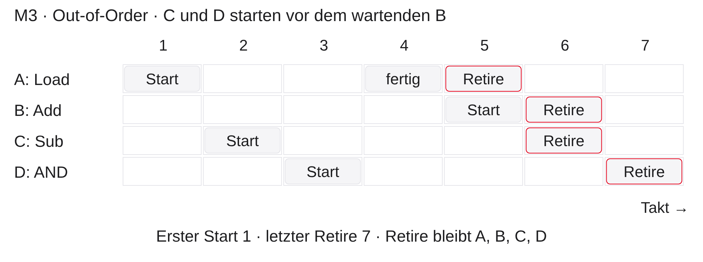{fig-alt="M3: A startet in eins, C in zwei, D in drei und B erst in fünf. Geordnetes Retire erfolgt A in fünf, B und C in sechs sowie D in sieben."}

Startreihenfolge A, C, D, B; Bestätigung A, B, C, D.

::: notes
Die Out-of-Order-Variante, kurz OoO, verändert gegenüber dem vorherigen Ablauf nur die Auswahlreihenfolge. M3 besitzt weiterhin eine ALU, Arithmetic Logic Unit, eine LSU, Load/Store Unit, und höchstens einen Issue pro Takt. Zusätzliche Starts im selben Takt erklären den Gewinn daher nicht. Die Hardware verwendet stattdessen bereits vorhandene, jüngere und bereite Arbeit.

A startet wieder in Takt eins. C benötigt den noch fehlenden Loadwert nicht und kann in Takt zwei beginnen. Sein Ziel ist die eigene physische Registerversion P12; das Ergebnis fünf liegt am Taktende vor. D verwendet diese Version ab Takt drei und verknüpft sie durch AND, bitweises Und, mit `t3 = 7`. Sein Ergebnis ist ebenfalls fünf. B bleibt unverändert an P10, die Ergebnisversion von A, gebunden und startet erst in Takt fünf. In Takt vier gibt es keinen weiteren Start.

Die echten RAW-Abhängigkeiten, Read After Write, bleiben somit A nach B und C nach D. Die Startreihenfolge lautet A, C, D, B. Bei Retire bleibt dagegen die Programmfolge A, B, C, D erhalten: A wird in fünf bestätigt, B und C gemeinsam in sechs, D in sieben. Frühe Fertigstellung erlaubt C und D nicht, B bei dieser endgültigen Bestätigung zu überholen.

Die Diagrammzeilen behalten ihre ursprüngliche Programmordnung; daran wird das Vorziehen gegenüber der waagerechten Taktskala sichtbar. Die roten Retiremarken zeigen die getrennte Bestätigungsregel. Der langsame Load ist nicht schneller geworden und sein Miss nicht verschwunden. Seine Wartezeit wurde teilweise genutzt; das definierte Fenster endet dadurch einen Takt früher.
:::

## Die Bilanz hängt am ganzen Fenster

::: {.section-label}
3 / 5 · Reihenfolge und Bestätigung
:::

| M3-Variante | Takte | IPC | CPI |
|-------------|-------|-----|-----|
| In-Order | $8$ | $4/8=0{,}5$ | $8/4=2$ |
| Out-of-Order | $7$ | $4/7\approx0{,}571$ | $7/4=1{,}75$ |

Zeitreduktion: $1-7/8=12{,}5\,\%$.

Beschleunigungsfaktor: $8/7\approx1{,}143$.

::: notes
Eine Leistungsaussage benötigt zuerst eine festgelegte Zählbasis. In beiden M3-Abläufen werden dieselben vier Befehle erfolgreich bestätigt. Für In-Order umfasst das betrachtete Fenster acht Takte, für Out-of-Order sieben. IPC, Instructions Per Cycle, ergibt sich daher zu $4/8=0{,}5$ beziehungsweise $4/7\approx0{,}571$. CPI, Cycles Per Instruction, beträgt umgekehrt $8/4=2$ beziehungsweise $7/4=1{,}75$. Die Kehrwertbeziehung gilt hier, weil dieselben Befehle und jeweils dasselbe Zeitfenster verwendet werden.

Bei unveränderter Taktfrequenz dauert das neue Fenster sieben Achtel so lange wie das alte. Die Zeitreduktion ist deshalb $1-7/8=12{,}5\,\%$. Der Beschleunigungsfaktor verwendet eine andere Bezugsgröße: alte Zeit geteilt durch neue Zeit, also $8/7\approx1{,}143$. Eine um rund $14{,}3\,\%$ erhöhte Rate und eine um $12{,}5\,\%$ verkürzte Zeit sind miteinander vereinbar.

Zwei Retires in Takt sechs bedeuten nicht IPC zwei für das gesamte Fenster. Ebenso wenig ist M3 mit dem zuvor betrachteten Breitenmodell mit zwei ALUs gleichzusetzen. Es besitzt nur eine arithmetisch-logische Einheit und einen Startplatz je Takt; der Vergleich isoliert die Reihenfolge, nicht die Superskalarbreite.

Fetch, Dekodierung und Renaming vor dem ersten Start sind ausgeblendet. Aus der kleinen Differenz folgt daher keine gemessene Beschleunigung einer vollständigen Anwendung. Offen bleibt zunächst, wie frühe interne Ergebnisse verwaltet werden, ohne den sichtbaren Programmzustand in eine unzulässige Reihenfolge zu bringen. Diese Aufgabe verbindet den Zeitplan mit der geordneten Bestätigung.
:::

## Der ROB verwaltet Ordnung und Status

::: {.section-label}
3 / 5 · Reihenfolge und Bestätigung
:::

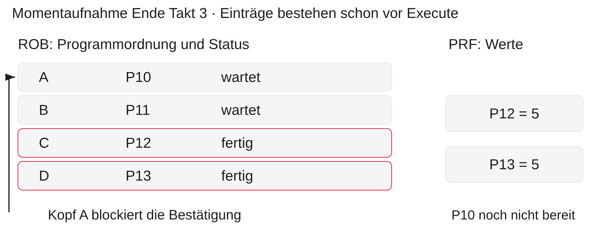{fig-alt="Am Ende von Takt drei stehen A und B noch nicht bereit, C und D sind fertig. Der ROB hält Reihenfolge und Status, während die Zahlenwerte fünf in P12 und P13 der physischen Registerdatei stehen."}

Lehrmodell: Zahlenwerte in der PRF, Status und Reihenfolge im ROB.

::: notes
Out-of-Order-Ausführung benötigt eine Verwaltung, die interne Fertigstellung von endgültiger Bestätigung trennt. Im betrachteten Modell hält der ROB, Reorder Buffer oder Ordnungspuffer, unter anderem die Programmfolge, Zielversionen, Fertigstatus und mögliche Exceptions fest. Berechnete Zahlenwerte liegen dagegen in der PRF, Physical Register File oder physischen Registerdatei. Diese Aufteilung ist eine Modellentscheidung und nicht die einzig mögliche Organisation eines Prozessors.

Ein ROB-Eintrag entsteht bereits bei der geordneten Aufnahme eines Befehls. Er wartet dort während der Auswahl und Ausführung, nicht erst nach deren Abschluss. Am Ende von Takt drei in M3 stehen die Einträge weiterhin in der Reihenfolge A, B, C, D. A wartet auf den Speicher, B auf A. C und D sind bereits fertig; ihre Werte fünf liegen in P12 beziehungsweise P13. Die roten Bereitschaftsmarken bedeuten dennoch keine erlaubte Bestätigung über den älteren A hinweg.

Maßgeblich ist der Bestätigungskopf, der älteste noch offene Eintrag. Erst wenn dessen erfolgreiche Ausführung feststeht, darf die Bestätigung an dieser Stelle weitergehen. So können intern weit vorgezogene Ergebnisse noch unbestätigt bleiben. Die Anordnung links und die Werte rechts in der Abbildung stellen deshalb verschiedene Zustände derselben Programmfolge dar.

Hier ist ein ROB-Eintrag je Beispielbefehl vorgegeben. Ein realer Kern kann mehrere interne Operationen je ISA-Befehl verwenden; ISA bedeutet Instruction Set Architecture, die Befehlssatzarchitektur. Entscheidend ist nicht eine universelle Tabellenform, sondern der erhaltene Unterschied zwischen einem bereits berechneten internen Wert und seiner architektonisch bestätigten Wirkung. Daraus lässt sich als Nächstes der Umgang mit einer Exception erklären.
:::

## Eine Exception bestätigt kein jüngeres Ergebnis

::: {.section-label}
3 / 5 · Reihenfolge und Bestätigung
:::

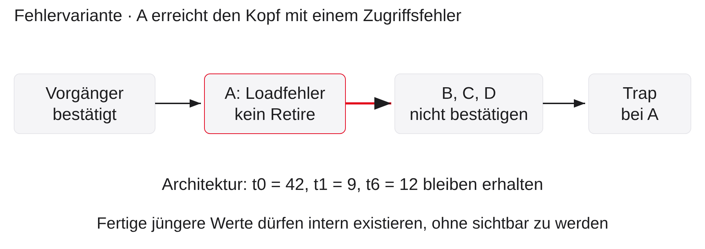{fig-alt="Variante: A meldet einen Load-Zugriffsfehler. Bereits bestätigte Vorgänger bleiben erhalten, A sowie B, C und D erhalten keine normalen bestätigten Wirkungen."}

Fehlervariante von M3: A lädt aus einem nicht erlaubten Bereich.

::: notes
Eine präzise Exception ordnet einen Fehler einem bestimmten Befehl zu und erhält einen dazu passenden sichtbaren Zustand. In der Fehlervariante von M3 meldet der Load A einen Zugriffsfehler, statt den zuvor angenommenen Speicherwert zehn zu liefern. Die normale Wirkung dieses Loads darf deshalb nicht bestätigt werden. Ein gewöhnliches RV32I-`add` würde dagegen keinen Integerüberlauf-Trap auslösen. RV32I ist die Zweiunddreißig-Bit-Integerbasis der RISC-V-Befehlssatzfamilie; RISC steht für Reduced Instruction Set Computer.

Der ROB, Reorder Buffer, erlaubt C und D durchaus, intern früh den Wert fünf zu berechnen. Sobald jedoch der älteste fehlerhafte A behandelt wird, werden weder seine normale Wirkung noch die jüngeren normalen Wirkungen von B, C und D bestätigt. Vor A erfolgreich bestätigte Vorgänger bleiben gültig. Der Zustand der Trapbehandlung entspricht dadurch einer klaren Grenze in der Programmfolge.

Bei anfänglich `t0 = 42`, `t1 = 9` und `t6 = 12` bleiben diese architektonischen Registerwerte erhalten. Die intern fertigen physischen Versionen aus C und D belegen nicht, dass das Programm ihre Werte schon als gültiges Ergebnis gesehen hätte. Die Exceptioninformation benennt den Load A; sie wird nicht willkürlich an eine gerade zuletzt fertig gewordene Operation angehängt.

Die Abbildung ordnet von links nach rechts bestätigte Vorgänger, die Fehlerstelle und den verworfenen jüngeren Bereich. Rot markiert den Fehler und die unterbundene Bestätigung. Gemeint ist keine pauschale Löschung des gesamten Speichers oder früherer korrekter Arbeit. Damit bleibt die bekannte Trap-Grundidee auch bei intern überlappender und vorgezogener Ausführung erhalten.
:::

## Interrupt und Exception brauchen verschiedene Grenzen

::: {.section-label}
3 / 5 · Reihenfolge und Bestätigung
:::

| Ereignis | Zuordnung |
|----------|-----------|
| Exception | zu einem bestimmten fehlerhaften Befehl |
| Interrupt | externe Anforderung, Annahme an zulässiger Grenze |

Ein gültiger Zustand ist ein bestätigter Programmanfang, kein Gemisch beliebiger Fertigstellungen.

::: notes
Die aus dem Trap-Pfad bekannte Unterscheidung zwischen Interrupt und Exception gilt auch in einem intern parallelen Kern. Eine synchrone Exception gehört zu einem bestimmten Befehl, etwa dem fehlgeschlagenen Load A. Ein Interrupt ist dagegen eine asynchrone Anforderung, beispielsweise von einer Peripherie. Er muss an einer durch die Architektur und Implementierung zulässigen Grenze angenommen werden, statt einer zufällig zuletzt abgeschlossenen internen Operation zugeordnet zu werden.

Ein präziser Grenzzustand entspricht hier einem vollständig bestätigten Anfang der Programmfolge. In der erfolgreichen M3-Ausführung könnte eine vereinbarte Grenze nach A den Wert `t0 = 10` enthalten, während B und die jüngeren Wirkungen noch nicht bestätigt sind. Nicht jede interne Fertigstellung erzeugt sofort eine solche Annahmegrenze. Welche Grenzen tatsächlich genutzt werden, bestimmt die jeweilige Hardware.

Eine Exception an A verlangt einen anderen Schnitt: A erhält keine normale bestätigte Wirkung, und auch die jüngeren Befehle bleiben unbestätigt. Bereits früher bestätigte Arbeit wird in keinem der beiden Fälle pauschal zurückgesetzt. Ein Interrupt ist insbesondere kein automatischer Systemreset und setzt auch eine extern versorgte Peripherie nicht zwangsläufig zurück.

Die Wiederaufnahme benötigt weiterhin eine zur Ursache passende gespeicherte Adresse und Verwaltungsinformation. Geordnetes Retire, die endgültige Bestätigung, hilft dabei, einen gültigen Programmanfang zu erhalten. Es legt aber nicht allein fest, wann jede Speicherwirkung für andere Beobachter sichtbar wird. Diese zusätzliche Unterscheidung ist besonders bei Stores erforderlich.
:::

## Ein Store hat mehr als einen Abschlusszeitpunkt

::: {.section-label}
3 / 5 · Reihenfolge und Bestätigung
:::

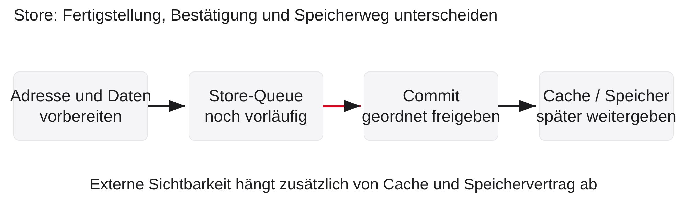{fig-alt="Eine Store-Operation berechnet Adresse und Daten, wartet in einer Queue, wird geordnet bestätigt und gelangt erst über den freigegebenen Speicherpfad zur Cache- oder Speicherebene."}

Bestätigen, zum Speicherpfad weitergeben und extern sichtbar werden unterscheiden.

::: notes
Ein Store schreibt Daten an eine Adresse. Intern können seine Adresse und sein Datenwert bereits bereitliegen, obwohl noch nicht feststeht, ob der Befehl zum richtigen Programmweg gehört und ohne ältere Exception bestätigt werden darf. Die LSU, Load/Store Unit oder Lade-/Speichereinheit, kann diese vorbereiteten Informationen deshalb zunächst in einer Queue, einem Puffer, halten.

Die Abbildung führt von der Vorbereitung über die Warteschlange zur geordneten Freigabe nach erfolgreichem Commit. Commit bezeichnet hier wie Retire die endgültige Bestätigung. Erst anschließend wird der Eintrag auf den freigegebenen Speicherpfad weitergegeben. Graue Bereiche kennzeichnen vorbereitete und wartende Arbeit, der rote Übergang deren Freigabe. Der Zeitpunkt der Bestätigung, die Änderung einer Cache-Kopie und die Sichtbarkeit für einen anderen Beobachter müssen nicht zusammenfallen.

Ein solcher Beobachter kann ein weiterer Kern oder ein eigenständiger Datenübertragungscontroller sein. Letzterer heißt DMA, Direct Memory Access, und kann Daten bewegen, ohne dass die CPU jedes Wort selbst kopiert. Für die Aussage über den Store genügt diese Bedeutung; dessen weitere Funktionsweise wird hier nicht vorausgesetzt. CPU bedeutet Central Processing Unit, Prozessor.

Bei einer älteren Exception darf ein jüngerer noch unbestätigter Store keine gewöhnliche bestätigte Speicherwirkung erhalten. In-Order-Retire garantiert jedoch nicht von allein jede globale Speicherordnung. Cache, Speichervertrag und gegebenenfalls Barrieren legen zusätzliche Regeln fest. Gerätezugriffe können zudem Seiteneffekte besitzen und benötigen besondere Plattformbedingungen; sie sind nicht beliebig wie gewöhnliche Speicherzugriffe spekulierbar. Das dargestellte Pufferverfahren erläutert diese Grenzen, ohne eine feste Registerstruktur jeder CPU zu behaupten.
:::

## Register-Renaming löst keine Speicheraliase

::: {.section-label}
3 / 5 · Reihenfolge und Bestätigung
:::

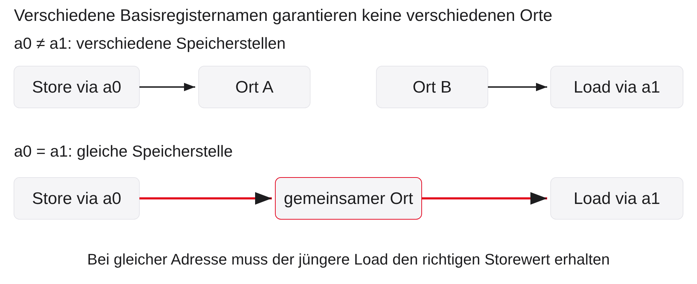{fig-alt="Store über a0 und Load über a1 können auf dieselbe Speicheradresse zeigen, obwohl ihre Basisregisternamen verschieden sind. Gleiche Adresse verlangt die richtige neue Wertversion."}

Verschiedene Zeigernamen sind kein Beweis für unabhängige Speicherstellen.

::: notes
Physische Registerversionen trennen gleiche architektonische Registernamen. Für Speicheradressen ergibt sich daraus noch keine Unabhängigkeit. Ein Store über `a0` und ein jüngerer Load über `a1` können denselben Speicherplatz treffen, obwohl zwei verschiedene Basisregister verwendet werden: Beide Register könnten dieselbe Adresse enthalten. Ein Alias bezeichnet hier genau diese gemeinsame Speicherstelle verschiedener Adressausdrücke.

Für das dargestellte Modell werden gleich breite, ausgerichtete Wortzugriffe angenommen; verschiedene gezeichnete Speicherorte überlappen nicht. Im oberen Fall treffen die Zugriffe unterschiedliche Adressen. Eine voneinander unabhängige Bearbeitung kann dann möglich sein. Im unteren Fall zeigt der rote gemeinsame Platz dagegen dieselbe Adresse. Der jüngere Load braucht hier den gemäß Programmfolge zuletzt geschriebenen Wert und darf nicht unbemerkt eine ältere Speicherkopie verwenden. Schwarze Pfeile kennzeichnen die jeweiligen Zugriffswege.

Eine konkrete LSU, Load/Store Unit, kann ältere Storeadressen prüfen, Daten aus einem Puffer weiterleiten oder eine zu früh spekulativ ausgeführte Ladeoperation erneut ausführen. Welche Verfahren verwendet werden, ist plattformspezifisch. Auch ein Compiler benötigt gültige Aliasannahmen, bevor er Speicheroperationen umordnet.

Es genügt deshalb nicht, nur nach voneinander unabhängigen Registernamen zu suchen. Ein vorgezogener Zugriff bringt nur dann einen Nutzen, wenn der richtige Wert erhalten bleibt und mögliche Wiederholungen in die Betrachtung eingehen. Nach den Datenabhängigkeiten begrenzt somit auch die Kenntnis der tatsächlichen Adressen die nutzbare Parallelität.
:::

## Endliche Puffer begrenzen das Vorziehen

::: {.section-label}
3 / 5 · Reihenfolge und Bestätigung
:::

- Ein langer Load kann den Bestätigungskopf blockieren
- ROB und Issue-Queue haben endliche Kapazität
- Register, Ports und Speicherbandbreite bleiben begrenzt
- Unabhängige Arbeit hilft nur innerhalb dieser Grenzen

::: notes
Ein Out-of-Order-Kern kann nicht beliebig weit in die Zukunft des Programms sehen. Seine Issue Queue enthält nur eine endliche Menge aufgenommener, noch auszuwählender Operationen. Auch der ROB, Reorder Buffer zur geordneten Bestätigung, und die physische Registerdatei besitzen begrenzte Kapazität. Issue bezeichnet den Start, Retire die endgültige Bestätigung.

Ein sehr langsamer ältester Load kann den Bestätigungskopf längere Zeit blockieren. Jüngere unabhängige Operationen werden währenddessen möglicherweise fertig, behalten aber ihre Einträge und Zielregister, bis sie bestätigt und die zugehörigen Ressourcen freigegeben werden dürfen. Ist der ROB voll oder sind keine neuen physischen Register mehr verfügbar, kann die Aufnahme weiterer Befehle anhalten. Dass im weiteren Programm noch unabhängige Arbeit existiert, beseitigt diesen Stau nicht automatisch.

Zusätzlich begrenzen Recheneinheiten, Speicherports und verfügbare Bandbreite die Startauswahl. Eine ALU, Arithmetic Logic Unit, kann nur die von ihrem Initiationsintervall erlaubte Anzahl an Operationen annehmen. Mehr Register liefern keinen fehlenden Speicherwert; zusätzliche ALUs helfen nicht gegen einen blockierten Fetchpfad, also eine unterbrochene Befehlslieferung.

ILP, Instruction-Level Parallelism, bezeichnet damit eine vorhandene Gelegenheit im Programm. Nutzbar wird sie erst innerhalb eines konkreten Fensters mit passenden Bereitschafts- und Ressourcenbedingungen. Eine weitere Grenze entsteht beim Kontrollfluss: Bevor zukünftige Operationen überhaupt ins Fenster gelangen können, muss die Hardware einen plausiblen nächsten Befehlsweg auswählen.
:::

## 4 · Den nächsten Pfad vorhersagen {.section-divider}

Welche Befehle sollen überhaupt als Nächstes vorbereitet werden?

Richtung und Ziel → Vorhersagezustand → Wiederanlauf

::: notes
Abhängigkeiten und Ressourcen begrenzen, welche vorhandenen Operationen beginnen dürfen. Bei Sprüngen entsteht eine zusätzliche Unsicherheit: Solange die Bedingung nicht feststeht, ist der nächste tatsächlich benötigte Programmweg noch unbekannt. Ein breiter Befehlsweg wäre wenig nützlich, wenn er bei jeder solchen Entscheidung vollständig warten müsste.

Eine Vorhersage kann die Vorbereitung fortsetzen, bevor Richtung und Ziel endgültig berechnet sind. Sie macht den eingeschlagenen Weg jedoch nicht automatisch richtig. Der Kern muss eine Abweichung erkennen und die normalen Wirkungen des falschen Pfads verwerfen. Die Kosten dieser Erholung hängen vom jeweiligen Modell ab und dürfen nicht mit einer beliebigen festen Zahl je Sprung gleichgesetzt werden.

Einfache Ein- und Zwei-Bit-Prädiktoren machen den Zustandsbezug nachvollziehbar: Die aktuelle Vorhersage verwendet den alten Zustand, erst das wirkliche Ergebnis aktualisiert ihn. Diese zeitliche Reihenfolge wird anschließend mit der Frage verbunden, welche internen Spuren ein verworfener Pfad trotzdem hinterlassen kann.
:::

## Ein Sprung braucht Richtung und Ziel

::: {.section-label}
4 / 5 · Sprünge und Vorhersage
:::

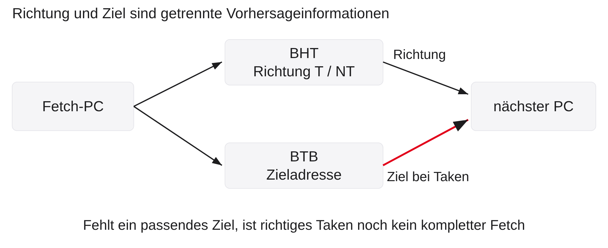{fig-alt="Der Fetch-PC wird für Richtungsvorhersage und Zielpuffer verwendet. Bei vorhergesagtem Taken und passendem Ziel wird dieses gewählt, sonst der Folgepfad; beides sind getrennte Informationen."}

Taken beantwortet „springen?“; ein Target beantwortet „wohin?“.

::: notes
Ein bedingter Sprung entscheidet, welcher Teil des Programms als Nächstes ausgeführt wird. Dafür sind zwei Informationen nötig. Taken, kurz T, beantwortet, ob der Sprung genommen wird. Not Taken, kurz NT, bezeichnet den Folgepfad. Bei Taken muss außerdem die Zieladresse bekannt sein. Eine richtige Richtung allein liefert noch nicht den vollständigen nächsten Befehlsstrom.

PC bedeutet Program Counter, Befehlsadresse. Aus dem Fetch-PC können getrennte Vorhersagestrukturen angesprochen werden: Die BHT, Branch History Table, bezeichnet hier die Richtungstabelle; der BTB, Branch Target Buffer, den Sprungzielpuffer. In der Abbildung liegt der PC links, beide Informationen stehen in der Mitte und rechts wird der nächste PC ausgewählt. Schwarze Pfeile sind Informationswege, der rote Pfeil ist der gewählte Zielweg.

Die tatsächliche Sprungbedingung kann häufig erst nach Holen, Dekodieren und Bereitstellen der benötigten Registeroperanden berechnet werden. Ohne Vorhersage würde der Fetchpfad bis zu dieser Entscheidung warten. Eine statische Heuristik kann beispielsweise Rückwärtssprünge als Taken behandeln. Eine dynamische Regel nutzt frühere Ergebnisse und passt ihren Zustand an.

Ein gültiger Treffer im Zielpuffer ist trotzdem nicht für jede Sprungstelle garantiert. Deshalb folgt aus einer richtigen Taken-Vorhersage weder eine kostenlose Zielbestimmung noch eine in jedem Takt gesicherte Befehlslieferung. Vorhersage schafft eine Arbeitsannahme für frühes Weiterarbeiten; später muss die tatsächliche Entscheidung mit dieser Annahme verglichen werden.
:::

## Eine Fehlvorhersage kostet Wiederanlaufzeit

::: {.section-label}
4 / 5 · Sprünge und Vorhersage
:::

{fig-alt="Nach einem vorhergesagten Sprungpfad werden jüngere Befehle bearbeitet. Bei der späteren falschen Vorhersage werden sie verworfen und der richtige Pfad wird neu befüllt."}

Penalty ist ein definierter Zusatzaufwand, nicht automatisch die Stufenanzahl.

::: notes
Frühes Weiterarbeiten auf einer Annahme hat einen Preis, wenn sich diese als falsch erweist. Misprediction bezeichnet eine Fehlvorhersage. Die noch unbestätigten Befehle des falschen Pfads müssen verworfen werden; dafür stehen hier die Begriffe Flush oder Squash. Anschließend wird der richtige Befehlsweg erneut geliefert und aufgenommen. Früher korrekt bestätigte Vorgänger bleiben dabei gültig.

Die Abbildung ordnet diese Schritte entlang einer qualitativen Zeitachse ohne Taktskala. Links beginnt die Arbeit auf dem angenommenen Pfad. Rote Flächen kennzeichnen jüngere Arbeiten, die später verworfen werden. Eine senkrechte Entscheidungsmarke führt zum grauen Wiederanlauf auf dem richtigen Pfad. Die Darstellung beansprucht damit keine konkrete Zykluszahl für einen realen Kern.

Penalty bezeichnet den zusätzlichen Aufwand dieses Fehlwegs und Wiederanlaufs. Er hängt unter anderem davon ab, wann die Bedingung aufgelöst wird, wie der Redirect zum richtigen PC erfolgt und wie schnell wieder Befehle geliefert werden. Eine tiefe oder breite Umsetzung kann bereits viele falsche Operationen vorbereitet haben. Die Penalty ist deshalb nicht automatisch gleich einer allgemeinen Anzahl von Pipelinestufen. Auch eine korrekte Richtungsvorhersage kann noch Ziel- und Lieferbedingungen benötigen.

Für die anschließende Rechnung wird eine feste effektive Zusatzstrafe von fünfzehn Takten vorgegeben. Andere Strafen überlappen in diesem additiven Lehrmodell nicht. Das ist eine Rechenannahme, keine Messung und keine universelle Eigenschaft eines Prozessors. Mit ihr lässt sich der mittlere Zusatzaufwand von seiner Wirkung auf den Durchsatz trennen.
:::

## CPI-Aufschlag und Durchsatzverlust trennen

::: {.section-label}
4 / 5 · Sprünge und Vorhersage
:::

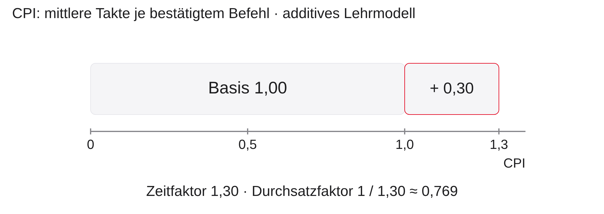{fig-alt="Ein Basis-CPI von eins plus ein Zusatz-CPI von 0,30 ergibt 1,30. Die Grafik hebt die Zusatzzeit hervor, nicht einen prozentual gleich großen Durchsatzverlust."}

$$
\Delta\mathrm{CPI}=0{,}20\cdot0{,}10\cdot15=0{,}30
$$

::: notes
Wie stark Fehlvorhersagen den mittleren Aufwand erhöhen, hängt sowohl von der Sprunghäufigkeit als auch von der Fehlerquote und den Fehlerkosten ab. Im additiven Lehrmodell seien zwanzig Prozent der bestätigten Befehle Branches, also Sprünge. Zehn Prozent dieser Sprünge werden falsch vorhergesagt; jeder Fehler kostet effektiv fünfzehn zusätzliche Takte. Das Basis-CPI beträgt eins. Weitere Änderungen oder überlappende Strafen sind ausgeschlossen.

CPI bedeutet Cycles Per Instruction, Takte pro bestätigtem Befehl. Pro Befehl entstehen hier $0{,}20\cdot0{,}10=0{,}02$ Fehlvorhersagen. Daraus folgen $0{,}02\cdot15=0{,}30$ zusätzliche Takte und insgesamt $1+0{,}30=1{,}30$ CPI. Die horizontale Achse der Grafik stellt diesen mittleren Aufwand dar: Grau ist die Basis, Rot die Zusatzzeit.

Bei gleicher Befehlsmenge und Taktfrequenz wächst die Zeit auf das $1{,}30$-Fache. Der Durchsatz, also Arbeit pro Zeit, sinkt auf den Kehrwert $1/1{,}30\approx0{,}76923$ der Ausgangsrate. Das sind rund $23{,}1\,\%$ weniger Durchsatz, nicht dreißig Prozent. Zeit- und Ratenänderung beziehen sich auf unterschiedliche Ausgangsgrößen.

Diese Bilanz benötigt noch keine bestimmte Vorhersageschaltung. Sie zeigt zunächst, weshalb eine Quote und ihre Bezugsbasis genau genannt werden müssen. Um eine solche Quote für einen gegebenen Verlauf zu bestimmen, wird nun eine kleine Zustandsregel verfolgt. Entscheidend ist jeweils die Reihenfolge: zuerst anhand des alten Zustands vorhersagen, danach mit dem tatsächlichen Ergebnis aktualisieren.
:::

## Ein Bit merkt nur das letzte Ergebnis

::: {.section-label}
4 / 5 · Sprünge und Vorhersage
:::

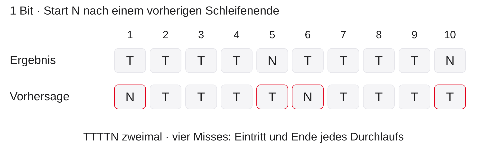{fig-alt="Ein 1-Bit-Prädiktor startet nach einem vorherigen Schleifenende mit Not Taken. Für TTTTNTTTTN verfehlt er jeweils den Wiedereintritt und das Ende: vier Misses."}

Modell: Vorhersage = gespeichertes letztes Ergebnis.

::: notes
Der einfachste betrachtete dynamische Prädiktor bewahrt ein einziges Bit pro Eintrag. Ein Prädiktor ist ein Vorhersageverfahren. Sein Zustand entspricht dem zuletzt beobachteten Ergebnis: T für Taken, den genommenen Sprung, oder N beziehungsweise NT für Not Taken. Die nächste Vorhersage verwendet diesen alten Zustand; erst nach Bekanntwerden des tatsächlichen Ergebnisses wird er überschrieben.

Eine Schleife liefert hier viermal Taken und danach einmal Not Taken. Vor dem betrachteten Fenster wurde bereits ein Schleifenende beobachtet, daher lautet der Startzustand N. Für die Folge TTTTNTTTTN wird zunächst der Wiedereintritt falsch vorhergesagt. Die folgenden Taken-Ergebnisse werden richtig geraten, das Schleifenende dagegen erneut falsch. Es hinterlässt wieder N. Beim zweiten Durchlauf entstehen deshalb dieselben Fehler an Eintritt und Ende: insgesamt vier Fehlvorhersagen in zehn Schritten.

Die Spalten der Abbildung führen von links nach rechts durch diese Folge. Das tatsächliche Ergebnis steht jeweils über der zuvor verwendeten Vorhersage; Rot markiert die falschen Entscheidungen. Diese vier Fehler sind keine universelle Missquote eines Ein-Bit-Prädiktors. Bei Startzustand T gäbe es im selben endlichen Fenster nur drei Misses.

Zur Aufgabe gehören somit das gesamte betrachtete Muster und seine Anfangshistorie. Das problematische Schleifenende erklärt zugleich die Motivation für mehr Zustand: Ein einzelner abweichender Ausgang soll nicht immer sofort die Erwartung für den nächsten Wiedereintritt umkehren. Daraus entsteht die Idee eines saturierenden Mehrzustandszählers.
:::

## Zwei Bits erzeugen Hysterese

::: {.section-label}
4 / 5 · Sprünge und Vorhersage
:::

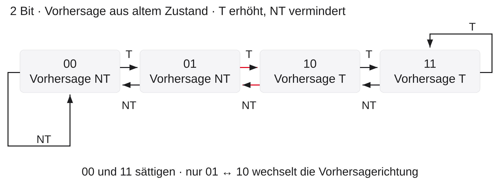{fig-alt="Vollständiger Automat mit Zuständen 00, 01, 10 und 11. Taken erhöht saturierend, Not Taken vermindert saturierend. Die oberen beiden Zustände sagen Taken vorher."}

Aus `11` führt ein NT nur nach `10`: Vorhersage bleibt T.

::: notes
Ein Zwei-Bit-Prädiktor nutzt vier Zustände, um nicht jede einzelne Abweichung sofort in eine neue Richtungsvorhersage umzusetzen. Der Zustand `00` bedeutet stark und `01` schwach Not Taken; `10` bedeutet schwach und `11` stark Taken. T steht für Taken, genommen, NT für Not Taken, nicht genommen. Die oberen beiden Zustände sagen T vorher, die unteren NT.

Nach einem tatsächlichen Taken wird der Zustand um eins erhöht, nach Not Taken um eins vermindert. Der Zähler saturiert: Er steigt nicht über `11` und fällt nicht unter `00`. Im Automaten kennzeichnen die Schleifen an diesen beiden Endzuständen genau diese Sättigung. Die beschrifteten Pfeile enthalten alle möglichen Zustandsübergänge. Rot hebt diejenigen Übergänge hervor, bei denen die vorhergesagte Richtung wechselt; die grauen Zustandskästen sind keine Wahrscheinlichkeiten.

Hysterese bedeutet hier, dass ein einzelnes widersprechendes Ergebnis aus einem starken Zustand die Richtung noch nicht ändert. Aus `11` führt ein NT nach `10`; beide Zustände sagen weiter Taken vorher. Erst ein zweites NT erreicht `01`. Aus dem bereits schwachen Zustand `10` genügt dagegen ein einziges NT für den Richtungswechsel.

Nach dem üblichen Ende einer ansonsten genommenen Schleife kann deshalb `10` erhalten bleiben und den nächsten Taken-Eintritt richtig vorhersagen. Die zusätzliche Erinnerung verbessert diesen konkreten Fall. Sie garantiert aber weder perfekte Entscheidungen für verschachtelte Schleifen noch für beliebig wechselnde Muster. Wie bei der Ein-Bit-Regel entscheidet der vorliegende Ausgangsverlauf über die tatsächliche Trefferzahl.
:::

## Vorhersage zuerst, Update danach

::: {.section-label}
4 / 5 · Sprünge und Vorhersage
:::

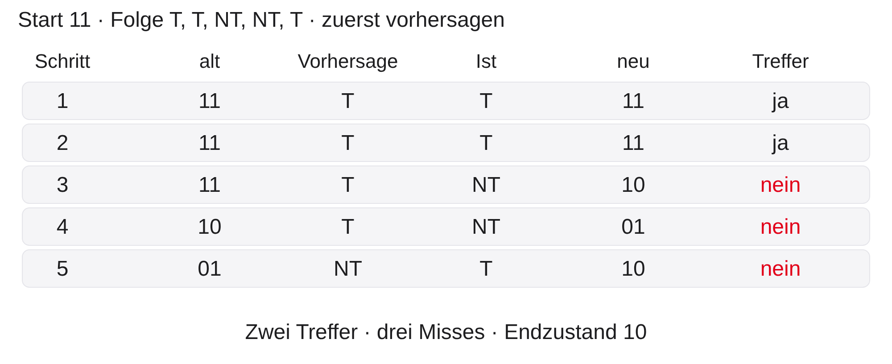{fig-alt="Start 11, Ergebnisse T T NT NT T. Die alten Zustände sind 11, 11, 11, 10 und 01; nur die ersten beiden Vorhersagen treffen, Endzustand ist 10."}

Start `11`; Folge T, T, NT, NT, T: zwei Treffer, drei Misses.

::: notes
Die Zustandsregel wird eindeutig, wenn jede Zeile den alten Zustand und das tatsächliche Ergebnis getrennt festhält. Für die Folge T, T, NT, NT, T beginnt der Zwei-Bit-Prädiktor in `11`. Taken wird vorhergesagt, solange der alte Zustand `10` oder `11` lautet. Die Aktualisierung folgt erst, nachdem die Vorhersage bewertet wurde.

Im ersten Schritt sagt `11` T vorher und bleibt nach dem tatsächlichen T in `11`. Der zweite Schritt verläuft ebenso. Im dritten Schritt lautet die Vorhersage aus `11` erneut T, doch das tatsächliche NT verändert den Zustand erst danach nach `10`. Im vierten Schritt sagt dieser schwache Taken-Zustand weiterhin T vorher; das nächste NT führt nach `01`. Im fünften Schritt wird aus `01` NT erwartet. Das tatsächliche T widerspricht dieser Vorhersage und bringt den Zustand anschließend nach `10`.

Damit treffen nur die ersten beiden Vorhersagen; drei sind falsch, und der Endzustand ist `10`. Die Abbildung ordnet die Schritte von oben nach unten und zeigt jeweils alten Zustand, Vorhersage, Ausgang und neuen Zustand. Rote Markierungen bezeichnen Misses, Fehlvorhersagen.

Würde das aktuelle Ergebnis schon vor seiner Vorhersage in den Zustand aufgenommen, erhielte das Verfahren unzulässiges Zukunftswissen. Nach einem einzelnen Schleifenende aus `11` bleibt dagegen korrekt `10` mit Richtung T erhalten. Darin liegt der Vorteil gegenüber dem sofort umschaltenden Ein-Bit-Zustand. Der Vorteil ist an die tatsächliche Geschichte gebunden; Startzustand und Beobachtungsfenster bleiben unverzichtbar.
:::

## Tabellen können sich Einträge teilen

::: {.section-label}
4 / 5 · Sprünge und Vorhersage · Vertiefung zur Lektüre
:::

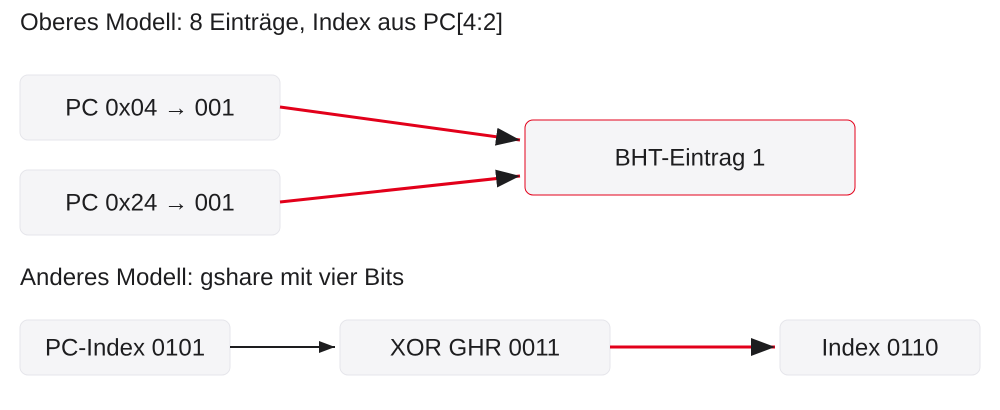{fig-alt="Bei einem Index aus PC-Bits vier bis zwei nutzen 0x04 und 0x24 beide Eintrag eins. Ein anderes gshare-Modell kombiniert vier Indexbits 0101 mit Historie 0011 per XOR zu 0110."}

Ein besserer Index beseitigt weder jede Kollision noch jeden falschen Verlauf.

::: notes
Ein Prädiktor besitzt nur eine endliche Tabelle. Verschiedene Sprungstellen können deshalb denselben Eintrag verwenden und dessen Zustand gegenseitig beeinflussen. Dieses Aliasing bezeichnet hier eine gemeinsame Tabellenposition, nicht dieselbe Programmstelle. PC bedeutet Program Counter, Befehlsadresse; BHT heißt Branch History Table und meint weiterhin die Richtungstabelle.

Das obere Modell besitzt acht Einträge und verwendet die PC-Bits vier bis zwei als Index. Die betrachteten Befehlsadressen sind vier-Byte-ausgerichtet. Sowohl `0x04` als auch `0x24` liefern nach Verschieben um zwei und Begrenzen auf drei Bits den Wert `001`, also Index eins. Der rote gemeinsame Kasten der Abbildung macht diese Kollision sichtbar. Eine Aktualisierung für die eine Sprungstelle verändert damit auch den Zustand, den die andere später vorfindet.

Ein getrenntes Vier-Bit-Beispiel verwendet zusätzlich die alte globale Sprunghistorie. Das GHR, Global History Register, speichert Ergebnisse mehrerer verschiedener Sprungstellen. Das Verfahren gshare verknüpft den gegebenen PC-Index `0101` und die Historie `0011` durch XOR, Exclusive Or oder exklusives Oder. Unterschiedliche Bits ergeben eins; das Resultat ist `0110`, Index sechs. Globale Historie ist dabei nicht automatisch eine Kombination aus lokaler und globaler Historie.

Ein anderer Index beseitigt nicht jede Kollision und trifft nicht jeden Verlauf. Weiterführende Verfahren sind etwa TAGE, Tagged Geometric History Length, mit markierten Tabellen verschieden langer Rückblicke, oder Perzeptronverfahren mit gewichteter Historie. Ihre Namen ordnen mögliche Implementierungen ein und begründen kein zusätzliches vorausgesetztes Prüfungswissen. Für diese Einheit bleibt die gemeinsame Grenze maßgeblich: Endliche Tabellen enthalten einen gelernten, vom bisherigen Verlauf abhängigen Zustand.
:::

## Rollback betrifft nicht jeden internen Zustand

::: {.section-label}
4 / 5 · Sprünge und Vorhersage
:::

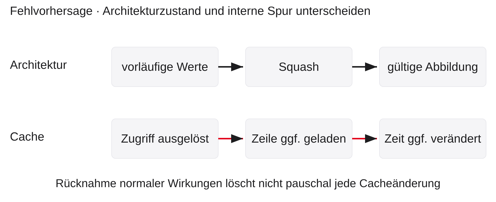{fig-alt="Eine Fehlvorhersage verwirft unbestätigte Registerwirkungen und stellt die gültige Abbildung wieder her. Ein bereits ausgelöster Cachezugriff kann dennoch eine interne Spur hinterlassen."}

Architektonisch korrekter Kontrollfluss kann interne Nebenwirkungen hinterlassen.

::: notes
Spekulative Ausführung bearbeitet einen Programmweg vorläufig unter einer noch ungeprüften Annahme. Prediction bezeichnet die Vorhersage, Rollback ihre Rücknahme und Squash das Verwerfen unbestätigter Arbeit. Ein Kern kann bereits spekulativ Befehle holen, ohne ein vollständiges Out-of-Order-Verfahren zu besitzen. Im hier betrachteten leistungsfähigen Modell werden beide Mechanismen kombiniert.

Der ROB, Reorder Buffer, trägt zur korrekten Bestätigung bei. Erweist sich ein angenommener Kontrollfluss als falsch, werden dessen unbestätigte Registerwirkungen nicht als gültiger Programmzustand übernommen. Die gültige Registerabbildung wird wiederhergestellt; früher korrekt bestätigte Vorgänger bleiben erhalten. Der obere schwarze Architekturweg in der Abbildung beschreibt diese Rückkehr zum richtigen Programmverlauf.

Nicht jeder interne Zustand muss dadurch auf seinen früheren Wert zurückgesetzt werden. Der untere rote Cacheweg zeigt eine mögliche bleibende Spur: Ein bereits ausgeführter Ladezugriff kann eine Cachezeile beschafft haben, die nach dem Verwerfen des Befehls weiterhin vorhanden ist. Weder die gesamte physische Registerdatei noch jeder Cache wird bei jeder Fehlvorhersage pauschal gelöscht.

Das ist zunächst eine Trennung von Beobachtungsebenen. Vorläufige Arbeit kann die spätere bestätigte Rechnung beschleunigen, während ihre mikroarchitektonischen Spuren noch sichtbar sein können. Ob sich daraus eine Information über einen fremden Wert gewinnen lässt, erfordert weitere Voraussetzungen. Die Darstellung erläutert dieses Prinzip und behauptet keine gemessene Verwundbarkeit einer bestimmten Kursplattform.
:::

## Ein Cache-Seitenkanal benötigt eine Wertkopplung

::: {.section-label}
4 / 5 · Sprünge und Vorhersage
:::

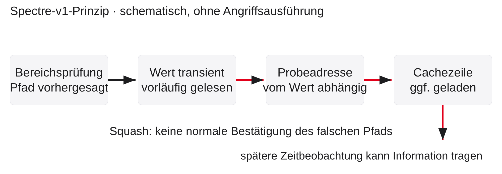{fig-alt="Im schematischen Spectre-v1-Fall läuft ein falscher Bounds-Pfad transient, ein Wert beeinflusst einen folgenden Probezugriff und dessen mögliche Cacheposition kann später über Zeit beobachtet werden."}

Verworfener Programmwert und beobachtbare Cache-Spur sind verschiedene Dinge.

::: notes
Ein Seitenkanal überträgt Information indirekt, beispielsweise über Zugriffszeiten statt über einen regulär erlaubten Rückgabewert. Die schematische Spectre-v1-Situation verbindet einen transient bearbeiteten falschen Prüfpfad mit einer später beobachtbaren Cache-Spur. Transient heißt vorläufig intern bearbeitet. Die architektonische Bounds-Prüfung, also Bereichsprüfung, bleibt wirksam und bestätigt den falschen Pfad nicht.

Die Abbildung verfolgt von links nach rechts die dafür nötige Kette: Eine Prüfung wird vorhergesagt, auf diesem angenommenen Pfad wird vorläufig ein Wert geladen, der Wert beeinflusst einen weiteren Probezugriff, und eine spätere Zeitbeobachtung kann dessen Cachewirkung untersuchen. Rot markiert die mögliche Informationsspur. Entscheidend ist die Wertkopplung: Der geladene Wert muss die Adresse der Probeoperation beeinflussen. Ein beliebiger schneller Load verrät nicht automatisch alle Bits eines beliebigen Geheimnisses.

Nach dem Squash, dem Verwerfen unbestätigter Arbeit, kann die gewählte Cachezeile weiterhin vorhanden sein. Dadurch verändert sich gegebenenfalls eine später messbare Zeitverteilung, obwohl der verworfene Registerwert kein erlaubtes Programmausgabeergebnis wurde. Andere Zugriffe, Störungen und konkrete Plattformdetails beeinflussen diese Beobachtung. Ein einzelner schneller Zugriff ist daher noch kein eindeutiger Nachweis eines Geheimniswerts.

Der Zusammenhang verwendet nur die bekannten Cachebegriffe und die Trennung von interner Fertigstellung und Bestätigung. Ein Exploit oder Hardwareangriff wird damit nicht als ausgeführt behauptet. Die Sicherheitsfrage entsteht aus dem Zusammenspiel dieser Mechanismen; sie lässt sich nicht allein durch das richtige Verwerfen des falschen Programmwegs beantworten.
:::

## Unterschiedliche Mechanismen brauchen passende Maßnahmen

::: {.section-label}
4 / 5 · Sprünge und Vorhersage · Vertiefung zur Lektüre
:::

| Fall | vereinfachte Grenze |
|------|---------------------|
| Spectre-v1 | falsch vorhergesagter Pfad einer Prüfung |
| ursprünglicher Meltdown | Berechtigungsprüfung auf betroffenen Designs |

Passende Barrieren, Maskierung und Speicherabbildung sind keine austauschbaren Universalrezepte.

::: notes
Aus einer möglichen Cache-Spur folgt noch kein einheitliches Gegenmittel für alle transienten Angriffe. Spectre-v1 betrifft hier die vorläufige Bearbeitung nach einer falsch vorhergesagten Bereichsprüfung. Der ursprüngliche Meltdown-Fall betraf dagegen bestimmte Designs, die geschützte Daten intern weiterreichen konnten, bevor der unzulässige Zugriff architektonisch als Fehler behandelt wurde. Diese Einordnung beschreibt unterschiedliche Mechanismen und keine Eigenschaft jedes modernen Kerns.

Benutzerprogramme und privilegierter Betriebssystemcode besitzen unterschiedliche Zugriffsrechte. KPTI, Kernel Page Table Isolation, trennt bestimmte Abbildungen des Kerneladressraums von denen der Benutzerprogramme. Das richtet sich insbesondere gegen den ursprünglichen Meltdown-Weg und ist keine allgemeine Lösung für Spectre.

Für bestimmte Spectre-Fälle können überprüfte Indexmaskierung oder geeignete Spekulationsbarrieren verwendet werden. Ob eine konkrete Anweisung diese Wirkung besitzt, muss ihr Architekturvertrag festlegen. ISA bedeutet Instruction Set Architecture, Befehlssatzarchitektur. In der RISC-V-Familie, RISC ausgeschrieben Reduced Instruction Set Computer, ordnet ein gewöhnliches `fence` Speicherzugriffe. Daraus darf ohne zusätzliche Vorgabe keine universelle Spekulationsbarriere abgeleitet werden.

Andere Varianten verlangen gegebenenfalls andere Hardware-, Software- oder Betriebssystemmaßnahmen. Die vereinfachte Tabelle ordnet daher Ursachen und Grenzen ein, statt eine pauschale Sicherheitszusage zu geben. Das grundlegende Lernziel bleibt, einen korrekt bestätigten Programmzustand von möglichen internen Informationsspuren zu unterscheiden und Maßnahmen nur unter ihren tatsächlichen Voraussetzungen zu beurteilen.
:::

## 5 · Wirkung prüfen und einordnen {.section-divider}

Wann ist eine Optimierung funktional richtig – und wann schneller?

Compiler → Abhängigkeiten → Funktionsnachweis → Zeitnachweis

::: notes
Die bisher betrachteten Mechanismen erklären Möglichkeiten und Grenzen einer Mikroarchitektur. Ein C-Programm beschreibt diese Umsetzung jedoch nicht direkt. Der Compiler wählt zunächst eine konkrete Befehlsfolge, die Hardware bearbeitet sie anschließend unter ihren eigenen Ressourcen- und Zeitbedingungen.

Der letzte Abschnitt verbindet beide Ebenen an Summenketten. Mehrere unabhängige Teilakkumulatoren können mehr nutzbare Befehlsparallelität erzeugen, benötigen aber eine abschließende Zusammenführung und passende Ressourcen. Eine andere Übersetzung oder ein funktional richtiges Hostprogramm beweist deshalb noch keinen Laufzeitgewinn auf einer bestimmten Zielplattform.

Die Rückkehr zur Einstiegsfrage fasst die Begründung zusammen: Eine zusätzliche Einheit hilft nur, wenn der vorbereitete Befehlspfad, die Eingabewerte und die übrigen Engpässe ihre Nutzung erlauben. Das Abschlussquiz und die Papieraufgaben prüfen diese Bedingungen an benannten Zeitfenstern und Zuständen. Vertiefte Implementierungsdetails können im Skript nachgelesen werden, ohne sie als Vorwissen vorauszusetzen.
:::

## Compiler und Hardware planen zu verschiedenen Zeiten

::: {.section-label}
5 / 5 · Compiler und Wirkung
:::

- Statisches Scheduling verändert die Übersetzung vor der Ausführung
- Dynamische Auswahl reagiert auf aktuelle Bereitschaft
- Beide müssen Werte und Nebenwirkungen erhalten
- `-O3` garantiert keine bestimmte Befehlsfolge und keine kürzere Laufzeit

::: notes
Unabhängige Operationen können sowohl vor als auch während der Ausführung umgeordnet werden. Statisches Scheduling ist eine solche Planung durch den Compiler bei der Übersetzung. Dynamische Auswahl findet dagegen zur Laufzeit statt und reagiert beispielsweise darauf, dass ein bestimmter Loadwert gerade noch fehlt. Beide Verfahren müssen benötigte Werte und zulässige Nebenwirkungen erhalten.

Der Compiler kann bereite Arbeit zwischen einen Load und dessen Nutzer verschieben, soweit die Programmbedeutung dies erlaubt. Er darf dabei weder eine noch benötigte alte Registerversion noch den notwendigen Speicherwert zerstören. Gültige Aliasannahmen und mögliche Seiteneffekte begrenzen deshalb seine Freiheit. Die Hardware sieht ihrerseits nur ein endliches Befehlsfenster und kennt nicht jede spätere Möglichkeit des ganzen Programms. Die beiden Planungsebenen ergänzen sich, ohne identisch zu sein.

GCC bedeutet GNU Compiler Collection, eine Compilerfamilie. GNU ist der Projektname freier Software und steht rekursiv für GNU’s Not Unix. Optimierungsstufen wie `-O1` und `-O3` erlauben unterschiedliche Analysen und Transformationen. Weder ein bestimmtes Ausrollen einer Schleife noch eine kürzere Laufzeit jeder Eingabe ist dadurch garantiert. Zielarchitektur, Compilerfassung, Optionen und Programm bestimmen gemeinsam die tatsächliche Übersetzung.

Für eine Summenschleife lohnt daher eine genauere Frage als „ist der Code länger oder kürzer?“: Entstehen nur weniger Schleifensprünge, oder werden wirklich mehrere unabhängige Berechnungsketten geschaffen? Erst der zweite Fall verändert die verfügbare Parallelität der eigentlichen Summenoperationen.
:::

## Ausrollen und mehrere Akkumulatoren unterscheiden {.compact-figure}

::: {.section-label}
5 / 5 · Compiler und Wirkung
:::

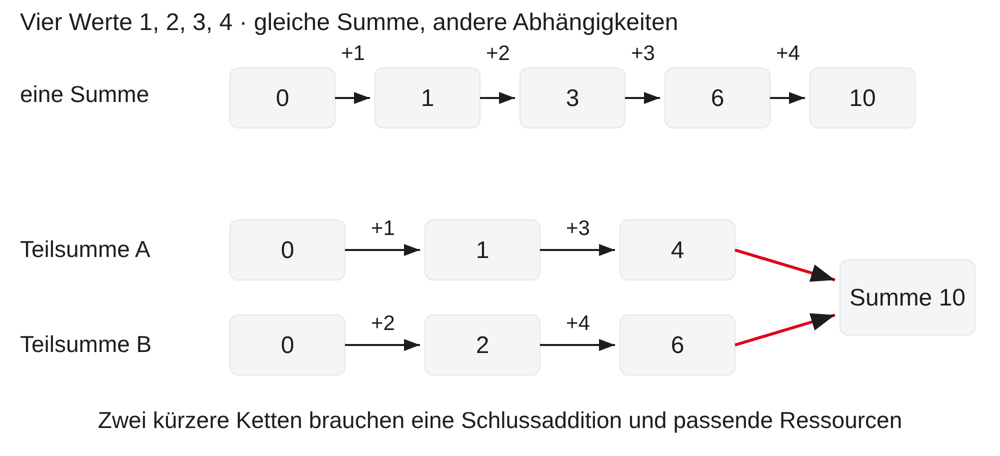{fig-alt="Vier Additionen auf derselben Summe bilden eine Kette. Zwei getrennte Teilakkumulatoren bilden zwei kürzere Ketten und werden am Ende zusammengeführt."}

Ein größerer gerader Codeabschnitt entfernt nicht automatisch die RAW-Kette.

::: notes
Ein Akkumulator führt ein Zwischenergebnis wiederholt fort. Bei einer Summe entsteht dadurch eine RAW-Kette, Read After Write: Jede Addition liest das Ergebnis der vorherigen. Loop Unrolling, Schleifenausrollen, schreibt mehrere Durchläufe als längeren geraden Codeabschnitt hin und kann so Schleifensprünge einsparen. Die Wertabhängigkeit der Additionen verschwindet dadurch jedoch nicht automatisch.

Die obere Kette der Abbildung addiert die Werte eins, zwei, drei und vier zu einem einzigen Akkumulator. Dessen Zustände lauten null, eins, drei, sechs und zehn. Auch vier untereinander ausgeschriebene C-Zeilen benötigen dabei jeweils das vorige Ergebnis. Im unteren Teil entstehen zwei Teilketten: eins und drei liefern vier, zwei und vier liefern sechs. Eine abschließende Addition verbindet beide zu zehn; rote Pfeile kennzeichnen diese Zusammenführung.

Die getrennten Ketten bieten mehr ILP, Instruction-Level Parallelism. Ob sie gleichzeitig ausgeführt werden können, hängt anschließend von den Ressourcen ab. Zwei Quellcodevariablen garantieren weder genau zwei Maschinenbefehle noch einen festen Beschleunigungsfaktor. Weitere Akkumulatoren verursachen Registerbedarf, Verwaltungsarbeit und eine Schlussreduktion.

Auch die Rechenregeln begrenzen die Umformung. Für vorzeichenlose Integeraddition mit gleicher Breite stimmt die Summe modulo der Wortbreite auch bei dieser Zerlegung. Bei Gleitkommaaddition kann eine andere Klammerung zu anderen Rundungsergebnissen führen. Das begleitende C-Programm prüft deshalb zuerst die funktionale Gleichheit im ausdrücklich gewählten vorzeichenlosen Modell; eine Aussage über Laufzeit erfordert zusätzlich eine passende Messung oder ein vollständiges Zeitmodell.
:::

## Übersetzung und Funktion sind eigene Nachweise

::: {.section-label}
5 / 5 · Compiler und Wirkung · Vertiefung zur Lektüre
:::

Vom Repository-Hauptordner:

```bash
gcc -std=c11 -O3 -Wall -Wextra -Werror \
  labs/src/lab07_ilp.c -o /tmp/lab07_ilp
/tmp/lab07_ilp
```

Host-C prüft Summen; Compiler Explorer zeigt Befehle, kein OoO-Timing.

::: notes
Der begleitende Hostversuch trennt die funktionale Prüfung einer Umformung von ihrer möglichen zeitlichen Wirkung. Host bezeichnet den gewöhnlichen Rechner, auf dem Compiler und Programm laufen. Die vorhandene Datei `labs/src/lab07_ilp.c` enthält eine einfache Summe und eine Variante mit zwei Teilakkumulatoren. Beide lesen gültige Arrayelemente, behandeln auch ungerade Längen und liefern mit `uint64_t` einen vorzeichenlosen Vierundsechzig-Bit-Wert.

Der Aufruf verwendet GCC, GNU Compiler Collection. GNU heißt rekursiv GNU’s Not Unix und bezeichnet das freie Softwareprojekt. `-std=c11` wählt die C-Sprachfassung von 2011, `-O3` die Optimierungsstufe, `-Wall` und `-Wextra` zusätzliche Warnungen. `-Werror` macht diese Warnungen zu Fehlern, `-o` benennt die ausführbare Datei. Der Backslash setzt die Shellzeile fort. Nach dem Übersetzen vergleicht der Programmaufruf die Ergebnisse für leere, kurze, gerade und ungerade Eingaben sowie große Werte. Gerätezugriffe und ein Zykluszähler gehören nicht zu diesem Versuch.

Eine konkrete Übersetzung kann anschließend mit Compiler Explorer, auch Godbolt genannt, untersucht werden. Die angezeigten Maschinenbefehle sind aber noch kein tatsächlicher OoO-Ablauf; OoO steht für Out-of-Order Execution. Ein Vergleich für RISC-V benötigt eine ausdrücklich gewählte Zielarchitektur und Compileroptionen. RISC bedeutet Reduced Instruction Set Computer.

Auch Renode, der vorgesehene Systemsimulator, belegt ohne geeignetes Mikroarchitekturmodell nicht die Zeitpläne dieser Einheit. Ein erfolgreicher Hostlauf bestätigt die geprüften Summenergebnisse. Er ersetzt weder eine RISC-V-Zeitmessung noch den Nachweis einer bestimmten Befehlsrate auf einer realen CPU.
:::

## Abschlussquiz: Fenster, Version und Vorhersage nennen

::: {.section-label}
5 / 5 · Compiler und Wirkung
:::

- Zehn QuizAcademy-Fragen
- Zehn Minuten bearbeiten, fünf Minuten auswerten
- Bei jeder Entscheidung die benötigte Bedingung begründen
- Vergleichbare Antwortlängen, genau eine richtige Option

::: notes
Die Quizfragen verbinden die einzelnen Begriffe wieder mit ihren erforderlichen Modellbedingungen. Eine Zeitangabe ist nur dann begründet, wenn Programm, Latenzen und Fenstergrenze bekannt sind. Bei Renaming entscheidet die Quellversion, die der betreffende Leser bei seiner Aufnahme erhalten hat. Ein Prädiktor verwendet seinen alten Zustand; das gerade erst beobachtete Ergebnis verändert die folgende Entscheidung.

IPC, Instructions Per Cycle, und CPI, Cycles Per Instruction, brauchen dieselbe Zählbasis, wenn sie als Kehrwerte verglichen werden. Ein höheres IPC muss bei einer anderen Befehlszahl nicht die kürzere Laufzeit bedeuten. Mehrere intern fertige Operationen können im ROB, Reorder Buffer, weiterhin auf ihre Bestätigung warten. Ein verworfener falscher Programmweg kann dagegen schon eine interne Cache-Spur hinterlassen haben. Die richtige Antwort ergibt sich jeweils aus der Trennung dieser Ebenen.

Für die zehn Fragen sind fünfzehn Minuten vorgesehen: zehn Minuten zur eigenen Bearbeitung und fünf zur begründeten Auswertung. Jede Frage enthält vier Optionen und genau eine richtige Antwort. Deren Länge ist kein zuverlässiger Auswahlhinweis. Die Erläuterungen führen kurz zur entscheidenden Bedingung oder zum passenden Gegenbeispiel zurück.

Die Diagnose ergänzt die offenen Papieraufgaben. Sie soll typische Fehlvorstellungen sichtbar machen und die begründete Entscheidung aus vorhandenen Annahmen festigen. Eine bestimmte Desktop-Mikroarchitektur ohne Datenblatt oder Messung vorherzusagen ist dafür weder nötig noch durch die Lehrmodelle erlaubt.
:::

## Zurück zu den zwei Recheneinheiten

::: {.section-label}
5 / 5 · Compiler und Wirkung
:::

| Geänderte Bedingung | Was die zweite ALU bewirkt |
|---|---|
| zwei passende unabhängige Rechnungen | ein Doppelstart kann möglich werden |
| eine einzige abhängige Kette | der fehlende Wert muss weiter abgewartet werden |
| Bestätigung auf eins begrenzt | dauerhaft höchstens ein bestätigter Befehl je Takt |

Welche Annahmen braucht die Behauptung „doppelt so schnell“ jetzt zusätzlich?

::: notes
Die Einstiegsfrage war absichtlich unvollständig. Zwei Addiereinheiten bei gleichem Takt sagen noch nicht, ob jeder benötigte Befehl doppelt so schnell bearbeitet wird. Inzwischen sind drei voneinander getrennte Prüfungen möglich: Gibt es passende unabhängige Operationen, kann der gesamte Befehlsweg beide bedienen, und welcher Anteil der Anwendung wird dadurch überhaupt beschleunigt?

Das kurze Doppelstartbeispiel benötigte für vier Befehle drei Takte bis zum letzten Retire. Die abhängige Viererfolge brauchte mit derselben Hardware fünf. Ein dauerhaft einzelner Bestätigungspfad würde zusätzlich die mittlere bestätigte Rate auf höchstens eins begrenzen. In jedem Fall sind Anfang, Ende und Zählbasis anzugeben. Ein kurzer Abschnitt mit zwei Abschlüssen je Takt ist kein Beweis für IPC zwei im ganzen Programm.

Out-of-Order beantwortet daneben eine andere Frage: Es kann jüngere bereite Arbeit nutzen, während ein älterer Befehl wartet. Die benötigten Daten und die Regeln korrekter Bestätigung verschwinden dadurch nicht. Compileränderungen wiederum können eine günstigere Befehlsfolge erzeugen, ohne allein eine bestimmte reale Laufzeit zu garantieren. Die begründete Antwort lautet deshalb: Mehr Breite ist dann nützlich, wenn Programm, Ressourcen und Zählfenster ihre Nutzung erlauben; eine pauschale Halbierung folgt aus der zweiten ALU nicht.
:::

## Was Sie jetzt erklären und prüfen können

::: {.section-label}
5 / 5 · Compiler und Wirkung
:::

- Pipelineüberlappung, Breite und Reihenfolge unterscheiden
- Wertabhängigkeiten und Registerversionen verfolgen
- Fertigstellung, Retire und Speicherwirkung trennen
- Vorhersage aus altem Zustand und ihre Kosten berechnen
- Compilerresultat, Modellzeit und Messung auseinanderhalten

::: notes
Aus der anfänglichen Frage nach mehr Arbeit pro Takt entsteht ein zusammenhängendes Bild des Kerns. Eine Pipeline überlappt Bearbeitungsstufen. Mehr Breite schafft mehrere Plätze in einzelnen Stufen. Out-of-Order nutzt jüngere bereite Arbeit, während geordnete Bestätigung die gültige Programmfolge erhält. Wertabhängigkeiten, Registerversionen, Speicheradressen und endliche Ressourcen entscheiden gemeinsam, welche Gelegenheit tatsächlich genutzt werden kann.

CPU bedeutet Central Processing Unit, Prozessor. Derselbe sichtbare Programmzustand kann auf verschiedenen Mikroarchitekturen mit unterschiedlichen Zeiten entstehen. Eine Zeit- oder Ratenzahl erhält ihren Sinn deshalb erst durch Programm, Zählbasis und Anfangsbedingungen. Auch Compilerresultat, analytisches Zeitmodell und tatsächliche Messung bleiben verschiedene Nachweise. Damit lässt sich der Nutzen interner Parallelität begründen, ohne aus bloßer Breite einen festen Beschleunigungsfaktor abzuleiten.

Die Grundlagen orientieren sich an Harris/Harris, Digital Design and Computer Architecture — RISC-V Edition, und Patterson/Hennessy, Computer Organization and Design. RISC steht für Reduced Instruction Set Computer. Konkrete Verwaltungsprinzipien erläutern die [BOOM-Renamingbeschreibung](https://github.com/riscv-boom/riscv-boom/blob/master/docs/sections/rename-stage.rst), der [Reorder Buffer](https://github.com/riscv-boom/riscv-boom/blob/master/docs/sections/reorder-buffer.rst) und die [RISC-V-Integerbasis](https://github.com/riscv/riscv-isa-manual/blob/main/src/unpriv/rv32.adoc). BOOM heißt Berkeley Out-of-Order Machine.

Die [GCC-Optionsbeschreibung](https://github.com/gcc-mirror/gcc/blob/master/gcc/doc/invoke.texi), die [Linux-Spectre-Dokumentation](https://github.com/torvalds/linux/blob/master/Documentation/admin-guide/hw-vuln/spectre.rst) und die [Linux-Dokumentation zur Kernel-Seitentabellentrennung](https://github.com/torvalds/linux/blob/master/Documentation/arch/x86/pti.rst) ergänzen Compiler- und Sicherheitseinordnung. GCC bedeutet GNU Compiler Collection, GNU rekursiv GNU’s Not Unix. Diese Quellen sind Architektur- und Implementierungsbeschreibungen, keine Messungen der Lehrmodelle. Die folgende Einheit über KI-Beschleuniger untersucht, warum regelmäßige Daten und Rechenmuster über diese allgemeine Kernparallelität hinaus spezialisierte Verarbeitung erlauben.
:::
