## Von Datenbewegung zu Befehlsparallelität

- Vorlesung 6: DMA entlastet die laufende Kopierbedienung
- Heute: mehrere Befehle innerhalb eines CPU-Kerns bearbeiten
- Unabhängige Arbeit kann Wartezeit überlappen
- Der sichtbare Programmzustand muss weiterhin korrekt bleiben

::: notes
DMA bedeutet Direct Memory Access, direkter Speicherzugriff, und CPU Central Processing Unit, Prozessor. Vorlesung 6 hat gezeigt, dass ausgelagerte Datenbewegung die Anwendung entlasten kann, ohne die Leitung schneller oder jede Ressource unabhängig zu machen. Diese Unterscheidung übertragen wir auf die Befehlsausführung im Kern.

Ein Prozessor muss nicht unbedingt warten, bis ein Befehl vollständig abgeschlossen ist, bevor er irgendeinen nächsten Arbeitsschritt beginnt. Er kann Stufen verschiedener Befehle überlappen und unter zusätzlichen Voraussetzungen unabhängige Rechnungen vorziehen. Entscheidend ist dabei, welche Werte gebraucht werden und welche Ressourcen verfügbar sind.

Die Anwendung soll trotzdem dieselben Ergebnisse und einen nachvollziehbaren Zustand bei einem Fehler erhalten. Die Vorlesung baut deshalb zuerst ein einfaches Zeitmodell auf. Anschließend trennt sie echte Datenabhängigkeiten von wiederverwendeten Registernamen und erklärt die geordnete Bestätigung intern vorgezogener Arbeit. Erst danach kommt vorhergesagter Kontrollfluss hinzu. Mehr Aktivität innerhalb des Kerns ist also ein Mittel zur Entlastung, keine automatische Verdopplung jeder Programmlaufzeit.
:::

## Voraussetzungen und drei Zeitmodelle

- C-Integer, Arrays und einfache Registeroperationen
- Cachetreffer und Speicherwartezeiten aus Vorlesung 2
- Interrupts und Exceptions aus Vorlesung 3
- M1: fünf skalare Stufen; M2: kurzer Breitenvergleich
- M3: vier Befehle mit festgelegtem Issue und Retire

::: notes
Für das Verständnis reichen Integerzahlen, Arrays, Registerzugriffe, Cachekopien und Unterbrechungen aus den bisherigen Vorlesungen. Die benötigten Prozessorstufen werden hier noch einmal vollständig eingeführt. Ein Cache-Miss bedeutet, dass ein benötigter Block nicht in der betrachteten Cacheebene bereitliegt und weiter beschafft werden muss.

M1 bezeichnet unser Fünf-Stufen-Modell mit einem neuen Befehl pro Takt. M2 ist dagegen ein bewusst verkürztes Modell mit einer Rechenphase und Bestätigung im Folgetakt, um die Breite zu isolieren. M3 vergleicht die Startreihenfolge desselben Vier-Befehle-Programms mit einer langsamen Speicheroperation. Zeiten aus diesen Modellen dürfen nicht vermischt werden.

Issue heißt hier Start einer ausgewählten Operation in einer Ausführungseinheit. Retire oder Commit ist die endgültige architektonische Bestätigung. Eine Operation kann vorher bereits fertig sein. Alle Latenzen, Breiten und Anfangswerte sind ausdrücklich Lehrannahmen. Sie beschreiben weder einen vermessenen Desktopprozessor noch einen allgemeinen Registerstandard. Wir unterscheiden Modellrechnung, tatsächlich übersetzten C-Code und reale Mikroarchitektur, damit eine Zahl wie „zwei Befehle je Takt“ eine überprüfbare Bedeutung bekommt.
:::

## Vier Schulstunden: Ablauf

| Stunde | Erklärung und Besprechung | Arbeitsphase |
|--------|---------------------------|--------------|
| 1 | Pipeline, Metriken und Ressourcen: 35 min | Aufgabe 1: 10 min |
| 2 | Abhängigkeiten, Renaming und Reihenfolge: 30 min | Aufgaben 2–3: 15 min |
| 3 | Bestätigung, Sprünge und Vorhersage: 30 min | Aufgabe 4: 15 min |
| 4 | Spekulation und Compiler: 15 min | Aufgaben 5–6: 15 min; Quiz: 15 min |

::: notes
Vier Schulstunden entsprechen hundertachtzig Minuten ohne zusätzliche Pausen. Die Planung umfasst hundertzehn Minuten Erklärung, Denkfragen und Lösungsbesprechung, fünfundfünfzig Minuten angeleitete Papierarbeit sowie fünfzehn Minuten Quiz. Die fünfzig Folien sind unterschiedlich aufwendig; Zeitdiagramme und Registerversionen brauchen mehr Gespräch als kurze Orientierung.

Die erste Arbeitsphase prüft Pipelinezeiten und Laufzeitgrößen. Danach werden Abhängigkeiten und ein klar festgelegter Befehlsplan verfolgt. Eine Zustandstabelle für einen Sprungprädiktor bildet die dritte Phase. Abschließend verbinden die Aufgaben einen präzisen Fehlerzustand mit einem kleinen Summenprogramm.

CPU heißt Central Processing Unit. Ihre interne Parallelität ist der gemeinsame Gegenstand, aber nicht jede Arbeitsphase zählt dieselbe Art von Ereignis. Beim Quiz müssen deshalb Zählbasis, gültiger Registerwert oder Vorhersagezeitpunkt genannt werden können. Vollständiges selbstständiges Bearbeiten benötigt den längeren Zeitrichtwert des Übungsblatts. Das optionale Compilerexperiment ergänzt diese Papieraufgaben; eine Simulatorinstallation gehört nicht zu den Voraussetzungen.
:::

## Befehlssatz und Mikroarchitektur trennen

| Ebene | Beispiel |
|-------|----------|
| ISA | `add` berechnet ein Registerergebnis |
| Mikroarchitektur | eine oder mehrere Recheneinheiten |
| Beobachtung | Laufzeit eines bestimmten Programms |

Gleicher Befehlssatz bedeutet nicht gleiche Taktzahl.

::: notes
ISA bedeutet Instruction Set Architecture, Befehlssatzarchitektur: die für Software beschriebene Schnittstelle mit Befehlen, Registern und ihren Wirkungen. CPU heißt Central Processing Unit. Die Mikroarchitektur ist die konkrete interne Umsetzung dieser Schnittstelle, beispielsweise mit bestimmten Stufen, Puffern und Recheneinheiten.

RISC-V ist die verwendete Befehlssatzfamilie; RISC steht für Reduced Instruction Set Computer, Rechner mit reduziertem Befehlssatz. Ein Basis-Integerbefehl `add` schreibt die Summe zweier Registeroperanden. Ob diese Summe nach einer oder mehreren internen Phasen fertig wird, ist nicht allein aus dem Befehlsnamen abzulesen.

Zwei Kerne können daher dasselbe Programm korrekt ausführen und unterschiedliche Laufzeiten besitzen. Eine Compilerübersetzung zeigt die ausgewählten Maschinenbefehle, aber noch keine vollständige Ausführungsgeschichte. Ein Zeitdiagramm muss zusätzlich die angenommene Mikroarchitektur benennen. Diese Trennung ist aus den Cache- und DMA-Beispielen vertraut; DMA heißt Direct Memory Access: Eine richtige Adresse sagt ebenso wenig über jede Wartezeit aus wie ein richtiger Befehl über seine konkrete Ausführung. Zuerst klären wir deshalb die grundlegenden Register- und Speicheroperationen.
:::

## Was Load und Add bedeuten

RV32I-Lehrfolge; `s1` zeigt auf ein gültiges ausgerichtetes Wort:

```asm
lw  t0, 0(s1)
add t1, t0, t2
```

Bei Speicherwert $10$ und `t2` $=1$: `t0` $=10$, danach `t1` $=11$.

::: notes
Der Ausschnitt verwendet RISC-V-Assembler. RISC bedeutet Reduced Instruction Set Computer. RV32I bezeichnet die Zweiunddreißig-Bit-Basis für Integerbefehle. Sie besitzt zweiunddreißig architektonische Integerregisternamen `x0` bis `x31`; `x0` liefert konstant null. `t0`, `t1`, `t2` und `s1` sind gebräuchliche alternative Namen, keine zusätzlichen Register.

`lw` bedeutet Load Word: ein vier Byte breites Wort von der Adresse Basisregister `s1` plus Offset null laden. Wir setzen einen gültigen ausgerichteten Speicherbereich voraus. Bei dem gewählten positiven Beispielwert zehn wird `t0` zehn. `add` addiert den Inhalt von `t0` und `t2` und schreibt das Zweiunddreißig-Bit-Ergebnis nach `t1`. Bei `t2 = 1` entsteht elf.

Der zweite Befehl benötigt also einen Wert, den der erste erst beschaffen muss. Ein Cache-Miss kann dieses Bereitstehen verzögern. Die Folge ist ein semantisches Beispiel, keine ausgeführte Firmware. Anfangswerte und Speicherzugriff sind ausdrücklich gegeben. Wie der Prozessor die benötigten Schritte überlappen kann, beschreibt nun ein einfaches Stufenmodell.
:::

## Fünf Stufen mit eigenen Aufgaben

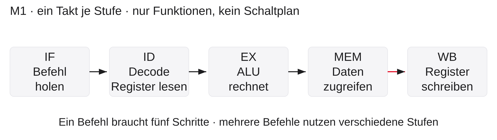{fig-alt="Fünf Funktionsstufen: IF holt einen Befehl, ID dekodiert und liest Register, EX rechnet, MEM bedient Datenzugriffe und WB schreibt das Ergebnis zurück."}

M1: höchstens ein neuer Befehl je Takt; Stufen verschiedener Befehle überlappen.

::: notes
CPU bedeutet Central Processing Unit, RISC in RISC-V Reduced Instruction Set Computer. M1 ist ein didaktisches Fünf-Stufen-Modell, keine vorgeschriebene Umsetzung jedes RISC-V-Kerns. IF steht für Instruction Fetch, Befehl holen. ID heißt Instruction Decode, dekodieren; hier werden auch Register gelesen. EX, Execute, führt beispielsweise eine arithmetische Rechnung aus. MEM, Memory, ist die Phase eines Datenzugriffs. WB, Write Back, schreibt ein Registerergebnis zurück.

ALU heißt Arithmetic Logic Unit, arithmetisch-logische Einheit. Sie berechnet in EX unter anderem Summen und Speicheradressen. Ein reiner Additionsbefehl benötigt keinen Nutzdatenzugriff in MEM, durchläuft im gleich langen Modell aber trotzdem diese Phase.

Die Abbildung wird von links nach rechts gelesen. Graue Kästen sind Stufen, Pfeile ihre Weitergabe; die rote Kennzeichnung hebt nur den Ergebnisweg hervor. Jede Stufe darf in einem Takt an einem anderen Befehl arbeiten. Das ist wie mehrere Arbeitsplätze an aufeinanderfolgenden Werkstücken: Ein Werkstück braucht mehrere Schritte, dennoch können nach dem Anlaufen regelmäßig Ergebnisse erscheinen. Durchlaufdauer und Ergebnisrate sind deshalb zu unterscheiden.
:::

## Überlappung ist bereits Parallelität

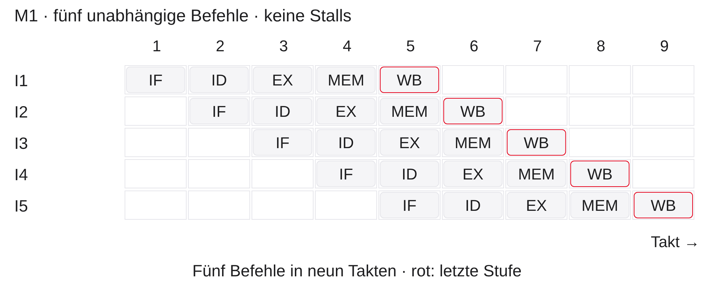{fig-alt="Fünf unabhängige Befehle durchlaufen die fünf Stufen diagonal über neun Takte. Ab Takt fünf beendet pro Takt einer die letzte Stufe."}

M1: fünf unabhängige Befehle, keine Wartezyklen.

::: notes
IF bedeutet Instruction Fetch, ID Instruction Decode, EX Execute, MEM Memory und WB Write Back. Die Stufen holen, dekodieren, rechnen, bedienen gegebenenfalls den Datenspeicher und schreiben das Ergebnis zurück. Das Modell betrachtet fünf unabhängige Befehle, sodass keiner einen noch fehlenden Wert seines Vorgängers braucht. Strukturelle Konflikte und Cache-Misses sind hier ausgeschlossen.

Die waagerechte Achse zählt Takte eins bis neun, die senkrechte listet Befehle I1 bis I5. Lesen Sie eine Zeile nach rechts für den Weg eines Befehls und eine Spalte nach unten für gleichzeitig besetzte Stufen. Graue Zellen zeigen die Bearbeitung; rot umrandet ist die letzte Phase. Ein Kästchen dauert einen Takt.

I1 erreicht WB in Takt fünf, I2 in sechs, I5 in neun. Obwohl zwischen dem ersten Start und letzten Ende neun Takte liegen, erscheinen im gefüllten Abschnitt Ergebnisse mit Abstand eins. Die Abbildung ist keine höhere Startbreite: Noch immer beginnt höchstens ein Befehl pro Takt. Für kurze Programme muss das Anlaufen in die mittlere Rate einbezogen werden.
:::

## Das kurze Fenster enthält Füllen und Leeren

Für $N$ unabhängige Befehle und $k$ gleich lange Stufen in M1:

$$
C=N+k-1
$$

Bei $N=5$, $k=5$: $C=9$ Takte, nicht fünf.

Bei $N=100$: $C=104$ Takte.

::: notes
$N$ ist die positive Anzahl betrachteter Befehle, $k$ die Anzahl Stufen und $C$ die Taktzahl vom ersten Start bis zum Ende des letzten Befehls. Jeder Befehl benötigt in M1 genau einen Takt je Stufe; neue Befehle beginnen im Abstand eines Takts. Es gibt keine Abhängigkeit, keinen Ressourcenstau und keinen Cache-Miss.

Der erste Befehl endet nach $k$ Takten. Jeder der verbleibenden $N-1$ Befehle endet einen Takt später als sein Vorgänger. Zusammen sind das $k+(N-1)=N+k-1$. Fünf Befehle und fünf Stufen ergeben neun Takte. Bei hundert Befehlen ergeben sich hundertvier Takte; der zusätzliche Anlauf fällt relativ weniger ins Gewicht.

Das ist eine Rechnung über ein endliches Zeitfenster. Die langfristige Rate kann sich einem Ergebnis je Takt nähern, ohne dass ein einzelner Befehl nur eine Stufe braucht. Bei null Befehlen ist diese Formel kein gültiges Zeitmodell; es wird gar keine Befehlsfolge bearbeitet. Der nächste Fall ergänzt eine konkrete Wartebedingung und zeigt, weshalb die Idealformel dann nicht genügt.
:::

## Forwarding verkürzt Warten, nicht die Abhängigkeit

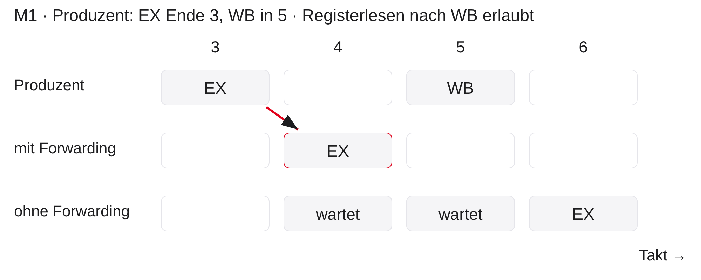{fig-alt="Ein ALU-Ergebnis entsteht Ende Takt drei. Mit Forwarding nutzt der Verbraucher es in EX Takt vier, ohne Forwarding liest er erst bei WB Takt fünf und rechnet in Takt sechs."}

M1: Registerschreiben und anschließendes Lesen im selben Takt erlaubt.

::: notes
ALU bedeutet Arithmetic Logic Unit, arithmetisch-logische Einheit. EX heißt Execute, Rechenphase, WB Write Back, Register-Rückschreiben. RAW steht für Read After Write: Ein jüngerer Leser benötigt den Wert eines älteren Schreibers. Forwarding oder Bypassing ist die direkte Weiterleitung eines bereits erzeugten Ergebnisses zur nächsten benötigenden Phase, bevor es den normalen Registerweg abgeschlossen hat.

Im Beispiel rechnet der Produzent in Takt drei; das Ergebnis ist am Taktende fertig. Mit einer passenden Weiterleitung kann der Verbraucher es für EX in Takt vier nutzen. Ohne diese Verbindung kommt der Wert erst in WB Takt fünf ins Registerfile. Wir erlauben dort Schreiben vor dem Lesen im selben Takt; der Verbraucher startet EX dann in sechs.

Die horizontale Achse ist Zeit in Takten. Der rote Pfeil zeigt die direkte Ergebnisweitergabe, graue Warteplätze die zwei verlorenen EX-Startgelegenheiten vier und fünf. In einer sonst unabhängigen Fünf-Befehle-Folge mit diesem einen Konflikt steigt das Fenster von neun auf elf Takte. Ein später Load kann andere Regeln verlangen. Forwarding erzeugt jedenfalls kein Ergebnis vor dessen Rechnung.
:::

## IPC und CPI brauchen dieselbe Zählbasis

Retired ISA-Befehle $N>0$, Core-Takte $C>0$, dasselbe Fenster:

$$
\mathrm{IPC}=\frac{N}{C},\qquad
\mathrm{CPI}=\frac{C}{N}=\frac{1}{\mathrm{IPC}}
$$

M1 mit fünf Befehlen: IPC $=5/9$, CPI $=9/5=1{,}8$.

::: notes
IPC heißt Instructions Per Cycle, Befehle pro Takt, CPI Cycles Per Instruction, Takte pro Befehl. ISA steht für Instruction Set Architecture, Befehlssatzarchitektur. Wir zählen endgültig bestätigte ISA-Befehle und Kerntakte innerhalb desselben Fensters. Retired bedeutet in diesem Zusammenhang bestätigt. Core bezeichnet den einzelnen Kern.

In unserem einfachen M1 werden fünf Befehle nach neun Takten erfolgreich beendet. Die mittlere Rate ist $5/9\approx0{,}556$, ihr Kehrwert $9/5=1{,}8$. Der spätere gefüllte Abschnitt mit einem Ende pro Takt ersetzt dieses ganze Fenster nicht. Ein einzelner Takt mit mehreren Abschlüssen ist ebenfalls noch keine mittlere Programmratenangabe.

Manche Prozessoren zerlegen einen ISA-Befehl in mehrere interne Mikrooperationen. Deren Zählung ist eine andere Größe und darf nicht unbemerkt als ISA-IPC eingesetzt werden. Auch unterschiedliche Messzeiträume, aktive statt vergangene Takte oder verschieden gezählte Befehle zerstören den Kehrwertvergleich. Für leere Fenster ist die Division nicht definiert. Erst eine benannte Zählbasis macht aus einem IPC-Wert eine überprüfbare Aussage; für Laufzeit brauchen wir außerdem die Frequenz.
:::

## Höheres IPC muss nicht kürzere Laufzeit bedeuten

Bei konstanter Frequenz $f$:

$$
T=\frac{N\cdot\mathrm{CPI}}{f}
$$

| Übersetzung | Befehle $N$ | CPI | Takte |
|-------------|-------------|-----|-------|
| A | $100$ | $1$ | $100$ |
| B | $150$ | $0{,}8$ | $120$ |

Bei $100$ MHz: $1\,\mu$s gegenüber $1{,}2\,\mu$s.

::: notes
IPC bedeutet Instructions Per Cycle, CPI Cycles Per Instruction. $T$ ist die betrachtete Laufzeit in Sekunden, $N$ die Zahl endgültig bestätigter Befehle und $f$ die konstante Kerntaktfrequenz in Hertz, Takten pro Sekunde. Das Produkt $N\cdot\mathrm{CPI}$ liefert die Taktzahl; Division durch $f$ die Zeit.

Die zwei Zeilen sind Modellübersetzungen derselben fachlichen Aufgabe, keine gemessenen Compilerresultate. A braucht hundert Befehle zu einem Takt im Mittel, also hundert Takte. B braucht hundertfünfzig zu acht Zehnteln, also hundertzwanzig Takte. Ihr IPC wäre $1/0{,}8=1{,}25$ und damit höher, dennoch ist das betrachtete Fenster länger.

Bei hundert Millionen Takten pro Sekunde entsprechen die beiden Mengen einer beziehungsweise einer Komma zwei Mikrosekunden. Eine Optimierung kann sowohl die Befehlszahl als auch den mittleren Aufwand ändern. Auch Frequenzwechsel oder andere Arbeit würden den direkten Vergleich beeinflussen. Für eine begründete Leistungsbewertung müssen daher Aufgabe, Zählfenster, Frequenz und Befehlsmenge feststehen. Eine größere interne Breite ist keine kostenlose Alternative zu dieser Prüfung.
:::

## Mehr Takt und mehr Breite kosten Energie

Vereinfachte dynamische Leistung:

$$
P_{\mathrm{dyn}}\approx\alpha C_{\mathrm{eff}}V^2f
$$

Bei festem $\alpha,C_{\mathrm{eff}}$:
$1{,}5$-facher Takt und $1{,}1$-fache Spannung ergeben Faktor $1{,}815$.

Leckleistung und zusätzliche Hardware sind getrennt zu betrachten.

::: notes
$P_{\mathrm{dyn}}$ bezeichnet die dynamische Schaltleistung in Watt. $\alpha$ ist ein dimensionsloser Aktivitätsfaktor, $C_{\mathrm{eff}}$ eine effektiv geschaltete Kapazität in Farad, $V$ die Versorgungsspannung in Volt und $f$ die Frequenz in Hertz. Die Formel beschreibt ein vereinfachtes Schaltmodell und keine vollständige Leistungsaufnahme des Prozessors.

Wenn Aktivität und Kapazität unverändert bleiben, multipliziert eine höhere Frequenz die Leistung linear, die Spannung geht quadratisch ein. Mit den angenommenen Faktoren entsteht $1{,}5\cdot1{,}1^2=1{,}815$, also einundachtzig Komma fünf Prozent mehr dynamische Leistung. Leckleistung wird damit nicht mitberechnet. Die Formel liefert auch keine universelle maximale Gigahertzfrequenz.

CPU bedeutet Central Processing Unit. Ein breiterer CPU-Kern benötigt beispielsweise zusätzliche Registerports, Auswahlhardware und Weiterleitungswege. Das kann Kapazität und Aktivität verändern; diese sind im Verhältnisbeispiel ausdrücklich festgehalten, im realen Umbau aber nicht automatisch konstant. Energie, Fläche und Reaktionszeit bleiben daher Abwägungen. Um vorhandene Ressourcen besser zu nutzen, müssen zuerst unabhängige Rechnungen im Programm gefunden werden.
:::

## ILP ist verfügbare Unabhängigkeit

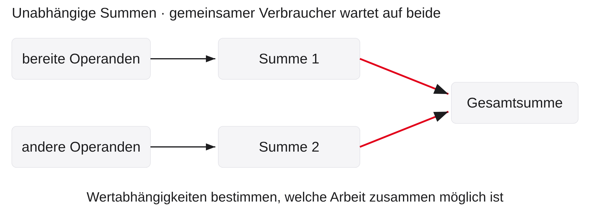{fig-alt="Zwei unabhängige Additionen bilden getrennte Datenwege; eine dritte Addition braucht beide Ergebnisse und verbindet sie erst danach."}

Bereite Operanden und passende Ressourcen bestimmen den möglichen Start.

::: notes
ILP bedeutet Instruction-Level Parallelism, Parallelität zwischen Befehlen desselben Programms. ALU heißt Arithmetic Logic Unit, arithmetisch-logische Einheit. ILP beschreibt hier, welche Operationen nicht aufeinander angewiesen sind; die tatsächlich erreichte Rate hängt zusätzlich von Ausführungseinheiten und Auswahlbreite ab.

Die Grafik zeigt zwei getrennte Summen aus bereits bereiten Registerwerten. Diese können unter passenden Bedingungen gleichzeitig in zwei ALUs entstehen. Die anschließende Summe braucht beide Ergebnisse. Die schwarzen Pfeile sind Wertabhängigkeiten, die rote Zusammenführung markiert den ersten gemeinsamen Verbraucher. Lesen Sie die Wege von links nach rechts.

Zwei C-Zeilen sind noch kein Beweis für zwei unabhängige Maschinenbefehle. Arrayzugriffe können Loads enthalten, Zeiger können auf denselben Speicher zeigen und eine Multiplikation kann eine andere Einheit benötigen. Das gezeichnete Beispiel setzt deshalb ausdrücklich bereite Registeroperanden voraus. Mehr Hardware beseitigt die Kante zur letzten Summe nicht. Wir unterscheiden anschließend eine echte Wertabhängigkeit von Konflikten, die nur durch wiederverwendete Registernamen entstehen.
:::

## RAW: Der Leser braucht den erzeugten Wert

RISC-V-Lehrfolge A–D, zunächst A und B:

```asm
lw  t0, 0(s1)     # A
add t1, t0, t2    # B
```

Bei Speicherwert $10$ und `t2` $=1$ muss B den Wert $10$ verwenden.

::: notes
RAW bedeutet Read After Write, Lesen nach Schreiben. Eine echte Wertabhängigkeit verbindet den Produzenten A mit dem Verbraucher B. RISC in RISC-V steht für Reduced Instruction Set Computer; der Ausschnitt verwendet dessen RV32I-Basis, Zweiunddreißig-Bit-Integerbefehle. `lw` lädt ein vier Byte breites Wort aus einem gültigen ausgerichteten Speicherbereich, `add` addiert Registerwerte.

`s1` ist das Basisregister der Modelladresse, `t0` das Ziel von A und eine Quelle von B. `t2` enthält eins, `t1` erhält das Ergebnis. Bei geladenen zehn entsteht elf. Solange A den Wert nicht geliefert hat, kann B diese Rechnung nicht korrekt abschließen. Ein alter Inhalt desselben Registernamens wäre kein Ersatz.

Forwarding kann den bereits bereiten Wert früher weitergeben; Renaming kann ihn unter einem anderen internen Namen festhalten. Keine dieser Techniken berechnet ihn vor dem Load. Der Konflikt hängt also an der fachlich benötigten Information, nicht bloß an einer Schreibweise. Die Folge wird um zwei Befehle ergänzt, damit auch alte und neue Versionen desselben Namens verfolgt werden können.
:::

## WAR: Der ältere Leser braucht die alte Version

```asm
add t1, t0, t2    # B liest t0
sub t0, t4, t5    # C schreibt neues t0
```

B braucht den Loadwert $10$; C erzeugt aus $8-3$ den neuen Wert $5$.

::: notes
WAR bedeutet Write After Read, Schreiben nach Lesen. B ist im Programm der ältere Leser von `t0`, C der jüngere Schreiber desselben Namens. RISC-V-Assembler bezeichnet `add` als Registeraddition und `sub` als Subtraktion. RISC heißt Reduced Instruction Set Computer, RV32I die Zweiunddreißig-Bit-Integerbasis.

Für das durchgehende Beispiel enthält `t2` eins, `t4` acht und `t5` drei. B soll den geladenen Wert zehn zu elf ergänzen und in `t1` schreiben. C erzeugt davon unabhängig fünf als neue Version von `t0`. Würde eine einfache Umsetzung dieses fünf zu früh über den alten Wert schreiben, könnte B fälschlich sechs berechnen.

B benötigt gerade nicht das neue Ergebnis von C. Der Konflikt ist deshalb eine Namensabhängigkeit und kein zusätzlicher Wertfluss von C nach B. Unterschiedliche physische Speicherplätze für beide Versionen können ihn lösen. Der Leser muss dabei seinen alten Quellnamen behalten; ein späterer Blick auf die zuletzt gültige Abbildung genügt nicht. Diese Anforderung motiviert die kommende Umbenennung.
:::

## WAW: Der jüngere Schreiber bestimmt den Endwert

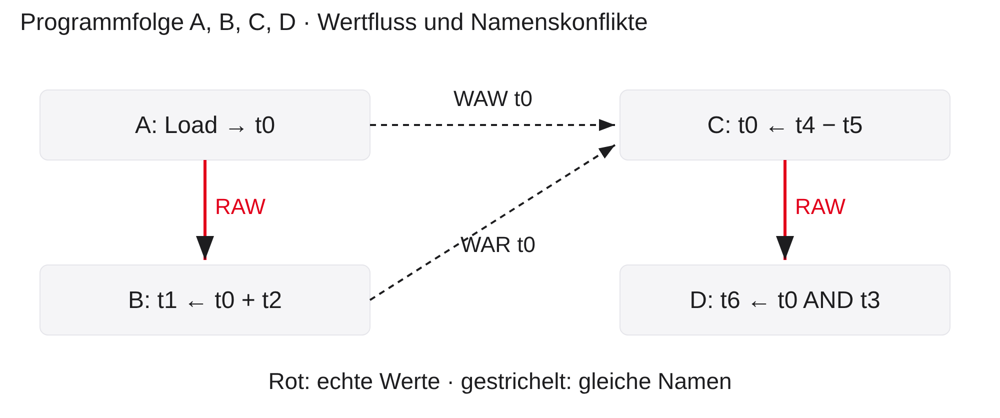{fig-alt="A nach B und C nach D sind RAW-Wertabhängigkeiten. A und C schreiben beide t0, während B die vorherige Version liest: zusätzlich WAW und WAR."}

A lädt `t0` $=10$, C schreibt später `t0` $=5$.

::: notes
WAW bedeutet Write After Write, Schreiben nach Schreiben. A und C schreiben denselben architektonischen Registernamen `t0`. Im sichtbaren Endzustand muss der Wert des jüngeren C gelten: fünf. Ihre Berechnung braucht aber nicht gegenseitig ihr Ergebnis. Das ist ein Namenskonflikt, der mit getrennten physischen Zielen entkoppelt werden kann.

RAW heißt Read After Write, Wertfluss vom Schreiber zum Leser, WAR Write After Read, Schutz einer älteren gelesenen Version vor einem jüngeren Überschreiben. Die Abbildung zeigt die vollständige Folge: A lädt `t0`, B addiert daraus nach `t1`, C subtrahiert nach `t0`, D verknüpft dieses neue `t0` bitweise mit `t3` nach `t6`. AND bedeutet bitweises Und. Bei `t3 = 7` ergibt D aus fünf bitweise Und sieben wieder fünf.

Rote durchgezogene Pfeile sind die echten Kanten A nach B und C nach D. Schwarze gestrichelte Pfeile zeigen WAR und WAW. Die Grafik gruppiert A und B links sowie C und D rechts; die Programmfolge bleibt A, B, C, D. Der gestrichelte WAR-Pfeil läuft deshalb von B zum höher gezeichneten C. Die Umsetzung muss richtige Versionen lesen und die endgültige Version bestätigen; sie muss nicht jede interne Fertigstellung derselben Namensschreiber in Programmreihenfolge erzwingen.
:::

## Superskalarität beschreibt Breite

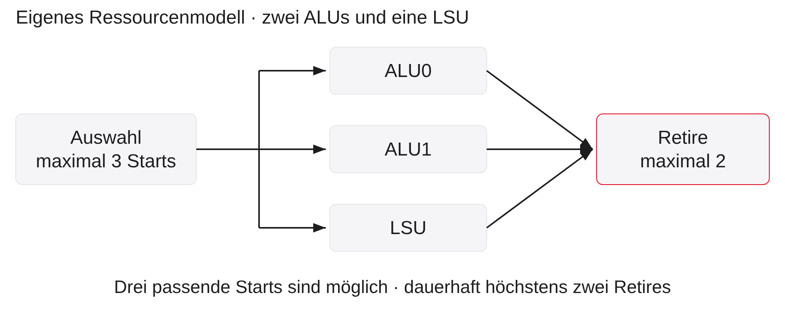{fig-alt="Ein Auswahlweg verteilt passende Operationen auf zwei ALUs und eine Load-Store-Einheit. Endgültig bestätigt werden im Modell höchstens zwei Befehle je Takt."}

Mehrere Starts pro Takt setzen passende Befehle und Ressourcen voraus.

::: notes
Superskalar heißt, dass eine Umsetzung mehrere Befehle in einem Takt ausgeben kann. Issue ist dieser ausgewählte Start, Retire die spätere endgültige Bestätigung. ALU bedeutet Arithmetic Logic Unit, LSU Load/Store Unit, Einheit für Laden und Speichern. CPU heißt Central Processing Unit.

Die Abbildung zeigt ein fiktives Ressourcenmodell mit zwei ALUs und einer LSU. Von der Auswahl in der Mitte führen Pfeile zu diesen unterschiedlichen Einheiten. Der rote Rand am Bestätigungsfeld markiert die auf zwei begrenzte Retire-Breite. Drei fertig werdende Ergebnisse pro Takt könnten diese Grenze nicht dauerhaft umgehen; ein endlicher Zwischenpuffer würde sich füllen.

Zwei unabhängige Adds passen möglicherweise zusammen, zwei Loads dagegen nicht in dieselbe einzelne LSU-Startgelegenheit. Die Ports und unterstützten Operationstypen müssen stimmen. Superskalarität ist auch nicht gleich Out-of-Order: Ein breiter Kern kann die Startreihenfolge weiterhin am Programm orientieren. Um Breite ohne andere Änderungen zu vergleichen, verwendet die folgende Folie ein ausdrücklich verkürztes Zeitmodell.
:::

## Vier Befehle: breit starten und breit bestätigen

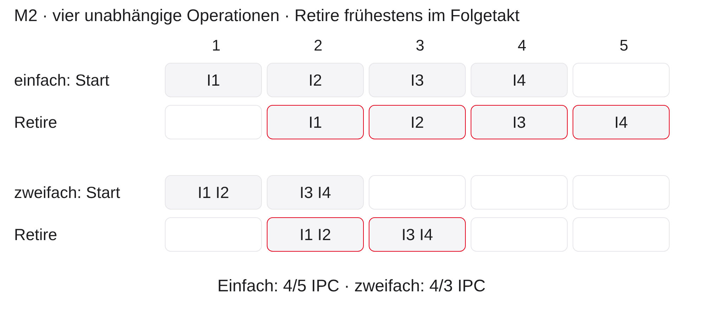{fig-alt="M2 vergleicht vier unabhängige Ein-Takt-Operationen. Ein Start und ein Retire je Takt benötigen fünf Takte, zwei Starts und zwei Retires drei."}

M2: Ergebnis am Starttaktende, Retire frühestens im Folgetakt.

::: notes
IPC bedeutet Instructions Per Cycle, bestätigte Befehle pro Takt. Issue ist der Start, Retire oder Commit die endgültige Bestätigung. M2 ist bewusst nicht die Fünf-Stufen-Pipeline M1. Alle vier Befehle sind zu Beginn bereit, haben keine gegenseitige Abhängigkeit und benötigen je einen Rechentakt. Bestätigung erfolgt frühestens im nächsten Takt.

Im skalaren Vergleich starten I1 bis I4 in eins bis vier und werden in zwei bis fünf bestätigt. Das betrachtete Fenster umfasst fünf Takte, also $4/5=0{,}8$ IPC. In der zweifachen Variante starten die Paare I1/I2 in eins und I3/I4 in zwei. Ihre Bestätigung folgt in zwei beziehungsweise drei, insgesamt $4/3\approx1{,}333$ IPC.

Die waagerechte Richtung zählt Takte. Graue Markierungen sind Starts, rote Bestätigungen; beide Bahnen zählen dieselben vier Befehle. Zwei Bestätigungen in einem einzelnen Takt erlauben daher nicht, das ganze kurze Fenster als IPC zwei zu bezeichnen. Startbreite, Bestätigungsbreite und Fenstergrenzen sind eigene Angaben. Der Vergleich isoliert diese Breiten, statt mit einem anderen Pipelineaufbau eine scheinbare Beschleunigung zu erzeugen.
:::

## Latenz und Initiationsintervall sind verschieden

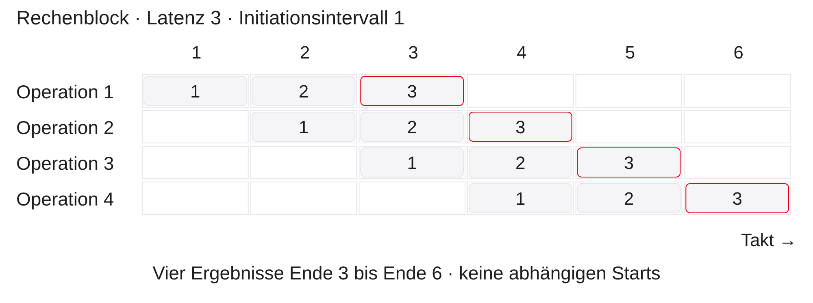{fig-alt="Vier unabhängige Operationen beginnen in Takten eins bis vier und belegen jeweils drei interne Rechenphasen. Ergebnisse entstehen an den Enden von drei bis sechs."}

Lehrblock: Latenz $3$ Takte, neuer Start alle $1$ Takt.

::: notes
Latenz ist hier die Zeit vom Operationsstart am Taktbeginn bis zur Fertigstellung am Ende der dritten Phase: drei Takte. Das Initiationsintervall ist der Mindestabstand aufeinanderfolgender Starts. Ein vollständig pipelinierter Rechenblock kann ein Intervall von einem Takt besitzen, obwohl jedes einzelne Ergebnis erst später fertig wird.

Die Grafik liest sich zeilenweise von links nach rechts. Vier unabhängige Operationen starten in eins, zwei, drei und vier. Ihre drei grauen Rechenphasen enden in drei, vier, fünf und sechs; rot ist jeweils das Ergebnisende. Ein abhängiger Verbraucher könnte das erste Resultat im Modell erst ab Takt vier nutzen.

Nach dem Füllen entsteht ein Ergebnis pro Takt, nicht nur alle drei Takte. Das ist keine Garantie für eine Kette abhängiger Multiplikationen. RISC in RISC-V heißt Reduced Instruction Set Computer. Ein Maschinenbefehl `mul` braucht dort eine passende Multiplikationserweiterung, nicht nur die RV32I-Integerbasis. Die Zeichnung ist deshalb als abstrakter Rechenblock bezeichnet. Durchsatz, Einzelwartezeit und vorhandener Befehlssatz sind verschiedene Voraussetzungen einer tatsächlichen Ausführung.
:::

## Fetch-Bytes sind keine feste Befehlszahl

- $16$ vollständig ausgerichtete Bytes: vier 32-Bit-Befehle
- Mit nur 16-Bit-Befehlen wären es acht
- Mischungen und Grenzen verändern die Aufteilung
- Decode-, Issue- und Retire-Breite bleiben getrennte Limits

::: notes
Fetch bedeutet Befehlsholen, Decode dessen Entschlüsselung, Issue Start in einer ausgewählten Einheit und Retire endgültige Bestätigung. Die Bytezahl eines Fetchpakets ist deshalb keine automatische Anzahl pro Takt bestätigter Befehle.

RISC-V ist die Befehlssatzfamilie; RISC bedeutet Reduced Instruction Set Computer. Im Grundmodell RV32I sind die betrachteten Befehle zweiunddreißig Bit oder vier Bytes breit. Ein passend an vollständigen Befehlen beginnender sechzehn-Byte-Abschnitt enthält dann vier Stück. Die optionale C-Erweiterung unterstützt komprimierte Befehle mit sechzehn Bit, also zwei Bytes; bei ausschließlich solchen Befehlen wären es acht. C bezeichnet hier eine Befehlssatzerweiterung, nicht die Programmiersprache.

Mischungen, Fetchgrenzen, Sprungziele und fehlende Cacheblöcke können die tatsächliche Lieferung verändern. Selbst acht geholte Befehle werden bei einer Decode-Breite von drei nicht sofort alle dekodiert. Ein früher Puffer kann unterschiedliche Breiten kurzzeitig entkoppeln, aber den langsamsten dauerhaften Abschnitt nicht unbegrenzt überholen. Diese Sicht auf endliche Puffer kennen Sie aus der Datenbewegung. Als nächste Frage bleibt, welche bereiten Befehle überhaupt ausgewählt werden dürfen.
:::

## Out-of-Order ändert die Startreihenfolge

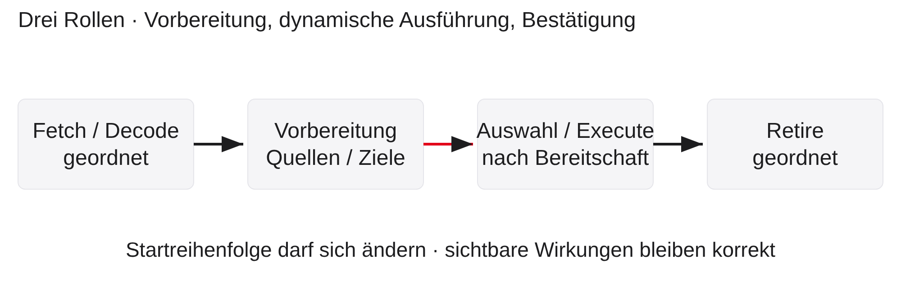{fig-alt="Befehle werden geordnet geholt und vorbereitet, anschließend nach Bereitschaft ausgeführt und zuletzt wieder in Programmordnung bestätigt."}

Ein Kern mit Issue-Breite eins kann bereits Out-of-Order arbeiten.

::: notes
OoO bedeutet Out-of-Order Execution, Ausführung außerhalb der ursprünglichen Reihenfolge. CPU heißt Central Processing Unit. Gemeint ist hier, dass ein jüngerer bereiter Befehl seine Operation starten darf, obwohl ein älterer auf einen Operanden wartet. Die Hardware bleibt getaktet; „außerhalb der Reihenfolge“ bedeutet nicht asynchron ohne Takt.

Die Grafik trennt drei Aufgaben. Links werden der vorhergesagte Befehlsstrom geholt, dekodiert und vorbereitet; Fetch heißt Holen und Decode Dekodieren. Execute heißt Ausführen. Die mittlere Auswahl darf nach Datenbereitschaft und Ressourcen entscheiden. Rechts werden endgültige Wirkungen wieder in Programmordnung bestätigt. Rote Pfeile heben die veränderte Auswahl hervor, schwarze die geordnete Weitergabe. Das Modell braucht dafür Zustand über mehrere noch nicht bestätigte Befehle.

Breite und Reihenfolge sind unabhängig: Ein Start je Takt kann jüngere Arbeit vorziehen, und mehrere Starts je Takt können trotzdem streng den nächsten Programmplatz verlangen. Out-of-Order überlappt verfügbare Arbeit mit Wartezeit; es entfernt keine benötigten Werte. Damit ältere und jüngere Namensversionen nicht verwechselt werden, wird vor der Auswahl zunächst die Registerabbildung festgelegt.
:::

## Architekturregister und physische Versionen

- RV32I: $32$ sichtbare Integernamen; `x0` ist fest null
- Physische Register speichern interne Versionen
- Eine Abbildung verbindet Namen und aktuelle Version
- Mehr interne Plätze ändern den sichtbaren Befehlssatz nicht

::: notes
ISA heißt Instruction Set Architecture, Befehlssatzarchitektur. RISC in RISC-V bedeutet Reduced Instruction Set Computer. RV32I bezeichnet deren Zweiunddreißig-Bit-Integerbasis mit zweiunddreißig Registernamen. Einunddreißig sind beschreibbar, `x0` ist die feste Null. Die Bitbreite im Namen ist nicht die Registeranzahl.

Ein architektonischer Name wie `t0` benennt den Wert, den ein Programm an einer gültigen Grenze sehen soll. Ein physisches Register ist ein interner Speicherplatz für eine bestimmte Version. Eine Umsetzung kann mehr solche Plätze als sichtbare Namen besitzen. Eine universelle Mindestzahl, etwa über hundert, wird daraus nicht abgeleitet.

Renaming heißt Registerumbenennung. Statt einen alten Platz sofort zu überschreiben, reserviert ein jüngerer Schreiber einen anderen. Quellen erhalten beim Vorbereiten die passenden bisherigen Versionskennungen. Die spekulative aktuelle Abbildung und der bereits bestätigte Programmzustand sind dabei nicht zwangsläufig identisch. Befehle ohne Registerziel und die feste Null benötigen kein gewöhnliches neues Ziel. Der nächste konkrete Ablauf zeigt, warum Quellen vor dem Aktualisieren ihrer Zielabbildung festgehalten werden.
:::

## Renaming: Quellen festhalten, neues Ziel vergeben

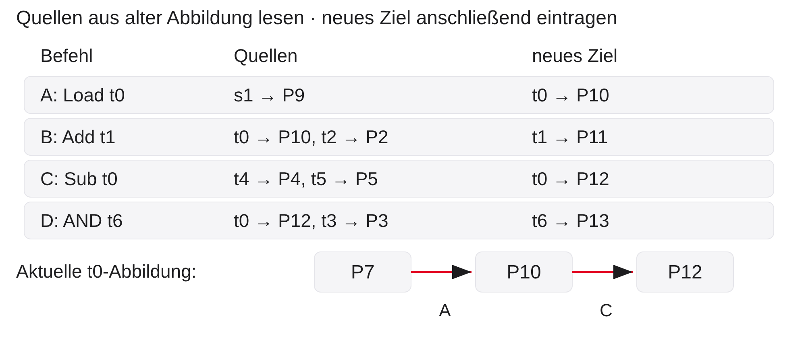{fig-alt="A bis D erhalten Ziele P10 bis P13. B liest die von A erzeugte Quelle P10, D die von C erzeugte Quelle P12; t0 wird zunächst P10 und danach P12 zugeordnet."}

Start: `t0` $\mapsto$ P7; freie Ziele P10, P11, P12, P13.

::: notes
Renaming ist die Registerumbenennung auf physische Versionen. Die Kennung P mit Zahl bezeichnet hier einen physischen Platz, keinen weiteren architektonischen Registerbefehl. Die Folge A bis D ist das Namensbeispiel: A lädt `t0`, B addiert nach `t1`, C subtrahiert nach `t0` und D verknüpft nach `t6`. Die übrigen Quellen besitzen bereits feste Abbildungen: `s1` auf P9, `t2` auf P2, `t3` auf P3, `t4` auf P4 und `t5` auf P5. Add heißt Addition, Sub Subtraktion, Load Laden und AND bitweises Und.

Lesen Sie die grauen Zeilen von oben nach unten. A erhält P10. B hält als Quelle P10 fest und erhält P11 als Ziel. C erhält P12; die aktuelle Abbildung für `t0` wandert damit zu P12. D liest diese neue Quelle P12 und erhält P13. Der rote Versionsweg unten zeigt `t0` von P7 über P10 zu P12.

Quellen werden jeweils aus der zum Programmplatz passenden Abbildung gelesen, bevor das neue Ziel eingetragen wird. B behält P10 auch dann, wenn C inzwischen vorbereitet ist. RAW, Read After Write, bleibt deshalb als echte Quelle-Ziel-Abhängigkeit bestehen. WAR, Write After Read, und WAW, Write After Write, kollidieren nicht mehr auf einem einzigen Speicherplatz. Die verschiedenen Versionen müssen allerdings lange genug erhalten bleiben.
:::

## Die aktuelle Abbildung ersetzt keinen alten Quelltag

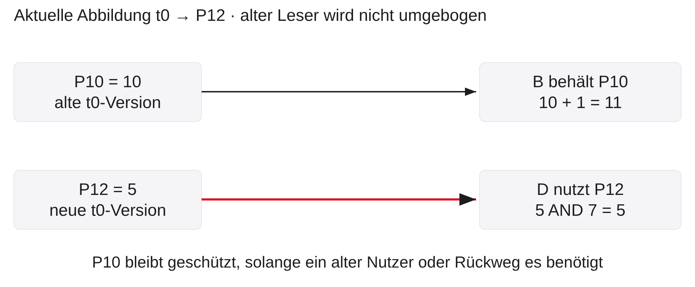{fig-alt="B behält Quelle P10 mit dem Loadwert zehn, obwohl die neuere Abbildung t0 bereits auf P12 mit fünf zeigt. D liest P12. Beide Leser erhalten verschiedene richtige Versionen."}

B berechnet $10+1=11$; D berechnet $5\ \mathrm{AND}\ 7=5$.

::: notes
Ein Tag ist hier eine Kennung eines physischen Registers. PRF bedeutet Physical Register File, physische Registerdatei. Sie speichert im gewählten Modell die Zahlenwerte verschiedener noch benötigter Versionen. Die aktuelle spekulative Abbildung von `t0` kann schon P12 nennen, während ein älterer Leser B weiterhin P10 benötigt.

Die Abbildung zeigt links diese beiden Plätze und rechts die zugehörigen Verbraucher. Schwarze Pfeile verbinden P10 mit B, rote P12 mit D. A liefert später zehn nach P10; C hat fünf nach P12 geschrieben. B erhält deshalb elf, D mit seiner anderen Quelle `t3 = 7` den Wert fünf. AND bedeutet bitweises Und: Nur Stellen mit einer Eins in beiden Operanden bleiben eins.

Ein Versionswechsel gibt P10 nicht sofort zur Wiederverwendung frei. In einem üblichen Modell kann die durch einen Schreiber ersetzte alte Version erst bei seiner geordneten Bestätigung und nach gesicherter Lebensdauer freigegeben werden. Ein Fehlerpfad muss ebenfalls die gültige Abbildung wiederherstellen können. Renaming löst den Namenskonflikt durch zusätzliche Plätze und Verwaltung, nicht durch Ignorieren älterer Leser.
:::

## Bereit heißt noch nicht ausgewählt

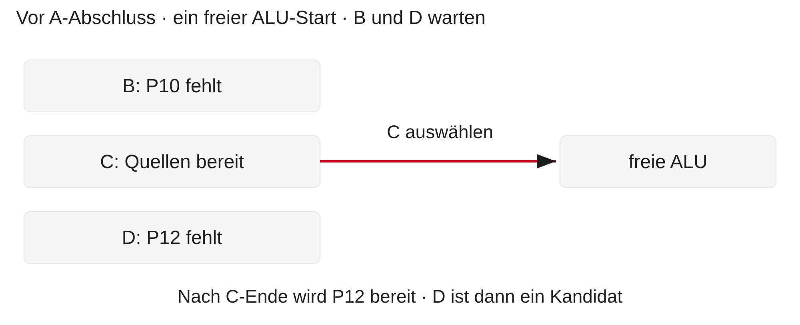{fig-alt="Eine Issue-Queue enthält B mit fehlendem P10, C mit bereiten Quellen und D mit fehlendem P12. Ein Scheduler wählt C für die freie ALU; nach dessen Ende kann D bereit werden."}

Operanden, freie Einheit, Port und Startbudget gemeinsam prüfen.

::: notes
Eine Issue Queue ist ein Auswahlpuffer für vorbereitete Operationen; verteilte Reservation Stations, Reservierungsstationen, sind eine mögliche andere Anordnung. ALU bedeutet Arithmetic Logic Unit, arithmetisch-logische Einheit. Der Scheduler ist die Auswahlhardware. Er berücksichtigt Operandenbereitschaft und verfügbare Startmöglichkeiten.

Im Bild wartet B auf P10 aus dem langsamen Load. C hat beide Quellen und kann in die einzelne freie ALU starten. D braucht P12, also das Ergebnis von C, und wird erst nach dessen Fertigstellung bereit. Lesen Sie den roten Auswahlpfeil nach rechts. Graue Zeilen mit fehlender Quelle sind keine sofort ausführbaren Kandidaten.

Wenn C fertig wird, markiert die Umsetzung seinen Zieltag bereit. Ein Nutzer kann den Wert aus der physischen Datei oder über einen Bypass erhalten. Diese Weckinformation ist noch keine Garantie, dass alle Nutzer im selben Takt starten; ein Port oder das Issue-Budget kann belegt sein. Die Zeichnung behauptet keinen einzelnen universellen Datenbus für jede Architektur. Für einen vollständigen Zeitvergleich werden jetzt Breiten, Latenzen und die Bestätigungsregel ausdrücklich festgelegt.
:::

## Ein festes Modell für den Reihenfolgevergleich

M3 beginnt beim ersten Issue; A–D sind bereits dekodiert und umbenannt.

| Eigenschaft | Lehrannahme |
|-------------|-------------|
| Issue | maximal $1$ je Takt |
| Einheiten | eine ALU, eine LSU |
| A: Load | Ergebnis Ende Takt $4$ |
| übrige Operationen | Ergebnis Ende ihres Starttakts |
| Retire | maximal $2$, geordnet, frühestens im Folgetakt |

::: notes
Issue heißt Start, Retire endgültige Bestätigung, ALU Arithmetic Logic Unit und LSU Load/Store Unit. M3 verwendet die bekannte Folge A Load nach `t0`, B Addition nach `t1`, C Subtraktion nach `t0` und D bitweises Und nach `t6`. Renaming hält dabei die beiden Versionen von `t0` getrennt.

Vor Takt eins sind alle vier Befehle schon dekodiert, umbenannt und im jeweiligen Auswahlzustand vorhanden. Das betrachtete Fenster zählt deshalb nur vom ersten Issue bis zum letzten Retire, nicht die gesamte Vorbereitung einer Anwendung. A startet in eins und liefert wegen angenommener Speicherwartezeit erst Ende vier. ALU-Ergebnisse sind jeweils am Ende ihres Starttakts bereit. Abhängige Nutzer starten frühestens im nächsten Takt.

Zur Bestätigung stehen maximal zwei Plätze pro Takt zur Verfügung. Ein fertiger Befehl wird erst im Folgetakt und nur nach allen älteren bestätigt. Beide Varianten besitzen identische Ressourcen und Latenzen. Der In-Order-Vergleich darf einen blockierten nächsten Befehl nicht überspringen; Out-of-Order darf jüngere bereite Kandidaten wählen. Andere reale Kerne können andere Stau- und Bestätigungsregeln besitzen. Nur mit diesen vollständigen Angaben sind die folgenden Pläne eindeutig.
:::

## In-Order: B blockiert die jüngeren Starts

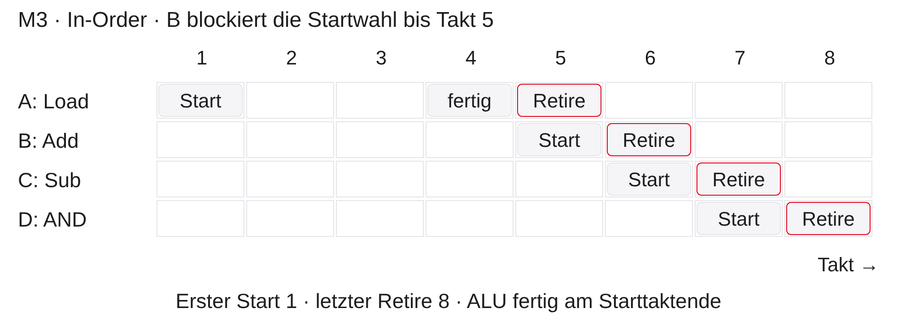{fig-alt="M3: A startet in eins, B wartet bis fünf, C startet in sechs und D in sieben. Retire erfolgt für A in fünf, B in sechs, C in sieben und D in acht."}

Fenster: erster Start in Takt $1$ bis letzter Retire in Takt $8$.

::: notes
In-Order Issue wählt hier streng den nächsten Programmplatz. A ist der Load, B braucht dessen Ergebnis, C schreibt eine neue Version von `t0` und D braucht diese neue Version. ALU bedeutet Arithmetic Logic Unit, LSU Load/Store Unit. Add ist Addition, Sub Subtraktion, Load Laden und AND bitweises Und. Das Lehrmodell besitzt einen Start je Takt und maximal zwei geordnete Retires, endgültige Bestätigungen, je Takt.

In Takt eins startet A. B ist als nächster Befehl bis zum Ende vier nicht bereit und blockiert deshalb die Auswahl in zwei, drei und vier. In fünf startet B, in sechs C und in sieben D. Die Fertigstellung der ALU-Operationen liegt jeweils am Starttaktende. Die frühestmöglichen Bestätigungen sind somit fünf für A, sechs für B, sieben für C und acht für D.

Die Grafik listet Programmzeilen senkrecht, Takte waagerecht. Graue Startflächen und Bereitschaftsmarken unterscheiden sich von rot umrandeten Retires. Gestrichelte Warteabschnitte kennzeichnen den fehlenden Loadwert, keine weiteren ausgeführten Befehle. Das Fenster hat acht Takte. Die Daten sind weiterhin korrekt: B ergibt elf, die jüngere `t0`-Version fünf und D ebenfalls fünf. Jüngere unabhängige Arbeit konnte in diesem Auswahlmodell nur nicht vorgezogen werden.
:::

## Out-of-Order: C und D nutzen die Wartezeit

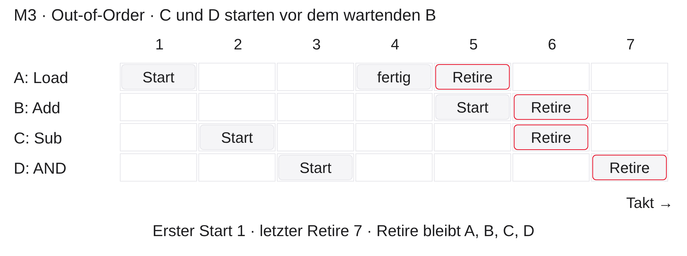{fig-alt="M3: A startet in eins, C in zwei, D in drei und B erst in fünf. Geordnetes Retire erfolgt A in fünf, B und C in sechs sowie D in sieben."}

Startreihenfolge A, C, D, B; Bestätigung A, B, C, D.

::: notes
OoO bedeutet Out-of-Order Execution, Ausführung außerhalb der Programmreihenfolge. Issue ist der Start und Retire die geordnete endgültige Bestätigung. RAW heißt Read After Write, echte Wertabhängigkeit. Das gleiche M3 besitzt weiterhin nur einen Start je Takt, eine ALU, Arithmetic Logic Unit, und eine LSU, Load/Store Unit.

A startet in eins. C ist unabhängig vom geladenen Wert und startet in zwei; sein Ziel ist die eigene physische Version P12. D verwendet diese Version ab drei und ergibt durch AND, bitweises Und, mit `t3 = 7` fünf. B bleibt an die Quelle P10 aus A gebunden und kann erst in fünf starten. In vier gibt es keinen weiteren Start. Die RAW-Kanten A nach B und C nach D sind also vollständig erhalten.

Rot umrandete Retiremarken stehen in Programmordnung: A in fünf, B und C in sechs, D in sieben. C und D sind zwar früh fertig, dürfen B aber nicht bei der Bestätigung überholen. Die waagerechte Achse zählt Takte, die Zeilen behalten die ursprüngliche Reihenfolge. So lässt sich das Vorziehen direkt erkennen. Der Miss wurde überlappt und nicht entfernt; das gewählte Fenster endet lediglich einen Takt früher.
:::

## Die Bilanz hängt am ganzen Fenster

| M3-Variante | Takte | IPC | CPI |
|-------------|-------|-----|-----|
| In-Order | $8$ | $4/8=0{,}5$ | $8/4=2$ |
| Out-of-Order | $7$ | $4/7\approx0{,}571$ | $7/4=1{,}75$ |

Zeitreduktion: $1-7/8=12{,}5\,\%$.

Beschleunigungsfaktor: $8/7\approx1{,}143$.

::: notes
IPC bedeutet Instructions Per Cycle, CPI Cycles Per Instruction. Beide Größen zählen die vier erfolgreich bestätigten Befehle im benannten Fenster. Die In-Order-Variante braucht acht Takte, die andere sieben. Division liefert die vier Tabellenwerte. Ihre Kehrwertbeziehung gilt, weil Programm und Zeitbasis jeweils übereinstimmen.

Bei unveränderter Frequenz ist die neue Fensterdauer sieben Achtel der alten, also zwölf Komma fünf Prozent kürzer. Der Beschleunigungsfaktor ist dagegen alte durch neue Zeit, acht Siebtel. Rund vierzehn Komma drei Prozent mehr Rate und zwölf Komma fünf Prozent weniger Zeit sind deshalb keine widersprüchlichen Ergebnisse.

Die zwei in Takt sechs bestätigten Befehle begründen nicht IPC zwei für das ganze Programm. Auch war dieses Beispiel nicht der Ressourcenfall mit zwei ALUs, Arithmetic Logic Units, arithmetisch-logischen Einheiten: M3 besitzt nur eine arithmetisch-logische Einheit und einen Start pro Takt. Es isoliert die Reihenfolge. Fetch und Renaming vor dem ersten Start sind nicht enthalten; daraus folgt keine gemessene Beschleunigung einer vollständigen Anwendung. Als nächste offene Frage bleibt, welche Verwaltung die frühe Fertigstellung ohne falschen Programmzustand erlaubt.
:::

## Der ROB verwaltet Ordnung und Status

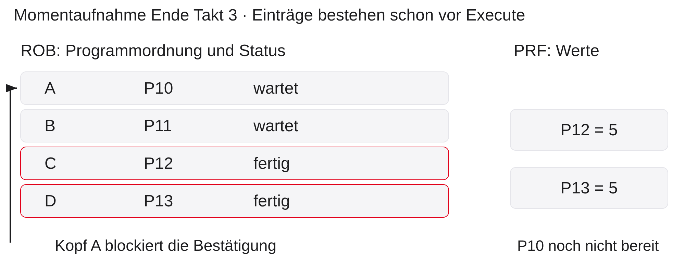{fig-alt="Am Ende von Takt drei stehen A und B noch nicht bereit, C und D sind fertig. Der ROB hält Reihenfolge und Status, während die Zahlenwerte fünf in P12 und P13 der physischen Registerdatei stehen."}

Lehrmodell: Zahlenwerte in der PRF, Status und Reihenfolge im ROB.

::: notes
ROB bedeutet Reorder Buffer, Puffer zur geordneten Bestätigung. PRF heißt Physical Register File, physische Registerdatei. Im gewählten Modell liegen berechnete Zahlenwerte in der PRF; der ROB verfolgt unter anderem Programmordnung, Zielversion, Fertigstatus und mögliche Exceptions. Ein ROB-Eintrag entsteht bereits bei der geordneten Aufnahme, nicht erst nach Ende der Rechnung, Execute oder Ausführung.

Die Grafik ist eine Momentaufnahme am Ende von Takt drei in M3. Die Reihenfolge links bleibt A, B, C, D. A wartet auf Speicher, B auf A. C und D sind fertig und besitzen rechts Werte fünf in P12 beziehungsweise P13. Die roten Bereitschaftsmarkierungen erlauben dennoch kein Vorbeispringen am ältesten A.

Lesen Sie den Bestätigungskopf oben zuerst. Erst wenn dieser erfolgreich fertig ist, darf die Reihenfolge weitergehen. Ein bestimmter Prozessor kann Datenstrukturen anders organisieren oder mehrere interne Operationen je ISA-Befehl besitzen; ISA bedeutet Instruction Set Architecture. Hier ist ein Eintrag je Beispielbefehl festgelegt. Entscheidend ist die Trennung von schon berechnetem internem Wert und bestätigter architektonischer Wirkung. Diese Trennung macht auch einen präzisen Fehlerzustand möglich.
:::

## Eine Exception bestätigt kein jüngeres Ergebnis

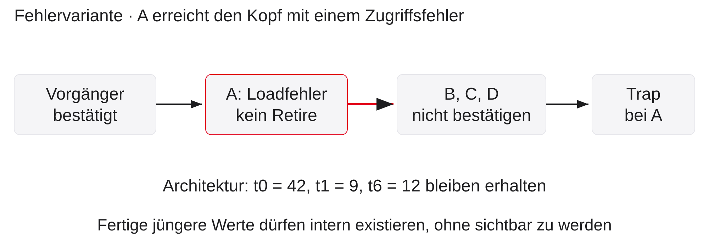{fig-alt="Variante: A meldet einen Load-Zugriffsfehler. Bereits bestätigte Vorgänger bleiben erhalten, A sowie B, C und D erhalten keine normalen bestätigten Wirkungen."}

Fehlervariante von M3: A lädt aus einem nicht erlaubten Bereich.

::: notes
Eine synchrone Exception ist ein durch einen konkreten Befehl ausgelöster Ausnahmefall. In dieser Variante meldet der Load A einen Zugriffsfehler, statt den zuvor angenommenen gültigen Speicherwert zehn zu liefern. Ein gewöhnliches RV32I-`add` löst dagegen keinen Integerüberlauf-Trap aus. RISC-V ist die Befehlssatzfamilie; RISC heißt Reduced Instruction Set Computer, RV32I ihre Zweiunddreißig-Bit-Integerbasis.

ROB bedeutet Reorder Buffer. Die vorgezogenen C und D können intern bereits fünf berechnet haben. Sobald der fehlerhafte älteste A behandelt wird, dürfen weder dessen normale Wirkung noch die jüngeren B, C und D bestätigt werden. Vor A erfolgreich bestätigte Vorgänger bleiben bestehen. Die Trapbehandlung erhält einen zur Fehlerstelle passenden Zustand und die Information über A.

Die Grafik wird von links nach rechts gelesen: bestätigter Vorgänger, fehlerhafte Stelle, verworfener jüngerer Bereich. Rot markiert den Fehler und die gesperrte Bestätigung, nicht eine Löschung sämtlichen Speichers. Bei anfänglich `t0 = 42`, `t1 = 9` und `t6 = 12` bleiben diese Werte im architektonischen Zustand erhalten. Interne fertige Versionen sind kein Beweis, dass das Programm sie gesehen hat.
:::

## Interrupt und Exception brauchen verschiedene Grenzen

| Ereignis | Zuordnung |
|----------|-----------|
| Exception | zu einem bestimmten fehlerhaften Befehl |
| Interrupt | externe Anforderung, Annahme an zulässiger Grenze |

Ein gültiger Zustand ist ein bestätigter Programmanfang, kein Gemisch beliebiger Fertigstellungen.

::: notes
Ein Interrupt ist eine asynchrone Unterbrechungsanforderung, etwa von einer Peripherie. Eine synchrone Exception gehört dagegen zu einem bestimmten Befehl, beispielsweise dem fehlgeschlagenen Load der vorigen Folie. Diese Unterscheidung knüpft an Vorlesung 3 an. CPU bedeutet Central Processing Unit.

Eine präzise Grenze bedeutet hier, dass der sichtbare Zustand einem vollständig bestätigten Anfang der Programmfolge entspricht. In der erfolgreichen M3-Folge könnte ein vereinbarter Grenzzustand nach A `t0 = 10` enthalten, während B und die jüngeren Wirkungen noch unbestätigt sind. Die Hardware legt fest, an welchen tatsächlichen Grenzen sie einen Interrupt annimmt; nicht jede interne Fertigstellung ist eine solche Grenze.

Eine Exception an A lässt dagegen dessen normale Wirkung und alle jüngeren aus. Früher bestätigte Arbeit wird nicht pauschal zurückgesetzt. Auch ein Interrupt ist kein automatischer Reset des Systems oder einer extern versorgten Peripherie. Die Wiederaufnahme benötigt eine zur Ursache passende gespeicherte Adresse und Verwaltungsinformation. Geordnetes Retire hilft, diese Zustände zu erhalten, beantwortet aber noch nicht jeden Zeitpunkt einer Speicherwirkung gegenüber anderen Beobachtern.
:::

## Ein Store hat mehr als einen Abschlusszeitpunkt

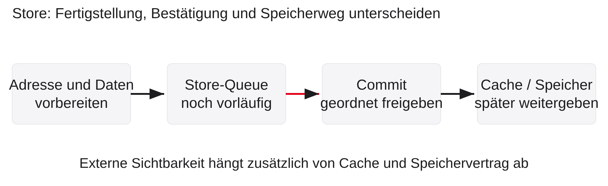{fig-alt="Eine Store-Operation berechnet Adresse und Daten, wartet in einer Queue, wird geordnet bestätigt und gelangt erst über den freigegebenen Speicherpfad zur Cache- oder Speicherebene."}

Bestätigen, zum Speicherpfad weitergeben und extern sichtbar werden unterscheiden.

::: notes
Store bedeutet Speichern. LSU heißt Load/Store Unit, Lade- und Speichereinheit. Eine Queue ist ein Puffer. Bei einem gewöhnlichen spekulativen Speicher-Store können Adresse und Daten schon intern bereitstehen, während eine ältere Entscheidung noch fehlt. Der Puffer hält diese Information, statt eine beliebige sichtbare Wirkung sofort auszulösen.

Lesen Sie die Grafik von links nach rechts. Graue Kästen sind Vorbereitung und Warteschlange. Der rote Übergang markiert die geordnete Freigabe nach erfolgreichem Commit, endgültiger Bestätigung. Erst danach folgt das Entleeren auf den Speicherpfad. Zeitpunkt der Bestätigung, Cacheänderung und Sichtbarkeit für einen anderen Kern oder DMA, Direct Memory Access, sind nicht automatisch identisch.

Bei einer älteren Exception darf ein jüngerer noch unbestätigter Store keine gewöhnliche bestätigte Speicherwirkung erhalten. Trotzdem erzeugt In-Order-Retire nicht allein eine universelle globale Speicherordnung. Cache, Speichervertrag und Barrieren bestimmen zusätzliche Regeln. Gerätezugriffe mit Nebenwirkungen benötigen besondere Plattformbedingungen und sind nicht beliebig spekulative normale Speicherzugriffe. Die Folie beschreibt ein konzeptionelles Pufferverfahren, keine zugesagte Registerstruktur jeder CPU, Central Processing Unit.
:::

## Register-Renaming löst keine Speicheraliase

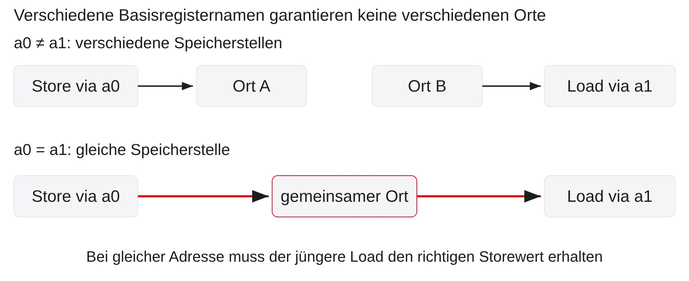{fig-alt="Store über a0 und Load über a1 können auf dieselbe Speicheradresse zeigen, obwohl ihre Basisregisternamen verschieden sind. Gleiche Adresse verlangt die richtige neue Wertversion."}

Verschiedene Zeigernamen sind kein Beweis für unabhängige Speicherstellen.

::: notes
Ein Alias bedeutet hier, dass unterschiedliche Adressausdrücke denselben Speicherplatz bezeichnen. Register-Renaming gibt Registernamen physische Versionen. Es beweist aber nicht, dass ein Store über `a0` und ein jüngerer Load über `a1` verschiedene Speicherstellen treffen. Die beiden Basisregister könnten dieselbe Zahl enthalten. Für die Zeichnung setzen wir gleich breite ausgerichtete Wortzugriffe voraus; verschiedene dargestellte Orte überlappen nicht.

Die Grafik zeigt zwei Fälle von oben nach unten. Bei unterschiedlichen Adressen kann eine unabhängige Bearbeitung möglich sein. Bei gleicher Adresse braucht der jüngere Load den gemäß Programmfolge zuletzt geschriebenen Wert, nicht unbemerkt die alte Speicherkopie. Rot hebt den gemeinsamen Platz hervor, schwarze Pfeile die jeweiligen Zugriffe.

LSU bedeutet Load/Store Unit. Eine konkrete LSU kann ältere Storeadressen prüfen, Daten aus ihrem Puffer weiterleiten oder eine zu frühe spekulative Ladeoperation später erneut ausführen. Diese Auswahl ist plattformspezifisch. Ein Compiler braucht ebenfalls gültige Aliasannahmen, bevor er Speicheroperationen umordnet. So werden zwei Grenzen sichtbar: Registerunabhängigkeit reicht nicht immer, und eine vorgezogene Rechnung ist nur dann ein Gewinn, wenn richtige Werte und mögliche Wiederholungen berücksichtigt sind.
:::

## Endliche Puffer begrenzen das Vorziehen

- Ein langer Load kann den Bestätigungskopf blockieren
- ROB und Issue-Queue haben endliche Kapazität
- Register, Ports und Speicherbandbreite bleiben begrenzt
- Unabhängige Arbeit hilft nur innerhalb dieser Grenzen

::: notes
ROB bedeutet Reorder Buffer, Ordnungspuffer; eine Issue Queue hält noch auszuwählende Operationen. Issue ist Start, Retire endgültige Bestätigung. Out-of-Order kann jüngere bereitstehende Operationen wählen, aber nur solche, die bereits im endlichen betrachteten Fenster vorhanden sind.

Ein langer ältester Load kann die Bestätigung blockieren. Jüngere Operationen werden fertig und belegen weiterhin Ressourcen, solange sie nicht zurückgegeben werden dürfen. Wenn der ROB voll ist oder keine neuen physischen Register mehr frei sind, kann die Aufnahme weiterer Befehle anhalten. Die Existenz späterer unabhängiger Arbeit im Programm ändert daran nicht automatisch etwas.

Auch ALU, Arithmetic Logic Unit, Speicherports und Bandbreite können die Auswahl begrenzen. Mehr Register lösen keinen fehlenden Speicherwert und mehr Recheneinheiten keinen blockierten Fetchpfad. CPU heißt Central Processing Unit. Diese Grenzen verbinden die bisherigen Begriffe: vorhandenes ILP, Instruction-Level Parallelism, ist eine Chance, deren tatsächliche Nutzung Bereitschaft und Ressourcen braucht. Beim Kontrollfluss kommt nun eine weitere Unsicherheit hinzu: Welche Befehle sollen überhaupt als nächste geholt werden?
:::

## Ein Sprung braucht Richtung und Ziel

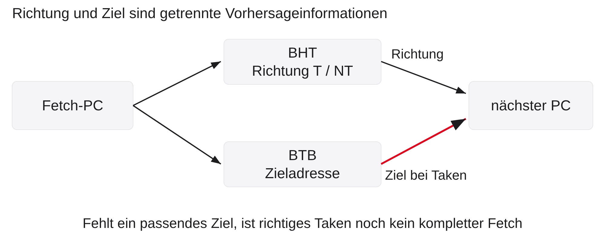{fig-alt="Der Fetch-PC wird für Richtungsvorhersage und Zielpuffer verwendet. Bei vorhergesagtem Taken und passendem Ziel wird dieses gewählt, sonst der Folgepfad; beides sind getrennte Informationen."}

Taken beantwortet „springen?“; ein Target beantwortet „wohin?“.

::: notes
PC bedeutet Program Counter, Adresse des betrachteten Befehls. Ein bedingter Branch oder Sprung wählt zwischen dem Folgepfad und einem Zielpfad. T kürzt Taken, genommen, ab; NT kürzt Not Taken, nicht genommen, ab. Die Richtung allein liefert bei Taken noch nicht die Zieladresse.

BHT heißt Branch History Table, Sprunghistorientabelle; sie bezeichnet hier ausdrücklich die Richtungstabelle. BTB bedeutet Branch Target Buffer, Sprungzielpuffer. Die Grafik zeigt den Fetch-PC links, zwei unterschiedliche Vorhersageinformationen in der Mitte und die Auswahl des nächsten PC rechts. Schwarze Pfeile sind Informationswege, rot ist der ausgewählte Zielweg.

Die tatsächliche Bedingung kann erst nach dem Holen und Dekodieren mit bereiten Registeroperanden berechnet werden. Eine einfache statische Heuristik kann Rückwärtssprünge als Taken behandeln, eine dynamische Regel nutzt frühere Ergebnisse. Ein gültiger Treffer im Zielpuffer ist dennoch nicht für jeden Sprung garantiert. Aus „richtiges Taken“ folgt deshalb keine vollständige kostenlose nächste Befehlslieferung. Vorhersage ermöglicht frühes Weiterarbeiten, muss aber später an der tatsächlichen Entscheidung überprüft werden.
:::

## Eine Fehlvorhersage kostet Wiederanlaufzeit

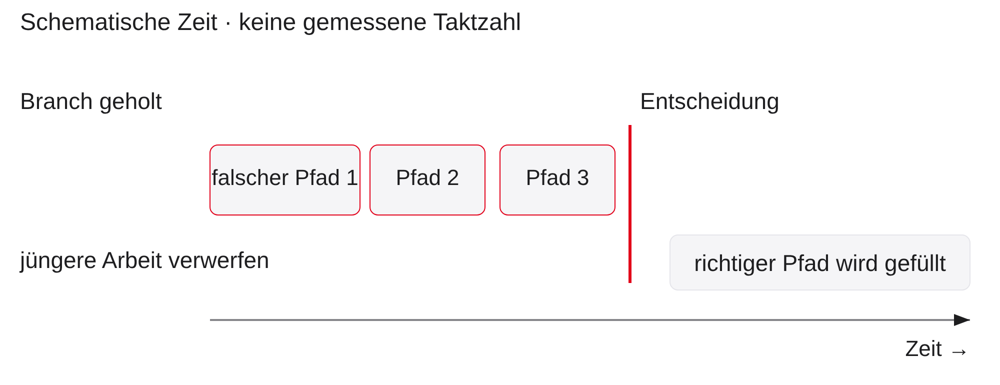{fig-alt="Nach einem vorhergesagten Sprungpfad werden jüngere Befehle bearbeitet. Bei der späteren falschen Vorhersage werden sie verworfen und der richtige Pfad wird neu befüllt."}

Penalty ist ein definierter Zusatzaufwand, nicht automatisch die Stufenanzahl.

::: notes
Misprediction bedeutet Fehlvorhersage. Flush oder Squash bezeichnet hier das Verwerfen des unbestätigten falschen Pfads; Penalty ist der zusätzliche Wiederanlaufaufwand. Fetch ist Befehlsholen, Retire endgültige Bestätigung. Eine tiefe oder breite Umsetzung kann viele falsche Operationen vorbereitet haben, bevor die Bedingung geklärt ist.

Die waagerechte Richtung der Grafik ist Zeit, ausdrücklich ohne quantitative Taktskala. Links wird ein Pfad angenommen. Rote Flächen sind die später verworfenen jüngeren Arbeiten. Eine senkrechte Entscheidungsmarke trennt sie vom grauen Wiederanlauf auf dem richtigen Pfad. Früher korrekt bestätigte Vorgänger werden dadurch nicht gelöscht.

Der Aufwand hängt unter anderem vom Zeitpunkt der Branchauflösung, Redirectweg und erneuter Lieferung ab. Er ist daher nicht automatisch gleich einer pauschalen Pipeline-Stufenzahl. Auch ein richtiger Richtungstreffer kann noch Ziel- oder Lieferbedingungen benötigen. Für die nächste Modellrechnung setzen wir eine feste effektive Zusatzstrafe von fünfzehn Takten an. Diese ist eine Vorgabe ohne Überlappung anderer Strafen, keine Messung und kein allgemeines Datenblatt eines Prozessorstalls.
:::

## CPI-Aufschlag und Durchsatzverlust trennen

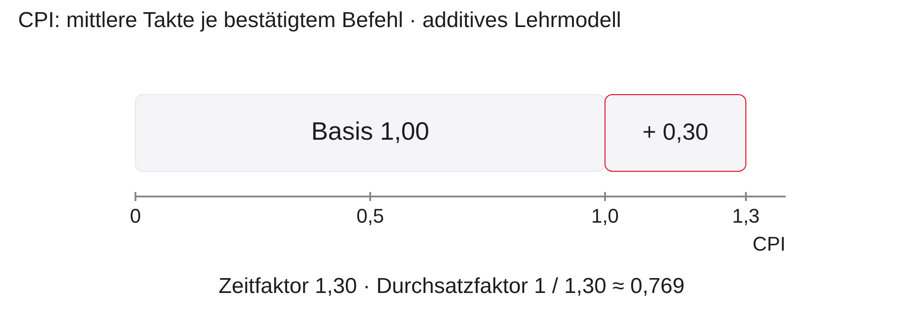{fig-alt="Ein Basis-CPI von eins plus ein Zusatz-CPI von 0,30 ergibt 1,30. Die Grafik hebt die Zusatzzeit hervor, nicht einen prozentual gleich großen Durchsatzverlust."}

$$
\Delta\mathrm{CPI}=0{,}20\cdot0{,}10\cdot15=0{,}30
$$

::: notes
CPI bedeutet Cycles Per Instruction, Takte pro bestätigtem Befehl. Zwanzig Prozent der betrachteten bestätigten Befehle seien Branches, Sprünge. Zehn Prozent dieser Sprünge werden falsch vorhergesagt. Jeder Fehler koste effektiv fünfzehn zusätzliche Takte. Basis-CPI ist eins; weitere Änderungen und überlappende Strafen sind im additiven Lehrmodell ausgeschlossen.

Die Fehlerzahl pro Befehl ist $0{,}20\cdot0{,}10=0{,}02$. Multiplikation mit fünfzehn liefert drei Zehntel zusätzliche Takte pro Befehl. Gesamt-CPI ist $1+0{,}30=1{,}30$. Die horizontale Achse der Grafik misst diesen mittleren Aufwand; grau zeigt die Basis, rot den Zusatz.

Bei gleicher Befehlsmenge und gleicher Frequenz steigt die Zeit auf das Ein-Komma-Dreifache. Durchsatz, Arbeit pro Zeit, fällt dagegen auf den Kehrwert $1/1{,}30\approx0{,}76923$, rund dreiundzwanzig Komma eins Prozent weniger. Beide Prozente besitzen unterschiedliche Bezugsgrößen. Diese Rechnung verlangt keine bestimmte Vorhersagehardware. Als Nächstes betrachten wir eine kleine konkrete Regel und verfolgen ihre Entscheidung stets vor dem Zustandsupdate.
:::

## Ein Bit merkt nur das letzte Ergebnis

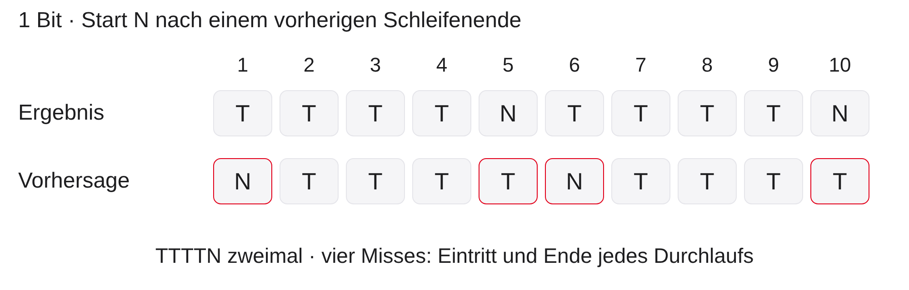{fig-alt="Ein 1-Bit-Prädiktor startet nach einem vorherigen Schleifenende mit Not Taken. Für TTTTNTTTTN verfehlt er jeweils den Wiedereintritt und das Ende: vier Misses."}

Modell: Vorhersage = gespeichertes letztes Ergebnis.

::: notes
Ein Prädiktor ist ein Vorhersageverfahren. T bedeutet Taken, Sprung genommen; N oder NT Not Taken, nicht genommen. Der Ein-Bit-Zustand merkt ausschließlich das zuletzt beobachtete Ergebnis. Zuerst wird aus dem alten Zustand vorhergesagt, danach wird das tatsächliche Ergebnis gespeichert.

Unsere Schleife liefert viermal Taken und dann einmal Not Taken. Vor dem gezeigten Fenster gab es bereits ein Schleifenende, der Startzustand ist daher N. Für die Folge TTTTNTTTTN werden der erste Wiedereintritt und das erste Ende falsch geraten. Das zweite Ende hinterlässt wieder N, weshalb im zweiten Durchlauf ebenfalls Eintritt und Ende falsch sind. Insgesamt entstehen vier Fehlvorhersagen in diesen zehn Schritten.

Die Grafik liest sich von links nach rechts. Je Spalte steht das tatsächliche Ergebnis über der alten Vorhersage; rot markiert Fehlentscheidungen. Diese Zahl ist keine universelle Trefferquote. Ein Startzustand T würde im gleichen endlichen Fenster nur drei Misses liefern. Die ausdrücklich gegebene Historie ist daher Teil der Aufgabe. Mehr Zustand kann ein einzelnes Ende weniger stark gewichten, ohne jede Musterfolge perfekt vorherzusagen.
:::

## Zwei Bits erzeugen Hysterese

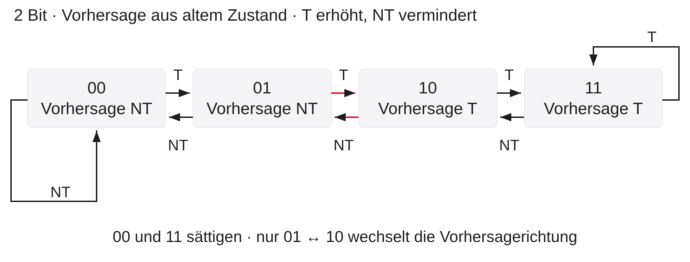{fig-alt="Vollständiger Automat mit Zuständen 00, 01, 10 und 11. Taken erhöht saturierend, Not Taken vermindert saturierend. Die oberen beiden Zustände sagen Taken vorher."}

Aus `11` führt ein NT nur nach `10`: Vorhersage bleibt T.

::: notes
T heißt Taken, genommen, NT Not Taken, nicht genommen. Der Zwei-Bit-Prädiktor verwendet einen saturierenden Zähler mit vier Zuständen. `00` ist stark und `01` schwach Not Taken; `10` ist schwach und `11` stark Taken. Die Vorhersage ist für die oberen beiden Zustände T, für die unteren NT.

Die Grafik wird entlang beschrifteter Pfeile gelesen. Taken erhöht den Zustand um eins bis höchstens drei, Not Taken vermindert ihn um eins bis mindestens null. Die Schleifen an `00` bei NT und `11` bei T zeigen die Sättigung. Rote Pfeile heben die beiden Übergänge hervor, an denen die vorhergesagte Richtung tatsächlich umschaltet. Grau sind Zustandskästen, keine Trefferwahrscheinlichkeiten.

Hysterese heißt hier, dass ein einzelnes widersprechendes Ergebnis aus einem starken Zustand die Richtung noch nicht ändert. Aus `11` braucht es zwei NT hintereinander bis `01`; aus dem schwachen `10` reicht dagegen ein NT. Nach einem üblichen Schleifenende kann der Zustand `10` den nächsten Taken-Eintritt richtig raten. Das ist eine einfache Regel, keine Garantie für verschachtelte oder beliebig wechselnde Muster.
:::

## Vorhersage zuerst, Update danach

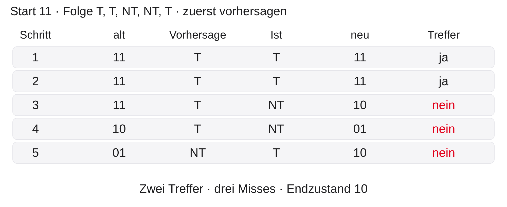{fig-alt="Start 11, Ergebnisse T T NT NT T. Die alten Zustände sind 11, 11, 11, 10 und 01; nur die ersten beiden Vorhersagen treffen, Endzustand ist 10."}

Start `11`; Folge T, T, NT, NT, T: zwei Treffer, drei Misses.

::: notes
T bedeutet Taken und NT Not Taken. Beim Zwei-Bit-Prädiktor zählt der Zustand vor dem aktuellen Ergebnis. Die Abbildung zeigt die fünf Schritte von oben nach unten mit altem Zustand, Vorhersage, tatsächlichem Ausgang und neuem Zustand. Rot ist ein Miss, eine Fehlvorhersage.

Aus `11` sagt die Hardware zuerst T und bleibt nach dem tatsächlichen T in `11`. Der zweite Schritt ist gleich. Im dritten sagt `11` wieder T, das tatsächliche NT führt erst anschließend nach `10`. Im vierten sagt `10` weiterhin T, ein weiteres NT vermindert auf `01`. Im fünften sagt `01` deshalb NT; das T führt danach nach `10`. Nur die ersten beiden Entscheidungen stimmen.

Ein vorheriges Einbauen des aktuellen Ergebnisses würde der Vorhersage Information geben, die sie noch gar nicht hatte. Nach einem einzelnen Schleifenende aus `11` bleibt hingegen `10` mit Richtung T; das erklärt den Vorteil gegenüber dem Ein-Bit-Verfahren in der vorherigen warmen Schleifenfolge. Startzustand und betrachteter Verlauf müssen immer genannt werden. Ein schwacher Zustand kann die Richtung bereits durch ein widersprechendes Ergebnis wechseln.
:::

## Tabellen können sich Einträge teilen

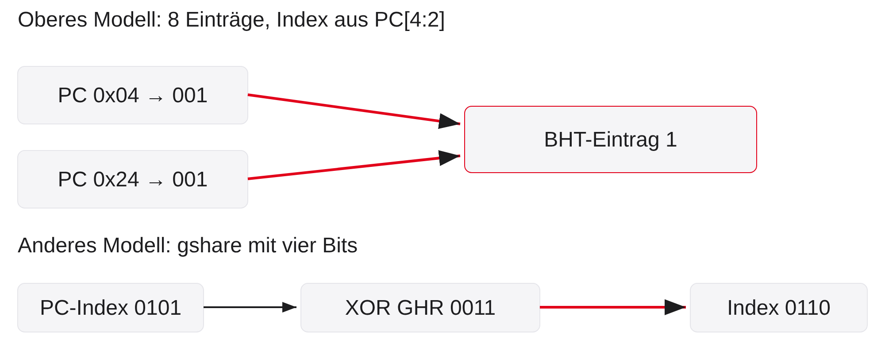{fig-alt="Bei einem Index aus PC-Bits vier bis zwei nutzen 0x04 und 0x24 beide Eintrag eins. Ein anderes gshare-Modell kombiniert vier Indexbits 0101 mit Historie 0011 per XOR zu 0110."}

Ein besserer Index beseitigt weder jede Kollision noch jeden falschen Verlauf.

::: notes
PC bedeutet Program Counter, Befehlsadresse. BHT heißt Branch History Table, hier die Richtungstabelle. Aliasing ist die gemeinsame Nutzung eines Tabelleneintrags durch unterschiedliche Sprungstellen. Im oberen Modell benutzen wir acht Einträge und die Adressbits vier bis zwei. Die hier betrachteten Befehlsadressen sind vier-Byte-ausgerichtet.

`0x04` und `0x24` unterscheiden sich, liefern aber nach Verschieben um zwei und Begrenzen auf drei Bits beide `001`, also Index eins. Sie können deshalb die Historie desselben Eintrags beeinflussen. Der rote gemeinsame Kasten zeigt diese Kollision, keine identische Programmstelle.

GHR bedeutet Global History Register, Register der letzten Sprungergebnisse über verschiedene Stellen. Das untere, getrennte Vier-Bit-Modell gshare kombiniert einen PC-Index `0101` und die gegebene alte Historie `0011` mit XOR, Exclusive Or oder exklusivem Oder: Unterschiedliche Bits ergeben eins. Das Resultat ist `0110`, Index sechs. Globale Historie ist nicht automatisch lokale plus globale Historie. Aufwendigere Verfahren wie TAGE, Tagged Geometric History Length, mit markierten Tabellen verschieden langer Rückblicke, oder Perzeptronverfahren mit gewichteter Historie existieren; sie sind weitere Implementierungen und hier kein zusätzliches vorausgesetztes Prüfungswissen. Endliche Tabellen und ihre Lernzustände bleiben plattformabhängig.
:::

## Rollback betrifft nicht jeden internen Zustand

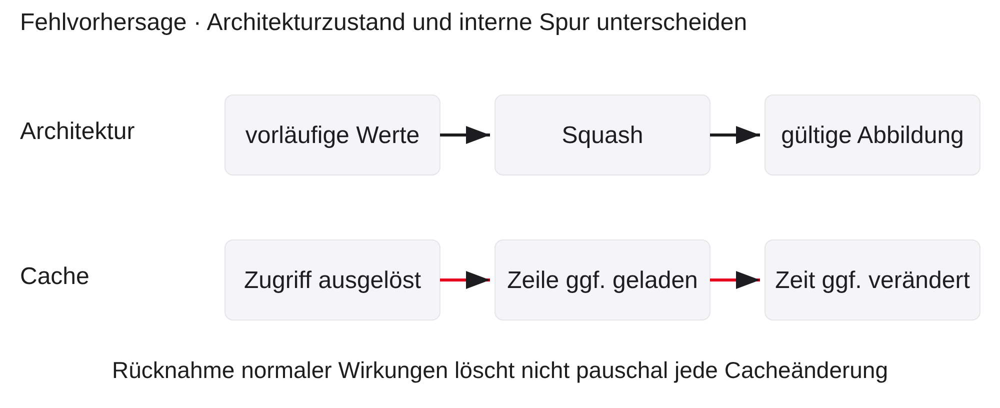{fig-alt="Eine Fehlvorhersage verwirft unbestätigte Registerwirkungen und stellt die gültige Abbildung wieder her. Ein bereits ausgelöster Cachezugriff kann dennoch eine interne Spur hinterlassen."}

Architektonisch korrekter Kontrollfluss kann interne Nebenwirkungen hinterlassen.

::: notes
Spekulative Ausführung ist die vorläufige Bearbeitung unter einer noch nicht bestätigten Annahme. Prediction bedeutet Vorhersage, Rollback Rücknahme, Squash Verwerfen. ROB heißt Reorder Buffer. Ein Kern kann bereits spekulativ Befehle holen, ohne ein vollständiges Out-of-Order-Verfahren zu besitzen; im betrachteten leistungsfähigen Modell kommt beides zusammen.

Die Abbildung trennt zwei Beobachtungsebenen von oben nach unten. Der schwarze Architekturweg stellt bei einem falschen Pfad den gültigen Register- und Abbildungszustand her und bestätigt keine gewöhnlichen jüngeren Wirkungen. Der rote Cacheweg markiert dagegen eine mögliche verbleibende interne Veränderung: Eine geladene Zeile kann weiterhin vorhanden sein.

Die gesamte physische Registerdatei oder jeder Cache wird bei einer Fehlvorhersage nicht pauschal gelöscht. Richtig bestätigte Vorgänger bleiben gültig. Das erklärt zugleich einen Nutzen und eine Grenze: Vorläufige Arbeit kann schneller zu einem später bestätigten Ergebnis führen; ihre mikroarchitektonischen Spuren müssen aber nicht unsichtbar sein. Eine mögliche Zeitbeobachtung solcher Spuren ist der nächste Zusammenhang. Die Grafik beschreibt ein Prinzip und keine gemessene Verwundbarkeit der Kursplattform.
:::

## Ein Cache-Seitenkanal benötigt eine Wertkopplung

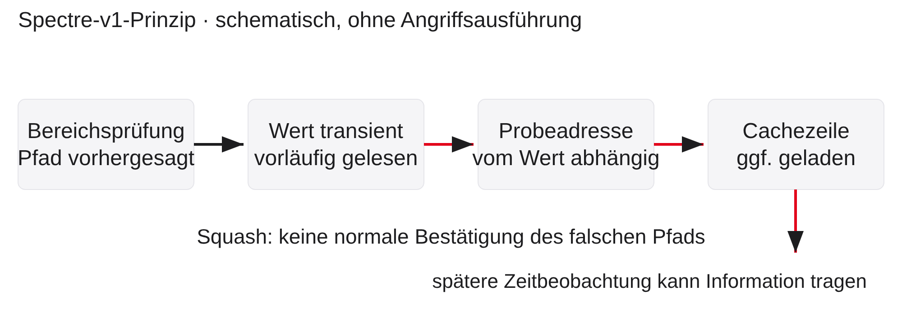{fig-alt="Im schematischen Spectre-v1-Fall läuft ein falscher Bounds-Pfad transient, ein Wert beeinflusst einen folgenden Probezugriff und dessen mögliche Cacheposition kann später über Zeit beobachtet werden."}

Verworfener Programmwert und beobachtbare Cache-Spur sind verschiedene Dinge.

::: notes
Ein Seitenkanal ist ein indirekter Informationsweg, beispielsweise über Zugriffszeiten statt über einen erlaubten normalen Rückgabewert. Spectre-v1 bezeichnet eine Klasse von Fällen mit transient umgangener Bereichsprüfung. Transient bedeutet hier nur vorläufig intern bearbeitet; die architektonische Bounds-Prüfung, Bereichsprüfung, bleibt wirksam und bestätigt den falschen Pfad nicht.

Die Grafik wird von links nach rechts gelesen: vorhergesagte Prüfung, vorläufig geladener Wert, davon abhängiger weiterer Zugriff und spätere Beobachtung. Rot ist die mögliche Spur. Entscheidend ist die Wertkopplung: Der Wert beeinflusst die Adresse einer Probeoperation. Ein beliebiger schneller Load allein verrät nicht automatisch alle Bits eines beliebigen Geheimnisses.

Nach dem Squash, Verwerfen, kann eine gewählte Cachezeile vorhanden sein und dadurch eine Zeitverteilung verändern. Eine schnelle Beobachtung ist mit Störungen, anderen Zugriffen und Plattformdetails verbunden; sie ist kein eindeutiger Beweis aus einem einzigen Versuch. Es wird kein Angriff im Labor ausgeführt. Die Darstellung nutzt die Cachebegriffe aus Vorlesung 2 und die Trennung zwischen Bestätigung und interner Fertigstellung, ohne einen erfolgreichen Exploit zu behaupten.
:::

## Unterschiedliche Mechanismen brauchen passende Maßnahmen

| Fall | vereinfachte Grenze |
|------|---------------------|
| Spectre-v1 | falsch vorhergesagter Pfad einer Prüfung |
| ursprünglicher Meltdown | Berechtigungsprüfung auf betroffenen Designs |

Passende Barrieren, Maskierung und Speicherabbildung sind keine austauschbaren Universalrezepte.

::: notes
Spectre-v1 beschreibt hier transiente Bearbeitung nach einer falsch vorhergesagten Bereichsprüfung. Der ursprüngliche Meltdown-Fall betrifft dagegen bestimmte Implementierungen, die geschützte Daten intern weiterreichen konnten, bevor der nicht erlaubte Zugriff architektonisch als Fehler behandelt wurde. Das sind verschiedene Mechanismen, keine Aussage über jeden modernen Kern.

Ein Benutzerprogramm und privilegierter Betriebssystemcode besitzen unterschiedliche Rechte. KPTI heißt Kernel Page Table Isolation, Trennung der Kernel-Seitentabellen. Diese Maßnahme beschränkt bestimmte gemeinsame Abbildungen und richtet sich vor allem gegen den ursprünglichen Meltdown-Weg; sie ist keine allgemeine Spectre-Lösung.

Für bestimmte Spectre-Fälle können überprüfte Indexmaskierung oder geeignete Spekulationsbarrieren helfen. ISA bedeutet Instruction Set Architecture. RISC-V ist eine Befehlssatzfamilie; RISC steht für Reduced Instruction Set Computer. Deren gewöhnliches `fence` ordnet Speicherzugriffe und darf nicht ohne konkreten Architekturvertrag als universelle Spekulationsbarriere ausgegeben werden. Andere Fälle benötigen andere Hardware-, Software- oder Betriebssystemmaßnahmen. Die Tabelle ordnet deshalb Prinzipien ein. Das Lernziel ist die Trennung von korrekt bestätigtem Programmzustand und möglichen internen Informationsspuren, nicht eine pauschale Sicherheitszusage.
:::

## Compiler und Hardware planen zu verschiedenen Zeiten

- Statisches Scheduling verändert die Übersetzung vor der Ausführung
- Dynamische Auswahl reagiert auf aktuelle Bereitschaft
- Beide müssen Werte und Nebenwirkungen erhalten
- `-O3` garantiert keine bestimmte Befehlsfolge und keine kürzere Laufzeit

::: notes
Scheduling heißt hier Einplanen von Operationen. Der Compiler übersetzt ein Programm vor der Ausführung und kann unabhängige Operationen in eine andere zulässige Reihenfolge bringen. Die Hardwareauswahl reagiert dagegen während der Ausführung beispielsweise auf einen tatsächlich noch fehlenden Loadwert. CPU bedeutet Central Processing Unit.

GCC heißt GNU Compiler Collection, eine Compilerfamilie. GNU ist der Projektname freier Software und steht rekursiv für GNU’s Not Unix. Optimierungsstufen wie `-O1` und `-O3` erlauben bestimmte zusätzliche Analysen und Transformationen. Sie garantieren weder genaues Ausrollen einer Schleife noch eine geringere Laufzeit jeder Eingabe. Zielarchitektur, Compilerfassung, Optionen und Programm beeinflussen die tatsächliche Übersetzung.

Ein Compiler kann bereite Arbeit zwischen einen Load und seinen Nutzer setzen. Er darf dafür aber keine benötigte alte Speicher- oder Registerversion zerstören. Aliaswissen und mögliche Nebenwirkungen beschränken die Umordnung. Hardware sieht ihrerseits nur ein endliches Befehlsfenster und nicht jede spätere Möglichkeit im ganzen Programm. Beide Ansätze ergänzen sich. Bei einer Summenschleife ist außerdem zu fragen, ob nur weniger Sprünge entstehen oder tatsächlich mehrere voneinander unabhängige Teilrechnungen.
:::

## Ausrollen und mehrere Akkumulatoren unterscheiden

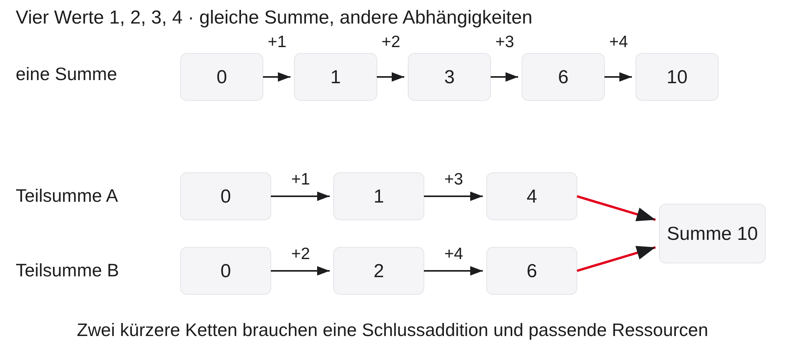{fig-alt="Vier Additionen auf derselben Summe bilden eine Kette. Zwei getrennte Teilakkumulatoren bilden zwei kürzere Ketten und werden am Ende zusammengeführt."}

Ein größerer gerader Codeabschnitt entfernt nicht automatisch die RAW-Kette.

::: notes
Ein Akkumulator ist eine Variable, die ein Zwischenergebnis wiederholt fortführt. RAW bedeutet Read After Write: Der nächste Summenschritt liest das zuvor geschriebene Ergebnis. ILP heißt Instruction-Level Parallelism, Unabhängigkeit zwischen Befehlen. Loop Unrolling, Schleifenausrollen, ersetzt mehrere Durchläufe durch mehr geraden Code und kann die Zahl der Schleifensprünge verringern.

Oben zeigt die Grafik vier Werte eins, zwei, drei und vier in einer einzigen Kette: null, eins, drei, sechs, zehn. Diese Abhängigkeit bleibt auch bestehen, wenn dieselben vier Additionen nebeneinander in den Quelltext geschrieben werden. Unten entstehen zwei getrennte Ketten aus eins und drei sowie zwei und vier. Ihre Ergebnisse vier und sechs werden zu zehn verbunden. Rote Pfeile markieren die abschließende Zusammenführung.

Für vorzeichenlose Integeraddition mit gleicher Breite stimmt die Summenzerlegung auch modulo ihrer Wortbreite. Andere Rechenregeln sind vorher zu prüfen; Gleitkommaaddition kann durch neue Klammerung andere Rundungsergebnisse liefern. Mehr Teilketten bringen Verwaltungsarbeit, Registerbedarf und eine Schlussaddition. Zwei C-Variablen garantieren zudem keine zwei Maschinenbefehle oder einen festen Beschleunigungsfaktor. Das begleitende C-Beispiel prüft zuerst dieselben Ergebnisse.
:::

## Übersetzung und Funktion sind eigene Nachweise

Vom Repository-Hauptordner:

```bash
gcc -std=c11 -O3 -Wall -Wextra -Werror \
  labs/src/lab07_ilp.c -o /tmp/lab07_ilp
/tmp/lab07_ilp
```

Host-C prüft Summen; Compiler Explorer zeigt Befehle, kein OoO-Timing.

::: notes
GCC bedeutet GNU Compiler Collection; GNU heißt rekursiv GNU’s Not Unix und bezeichnet das freie Softwareprojekt. Host ist hier der normale Rechner, auf dem der Compiler und das kleine C-Programm laufen. Die vorhandene Datei `labs/src/lab07_ilp.c` enthält eine einfache und eine in zwei Teilakkumulatoren aufgeteilte vorzeichenlose Summe. Beide lesen gültige Arrayelemente, bearbeiten auch ungerade Längen und liefern ein `uint64_t`-Ergebnis, einen vorzeichenlosen Vierundsechzig-Bit-Wert.

`-std=c11` wählt die C-Sprachfassung von 2011, `-O3` die Optimierungsstufe, `-Wall` und `-Wextra` zusätzliche Warnungen; `-Werror` behandelt sie als Fehler. `-o` benennt die ausführbare Datei. Der Backslash setzt die Shellzeile fort. Der Lauf vergleicht Ergebnisse für leere, kurze, gerade und ungerade Eingaben sowie große Werte. Es gibt keine Gerätezugriffe und keinen Zykluszähler.

OoO heißt Out-of-Order Execution. Compiler Explorer, auch Godbolt, zeigt eine konkrete Übersetzung, nicht ihren tatsächlichen OoO-Ablauf. Ein optionaler RISC-V-Vergleich benötigt die gewählte Zielarchitektur und Optionen; RISC steht für Reduced Instruction Set Computer. Renode ist ein Systemsimulator und liefert ohne geeignetes Mikroarchitekturmodell keinen Nachweis dieser Zeitdiagramme. Die hier tatsächlich geprüften Host-Ergebnisse ersetzen deshalb keine RISC-V-Zeitmessung.
:::

## Abschlussquiz: Fenster, Version und Vorhersage nennen

- Zehn QuizAcademy-Fragen
- Zehn Minuten bearbeiten, fünf Minuten auswerten
- Bei jeder Entscheidung die benötigte Bedingung begründen
- Vergleichbare Antwortlängen, genau eine richtige Option

::: notes
Das Quiz verwendet ausschließlich die in diesem Block erklärten Modelle und Unterscheidungen. Bei einer Zeitfrage müssen Programm, Latenzen und Fenstergrenze berücksichtigt werden. Bei Renaming entscheidet die zum Leser gespeicherte Version. Beim Prädiktor ist der alte Zustand maßgeblich, nicht der gerade neu berechnete.

IPC bedeutet Instructions Per Cycle und CPI Cycles Per Instruction. ROB heißt Reorder Buffer, Ordnungspuffer. Diese Begriffe werden mit konkreten Situationen verknüpft: mehrere fertige Operationen können noch unbestätigt sein, ein höheres IPC kann bei mehr Befehlen trotzdem ein längeres Zeitfenster bedeuten, und ein falscher Pfad kann interne Cache-Spuren hinterlassen.

Die fünfzehn Minuten teilen sich in zehn Minuten eigene Bearbeitung und fünf Minuten Erklärung der naheliegenden Verwechslungen. Eine Frage enthält vier Optionen und genau eine richtige Antwort. Deren Länge ist kein verlässlicher Auswahlhinweis. Die Erläuterungen dienen als kurze Rückführung zur passenden Folie oder Papieraufgabe. Das Ziel ist eine begründete Entscheidung aus Modellbedingungen, keine Vorhersage einer bestimmten Desktop-Implementierung ohne Datenblatt oder Messung.
:::

## Was Sie jetzt erklären und prüfen können

- Pipelineüberlappung, Breite und Reihenfolge unterscheiden
- Wertabhängigkeiten und Registerversionen verfolgen
- Fertigstellung, Retire und Speicherwirkung trennen
- Vorhersage aus altem Zustand und ihre Kosten berechnen
- Compilerresultat, Modellzeit und Messung auseinanderhalten

::: notes
CPU bedeutet Central Processing Unit. Die zentrale Einsicht ist, dass mehrere interne Aktivitäten nur unter passenden Abhängigkeiten, Ressourcen und Bestätigungsregeln einen Gewinn ergeben. Der gleiche sichtbare Zustand kann auf verschiedenen Mikroarchitekturen mit unterschiedlichen Zeiten entstehen. Eine Zahl erhält ihre Bedeutung durch Programm, Zählbasis und Anfangsbedingungen.

Die Grundlagen orientieren sich an Harris/Harris, Digital Design and Computer Architecture — RISC-V Edition, und Patterson/Hennessy, Computer Organization and Design. RISC steht für Reduced Instruction Set Computer. Für konkrete Verwaltungsprinzipien wurden die [BOOM-Renamingbeschreibung](https://github.com/riscv-boom/riscv-boom/blob/master/docs/sections/rename-stage.rst), der [Reorder Buffer](https://github.com/riscv-boom/riscv-boom/blob/master/docs/sections/reorder-buffer.rst) und die [RISC-V-Integerbasis](https://github.com/riscv/riscv-isa-manual/blob/main/src/unpriv/rv32.adoc) herangezogen. BOOM heißt Berkeley Out-of-Order Machine. Ergänzend dienen die [GCC-Optionsbeschreibung](https://github.com/gcc-mirror/gcc/blob/master/gcc/doc/invoke.texi) und die [Linux-Spectre-Dokumentation](https://github.com/torvalds/linux/blob/master/Documentation/admin-guide/hw-vuln/spectre.rst); GCC heißt GNU Compiler Collection, GNU rekursiv GNU’s Not Unix. Die [Linux-Dokumentation zur Kernel-Seitentabellentrennung](https://github.com/torvalds/linux/blob/master/Documentation/arch/x86/pti.rst) ergänzt die Einordnung des ursprünglichen Meltdown-Falls.

Diese Quellen sind Architektur- und Implementierungsbeschreibungen, keine Messungen unserer Lehrmodelle. Vorlesung 8 fragt anschließend, warum regelmäßige Rechenaufgaben zusätzliche spezialisierte Beschleuniger sinnvoll machen können.
:::
