## Was fehlt dem Sensorgerät?

::: {.section-label}
Einstieg · Die Frage des Sensorgeräts
:::

Ein Sensorgerät soll aus Messwerten „Gehen“ erkennen.
Sein Prozessor kann bereits addieren und multiplizieren.

- Welche Zahlen wären eine geeignete Eingabe?
- Woher kommt die Rechenvorschrift für die Entscheidung?
- Würde die doppelte Multiplikationsrate allein genügen?

Zwei Minuten zu zweit: Vermutung und fehlende Voraussetzung nennen.

::: notes
Ein Mikrocontroller kann rechnen, ohne bereits eine brauchbare Entscheidung aus Sensordaten treffen zu können. Die Einstiegsfrage knüpft an bekannte Messwerte, gespeicherte Programme und die Grenzen eines Prozessors an. Wissen über KI-Software ist nicht erforderlich: Zunächst kann eine vermutete Regel, eine Folge von Bedingungen oder ein anhand von Beispielen angepasstes Modell vorgeschlagen werden.

Ein naheliegender Ansatz wäre, einen Schwellenwert für die Beschleunigung festzulegen. Ein anderer nutzt mehrere aufeinanderfolgende Messungen, weil ein einzelner Wert Stehen und Gehen nicht zuverlässig unterscheiden muss. Beide Ansätze benötigen eine festgelegte Eingabe und einen überprüfbaren Zusammenhang mit der verlangten Ausgabe. Höhere Multiplikationsleistung stellt diesen Zusammenhang nicht her.

Ein neuronales Modell kann seine Parameter aus geeigneten Beispielen erhalten. Es benötigt dafür eine Rechenstruktur, Trainingsdaten, eine Bewertung der Ausgaben und eine Prüfung an nicht zum Anpassen verwendeten Daten. Bei der späteren Auswertung, der Inferenz, müssen dieselbe Vorverarbeitung und passende Datentypen verwendet werden. Erst danach wird die Frage nach der ausreichend schnellen und sparsamen Ausführung sinnvoll.

Der folgende Lernweg erklärt zunächst diese Softwarebegriffe und leitet aus gewichteten Summen die regelmäßige Matrixrechnung her. Bei der Rückkehr zum Sensorgerät wird getrennt, was ein Modell wissen muss und was ein Beschleuniger für dessen Ausführung leisten kann.
:::

## KI am Edge: Rechnung braucht Daten

::: {.section-label}
Einstieg · Vom CPU-Kern zur Modellrechnung
:::

- Vorlesung 7: unabhängige Befehle und Speicherzugriffe überlappen
- Heute: dieselbe Rechnung auf vielen Werten ausführen
- Daten lokal wiederverwenden, statt jedes Produkt neu zu versorgen
- Modell, Hardware und Firmware müssen zusammenpassen

::: notes
Die Frage des Sensorgeräts verbindet einen Softwareentwurf mit einem Rechnerentwurf. KI bedeutet Künstliche Intelligenz. Im Mittelpunkt stehen hier neuronale Netze, deren Parameter bereits anhand von Daten bestimmt wurden. Diese Netze sind nur eine Familie von KI-Verfahren. Für manche Aufgabe genügt weiterhin ein klassischer, von Menschen festgelegter Schwellenwertalgorithmus. Die Auswahl beginnt bei der verlangten Funktion und nicht beim Namen eines Beschleunigers.

Edge bezeichnet die Verarbeitung am Rand eines vernetzten Systems, etwa auf einem Sensorgerät oder einem lokalen Gateway. Ein Gateway vermittelt zwischen Geräten und einem übergeordneten Netz. Die Daten müssen nicht für jede Auswertung an einen entfernten Server geschickt werden. Ob lokale Verarbeitung sinnvoll ist, hängt unter anderem von Reaktionszeit, Verfügbarkeit, Energie und dem Umgang mit den Daten ab.

Aus der vorherigen Vorlesung ist bekannt, dass unabhängige Befehle und Speicherzugriffe überlappt werden können. Für viele neuronale Rechenmuster tritt eine weitere Regelmäßigkeit hinzu: Ähnliche Multiplikationen und Additionen werden auf vielen Zahlen ausgeführt. Datenparallelität und lokale Wiederverwendung können diese Arbeit günstiger organisieren. Zusätzliche Rechenwerke helfen jedoch nur, wenn ihre Operanden bereitstehen.

Der Lernweg beginnt deshalb bei der Softwarebedeutung: Eingaben, gelernte Parameter und Ausgaben. Daraus werden gewichtete Summen und Matrizen hergeleitet. Anschließend werden Vektoren, ein kleines systolisches Array sowie Quantisierung und Speicherplanung untersucht. Alle Zahlen und Zeitabläufe bleiben Lehrmodelle; sie ersetzen weder eine Modellgüteprüfung noch eine Messung an einem KI-Chip.
:::

## Was wir aus Vorlesung 7 mitnehmen

::: {.section-label}
Einstieg · Vom CPU-Kern zur Modellrechnung
:::

- RAW: eine Summe benötigt ihre vorherige Teilsumme
- OoO kann unabhängige Produkte und Loads vorziehen
- Ein Compilerlisting zeigt Befehle, kein vollständiges Zeitverhalten
- Mehr parallele Rechnung hebt eine Bandbreitengrenze nicht auf

::: notes
Die neue Einheit setzt C-Arrays und Zeiger, die Speicherhierarchie sowie die Grundideen der CPU-Vorlesung voraus. Vorkenntnisse über KI-Software, serielle Bussysteme oder DMA sind dafür nicht nötig. Ein KI-Modell wird im ersten Abschnitt von seinen Eingaben bis zu seiner konkreten Rechnung aufgebaut.

RAW heißt Read After Write, Lesen nach Schreiben: Eine Operation benötigt einen zuvor erzeugten Wert. Bei einer laufenden Produktsumme hängt der neue Akkumulator vom alten ab. OoO bedeutet Out of Order, interne Ausführung außerhalb der Programmreihenfolge. Der Kern kann etwa einen unabhängigen Load vorziehen, während er auf einen anderen Wert wartet. Ein Load ist ein Ladebefehl und bedeutet nicht zwingend einen Zugriff auf externen Speicher; sein Wert kann bereits in einem Cache liegen.

Bandbreite und Latenz beschreiben unterschiedliche Grenzen. Bandbreite ist die übertragbare Datenmenge je Zeit, Latenz die Dauer bis zum Eintreffen eines einzelnen benötigten Werts. Ein Cache hält nahe Kopien ausgewählter Speicherblöcke. Ein lokaler Operandenpuffer im späteren Modell erfüllt ebenfalls die Aufgabe, bereits beschaffte Werte in der Nähe zu halten; seine Verwaltung wird jeweils ausdrücklich festgelegt.

Die Summenabhängigkeit verschwindet durch eine neuronale Rechnung nicht. Verschiedene Ausgabesummen sind dagegen unabhängig und können zusätzliche Rechenwerke nutzen. Ein Compilerlisting zeigt dabei die gewählten Maschinenbefehle, aber keine vollständige Zeitanalyse. Ob Abhängigkeiten, Rechenressourcen oder Datenversorgung begrenzen, wird erst durch das konkrete Ausführungsmodell entschieden.
:::

## Vier Schulstunden und Lernziele

::: {.section-label}
Einstieg · Vom CPU-Kern zur Modellrechnung
:::

| Stunde | Erklärung und Besprechung | Arbeitsphase |
|--------|---------------------------|--------------|
| 1 | KI-Grundlagen und Dense-Schicht: 35 min | Aufgaben 1–2: 10 min |
| 2 | SIMD, DSP und Vektorlängen: 30 min | Aufgabe 3: 15 min |
| 3 | Systolisches Array und Auslastung: 30 min | Aufgabe 4: 15 min |
| 4 | Quantisierung und Firmware: 15 min | Aufgaben 5–6: 15 min; Quiz: 15 min |

::: notes
Die vier Schulstunden umfassen hundertachtzig Minuten ohne zusätzliche Pausen: hundertzehn Minuten für Erklärung, Denkfragen und gemeinsame Auswertung, fünfundfünfzig Minuten angeleitete Papierarbeit und fünfzehn Minuten Quiz. Die siebzig Folien gliedern den Weg in kleinere Schritte; kurze Begriffs- und Übergangsfolien benötigen weniger gemeinsame Zeit als Rechen- und Datenflussbilder. Der Lerntext enthält zusätzliche Begründungen zum selbstständigen Nachlesen und ist kein Wort-für-Wort-Vortragsskript.

Am Anfang steht das Verstehen einer Modellrechnung ohne vorausgesetzte KI-Softwarekenntnisse. Ein neuronales Modell verwendet Eingaben, beim Training bestimmte Gewichte und Biaswerte sowie Aktivierungsfunktionen. Aus gewichteten Summen lassen sich eine Matrix-Vektor-Rechnung und die parallele Auswertung mehrerer Eingaben herleiten. Darauf bauen die weiteren Ziele auf: Parameter von Rechenarbeit unterscheiden, die über eine benannte Speichergrenze nötigen Bytes zählen und eine Bandbreitenobergrenze begründen.

SIMD steht für Single Instruction, Multiple Data, ein gemeinsamer Befehl auf mehreren Daten. DSP bedeutet Digital Signal Processor, Prozessor für digitale Signalverarbeitung. Diese Formen der Datenparallelität führen zu aktiven Vektorlängen und anschließend zum räumlich organisierten systolischen Array. Der letzte Teil verbindet die Rechnung mit Zahlenformaten, Firmware und getrennten Budgets für Modell- und Arbeitsspeicher.

Die angeleiteten Papierphasen wählen dazu passende Teile des Übungsblatts aus; dessen Richtwert von sechzig bis fünfundsiebzig Minuten gilt für die vollständige selbstständige Bearbeitung. Alle Pflichtaufgaben bleiben auf Papier lösbar. Das optionale C-Experiment prüft Zahlen und Fehlerfälle auf dem Entwicklungsrechner und benötigt weder ein neuronales Framework noch die ausgeblendeten Veranstaltungsteile.
:::

## 1 · Vom Modell zur Matrix {.section-divider}

Wie wird aus einer Beobachtung eine berechenbare Modellaufgabe?

::: {.section-route}
Modell → Rechenmuster → Vektoren → Array → Firmware → Bilanz
:::

Eingaben, gelernte Parameter und Aktivierungen zuerst auseinanderhalten.

::: notes
Das Sensorgerät besitzt schon einen Prozessor und Speicher. Offen ist zunächst, welche Zahlen eine Beobachtung darstellen und welche Rechnung daraus eine brauchbare Ausgabe erzeugen soll. Dieser erste Abschnitt entwickelt die dafür nötigen Softwarebegriffe ohne vorausgesetzte KI-Kenntnisse.

Eine klare Trennung zwischen Rechenstruktur, Parametern und aktuellen Daten führt von Beispielen und Training zu gewichteten Summen. Mehrere solche Summen werden als Matrixoperation lesbar; eine Aktivierungsfunktion ergänzt ihre Nichtlinearität. Damit werden die später beschleunigten Operationen verständlich, bevor über bestimmte Chips gesprochen wird.

Alle kleinen Zahlenbeispiele sind bewusst von Hand gesetzt. Sie dienen der vollständigen Kontrolle von Formen und Ergebnissen und stellen kein trainiertes Bewegungsmodell dar. Die Frage, ob ein Modell auch auf neuen Eingaben gut arbeitet, bleibt von der korrekten und schnellen Ausführung seiner Rechnung getrennt.
:::

## Vom Sensorfenster zur Eingabe

::: {.section-label}
1 / 6 · Modell und Matrix
:::

Anwendung: ein kurzes Bewegungsfenster beurteilen.

1. Messwerte in festgelegter Reihenfolge sammeln
2. Ausschnitt und Vorverarbeitung eindeutig bestimmen
3. Zahlenfeld $x$ an das Modell übergeben
4. Ausgabe nach ihrem vereinbarten Zweck auswerten

Eingaben sind Daten – nicht die gespeicherten Modellparameter.

::: notes
Die Eingabe eines Modells ist zunächst ein vereinbartes Zahlenfeld. Für eine Bewegungsentscheidung kann ein einzelner Beschleunigungswert zu wenig Information enthalten. Ein Fenster bewahrt mehrere aufeinanderfolgende Messungen und gegebenenfalls mehrere Sensorachsen. Seine Länge, die Reihenfolge der Kanäle und die Abtastbedingungen gehören zum Eingabevertrag. Eine Verwechslung von Achsen oder Zeitpositionen verändert die Bedeutung der Zahlen, auch wenn ihre Bytezahl gleich bleibt.

Die Vorverarbeitung kann beispielsweise eine feste Skalierung anwenden oder Merkmale aus dem Fenster bilden. Ein Merkmal ist eine für die Aufgabe verwendete Eingangsgröße, etwa ein Mittelwert oder eine Schwankungsgröße. Es kann von Menschen festgelegt oder von einer vorgelagerten Modellstufe berechnet werden. Ein neuronales Netz kann auch passend aufbereitete Rohwertfolgen verarbeiten; die Eingabe muss nicht immer aus handentworfenen Merkmalen bestehen.

Im Folgenden bezeichnet $x$ einen Eingangsvektor. Seine Zahlen stammen aus der gerade betrachteten Beobachtung und ändern sich von Auswertung zu Auswertung. Sie sind damit keine gelernten Gewichte. Die Ausgabe ist ebenfalls zunächst nur ein Zahlenfeld mit vereinbarter Bedeutung. Ob daraus eine Klasse, eine geschätzte Größe oder eine weitere Verarbeitung entsteht, legt die Anwendung fest. So bleiben Datenformat, Modellrechnung und Geräteentscheidung getrennt nachvollziehbar.
:::

## Ein Modell verbindet Eingabe und Ausgabe

::: {.section-label}
1 / 6 · Modell und Matrix
:::

$$\widehat y=f_{\theta}(x)$$

- $x$: Zahlen der aktuellen Beobachtung
- $\theta$: festgelegte Modellparameter
- $f$: vereinbarte Rechenstruktur
- $\widehat y$: berechnete Ausgabe

Eine passende Ausgabe ist zu prüfen, nicht durch „KI“ garantiert.

::: notes
Ein Modell beschreibt einen Zusammenhang zwischen Eingabe und Ausgabe. In der Schreibweise $\widehat y=f_\theta(x)$ enthält $x$ die aktuelle Beobachtung. $f$ bezeichnet die festgelegte Folge von Rechenschritten, und $\theta$ fasst ihre Parameter zusammen. Der Hut über $\widehat y$ macht kenntlich, dass es sich um eine berechnete Schätzung handelt und nicht automatisch um die wahre Größe. Diese allgemeine Schreibweise legt noch keine konkrete Art neuronalen Netzes fest.

Ein einfaches Modell könnte einen gewichteten Wert mit einer Schwelle vergleichen. Ein größeres Modell kann viele solcher Rechenstufen kombinieren. Die Parameter steuern die konkrete Abbildung, während die Rechenstruktur vorgibt, an welchen Stellen sie verwendet werden. Bei neuronalen Netzen sind Gewichte und Biaswerte wichtige Parameter; ihre Wirkung wird gleich an vollständig bekannten Zahlen entwickelt.

Training passt Parameter an Beispieldaten an. Anschließend kann dieselbe Struktur mit festen Parametern auf neue Eingaben angewandt werden. Diese Inferenz liefert eine Ausgabe, aber keine automatische Qualitätsgarantie. Ein ungeeignetes Modell oder falsch aufbereitete Daten können sehr schnell und dennoch unbrauchbar ausgewertet werden.

Für die Hardware ist entscheidend, welche Operationen, Formen und Datentypen die konkrete Struktur verlangt. Der Begriff Modell ersetzt diese Angaben nicht. Die Trennung zwischen Struktur, Parametern und aktuellen Daten macht später verständlich, welche Zahlen wiederverwendet werden können und welche bei jeder Auswertung neu eintreffen.
:::

## Edge ist ein Ort, keine Prozessorpflicht

::: {.section-label}
1 / 6 · Modell und Matrix
:::

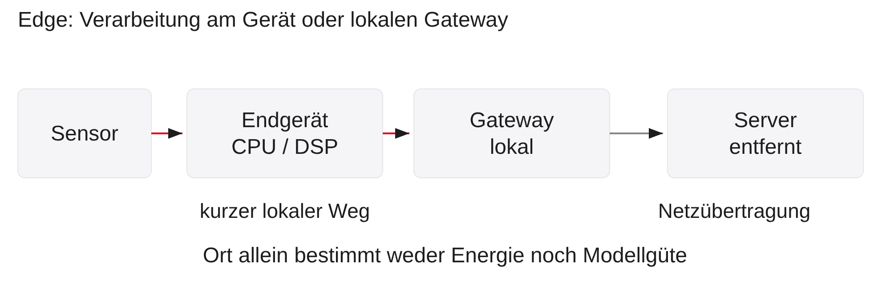{fig-alt="Sensordaten können auf dem Endgerät, einem lokalen Gateway oder einem entfernten Server verarbeitet werden. Die Übertragungswege haben eigene Kosten."}

Reaktionszeit, Energie, Verfügbarkeit und Datenschutz gemeinsam bewerten.

::: notes
Wo ein Modell ausgeführt wird und wie seine Rechnung beschleunigt wird, sind zwei verschiedene Entscheidungen. Edge AI bezeichnet Künstliche Intelligenz am Rand eines vernetzten Systems; AI steht für Artificial Intelligence. Vom Sensor aus kann die Verarbeitung auf dem Endgerät, einem nahen Gateway oder einem entfernten Server liegen. Ein Gateway vermittelt zwischen Geräten und einem übergeordneten Netz. Die kurzen roten Wege der Abbildung markieren Lokalität, keine gemessene Energierangfolge.

Eine lokale Entscheidung kann auch ohne erreichbares Netz verfügbar bleiben und die Übertragung sensibler Rohdaten reduzieren. Dafür benötigt das Gerät eigenen Speicher, Energie und eine ausreichend kurze Ausführungszeit. Funkübertragung ist nicht unter allen Bedingungen teurer als lokale Rechnung. Ein kleines Modell auf einem sparsamen Prozessor und ein großes Modell mit langen Rechenphasen können zu unterschiedlichen Entscheidungen führen.

NPU heißt Neural Processing Unit, Beschleuniger für neuronale Verarbeitung. Eine NPU ist keine Voraussetzung für Edge AI: Auch die normale CPU, Central Processing Unit oder Prozessor, kann ein geeignetes Modell ausführen. Ein klassischer Schwellenwertalgorithmus kann ebenfalls bereits die Anforderung erfüllen. Zunächst müssen daher Eingaben, gewünschte Ausgaben und Qualitätsanforderungen der Anwendung feststehen. Erst danach lässt sich beurteilen, ob ein gelerntes Modell und welche Hardware dafür zweckmäßig sind.
:::

## Training und Inferenz sind verschiedene Arbeit

::: {.section-label}
1 / 6 · Modell und Matrix
:::

- Training: Parameter anhand von Beispieldaten bestimmen
- Inferenz: neue Eingaben mit festgelegten Parametern auswerten
- Vorverarbeitung und Entscheidungslogik gehören zur Anwendung
- Eine Aktivitätsklasse ist noch keine gezählte Schrittzahl

::: notes
Ein Modell besitzt eine festgelegte Rechenstruktur und veränderliche Parameter. Zu den Parametern gehören Gewichte und Biaswerte, deren konkrete Wirkung gleich an kleinen Summen entwickelt wird. Training bestimmt diese Zahlen anhand von Beispielen und einem Maß für die Abweichung zwischen gewünschter und berechneter Ausgabe. Inferenz verwendet die anschließend festgelegten Parameter für eine neue Eingabe. Inferenz muss nicht auf demselben Gerät wie das Training stattfinden.

Beide Phasen können ähnliche Grundoperationen enthalten, stellen aber unterschiedliche Anforderungen an Speicher und Steuerung. Beim Training ändern sich die Parameter; bei einer gewöhnlichen Inferenz bleiben sie konstant. Die Rückmeldung für das Training kann bei überwachtem Lernen eine bekannte Kategorie oder ein gewünschter Zahlenwert sein. Nicht jedes KI-Verfahren benötigt dieselbe Art von Daten oder dasselbe Trainingsverfahren. Für diese Einführung genügt ein überwachtes Lehrbeispiel ohne Implementierung eines Optimierers.

Als Anwendung dient ein Fenster von Beschleunigungsmessungen, also ein zeitlich begrenzter Ausschnitt. Die Vorverarbeitung kann Achsen ordnen, Werte normieren oder Merkmale bilden. Ein Modell könnte dem Fenster die Klasse Stehen, Gehen oder Laufen zuordnen. Ein solcher Klassifikator entscheidet zwischen Kategorien; er zählt dadurch noch keine einzelnen Schritte. Ein Regressionsmodell würde stattdessen eine numerische Größe schätzen.

Auch die Zahlen eines Klassifikators sind nicht automatisch Wahrscheinlichkeiten. Die Bedeutung der Ausgabe folgt dem Modellvertrag und seiner Nachverarbeitung. Diese Unterscheidung verhindert später, dass ein berechneter Rohwert ohne Prüfung als sichere Geräteentscheidung behandelt wird.
:::

## Beispiele zum Lernen und zum Prüfen

::: {.section-label}
1 / 6 · Modell und Matrix
:::

Überwachtes Lehrbeispiel: Eingabe $x$ und bekannte Zielausgabe $t$.

| Datenrolle | Zweck |
|---|---|
| Trainingsdaten | Parameter anpassen |
| Validierungsdaten | Varianten und Einstellungen beurteilen |
| Getrennte Testdaten | abschließend an bisher nicht genutzten Fällen prüfen |

Ähnliche Fenster derselben Aufnahme können Informationen verraten.

::: notes
Beim überwachten Lernen gehört zu einem Trainingsbeispiel eine Eingabe $x$ und eine bekannte Zielausgabe $t$. Bei einer Klassifikation kann das eine zuvor zugeordnete Aktivitätsklasse sein, bei einer Regression ein gewünschter Zahlenwert. Die Herkunft und Zuverlässigkeit dieser Zielangaben beeinflussen das Ergebnis. Eine falsche Zuordnung wird nicht dadurch richtig, dass das Training sie gut nachbildet.

Trainingsdaten werden zum Anpassen der Parameter verwendet. Validierungsdaten helfen, Varianten oder Einstellungen zu beurteilen. Ein getrennt gehaltener Testsatz dient anschließend zur Bewertung an Fällen, die weder zum Anpassen noch zur Auswahl verwendet wurden. Wiederholte Auswahlentscheidungen anhand der Testergebnisse würden diese Trennung wieder aufweichen. Auch ein Test misst nur die Leistung auf seinen tatsächlich vertretenen Fällen.

Zeitreihen erfordern besondere Sorgfalt: Benachbarte oder überlappende Sensorfenster aus derselben Aufnahme können nahezu dieselben Informationen enthalten. Werden sie unbedacht auf Training und Test verteilt, erscheint die Aufgabe leichter, als sie für eine neue Person oder Messsituation ist. Eine geeignete Trennung kann deshalb ganze Aufnahmen, Zeitabschnitte oder Personen zusammenhalten, passend zur späteren Einsatzfrage.

Gute Ergebnisse auf bekannten Beispielen beweisen somit keine zuverlässige Verallgemeinerung. Für den Rechnerentwurf folgt daraus eine wichtige Grenze: Schnelle Inferenz und brauchbare Modellqualität sind getrennte Anforderungen. Die heute verwendeten kleinen Zahlenbeispiele prüfen nur die Rechnung und stellen kein trainiertes Erkennungsmodell dar.
:::

## Was beim Lernen verändert wird

::: {.section-label}
1 / 6 · Modell und Matrix
:::

Vereinfachtes Modell: $\widehat y=w x$, ein Beispiel $x=2$, Ziel $t=4$.

| Gewicht $w$ | Ausgabe $\widehat y$ | quadratische Abweichung $(\widehat y-t)^2$ |
|---:|---:|---:|
| $1$ | $2$ | $4$ |
| $2$ | $4$ | $0$ |

Training verändert $w$; die Inferenz setzt das gewählte $w$ ein.

::: notes
Ein einzelner Parameter genügt, um den Unterschied zwischen Training und Inferenz sichtbar zu machen. Das Lehrmodell berechnet $\widehat y=w x$ ohne Bias. Die aktuelle Eingabe ist $x=2$, die gewünschte Zielausgabe $t=4$. Bei $w=1$ entsteht $\widehat y=2$, also die quadratische Abweichung $(2-4)^2=4$. Bei $w=2$ entsteht vier und die Abweichung dieses einen Beispiels ist null.

Eine solche Abweichungsgröße heißt Verlust oder Loss. Sie bewertet, wie gut eine berechnete Ausgabe zu der vorgegebenen Aufgabe passt. Für andere Aufgaben werden andere Verlustfunktionen verwendet. Ein Trainingsverfahren sucht Parameter, die den Verlust über seine Trainingsbeispiele günstig verändern. Wie ein numerischer Optimierer diese Änderungen berechnet, ist für das heutige Hardware-Rechenmuster nicht erforderlich.

Der Vergleich zweier von Hand gewählter Gewichte ist keine vollständige Trainingsimplementierung. Ein exakt getroffenes Beispiel ist außerdem noch kein verlässlich verallgemeinerndes Modell. Es könnten weitere Beispiele widersprechen oder spätere Eingaben außerhalb des vertretenen Bereichs liegen. Modellwahl und getrennte Prüfung bleiben deshalb nötig.

Bei der Inferenz wird das ausgewählte Gewicht als bereits festgelegter Zahlenwert gelesen und mit einer neuen Eingabe verrechnet. Für den Prozessor ist diese Auswertung eine konkrete Folge von Operationen. Der Ursprung des Gewichts verändert nicht die Bedeutung der Multiplikation. Genau diese Verbindung führt nun von der Softwareidee zu den gewichteten Summen neuronaler Schichten.
:::

## Welche Zahlen speichert ein Netz?

::: {.section-label}
1 / 6 · Modell und Matrix
:::

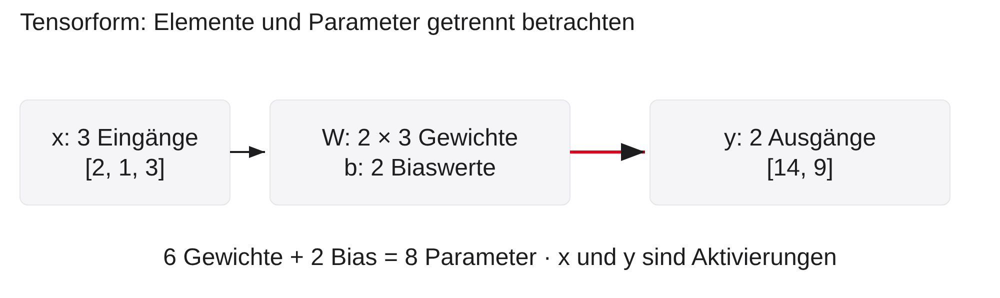{fig-alt="Eingangsvektor x mit drei Werten, Gewichtsmatrix W mit zwei Zeilen und drei Spalten, Biasvektor b und Ausgangsvektor y mit je zwei Werten."}

Gewichte und Bias sind Parameter; Eingaben und Zwischenergebnisse sind Aktivierungen.

::: notes
Ein Modell muss sowohl seine Parameter als auch die gerade verarbeiteten Daten speichern. Gewichte bestimmen die Beiträge einzelner Eingaben zu einer Summe; ein Bias verschiebt die Summe unabhängig von der Eingabe. Während einer gewöhnlichen Inferenz bleiben diese Parameter konstant. Eingaben und berechnete Zwischen- oder Ausgangswerte heißen dagegen Aktivierungen.

Ein Tensor ist ein Zahlenfeld mit festgelegter Form und Datentyp. Ein Vektor besitzt eine Achse, eine Matrix zwei; der allgemeinere Tensorbegriff umfasst auch höherdimensionale Felder. Die Form gibt die Elementzahlen entlang der Achsen an. Speicherbytes ergeben sich erst zusammen mit dem Datentyp. Zwei gleich geformte Tensoren können beispielsweise als Int8- und Float32-Felder sehr unterschiedliche Speichergrößen haben; diese Formate werden später genauer betrachtet.

Die vorhandene Abbildung beschreibt bereits das spätere, separate Drei-Eingänge-Beispiel: $x$ enthält drei Werte, $W$ zwei Zeilen mit je drei Gewichten, und $b$ sowie der Ausgang besitzen je zwei Werte. Die Pfeile markieren die mathematischen Abhängigkeiten der Rechnung und keine reale Verdrahtung eines Datenwegs. Die rote Ausgangsgruppe hebt die zwei zu berechnenden Summen hervor.

Zunächst wird das Prinzip an einer noch kleineren Zwei-Eingänge-Rechnung entwickelt. Danach wird bewusst zum abgebildeten Drei-Eingänge-Beispiel gewechselt. Die Idee bleibt gleich: Eine nachfolgende Schicht kann die Aktivierungen der vorherigen als neue Eingaben verwenden. Deshalb benötigt ein Netz neben den gespeicherten Parametern auch Platz für die jeweils lebenden Zwischenwerte.
:::

## Eine gewichtete Summe vollständig verfolgen

::: {.section-label}
1 / 6 · Modell und Matrix
:::

$$z=w_0x_0+w_1x_1+b$$

Eingänge: $x_0=2$, $x_1=-1$; Gewichte: $w_0=3$, $w_1=4$; Bias: $b=-1$.

$$z=3\cdot2+4\cdot(-1)-1=1$$

Jedes Gewicht gehört zu genau einem Eingang dieses Neurons.

::: notes
Eine grundlegende Recheneinheit vieler neuronaler Netze bildet eine gewichtete Summe. Sie wird oft als künstliches Neuron bezeichnet. Dies ist eine mathematische Recheneinheit und kein vollständiges biologisches Nervenzellmodell. Die Eingaben $x_0$ und $x_1$ werden mit ihren zugehörigen Gewichten $w_0$ und $w_1$ multipliziert. Anschließend werden die Produkte und der Bias $b$ addiert. Das Ergebnis $z$ heißt hier Voraktivierung.

Die frei gewählten Lehrzahlen ergeben zwei Beiträge: $3\cdot2=6$ und $4\cdot(-1)=-4$. Ihre Summe zwei wird durch den Bias minus eins zu $z=1$. Ein negatives Gewicht oder eine negative Eingabe kann somit einen Beitrag verringern. Ein Gewicht ist nicht einfach eine immer positive Wichtigkeitszahl; seine Wirkung hängt auch von Wertebereich und Vorverarbeitung der Eingaben ab.

Alle Werte dieses Beispiels sind von Hand gesetzt und nicht durch ein Training gewonnen. Gerade dadurch lässt sich jeder Rechenschritt unabhängig nachvollziehen. Die Eingaben ändern sich mit der Beobachtung; Gewichte und Bias bleiben während der betrachteten Inferenz konstant.

Die Produktsumme ist zunächst nur ein Zahlenwert. Für eine Schicht kann anschließend eine Aktivierungsfunktion folgen. Bevor sie betrachtet wird, lohnt der getrennte Blick auf den Bias: Er wirkt auch dann, wenn die gewichteten Eingaben zusammen null ergeben.
:::

## Der Bias verschiebt die Voraktivierung

::: {.section-label}
1 / 6 · Modell und Matrix
:::

Bei gleicher gewichteter Summe $s=w_0x_0+w_1x_1$ gilt:

| $s$ | Bias $b$ | Voraktivierung $z=s+b$ |
|---:|---:|---:|
| $2$ | $-1$ | $1$ |
| $2$ | $-3$ | $-1$ |
| $0$ | $-1$ | $-1$ |

Mit Bias ist die Abbildung $Wx+b$ allgemein affin, nicht rein linear.

::: notes
Der Bias ist ein eigener Parameter pro Ausgang. Er wird genau einmal zur gewichteten Summe addiert und verändert deren Lage unabhängig von der aktuellen Eingabe. Bei der bisherigen Produktsumme zwei liefert Bias minus eins das Ergebnis eins. Mit Bias minus drei ergäbe dieselbe Eingabe dagegen minus eins. Selbst bei Eingabe null bleibt die Voraktivierung im Allgemeinen gleich dem Bias und nicht gleich null.

Eine rein lineare Abbildung $Wx$ bildet den Nullvektor auf den Nullvektor ab. Die zusätzliche Verschiebung $b$ macht $Wx+b$ mathematisch zu einer affinen Abbildung. In Software heißen solche Operatoren trotzdem häufig lineare oder Dense-Schichten. Die gebräuchliche Bezeichnung darf die Rolle des Bias nicht verdecken.

Ein Bias kann beispielsweise beeinflussen, ab welcher gewichteten Summe eine nachgeschaltete Funktion einen positiven Ausgang liefert. Er ersetzt dabei nicht die Gewichte: Deren Werte steuern weiterhin, wie jede Eingabe die Summe verändert. Ein Nullgewicht blendet den betreffenden Eingang für diese Summe aus; ein anderer Bias verschiebt dagegen alle Eingaben dieses Neurons um denselben Betrag.

Damit sind zwei Parameterarten getrennt. Für zwei Eingänge besitzt ein solches Neuron zwei Gewichte und einen Bias. Seine drei gespeicherten Parameter sind aber nicht automatisch drei Multiplikationen. Die Zahl der Rechenoperationen wird später mit einer ausdrücklich benannten Konvention gezählt.
:::

## Eine Aktivierungsfunktion verändert das Muster {.compact-figure}

::: {.section-label}
1 / 6 · Modell und Matrix
:::

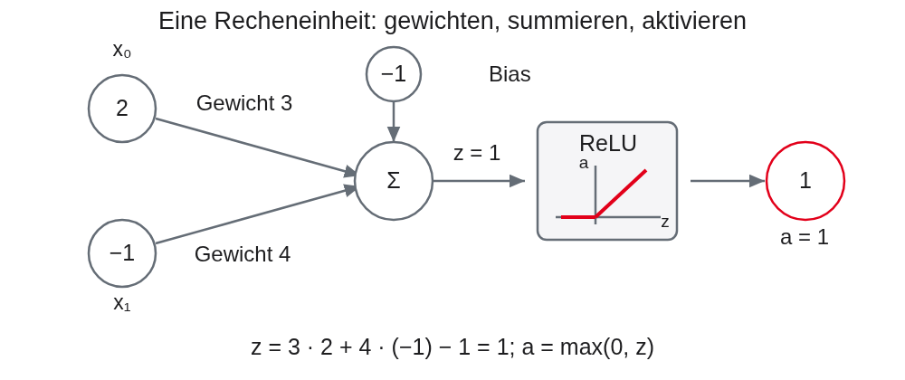{fig-alt="Zwei Eingaben 2 und minus1 werden mit 3 und4 gewichtet, Bias minus1 ergibt Voraktivierung1. Eine ReLU mit Knick bei null liefert ebenfalls1."}

ReLU: $a=\max(0,z)$; Beispiele $-3\mapsto0$ und $1\mapsto1$.

::: notes
Eine Aktivierungsfunktion wird auf die Voraktivierung angewandt. Die hier verwendete ReLU, Rectified Linear Unit, setzt negative Werte auf null und lässt positive Werte unverändert. Mathematisch gilt $a=\max(0,z)$. Das Ergebnis $a$ ist eine Aktivierung, also ein berechneter Wert und kein gespeichertes Gewicht.

Die Abbildung liest sich von links nach rechts. Die beiden Eingangszahlen zwei und minus eins werden mit den Gewichten drei und vier multipliziert. Der zusätzliche Pfeil mit minus eins führt den Bias zur Summeneinheit. Aus $6-4-1$ entsteht $z=1$. Die dargestellte ReLU-Kennlinie ist für negative Argumente waagrecht und für positive Argumente ansteigend; bei eins liefert sie ebenfalls eins. Eine andere Voraktivierung von minus drei würde null liefern.

Der Knick bei null macht ReLU nichtlinear. Nichtlinearität ist wichtig, wenn mehrere Schichten andere Zusammenhänge darstellen sollen als nur eine einzige affine Abbildung. ReLU ist jedoch nur eine mögliche Aktivierungsfunktion. Sie ist weder in jedem Modell vorhanden noch ein Beleg dafür, dass ein Netz seine Aufgabe gut gelernt hat.

Auch für die Hardware bleibt diese Funktion eine zusätzliche Operation mit eigener Semantik. Eine Matrixmultiplikation erledigt nicht automatisch die Aktivierung, die Vorverarbeitung oder eine spätere Klassenentscheidung. Ein Backend kann solche Schritte zusammenfassen, muss dabei aber das vereinbarte Ergebnis und die Datentypregeln erhalten.
:::

## Mehrere Neuronen teilen dieselbe Eingabe

::: {.section-label}
1 / 6 · Modell und Matrix
:::

$$W=\begin{bmatrix}3&4\\-2&1\end{bmatrix},\quad
x=\begin{bmatrix}2\\-1\end{bmatrix},\quad
b=\begin{bmatrix}-1\\2\end{bmatrix}$$

$$z=Wx+b=\begin{bmatrix}1\\-3\end{bmatrix},\qquad
a=\operatorname{ReLU}(z)=\begin{bmatrix}1\\0\end{bmatrix}$$

Jede Zeile bildet eine andere gewichtete Summe über dieselben Eingaben.

::: notes
Eine vollständig verbundene Schicht setzt mehrere solche Neuronen nebeneinander. Alle erhalten dieselbe Eingabe, verwenden aber eigene Gewichte und einen eigenen Bias. Die Gewichte eines Ausgangs lassen sich als eine Matrixzeile schreiben. Mehrere Zeilen bilden dadurch eine Matrix-Vektor-Multiplikation.

Die erste Zeile ist bereits bekannt: $3\cdot2+4\cdot(-1)-1=1$. Die zweite verwendet andere Parameter: $(-2)\cdot2+1\cdot(-1)+2=-3$. Die beiden Voraktivierungen sind daher $z=[1,-3]^T$. Wird ReLU anschließend elementweise angewandt, entsteht $a=[1,0]^T$. Das hochgestellte $T$ kennzeichnet die Schreibweise als Spaltenvektor.

Die gleiche Eingabe trägt zu beiden Ergebnissen bei. Sie muss nicht für jede Zeile neu gemessen werden. Auch die beiden Summen hängen nicht voneinander ab: Ihr jeweiliger Akkumulator benötigt nur die eigenen bisherigen Teilsummen. Diese Unabhängigkeit ist die Verbindung zu mehreren Recheneinheiten und später zur Datenparallelität.

Voraktivierung und Aktivierung bleiben ausdrücklich getrennt. $z=Wx+b$ ist hier affin; erst $a=\operatorname{ReLU}(z)$ ergänzt die gewählte Nichtlinearität. Die gesamte Rechenfolge ist damit noch kein trainierter Klassifikator. Sie erklärt zunächst, welche Produkte zu welchen Ausgängen gehören und warum eine Gewichtsmatrix in vielen neuronalen Rechnungen natürlich entsteht.
:::

## Formen prüfen, bevor Werte berechnet werden

::: {.section-label}
1 / 6 · Modell und Matrix
:::

Für $N$ Eingänge und $M$ Ausgänge:

$$\underbrace{W}_{M\times N}
\underbrace{x}_{N\times1}
+\underbrace{b}_{M\times1}
=\underbrace{z}_{M\times1}$$

- Die innere Dimension $N$ muss übereinstimmen.
- Jede Ausgangszeile erhält genau einen Bias.
- Elementweises Multiplizieren ist eine andere Operation.

::: notes
Die Form eines Zahlenfelds beschreibt, welche Achsen zusammengehören. Für $N$ Eingänge und $M$ Ausgänge besitzt die Gewichtsmatrix $M$ Zeilen und $N$ Spalten. Der Eingangsvektor wird mathematisch als Spalte mit $N$ Zeilen geschrieben. Eine Zeile von $W$ trifft damit eine vollständige Spalte von $x$; das Ergebnis besitzt $M$ Werte. Bias und Voraktivierung haben in dieser Spaltenschreibweise die Form $M\times1$. Eine Programmbibliothek kann denselben Vektor als eindimensionales Feld speichern; eine ausdrücklich zweidimensionale Tensorform $M\times1$ und eine Form mit nur der Achsenlänge $M$ sind dort unterschiedliche Schnittstellen. Die mathematische Orientierung und das tatsächliche API-Layout sind deshalb gemeinsam festzulegen.

Die übereinstimmende innere Dimension ist keine bloße Schreibkonvention. Sie zählt, wie viele einander zugeordnete Produkte jede Ausgangssumme enthält. Wären drei Gewichte mit nur zwei Eingaben zu verbinden, fehlte eine Zuordnung. Eine gleich große Speicherdatei oder ein passender Zeiger behebt diesen Formfehler nicht.

Beim elementweisen Produkt werden dagegen entsprechende Einträge direkt miteinander multipliziert, ohne über die Eingangsachse zu summieren. Es ist eine andere Operation und liefert im Allgemeinen eine andere Form und Bedeutung. Auch ReLU wird elementweise angewandt, allerdings ohne einen zweiten Operanden gleicher Form zu benötigen.

Diese Formprüfung ist später sowohl für C-Indizes als auch für einen Framework-Operator wichtig. Ein Tensorvertrag umfasst zusätzlich Datentyp, Speicherlayout und gegebenenfalls Quantisierung. Zunächst genügt die sichere Zuordnung von Eingangsachse, Ausgangsachse und Bias; danach kann dieselbe Gewichtsmatrix auf mehrere Eingaben angewandt werden.
:::

## Mehrere Eingaben werden zu einer Matrix

::: {.section-label}
1 / 6 · Modell und Matrix
:::

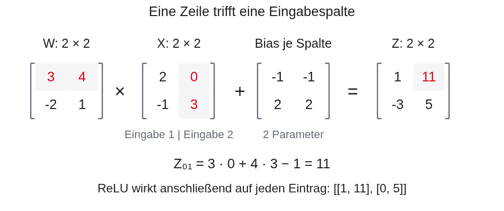{fig-alt="Eine Zeile der Gewichtsmatrix und eine Spalte der Eingabematrix werden hervorgehoben. Zwei Eingabespalten liefern mit einmal je Spalte addiertem Bias Z gleich [[1,11],[-3,5]]."}

Spaltenkonvention: eine Eingabe je Spalte; Bias je Ausgabespalte addieren.

::: notes
Die bisherige Gewichtsmatrix kann mehrere Eingaben mit denselben Parametern auswerten. Dazu werden die Eingangsvektoren als Spalten einer Matrix $X$ angeordnet. Diese Spaltenkonvention wird hier ausdrücklich gewählt; eine andere Bibliothek kann Eingaben als Zeilen speichern und entsprechend andere transponierte Formeln verwenden.

Die erste Eingabe ist $[2,-1]^T$, die zweite $[0,3]^T$. Mit $X=[[2,0],[-1,3]]$ und den bekannten Gewichten ergibt sich vor dem Bias $WX=[[2,12],[-5,3]]$. Der Bias $[-1,2]^T$ wird jeder Ergebnisspalte hinzugefügt. Seine im Bild wiederholten Einträge beschreiben diese Rechenwirkung; es bleiben zwei Parameter, und eine eigene wiederholte Biasmatrix muss dafür nicht gespeichert werden. Damit ist $Z=[[1,11],[-3,5]]$. Die hervorgehobene erste Gewichtszeile trifft in der zweiten Spalte auf $[0,3]^T$: $3\cdot0+4\cdot3-1=11$.

Elementweise ReLU ergibt anschließend $A=[[1,11],[0,5]]$. Die vier Matrixeinträge gehören zu zwei verschiedenen Eingaben und zwei verschiedenen Neuronen. Eine Matrixausgabe ist daher weder eine einzelne neue Eingabe noch automatisch eine Tabelle von Wahrscheinlichkeiten.

Das Zusammenfassen mehrerer Eingaben heißt Batching. Es kann die Wiederverwendung von Gewichten verbessern, benötigt aber Speicher und unter Umständen Wartezeit, bis genügend Eingaben vorliegen. Ein einzelnes zeitkritisches Sensorfenster darf nicht beliebig lange auf einen Batch warten. Die mathematische Regelmäßigkeit erklärt die Hardwaremöglichkeit; die Anwendung entscheidet, ob diese Bündelung zulässig ist.
:::

## Schichten bilden neue Zwischenmerkmale {.compact-figure}

::: {.section-label}
1 / 6 · Modell und Matrix
:::

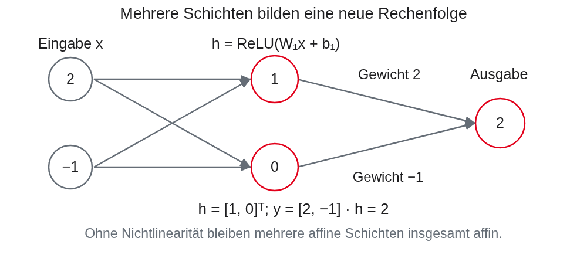{fig-alt="Zwei Eingaben versorgen zwei ReLU-Neuronen mit Ergebnissen1 und0. Eine folgende Zeile mit Gewichten2 und minus1 ergibt die Ausgabe2."}

$$h=\operatorname{ReLU}(W_1x+b_1),\qquad y=W_2h+b_2$$

::: notes
Die Ausgabe einer Schicht kann als Eingabe der nächsten dienen. Die Zwischenaktivierungen heißen hier $h$. Für das bekannte Beispiel liefert die erste affine Rechnung mit anschließender ReLU $h=[1,0]^T$. Eine folgende Zeile mit $W_2=[2,-1]$ und $b_2=0$ berechnet daraus $y=2\cdot1-1\cdot0=2$. Die Pfeile der Abbildung zeigen, welche Zwischenwerte zu welchen Summen beitragen, und keine elektrische Verdrahtung eines bestimmten Prozessors.

Die zweite Schicht sieht nicht mehr direkt die ursprünglichen Messwerte, sondern berechnete Zwischenmerkmale. Beim Training können Gewichte mehrerer Schichten gemeinsam angepasst werden. Dass sie passende Merkmale bilden, ist ein Ziel des Trainings und keine Garantie allein durch das Zeichnen weiterer Schichten.

Die Rolle der Nichtlinearität lässt sich auch algebraisch verstehen. Ohne Aktivierungsfunktion wäre $y=W_2(W_1x+b_1)+b_2=(W_2W_1)x+(W_2b_1+b_2)$. Mehrere affine Schichten blieben insgesamt eine affine Abbildung und könnten zu einer zusammengefasst werden. Eine Nichtlinearität zwischen ihnen verhindert diese allgemeine Zusammenfassung.

Für die Ausführung entstehen nun wiederholte Matrix- oder Vektoroperationen mit dazwischenliegenden Aktivierungen. Die Zwischenwerte benötigen Speicher und müssen die nächste Schicht in der vereinbarten Form erreichen. Mehr Rechenschichten bedeuten deshalb nicht nur mehr Produkte, sondern auch zusätzliche Datenabhängigkeiten und einen geplanten Lebenszyklus der Aktivierungen.
:::

## Warum Matrixprodukte so oft wiederkehren

::: {.section-label}
1 / 6 · Modell und Matrix
:::

- Viele Neuronen: viele gewichtete Summen über gleiche Eingaben
- Viele Eingaben: dieselben Gewichte wiederholt verwenden
- Viele Schichten: affine Rechnung und weitere Operatoren verknüpfen
- Regelmäßige Produkte und Summen erlauben gemeinsame Datenwege

Matrixrechnung ist eine zentrale Grundlage vieler Netze – nicht die Definition jeder KI.

::: notes
Die Matrixschreibweise entsteht aus der Struktur der Rechnung und nicht erst aus dem Wunsch nach einem Beschleuniger. Eine Zeile sammelt die Gewichte eines Neurons, mehrere Zeilen verarbeiten dieselbe Eingabe für verschiedene Ausgänge. Mehrere Eingaben lassen sich wiederum zu Spalten zusammenfassen. Die resultierenden Produkte und Summen besitzen regelmäßige Achsen und viele Möglichkeiten zur Wiederverwendung.

Vollständig verbundene Schichten verwenden dieses Muster unmittelbar. Auch Faltungen kombinieren viele lokale gewichtete Summen und teilen Gewichte zwischen Positionen. Ihre Implementierung kann passende Matrixoperationen nutzen, muss aber nicht erst eine große explizite Matrix aller Fenster speichern. Der Zusammenhang erklärt Rechenregularität, ohne eine einzige Implementierung für alle Operatoren vorzugeben.

Andere Modellteile bleiben ebenso wichtig: Aktivierungen, Vergleiche, Reduktionen oder Datenumordnungen sind nicht automatisch durch ein Matrixprodukt erledigt. Außerdem existieren KI-Verfahren, die nicht als solche neuronalen Netze organisiert sind. Aus der zentralen Rolle von Matrixarbeit in vielen Netzen folgt deshalb weder, dass jede KI nur eine Matrixmultiplikation wäre, noch dass ein Matrixprodukt bereits eine sinnvolle Erkennungsfunktion liefert.

Für den Rechnerentwurf lässt sich nun eine präzise Frage stellen: Wie werden die benötigten Produkte versorgt, ausgeführt und zu korrekten Summen verbunden? Die folgenden Abschnitte zählen zunächst Parameter, Operationen und Bytes getrennt und untersuchen danach, welche Datenparallelität und lokale Wiederverwendung die konkrete Rechnung erlaubt.
:::

## Dense-Schicht: zwei gewichtete Summen

::: {.section-label}
1 / 6 · Modell und Matrix
:::

$$y_j=b_j+\sum_{i=0}^{N-1}W_{j,i}x_i,\qquad j=0,\ldots,M-1$$

- $N$ Eingänge, $M$ Ausgänge; hier $N=3$, $M=2$
- Jede Zeile von $W$ bildet eine eigene Summe
- Eine anschließende Aktivierungsfunktion ist hier ausgeblendet

::: notes
Das Zwei-Eingänge-Beispiel hat gezeigt, wie mehrere gewichtete Summen als eine Matrixoperation geschrieben werden. Nun wird bewusst zu einem anderen Lehrbeispiel mit drei Eingängen und zwei Ausgängen gewechselt. Die Zahlen sind weiterhin von Hand gesetzt; sie stammen nicht aus einem trainierten Modell.

Dense heißt vollständig verbunden: Jeder der $M$ Ausgänge erhält einen Beitrag von jedem der $N$ Eingänge. $x_i$ bezeichnet Eingang $i$, $W_{j,i}$ das Gewicht dieses Eingangs für Ausgang $j$, $b_j$ dessen Bias und $y_j$ die fertige Summe. Die Summe läuft über die Eingangsspalten, während $j$ die Ausgangszeile auswählt. Alle Indizes beginnen bei null. Für dieses Beispiel sind $N=3$ und $M=2$.

Die Matrix enthält sechs Gewichte und der Biasvektor zwei weitere Parameter. Jede Zeile bildet ein eigenes Skalarprodukt mit demselben Eingangsvektor. Diese beiden Ausgabesummen sind voneinander unabhängig. Innerhalb eines fortlaufenden Akkumulators hängt die neue Teilsumme dagegen von der alten ab. Diese Abhängigkeitsstruktur wird später mit der CPU-Parallelität verglichen.

Eine nachgeschaltete Aktivierungsfunktion ist hier ausdrücklich ausgeblendet. $y=Wx+b$ bezeichnet in diesem Beispiel also die affine Voraktivierung, die zuvor $z$ hieß; es gilt hier $y=z$. Mit nichtverschwindendem Bias ist die Abbildung mathematisch affin, auch wenn entsprechende Operatoren in Software häufig als lineare oder Dense-Schichten bezeichnet werden. Vorverarbeitung, Training und Klassenauswahl sind nicht Bestandteil dieser isolierten Rechnung.
:::

## Rechnen Sie die beiden Ausgänge aus

::: {.section-label}
1 / 6 · Modell und Matrix
:::

$$W=\begin{bmatrix}1&2&3\\0&-1&4\end{bmatrix},\quad
x=\begin{bmatrix}2\\1\\3\end{bmatrix},\quad
b=\begin{bmatrix}1\\-2\end{bmatrix}$$

Bestimmen Sie $y=Wx+b$. Wie viele Parameter werden verwendet?

::: notes
Die allgemeine Zeilensumme wird mit vollständig bekannten Zahlen überprüfbar. $W$ bezeichnet die Gewichte des Drei-Eingänge-Beispiels, $x$ die aktuelle Eingabe, $b$ die beiden Biaswerte und $y$ die Ausgabe ohne nachgeschaltete Aktivierung. Matrix-Vektor-Multiplikation bildet das Skalarprodukt jeder Zeile mit demselben Eingangsvektor. Dazu werden einander zugeordnete Werte multipliziert und die Produkte addiert.

Für die erste Zeile entstehen $1\cdot2=2$, $2\cdot1=2$ und $3\cdot3=9$. Ihre Summe ist dreizehn; mit Bias eins folgt $y_0=14$. Die zweite Zeile ergibt $0\cdot2=0$, $(-1)\cdot1=-1$ und $4\cdot3=12$. Die Summe elf wird durch Bias minus zwei zu $y_1=9$. Damit ist $y=[14,9]^T$, wobei das hochgestellte $T$ die Transposition zur Spaltenform bezeichnet.

Sechs Gewichte und zwei Biaswerte ergeben acht Parameter. Die drei Eingaben sind Daten dieser Auswertung und keine trainierten Parameter. Ein Bias gehört genau einmal zur jeweiligen Ausgangssumme; würde er zu jedem Produkt addiert, entstünde ein anderer Operator. Die zwei Zeilen können unabhängig kontrolliert werden.

Diese vollständige Rechnung dient anschließend als gemeinsame Referenz für verschiedene Datenwege. Eine CPU, ein Vektorprozessor und ein geeigneter Beschleuniger sollen dieselbe mathematische Aufgabe lösen, können ihre Produkte und Summen aber verschieden organisieren. Gleiche Ergebnisse allein beschreiben noch nicht ihren Speicherverkehr oder ihre Ausführungszeit.
:::

## 2 · Rechenarbeit und Daten zählen {.section-divider}

Wie viel Rechnung steckt im Modell – und wie viele Bytes müssen dafür ankommen?

::: {.section-route}
Modell → Rechenmuster → Vektoren → Array → Firmware → Bilanz
:::

Parameter, MACs, Speichergrenze und Intensität getrennt benennen.

::: notes
Die Softwaregrundlagen liefern nun eine vollständig bekannte Folge von Produkten, Summen und Aktivierungen. Daraus lässt sich aber noch keine Laufzeit ablesen. Zuerst sind die gespeicherten Parameter von der tatsächlich ausgeführten arithmetischen Arbeit zu unterscheiden.

Danach kommt die Datenversorgung hinzu. Eine Multiplikation benötigt Operanden, und derselbe Wert kann je nach Organisation einmal oder mehrfach über eine langsame Speichergrenze übertragen werden. Die Zählung hängt deshalb davon ab, welche Grenze und welche Anteile betrachtet werden. Eine Zahl ohne diese Angaben ist kein vergleichbarer Datenverkehr.

Dieser Abschnitt führt von einer skalaren Summenschleife zur Rechenintensität und zu idealen Roofline-Obergrenzen. Wiederverwendung kleiner Matrixausschnitte zeigt anschließend, wie sich die Datenmenge ändern kann, obwohl das mathematische Ergebnis gleich bleibt. Erst damit ist die Grundlage gelegt, zusätzliche Rechenwege sachlich zu beurteilen.
:::

## MACs, Parameter und Operationen zählen

::: {.section-label}
2 / 6 · Rechenarbeit und Daten
:::

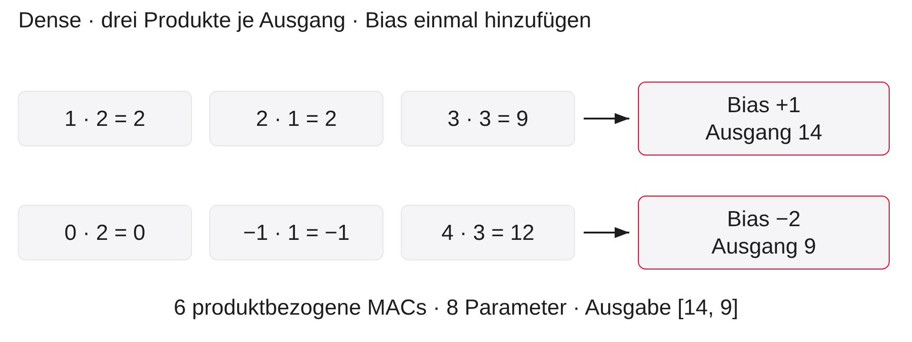{fig-alt="Zwei Ausgangssummen verwenden je drei Produkte und einen Bias. Ergebnisse sind 14 und 9. Es gibt sechs produktbezogene MACs und acht Parameter."}

Konvention: eine MAC zählt als zwei arithmetische Operationen.

::: notes
Nachdem das Ergebnis der Dense-Schicht feststeht, lassen sich drei verschiedene Mengen zählen: gespeicherte Parameter, arithmetische Arbeit und ausführbare Maschinenbefehle. MAC bedeutet Multiply-Accumulate, ein Produkt zu einer laufenden Summe addieren: $a\leftarrow a+wx$. Dabei ist $a$ der Akkumulator, $w$ ein Gewicht und $x$ ein Eingang. Die Abbildung verfolgt die beiden Ausgangszeilen bis zu den vollständigen Werten vierzehn und neun einschließlich Bias.

Das Drei-Eingänge-Beispiel enthält sechs produktbezogene MACs. Unsere Zählkonvention zählt je MAC eine Multiplikation und eine Addition, also zwei arithmetische Operationen. Beginnt jeder Akkumulator bei null und wird der Bias anschließend getrennt addiert, entstehen zwölf produktbezogene Operationen plus zwei Biasadditionen, insgesamt vierzehn. Eine Initialisierung des Akkumulators mit dem Bias vermeidet diese getrennte Addition. Deshalb muss die verwendete Konvention stets genannt werden.

Eine MAC kann je nach Befehlssatz ein einzelner Befehl sein, mehrere Befehle benötigen oder nur eine Teilaktion eines Hardwareauftrags darstellen. Zwei gezählte Operationen sind daher weder zwei garantierte Prozessorzyklen noch zwei garantierte Maschinenbefehle. Die acht Parameter sind ebenfalls keine acht MACs.

Wiederverwendung verändert das Verhältnis zusätzlich: Eine Faltung kann dieselben Gewichte an mehreren räumlichen Positionen verwenden. Dann steigt die Rechenarbeit, ohne dass für jede Position neue Parameter gespeichert werden. Parameterzahl, Datenverkehr und Laufzeit müssen deshalb getrennt untersucht werden.
:::

## Der skalare Kern ist eine Summenkette

::: {.section-label}
2 / 6 · Rechenarbeit und Daten
:::

```c
/* Eine Zeile mit drei Eingängen.
   Eingänge/Gewichte: int8_t, Bias: int32_t. */
int64_t sum = bias;
for (size_t i = 0; i < 3; ++i) {
    sum += (int64_t)input[i] * weight[i];
}
```

Zwei Zeilen erlauben unabhängige Summen; jede einzelne Summe bleibt abhängig.

::: notes
Die mathematische Zeilensumme lässt sich direkt in C ausdrücken. Der Ausschnitt stammt aus dem Rechenkern der vollständigen Hostdatei `labs/src/lab08_dense.c`. `int8_t`, `int32_t` und `int64_t` sind vorzeichenbehaftete Ganzzahltypen mit acht, zweiunddreißig beziehungsweise vierundsechzig Bit. `size_t` ist der vorzeichenlose C-Typ für Objektgrößen und Indizes. Header, Fehlerprüfung und konkrete Beispieldaten stehen in der vollständigen Datei; sichtbar sind hier nur die drei Iterationen einer Ausgangszeile.

`input[i]` und `weight[i]` wählen das zusammengehörige Wertepaar. Die Umwandlung vor der Multiplikation lässt das Produkt im breiten Ganzzahltyp berechnen. `sum` beginnt mit dem Bias und enthält nach jeder Iteration ein weiteres Produkt. Vor der Ausgabe prüft die vollständige Funktion den zulässigen Ergebnisbereich. Das ist eine Integer-Modellrechnung mit Nullpunkten null, kein vollständiger quantisierter Netzwerkkernel.

RAW, Read After Write, beschreibt die echte Abhängigkeit der Akkumulation: Jede Aktualisierung liest den vorherigen Wert von `sum`. Unabhängige Produkte oder die zweite Ausgangszeile können dennoch andere Rechenressourcen nutzen. OoO, Out of Order, kann solche unabhängige Arbeit intern vorziehen, verändert aber nicht die Bedeutung der Summenkette.

GCC bedeutet GNU Compiler Collection. Der Compiler übersetzt die C-Schleife; daraus folgt noch keine Zeitmessung eines RISC-V-Kerns. Die Anzahl gleichzeitig möglicher Produkte und die Versorgung mit Eingaben sind zusätzliche Mikroarchitekturfragen. Für den nächsten Schritt wird deshalb die durch eine benannte Speichergrenze übertragene Datenmenge betrachtet.
:::

## Rechenintensität braucht eine Speichergrenze

::: {.section-label}
2 / 6 · Rechenarbeit und Daten
:::

$$I=\frac{O}{D}\quad[\text{Operationen/Byte}]$$

- $O$: gezählte arithmetische Arbeit
- $D$: übertragene Bytes über eine ausdrücklich benannte Grenze
- Lehrmodell R: externer Speicher → lokaler Operandenpuffer
- Zunächst nur Eingangsverkehr; Bias und Ausgaben ausgeschlossen

::: notes
Ein Rechenkern muss nicht nur Operationen ausführen, sondern auch ihre Operanden erhalten. Arithmetische Rechenintensität, englisch Arithmetic Intensity, setzt die gezählte Rechenarbeit zum Datenverkehr ins Verhältnis: $I=O/D$. $O$ zählt arithmetische Operationen, $D$ die übertragene Datenmenge in Byte. Ein Byte umfasst acht Bit. Die Einheit ist somit Operationen je Byte.

Die Angabe benötigt eine Speichergrenze. Ein Wert kann einmal aus einem weiter entfernten Speicher kommen und danach mehrfach aus einem lokalen Puffer gelesen werden. Diese Zugriffe gehören zu unterschiedlichen Verkehren. Lehrmodell R zählt zunächst nur Transfers vom externen Speicher zum lokalen Operandenpuffer. Dort angenommene Vier-Byte-Operanden und zwei neue Operanden je MAC, Multiply-Accumulate, bedeuten acht Byte für zwei Operationen: $I=2/8=0{,}25$ Operationen je Byte.

Biasverkehr und Ausgabeschreiben sind in diesem ersten Modell ausgeschlossen. Mit einer anderen Grenze oder Zählbasis kann dieselbe mathematische Rechnung eine andere Intensität besitzen. Auf einem Mikrocontroller kann der entscheidende langsame Speicher auch Flash anstelle eines externen DRAM sein. DRAM heißt Dynamic Random Access Memory, dynamischer Arbeitsspeicher. Es wird keine bestimmte Platine angenommen.

Rechenintensität ist zunächst ein Verhältnis, keine Laufzeit. Erst zusammen mit einer maximalen Rechenrate und einer Bandbreite entsteht eine obere Grenze für die versorgbare Arbeit. Damit wird aus der Softwarefrage nach gleichen Produkten eine konkrete Hardwarefrage: Wie viele dieser Produkte kann der Datenstrom überhaupt rechtzeitig bedienen?
:::

## Roofline: zwei ideale Obergrenzen

::: {.section-label}
2 / 6 · Rechenarbeit und Daten
:::

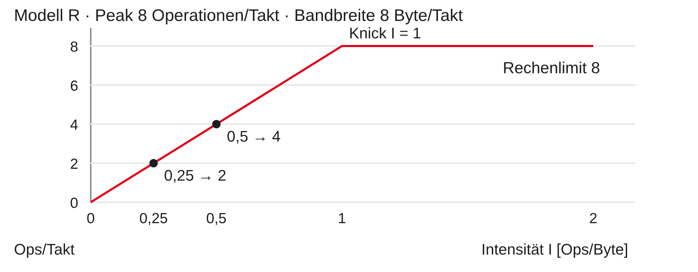{fig-alt="Roofline-Modell mit Peak acht Operationen pro Takt und Bandbreite acht Byte pro Takt. Die Grenze steigt bis Intensität eins linear und bleibt danach bei acht. Punkte bei 0,25 und 0,5 ergeben zwei und vier."}

$$P\leq\min(P_{\mathrm{peak}},B\,I),\qquad
I_{\mathrm{Knick}}=P_{\mathrm{peak}}/B$$

::: notes
Das Roofline-Modell verbindet Rechenkapazität und Datenversorgung zu einer idealen Obergrenze. Roofline bedeutet Dachlinie. Die waagerechte Achse trägt die Intensität $I$ in Operationen je Byte, die senkrechte Achse die Rate $P$ in Operationen je Takt. Die dargestellte Kurve ist keine Messkurve und garantiert nicht, dass eine Anwendung sie erreicht.

$P_{\mathrm{peak}}$ bezeichnet die maximale Rechenrate bei vollständig versorgten Einheiten. $B$ ist die Bandbreite über die zuvor festgelegte Grenze in Byte je Takt. Das Produkt $BI$ begrenzt, wie viele Operationen der Datenstrom höchstens versorgen kann. Insgesamt gilt $P\leq\min(P_{\mathrm{peak}},BI)$.

In Lehrmodell R betragen Peak und Bandbreite jeweils acht in ihren unterschiedlichen Einheiten. Bei $I=0{,}25$ sind höchstens $\min(8,8\cdot0{,}25)=2$ Operationen je Takt versorgbar, bei $I=0{,}5$ vier. Der Knick liegt bei $P_{\mathrm{peak}}/B=1$ Operation je Byte. Links davon ist die Bandbreitengrenze enger; rechts davon die Rechengrenze.

Eine Intensität kleiner als eins bedeutet nicht auf jeder Hardware Speicherbegrenzung, denn der Knick hängt von Peak und Bandbreite ab. Abhängigkeiten, Anlaufzeiten, Konflikte oder nicht unterstützte Operationen können die tatsächliche Rate zusätzlich senken. Die nächste Frage ist daher nicht nur, wie mehr Rechenwerke gebaut werden, sondern wie bereits geladene Daten häufiger für nützliche Rechnung verwendet werden können.
:::

## Dieselbe Matrixrechnung mit Wiederverwendung

::: {.section-label}
2 / 6 · Rechenarbeit und Daten
:::

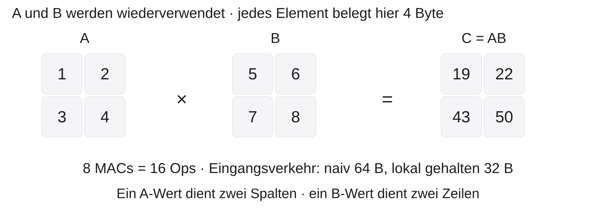{fig-alt="A gleich [[1,2],[3,4]], B gleich [[5,6],[7,8]], C gleich [[19,22],[43,50]]. Acht MACs verwenden dieselben acht Eingangswerte mehrfach."}

Ein Tile ist ein lokal bearbeiteter Matrixausschnitt. Auch eine CPU kann Tiles nutzen.

::: notes
Eine Matrixmultiplikation enthält systematisch mehrfach gebrauchte Werte. Ein Tile ist ein begrenzter Matrixausschnitt, der gemeinsam in einen nahen Speicher passt. Tiling bezeichnet das lokale Halten und Bearbeiten solcher Ausschnitte. Es ist ebenso eine Softwaretechnik für eine CPU, Central Processing Unit, wie eine Organisationsidee für einen Beschleuniger. Eine NPU, Neural Processing Unit, besitzt darauf kein exklusives Prinzip.

Für die abgebildeten Eingabematrizen gilt $C=AB$. Beide Eingaben besitzen zwei Zeilen und zwei Spalten. Jede Ausgabesumme beginnt bei null: $C_{00}=1\cdot5+2\cdot7=19$, $C_{01}=1\cdot6+2\cdot8=22$, $C_{10}=3\cdot5+4\cdot7=43$ und $C_{11}=3\cdot6+4\cdot8=50$. Acht produktbezogene MACs, Multiply-Accumulate, ergeben nach der festgelegten Konvention sechzehn Operationen.

Jeder Wert von $A$ wird für zwei Ausgabespalten gebraucht und jeder Wert von $B$ für zwei Ausgabezeilen. Ohne lokales Halten lädt das naive Modell beide Operanden jeder MAC neu: sechzehn Transfers zu je vier Byte, insgesamt vierundsechzig Byte. Werden die acht verschiedenen Eingabewerte einmal geladen und danach lokal wiederverwendet, genügen zweiunddreißig Byte über dieselbe Grenze.

Die kleinen ganzen Zahlen des Rechenbeispiels belegen nicht ihre tatsächliche Speicherbreite. Für diesen Vergleich werden ausdrücklich vier Byte je Operand angenommen. Auch eine CPU kann den beschriebenen Verkehr reduzieren. Noch nicht enthalten sind die fertigen Ausgaben; deren Rückschreiben erweitert die bisher betrachtete Zählbasis.
:::

## Was ändert das Ausgabeschreiben?

::: {.section-label}
2 / 6 · Rechenarbeit und Daten
:::

| Zählbasis für $C=AB$ | Naiv | Mit lokalem Tile |
|--------------------|------|------------------|
| Nur Eingangsbytes | $64$ B | $32$ B |
| Zusätzlich vier Ausgaben zu je $4$ B | $80$ B | $48$ B |
| Intensität mit Ausgaben | $16/80=0{,}2$ | $16/48\approx0{,}333$ |

Kein anfängliches Lesen von $C$; alle vier Summen starten bei null.

::: notes
Die Rechnung bleibt dieselbe, wenn zusätzlich ihre Ausgaben in die Verkehrsbilanz aufgenommen werden. Die Speichergrenze wird jedoch erweitert: Zu den Eingangsbytes kommen vier fertige Werte mit je vier Byte, also sechzehn Ausgabebyte. Die Operation lautet $C=AB$ und nicht $C\leftarrow C+AB$. Deshalb ist kein altes $C$ einzulesen; auch Biaswerte gibt es in diesem Matrixbeispiel nicht.

Die acht MACs, Multiply-Accumulate, zählen unverändert als sechzehn Operationen. Naiv entstehen vierundsechzig Eingangsbytes plus sechzehn Ausgabebytes, zusammen achtzig. Mit lokalem Tile sind es zweiunddreißig plus sechzehn, also achtundvierzig Byte. Die Intensitäten sinken auf $16/80=0{,}2$ und $16/48=1/3$ Operation je Byte. Die absolute Ersparnis bleibt zweiunddreißig Byte; ihr relativer Anteil am Gesamtverkehr beträgt jetzt vierzig statt fünfzig Prozent.

Ein Vergleich von Intensitäten ist nur sinnvoll, wenn dieselbe Grenze und dieselben Anteile gezählt werden. Das vorherige Roofline-Diagramm verwendete ausdrücklich das reine Eingangsmodell. Für eine gemeinsame Betrachtung beider Transferrichtungen wäre eine passende Bandbreitenannahme erforderlich; seine Punkte dürfen nicht stillschweigend umbenannt werden.

Diese Sorgfalt ist auch bei Leistungsangaben eines realen Chips nötig. Eine eng gesetzte Rechengrenze kann Übergaben, Bias und Ausgabeverkehr ausschließen, während die Anwendung sie dennoch bezahlt. Zuerst wird deshalb die Zählbasis festgelegt und erst anschließend die Zahl verglichen.
:::

## Bandbreite, Latenz und Abhängigkeit trennen

::: {.section-label}
2 / 6 · Rechenarbeit und Daten
:::

- Bandbreite: wie viele Bytes pro Zeit ankommen können
- Latenz: wann ein einzelner benötigter Wert bereitsteht
- RAW: wann die nächste abhängige Summe starten kann
- Überlappung hilft beim Warten; Wiederverwendung senkt Verkehr

::: notes
Eine hohe übertragbare Bytezahl und eine früh verfügbare einzelne Eingabe sind unterschiedliche Eigenschaften. Bandbreite misst eine Rate; Latenz eine Dauer. Dazu kommt eine dritte Grenze: RAW, Read After Write, macht die nächste Akkumulation vom vorherigen Summenwert abhängig. Diese Summenabhängigkeit bleibt auch bei reichlich Speicherbandbreite bestehen.

Ein ausdrücklich vereinfachtes Transfermodell verdeutlicht den Unterschied. Ein Transfer dauert drei Takte, während ein neuer unabhängiger Transfer in jedem Takt beginnen darf. Starts in den Takten eins bis vier liefern dann Ergebnisse am Ende der Takte drei bis sechs. Werden dieselben vier Transfers seriell begonnen, enden sie erst in drei, sechs, neun und zwölf. Die einzelne Latenz beträgt in beiden Fällen drei Takte; die Überlappung verbessert den Durchsatz. Diese Zählweise ist eine Modellannahme und keine Angabe zu einer konkreten Speicherplatine.

OoO, Out of Order, kann unabhängige Zugriffe überlappen und vorhandene Ressourcen dadurch besser nutzen. Es erzeugt weder unbegrenzte Bandbreite noch beseitigt es eine echte Datenabhängigkeit. Tiling reduziert dagegen die angeforderte Datenmenge, indem ein Matrixausschnitt lokal bleibt. Beide Maßnahmen können gemeinsam sinnvoll sein.

Die Unterscheidung führt zurück zur Ausgangsfrage nach mehr Multiplikationsleistung. Eine schnellere Recheneinheit hilft nur, wenn gerade Rechenkapazität begrenzt. Bei fehlenden Operanden, einer langen Summenkette oder unnötigem Nachladen muss zuerst der jeweilige Engpass verstanden werden.
:::

## Papierphase 1: Rechnung und Speichergrenze

::: {.section-label}
2 / 6 · Rechenarbeit und Daten
:::

Übungsblatt, Aufgaben 1–2 · 10 Minuten

- Dense: Ausgänge, Parameter und MACs getrennt zählen
- Roofline: Grenze und Knick aus den Modellwerten bestimmen
- Tile: Wiederverwendung erklären und Ausgaben gesondert zählen

::: notes
Die ersten beiden Papieraufgaben übertragen die eingeführten Regeln auf andere Formen und Zahlen. Die neue Dense-Schicht hat drei Ausgänge und zwei Eingänge. Die Zeilen ergeben $6+2-1=7$, $-9-8+2=-15$ und $3-4=-1$. Sechs Gewichte und drei Biaswerte sind neun Parameter, während nur sechs produktbezogene MACs, Multiply-Accumulate, anfallen. Mit Int8-Gewichten und -Eingaben sowie Int32-Biaswerten beträgt die Größe $6+12+2=20$ Byte; drei Int8-Ausgaben erhöhen sie auf $23$ Byte. Int8 und Int32 bezeichnen Ganzzahlen mit acht beziehungsweise zweiunddreißig Bit. Metadaten, Ausrichtung und temporäre Arbeitsbereiche fehlen in dieser Zahl.

Die geänderte Roofline verwendet einen Peak von zwölf Operationen je Takt und eine Bandbreite von sechs Byte je Takt. Bei Intensität $0{,}5$ beträgt die obere Grenze drei Operationen je Takt, bei Intensität zwei zwölf. Der Knick liegt bei zwei Operationen je Byte. Ein auf vierundzwanzig erhöhter Peak ändert die Grenze bei Intensität $0{,}5$ nicht, weil die Datenversorgung dort weiter nur drei Operationen je Takt erlaubt.

Das 2×3-mal-3×2-Tile enthält zwölf MACs, also vierundzwanzig Operationen. Naiv werden $96$ Eingangsbytes übertragen, mit Wiederverwendung nur $48$. Daraus folgen Intensitäten $0{,}25$ und $0{,}5$. Vier zusätzliche Vier-Byte-Ausgaben erweitern die Zählbasis auf $112$ und $64$ Byte; die Intensitäten sind dann $3/14$ und $0{,}375$. Bei jedem Ergebnis gehört daher die benannte Transfergrenze zur Antwort. Die vollständigen Rechenwege stehen im Lösungsprofil des Übungsblatts.
:::

## 3 · Gleiche Rechnung auf vielen Daten {.section-divider}

Welche Parallelität steckt zwischen den Elementen, und welche bleibt abhängig?

::: {.section-route}
Modell → Rechenmuster → Vektoren → Array → Firmware → Bilanz
:::

SIMD, DSP und Vektoren über ihre Wirkung und ihre Grenzen verstehen.

::: notes
Die Matrixrechnung enthält viele gleichartige Operationen. Neben der Befehlsparallelität eines CPU-Kerns lässt sich deshalb Datenparallelität nutzen: Eine gemeinsame Operation wird auf mehrere Daten angewandt. Das bedeutet noch nicht, dass beliebig viele physische Rechenwerke vorhanden sind oder jedes Ergebnis nach einem Takt fertig ist.

Dieser Abschnitt entwickelt gepackte Operanden, Signalverarbeitungseinheiten und die RISC-V-Vektorerweiterung schrittweise. Besonders wichtig sind die Grenzen zwischen logischer Elementzahl, Registerkapazität und tatsächlich vorhandenen Rechen-Lanes. Auch breite Produktsummen benötigen passende Datentypen und eine eindeutige Zählweise.

Die Beispiele verwenden jeweils ein ausdrücklich festgelegtes Zeit- und Zahlenmodell. Vektorlänge und Befehlssatzwirkung werden von Latenzen und Durchsatz getrennt. Dadurch bleibt nachvollziehbar, welche Aussage eine Softwareoperation garantiert und welche erst zur gewählten Mikroarchitektur gehört.
:::

## ILP und DLP können gleichzeitig auftreten

::: {.section-label}
3 / 6 · Datenparallelität
:::

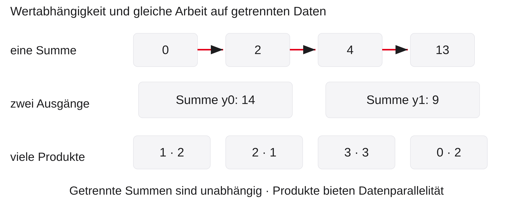{fig-alt="Eine Summenkette enthält abhängige Akkumulationen. Zwei Ausgabesummen sind voneinander unabhängig, mehrere elementweise Produkte bieten Datenparallelität."}

DLP beschreibt das Rechenmuster; SIMD ist eine mögliche Umsetzung.

::: notes
Die gewichteten Summen einer dichten Schicht bieten zwei Arten von Parallelität. Innerhalb einer Summe hängt die nächste Akkumulation vom bisherigen Ergebnis ab; zwischen verschiedenen Ausgängen können dagegen unabhängige Rechnungen liegen. ILP, Instruction-Level Parallelism, bezeichnet Parallelität zwischen Maschinenbefehlen. DLP, Data-Level Parallelism, bezeichnet gleiche Arbeit an verschiedenen Daten. SIMD, Single Instruction, Multiple Data, ist eine mögliche Befehlssteuerung für mehrere solche Datenoperationen. Das Datenmuster des Programms und die Art seiner Umsetzung durch Hardware sind damit getrennt zu betrachten.

Eine fortlaufende Summenkette steht einer Gruppe unabhängiger Ausgabesummen gegenüber. Jeder Akkumulator benötigt seinen Vorgänger; diese Abhängigkeit ist rot verbunden. Die beiden Ausgabesummen können unabhängig voneinander fortschreiten. Innerhalb jeder bleiben Ketten, zwischen den Zeilen besteht jedoch kein Wertfluss. Die Gruppe unabhängiger Produkte zeigt gleiche Multiplikation auf mehreren Eingangspaaren.

ILP verlangt nicht unterschiedliche Rechenarten: Zwei unabhängige Additionsbefehle können ebenso parallel ausgeführt werden. Umgekehrt definiert DLP noch keinen Maschinenbefehl. Ein Compiler kann das Datenmuster skalar, mit festen SIMD-Gruppen oder mit Vektoren umsetzen. Hundert unabhängige Produkte bedeuten weder hundert physische Rechenwerke noch Fertigstellung in einem Takt. Die passende Hardware muss die Datenkapazität, tatsächlichen Rechenressourcen und späteres Zusammenführen der Produkte organisieren.
:::

## Packed SIMD: Grenzen zwischen den Bytes

::: {.section-label}
3 / 6 · Datenparallelität
:::

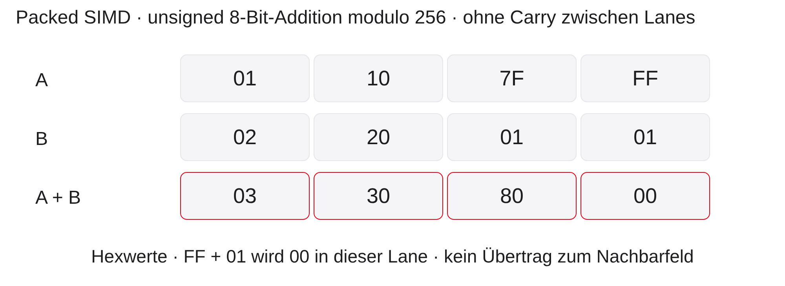{fig-alt="Vier unsigned Acht-Bit-Lanes addieren 1+2,16+32,127+1,255+1 getrennt zu 3,48,128,0. Es fließt kein Übertrag in die Nachbarlane."}

Ein gewöhnliches 32-Bit-`add` auf gepackten Bytes hat andere Übertragsregeln.

::: notes
Eine Möglichkeit, die gleiche Rechnung auf mehrere kleine Werte anzuwenden, ist Packed SIMD. SIMD steht für Single Instruction, Multiple Data; Packed bezeichnet die gemeinsame Ablage mehrerer Elemente in einem breiteren Register. Jedes getrennt behandelte Datenfeld heißt hier Lane, ohne damit bereits ein eigenes dauerhaftes Rechenwerk zu behaupten. Das Rechenbeispiel verwendet vier vorzeichenlose Acht-Bit-Felder und Addition modulo $256$: Ein Überlauf wird innerhalb des betroffenen Feldes verworfen und nicht in das Nachbarfeld übertragen.

Die Ergebnisse sind $1+2=3$, $16+32=48$, $127+1=128$ und $255+1=0$ modulo $256$. In Hexadezimalnotation erscheinen sie als 03, 30, 80 und 00. Die senkrechten Feldgrenzen verhindern einen Übertrag in das Nachbarfeld. Ein gewöhnliches Zweiunddreißig-Bit-`add` addiert dagegen eine ganze Zahl und kann einen Byteübertrag weitergeben.

Das Beispiel ist kein behaupteter SIMD-Befehl der RISC-V-Basis. RISC-V ist die Befehlssatzfamilie des Kurses. Vorzeichenbehaftete Addition oder Sättigung, Begrenzen statt Umklappen, wären andere Verträge. Eine Produktsumme für ein Netz ist nochmals etwas anderes: Schon $20\cdot20=400$ passt nicht in ein Acht-Bit-Feld. Wir müssen daher Breite der Operanden und Breite des Akkumulators getrennt wählen.
:::

## Schmale Operanden, breitere Produktsumme

::: {.section-label}
3 / 6 · Datenparallelität
:::

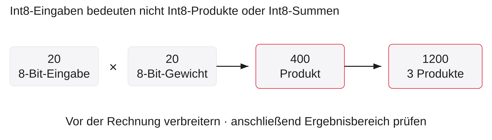{fig-alt="Zwei Int8-Operanden mit Wert 20 ergeben Produkt 400. Drei solche Produkte ergeben Summe 1200. Der Akkumulator braucht mehr als acht Bit."}

Int8 beschreibt gespeicherte Operanden, nicht automatisch die Ergebnisbreite.

::: notes
Geringe Speicherbreite und ausreichende Rechenbreite sind verschiedene Anforderungen. Int8 bezeichnet eine vorzeichenbehaftete Acht-Bit-Ganzzahl mit dem Bereich von minus hundertachtundzwanzig bis hundert siebenundzwanzig. Schon zwei Operanden mit dem Wert zwanzig liefern das Produkt vierhundert. Drei solche Produkte ergeben zwölfhundert. Weder das einzelne Produkt noch die Summe passen in Int8. Ein Akkumulator, der die laufende Produktsumme hält, muss deshalb für einen größeren Wertebereich ausgelegt sein.

Bei neuronalen Integerkerneln sind Int8-Eingaben und Gewichte mit einem Int32-Akkumulator verbreitet; Int32 bedeutet vorzeichenbehaftete Zweiunddreißig-Bit-Ganzzahl. Das ist keine Garantie gegen jeden Überlauf. Anzahl der Produkte, Nullpunktkorrektur und Biasbereich müssen zum Kernel passen. Unser kleines Hostbeispiel summiert zur sicheren Bereichsprüfung zunächst in Int64, einer Vierundsechzig-Bit-Ganzzahl, und prüft anschließend die Ausgabe.

Widening, Verbreitern, bedeutet das Rechnen mit einem größeren Typ, nicht das nachträgliche Wiederherstellen bereits verlorener Bits. Die Umwandlung muss vor einer zu schmalen Rechnung erfolgen. Requantisierung ist die spätere Skalierung und Begrenzung auf einen Ausgangsdatentyp. Sie ist ein eigener Schritt und keine gewöhnliche Int8-MAC. MAC steht für Multiply-Accumulate. Schmale gespeicherte Daten sparen also Bytes, verlangen aber weiterhin eine sauber geplante Arithmetik.
:::

## DSP: bekannte Muster der Signalverarbeitung

::: {.section-label}
3 / 6 · Datenparallelität
:::

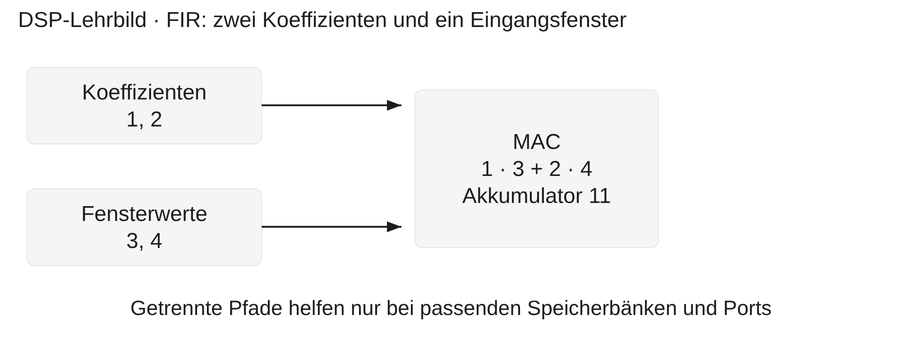{fig-alt="Koeffizienten und ein gleitendes Eingangsfenster versorgen einen MAC-Akkumulator über getrennte lokale Pfade. Zwei Produkte 1 mal 3 und 2 mal 4 ergeben 11."}

Mehrere Speicherpfade und Hardware-Schleifen sind mögliche DSP-Merkmale.

::: notes
Produktsummen sind kein ausschließlich neuronales Rechenmuster. Ein DSP, Digital Signal Processor oder Prozessor für digitale Signalverarbeitung, unterstützt häufig ähnliche Aufgaben. Ein FIR-Filter, Finite Impulse Response oder Filter mit endlicher Impulsantwort, berechnet beispielsweise $y[n]=\sum_k h[k]x[n-k]$. Dabei bezeichnet $n$ den Zeitpunkt, $k$ die Verzögerung und $h[k]$ den zugehörigen Filterkoeffizienten. Mit den Koeffizienten eins und zwei sowie den zugeordneten Eingangswerten drei und vier entsteht $1\cdot3+2\cdot4=11$. Die Form der Rechnung ist einer gewichteten neuronalen Summe ähnlich, ihre fachliche Bedeutung jedoch eine andere.

Das Bild zeigt getrennte lokale Pfade für Koeffizienten und Eingangswerte, die eine MAC-Einheit versorgen. MAC steht für Multiply-Accumulate, Produkt zur Summe addieren. Zusätzliche Pfade können zwei benötigte Operanden gleichzeitig bereitstellen, wenn Speicherbänke und Ports dies tatsächlich erlauben. Ein solcher Datenpfad ist eine Verbindung für die benötigten Werte. Zwei verfügbare Verbindungen garantieren noch keine konfliktfreie Versorgung: Bankkonflikte entstehen bei konkurrierenden Zugriffen auf dieselbe Speicherressource.

Hardware-Schleifen können die wiederholte Steuerung von Start, Ende und Zähler übernehmen. Das spart bestimmte Zähler- und Sprungbefehle, beseitigt aber keine Datenwartezeit. Diese Merkmale gehören nicht zwingend zu jedem DSP. Die Nähe zur Dense-Schicht liegt in der häufigen Produktsumme; Zeitfenster und Modellbedeutung bleiben unterschiedlich. Ob ein eigener MAC-Pfad genügend Durchsatz hat, klärt nun die Trennung von Latenz und Startabstand.
:::

## Ein Start pro Takt ist nicht Latenz eins

::: {.section-label}
3 / 6 · Datenparallelität
:::

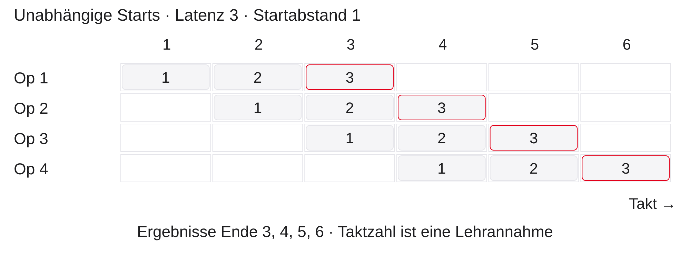{fig-alt="Vier unabhängige Operationen beginnen in Takten eins bis vier. Bei Ergebnislatenz drei enden sie in Takten drei bis sechs. Latenz drei und Initiationsintervall eins sind verschieden."}

Lehrmodell: Ergebnislatenz $3$, Initiationsintervall $1$.

::: notes
Wie schnell ein Rechenpfad neue Arbeit übernehmen kann, folgt nicht unmittelbar aus seiner Ergebnislatenz. Latenz ist die Anzahl der Takte vom Start einer Operation bis zu ihrem fertigen Ergebnis. Das Initiationsintervall ist dagegen der minimale Abstand zwischen zwei zulässigen Starts. In einer gepipelineten Einheit können sich verschiedene unabhängige Operationen in unterschiedlichen Verarbeitungsstufen befinden. Das hier angenommene Modell hat drei Schritte je Operation und erlaubt trotzdem schon in jedem Takt einen neuen Start.

Die waagerechte Achse zeigt Takte eins bis sechs. Operationen eins bis vier starten in eins, zwei, drei und vier. Ihre Ergebnisse liegen jeweils am Ende von drei, vier, fünf und sechs vor. Die rote letzte Stufe markiert Fertigstellung. Es sind vier Operationen in einem sechs Takte langen Fenster; der längere stationäre Strom könnte trotzdem ein Ergebnis je Takt liefern. Latenz drei wird dadurch nicht zu eins.

Eine MAC, Multiply-Accumulate, verbindet Produkt und Summenaddition. Bei einer abhängigen Akkumulatorkette genügt das Initiationsintervall allein nicht, weil der nächste Start den vorigen Wert benötigt. Dafür sind passende Weiterleitung und Abhängigkeitsregeln entscheidend. Die Abbildung ist daher ausdrücklich ein Modell unabhängiger Operationen, keine Zusage eines DSP, Digital Signal Processor. Dieselbe Vorsicht benötigen wir bei einem Vektorbefehl: Seine Elementzahl verrät noch nicht seine tatsächliche Laufzeit.
:::

## RVV: Registerbreite ist eine Kapazität

::: {.section-label}
3 / 6 · Datenparallelität
:::

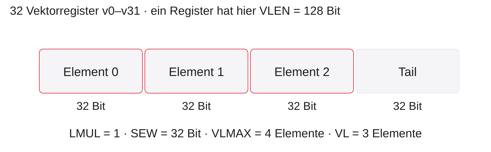{fig-alt="Ein 128-Bit-Vektorregister enthält bei 32-Bit-Elementen vier Plätze. VL drei aktiviert die ersten drei, der vierte ist Tail. Es gibt 32 Vektorregister v0 bis v31."}

VLEN in Bit · SEW in Bit/Element · VL in Elementen

::: notes
Ein Vektorbefehl beschreibt die gemeinsame Bearbeitung mehrerer Elemente, ohne die Zahl der dafür gleichzeitig arbeitenden Rechenpfade festzulegen. RVV, RISC-V Vector Extension, ist die Vektorerweiterung der RISC-V-Befehlssatzarchitektur; RISC steht für Reduced Instruction Set Computer. RVV stellt zweiunddreißig architektonische Vektorregister von `v0` bis `v31` bereit. VLEN, Vector Register Length, bezeichnet die implementierte Breite eines solchen Registers in Bit. SEW, Selected Element Width, bezeichnet die konfigurierte Bitbreite eines Elements. Damit sind zunächst Speicherplätze innerhalb der Register beschrieben.

Das Bild nimmt VLEN hundertachtundzwanzig Bit und SEW zweiunddreißig Bit an. LMUL, Vector Register Group Multiplier, ist hier eins und bezeichnet eine Gruppe von einem Register. Damit ergeben sich vier Elementplätze. VL, Vector Length, ist die aktuell aktive Zahl von Elementen. Hier sind es drei; der vierte Platz ist Tail, der inaktive Rest hinter der aktiven Länge. Rot markiert aktive Plätze, hellgrau den Rest. Die Zeichnung zeigt Datenplätze, keine vier physischen Rechenwerke.

Ein langes Array kann mehr Elemente besitzen, als in diese Registergruppe passen. Es wird dann in mehreren Abschnitten bearbeitet. Die Vektorerweiterung erlaubt, die aktive Länge für jeden Abschnitt zu wählen und vom Befehl zurückzugeben. Dafür müssen wir die maximale Kapazität von der angeforderten und der tatsächlichen Länge unterscheiden. Erst die getrennte Rechnung mit diesen Größen ergibt eine für die Schleifensteuerung verwendbare Elementzahl.
:::

## VLMAX berechnen

::: {.section-label}
3 / 6 · Datenparallelität
:::

$$\mathrm{VLMAX}=\mathrm{LMUL}\,\frac{\mathrm{VLEN}}{\mathrm{SEW}}$$

| Registergruppe | Registerbreite | Elementbreite | Kapazität |
|----------------|----------------|---------------|-----------|
| LMUL $=1$ | VLEN $=128$ Bit | SEW $=32$ Bit | $4$ Elemente |
| LMUL $=1$ | VLEN $=1024$ Bit | SEW $=32$ Bit | $32$ Elemente |

VL kann kleiner sein als diese Kapazität.

::: notes
Aus Registerbreite und Elementformat ergibt sich eine maximale Kapazität, nicht automatisch eine Ausführungsrate. VLMAX ist die maximale aktive Vektorlänge für die gewählte Konfiguration. VLEN, Vector Register Length, wird in Registerbits gemessen, SEW, Selected Element Width, in Bit je Element. LMUL, Vector Register Group Multiplier, beschreibt die Größe einer Registergruppe relativ zu einem einzelnen Vektorregister. Das weitere Grundbeispiel verwendet LMUL eins; die allgemeinere Gleichung lautet $\mathrm{VLMAX}=\mathrm{LMUL}\cdot\mathrm{VLEN}/\mathrm{SEW}$.

Die Division Bit durch Bit je Element liefert Elemente. Hundertachtundzwanzig geteilt durch zweiunddreißig ergibt vier; eintausendvierundzwanzig geteilt durch zweiunddreißig ergibt zweiunddreißig. Eine Registergruppe fasst also unterschiedlich viele Elemente, obwohl die Programmlogik gleich sein kann. VL, Vector Length, bezeichnet anschließend nur die tatsächlich aktivierten Elemente des aktuellen Abschnitts.

Die Gleichung gilt für eine unterstützte Element- und Gruppenkonfiguration. Ein Kern muss nicht jede denkbare Kombination unterstützen. Die vollständige Vektorerweiterung und eine minimale eingebettete Teilmenge sind zudem unterschiedliche Zielvoraussetzungen. Wir setzen für die folgenden Beispiele Unterstützung der gezeigten Zweiunddreißig-Bit-Konfiguration voraus. Weder VLEN noch VLMAX bestimmen die Zahl gleichzeitig arbeitender physischer Lanes. Für die Schleifensteuerung ist deshalb zunächst die Länge maßgeblich, die Software für einen noch unbearbeiteten Arrayrest tatsächlich erhält.
:::

## `vsetvli` liefert die aktive Länge zurück

::: {.section-label}
3 / 6 · Datenparallelität
:::

| Angeforderter Rest | Zulässige aktive Länge |
|--------------------|------------------------|
| $\mathrm{AVL}\leq\mathrm{VLMAX}$ | $\mathrm{VL}=\mathrm{AVL}$ |
| $\mathrm{VLMAX}<\mathrm{AVL}<2\mathrm{VLMAX}$ | $\lceil\mathrm{AVL}/2\rceil\leq\mathrm{VL}\leq\mathrm{VLMAX}$ |
| $\mathrm{AVL}\geq2\mathrm{VLMAX}$ | $\mathrm{VL}=\mathrm{VLMAX}$ |

Software verwendet den zurückgegebenen Wert, nicht eine angenommene Breite.

::: notes
Eine portable Vektorschleife verarbeitet jeweils so viele Elemente, wie eine unterstützte Konfiguration für den verbleibenden Rest zulässt. Der RVV-Befehl `vsetvli` konfiguriert unter anderem Elementbreite und Registergruppengröße, setzt das Längenregister `vl` und kann dessen Wert in einem gewöhnlichen Integerregister zurückgeben. RVV bedeutet RISC-V Vector Extension. AVL, Application Vector Length, ist die angeforderte Zahl noch zu verarbeitender Elemente; VLMAX die maximale Kapazität und VL die tatsächlich gewählte aktive Länge.

Die Fallunterscheidung folgt den Längenregeln der RVV-Spezifikation 1.0 für eine unterstützte Konfiguration. Passt der Rest vollständig, wird er exakt bearbeitet. Ist er mindestens doppelt so groß wie die Kapazität, wird ein voller Abschnitt verwendet. Dazwischen ist eine ganzzahlige Länge von der aufgerundeten Hälfte des Restes bis zur Kapazität erlaubt. Im mittleren Fall ist jeder Integer innerhalb der Grenzen zulässig; eine einzelne garantierte Wahl gibt es dort nicht.

Die Regel erlaubt, die letzten beiden Abschnitte gleichmäßiger zu verteilen. Eine Implementierung wählt bei gleichen Eingangswerten deterministisch, also reproduzierbar. Bei AVL null ist VL null; bei positivem AVL ist VL positiv. Die Schleife muss Zeiger und Restzähler um die zurückgegebene Länge verändern. Die vereinfachte Behauptung, VL sei immer das Minimum von AVL und VLMAX, ist im mittleren Fall zu eng.
:::

## Rest 40 bei Kapazität 32

::: {.section-label}
3 / 6 · Datenparallelität
:::

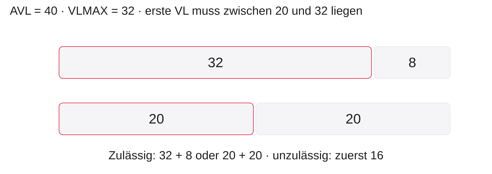{fig-alt="Vierzig Elemente können bei VLMAX 32 als 32 plus 8 oder als 20 plus 20 bearbeitet werden. Eine erste VL 16 ist unzulässig, weil mindestens 20 nötig sind."}

Bei $1000$ Elementen: $30\cdot32=960$, dann zwei Restabschnitte.

::: notes
Die erlaubten Längen lassen sich an einem Rest von vierzig Elementen bei einer Kapazität von zweiunddreißig nachvollziehen. AVL bezeichnet die angeforderte Restzahl, VLMAX die maximale aktive Kapazität und VL die gewählte Länge. Weil vierzig zwischen einfacher und doppelter Kapazität liegt, erlaubt die Regel eine erste Länge von $\lceil40/2\rceil=20$ bis zweiunddreißig. Eine Schleife darf sich hier nicht auf einen einzigen garantierten Aufteilungsplan verlassen.

Die oberen Streifen zeigen zwei zulässige Strategien: zuerst zweiunddreißig, danach acht, oder zuerst zwanzig, danach zwanzig. Nach dem ersten Abschnitt passt der Rest vollständig und wird exakt gewählt. Eine erste VL sechzehn ist verboten; die vermeintliche Folge sechzehn plus vierundzwanzig beginnt daher mit einer unzulässigen Länge. Bei Zweiunddreißig-Bit-Elementen rückt jeder Zeiger um vier mal VL Byte: hundertachtundzwanzig und zweiunddreißig beziehungsweise zweimal achtzig Byte.

Für eintausend Elemente sind zunächst dreißig volle Abschnitte erzwungen, weil der Rest vor jedem dieser Starts mindestens vierundsechzig beträgt. Danach bleiben vierzig. Diese benötigen zwei weitere Abschnitte, insgesamt also zweiunddreißig Iterationen. Die genaue Aufteilung der letzten zwei kann variieren. Beide Streifen bearbeiten jedes Element genau einmal. Eine tragfähige Schleife benötigt deshalb keinen fest einprogrammierten Wert für die Registerbreite.
:::

## Eine Schleife für elementweise Addition

::: {.section-label}
3 / 6 · Datenparallelität
:::

```asm
# RVV 1.0; a0=N, a1=A, a2=B, a3=C; uint32_t-Arrays
beqz a0, done
loop:
    vsetvli t0, a0, e32, m1, ta, ma
    vle32.v v0, (a1)
    vle32.v v1, (a2)
    vadd.vv v2, v0, v1
    vse32.v v2, (a3)
    slli t1, t0, 2
    add a1, a1, t1
    add a2, a2, t1
    add a3, a3, t1
    sub a0, a0, t0
    bnez a0, loop
done:
    ret
```

::: notes
Die praktische Konsequenz der Längenregel ist eine Schleife, deren Fortschritt vom zurückgegebenen VL abhängt. Die gezeigte RISC-V-Assembler-Lehrfolge verwendet RVV, RISC-V Vector Extension, Version 1.0; sie wurde nicht mit einer RISC-V-Toolchain assembliert. Ihre Arrays enthalten `uint32_t`, vorzeichenlose Zweiunddreißig-Bit-Ganzzahlen. `a0` enthält die noch zu bearbeitende Elementzahl, `a1`, `a2` und `a3` enthalten gültige ausgerichtete Adressen der Arrays A, B und C. Alle Arrays besitzen mindestens N Elemente; C überschneidet sich in diesem Modell nicht mit den Quellen. Bytezahl und Zeigerfortschritt müssen im Zieladressraum darstellbar bleiben.

`beqz` überspringt bei N null sämtliche Zugriffe. `vsetvli` wählt `e32`, Zweiunddreißig-Bit-Elemente, und `m1`, eine Registergruppe von einem Register. Es gibt die aktive Länge VL in `t0` zurück. `ta` und `ma` erlauben, inaktive Tail- beziehungsweise maskierte Plätze nicht zu erhalten; unser unmaskierter Code verwendet diese Inhalte nicht. `vle32.v` lädt aktive Elemente nach `v0` und `v1`, `vadd.vv` addiert sie elementweise modulo $2^{32}$ nach `v2`, `vse32.v` speichert nur die aktiven Ergebnisse.

`slli` verschiebt VL um zwei Bit nach links, berechnet also vier mal VL Byte in `t1`. Die drei `add`-Befehle rücken die Zeiger um diese Bytezahl. `sub` reduziert den Rest um VL; `bnez` wiederholt bei positivem Rest. `ret` kehrt zum Aufrufer zurück. Die Folge zeigt kein Skalarprodukt und keine MAC, Multiply-Accumulate. Ihre Korrektheit hängt von der zurückgegebenen Länge ab, ihre Laufzeit zusätzlich von der Mikroarchitektur und Datenversorgung.
:::

## Vier aktive Elemente brauchen nicht vier Lanes

::: {.section-label}
3 / 6 · Datenparallelität
:::

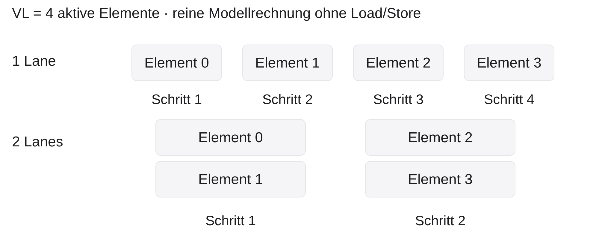{fig-alt="Dieselben vier aktiven Vektorelemente können in einem Modell mit einer Lane in vier Schritten oder mit zwei Lanes in zwei Schritten gerechnet werden. Datenkapazität und Rechenbreite sind verschieden."}

Gleiche ISA-Wirkung; unterschiedliche interne Umsetzung und Zeit.

::: notes
Aus der aktiven Vektorlänge folgt noch keine feste Laufzeit. Die ISA, Instruction Set Architecture oder Befehlssatzarchitektur, beschreibt beispielsweise, dass die aktiven Plätze elementweise addiert werden. VL, Vector Length, legt ihre Anzahl fest. Eine physische Lane ist dagegen ein tatsächlich vorhandener elementweiser Rechenpfad der Mikroarchitektur. Für den Vergleich wird VL vier angenommen; Laden, Speichern und Startkosten werden vollständig ausgeblendet. Erst unter diesen zusätzlichen Annahmen lässt sich die Zahl interner Rechenschritte vergleichen.

Die obere Modellumsetzung besitzt eine Lane und verarbeitet die vier unabhängigen Additionen in vier Schritten. Die untere besitzt zwei und benötigt zwei Schritte. Die kleinen nummerierten Felder stellen Elemente dar; ihre horizontalen Gruppen bilden einen internen Schritt. Die Zahlen vier und zwei sind Lehrzeiten unter der Annahme eines Ergebnisses je Lane und Schritt, keine Laufzeitgarantie von RVV, RISC-V Vector Extension.

Beide Umsetzungen können dieselben vier Ergebnisse liefern. Ein großes Register kann somit von wenigen Rechenpfaden über mehrere Takte bearbeitet werden. Umgekehrt braucht eine breite Umsetzung genügend Speicherbandbreite. Portable Vektorlängen machen die Programmlogik weniger abhängig von der Registerkapazität, garantieren jedoch keine gleiche Zeit oder Energie. Zusätzliche Weiterleitung zwischen verschiedenen Rechenoperationen ist eine weitere, davon getrennte Möglichkeit der Überlappung.
:::

## Chaining: Ergebnisse elementweise weitergeben

::: {.section-label}
3 / 6 · Datenparallelität
:::

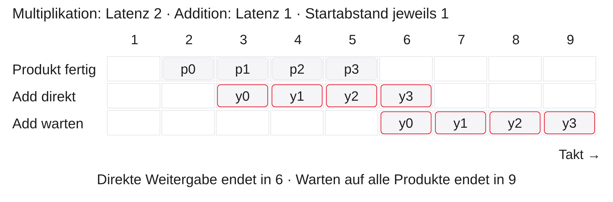{fig-alt="Vier Multiplikationen enden in Takten zwei bis fünf. Mit Weitergabe starten die zugehörigen Additionen in drei bis sechs, ohne Weitergabe erst in sechs bis neun."}

Lehrmodell: Multiplikationslatenz $2$, Additionslatenz $1$, je ein Start pro Takt.

::: notes
Auch die Übergabe zwischen zwei Rechenoperationen kann elementweise erfolgen. Chaining bezeichnet die direkte Weitergabe fertiger Elemente an den nachfolgenden Rechenpfad. Im Modell entsteht zunächst für jedes von vier Elementen ein Produkt und anschließend eine getrennte Addition. Dies ist keine fused multiply-add, also keine verschmolzene Multiplikation und Addition. Die dargestellten Zeiten sind ebenso wenig eine Garantie der RVV-Spezifikation, der RISC-V Vector Extension. Sie ergeben sich aus den hier ausdrücklich vorgegebenen Ressourcen und Startregeln.

Die waagerechte Achse trägt Kerntakte. Vier unabhängige Multiplikationen starten in eins bis vier, ihre Ergebnisse entstehen bei Latenz zwei am Ende von zwei bis fünf. Eine Addition hat Latenz eins. Mit Weitergabe kann sie für das jeweilige Element im Folgetakt beginnen: drei, vier, fünf und sechs. Die vier letzten Ergebnisse stehen daher am Ende von drei bis sechs bereit.

Ohne Chaining verlangt dieses Vergleichsmodell, dass erst alle vier Produkte fertig sind. Die Additionen starten dann in sechs bis neun und enden jeweils im selben Takt. Der gesamte Ausschnitt endet mit Chaining in sechs, ohne in neun. Die Rechnung umfasst in beiden Fällen vier Multiplikationen und vier Additionen. Rot markiert die früheren Endergebnisse; eine gültige Weiterleitung braucht passende Ports und Ressourcen. Wir addieren unabhängige Elemente, keine einzige abhängige Akkumulatorkette. Diese Unterscheidung verhindert, dass das Bild als allgemeine Beschleunigung jeder Summe gelesen wird.
:::

## Papierphase 2: Vektorlängen und Ablauf

::: {.section-label}
3 / 6 · Datenparallelität
:::

Übungsblatt, Aufgabe 3 · 15 Minuten

- VLMAX aus Bitbreiten berechnen
- Zulässige VL-Folgen für den Rest unterscheiden
- Zeigerinkrement und Elementzahl getrennt angeben
- Kapazität und physische Rechenbreite auseinanderhalten

::: notes
Die Papieraufgabe verbindet Kapazität, zulässige Abschnittslängen und Zeitverhalten, ohne diese Größen gleichzusetzen. VLEN, Vector Register Length, bezeichnet Registerbits; SEW, Selected Element Width, Bit je Element und LMUL, Vector Register Group Multiplier, die Registergruppengröße. VLMAX ist die daraus folgende maximale Elementzahl, VL die aktive Länge und AVL, Application Vector Length, der angeforderte Rest. Für die neue Konfiguration ergeben sich $2\cdot256/16=32$ Elementplätze. Die Anzahl physischer Lanes, also gleichzeitig verfügbarer Rechenpfade, ist damit weiterhin nicht bestimmt.

Im separaten Restfall gelten VLMAX sechzehn und AVL sechsundzwanzig. Die erste Länge muss zwischen dreizehn und sechzehn liegen. Daher sind $16+10$, $14+12$ und $13+13$ zulässig, $12+14$ nicht. Bei Zwei-Byte-Elementen verschiebt $14+12$ die Zeiger um achtundzwanzig und vierundzwanzig Byte. Für zweihundertfünfzig Elemente erzwingen zunächst vierzehn volle Iterationen zweihundertvierundzwanzig Elemente; der Rest sechsundzwanzig benötigt zwei weitere Iterationen.

Im Zeitmodell enden die sechs Produkte in Takten drei bis acht. Chaining bedeutet elementweise Weiterleitung: Die zugehörigen Additionen starten vier bis neun und enden fünf bis zehn. Ohne Chaining beginnen sie erst neun bis vierzehn und enden zehn bis fünfzehn. Die Endzeiten zehn und fünfzehn hängen von den gegebenen Latenzen und Startabständen ab; sie sind keine Befehlssatzgarantie.
:::

## 4 · Daten lokal durch ein Array führen {.section-divider}

Was ändert sich, wenn Produkte räumlich organisiert und Werte weitergereicht werden?

::: {.section-route}
Modell → Rechenmuster → Vektoren → Array → Firmware → Bilanz
:::

Gleiche Matrixrechnung, anderer Datenfluss; Einspeisung und Auslesen mitzählen.

::: notes
Ein Vektorprozessor ist nicht die einzige Möglichkeit, regelmäßige Produkte zu organisieren. Ein räumliches Gitter aus Rechenzellen kann Eingaben von Nachbar zu Nachbar weiterreichen und Teilsummen lokal halten. Ein solcher systolischer Datenfluss nutzt die Wiederverwendung der Matrixrechnung auf eine andere Weise.

Ausgangspunkt bleibt das bereits vollständig berechnete Matrixprodukt. Die Zellen erhalten zu festen Modellzeitpunkten passende Operandenpaare; eine Zahl null ist dabei weiterhin eine gültige Eingabe und kein leerer Platz. Der genaue Zeitplan macht sichtbar, wann eine Teilsumme entsteht und wann sie vollständig ist.

Der Abschnitt vergleicht CPU, GPU und NPU als Organisationsideen und verfolgt anschließend ein kleines Array. Ein Peakwert beschreibt nur eine ideal versorgte Rechenkapazität. Füllen, Leeren, räumliche Belegung, Übergaben und nicht beschleunigte Arbeit bestimmen mit, wie viel davon in einer Anwendung nutzbar wird.
:::

## CPU, GPU und NPU: gleiche Rechnung

::: {.section-label}
4 / 6 · Systolisches Array
:::

$y_0=1+1\cdot2+2\cdot1+3\cdot3=14$

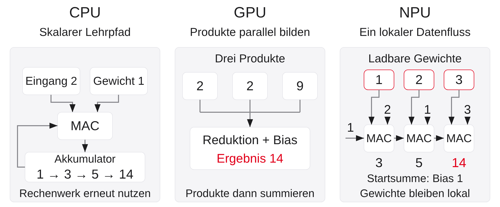{fig-alt="Drei beispielhafte Wege für dieselbe Ausgabesumme. Der skalare CPU-Pfad verwendet eine MAC wiederholt und akkumuliert 1,3,5,14. Der GPU-Pfad bildet Produkte 2,2,9 parallel und summiert mit Bias 1 zu 14. Ein NPU-Prinzipbeispiel hält ladbare Gewichte 1,2,3 lokal und gibt Teilsummen 3,5,14 durch drei MAC-Zellen weiter."}

CPU auch mit SIMD · NPU-Gewichte ladbar

::: notes
Die gleiche Produktsumme kann auf unterschiedlichen Hardwareklassen organisiert werden. Eine CPU, Central Processing Unit, ist ein allgemeiner Prozessor. Eine GPU, Graphics Processing Unit, besitzt breite parallele Ausführungsmöglichkeiten. Eine NPU, Neural Processing Unit, ist ein Beschleuniger für neuronale Verarbeitung. SIMD, Single Instruction, Multiple Data, bezeichnet eine mögliche gemeinsame Befehlssteuerung mehrerer Datenelemente, MAC, Multiply-Accumulate, das Addieren eines Produkts zu einer Summe. Die Gegenüberstellung vergleicht mögliche Datenwege und Abhängigkeiten; sie zeigt weder vollständige Chips noch gemessene Geschwindigkeiten oder eine elektrische Verdrahtung.

Wir verwenden die erste Zeile der bereits bekannten Dense-Schicht, einer vollständig verbundenen Schicht: Gewichte eins, zwei, drei, Eingaben zwei, eins, drei und Bias eins. Bias ist der eingangsunabhängige Summenoffset; $y_0$ der erste Ausgang. Drei Produkte ergeben zwei, zwei und neun. Zusammen mit dem einmaligen Bias folgt vierzehn. Das kleine Ganzzahlbeispiel besitzt keine Überlauf- oder Rundungseffekte; alle drei Wege berechnen genau diesen Ausgang.

Links steht ein ausdrücklich skalarer CPU-Lehrpfad. Die oberen Felder zeigen das erste Operandenpaar. Eine MAC wird für alle drei Paare erneut benutzt, der Akkumulator hält die Summe: eins vor Beginn, danach drei, fünf und vierzehn. Der Rückführungsweg zeigt die Abhängigkeit vom bisherigen Wert. Das bedeutet nicht, dass CPUs grundsätzlich nur eine Multiplikation gleichzeitig ausführen: mehrere Rechenwerke, Kerne oder SIMD können zusätzliche Parallelität nutzen.

In der Mitte werden drei unabhängige Produkte parallel gebildet. Die grauen Leitungen führen sie zur Reduktion, also Summierung mehrerer Beiträge. Zwei plus zwei plus neun ergibt dreizehn, mit Bias eins vierzehn. Eine GPU organisiert parallele Arbeit unter anderem über Threads, Ausführungsfäden. Wie viele Produkte gleichzeitig laufen, hängt von Ressourcen, Aufgabe und Auslastung ab. Die Reduktion bleibt erforderlich.

Rechts ist ein mögliches NPU-Datenflussprinzip gezeichnet. Rot umrandete Felder halten zuvor geladene Gewichte lokal. Die Eingabezahlen gelangen getrennt zu den MAC-Zellen; die Startsumme eins durchläuft die Kette. Die Zahlen darunter sind Teilsummen drei, fünf und vierzehn. Gewichte sind hier für diesen Nutzungsabschnitt ortsfest, nicht fest in die Schaltung eingebaut; neue Gewichte können geladen werden. Diese Variante ist keine universelle NPU-Architektur und legt keine Taktzahlen fest.

Für eine Hardwareauswahl müssen auch Datentransfer, unterstützte Operatoren, Formen und Datentypen passen. Ein Operator ist eine Modelloperation wie eine vollständig verbundene Schicht. NPU bezeichnet keine einheitliche ISA, Instruction Set Architecture oder Befehlssatzarchitektur. Ein System kann alle drei Klassen kombinieren; kleine oder nicht unterstützte Teilaufgaben können auf der CPU bleiben. Übergaben und Kopien gehören dann zum Gesamtaufwand. Ohne gemeinsame Messgrenze folgt aus den Pfeilen keine Energierangfolge. Als anderes lokales Datenflussprinzip untersuchen die folgenden Folien ein systolisches Array mit ortsfesten Ausgabesummen und eigenem, ausdrücklich definiertem Zeitplan.
:::

## Eine Zelle rechnet und reicht weiter

::: {.section-label}
4 / 6 · Systolisches Array
:::

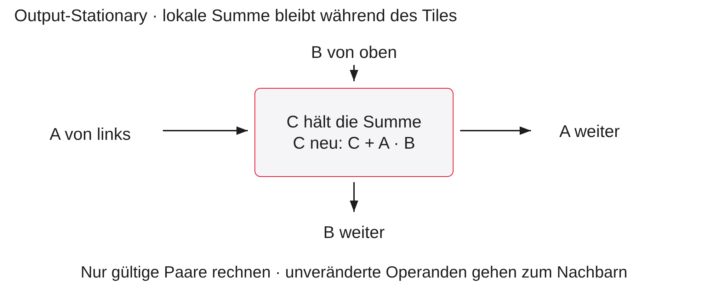{fig-alt="Eine Modellzelle empfängt A von links und B von oben, addiert A mal B zur lokalen Summe C und reicht unverändertes A nach rechts und B nach unten."}

Output-Stationary: Die Teilsumme bleibt während des Tiles in der Zelle.

::: notes
Ein eigener Datenfluss kann die wiederholte Versorgung und Weitergabe von Operanden regelmäßig organisieren. Ein systolisches Array ist dazu als Gitter getakteter Nachbarzellen aufgebaut. Der Name erinnert an die Systole, die rhythmische Pumpbewegung des Herzens: Werte bewegen sich als zeitlich geordnete Welle durch die Zellen. Eine MAC, Multiply-Accumulate, multipliziert ein Eingangspaar und addiert das Produkt zur lokalen Summe. Für das Verständnis ist entscheidend, welcher Wert in einer Zelle bleibt und welche Werte weiterwandern.

In unserem Output-Stationary-Lehrmodell bleibt die Ausgabeteilsumme $C$ während eines Tiles, eines lokal bearbeiteten Matrixausschnitts, in der Zelle. $A$ kommt von links und wird unverändert nach rechts weitergegeben. $B$ kommt von oben und wandert unverändert nach unten. Die Zelle leitet also nicht das Produkt als neuen A- oder B-Wert weiter. Die rote Umrandung markiert die lokal gehaltene Summe.

Wir nehmen für ein gültiges Eingangspaar eine vollständige MAC pro Takt an. Ein Operand erreicht den Nachbarn erst im nächsten Takt. Ohne zwei gültige passend indizierte Werte erfolgt keine MAC. Die Summe beginnt vor dem ersten Takt bei null. Das sind explizite Modellannahmen, keine Vorgabe für jede NPU, Neural Processing Unit. Ein tatsächliches System braucht zusätzlich Puffer, gültige Kennzeichnungen und einen Ausleseweg. Vier solcher Zellen reichen aus, um die bekannte Zwei-mal-zwei-Matrixrechnung mit verteilten lokalen Summen aufzubauen.
:::

## Vier Zellen für die bekannte 2×2-Rechnung

::: {.section-label}
4 / 6 · Systolisches Array
:::

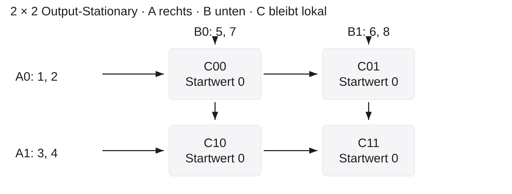{fig-alt="Vier Zellen C00,C01,C10,C11 bilden ein 2-mal-2-Gitter. A fließt zeilenweise rechts, B spaltenweise unten, C bleibt lokal."}

Alle Summen starten bei null; Vorladen und Auslesen sind ausgeklammert.

::: notes
Vier solcher Zellen können gemeinsam ein Zwei-mal-zwei-Matrixprodukt berechnen. Im Output-Stationary-Modell bleiben die Ausgabesummen $C_{00}$, $C_{01}$, $C_{10}$ und $C_{11}$ während der Rechnung in ihren jeweiligen Zellen. Die bei null beginnenden Indizes bezeichnen Zeile und Spalte. A-Werte treten links je Zeile ein, B-Werte oben je Spalte. Die Verbindungen stehen für lokale Nachbarweitergabe und nicht für einen Zugriff auf den externen Speicher bei jeder einzelnen MAC, Multiply-Accumulate.

Wir verwenden exakt die Matrizen des Tile-Beispiels: $A=[[1,2],[3,4]]$, $B=[[5,6],[7,8]]$ und $C=AB$. Eine Zelle $C_{ij}$ benötigt für beide Summenschritte den passenden Wert $A_{ik}$ und $B_{kj}$ mit demselben inneren Index $k$. Für $C_{01}$ sind das $1\cdot6$ und $2\cdot8$. Für $C_{10}$ sind es $3\cdot5$ und $4\cdot7$. Alle Summen starten bei null, jedes gültige Paar wird im aktuellen Takt verarbeitet und erst im nächsten Takt weitergereicht.

Ein geometrisch richtiges Gitter allein stellt noch nicht sicher, dass zusammengehörige Werte gleichzeitig eintreffen. Würden alle Zeilen und Spalten ungeordnet starten, könnten falsche Indexpaare zusammentreffen. Die Randeinspeisung muss deshalb um Zeilen- beziehungsweise Spaltenposition versetzt werden. Die Staffelung erklärt den Anlauf des Gitters und lässt sich aus den Einspeisezeiten auf einer gemeinsamen Zeitachse ableiten.
:::

## Die Randeinspeisung wird gestaffelt

::: {.section-label}
4 / 6 · Systolisches Array
:::

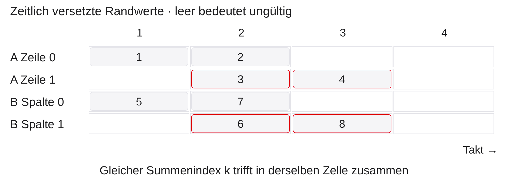{fig-alt="Randwerte: A-Zeile0 erhält 1,2 in Takten1,2, A-Zeile1 3,4 in2,3. B-Spalte0 erhält5,7 in1,2, B-Spalte1 6,8 in2,3. Leere Felder sind ungültig."}

Ankunft in Zelle $(i,j)$: Takt $1+k+i+j$, mit $i,j,k\in\{0,1\}$.

::: notes
Passende Produkte entstehen nur, wenn die richtigen Werte gleichzeitig an derselben Zelle ankommen. Dazu wird die Randeinspeisung zeitlich gestaffelt. Für die bei null beginnenden Zeilen-, Spalten- und Summenindizes $i$, $j$ und $k$ wird $A_{ik}$ links in Takt $1+k+i$ und $B_{kj}$ oben in Takt $1+k+j$ eingespeist. Jeder Nachbarschritt nach rechts oder unten benötigt einen weiteren Takt. Die Zeitachse beschreibt somit die Verfügbarkeit an den Rändern, noch nicht die vollständige Belegung aller Zellen.

Damit erreichen beide passenden Operanden Zelle $(i,j)$ in Takt $1+k+i+j$. Für $C_{00}$ treffen eins und fünf in Takt eins sowie zwei und sieben in Takt zwei zusammen. Für $C_{11}$ benötigen A-Wert drei und B-Wert sechs jeweils noch einen Nachbarschritt nach ihrer Einspeisung in zwei; sie treffen in drei ein. Vier und acht treffen entsprechend in vier ein.

Leere Felder sind ungültige Plätze, keine numerischen Nullen. Die Modellzelle führt dort keine MAC, Multiply-Accumulate, aus. Die grauen Felder markieren diese Leerstellen; rote Einspeisewerte zeigen den verzögerten Start der zweiten Zeile und Spalte. Die Staffelung wird manchmal Skewing genannt, zeitliches Versetzen. Sie sorgt dafür, dass nicht nur die Werte, sondern auch ihre inneren Indizes zusammenpassen. Genau deshalb füllt sich das Gitter wellenartig statt sofort vollständig.
:::

## Die gültigen Paare wandern als Welle

::: {.section-label}
4 / 6 · Systolisches Array
:::

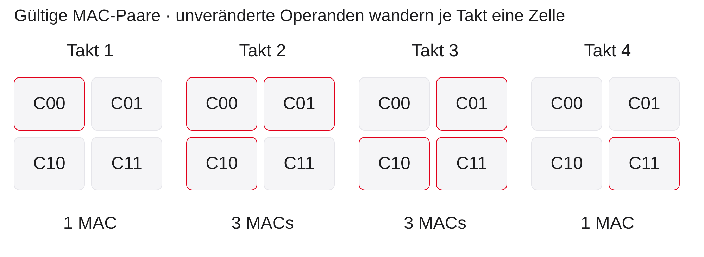{fig-alt="Takt1 rechnet C00, Takt2 C00,C01,C10, Takt3 C01,C10,C11, Takt4 C11. Die aktiven Zellen ergeben pro Takt1,3,3,1 MACs."}

Acht gültige MACs in vier Takten; leere Zellen erledigen keine Arbeit.

::: notes
Aus der gestaffelten Einspeisung folgt eine Welle gültiger Rechnungen durch das Gitter. Eine MAC, Multiply-Accumulate, addiert ein Produkt zur lokalen Ausgabesumme. In den vier aufeinanderfolgenden Zuständen bleibt diese Summe im Sinne von Output-Stationary in ihrer Zelle. Rot umrandete Positionen haben ein gültiges zusammengehöriges Operandenpaar; graue Positionen führen in dem betreffenden Takt keine MAC aus. Vorhandene Hardware und tatsächlich nutzbare Rechenarbeit sind damit unmittelbar unterscheidbar.

In Takt eins arbeitet nur $C_{00}$ mit eins mal fünf. In zwei verarbeitet diese Zelle ihr zweites Paar; zugleich beginnen $C_{01}$ und $C_{10}$. In drei erhalten diese beiden ihre zweiten Paare und $C_{11}$ beginnt. In vier bleibt nur noch das zweite Paar von $C_{11}$. Die Zahl gültiger MACs ist also eins, drei, drei, eins, zusammen acht. Vier vorhandene Rechenzellen ergeben nicht automatisch vier nutzbare MACs in jedem Takt.

Das Bild illustriert Anlauf und Auslaufen eines kleinen Tiles, eines Matrixausschnitts. Es enthält keine Zeit für Vorladen aus externem Speicher und kein anschließendes Auslesen der Summen. Die lokale Datenbewegung kostet in realer Hardware ebenfalls Energie. Die Welle ist somit ein Datenflussprinzip mit offen benannter Grenze. Eine Ergebnisprüfung muss daher zusätzlich die Teilsummen verfolgen; allein die richtigen aktiven Zellpositionen belegen noch keine richtige Zahlenrechnung.
:::

## Wann ist welche Summe fertig?

::: {.section-label}
4 / 6 · Systolisches Array
:::

| Taktende | $C_{00}$ | $C_{01}$ | $C_{10}$ | $C_{11}$ |
|----------|----------|----------|----------|----------|
| 1 | $5$ | $0$ | $0$ | $0$ |
| 2 | $19$ fertig | $6$ | $15$ | $0$ |
| 3 | $19$ | $22$ fertig | $43$ fertig | $18$ |
| 4 | $19$ | $22$ | $43$ | $50$ fertig |

Fertig in der Zelle bedeutet noch nicht nach außen ausgelesen.

::: notes
Neben den gültigen Positionen müssen die lokalen Zahlenwerte stimmen. $C_{ij}$ bezeichnet die Akkumulation in Zeile $i$ und Spalte $j$; vor Takt eins beginnen alle vier bei null. Die Tabelle hält jeweils den Zustand am Taktende fest. Eine noch unveränderte Null ist deshalb zunächst nur der Anfangswert. Sie darf nicht als gerade ausgeführtes Nullprodukt und damit als zusätzliche gültige MAC mitgezählt werden.

$C_{00}$ enthält nach eins $1\cdot5=5$, nach zwei zusätzlich $2\cdot7=14$, also neunzehn. $C_{01}$ startet in zwei mit $1\cdot6=6$ und endet in drei mit $6+2\cdot8=22$. $C_{10}$ startet in zwei mit $3\cdot5=15$ und endet in drei mit $15+4\cdot7=43$. $C_{11}$ beginnt erst in drei mit $3\cdot6=18$ und endet in vier mit $18+4\cdot8=50$.

Damit ist die Ergebnismatrix wieder $[[19,22],[43,50]]$. Die letzten Summenschritte liegen in den Takten zwei, drei, drei und vier. Es gibt hier also keine stetige Folge von genau einem neuen Ausgang pro Takt. Fertig bedeutet, dass alle zugehörigen Produkte lokal addiert wurden. Ein anschließender Readout, Auslesen, verlangt einen eigenen Datenweg und Zeitannahmen. Diese werden nicht in die vier internen Rechentakte hineinerfunden. Die Trennung ist für eine spätere End-to-End-Bewertung entscheidend.
:::

## Stationary: welcher Wert bleibt lokal?

::: {.section-label}
4 / 6 · Systolisches Array
:::

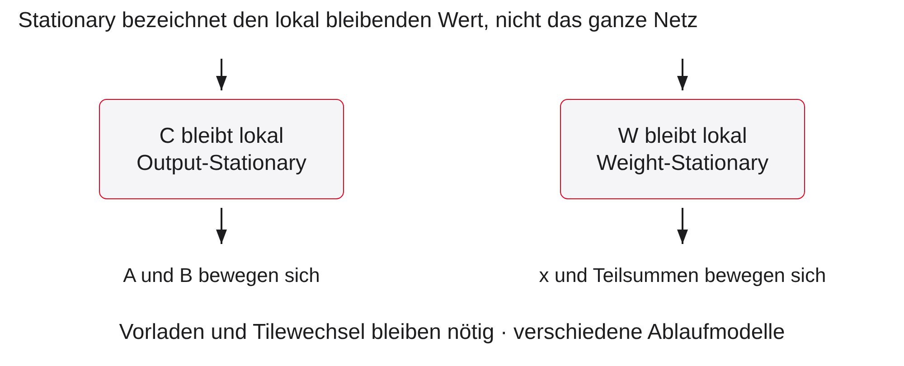{fig-alt="Output-Stationary hält eine Teilsumme in der Zelle und bewegt Operanden. Weight-Stationary hält ein Gewicht während eines Nutzungsabschnitts und bewegt Eingaben und Teilsummen."}

Ein Wechsel des Tiles kann neue Gewichte und andere Datenwege verlangen.

::: notes
Die Wiederverwendung wird auch dadurch bestimmt, welcher Wert während eines Nutzungsabschnitts lokal bleibt. Stationary bedeutet in diesem Zusammenhang ortsfest. Output-Stationary hält eine Ausgabeteilsumme in der Zelle, während deren Operanden eintreffen. Weight-Stationary hält ein Gewicht vor Ort; Aktivierungen und Teilsummen bewegen sich nach dem jeweiligen anderen Datenfluss. Aktivierungen sind Eingaben oder berechnete Zwischenwerte eines neuronalen Netzes. Beide Organisationsprinzipien dienen der Datenversorgung, doch ohne weitere Angaben ergibt sich daraus kein unmittelbarer Taktvergleich.

Der rote Wert in der linken Zelle ist die bleibende Summe, rechts das bleibende Gewicht. Graue Pfeile kennzeichnen weiter bewegte Werte. Unser bisheriger Vier-Takte-Plan gilt ausschließlich für die linke Output-Stationary-Variante. Er darf nicht ohne neuen Ablauf auf die rechte übertragen werden.

Ein konstantes Gewicht kann für viele Eingaben wiederverwendet werden. Trotzdem muss es zunächst geladen werden; bei einem neuen Tile, einem anderen Matrixausschnitt, kann erneutes Laden nötig sein. Auch ein vollständiges Netz enthält unterschiedliche Schichten und Formen. Welche Organisation den Verkehr reduziert, hängt von diesen Wiederverwendungsbeziehungen und lokalen Speicherkapazitäten ab. Ortsfeste Werte beseitigen weder Eingaben, Ausgaben noch den Speicherbedarf aller Zwischenwerte. Die Wahl des Datenflusses ist damit eine konkrete Optimierung, keine allgemeine Zusage von kostenfreier Bewegung.
:::

## Kleine Tiles nutzen große Arrays schlecht aus

::: {.section-label}
4 / 6 · Systolisches Array
:::

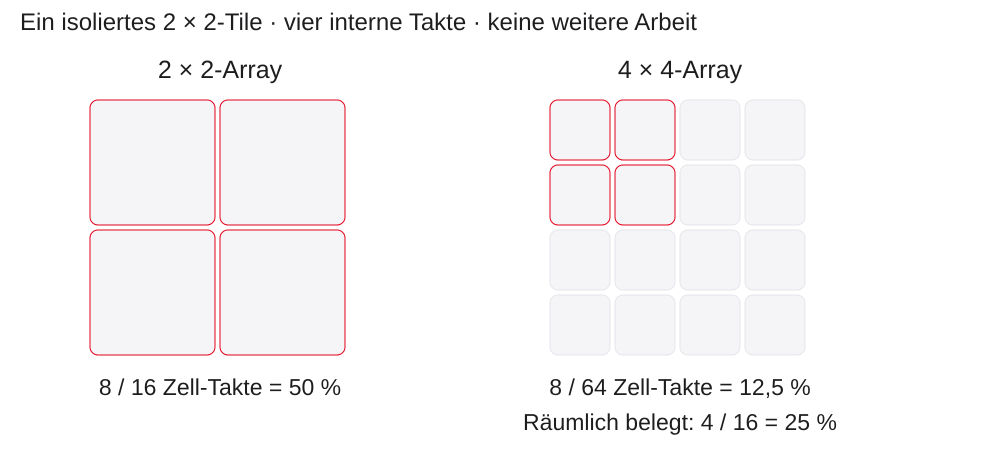{fig-alt="Ein isoliertes2-mal-2-Tile nutzt im2-mal-2-Array acht von sechzehn Zell-Takten,50Prozent. Im4-mal-4-Array mit sonst leeren Zellen acht von64,12,5Prozent. Räumliche Belegung dort25Prozent."}

$U=\text{gültige MACs}/(\text{Zellen}\cdot\text{Takte})$

::: notes
Wie gut ein Array genutzt wird, ist eine Frage des abgegrenzten Zeitfensters. Die zeitlich gemittelte Auslastung $U$ vergleicht tatsächlich gültige MACs, Multiply-Accumulate, mit den verfügbaren Zell-Takten. Ein Zell-Takt ist im Modell eine mögliche Rechengelegenheit, weil jede Zelle höchstens eine MAC je Takt ausführen kann. Der betrachtete Fall enthält nur ein einziges kleines Tile, einen Matrixausschnitt. Keine weiteren Tiles oder Aufgaben werden in freie Positionen oder Wartephasen eingeschoben.

Im Zwei-mal-zwei-Array sind über vier Takte sechzehn Zell-Takte verfügbar. Die acht gültigen MACs ergeben $U=8/(4\cdot4)=0{,}5$, also fünfzig Prozent. Wird dasselbe Tile in den oberen linken vier Zellen eines Vier-mal-vier-Arrays ausgeführt und bleiben alle anderen leer, sind es acht von vierundsechzig, also zwölf Komma fünf Prozent. Die räumliche Belegung beträgt dort vier von sechzehn Zellen, fünfundzwanzig Prozent. Sie ist nicht dieselbe Größe wie die zeitliche Auslastung.

Weitere Belegung oder Überlappung könnte den Vergleich ändern. Vorladen und Readout sind wie zuvor ausgeschlossen. Die Prozentwerte sind keine Kennwerte einer konkreten NPU, Neural Processing Unit. Sie zeigen, warum eine hohe Zahl vorhandener MAC-Zellen allein noch wenig über eine kleine Endgeräteaufgabe aussagt. Peakangaben setzen eine passend gefüllte und versorgte Nutzung voraus.
:::

## TPU v1: Peak mit Zählkonvention

::: {.section-label}
4 / 6 · Systolisches Array
:::

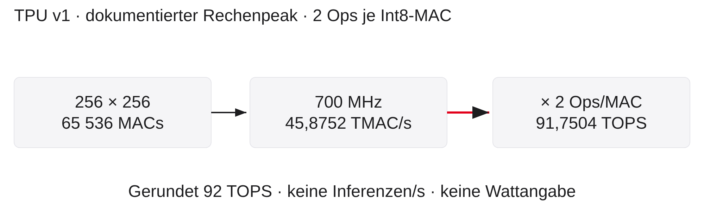{fig-alt="256mal256 Int8-MACs bei700MHz ergeben45,8752 TMAC/s und bei zwei Operationen je MAC91,7504 TOPS, gerundet92. Es handelt sich um Rechenpeak."}

Datacenter-Beispiel aus Jouppi et al. (2017), keine Edge-Energiemessung.

::: notes
Eine Peakangabe zählt das bei passender Versorgung maximal mögliche Rechenangebot. Das historische Beispiel TPU v1 macht sowohl die Größenordnung als auch die Zählkonvention sichtbar. TPU heißt Tensor Processing Unit, Googles Bezeichnung für einen Beschleuniger neuronaler Tensorrechnung. Die Originalarbeit von Jouppi und Mitautoren beschreibt die erste Generation als Baustein für ein Rechenzentrum. Int8 bezeichnet Acht-Bit-Integeroperanden; MAC, Multiply-Accumulate, eine Multiplikation mit Akkumulation. MHz sind Millionen Takte pro Sekunde, TMAC/s Billionen MACs pro Sekunde und TOPS, Tera Operations Per Second, Billionen gezählte Operationen pro Sekunde.

Die dokumentierten $256\cdot256=65\,536$ MAC-Einheiten und siebenhundert MHz führen rechnerisch zu $65\,536\cdot700\cdot10^6=45{,}8752\cdot10^{12}$ MACs je Sekunde. Bei zwei arithmetischen Operationen pro MAC verdoppelt sich die Zahl auf $91{,}7504$ TOPS, gerundet zweiundneunzig. Die Abbildung zeigt diese Zählkette, nicht eine gemessene Anwendungsrate.

Datentyp, Versorgung, Auslastung und unterstützte Operationen bestimmen, ob eine Anwendung diesen Peak annähern kann. TOPS sind keine Inferenzen je Sekunde und enthalten keine Wattzahl. Für Energieeffizienz müssten zusätzlich gemessene Leistung und dieselbe Systemgrenze bekannt sein. Das Rechenzentrum-Beispiel erklärt die Größenordnung regelmäßiger Spezialhardware; daraus folgt keine Milliwatt-Angabe für ein Endgerät.
:::

## Beschleunigte Teilrechnung und Gesamtzeit {.compact-figure}

::: {.section-label}
4 / 6 · Systolisches Array
:::

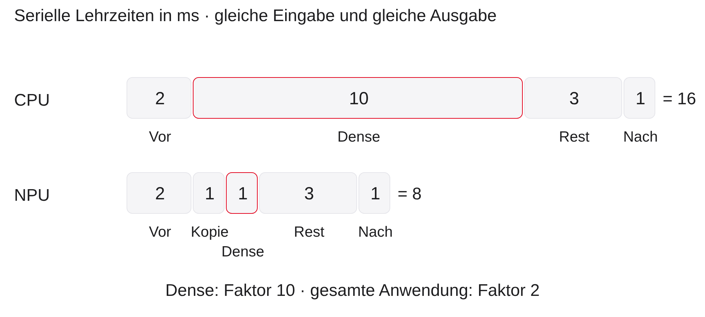{fig-alt="Modellzeiten: CPU-Pfad Vorverarbeitung2ms, Dense10ms, übrige Operatoren3ms, Nachverarbeitung1ms, gesamt16. Beschleunigerpfad zusätzlich Kopie1ms, Dense1ms, gesamt8. Teilfaktor10, Gesamtfaktor2."}

Lehrannahme: serielle Phasen, gleicher Input und gleiche Ausgabe.

::: notes
Für die Anwendung zählt nicht nur die beschleunigte Matrixphase. Die End-to-End-Latenz reicht hier vom bereitstehenden Sensorfenster bis zur fertigen Entscheidung und umfasst sämtliche ausdrücklich definierten Phasen. CPU bedeutet Central Processing Unit, allgemeiner Prozessor; Dense eine vollständig verbundene Schicht. Die Zeiten der Balken sind fiktive Lehrwerte in Millisekunden. Alle Phasen laufen seriell und ohne Überlappung. Damit bleiben sowohl Datenkopie als auch übrige Modelloperationen und Nachbereitung im Vergleich enthalten.

Der reine CPU-Pfad benötigt zwei Millisekunden Vorverarbeitung, zehn für die beschleunigbare Dense-Rechnung, drei für übrige Operatoren und eine für Nachverarbeitung: insgesamt sechzehn. Im zweiten Pfad bleibt Vorverarbeitung bei zwei, eine zusätzliche Kopier- und Übergabephase kostet eine, Dense sinkt auf eine, übrige Operatoren bleiben drei und Nachverarbeitung eins. Die Summe ist acht.

Die Teilrechnung wird um Faktor zehn schneller, die Gesamtaufgabe nur um Faktor $16/8=2$. Der rote Abschnitt im Bild markiert die veränderte Rechnung, graue Abschnitte die übrige Arbeit. Nicht unterstützte Operatoren können auf der CPU verbleiben. Diese Lehrrechnung ist keine Messung und sagt nichts über Energie. Sie begründet, warum Operatorabdeckung, Übergaben und übrige Firmwareaufgaben zur Hardwareauswahl gehören.
:::

## Papierphase 3: das Array selbst verfolgen

::: {.section-label}
4 / 6 · Systolisches Array
:::

Übungsblatt, Aufgabe 4 · 15 Minuten

- Randwerte zeitlich versetzen und gültige Paare zuordnen
- Teilsummen nach jedem Takt eintragen
- Auslastung von räumlicher Belegung unterscheiden
- Peak und Gesamtlatenz getrennt bewerten

::: notes
Ein verändertes Matrixformat prüft, ob der Datenfluss über das vorgerechnete Beispiel hinaus verstanden ist. Die Aufgabe verwendet wiederum ein systolisches Array mit getakteter Nachbarweitergabe und ortsfesten Ausgabesummen, also Output-Stationary. Eine MAC, Multiply-Accumulate, addiert ein gültiges Produkt zur laufenden Summe. Anders als zuvor umfasst die innere Dimension nun drei Produkte je Ausgabe. Zusammen mit der versetzten Einspeisung entsteht dadurch eine Welle von fünf Takten. Welche Werte sich begegnen, folgt weiterhin aus den Einspeisezeiten und nicht allein aus der räumlichen Anordnung.

Die vier Teilsummen lauten nach Takt eins $[[2,0],[0,0]]$, nach zwei $[[0,8],[3,0]]$, nach drei $[[-5,11],[3,12]]$, nach vier $[[-5,12],[13,12]]$ und nach fünf $[[-5,12],[13,10]]$. Die letzten gültigen MACs liegen für $C_{00}$ in drei, $C_{01}$ und $C_{10}$ in vier sowie $C_{11}$ in fünf. In $C_{11}$ treffen die Paare $(3,4)$, $(0,3)$ und $(2,-1)$ in drei, vier und fünf ein. Ein numerisches Nullprodukt bleibt eine gültige MAC.

Die gültigen MAC-Zahlen je Takt sind eins, drei, vier, drei und eins. Zwölf MACs auf vier Zellen in fünf Takten ergeben $12/20=60\,\%$ zeitliche Auslastung. Auf einem ansonsten ungenutzten 4×4-Array sinkt sie für dasselbe Fenster auf $12/80=15\,\%$; räumlich belegt das Tile vier von sechzehn Zellen, also $25\,\%$. Fertige interne Summen sind ohne einen festgelegten Ausleseweg noch keine nach außen übertragenen Ergebnisse.
:::

## 5 · Das Modell in die Firmware bringen {.section-divider}

Welche Zahlen, Operatoren und Speicherbereiche benötigt eine Inferenz auf dem Gerät?

::: {.section-route}
Modell → Rechenmuster → Vektoren → Array → Firmware → Bilanz
:::

Quantisierung, Operatorvertrag sowie Modell- und Arbeitsspeicher zusammen planen.

::: notes
Eine passende Matrixarchitektur allein bildet noch keine ausführbare Geräteanwendung. Das trainierte Modell muss in ein unterstütztes Format überführt werden, und seine Operatoren müssen mit passenden Formen und Datentypen verfügbar sein. Erst daraus entsteht eine konkrete Inferenz in der Firmware.

Die bisherigen Rechnungen verwendeten bewusst einfache Zahlen. Ein reales Netz kann für die Bereitstellung jedoch andere Zahlenformate benötigen. Quantisierung stellt reale Werte durch schmalere Codes mit Skala und Nullpunkt dar. Rundung, Sättigung und die Breite der Produktsumme beeinflussen das Ergebnis und müssen zum Operator passen.

Modellbytes und temporärer Arbeitsspeicher bilden zudem verschiedene Budgets. Parameter können im nichtflüchtigen Speicher liegen, während Aktivierungen und Verwaltungsdaten Platz im SRAM benötigen. Der Abschnitt verbindet deshalb die Rechenregeln mit einer überprüfbaren Speicherplanung, ohne eine nicht tatsächlich ausgeführte Framework- oder Geräteintegration zu behaupten.
:::

## Vom trainierten Modell zur Firmware

::: {.section-label}
5 / 6 · Quantisierung und Speicher
:::

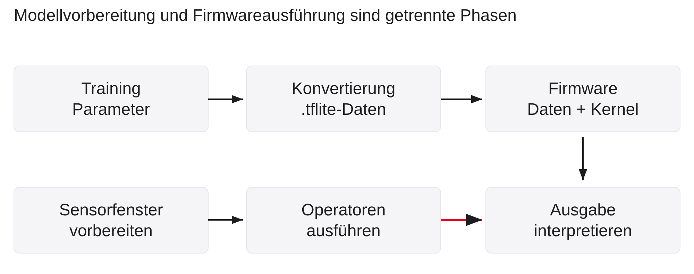{fig-alt="Offline entstehen trainiertes Modell und geprüfte tflite-Modelldaten. Firmware verbindet diese Daten mit Operator-Kerneln und Laufzeit. Auf dem Gerät werden Eingaben vorverarbeitet, Operatoren ausgeführt und Ausgaben interpretiert."}

Ein exportiertes C-Byte-Array enthält Modelldaten, keinen Modell-Maschinencode.

::: notes
Nach den Rechen- und Datenflussmodellen stellt sich die Softwarefrage: Wie wird ein trainiertes Modell zu einer wiederholt ausführbaren Gerätefunktion? TFLM, TensorFlow Lite for Microcontrollers, ist eine kleine C++-Laufzeit für neuronale Modelle auf Mikrocontrollern. Eine Runtime oder Laufzeitbibliothek organisiert die Modelloperationen; ein Kernel ist der ausführende Code eines Operators, beispielsweise einer vollständig verbundenen Schicht. Der dargestellte Ablauf trennt die Vorbereitung außerhalb des Geräts von der späteren Ausführung in der Firmware.

Offline werden Parameter trainiert, Datentypen und Quantisierung festgelegt und eine kompatible `.tflite`-Datei erzeugt. Sie enthält strukturierte Modelldaten. Ein Export als C-Byte-Array ändert deren Darstellung, verwandelt sie aber nicht in Maschinenbefehle. Die Firmware muss zusätzlich passende Operator-Kernel und die Laufzeit einbinden. Ein NPU-Backend, eine Anbindung an eine Neural Processing Unit, ist eine eigene Integrationsfrage.

Auf dem Gerät werden Eingaben passend vorbereitet, Operatoren mit ihren Parametern ausgeführt und Ausgaben gemäß dem Modellvertrag interpretiert. Ein Modellvertrag beschreibt Form, Datentyp, Reihenfolge, Skalierung und Bedeutung der Tensoren. Ein bekanntes Dateikennzeichen allein beweist kein gültiges Modell. Dieses Repository enthält für die Pflichtübung kein trainiertes TFLM-Modell und keine TFLM-Abhängigkeit. Der Workflow ist eine konzeptionelle Einordnung; das optionale Hostprogramm prüft die hier vollständig definierten Zahlenbeispiele.
:::

## Quantisierung: reale Werte mit Int8 darstellen

::: {.section-label}
5 / 6 · Quantisierung und Speicher
:::

$$r\approx s(q-z),\qquad
q=\operatorname{clip}_{[-128,127]}\!\left(\operatorname{round}(r/s)+z\right)$$

- $s>0$: Skalierung; $z$: ganzzahliger Nullpunkt
- Lehrregel: auf den nächsten Integer, Halbfälle weg von null
- Rundung und Begrenzung können Information verlieren

::: notes
Die Wahl des Zahlenformats verbindet Modellgüte mit Speicher- und Rechenaufwand. Quantisierung bildet einen größeren oder kontinuierlich betrachteten Bereich auf endlich viele darstellbare Werte ab. Int8 ist die vorzeichenbehaftete Acht-Bit-Ganzzahl von minus hundertachtundzwanzig bis hundert siebenundzwanzig. In der Zuordnung bezeichnet $r$ den realen Wert, $q$ den gespeicherten Integercode, $s>0$ den Skalierungsschritt in realen Einheiten je Codeschritt und $z$ den ganzzahligen Code für reale Null. Das Zahlenformat allein gibt diese Zuordnung noch nicht an.

Zum Kodieren wird zunächst durch $s$ geteilt, gerundet und anschließend der ganzzahlige Nullpunkt addiert. Clip bedeutet Begrenzen auf den Int8-Bereich. Unsere Lehrregel rundet auf die nächste ganze Zahl und exakte Halbfälle vom Nullpunkt der zu rundenden Zahl weg. Sie ist die Regel des begleitenden Hostprogramms; konkrete Bibliotheken können eine andere festgelegte Rundung verwenden. Zum Rückrechnen wird $z$ subtrahiert und mit $s$ multipliziert.

Bei $z=-3$ wird reale Null als minus drei kodiert: $s((-3)-(-3))=0$. Das ist nicht dasselbe wie ein negativer realer Wert. Ohne Begrenzung beträgt der Rundungsfehler höchstens einen halben Skalierungsschritt. Bei Werten außerhalb des darstellbaren Bereichs gilt diese kleine Fehlergrenze nicht. Ein ungültiges $s$, etwa null, darf nicht als normale Quantisierung verarbeitet werden. Die Zahlenbeispiele zur Rundung und Sättigung machen diese unterschiedlichen Fehlergrenzen konkret.
:::

## Rundungsfehler und Sättigung unterscheiden

::: {.section-label}
5 / 6 · Quantisierung und Speicher
:::

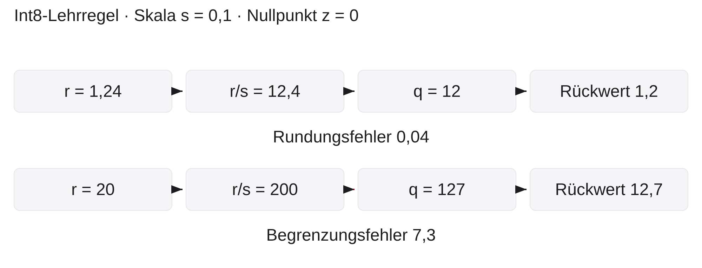{fig-alt="Bei Skala0,1 und Nullpunkt0 wird1,24 zu Code12 und rückgerechnet1,2, Fehler0,04. Wert20 wird auf127 begrenzt und zu12,7 rückgerechnet, Fehler7,3."}

Die Auswahl der Skala beeinflusst Auflösung und darstellbaren Bereich.

::: notes
Rundung innerhalb des darstellbaren Bereichs und Begrenzung an dessen Rand verursachen unterschiedliche Fehler. Die Quantisierungsskala $s$, der Nullpunkt $z$ und der gespeicherte Int8-Code $q$ ergeben den Rückwert $\hat r=s(q-z)$. Int8 bedeutet vorzeichenbehaftete Acht-Bit-Ganzzahl. Das Beispiel verwendet $s=0{,}1$, $z=0$ und die zuvor festgelegte Rundung auf die nächste ganze Zahl mit Halbfällen weg von null. Die beiden Fälle der Abbildung müssen unter genau dieser gemeinsamen Zuordnung verglichen werden.

Für $r=1{,}24$ ist $r/s=12{,}4$, gerundet zwölf. Der Rückwert ist $0{,}1\cdot12=1{,}2$, der absolute Fehler $|1{,}24-1{,}2|=0{,}04$. Der negative Wert minus eins Komma vierundzwanzig würde zu minus zwölf und zurück minus eins Komma zwei. Für zwanzig entsteht vor Begrenzung zweihundert. Clip begrenzt auf hundert siebenundzwanzig, der Rückwert ist zwölf Komma sieben und der absolute Fehler sieben Komma drei. Minus zwanzig wird entsprechend auf minus hundertachtundzwanzig begrenzt und zu minus zwölf Komma acht.

Der rote Rand markiert Sättigung, Begrenzen am zulässigen Bereich. Ein größerer Skalierungsschritt könnte mehr Wertebereich abdecken, würde aber die feine Auflösung verschlechtern. Geeignete Skalen werden deshalb anhand repräsentativer Daten gewählt. Ob die resultierenden Fehler die Modellgüte verschlechtern, muss mit passenden Testdaten bewertet werden; kleine Gewichtbytes beweisen keine unveränderte Genauigkeit.
:::

## Quantisierte Produkte brauchen ihre Skalen

::: {.section-label}
5 / 6 · Quantisierung und Speicher
:::

$$a=\sum_i(q_{x,i}-z_x)(q_{w,i}-z_w)+q_b$$
$$r_y\approx s_xs_w\,a$$

Beispiel: $q_x=[12,-4]$, $z_x=-3$, $q_w=[2,3]$, $z_w=0$.

Bei $s_x=0{,}1$, $s_w=0{,}2$, $q_b=5$: $a=32$, $r_y\approx0{,}64$.

::: notes
Auch bei Integerprodukten bleibt die Bedeutung der Codes von ihren Skalen abhängig. Das getrennte Zwei-Eingang-Lehrbeispiel ist keine Umkodierung der vorherigen Drei-Eingang-Dense-Schicht. $q_x$ und $q_w$ bezeichnen die gespeicherten Eingabe- und Gewichtcodes, $z_x$ und $z_w$ deren Nullpunkte sowie $s_x$ und $s_w$ die Skalen. Die breite Akkumulation heißt $a$. Der Biascode $q_b$ besitzt Nullpunkt null und die Produktskala $s_xs_w$; Bias ist der eingangsunabhängige Summenoffset. Erst mit diesen Vereinbarungen lässt sich die Integerrechnung als Näherung einer realwertigen Summe lesen.

Nach Nullpunktkorrektur sind die Eingaben $12-(-3)=15$ und $-4-(-3)=-1$. Die Gewichte bleiben zwei und drei. Die Produktsumme ist $15\cdot2+(-1)\cdot3=27$. Bias fünf ergibt $a=32$. Die kombinierte Skala beträgt $0{,}1\cdot0{,}2=0{,}02$, also ist der rekonstruierte Ausgang $32\cdot0{,}02=0{,}64$. Die realen Einzelprodukte sind $1{,}5\cdot0{,}4$ und $(-0{,}1)\cdot0{,}6$, zusätzlich Bias $0{,}1$; auch das ergibt $0{,}64$.

Soll der Ausgang selbst wieder Int8, eine Acht-Bit-Ganzzahl, werden, braucht er seine eigene Skala und seinen Nullpunkt. Mit $s_y=0{,}05$, $z_y=-2$ folgt $q_y=\operatorname{round}(0{,}64/0{,}05)-2=13-2=11$, rückgerechnet $0{,}65$. Diese Requantisierung ist ein weiterer Rundungsschritt. Int32-Biaswerte und breite Summen dürfen beim Speicherbudget nicht als Ein-Byte-Werte gezählt werden. Das Beispiel verwendet eine Skala je Tensor; andere Operatorvarianten können kanalweise Skalen benötigen.
:::

## Flash und Tensor Arena getrennt planen

::: {.section-label}
5 / 6 · Quantisierung und Speicher
:::

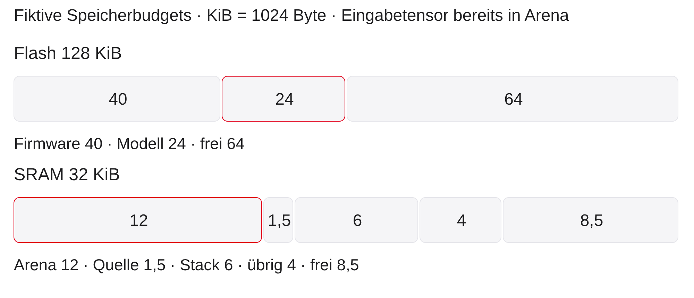{fig-alt="Fiktives Budget:128KiB Flash mit40KiB Firmware,24KiB Modell und64KiB frei.32KiB SRAM mit12KiB Arena,1,5KiB Quellfenster,6KiB Stack,4KiB übrigen Daten und8,5KiB frei."}

$250\,000$ reine Gewichte: Float32 $1$ MB, Int8 $0{,}25$ MB.

::: notes
Das Speicherbudget muss dauerhafte Modelldaten und laufende Arbeit getrennt berücksichtigen. Flash bezeichnet nichtflüchtigen Programmspeicher, SRAM, Static Random Access Memory, den statischen flüchtigen Arbeitsspeicher. Eine Tensor Arena ist ein zusammenhängender Arbeitsbereich für Tensoren, vorübergehende Kernelpuffer und Verwaltungsdaten. Ihre Belegung folgt aus Modell, Operator-Kerneln und Speicherplanung, nicht allein aus der Dateigröße des Modells. Hinzu kommt unter anderem der Stack für Aufrufrahmen und lokale Daten.

Die Grafik verwendet ausdrücklich ein fiktives Budget: hundertachtundzwanzig KiB Flash enthalten vierzig KiB Firmware und vierundzwanzig KiB vollständige Modelldaten, frei bleiben vierundsechzig KiB. Ein KiB, Kibibyte, sind eintausendvierundzwanzig Byte. Zweiunddreißig KiB SRAM enthalten zwölf KiB Arena, ein Komma fünf KiB Float-Quellfenster, sechs KiB Stackreserve und vier KiB übrige Daten. Die Summe dreiundzwanzig Komma fünf lässt acht Komma fünf KiB frei. Der spätere Int8-Eingangstensor liegt hier bereits in der Arena und wird nicht nochmals addiert.

Unabhängig davon benötigt ein hypothetisches Feld mit zweihundertfünfzigtausend reinen Gewichten bei Float32, Zweiunddreißig-Bit-Gleitkomma, vier Byte je Wert, eine Million Byte, also ein dezimales MB, Megabyte. Int8 braucht zweihundertfünfzigtausend Byte, ein Viertel. Die fünfundsiebzig Prozent Ersparnis gelten für diese Gewichtbytes, nicht für die ganze Datei oder Arena. `const` in C verhindert gewöhnliche Veränderung; erst Linkerplatzierung und Startcode bestimmen, wo das Modell physisch liegt und ob es kopiert wird.
:::

## Initialisierung und Inferenz sind zwei Phasen

::: {.section-label}
5 / 6 · Quantisierung und Speicher
:::

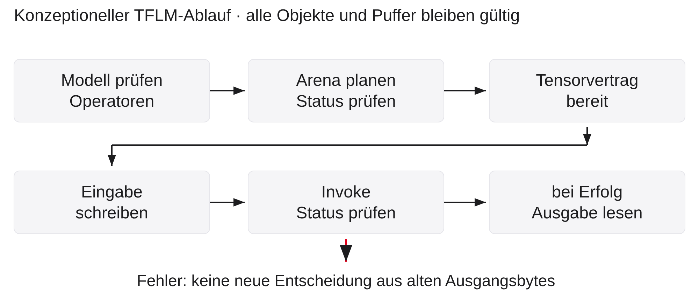{fig-alt="Setup prüft Modell und Operatoren, plant Arena und prüft Tensorvertrag. Danach werden Eingaben geschrieben, Invoke geprüft und nur bei Erfolg Ausgaben gelesen. Fehler führt zum Fehlerpfad, nicht zur neuen Entscheidung."}

Interpreter, Arena und Modell müssen während ihrer Nutzung gültig bleiben.

::: notes
Bevor wiederholt neue Eingaben ausgewertet werden, muss die Laufzeit gültig eingerichtet sein. TFLM bedeutet TensorFlow Lite for Microcontrollers. Der Interpreter führt die Operationen des Modells über passende Kernel aus; ein Resolver ordnet Operatoren diesen Implementierungen zu. Die Arena stellt den zusammenhängenden Arbeitsbereich bereit. Der Ablauf beschreibt eine konzeptionelle Zustandsfolge und kein in diesem Repository bereits ausgeführtes TFLM-Programm. Die genannten realen Schnittstellen sind von diesem vereinfachten Ablaufmodell zu unterscheiden.

Zuerst muss eine vertrauenswürdige vollständige Modelldatei mit passender Struktur vorliegen. Das Lesen einer Schema-Version allein validiert keine beliebige beschädigte Bytefolge. Danach sind kompatible Operatoren, langlebige Objekte und eine ausreichend große Arena nötig. `AllocateTensors()` heißt in der dokumentierten TFLM-Schnittstelle die Planung und Bereitstellung der Tensorpuffer. Ihr Status muss geprüft werden; erst anschließend werden Eingabeform, Datentyp und Quantisierungsparameter kontrolliert.

Im wiederholten Zyklus werden vorbereitete Eingaben geschrieben. `Invoke()` führt die Modelloperationen aus. Nur nach Erfolg wird der Ausgang entsprechend seinem Vertrag gelesen. Ein Fehler ist kein neuer Klassenscore; alte Pufferwerte dürfen nicht als frisch berechnet ausgegeben werden. Die roten Fehlerpfeile markieren diese Abzweigung. Ein lokaler Interpreter, der am Ende einer Setup-Funktion zerstört wird, kann nicht später weiterverwendet werden. Gleiches gilt für eine ausgelaufene lokale Arena. Ein Heap ist dynamisch zugeteilter Arbeitsspeicher. TFLM kann ohne Betriebssystem arbeiten; daraus folgt keine Heapfreiheit der gesamten Firmware.
:::

## 6 · Die gesamte Anwendung beurteilen {.section-divider}

Wann ist aus einer schnellen Teilrechnung eine brauchbare Edge-Lösung geworden?

::: {.section-route}
Modell → Rechenmuster → Vektoren → Array → Firmware → Bilanz
:::

Lebensdauer, Fehlerstatus, Eingabevertrag und Gesamtzeit gehören zur Entscheidung.

::: notes
Nach Zahlenformat und Speichergröße ist noch der Lebenszyklus der Anwendung zu klären. Ein einmal vorbereiteter Interpreter muss seine Modell- und Arbeitsbereiche während aller Aufrufe behalten. Neue Eingaben müssen denselben Vertrag erfüllen wie die beim Entwurf verwendeten Daten. Nach einem Fehler darf ein alter Ausgang nicht unbemerkt als neue Entscheidung weiterverwendet werden.

Dieser letzte Abschnitt verbindet Initialisierung, einzelne Inferenz und spätere Auswertung. Eine vollständig beschleunigte Teilrechnung kann die Gesamtdauer nur begrenzt senken, wenn Vorbereitung, Kopien und andere Operatoren bestehen bleiben. Rechenkorrektheit, Modellgüte, Reaktionszeit und Energie sind deshalb getrennte Nachweise unter einer gemeinsamen Anwendungsgrenze.

Die Rückkehr zum Sensorgerät beantwortet damit die Einstiegsfrage. Das Quiz und die Papieraufgaben prüfen anschließend, ob Parameter, Operationen, Datenverkehr, Zeitpläne und Speicherbudgets im jeweils angegebenen Modell auseinandergehalten werden können.
:::

## Sensorfenster und Ausgabe brauchen einen Vertrag

::: {.section-label}
6 / 6 · Firmware und Gesamtbilanz
:::

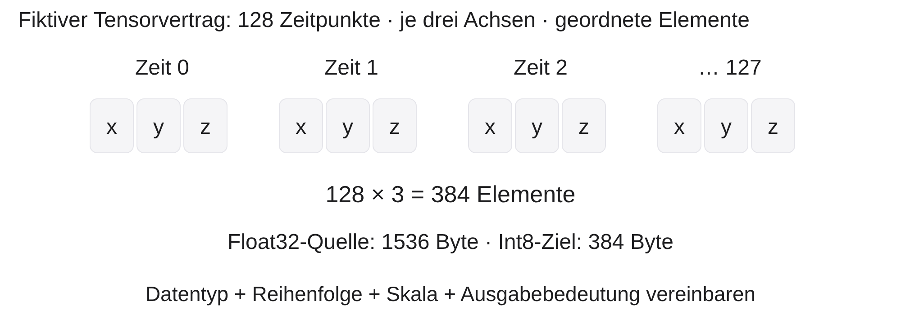{fig-alt="128Zeitpunkte mit drei Achsen ergeben384Elemente. Float32-Quelle braucht1536Byte, Int8-Ziel384Byte. Die Ausgabe wird erst nach erfolgreicher Inferenz anhand von Form, Skala und Bedeutung ausgewertet."}

Klassenindex, Score, Wahrscheinlichkeit und Fehlerstatus sind verschiedene Größen.

::: notes
Die Schnittstelle zum Modell verlangt mehr als eine passende Bytezahl. Das fiktive Sensorfenster enthält hundertachtundzwanzig aufeinanderfolgende Zeitpunkte mit je drei Achsen, also $128\cdot3=384$ Elemente. Ein Float32-Wert belegt hier vier Byte; das Quellfenster benötigt $384\cdot4=1536$ Byte, ein Komma fünf KiB. Ein Int8-Code benötigt ein Byte, der Eingabetensor folglich dreihundertvierundachtzig Byte. Zusätzlich ist die richtige Reihenfolge erforderlich, beispielsweise zuerst der Zeitpunkt und innerhalb jedes Zeitpunkts die Achse. Gleiche Formate können bei anderer Anordnung eine andere Bedeutung haben.

Ein Zeiger auf das Fenster enthält dessen Adresse. `sizeof` dieses Zeigers liefert die Größe der Adresse, nicht dreihundertvierundachtzig Elemente. Die Elementzahl muss aus dem Vertrag oder einer expliziten Längenangabe kommen. Normalisierung und Quantisierung müssen außerdem dieselben Regeln wie bei der Modellvorbereitung verwenden.

Drei Ausgabebytes beweisen weder drei bestimmte Klassen noch Wahrscheinlichkeiten. Ein Score kann ein beliebiger Bewertungswert sein. Eine Wahrscheinlichkeit erfordert eine dafür definierte Ausgabe, beispielsweise eine geeignete Normalisierung. Ein Klassenindex benennt eine Kategorie, ein Fehlerstatus den Erfolg der Ausführung. Ein Grenzwert von null Komma acht ist nur mit entsprechender Bedeutung und Rückskalierung sinnvoll. Selbst eine korrekt erkannte Klasse Gehen liefert keine gezählte Schrittzahl. Form, Skalierung und Semantik gehören deshalb ebenso zum Modellvertrag wie die Bytezahl.
:::

## Eine brauchbare Edge-Lösung prüfen

::: {.section-label}
6 / 6 · Firmware und Gesamtbilanz
:::

- Passende Operatoren, Formen und Datentypen
- Vollständige Zeit- und Speicherbudgets
- Modellgüte mit repräsentativen Daten prüfen
- Nullgewichte sparen erst mit passender Darstellung oder Ausführung
- Funktionaler Simulatorlauf und Hardwaremessung beantworten andere Fragen

::: notes
Eine brauchbare Edge-Lösung verbindet die numerische Rechnung mit ihren Systemgrenzen. Edge bezeichnet die Verarbeitung am Endgerät oder an einem lokalen Gateway. Ein Operator ist eine Modelloperation, ein Datentyp ihr Zahlenformat. Vor der Hardwareauswahl müssen die Modelloperatoren zu den tatsächlich vorhandenen Kerneln passen; verbleibende Teile auf einem anderen Rechenpfad können zusätzliche Übergaben erfordern. Das Zeitbudget umfasst die ganze vereinbarte Reaktionskette. Das Speicherbudget zählt Modelldaten, Arbeitsbereich, Sensorpuffer, Stack als Aufrufspeicher und übrige Firmwaredaten.

Pruning ist das gezielte Entfernen oder Nullsetzen von Gewichten. Ein dicht gespeichertes Int8-Feld mit vier Elementen braucht weiterhin vier Byte, auch wenn zwei Codes null sind und diese im verwendeten Gewichtformat reale Null bedeuten. Eine dünnbesetzte, sparse Darstellung benötigt zusätzliche Positionsinformation. Ein Kernel spart nur dann Rechenarbeit, wenn er nicht benötigte Produkte tatsächlich überspringt. Dateiersparnis und weniger ausgeführte MACs, Multiply-Accumulate, sind verschiedene Aussagen.

Renode ist der im Kurs verwendete Simulator für Systeme mit Prozessor, Speicher und Peripherie. Ein korrektes funktionales Ergebnis kann die Daten- und Steuerungslogik prüfen. Es belegt ohne validiertes Zeitmodell keine Hardwarelatenz und keine Energieeffizienz. Das hier enthaltene Hostprogramm läuft auf dem Entwicklungsrechner und prüft numerische Beispiele. Es liefert keinen Vergleich realer CPUs oder NPUs; CPU bedeutet Central Processing Unit, NPU Neural Processing Unit. Repräsentative Modellgüte und tatsächliche Systemleistung bleiben eigene Messaufgaben.
:::

## Zurück zum Sensorgerät: Was fehlt noch?

::: {.section-label}
6 / 6 · Firmware und Gesamtbilanz
:::

Ein Rechenwerk allein erkennt keine Bewegung.

- Eingabefenster und Vorverarbeitung festlegen
- Geeignete Parameter bestimmen und an neuen Fällen prüfen
- Operatoren, Formen und Datentypen korrekt ausführen
- Speicher, Reaktionszeit und Energie im Gesamtsystem beurteilen

Mehr Matrixleistung hilft erst am tatsächlich begrenzenden Teil.

::: notes
Die Einstiegsfrage lässt sich nun in Software- und Hardwareanforderungen zerlegen. Ein Sensorgerät benötigt zuerst ein definiertes Eingabefenster mit richtiger Kanalreihenfolge und Vorverarbeitung. Ein gewähltes Modell muss zu seiner Aufgabe passen und anhand geeigneter Daten beurteilt werden. Dass eine gewichtete Summe berechnet werden kann, beweist noch keine zuverlässige Erkennung von Gehen.

Training bestimmt Parameter; Inferenz setzt sie für neue Eingaben ein. Viele neuronale Schichten führen dabei regelmäßige Produkte und Summen aus, die als Matrixoperationen geschrieben werden können. Aktivierung, Datenumordnung und die nachfolgende Entscheidung bleiben zusätzliche Operatoren. Gewichte, aktuelle Eingaben und Zwischenergebnisse besitzen verschiedene Lebensdauern und Speicherbudgets.

Die Hardwareauswahl folgt diesen Anforderungen. Eine CPU kann ein kleines Modell ausführen. Vektoren oder ein geeigneter Beschleuniger können passende Teilrechnungen effizienter organisieren, wenn ihre Operanden, Formen und Datentypen unterstützt werden. Lokale Wiederverwendung kann die Datenversorgung verbessern; mehr Rechenpeak allein beseitigt weder eine Bandbreitenbegrenzung noch einen fehlerhaften Eingabevertrag.

Schließlich ist die gesamte Anwendung zu bewerten. Ein beschleunigter Dense-Operator kann durch Übergabe und andere Modellteile nur einen begrenzten Gesamtgewinn bewirken. Reaktionszeit und Energie sind unter derselben Systemgrenze zu prüfen. Die ursprüngliche Vermutung „doppelte Multiplikationsrate genügt“ wird damit eingegrenzt: Sie hilft nur, wenn diese Produkte tatsächlich den begrenzenden Teil eines bereits brauchbaren und korrekt integrierten Modells bilden.
:::

## Papierphase 4 und Quiz

::: {.section-label}
6 / 6 · Firmware und Gesamtbilanz
:::

Aufgaben 5–6: 15 Minuten · anschließend Quiz: 15 Minuten

- Quantisierung mit Rundung, Nullpunkt und Begrenzung
- Modellbytes und Arbeitsspeicher getrennt budgetieren
- Fehlerpfad und gültige Lebensdauer begründen
- Rückblick: Datenmuster → Versorgung → Hardware → Gesamtsystem

::: notes
Die abschließenden Aufgaben übertragen Quantisierung und Systembudget auf andere Daten. Int8 umfasst die ganzen Zahlen von minus hundertachtundzwanzig bis hundert siebenundzwanzig. Bei Skala $0{,}2$ und Nullpunkt null wird $-1{,}37$ auf Code minus sieben gerundet, mit Rückwert $-1{,}4$ und absolutem Fehler $0{,}03$. Minus dreißig liegt außerhalb des darstellbaren Bereichs und wird auf Code minus hundertachtundzwanzig begrenzt; der Rückwert $-25{,}6$ hat Fehler $4{,}4$. Bei Nullpunkt fünf stellt dagegen Code fünf die reale Null dar. Im separaten Skalarprodukt bleiben nach Nullpunktkorrektur sechs und minus vier als Eingaben: $6(-2)+(-4)3+4=-20$. Mit Skala $0{,}025$ ergibt sich $-0{,}5$; Requantisierung mit Ausgangsskala $0{,}08$ und Nullpunkt drei führt zu Code minus drei und Rückwert $-0{,}48$.

Flash, nichtflüchtiger Programmspeicher, und SRAM, Static Random-Access Memory, werden getrennt bilanziert. Frei bleiben $192-52-36=104$ KiB Flash und $48-18-1600/1024-7-5=16{,}4375$ KiB SRAM; KiB sind Kibibyte. Das Quellfenster enthält vierhundert Elemente: $1600$ Byte Float32 oder vierhundert Byte Int8. Der Zieltensor ist bereits in der Tensor Arena, dem geplanten Arbeitsbereich, enthalten. Arena und Interpreter müssen während der Nutzung leben; ein Fehlerstatus darf keinen alten Ausgang als neue Entscheidung freigeben.

Die seriellen CPU-Zeiten, Central Processing Unit oder Prozessor, ergeben $16{,}5$ Millisekunden. Mit Beschleuniger einschließlich Kopie sind es $7{,}25$ Millisekunden. Die Dense-Schicht allein ist Faktor sechs schneller, die Anwendung nur $66/29\approx2{,}276$. Ebenso gilt die Gewichtbyte-Ersparnis von $75\,\%$ nicht automatisch für Modelldatei oder Arena. Das Quiz prüft diese Systemgrenzen sowie Parameter, MACs, Bandbreite, Vektorlänge und Datenfluss.
:::

## Quellen und sinnvoller nächster Versuch

::: {.section-label}
6 / 6 · Firmware und Gesamtbilanz
:::

- Harris & Harris: *Digital Design and Computer Architecture — RISC-V Edition*
- Patterson & Hennessy: *Computer Organization and Design — RISC-V Edition*
- [RVV 1.0: Regeln für aktive Längen](https://github.com/riscv/riscv-v-spec/blob/master/v-spec.adoc)
- [Jouppi et al.: TPU v1 (2017)](https://arxiv.org/abs/1704.04760)
- [TFLM: Speicherplanung](https://github.com/tensorflow/tflite-micro/blob/main/tensorflow/lite/micro/docs/memory_management.md) und [Int8-Spezifikation](https://github.com/tensorflow/tensorflow/blob/master/tensorflow/lite/g3doc/performance/quantization_spec.md)

::: notes
Die fachliche Einordnung verbindet die Grundlagen des Moduls mit den jeweils speziellen technischen Quellen. Harris/Harris und Patterson/Hennessy liefern den Bezugsrahmen für Befehlssatz, Datenpfad, Speicherhierarchie und Parallelität. Die aktiven Vektorlängen folgen der Spezifikation 1.0 der RISC-V Vector Extension, kurz RVV. Die Arbeit von Jouppi und Mitautoren zur TPU, Tensor Processing Unit, dokumentiert die erste Generation und ihre Peakzählung. TFLM, TensorFlow Lite for Microcontrollers, erläutert Arbeitsbereich und Laufzeitintegration. Die TensorFlow-Int8-Spezifikation ist die Primärquelle für Nullpunkte, breite Biaswerte und Skalen; konkrete Operatorvarianten können eine andere Granularität der Skalierung verlangen.

Unsere Matrizen, Zeitpläne, Roofline-Raten, Flash-/SRAM-Budgets und Quantisierungszahlen sind ausdrücklich eigene Lehrmodelle. Flash ist nichtflüchtiger Speicher; SRAM bedeutet Static Random Access Memory. Der zugehörige C-Quellcode bietet einen nachvollziehbaren numerischen Versuch auf dem Hostrechner. Er trainiert kein Netz, lädt kein TFLM-Modell und beansprucht keine RISC-V- oder Renode-Zeitmessung.

Ein späterer vollständiger Geräteversuch braucht ein festgelegtes Modell mit Testdaten, einen geprüften Tensorvertrag, passende Runtime-Kernel und eine dokumentierte Plattform. Zuerst wären Referenzausgaben und Speicherbelegung zu validieren; anschließend könnten Laufzeit und Energie unter derselben Systemgrenze gemessen werden. Dieser nächste Versuch folgt aus den heutigen Unterscheidungen und braucht keine ungesicherte Leistungsannahme.
:::
