## KI am Edge: Rechnung braucht Daten

- Vorlesung 7: unabhängige Befehle und Speicherzugriffe überlappen
- Heute: dieselbe Rechnung auf vielen Werten ausführen
- Daten lokal wiederverwenden, statt jedes Produkt neu zu versorgen
- Modell, Hardware und Firmware müssen zusammenpassen

::: notes
KI bedeutet Künstliche Intelligenz. In dieser Vorlesung betrachten wir daraus die Ausführung bereits trainierter neuronaler Netze. Edge bezeichnet den Rand eines vernetzten Systems, beispielsweise ein Sensorgerät oder ein lokales Gateway. Ein Gateway vermittelt zwischen Geräten und einem übergeordneten Netz. Es muss nicht jede Eingabe an einen entfernten Server weitergeben.

Aus Vorlesung 7 ist bekannt, dass ein Prozessor unabhängige Arbeit überlappen kann. Heute verschiebt sich der Blick: Viele Eingaben verlangen dieselbe Art von Multiplikation und Addition. Das eröffnet Datenparallelität und regelmäßige Datenwege. Zusätzliche Rechenwerke helfen jedoch nur, wenn ihre Operanden rechtzeitig ankommen.

Wir entwickeln diese Frage von einer einzelnen gewichteten Summe über Vektoren bis zu einem kleinen systolischen Gitter. Abschließend verbinden wir den Datenfluss mit Quantisierung und Speicherplanung in einer Firmware. Die Zahlen der Rechen- und Zeitmodelle sind ausdrücklich Lehrannahmen. Sie ersetzen keine Messung an einem KI-Chip.
:::

## Was wir aus Vorlesung 7 mitnehmen

- RAW: eine Summe benötigt ihre vorherige Teilsumme
- OoO kann unabhängige Produkte und Loads vorziehen
- Ein Compilerlisting zeigt Befehle, kein vollständiges Zeitverhalten
- Mehr parallele Rechnung hebt eine Bandbreitengrenze nicht auf

::: notes
RAW heißt Read After Write, Lesen nach Schreiben: Eine Operation braucht den von einem Vorgänger erzeugten Wert. In einer fortlaufenden Summe ist der neue Akkumulator vom alten abhängig. OoO bedeutet Out of Order, interne Ausführung außerhalb der Programmreihenfolge. Ein Kern kann beispielsweise einen unabhängigen Speicherzugriff beginnen, während er noch auf einen anderen wartet.

Ein Load ist ein Ladebefehl. Er bedeutet nicht automatisch einen Zugriff auf externen Hauptspeicher; sein Wert kann bereits im Cache liegen. Ein Cache ist eine nahe Kopie ausgewählter Speicherblöcke. Bandbreite bezeichnet übertragbare Bytes je Zeiteinheit, Latenz die Zeit bis zum einzelnen Ergebnis. Beides müssen wir auseinanderhalten.

Die vertraute Summenkette bleibt auch bei einer neuronalen Rechnung eine echte Abhängigkeit. Mehrere unabhängige Ausgabesummen können dagegen parallel bearbeitet werden. Ein Compilerlisting zeigt die gewählten Maschinenbefehle. Ob deren Ausführung an Abhängigkeiten, Ports oder Datenversorgung wartet, verlangt weitere Annahmen. Dieser Zusammenhang führt zur Leitfrage: Wie viel gleichartige Rechnung steckt in einem Modell, und wie viele Daten müssen wir dafür bewegen?
:::

## Vier Schulstunden und Lernziele

| Stunde | Erklärung und Besprechung | Arbeitsphase |
|--------|---------------------------|--------------|
| 1 | Dense-Schicht und Speichergrenzen: 35 min | Aufgaben 1–2: 10 min |
| 2 | SIMD, DSP und Vektorlängen: 30 min | Aufgabe 3: 15 min |
| 3 | Systolisches Array und Auslastung: 30 min | Aufgabe 4: 15 min |
| 4 | Quantisierung und Firmware: 15 min | Aufgaben 5–6: 15 min; Quiz: 15 min |

::: notes
Vier Schulstunden ergeben hundertachtzig Minuten ohne zusätzliche Pausen: hundertzehn Minuten Erklärung, Denkfragen und Lösungsbesprechung, fünfundfünfzig Minuten angeleitete Papierarbeit und fünfzehn Minuten Quiz. Die fünfzig Folien setzen unterschiedliche Schwerpunkte; Datenflussbilder und Rechnungen brauchen mehr Zeit als kurze Übersichten. Das Übungsblatt nennt zusätzlich einen Richtwert für vollständiges selbstständiges Bearbeiten.

Sie sollen danach eine Dense-Schicht berechnen, Parameter von Rechenaufwand unterscheiden und eine Bandbreitengrenze mit benannter Speichergrenze bestimmen können. Dense heißt vollständig verbunden: Jeder Eingang trägt zu jedem betrachteten Ausgang bei. SIMD steht für Single Instruction, Multiple Data, ein gemeinsamer Befehl auf mehreren Daten. DSP bedeutet Digital Signal Processor, Prozessor für digitale Signalverarbeitung.

Weitere Lernziele sind die aktive Vektorlänge, die zeitlich versetzte Einspeisung eines systolischen Arrays und ein getrenntes Budget für Modell- und Arbeitsspeicher. Alle Pflichtaufgaben sind auf Papier lösbar. Das optionale C-Experiment prüft Zahlen und Fehlerfälle auf dem Entwicklungsrechner; ein neuronales Framework ist dafür nicht nötig.
:::

## Edge ist ein Ort, keine Prozessorpflicht

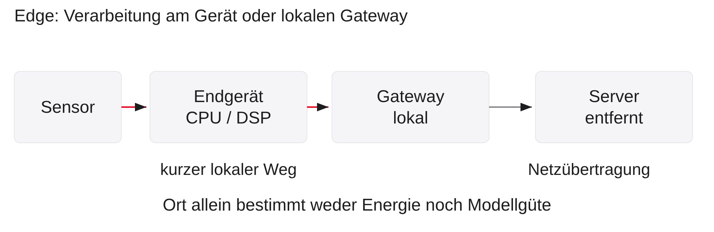{fig-alt="Sensordaten können auf dem Endgerät, einem lokalen Gateway oder einem entfernten Server verarbeitet werden. Die Übertragungswege haben eigene Kosten."}

Reaktionszeit, Energie, Verfügbarkeit und Datenschutz gemeinsam bewerten.

::: notes
Edge AI bedeutet künstliche Intelligenz am Rand eines vernetzten Systems. AI steht für Artificial Intelligence. Das Bild liest sich vom Sensor nach rechts: Eine Verarbeitung kann auf dem Endgerät stattfinden, auf einem nahen Gateway oder nach einer Netzübertragung auf einem entfernten Server. Die roten kurzen Wege markieren Lokalität, nicht automatisch den geringsten Energieverbrauch.

Eine lokale Entscheidung kann bei ausgefallenem Netz weiter verfügbar sein und Übertragungen sensibler Rohdaten reduzieren. Sie benötigt dafür eigenen Speicher, Energie und eine passende Ausführungszeit. Funkübertragung ist keineswegs immer teurer als lokale Rechnung. Ein kleines Modell auf einem sparsamen Prozessor und ein großes Modell mit langen Rechenphasen führen zu unterschiedlichen Entscheidungen.

NPU heißt Neural Processing Unit, Beschleuniger für neuronale Verarbeitung. Sie ist keine Voraussetzung für Edge AI. Ein Endgerät kann ein Modell auf seiner normalen CPU ausführen; CPU heißt Central Processing Unit, Prozessor. Auch ein klassischer Schwellenwertalgorithmus kann die Anforderung bereits erfüllen. Zuerst ist daher die Aufgabe zu beschreiben, bevor eine Hardwareklasse gewählt wird.
:::

## Training und Inferenz sind verschiedene Arbeit

- Training: Parameter anhand von Beispieldaten bestimmen
- Inferenz: neue Eingaben mit festgelegten Parametern auswerten
- Vorverarbeitung und Entscheidungslogik gehören zur Anwendung
- Eine Aktivitätsklasse ist noch keine gezählte Schrittzahl

::: notes
Ein Parameter ist ein beim Training bestimmter Zahlenwert, etwa ein Gewicht oder ein Bias. Training verändert diese Werte mit Hilfe von Beispieldaten und einer Zielfunktion. Inferenz verwendet die danach festgelegten Werte für eine neue Eingabe. Beide Phasen können ähnliche Grundoperationen enthalten, haben aber andere Speicher- und Steuerungsanforderungen. Inferenz findet nicht zwingend auf derselben Maschine wie Training statt.

Als Anwendungsbild verwenden wir ein Fenster von Beschleunigungsmessungen. Ein Fenster ist ein zeitlich begrenzter Ausschnitt. Vorverarbeitung kann Achsen ordnen, Werte normieren oder Merkmale bilden. Ein Modell könnte dem Fenster die Klasse Stehen, Gehen oder Laufen zuordnen. Das liefert keine Anzahl einzelner Schritte. Dafür wäre zusätzliche zeitliche Ereigniserkennung nötig.

Ein Klassifikator entscheidet zwischen Kategorien, ein Regressionsmodell schätzt eine numerische Größe. Auch ein Klassifikator gibt nicht zwingend Wahrscheinlichkeiten aus. Wir behandeln zunächst eine kleine lineare Schicht ohne Training und ohne Klassenaussage. So lässt sich ihre Rechnung vollständig verstehen, bevor die Bedeutung der Modellausgabe hinzukommt.
:::

## Welche Zahlen speichert ein Netz?

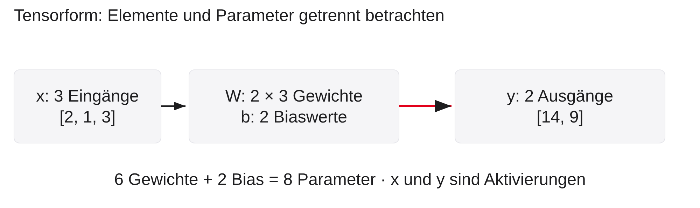{fig-alt="Eingangsvektor x mit drei Werten, Gewichtsmatrix W mit zwei Zeilen und drei Spalten, Biasvektor b und Ausgangsvektor y mit je zwei Werten."}

Gewichte und Bias sind Parameter; Eingaben und Zwischenergebnisse sind Aktivierungen.

::: notes
Ein Tensor ist ein Zahlenfeld mit festgelegter Form und Datentyp. Ein Vektor hat eine Achse, eine Matrix zwei; der allgemeinere Begriff umfasst auch höherdimensionale Felder. Die Form beschreibt die Elementzahlen entlang der Achsen, noch nicht die Zahl der Speicherbytes. Diese hängt zusätzlich vom Datentyp ab.

Das Bild zeigt den Eingangsvektor $x$ mit drei Werten, die Gewichtsmatrix $W$ mit zwei Zeilen und drei Spalten, den Biasvektor $b$ mit zwei Werten und den Ausgang $y$ mit zwei Werten. Ein Gewicht bestimmt, wie stark ein Eingang zu einer Summe beiträgt. Ein Bias verschiebt diese Summe unabhängig von der Eingabe. Die Leserichtung der Pfeile beschreibt Abhängigkeiten der Rechnung, keine reale Busverdrahtung.

Gewichte und Bias werden während einer gewöhnlichen Inferenz als konstante Parameter verwendet. Aktivierungen sind Eingaben und berechnete Zwischen- oder Ausgangswerte. Die Eingangsdaten eines späteren Layers, einer Schicht, können bereits Ergebnisse der vorherigen sein. Ein Netz braucht deshalb neben seinen gespeicherten Parametern auch Platz für aktive Zwischenwerte. Die rote Ausgangsgruppe markiert die zwei zu berechnenden Summen.
:::

## Dense-Schicht: zwei gewichtete Summen

$$y_j=b_j+\sum_{i=0}^{N-1}W_{j,i}x_i,\qquad j=0,\ldots,M-1$$

- $N$ Eingänge, $M$ Ausgänge; hier $N=3$, $M=2$
- Jede Zeile von $W$ bildet eine eigene Summe
- Eine anschließende Aktivierungsfunktion ist hier ausgeblendet

::: notes
Dense heißt vollständig verbunden. Jeder der $M$ Ausgänge erhält einen Beitrag von jedem der $N$ Eingänge. $x_i$ ist Eingang $i$, $W_{j,i}$ das Gewicht von diesem Eingang zu Ausgang $j$, $b_j$ dessen Bias und $y_j$ das Ergebnis. Die Summe läuft über die Eingangsspalten, während $j$ die Ausgangszeile auswählt. Alle Indizes beginnen bei null.

Bei drei Eingängen und zwei Ausgängen enthält $W$ sechs Gewichte. Es gibt zwei weitere Parameter für den Bias. Die erste Zeile verwendet alle drei Eingänge und ihre drei Gewichte; die zweite tut dasselbe mit anderen Gewichten. Diese beiden Ausgabesummen sind voneinander unabhängig. Innerhalb einer einzelnen Summe hängt ein fortlaufender Akkumulator dagegen von seiner vorherigen Teilsumme ab.

Eine Aktivierungsfunktion ist eine nachgeschaltete Abbildung, beispielsweise das Ersetzen negativer Werte durch null. Sie kann Nichtlinearität erzeugen. Wir lassen sie hier bewusst weg, um das lineare Rechenmuster zu isolieren. Auch Vorverarbeitung, Training und eine Klassenauswahl sind nicht Teil dieser Formel. Mit konkreten Zahlen wird nun sichtbar, welche Produkte in welchen Ausgang gehören.
:::

## Rechnen Sie die beiden Ausgänge aus

$$W=\begin{bmatrix}1&2&3\\0&-1&4\end{bmatrix},\quad
x=\begin{bmatrix}2\\1\\3\end{bmatrix},\quad
b=\begin{bmatrix}1\\-2\end{bmatrix}$$

Bestimmen Sie $y=Wx+b$. Wie viele Parameter werden verwendet?

::: notes
Das Beispiel ist ein frei gewähltes Lehrmodell, kein trainiertes Netz. $W$ bezeichnet Gewichte, $x$ Eingaben, $b$ Biaswerte und $y$ Ausgaben. Matrix-Vektor-Multiplikation bedeutet hier das Skalarprodukt jeder Zeile mit dem Eingangsvektor. Ein Skalarprodukt multipliziert einander zugeordnete Werte und addiert die Produkte.

Für die erste Zeile entstehen $1\cdot2=2$, $2\cdot1=2$ und $3\cdot3=9$. Ihre Summe ist dreizehn. Mit Bias eins ergibt sich $y_0=14$. Für die zweite Zeile erhalten wir $0\cdot2=0$, $(-1)\cdot1=-1$ und $4\cdot3=12$. Die Summe elf wird durch Bias minus zwei zu $y_1=9$. Also ist $y=[14,9]^T$; das hochgestellte $T$ bezeichnet Transposition zur Spaltenform.

Die Parameterzahl beträgt sechs Gewichte plus zwei Biaswerte, also acht. Die Eingaben zählen nicht als trainierte Parameter. Ein häufiger Fehler ist das Addieren des Bias zu jedem Produkt; er gehört hier genau einmal zur jeweiligen Ausgangssumme. Lassen Sie vor der Besprechung beide Zeilen auf Papier berechnen. Das Ergebnis wird anschließend zur Kontrolle aller alternativen Datenwege verwendet.
:::

## MACs, Parameter und Operationen zählen

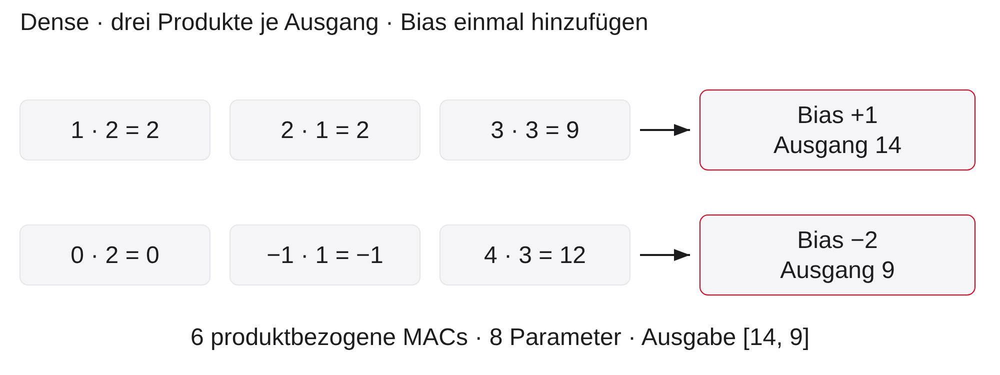{fig-alt="Zwei Ausgangssummen verwenden je drei Produkte und einen Bias. Ergebnisse sind 14 und 9. Es gibt sechs produktbezogene MACs und acht Parameter."}

Konvention: eine MAC zählt als zwei arithmetische Operationen.

::: notes
MAC bedeutet Multiply-Accumulate, Multiplizieren und zur laufenden Summe addieren: $a\leftarrow a+wx$. $a$ ist der Akkumulator, $w$ ein Gewicht und $x$ ein Eingang. Die Abbildung trennt die beiden Zeilen der Dense-Schicht, einer vollständig verbundenen Schicht. Die roten Endwerte vierzehn und neun sind die vollständigen Ausgänge einschließlich Bias.

Für dieses Beispiel zählen wir sechs produktbezogene MACs, also sechs Multiplikationen mit sechs Akkumulationen. Wenn ein Akkumulator bei null beginnt und der Bias anschließend separat addiert wird, ergeben sich zwölf arithmetische Operationen plus zwei Biasadditionen, insgesamt vierzehn. Wird stattdessen mit dem Bias initialisiert, entfällt diese separate Addition. Wir verwenden die Zählweise deshalb stets ausdrücklich.

Eine MAC kann je nach Befehlssatz als ein Befehl, als mehrere Befehle oder als Teil eines Hardwareauftrags umgesetzt sein. Die zwei gezählten Operationen sind weder zwei garantierte Takte noch zwei Maschinenbefehle. Acht Parameter sind wiederum keine acht MACs. Bei einer Faltung, die dieselben Gewichte an mehreren Positionen nutzt, steigt die Rechenzahl ohne entsprechend neue Parameter. Parameterzahl, arithmetische Arbeit und Laufzeit sind unterschiedliche Größen.
:::

## Der skalare Kern ist eine Summenkette

```c
/* Eine Zeile mit drei Eingängen.
   Eingänge/Gewichte: int8_t, Bias: int32_t. */
int64_t sum = bias;
for (size_t i = 0; i < 3; ++i) {
    sum += (int64_t)input[i] * weight[i];
}
```

Zwei Zeilen erlauben unabhängige Summen; jede einzelne Summe bleibt abhängig.

::: notes
Der Ausschnitt ist C und zeigt den Rechenkern der Hostdatei `labs/src/lab08_dense.c`. `int8_t` ist eine vorzeichenbehaftete Acht-Bit-Ganzzahl, `int32_t` eine Zweiunddreißig-Bit-Ganzzahl und `int64_t` eine Vierundsechzig-Bit-Ganzzahl. `size_t` ist der für Objektgrößen und Indizes verwendete vorzeichenlose C-Typ. Die vollständige Datei enthält die benötigten Header, Fehlerprüfung und Beispielwerte; hier sind nur die drei Iterationen einer Zeile sichtbar.

`input[i]` und `weight[i]` wählen die zueinander gehörenden Elemente. Die Umwandlung vor der Multiplikation sorgt dafür, dass das Produkt im breiten Ganzzahltyp berechnet wird. `sum` startet mit dem Bias, enthält nach jeder Iteration eine weitere Produktsumme und wird vor der Ausgabe auf den zulässigen Ergebnisbereich geprüft. Das ist eine Integer-Modellrechnung mit Nullpunkten null, kein vollständiger quantisierter Netzwerkkernel.

RAW steht für Read After Write: Jede Akkumulation liest den zuvor geschriebenen Wert von `sum`. Produkte oder die zweite Zeile können trotzdem unabhängige Arbeit bieten. OoO, Out of Order, kann solche Arbeit intern vorziehen. GCC, GNU Compiler Collection, übersetzt das Programm; daraus folgt noch keine Zeitmessung eines RISC-V-Kerns. RISC-V ist die im Kurs verwendete Befehlssatzfamilie.
:::

## Rechenintensität braucht eine Speichergrenze

$$I=\frac{O}{D}\quad[\text{Operationen/Byte}]$$

- $O$: gezählte arithmetische Arbeit
- $D$: übertragene Bytes über eine ausdrücklich benannte Grenze
- Lehrmodell R: externer Speicher → lokaler Operandenpuffer
- Zunächst nur Eingangsverkehr; Bias und Ausgaben ausgeschlossen

::: notes
Arithmetic Intensity, arithmetische Rechenintensität, setzt Rechenarbeit zum Datenverkehr ins Verhältnis. $I$ ist die Intensität, $O$ die Anzahl arithmetischer Operationen und $D$ die darüber versorgten Bytes. Ein Byte besteht aus acht Bit. Wir zählen eine MAC, Multiply-Accumulate, als Multiplikation plus Addition, also zwei Operationen.

Die Speichergrenze ist entscheidend. Ein Wert kann einmal aus externem Speicher kommen und danach mehrfach aus einem lokalen Puffer gelesen werden. Das sind unterschiedliche Verkehre. Lehrmodell R betrachtet nur Transfers vom externen Speicher zum lokalen Operandenpuffer. Es unterstellt Vier-Byte-Operanden. Zwei neue Operanden je MAC bedeuten acht Byte für zwei Operationen, daher $I=2/8=0{,}25$ Operationen je Byte.

Dies ist zunächst ein Eingangsmodell ohne Biasverkehr und ohne Ausgabeschreiben. Bei einer anderen Grenze oder Zählbasis kann dieselbe Rechnung eine andere Intensität besitzen. Auf einem Mikrocontroller kann der relevante langsame Speicher auch Flash statt externem DRAM sein. DRAM heißt Dynamic Random Access Memory, dynamischer Arbeitsspeicher. Wir legen hier keine bestimmte Platine zugrunde. Erst eine zusätzlich gegebene Rechenrate und Bandbreite machen aus der Intensität eine Leistungsgrenze.
:::

## Roofline: zwei ideale Obergrenzen

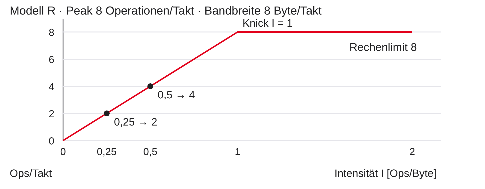{fig-alt="Roofline-Modell mit Peak acht Operationen pro Takt und Bandbreite acht Byte pro Takt. Die Grenze steigt bis Intensität eins linear und bleibt danach bei acht. Punkte bei 0,25 und 0,5 ergeben zwei und vier."}

$$P\leq\min(P_{\mathrm{peak}},B\,I),\qquad
I_{\mathrm{Knick}}=P_{\mathrm{peak}}/B$$

::: notes
Roofline bedeutet Dachlinie. Das Diagramm zeigt eine idealisierte Obergrenze, keine Messkurve. Die waagerechte Achse trägt Intensität $I$ in Operationen je Byte, die senkrechte Rate $P$ in Operationen je Takt. $P_{\mathrm{peak}}$ ist die maximale Rechenrate bei vollständig versorgten Einheiten; $B$ ist die Bandbreite über die betrachtete Speichergrenze in Byte je Takt.

In Lehrmodell R sind $P_{\mathrm{peak}}=8$ Operationen je Takt und $B=8$ Byte je Takt. Die schräge Grenze $BI$ beschreibt, wie viel Rechnung der Datenstrom höchstens versorgen kann. Die horizontale Grenze acht beschreibt das Rechenlimit. Bei $I=0{,}25$ ergibt sich $\min(8,8\cdot0{,}25)=2$, bei $I=0{,}5$ vier. Der Knick liegt bei $8/8=1$ Operation je Byte.

Unterhalb dieses Knicks ist die Bandbreitengrenze enger. Eine Intensität kleiner als eins bedeutet aber nicht auf jeder Hardware Speicherbegrenzung: Der Knick verschiebt sich mit Peak und Bandbreite. Abhängigkeiten, Anlauf, Konflikte oder unpassende Operationen können die reale Rate weiter reduzieren. Eine obere Schranke zu erreichen ist eine zusätzliche Frage. Deshalb untersuchen wir nun, wie lokale Wiederverwendung die betrachteten Bytes verändert.
:::

## Dieselbe Matrixrechnung mit Wiederverwendung

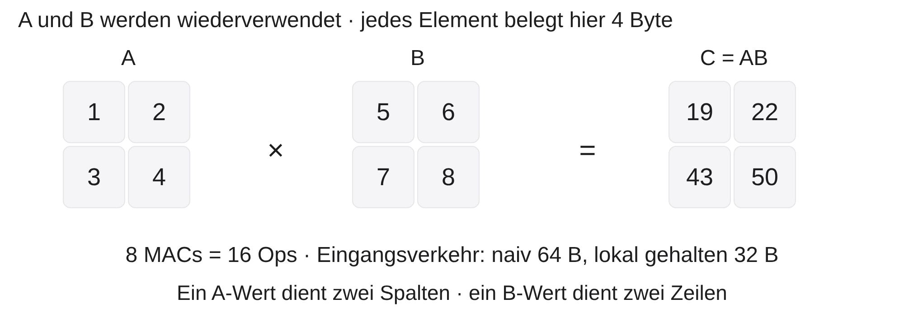{fig-alt="A gleich [[1,2],[3,4]], B gleich [[5,6],[7,8]], C gleich [[19,22],[43,50]]. Acht MACs verwenden dieselben acht Eingangswerte mehrfach."}

Ein Tile ist ein lokal bearbeiteter Matrixausschnitt. Auch eine CPU kann Tiles nutzen.

::: notes
Ein Tile ist ein begrenzter Ausschnitt einer größeren Matrix, der gemeinsam in einen nahen Speicher passt. CPU bedeutet Central Processing Unit, Prozessor. Tiling ist eine Softwaretechnik ebenso wie eine Organisationsidee für Beschleuniger. Es ist kein exklusives Merkmal einer NPU, Neural Processing Unit.

Im Bild gilt $C=AB$. $A$ und $B$ sind Eingabematrizen mit je zwei Zeilen und zwei Spalten, $C$ enthält vier Ausgabesummen. $C_{00}=1\cdot5+2\cdot7=19$, $C_{01}=1\cdot6+2\cdot8=22$, $C_{10}=3\cdot5+4\cdot7=43$ und $C_{11}=3\cdot6+4\cdot8=50$. Jede Summe startet bei null. Acht produktbezogene MACs, Multiply-Accumulate, ergeben nach unserer Konvention sechzehn Operationen.

Jeder Wert von $A$ wird für zwei Spalten und jeder Wert von $B$ für zwei Zeilen benötigt. Ohne lokales Halten lädt das naive Modell beide Operanden jeder MAC neu: sechzehn Vier-Byte-Transfers, also vierundsechzig Byte. Werden die acht verschiedenen Eingabewerte einmal geladen und lokal wiederverwendet, sind es zweiunddreißig Byte über dieselbe Grenze. Die Zahlenwerte sind hier kleine ganze Zahlen; für diese Transferrechnung nehmen wir dennoch je vier Speicherbytes an. Ausgabeverkehr kommt gesondert hinzu.
:::

## Was ändert das Ausgabeschreiben?

| Zählbasis für $C=AB$ | Naiv | Mit lokalem Tile |
|--------------------|------|------------------|
| Nur Eingangsbytes | $64$ B | $32$ B |
| Zusätzlich vier Ausgaben zu je $4$ B | $80$ B | $48$ B |
| Intensität mit Ausgaben | $16/80=0{,}2$ | $16/48\approx0{,}333$ |

Kein anfängliches Lesen von $C$; alle vier Summen starten bei null.

::: notes
B bezeichnet hier Byte. Ein Tile ist ein lokal gehaltener Matrixausschnitt. Die Tabelle erweitert bewusst die bisherige Zählbasis: Neben den Eingaben werden vier fertige Ausgaben mit je vier Byte über die betrachtete Grenze zurückgeschrieben. Wir bilden $C=AB$, nicht $C\leftarrow C+AB$, und benötigen daher kein anfängliches Laden einer alten Matrix $C$. Biaswerte gibt es in diesem Beispiel nicht.

Die acht MACs, Multiply-Accumulate, bleiben sechzehn Operationen. Naiv fallen vierundsechzig Eingangsbytes plus sechzehn Ausgabebytes an, zusammen achtzig. Mit Wiederverwendung sind es zweiunddreißig plus sechzehn, also achtundvierzig Byte. Die Intensitäten sinken gegenüber dem reinen Eingangsmodell auf $0{,}2$ und ein Drittel Operation je Byte. Die Ersparnis beträgt weiterhin zweiunddreißig Byte, der relative Anteil am Gesamtverkehr ist jetzt jedoch vierzig statt fünfzig Prozent.

Für eine Rechnung mit beiden Transferrichtungen müsste außerdem eine dazu passende Bandbreitenannahme gelten. Die vorherige Roofline benutzte ausdrücklich nur Eingangsverkehr; ihre Punkte werden nicht stillschweigend umbenannt. Ein häufiges Klausurproblem ist das Vergleichen von Zahlen mit unterschiedlichen Speichergrenzen oder ausgeschlossenen Anteilen. Geben Sie daher zuerst an, was gezählt wird, und setzen Sie erst anschließend Zahlen ein.
:::

## Bandbreite, Latenz und Abhängigkeit trennen

- Bandbreite: wie viele Bytes pro Zeit ankommen können
- Latenz: wann ein einzelner benötigter Wert bereitsteht
- RAW: wann die nächste abhängige Summe starten kann
- Überlappung hilft beim Warten; Wiederverwendung senkt Verkehr

::: notes
RAW heißt Read After Write, Lesen nach Schreiben. Eine Akkumulation braucht den zuvor erzeugten Summenwert. Dieser Wartegrund unterscheidet sich sowohl von der Latenz eines Speicherzugriffs als auch von der Bandbreite einer Leitung. Bandbreite misst eine Rate, Latenz eine Dauer.

Angenommen, ein Transfer benötigt drei Takte, aber ein neuer unabhängiger Transfer kann in jedem Takt beginnen. Vier Starts in den Takten eins bis vier liefern bei dieser Zählweise Ergebnisse am Ende von drei bis sechs. Vier seriell gestartete Transfers würden dagegen am Ende von drei, sechs, neun und zwölf fertig. Die einzelne Latenz bleibt drei; die Überlappung verbessert den Durchsatz. Das ist ein vereinfachtes Zeitmodell, keine Speicher- oder Prozessorangabe.

OoO bedeutet Out of Order, interne Ausführung außerhalb der Programmreihenfolge. Sie kann unabhängige Zugriffe überlappen und damit vorhandene Bandbreite besser nutzen. Sie erzeugt weder unbegrenzte Bandbreite noch hebt sie die echte Summenabhängigkeit auf. Tiling, lokales Halten eines Matrixausschnitts, reduziert dagegen die angeforderte Datenmenge. Diese Maßnahmen können zusammenwirken. Welche davon hilft, hängt davon ab, welcher Engpass im konkreten Zeitfenster wirksam ist.
:::

## Papierphase 1: Rechnung und Speichergrenze

Übungsblatt, Aufgaben 1–2 · 10 Minuten

- Dense: Ausgänge, Parameter und MACs getrennt zählen
- Roofline: Grenze und Knick aus den Modellwerten bestimmen
- Tile: Wiederverwendung erklären und Ausgaben gesondert zählen

::: notes
Dense ist eine vollständig verbundene Schicht; MAC heißt Multiply-Accumulate, Produkt zur Summe addieren. Roofline ist das Modell einer durch Rechenpeak und Bandbreite begrenzten Rate. Ein Tile ist ein lokal bearbeiteter Matrixausschnitt. Diese Arbeitsphase verbindet die drei Begriffe, ohne einen Compiler oder ein Framework vorauszusetzen.

Aufgabe 1 führt zu den Ausgängen vierzehn und neun, acht Parametern und sechs produktbezogenen MACs. Bei sechs Int8-Gewichten, zwei Int32-Biaswerten und drei Int8-Eingaben ergeben sich sechs plus acht plus drei, also siebzehn gespeicherte Byte vor den Ausgaben. Int8 und Int32 sind vorzeichenbehaftete Ganzzahlen mit acht beziehungsweise zweiunddreißig Bit. Das ist ein Datenbudget, noch keine vollständige Datei- oder Laufzeitgröße.

Aufgabe 2 benutzt die Eingangsgrenze von Lehrmodell R: Peak acht Operationen je Takt, Bandbreite acht Byte je Takt, Grenzen zwei und vier bei Intensität $0{,}25$ und $0{,}5$. Beide liegen unter dem Knick eins. Mit Ausgaben entstehen beim Tile andere Intensitäten. Besprechen Sie besonders, warum mehr Rechenwerke im unveränderten Eingangsmodell den engeren Transfergrenzwert nicht verschieben. Vollständige Lösungen stehen im Lösungsprofil des Übungsblatts.
:::

## ILP und DLP können gleichzeitig auftreten

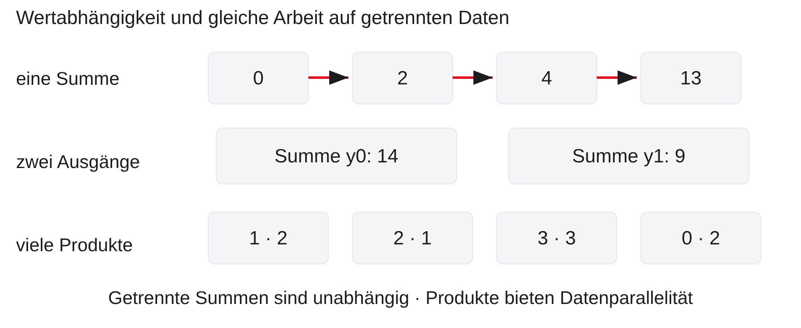{fig-alt="Eine Summenkette enthält abhängige Akkumulationen. Zwei Ausgabesummen sind voneinander unabhängig, mehrere elementweise Produkte bieten Datenparallelität."}

DLP beschreibt das Rechenmuster; SIMD ist eine mögliche Umsetzung.

::: notes
ILP bedeutet Instruction-Level Parallelism, Parallelität zwischen Maschinenbefehlen. DLP heißt Data-Level Parallelism, Parallelität gleicher Arbeit an unterschiedlichen Daten. SIMD bedeutet Single Instruction, Multiple Data, eine Befehlssteuerung für mehrere Datenoperationen. Diese Begriffe beschreiben verschiedene Ebenen: Das Programm kann Datenparallelität anbieten, während eine bestimmte Architektur sie mit SIMD nutzt.

Die obere Zeile zeigt eine fortlaufende Summenkette. Jeder Akkumulator benötigt seinen Vorgänger; diese Abhängigkeit ist rot verbunden. Darunter stehen zwei unabhängige Ausgabesummen. Innerhalb jeder bleiben Ketten, zwischen den Zeilen besteht jedoch kein Wertfluss. Die Gruppe unabhängiger Produkte zeigt gleiche Multiplikation auf mehreren Eingangspaaren.

ILP verlangt nicht unterschiedliche Rechenarten: Zwei unabhängige Additionsbefehle können ebenso parallel ausgeführt werden. Umgekehrt definiert DLP noch keinen Maschinenbefehl. Ein Compiler kann das Datenmuster skalar, mit festen SIMD-Gruppen oder mit Vektoren umsetzen. Hundert unabhängige Produkte bedeuten weder hundert physische Rechenwerke noch Fertigstellung in einem Takt. Die passende Hardware muss die Datenkapazität, tatsächlichen Rechenressourcen und späteres Zusammenführen der Produkte organisieren.
:::

## Packed SIMD: Grenzen zwischen den Bytes

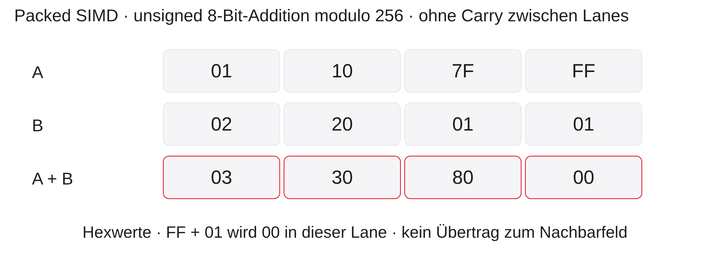{fig-alt="Vier unsigned Acht-Bit-Lanes addieren 1+2,16+32,127+1,255+1 getrennt zu 3,48,128,0. Es fließt kein Übertrag in die Nachbarlane."}

Ein gewöhnliches 32-Bit-`add` auf gepackten Bytes hat andere Übertragsregeln.

::: notes
SIMD steht für Single Instruction, Multiple Data. Packed bedeutet, dass mehrere kleine Elemente in einem breiteren Register liegen. Eine Lane ist dabei ein getrennt behandeltes Datenfeld; sie muss nicht einem dauerhaft eigenen physischen Rechenwerk entsprechen. Das Diagramm verwendet vier vorzeichenlose Acht-Bit-Felder und ausdrücklich Addition modulo $256$, also mit Verwerfen des Überlaufs innerhalb jedes Feldes.

Die Ergebnisse sind $1+2=3$, $16+32=48$, $127+1=128$ und $255+1=0$ modulo $256$. In Hexadezimalnotation erscheinen sie als 03, 30, 80 und 00. Die senkrechten Feldgrenzen verhindern einen Übertrag in das Nachbarfeld. Ein gewöhnliches Zweiunddreißig-Bit-`add` addiert dagegen eine ganze Zahl und kann einen Byteübertrag weitergeben.

Das Beispiel ist kein behaupteter SIMD-Befehl der RISC-V-Basis. RISC-V ist die Befehlssatzfamilie des Kurses. Vorzeichenbehaftete Addition oder Sättigung, Begrenzen statt Umklappen, wären andere Verträge. Eine Produktsumme für ein Netz ist nochmals etwas anderes: Schon $20\cdot20=400$ passt nicht in ein Acht-Bit-Feld. Wir müssen daher Breite der Operanden und Breite des Akkumulators getrennt wählen.
:::

## Schmale Operanden, breitere Produktsumme

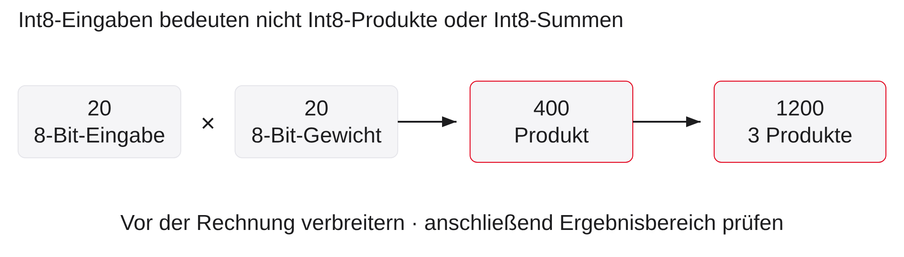{fig-alt="Zwei Int8-Operanden mit Wert 20 ergeben Produkt 400. Drei solche Produkte ergeben Summe 1200. Der Akkumulator braucht mehr als acht Bit."}

Int8 beschreibt gespeicherte Operanden, nicht automatisch die Ergebnisbreite.

::: notes
Int8 bedeutet eine vorzeichenbehaftete Ganzzahl mit acht Bit und Bereich minus hundertachtundzwanzig bis hundert siebenundzwanzig. Ein Akkumulator hält die laufende Summe. Im Bild werden zwei schmale Operanden mit Wert zwanzig zunächst multipliziert. Das Produkt vierhundert benötigt einen breiteren Zahlenbereich. Drei solche Produkte ergeben zwölfhundert, ebenfalls weit außerhalb des Int8-Bereichs.

Bei neuronalen Integerkerneln sind Int8-Eingaben und Gewichte mit einem Int32-Akkumulator verbreitet; Int32 bedeutet vorzeichenbehaftete Zweiunddreißig-Bit-Ganzzahl. Das ist keine Garantie gegen jeden Überlauf. Anzahl der Produkte, Nullpunktkorrektur und Biasbereich müssen zum Kernel passen. Unser kleines Hostbeispiel summiert zur sicheren Bereichsprüfung zunächst in Int64, einer Vierundsechzig-Bit-Ganzzahl, und prüft anschließend die Ausgabe.

Widening, Verbreitern, bedeutet das Rechnen mit einem größeren Typ, nicht das nachträgliche Wiederherstellen bereits verlorener Bits. Die Umwandlung muss vor einer zu schmalen Rechnung erfolgen. Requantisierung ist die spätere Skalierung und Begrenzung auf einen Ausgangsdatentyp. Sie ist ein eigener Schritt und keine gewöhnliche Int8-MAC. MAC steht für Multiply-Accumulate. Schmale gespeicherte Daten sparen also Bytes, verlangen aber weiterhin eine sauber geplante Arithmetik.
:::

## DSP: bekannte Muster der Signalverarbeitung

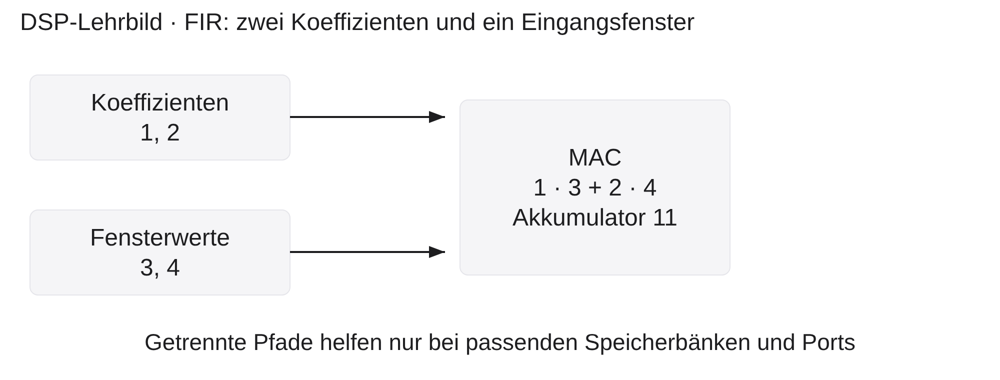{fig-alt="Koeffizienten und ein gleitendes Eingangsfenster versorgen einen MAC-Akkumulator über getrennte lokale Pfade. Zwei Produkte 1 mal 3 und 2 mal 4 ergeben 11."}

Mehrere Speicherpfade und Hardware-Schleifen sind mögliche DSP-Merkmale.

::: notes
DSP heißt Digital Signal Processor, Prozessor für digitale Signalverarbeitung. Ein FIR-Filter, Finite Impulse Response, Filter mit endlicher Impulsantwort, berechnet eine gewichtete Summe eines zeitlichen Eingangsfensters: $y[n]=\sum_k h[k]x[n-k]$. $n$ ist der Zeitpunkt, $k$ die Verzögerung und $h[k]$ ein Filterkoeffizient. Mit Koeffizienten eins und zwei sowie den zugehörigen Eingangswerten drei und vier ergibt sich $1\cdot3+2\cdot4=11$.

Das Bild zeigt getrennte lokale Pfade für Koeffizienten und Eingangswerte, die eine MAC-Einheit versorgen. MAC steht für Multiply-Accumulate, Produkt zur Summe addieren. Zusätzliche Pfade können zwei benötigte Operanden gleichzeitig bereitstellen, wenn Speicherbänke und Ports dies tatsächlich erlauben. Zwei gezeichnete Busse sind keine Garantie gegen Bankkonflikte, konkurrierende Zugriffe auf dieselbe Ressource.

Hardware-Schleifen können die wiederholte Steuerung von Start, Ende und Zähler übernehmen. Das spart bestimmte Zähler- und Sprungbefehle, beseitigt aber keine Datenwartezeit. Diese Merkmale gehören nicht zwingend zu jedem DSP. Die Nähe zur Dense-Schicht liegt in der häufigen Produktsumme; Zeitfenster und Modellbedeutung bleiben unterschiedlich. Ob ein eigener MAC-Pfad genügend Durchsatz hat, klärt nun die Trennung von Latenz und Startabstand.
:::

## Ein Start pro Takt ist nicht Latenz eins

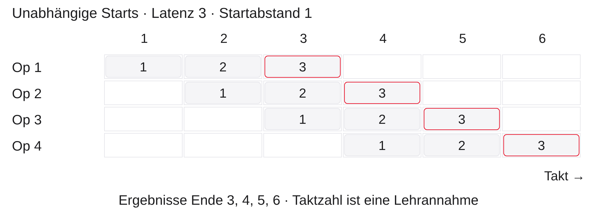{fig-alt="Vier unabhängige Operationen beginnen in Takten eins bis vier. Bei Ergebnislatenz drei enden sie in Takten drei bis sechs. Latenz drei und Initiierungsintervall eins sind verschieden."}

Lehrmodell: Ergebnislatenz $3$, Initiierungsintervall $1$.

::: notes
Ergebnislatenz ist die Zahl der Takte vom Start einer Operation bis zu ihrem fertigen Ergebnis. Das Initiierungsintervall ist der minimale Abstand zweier zulässiger Starts. Die Abbildung verwendet eine hypothetische gepipelinete Recheneinheit: Jede Operation durchläuft drei Schritte, während schon weitere unabhängige Operationen nachrücken können.

Die waagerechte Achse zeigt Takte eins bis sechs. Operationen eins bis vier starten in eins, zwei, drei und vier. Ihre Ergebnisse liegen jeweils am Ende von drei, vier, fünf und sechs vor. Die rote letzte Stufe markiert Fertigstellung. Es sind vier Operationen in einem sechs Takte langen Fenster; der längere stationäre Strom könnte trotzdem ein Ergebnis je Takt liefern. Latenz drei wird dadurch nicht zu eins.

Eine MAC, Multiply-Accumulate, verbindet Produkt und Summenaddition. Bei einer abhängigen Akkumulatorkette genügt das Initiierungsintervall allein nicht, weil der nächste Start den vorigen Wert benötigt. Dafür sind passende Weiterleitung und Abhängigkeitsregeln entscheidend. Die Abbildung ist daher ausdrücklich ein Modell unabhängiger Operationen, keine Zusage eines DSP, Digital Signal Processor. Dieselbe Vorsicht benötigen wir bei einem Vektorbefehl: Seine Elementzahl verrät noch nicht seine tatsächliche Laufzeit.
:::

## RVV: Registerbreite ist eine Kapazität

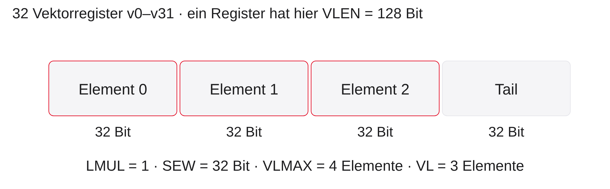{fig-alt="Ein 128-Bit-Vektorregister enthält bei 32-Bit-Elementen vier Plätze. VL drei aktiviert die ersten drei, der vierte ist Tail. Es gibt 32 Vektorregister v0 bis v31."}

VLEN in Bit · SEW in Bit/Element · VL in Elementen

::: notes
RVV bedeutet RISC-V Vector Extension, Vektorerweiterung der RISC-V-Befehlssatzarchitektur. RISC steht für Reduced Instruction Set Computer. RVV stellt zweiunddreißig architektonische Vektorregister `v0` bis `v31` bereit. VLEN, Vector Register Length, ist die implementierte Bitzahl eines solchen Registers. SEW, Selected Element Width, ist die konfigurierte Breite eines Elements.

Das Bild nimmt VLEN hundertachtundzwanzig Bit und SEW zweiunddreißig Bit an. LMUL, Vector Register Group Multiplier, ist hier eins und bezeichnet eine Gruppe von einem Register. Damit ergeben sich vier Elementplätze. VL, Vector Length, ist die aktuell aktive Zahl von Elementen. Hier sind es drei; der vierte Platz ist Tail, der inaktive Rest hinter der aktiven Länge. Rot markiert aktive Plätze, hellgrau den Rest. Die Zeichnung zeigt Datenplätze, keine vier physischen Rechenwerke.

Ein langes Array kann mehr Elemente besitzen, als in diese Registergruppe passen. Es wird dann in mehreren Abschnitten bearbeitet. Die Vektorerweiterung erlaubt, die aktive Länge für jeden Abschnitt zu wählen und vom Befehl zurückzugeben. Dafür müssen wir die maximale Kapazität von der angeforderten und der tatsächlichen Länge unterscheiden. Diese Größen werden auf der nächsten Folie mit ihren Einheiten berechnet.
:::

## VLMAX berechnen

$$\mathrm{VLMAX}=\mathrm{LMUL}\,\frac{\mathrm{VLEN}}{\mathrm{SEW}}$$

| Registergruppe | Registerbreite | Elementbreite | Kapazität |
|----------------|----------------|---------------|-----------|
| LMUL $=1$ | VLEN $=128$ Bit | SEW $=32$ Bit | $4$ Elemente |
| LMUL $=1$ | VLEN $=1024$ Bit | SEW $=32$ Bit | $32$ Elemente |

VL kann kleiner sein als diese Kapazität.

::: notes
VLMAX heißt maximale aktive Vektorlänge für die gewählte Konfiguration. VLEN, Vector Register Length, ist die Registerbreite in Bit. SEW, Selected Element Width, gibt Bit je Element an. LMUL, Vector Register Group Multiplier, beschreibt die Größe einer Vektorregistergruppe relativ zu einem Register. Wir verwenden im weiteren Beispiel ausschließlich LMUL eins.

Die Division Bit durch Bit je Element liefert Elemente. Hundertachtundzwanzig geteilt durch zweiunddreißig ergibt vier; eintausendvierundzwanzig geteilt durch zweiunddreißig ergibt zweiunddreißig. Eine Registergruppe fasst also unterschiedlich viele Elemente, obwohl die Programmlogik gleich sein kann. VL, Vector Length, bezeichnet anschließend nur die tatsächlich aktivierten Elemente des aktuellen Abschnitts.

Die Gleichung gilt für eine unterstützte Element- und Gruppenkonfiguration. Ein Kern muss nicht jede denkbare Kombination unterstützen. Die vollständige Vektorerweiterung und eine minimale eingebettete Teilmenge sind zudem unterschiedliche Zielvoraussetzungen. Wir setzen für die folgenden Beispiele Unterstützung der gezeigten Zweiunddreißig-Bit-Konfiguration voraus. Weder VLEN noch VLMAX bestimmen die Zahl gleichzeitig arbeitender physischer Lanes. Die nächste Frage lautet deshalb zuerst, welche Länge die Software für einen noch unbearbeiteten Arrayrest erhält.
:::

## `vsetvli` liefert die aktive Länge zurück

| Angeforderter Rest | Zulässige aktive Länge |
|--------------------|------------------------|
| $\mathrm{AVL}\leq\mathrm{VLMAX}$ | $\mathrm{VL}=\mathrm{AVL}$ |
| $\mathrm{VLMAX}<\mathrm{AVL}<2\mathrm{VLMAX}$ | $\lceil\mathrm{AVL}/2\rceil\leq\mathrm{VL}\leq\mathrm{VLMAX}$ |
| $\mathrm{AVL}\geq2\mathrm{VLMAX}$ | $\mathrm{VL}=\mathrm{VLMAX}$ |

Software verwendet den zurückgegebenen Wert, nicht eine angenommene Breite.

::: notes
`vsetvli` ist ein Konfigurationsbefehl der RISC-V Vector Extension, kurz RVV. Er setzt unter anderem Elementbreite und Gruppengröße, bestimmt das Längenregister `vl` und kann dieselbe aktive Elementzahl in ein normales Integerregister zurückgeben. AVL bedeutet Application Vector Length, die von der Anwendung angeforderte Zahl noch zu verarbeitender Elemente. VLMAX ist die maximale Elementzahl der gewählten Registergruppe; VL die tatsächlich aktivierte Zahl.

Die Fallunterscheidung folgt den Längenregeln der RVV-Spezifikation 1.0 für eine unterstützte Konfiguration. Passt der Rest vollständig, wird er exakt bearbeitet. Ist er mindestens doppelt so groß wie die Kapazität, wird ein voller Abschnitt verwendet. Dazwischen ist eine ganzzahlige Länge von der aufgerundeten Hälfte des Restes bis zur Kapazität erlaubt. Im mittleren Fall ist jeder Integer innerhalb der Grenzen zulässig; eine einzelne garantierte Wahl gibt es dort nicht.

Die Regel erlaubt, die letzten beiden Abschnitte gleichmäßiger zu verteilen. Eine Implementierung wählt bei gleichen Eingangswerten deterministisch, also reproduzierbar. Bei AVL null ist VL null; bei positivem AVL ist VL positiv. Die Schleife muss Zeiger und Restzähler um die zurückgegebene Länge verändern. Die vereinfachte Behauptung, VL sei immer das Minimum von AVL und VLMAX, ist im mittleren Fall zu eng.
:::

## Rest 40 bei Kapazität 32

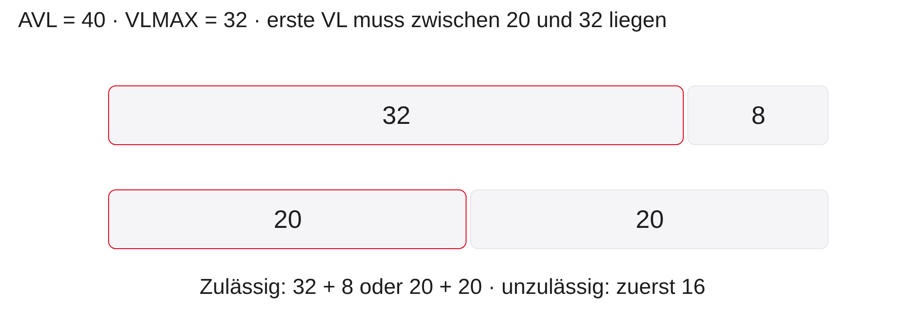{fig-alt="Vierzig Elemente können bei VLMAX 32 als 32 plus 8 oder als 20 plus 20 bearbeitet werden. Eine erste VL 16 ist unzulässig, weil mindestens 20 nötig sind."}

Bei $1000$ Elementen: $30\cdot32=960$, dann zwei Restabschnitte.

::: notes
VLMAX ist die maximale aktive Vektorlänge, VL die gewählte aktive Länge und AVL der angeforderte Rest. Bei AVL vierzig und VLMAX zweiunddreißig liegt der Rest zwischen einfacher und doppelter Kapazität. Die erste VL muss daher mindestens $\lceil40/2\rceil=20$ und höchstens zweiunddreißig sein.

Die oberen Streifen zeigen zwei zulässige Strategien: zuerst zweiunddreißig, danach acht, oder zuerst zwanzig, danach zwanzig. Nach dem ersten Abschnitt passt der Rest vollständig und wird exakt gewählt. Eine erste VL sechzehn ist verboten; die vermeintliche Folge sechzehn plus vierundzwanzig beginnt daher mit einer unzulässigen Länge. Bei Zweiunddreißig-Bit-Elementen rückt jeder Zeiger um vier mal VL Byte: hundertachtundzwanzig und zweiunddreißig beziehungsweise zweimal achtzig Byte.

Für eintausend Elemente sind zunächst dreißig volle Abschnitte erzwungen, weil der Rest vor jedem dieser Starts mindestens vierundsechzig beträgt. Danach bleiben vierzig. Diese benötigen zwei weitere Abschnitte, insgesamt also zweiunddreißig Iterationen. Die genaue Aufteilung der letzten zwei kann variieren. Beide Streifen bearbeiten jedes Element genau einmal. Eine tragfähige Schleife benötigt deshalb keinen fest einprogrammierten Wert für die Registerbreite.
:::

## Eine Schleife für elementweise Addition

```asm
# RVV 1.0; a0=N, a1=A, a2=B, a3=C; uint32_t-Arrays
beqz a0, done
loop:
    vsetvli t0, a0, e32, m1, ta, ma
    vle32.v v0, (a1)
    vle32.v v1, (a2)
    vadd.vv v2, v0, v1
    vse32.v v2, (a3)
    slli t1, t0, 2
    add a1, a1, t1
    add a2, a2, t1
    add a3, a3, t1
    sub a0, a0, t0
    bnez a0, loop
done:
    ret
```

::: notes
Der Ausschnitt ist eine RISC-V-Assembler-Lehrfolge für RVV, RISC-V Vector Extension, Version 1.0. Er wurde nicht mit einer RISC-V-Toolchain assembliert. `uint32_t` bedeutet vorzeichenlose Zweiunddreißig-Bit-Ganzzahl. `a0` enthält die noch zu bearbeitende Elementzahl, `a1`, `a2` und `a3` gültige ausgerichtete Adressen der Arrays A, B und C. Die Arrays haben mindestens N Elemente; C überschneidet sich hier nicht mit den Quellen. Zeigeraddition und Bytezahl müssen im Zieladressraum darstellbar sein.

`beqz` überspringt bei N null sämtliche Zugriffe. `vsetvli` wählt `e32`, Zweiunddreißig-Bit-Elemente, und `m1`, eine Registergruppe von einem Register. Es gibt die aktive Länge VL in `t0` zurück. `ta` und `ma` erlauben, inaktive Tail- beziehungsweise maskierte Plätze nicht zu erhalten; unser unmaskierter Code verwendet diese Inhalte nicht. `vle32.v` lädt aktive Elemente nach `v0` und `v1`, `vadd.vv` addiert sie elementweise modulo $2^{32}$ nach `v2`, `vse32.v` speichert nur die aktiven Ergebnisse.

`slli` verschiebt VL um zwei Bit nach links, berechnet also vier mal VL Byte in `t1`. Die drei `add`-Befehle rücken die Zeiger um diese Bytezahl. `sub` reduziert den Rest um VL; `bnez` wiederholt bei positivem Rest. `ret` kehrt zum Aufrufer zurück. Die Folge zeigt kein Skalarprodukt und keine MAC, Multiply-Accumulate. Ihre Korrektheit hängt von der zurückgegebenen Länge ab, ihre Laufzeit zusätzlich von der Mikroarchitektur und Datenversorgung.
:::

## Vier aktive Elemente brauchen nicht vier Lanes

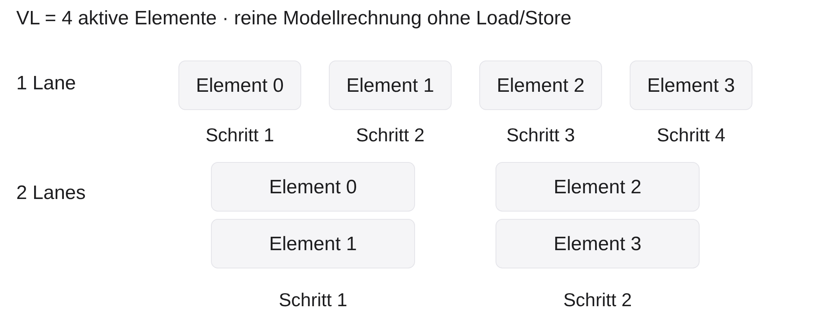{fig-alt="Dieselben vier aktiven Vektorelemente können in einem Modell mit einer Lane in vier Schritten oder mit zwei Lanes in zwei Schritten gerechnet werden. Datenkapazität und Rechenbreite sind verschieden."}

Gleiche ISA-Wirkung; unterschiedliche interne Umsetzung und Zeit.

::: notes
ISA bedeutet Instruction Set Architecture, Befehlssatzarchitektur. Sie beschreibt die Wirkung einer Instruktion, etwa elementweise Addition der aktiven Vektorplätze. VL, Vector Length, bestimmt deren Anzahl. Eine physische Lane ist hier ein tatsächlich verfügbarer elementweiser Rechenpfad. Im Bild betrachten wir VL vier und abstrahieren Laden, Speichern und Startkosten vollständig weg.

Die obere Modellumsetzung besitzt eine Lane und verarbeitet die vier unabhängigen Additionen in vier Schritten. Die untere besitzt zwei und benötigt zwei Schritte. Die kleinen nummerierten Felder stellen Elemente dar; ihre horizontalen Gruppen bilden einen internen Schritt. Die Zahlen vier und zwei sind Lehrzeiten unter der Annahme eines Ergebnisses je Lane und Schritt, keine Laufzeitgarantie von RVV, RISC-V Vector Extension.

Beide Umsetzungen können dieselben vier Ergebnisse liefern. Ein großes Register kann somit von wenigen Rechenpfaden über mehrere Takte bearbeitet werden. Umgekehrt braucht eine breite Umsetzung genügend Speicherbandbreite. Portable Vektorlängen machen die Programmlogik weniger abhängig von der Registerkapazität, garantieren jedoch keine gleiche Zeit oder Energie. Zusätzliche Weiterleitung zwischen verschiedenen Rechenoperationen ist eine weitere, davon getrennte Möglichkeit der Überlappung.
:::

## Chaining: Ergebnisse elementweise weitergeben

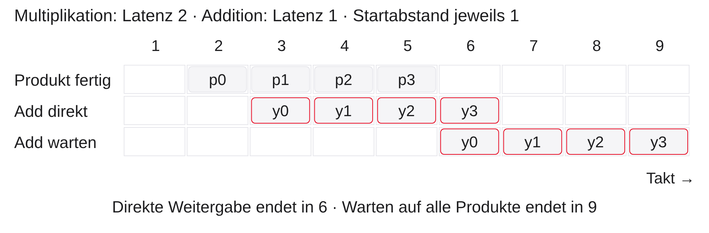{fig-alt="Vier Multiplikationen enden in Takten zwei bis fünf. Mit Weitergabe starten die zugehörigen Additionen in drei bis sechs, ohne Weitergabe erst in sechs bis neun."}

Lehrmodell: Multiplikationslatenz $2$, Additionslatenz $1$, je ein Start pro Takt.

::: notes
Chaining ist die direkte elementweise Weitergabe fertiger Ergebnisse zwischen Rechenpfaden. Das Modell bildet für vier Elemente erst ein Produkt und danach eine separate Addition. Es ist keine fused multiply-add, verschmolzene Multiplikation und Addition, und keine Zusage der RVV-Spezifikation; RVV bedeutet RISC-V Vector Extension.

Die waagerechte Achse trägt Kerntakte. Vier unabhängige Multiplikationen starten in eins bis vier, ihre Ergebnisse entstehen bei Latenz zwei am Ende von zwei bis fünf. Eine Addition hat Latenz eins. Mit Weitergabe kann sie für das jeweilige Element im Folgetakt beginnen: drei, vier, fünf und sechs. Die vier letzten Ergebnisse stehen daher am Ende von drei bis sechs bereit.

Ohne Chaining verlangt dieses Vergleichsmodell, dass erst alle vier Produkte fertig sind. Die Additionen starten dann in sechs bis neun und enden jeweils im selben Takt. Der gesamte Ausschnitt endet mit Chaining in sechs, ohne in neun. Die Rechnung umfasst in beiden Fällen vier Multiplikationen und vier Additionen. Rot markiert die früheren Endergebnisse; eine gültige Weiterleitung braucht passende Ports und Ressourcen. Wir addieren unabhängige Elemente, keine einzige abhängige Akkumulatorkette. Diese Unterscheidung verhindert, dass das Bild als allgemeine Beschleunigung jeder Summe gelesen wird.
:::

## Papierphase 2: Vektorlängen und Ablauf

Übungsblatt, Aufgabe 3 · 15 Minuten

- VLMAX aus Bitbreiten berechnen
- Zulässige VL-Folgen für den Rest unterscheiden
- Zeigerinkrement und Elementzahl getrennt angeben
- Kapazität und physische Rechenbreite auseinanderhalten

::: notes
VLMAX ist die maximale aktive Elementzahl einer Registergruppe. VLEN, Vector Register Length, ist deren Registerbreite in Bit, SEW, Selected Element Width, die Bitzahl je Element und LMUL, Vector Register Group Multiplier, die Gruppengröße. VL ist die aktive Länge; AVL, Application Vector Length, die angeforderte Restzahl.

Bei VLEN hundertachtundzwanzig, SEW zweiunddreißig und LMUL eins folgt VLMAX vier. Das ist keine Angabe von vier physischen Rechenpfaden. Im zweiten Teil der Aufgabe gilt separat VLMAX zweiunddreißig. Für AVL vierzig sind erste Längen zwanzig bis zweiunddreißig zulässig. Mit VL vierundzwanzig bleiben sechzehn; die Zeiger bewegen sich um sechsundneunzig, anschließend vierundsechzig Byte. Die Anfangswahl sechzehn ist dagegen unzulässig.

Für eintausend Elemente entstehen dreißig volle und zwei Restiterationen. Besprechen Sie abschließend die Chaining-Zeitpunkte sechs und neun unter den gegebenen Modellbedingungen. Chaining bedeutet direkte elementweise Weiterleitung und ist keine garantierte Vektorbefehlseigenschaft. Die Aufgabe prüft damit sowohl die Befehlssatzregeln als auch die Grenze zwischen diesen Regeln und einem angenommenen Zeitmodell.
:::

## CPU, GPU und NPU kombinieren

| Einheit | Häufiger Schwerpunkt | Auswahlfrage |
|---------|----------------------|--------------|
| CPU | Kontrollfluss, flexible Aufgaben | Reicht sie für das kleine Modell? |
| GPU | viele parallele Daten und Threads | Passen Auslastung und Datentransfer? |
| NPU | unterstützte neuronale Operatoren | Werden Form und Datentyp unterstützt? |

Eine NPU ist keine einheitliche ISA und nicht immer ein systolisches Array.

::: notes
CPU bedeutet Central Processing Unit, allgemeiner Prozessor; GPU Graphics Processing Unit, Grafikprozessor mit breiten parallelen Ausführungsmöglichkeiten; NPU Neural Processing Unit, Beschleuniger für neuronale Verarbeitung. Ein Thread ist ein eigener Ausführungsfaden. ISA heißt Instruction Set Architecture, Befehlssatzarchitektur. NPU ist eine Produkt- und Architekturklasse, kein einheitlicher Standard für Befehle oder interne Gitter.

Die Tabelle nennt häufige Schwerpunkte, keine absoluten Grenzen. Eine CPU kann ein kleines Modell mit kurzer Gesamtlatenz ausführen. Eine GPU kann bei großen gut parallelen Aufgaben viel Durchsatz liefern, verlangt aber ebenfalls Datenversorgung und passende Auslastung. Eine NPU unterstützt bestimmte Operatoren, Datentypen und Formen besonders gut. Ein Operator ist eine Modelloperation wie vollständig verbundene Schicht oder Faltung.

Nicht unterstützte Teile können auf der CPU bleiben; dann kommen Übergaben und Kopien hinzu. Ein System kann alle drei Klassen kombinieren. Energieangaben lassen sich ohne dieselbe Aufgabe, Messgrenze und Betriebsweise nicht vergleichen. Wir untersuchen nun als ein mögliches NPU-Prinzip ein systolisches Array. Seine Stärke entsteht nicht durch den Namen, sondern durch lokale Wiederverwendung und regelmäßige Nachbarverbindungen.
:::

## Eine Zelle rechnet und reicht weiter

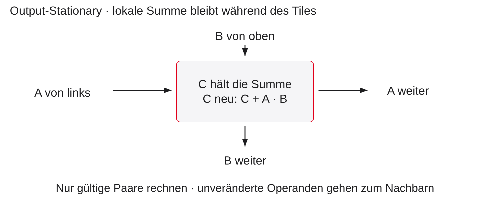{fig-alt="Eine Modellzelle empfängt A von links und B von oben, addiert A mal B zur lokalen Summe C und reicht unverändertes A nach rechts und B nach unten."}

Output-Stationary: Die Teilsumme bleibt während des Tiles in der Zelle.

::: notes
Ein systolisches Array ist ein regelmäßiges Gitter von Rechenzellen mit getakteter Datenweitergabe. Systole bezeichnet die rhythmische Pumpbewegung des Herzens; das Namensbild beschreibt eine Wertwelle durch Nachbarzellen. Eine MAC, Multiply-Accumulate, multipliziert ein Eingangspaar und addiert das Produkt zur lokalen Summe.

In unserem Output-Stationary-Lehrmodell bleibt die Ausgabeteilsumme $C$ während eines Tiles, eines lokal bearbeiteten Matrixausschnitts, in der Zelle. $A$ kommt von links und wird unverändert nach rechts weitergegeben. $B$ kommt von oben und wandert unverändert nach unten. Die Zelle leitet also nicht das Produkt als neuen A- oder B-Wert weiter. Die rote Umrandung markiert die lokal gehaltene Summe.

Wir nehmen für ein gültiges Eingangspaar eine vollständige MAC pro Takt an. Ein Operand erreicht den Nachbarn erst im nächsten Takt. Ohne zwei gültige passend indizierte Werte erfolgt keine MAC. Die Summe beginnt vor dem ersten Takt bei null. Das sind explizite Modellannahmen, keine Vorgabe für jede NPU, Neural Processing Unit. Ein tatsächliches System braucht zusätzlich Puffer, gültige Kennzeichnungen und einen Ausleseweg. Nun verbinden wir vier solcher Zellen zur bekannten Matrixrechnung.
:::

## Vier Zellen für die bekannte 2×2-Rechnung

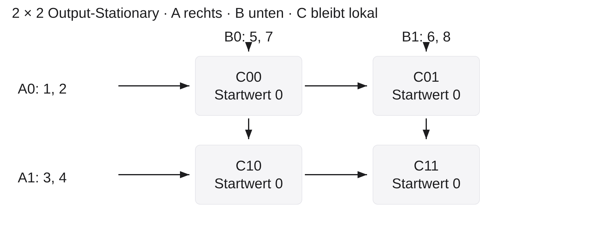{fig-alt="Vier Zellen C00,C01,C10,C11 bilden ein 2-mal-2-Gitter. A fließt zeilenweise rechts, B spaltenweise unten, C bleibt lokal."}

Alle Summen starten bei null; Vorladen und Auslesen sind ausgeklammert.

::: notes
Die Abbildung zeigt ein Output-Stationary-Array: Die vier Ausgabesummen $C_{00}$, $C_{01}$, $C_{10}$ und $C_{11}$ bleiben während der Rechnung in ihren Zellen. Die Indizes bezeichnen Zeile und Spalte und beginnen bei null. $A$ wird links je Zeile eingespeist, $B$ oben je Spalte. Pfeile zeigen Nachbarweitergabe, keine Systembuszugriffe für jede einzelne MAC. MAC bedeutet Multiply-Accumulate.

Wir verwenden exakt die Matrizen des Tile-Beispiels: $A=[[1,2],[3,4]]$, $B=[[5,6],[7,8]]$ und $C=AB$. Eine Zelle $C_{ij}$ benötigt für beide Summenschritte den passenden Wert $A_{ik}$ und $B_{kj}$ mit demselben inneren Index $k$. Für $C_{01}$ sind das $1\cdot6$ und $2\cdot8$. Für $C_{10}$ sind es $3\cdot5$ und $4\cdot7$. Alle Summen starten bei null, jedes gültige Paar wird im aktuellen Takt verarbeitet und erst im nächsten Takt weitergereicht.

Ein geometrisch richtiges Gitter allein stellt noch nicht sicher, dass zusammengehörige Werte gleichzeitig eintreffen. Würden alle Zeilen und Spalten ungeordnet starten, könnten falsche Indexpaare zusammentreffen. Die Randeinspeisung muss deshalb um Zeilen- beziehungsweise Spaltenposition versetzt werden. Diese Staffelung erklärt den Anlauf und wird als nächster Schritt ausdrücklich auf einer Zeitachse gezeigt.
:::

## Die Randeinspeisung wird gestaffelt

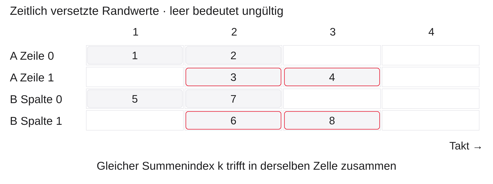{fig-alt="Randwerte: A-Zeile0 erhält 1,2 in Takten1,2, A-Zeile1 3,4 in2,3. B-Spalte0 erhält5,7 in1,2, B-Spalte1 6,8 in2,3. Leere Felder sind ungültig."}

Ankunft in Zelle $(i,j)$: Takt $1+k+i+j$, mit $i,j,k\in\{0,1\}$.

::: notes
Die Zeitachse zeigt die an den Rändern verfügbaren Werte, noch nicht alle Zellwerte. Zeilen- und Spaltenindizes $i$ und $j$ sowie Summenindex $k$ beginnen bei null. $A_{ik}$ wird links in Takt $1+k+i$ eingespeist, $B_{kj}$ oben in Takt $1+k+j$. Ein Schritt nach rechts beziehungsweise unten benötigt jeweils einen zusätzlichen Takt.

Damit erreichen beide passenden Operanden Zelle $(i,j)$ in Takt $1+k+i+j$. Für $C_{00}$ treffen eins und fünf in Takt eins sowie zwei und sieben in Takt zwei zusammen. Für $C_{11}$ benötigen A-Wert drei und B-Wert sechs jeweils noch einen Nachbarschritt nach ihrer Einspeisung in zwei; sie treffen in drei ein. Vier und acht treffen entsprechend in vier ein.

Leere Felder sind ungültige Plätze, keine numerischen Nullen. Die Modellzelle führt dort keine MAC, Multiply-Accumulate, aus. Die grauen Felder markieren diese Leerstellen; rote Einspeisewerte zeigen den verzögerten Start der zweiten Zeile und Spalte. Die Staffelung wird manchmal Skewing genannt, zeitliches Versetzen. Sie sorgt dafür, dass nicht nur die Werte, sondern auch ihre inneren Indizes zusammenpassen. Genau deshalb füllt sich das Gitter wellenartig statt sofort vollständig.
:::

## Die gültigen Paare wandern als Welle

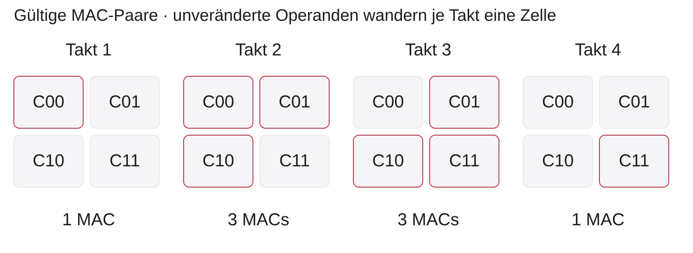{fig-alt="Takt1 rechnet C00, Takt2 C00,C01,C10, Takt3 C01,C10,C11, Takt4 C11. Die aktiven Zellen ergeben pro Takt1,3,3,1 MACs."}

Acht gültige MACs in vier Takten; leere Zellen erledigen keine Arbeit.

::: notes
MAC heißt Multiply-Accumulate, Produkt zur lokalen Summe addieren. Die vier kleinen Gitter zeigen aufeinanderfolgende Takte desselben Output-Stationary-Modells, bei dem die Summe in ihrer Zelle bleibt. Rot umrandet sind Zellen mit einem gültigen passenden Eingangspaar. Grau bleiben Zellen, die in diesem Takt keine gültige Rechnung ausführen.

In Takt eins arbeitet nur $C_{00}$ mit eins mal fünf. In zwei verarbeitet diese Zelle ihr zweites Paar; zugleich beginnen $C_{01}$ und $C_{10}$. In drei erhalten diese beiden ihre zweiten Paare und $C_{11}$ beginnt. In vier bleibt nur noch das zweite Paar von $C_{11}$. Die Zahl gültiger MACs ist also eins, drei, drei, eins, zusammen acht. Vier vorhandene Rechenzellen ergeben nicht automatisch vier nutzbare MACs in jedem Takt.

Das Bild illustriert Anlauf und Auslaufen eines kleinen Tiles, eines Matrixausschnitts. Es enthält keine Zeit für Vorladen aus externem Speicher und kein anschließendes Auslesen der Summen. Die lokale Datenbewegung kostet in realer Hardware ebenfalls Energie. Die Welle ist somit ein Datenflussprinzip mit offen benannter Grenze. Zur Ergebnisprüfung verfolgen wir nun zusätzlich die Zahlen, nicht nur die aktiven Zellpositionen.
:::

## Wann ist welche Summe fertig?

| Taktende | $C_{00}$ | $C_{01}$ | $C_{10}$ | $C_{11}$ |
|----------|----------|----------|----------|----------|
| 1 | $5$ | $0$ | $0$ | $0$ |
| 2 | $19$ fertig | $6$ | $15$ | $0$ |
| 3 | $19$ | $22$ fertig | $43$ fertig | $18$ |
| 4 | $19$ | $22$ | $43$ | $50$ fertig |

Fertig in der Zelle bedeutet noch nicht nach außen ausgelesen.

::: notes
$C_{ij}$ ist die lokale Akkumulation in Zeile $i$ und Spalte $j$ des Arrays; alle vier beginnen vor Takt eins bei null. Die Tabelle gibt Werte am Taktende an. Eine unveränderte Null vor dem ersten gültigen Paar ist daher der Anfangswert, kein gerade ausgeführtes Nullprodukt.

$C_{00}$ enthält nach eins $1\cdot5=5$, nach zwei zusätzlich $2\cdot7=14$, also neunzehn. $C_{01}$ startet in zwei mit $1\cdot6=6$ und endet in drei mit $6+2\cdot8=22$. $C_{10}$ startet in zwei mit $3\cdot5=15$ und endet in drei mit $15+4\cdot7=43$. $C_{11}$ beginnt erst in drei mit $3\cdot6=18$ und endet in vier mit $18+4\cdot8=50$.

Damit ist die Ergebnismatrix wieder $[[19,22],[43,50]]$. Die letzten Summenschritte liegen in den Takten zwei, drei, drei und vier. Es gibt hier also keine stetige Folge von genau einem neuen Ausgang pro Takt. Fertig bedeutet, dass alle zugehörigen Produkte lokal addiert wurden. Ein anschließender Readout, Auslesen, verlangt einen eigenen Datenweg und Zeitannahmen. Diese werden nicht in die vier internen Rechentakte hineinerfunden. Die Trennung ist für eine spätere End-to-End-Bewertung entscheidend.
:::

## Stationary: welcher Wert bleibt lokal?

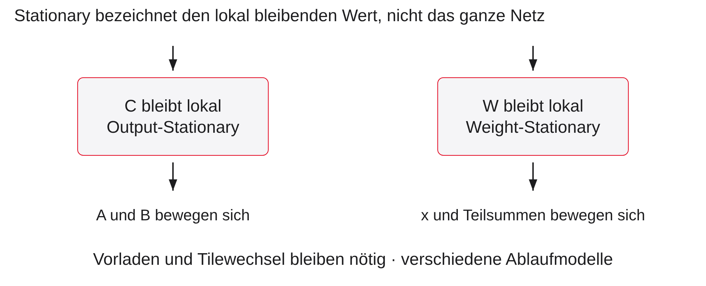{fig-alt="Output-Stationary hält eine Teilsumme in der Zelle und bewegt Operanden. Weight-Stationary hält ein Gewicht während eines Nutzungsabschnitts und bewegt Eingaben und Teilsummen."}

Ein Wechsel des Tiles kann neue Gewichte und andere Datenwege verlangen.

::: notes
Stationary bedeutet ortsfest für einen benannten Nutzungsabschnitt. Output-Stationary hält eine Ausgabeteilsumme lokal, während Operanden zu ihr gelangen. Weight-Stationary hält ein Gewicht lokal, während Aktivierungen und Teilsummen entsprechend dem jeweiligen Datenfluss bewegt werden. Aktivierungen sind Eingangswerte oder berechnete Zwischenwerte eines Netzes. Das Bild zeigt zwei alternative Organisationsprinzipien, keinen direkten Taktvergleich.

Der rote Wert in der linken Zelle ist die bleibende Summe, rechts das bleibende Gewicht. Graue Pfeile kennzeichnen weiter bewegte Werte. Unser bisheriger Vier-Takte-Plan gilt ausschließlich für die linke Output-Stationary-Variante. Er darf nicht ohne neuen Ablauf auf die rechte übertragen werden.

Ein konstantes Gewicht kann für viele Eingaben wiederverwendet werden. Trotzdem muss es zunächst geladen werden; bei einem neuen Tile, einem anderen Matrixausschnitt, kann erneutes Laden nötig sein. Auch ein vollständiges Netz enthält unterschiedliche Schichten und Formen. Welche Organisation den Verkehr reduziert, hängt von diesen Wiederverwendungsbeziehungen und lokalen Speicherkapazitäten ab. Ortsfeste Werte beseitigen weder Eingaben, Ausgaben noch den Speicherbedarf aller Zwischenwerte. Die Wahl des Datenflusses ist damit eine konkrete Optimierung, keine allgemeine Zusage von kostenfreier Bewegung.
:::

## Kleine Tiles nutzen große Arrays schlecht aus

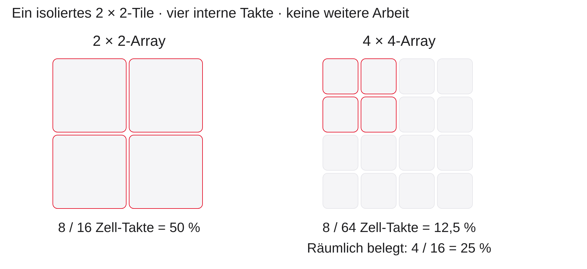{fig-alt="Ein isoliertes2-mal-2-Tile nutzt im2-mal-2-Array acht von sechzehn Zell-Takten,50Prozent. Im4-mal-4-Array mit sonst leeren Zellen acht von64,12,5Prozent. Räumliche Belegung dort25Prozent."}

$U=\text{gültige MACs}/(\text{Zellen}\cdot\text{Takte})$

::: notes
$U$ ist die zeitlich gemittelte Auslastung im ausdrücklich abgegrenzten Rechenfenster. MAC bedeutet Multiply-Accumulate. Der Nenner zählt verfügbare Zell-Takte, also mögliche Rechengelegenheiten bei höchstens einer MAC je Zelle und Takt. Der Zähler zählt tatsächlich gültige Produkte. Das Bild setzt voraus, dass nur unser einzelnes kleines Tile läuft und sonst keine weiteren Tiles oder Aufgaben überlappt werden.

Im Zwei-mal-zwei-Array sind über vier Takte sechzehn Zell-Takte verfügbar. Die acht gültigen MACs ergeben $U=8/(4\cdot4)=0{,}5$, also fünfzig Prozent. Wird dasselbe Tile in den oberen linken vier Zellen eines Vier-mal-vier-Arrays ausgeführt und bleiben alle anderen leer, sind es acht von vierundsechzig, also zwölf Komma fünf Prozent. Die räumliche Belegung beträgt dort vier von sechzehn Zellen, fünfundzwanzig Prozent. Sie ist nicht dieselbe Größe wie die zeitliche Auslastung.

Weitere Belegung oder Überlappung könnte den Vergleich ändern. Vorladen und Readout sind wie zuvor ausgeschlossen. Die Prozentwerte sind keine Kennwerte einer konkreten NPU, Neural Processing Unit. Sie zeigen, warum eine hohe Zahl vorhandener MAC-Zellen allein noch wenig über eine kleine Endgeräteaufgabe aussagt. Peakangaben setzen eine passend gefüllte und versorgte Nutzung voraus.
:::

## TPU v1: Peak mit Zählkonvention

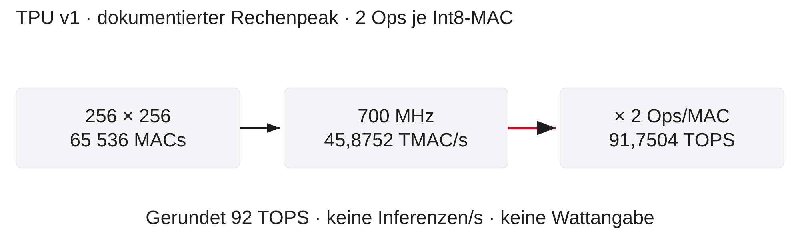{fig-alt="256mal256 Int8-MACs bei700MHz ergeben45,8752 TMAC/s und bei zwei Operationen je MAC91,7504 TOPS, gerundet92. Es handelt sich um Rechenpeak."}

Datacenter-Beispiel aus Jouppi et al. (2017), keine Edge-Energiemessung.

::: notes
TPU heißt Tensor Processing Unit, Googles Bezeichnung für einen Beschleuniger neuronaler Tensorrechnung. Die erste Generation ist in der Originalarbeit von Jouppi und Mitautoren als Datacenter-Baustein beschrieben, also für ein Rechenzentrum. Int8 sind Acht-Bit-Integeroperanden; MAC heißt Multiply-Accumulate, Produkt zur Summe addieren. MHz bedeutet Millionen Takte pro Sekunde, TMAC/s Billionen MACs pro Sekunde und TOPS Tera Operations Per Second, Billionen gezählte Operationen pro Sekunde.

Die dokumentierten $256\cdot256=65\,536$ MAC-Einheiten und siebenhundert MHz führen rechnerisch zu $65\,536\cdot700\cdot10^6=45{,}8752\cdot10^{12}$ MACs je Sekunde. Bei zwei arithmetischen Operationen pro MAC verdoppelt sich die Zahl auf $91{,}7504$ TOPS, gerundet zweiundneunzig. Die Abbildung zeigt diese Zählkette, nicht eine gemessene Anwendungsrate.

Datentyp, Versorgung, Auslastung und unterstützte Operationen bestimmen, ob eine Anwendung diesen Peak annähern kann. TOPS sind keine Inferenzen je Sekunde und enthalten keine Wattzahl. Für Energieeffizienz müssten zusätzlich gemessene Leistung und dieselbe Systemgrenze bekannt sein. Das Rechenzentrum-Beispiel erklärt die Größenordnung regelmäßiger Spezialhardware; daraus folgt keine Milliwatt-Angabe für ein Endgerät.
:::

## Beschleunigte Teilrechnung und Gesamtzeit

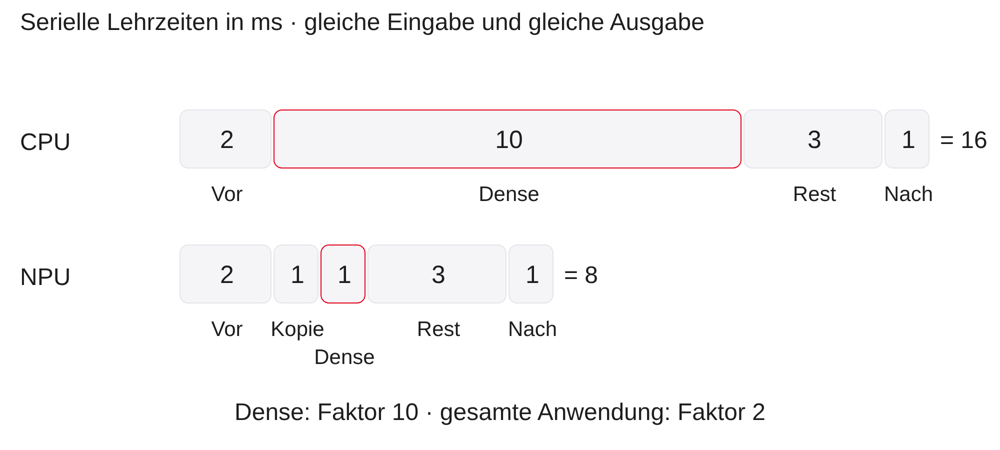{fig-alt="Modellzeiten: CPU-Pfad Vorverarbeitung2ms, Dense10ms, übrige Operatoren3ms, Nachverarbeitung1ms, gesamt16. Beschleunigerpfad zusätzlich Kopie1ms, Dense1ms, gesamt8. Teilfaktor10, Gesamtfaktor2."}

Lehrannahme: serielle Phasen, gleicher Input und gleiche Ausgabe.

::: notes
CPU heißt Central Processing Unit, Prozessor. Dense ist eine vollständig verbundene Schicht. Die Balken zeigen eine fiktive End-to-End-Latenz vom bereitstehenden Sensorfenster bis zur fertigen Entscheidung, gemessen in Millisekunden. End-to-End bedeutet, dass sämtliche hier definierten Phasen zählen, nicht nur die Rechnung im Beschleuniger. Die Phasen laufen in diesem Modell seriell, ohne Überlappung.

Der reine CPU-Pfad benötigt zwei Millisekunden Vorverarbeitung, zehn für die beschleunigbare Dense-Rechnung, drei für übrige Operatoren und eine für Nachverarbeitung: insgesamt sechzehn. Im zweiten Pfad bleibt Vorverarbeitung bei zwei, eine zusätzliche Kopier- und Übergabephase kostet eine, Dense sinkt auf eine, übrige Operatoren bleiben drei und Nachverarbeitung eins. Die Summe ist acht.

Die Teilrechnung wird um Faktor zehn schneller, die Gesamtaufgabe nur um Faktor $16/8=2$. Der rote Abschnitt im Bild markiert die veränderte Rechnung, graue Abschnitte die übrige Arbeit. Nicht unterstützte Operatoren können auf der CPU verbleiben. Diese Lehrrechnung ist keine Messung und sagt nichts über Energie. Sie begründet, warum Operatorabdeckung, Übergaben und übrige Firmwareaufgaben zur Hardwareauswahl gehören.
:::

## Papierphase 3: das Array selbst verfolgen

Übungsblatt, Aufgabe 4 · 15 Minuten

- Randwerte zeitlich versetzen und gültige Paare zuordnen
- Teilsummen nach jedem Takt eintragen
- Auslastung von räumlicher Belegung unterscheiden
- Peak und Gesamtlatenz getrennt bewerten

::: notes
Ein systolisches Array gibt Operanden getaktet an Nachbarzellen weiter. Im verwendeten Output-Stationary-Modell bleiben Ausgabesummen in ihren Zellen. MAC heißt Multiply-Accumulate, ein Produkt zur laufenden Summe addieren. Diese Papieraufgabe verlangt das Nachvollziehen des Datenflusses und nicht nur das Erinnern der Endmatrix.

Die Musterlösung ergibt acht MACs, verteilt als eins, drei, drei und eins auf vier Takte. Die Teilsummen lauten nach eins $[[5,0],[0,0]]$, nach zwei $[[19,6],[15,0]]$, nach drei $[[19,22],[43,18]]$ und nach vier $[[19,22],[43,50]]$. Für $C_{11}$ treffen die Paare drei und sechs in drei sowie vier und acht in vier zusammen. Die Summe fünfzig ist erst am Ende von vier intern fertig.

Vier Zellen mal vier Takte ergeben sechzehn Zell-Takte; acht gültige MACs bedeuten fünfzig Prozent. Ein größeres isoliertes Array kann schlechter ausgelastet sein. Beim Besprechen sollte außerdem ausdrücklich die Frage gestellt werden, ob fertige interne Summen schon nach außen übertragen sind. Die Antwort ist nein: Dafür fehlt im Lehrmodell ein angenommener Ausleseweg. Die nachfolgenden Software- und Speicherfragen setzen genau an dieser Systemgrenze an.
:::

## Vom trainierten Modell zur Firmware

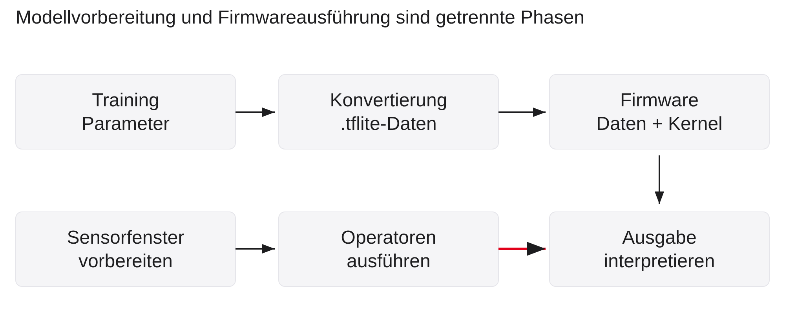{fig-alt="Offline entstehen trainiertes Modell und geprüfte tflite-Modelldaten. Firmware verbindet diese Daten mit Operator-Kerneln und Laufzeit. Auf dem Gerät werden Eingaben vorverarbeitet, Operatoren ausgeführt und Ausgaben interpretiert."}

Ein exportiertes C-Byte-Array enthält Modelldaten, keinen Modell-Maschinencode.

::: notes
TFLM bedeutet TensorFlow Lite for Microcontrollers, eine kleine C++-Laufzeit für neuronale Modelle auf Mikrocontrollern. Eine Runtime, Laufzeitbibliothek, organisiert die Modelloperationen. Ein Kernel ist der ausführende Code eines Operators, beispielsweise einer vollständig verbundenen Schicht. Das Bild trennt Vorbereitung außerhalb des Geräts von wiederholter Ausführung innerhalb der Firmware.

Offline werden Parameter trainiert, Datentypen und Quantisierung festgelegt und eine kompatible `.tflite`-Datei erzeugt. Sie enthält strukturierte Modelldaten. Ein Export als C-Byte-Array ändert deren Darstellung, verwandelt sie aber nicht in Maschinenbefehle. Die Firmware muss zusätzlich passende Operator-Kernel und die Laufzeit einbinden. Ein NPU-Backend, eine Anbindung an eine Neural Processing Unit, ist eine eigene Integrationsfrage.

Auf dem Gerät werden Eingaben passend vorbereitet, Operatoren mit ihren Parametern ausgeführt und Ausgaben gemäß dem Modellvertrag interpretiert. Ein Modellvertrag beschreibt Form, Datentyp, Reihenfolge, Skalierung und Bedeutung der Tensoren. Ein bekanntes Dateikennzeichen allein beweist kein gültiges Modell. Dieses Repository enthält für die Pflichtübung kein trainiertes TFLM-Modell und keine TFLM-Abhängigkeit. Der Workflow ist eine konzeptionelle Einordnung; das optionale Hostprogramm prüft die hier vollständig definierten Zahlenbeispiele.
:::

## Quantisierung: reale Werte mit Int8 darstellen

$$r\approx s(q-z),\qquad
q=\operatorname{clip}_{[-128,127]}\!\left(\operatorname{round}(r/s)+z\right)$$

- $s>0$: Skalierung; $z$: ganzzahliger Nullpunkt
- Lehrregel: auf den nächsten Integer, Halbfälle weg von null
- Rundung und Begrenzung können Information verlieren

::: notes
Quantisierung bildet einen größeren oder kontinuierlich betrachteten Zahlenbereich auf endlich viele darstellbare Werte ab. Int8 bezeichnet die vorzeichenbehaftete Acht-Bit-Ganzzahl von minus hundertachtundzwanzig bis hundert siebenundzwanzig. $r$ ist der reale Ausgangswert, $q$ der gespeicherte Integercode, $s$ eine positive Skalierung in realen Einheiten je Codeschritt und $z$ der Integercode der realen Null.

Zum Kodieren teilen wir zunächst durch $s$, runden und addieren anschließend den ganzzahligen Nullpunkt. Clip bedeutet Begrenzen auf den Int8-Bereich. Unsere Lehrregel rundet auf die nächste ganze Zahl und exakte Halbfälle vom Nullpunkt der zu rundenden Zahl weg. Sie ist die Regel des begleitenden Hostprogramms; konkrete Bibliotheken können eine andere festgelegte Rundung verwenden. Zum Rückrechnen subtrahieren wir $z$ und multiplizieren mit $s$.

Bei $z=-3$ wird reale Null als minus drei kodiert: $s((-3)-(-3))=0$. Das ist nicht dasselbe wie ein negativer realer Wert. Ohne Begrenzung beträgt der Rundungsfehler höchstens einen halben Skalierungsschritt. Bei Werten außerhalb des darstellbaren Bereichs gilt diese kleine Fehlergrenze nicht. Ein ungültiges $s$, etwa null, darf nicht als normale Quantisierung verarbeitet werden. Nun rechnen wir beide Fehlerarten mit Zahlen nach.
:::

## Rundungsfehler und Sättigung unterscheiden

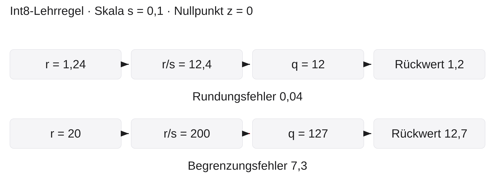{fig-alt="Bei Skala0,1 und Nullpunkt0 wird1,24 zu Code12 und rückgerechnet1,2, Fehler0,04. Wert20 wird auf127 begrenzt und zu12,7 rückgerechnet, Fehler7,3."}

Die Auswahl der Skala beeinflusst Auflösung und darstellbaren Bereich.

::: notes
$s$ ist die Quantisierungsskala, $z$ der Nullpunkt, $q$ der Int8-Code und $\hat r=s(q-z)$ der rekonstruierte reale Wert. Int8 bedeutet vorzeichenbehaftete Acht-Bit-Ganzzahl. Das Diagramm stellt zwei getrennte Fehlerbilder gegenüber. Im Lehrbeispiel gilt $s=0{,}1$, $z=0$ und die auf der vorherigen Folie definierte Rundung.

Für $r=1{,}24$ ist $r/s=12{,}4$, gerundet zwölf. Der Rückwert ist $0{,}1\cdot12=1{,}2$, der absolute Fehler $|1{,}24-1{,}2|=0{,}04$. Der negative Wert minus eins Komma vierundzwanzig würde zu minus zwölf und zurück minus eins Komma zwei. Für zwanzig entsteht vor Begrenzung zweihundert. Clip begrenzt auf hundert siebenundzwanzig, der Rückwert ist zwölf Komma sieben und der absolute Fehler sieben Komma drei. Minus zwanzig wird entsprechend auf minus hundertachtundzwanzig begrenzt und zu minus zwölf Komma acht.

Der rote Rand markiert Sättigung, Begrenzen am zulässigen Bereich. Ein größerer Skalierungsschritt könnte mehr Wertebereich abdecken, würde aber die feine Auflösung verschlechtern. Geeignete Skalen werden deshalb anhand repräsentativer Daten gewählt. Ob die resultierenden Fehler die Modellgüte verschlechtern, muss mit passenden Testdaten bewertet werden; kleine Gewichtbytes beweisen keine unveränderte Genauigkeit.
:::

## Quantisierte Produkte brauchen ihre Skalen

$$a=\sum_i(q_{x,i}-z_x)(q_{w,i}-z_w)+q_b$$
$$r_y\approx s_xs_w\,a$$

Beispiel: $q_x=[12,-4]$, $z_x=-3$, $q_w=[2,3]$, $z_w=0$.

Bei $s_x=0{,}1$, $s_w=0{,}2$, $q_b=5$: $a=32$, $r_y\approx0{,}64$.

::: notes
Dies ist ein eigenes Zwei-Eingang-Lehrbeispiel, nicht eine Umkodierung der vorherigen Drei-Eingang-Dense-Schicht. $q_x$ und $q_w$ sind gespeicherte Integercodes für Eingaben und Gewichte, $z_x$ und $z_w$ deren Nullpunkte und $s_x$, $s_w$ ihre Skalen. $a$ ist die breite Integerakkumulation. $q_b$ ist ein Biascode mit Nullpunkt null und Skala $s_xs_w$. Bias heißt eingangsunabhängiger Summenoffset.

Nach Nullpunktkorrektur sind die Eingaben $12-(-3)=15$ und $-4-(-3)=-1$. Die Gewichte bleiben zwei und drei. Die Produktsumme ist $15\cdot2+(-1)\cdot3=27$. Bias fünf ergibt $a=32$. Die kombinierte Skala beträgt $0{,}1\cdot0{,}2=0{,}02$, also ist der rekonstruierte Ausgang $32\cdot0{,}02=0{,}64$. Die realen Einzelprodukte sind $1{,}5\cdot0{,}4$ und $(-0{,}1)\cdot0{,}6$, zusätzlich Bias $0{,}1$; auch das ergibt $0{,}64$.

Soll der Ausgang selbst wieder Int8, eine Acht-Bit-Ganzzahl, werden, braucht er seine eigene Skala und seinen Nullpunkt. Mit $s_y=0{,}05$, $z_y=-2$ folgt $q_y=\operatorname{round}(0{,}64/0{,}05)-2=13-2=11$, rückgerechnet $0{,}65$. Diese Requantisierung ist ein weiterer Rundungsschritt. Int32-Biaswerte und breite Summen dürfen beim Speicherbudget nicht als Ein-Byte-Werte gezählt werden. Das Beispiel verwendet eine Skala je Tensor; andere Operatorvarianten können kanalweise Skalen benötigen.
:::

## Flash und Tensor Arena getrennt planen

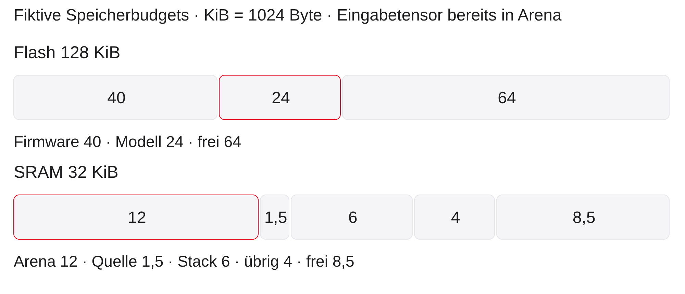{fig-alt="Fiktives Budget:128KiB Flash mit40KiB Firmware,24KiB Modell und64KiB frei.32KiB SRAM mit12KiB Arena,1,5KiB Quellfenster,6KiB Stack,4KiB übrigen Daten und8,5KiB frei."}

$250\,000$ reine Gewichte: Float32 $1$ MB, Int8 $0{,}25$ MB.

::: notes
Flash ist nichtflüchtiger Programmspeicher. SRAM heißt Static Random Access Memory, statischer flüchtiger Arbeitsspeicher. Eine Tensor Arena ist ein bereitgestellter zusammenhängender Arbeitsbereich für Tensoren, temporäre Kernelpuffer und Verwaltungsdaten. Die Belegung hängt von Modell, Operator-Kerneln und ihrer Speicherplanung ab; sie folgt nicht allein aus der Modelldateigröße. Stack ist der Speicher für Aufrufrahmen und lokale Daten.

Die Grafik verwendet ausdrücklich ein fiktives Budget: hundertachtundzwanzig KiB Flash enthalten vierzig KiB Firmware und vierundzwanzig KiB vollständige Modelldaten, frei bleiben vierundsechzig KiB. Ein KiB, Kibibyte, sind eintausendvierundzwanzig Byte. Zweiunddreißig KiB SRAM enthalten zwölf KiB Arena, ein Komma fünf KiB Float-Quellfenster, sechs KiB Stackreserve und vier KiB übrige Daten. Die Summe dreiundzwanzig Komma fünf lässt acht Komma fünf KiB frei. Der spätere Int8-Eingangstensor liegt hier bereits in der Arena und wird nicht nochmals addiert.

Unabhängig davon benötigt ein hypothetisches Feld mit zweihundertfünfzigtausend reinen Gewichten bei Float32, Zweiunddreißig-Bit-Gleitkomma, vier Byte je Wert, eine Million Byte, also ein dezimales MB, Megabyte. Int8 braucht zweihundertfünfzigtausend Byte, ein Viertel. Die fünfundsiebzig Prozent Ersparnis gelten für diese Gewichtbytes, nicht für die ganze Datei oder Arena. `const` in C verhindert gewöhnliche Veränderung; erst Linkerplatzierung und Startcode bestimmen, wo das Modell physisch liegt und ob es kopiert wird.
:::

## Initialisierung und Inferenz sind zwei Phasen

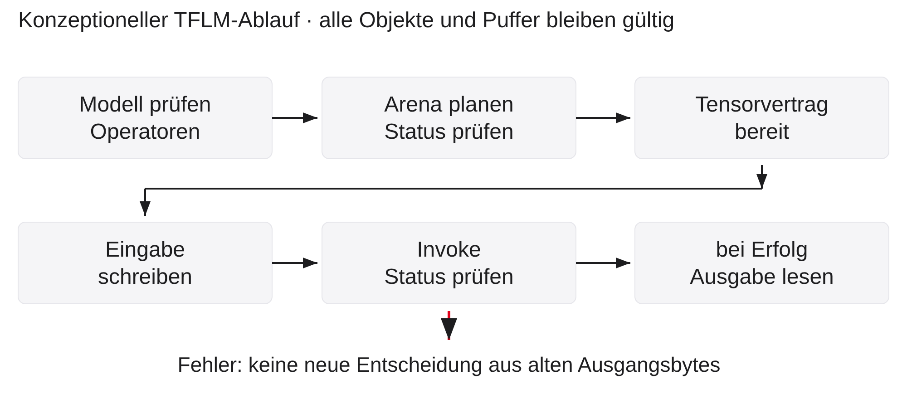{fig-alt="Setup prüft Modell und Operatoren, plant Arena und prüft Tensorvertrag. Danach werden Eingaben geschrieben, Invoke geprüft und nur bei Erfolg Ausgaben gelesen. Fehler führt zum Fehlerpfad, nicht zur neuen Entscheidung."}

Interpreter, Arena und Modell müssen während ihrer Nutzung gültig bleiben.

::: notes
TFLM heißt TensorFlow Lite for Microcontrollers. Ein Interpreter ist das Objekt, das die Operationen eines Modells über passende Kernel ausführt. Ein Resolver ordnet Operatoren solchen Kerneln zu. Eine Arena ist der zusammenhängende Arbeitsbereich. Das Ablaufbild ist eine konzeptionelle Zustandsfolge, kein ausgeführtes TFLM-Programm und keine eigene erfundene Bibliotheksschnittstelle.

Zuerst muss eine vertrauenswürdige vollständige Modelldatei mit passender Struktur vorliegen. Das Lesen einer Schema-Version allein validiert keine beliebige beschädigte Bytefolge. Danach sind kompatible Operatoren, langlebige Objekte und eine ausreichend große Arena nötig. `AllocateTensors()` heißt in der dokumentierten TFLM-Schnittstelle die Planung und Bereitstellung der Tensorpuffer. Ihr Status muss geprüft werden; erst anschließend werden Eingabeform, Datentyp und Quantisierungsparameter kontrolliert.

Im wiederholten Zyklus werden vorbereitete Eingaben geschrieben. `Invoke()` führt die Modelloperationen aus. Nur nach Erfolg wird der Ausgang entsprechend seinem Vertrag gelesen. Ein Fehler ist kein neuer Klassenscore; alte Pufferwerte dürfen nicht als frisch berechnet ausgegeben werden. Die roten Fehlerpfeile markieren diese Abzweigung. Ein lokaler Interpreter, der am Ende einer Setup-Funktion zerstört wird, kann nicht später weiterverwendet werden. Gleiches gilt für eine ausgelaufene lokale Arena. Ein Heap ist dynamisch zugeteilter Arbeitsspeicher. TFLM kann ohne Betriebssystem arbeiten; daraus folgt keine Heapfreiheit der gesamten Firmware.
:::

## Sensorfenster und Ausgabe brauchen einen Vertrag

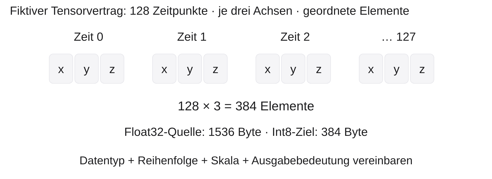{fig-alt="128Zeitpunkte mit drei Achsen ergeben384Elemente. Float32-Quelle braucht1536Byte, Int8-Ziel384Byte. Die Ausgabe wird erst nach erfolgreicher Inferenz anhand von Form, Skala und Bedeutung ausgewertet."}

Klassenindex, Score, Wahrscheinlichkeit und Fehlerstatus sind verschiedene Größen.

::: notes
Ein Sensorfenster enthält im fiktiven Beispiel hundertachtundzwanzig aufeinanderfolgende Zeitpunkte mit je drei Achsen. Das ergibt $128\cdot3=384$ Elemente. Float32 bedeutet hier einen Vier-Byte-Gleitkommawert; das Quellfenster braucht daher $384\cdot4=1536$ Byte, ein Komma fünf KiB. Int8 bedeutet einen Ein-Byte-Integercode; der Eingabetensor benötigt dreihundertvierundachtzig Byte. Seine Elemente müssen in der vom Modell verlangten Reihenfolge, beispielsweise Zeitpunkt dann Achse, geschrieben werden.

Ein Zeiger auf das Fenster enthält dessen Adresse. `sizeof` dieses Zeigers liefert die Größe der Adresse, nicht dreihundertvierundachtzig Elemente. Die Elementzahl muss aus dem Vertrag oder einer expliziten Längenangabe kommen. Normalisierung und Quantisierung müssen außerdem dieselben Regeln wie bei der Modellvorbereitung verwenden.

Drei Ausgabebytes beweisen weder drei bestimmte Klassen noch Wahrscheinlichkeiten. Ein Score kann ein beliebiger Bewertungswert sein. Eine Wahrscheinlichkeit erfordert eine dafür definierte Ausgabe, beispielsweise eine geeignete Normalisierung. Ein Klassenindex benennt eine Kategorie, ein Fehlerstatus den Erfolg der Ausführung. Ein Grenzwert von null Komma acht ist nur mit entsprechender Bedeutung und Rückskalierung sinnvoll. Selbst eine korrekt erkannte Klasse Gehen liefert keine gezählte Schrittzahl. Form, Skalierung und Semantik gehören deshalb ebenso zum Modellvertrag wie die Bytezahl.
:::

## Eine brauchbare Edge-Lösung prüfen

- Passende Operatoren, Formen und Datentypen
- Vollständige Zeit- und Speicherbudgets
- Modellgüte mit repräsentativen Daten prüfen
- Nullgewichte sparen erst mit passender Darstellung oder Ausführung
- Funktionaler Simulatorlauf und Hardwaremessung beantworten andere Fragen

::: notes
Edge ist die Verarbeitung am Endgerät oder lokalen Gateway. Ein Operator ist eine Modelloperation, ein Datentyp deren Zahlenformat. Vor der Wahl eines Beschleunigers ist zu prüfen, ob das Modell überhaupt auf dessen Kernel passt und ob nicht unterstützte Teile teure Übergaben verursachen. Zeitbudget meint die ganze definierte Reaktionskette; Speicherbudget umfasst Modell, Arbeitsbereich, Sensorpuffer, Stack als Aufrufspeicher und übrige Firmwaredaten.

Pruning ist das gezielte Entfernen oder Nullsetzen von Gewichten. Ein dicht gespeichertes Int8-Feld mit vier Elementen braucht weiterhin vier Byte, auch wenn zwei Codes null sind und diese im verwendeten Gewichtformat reale Null bedeuten. Eine dünnbesetzte, sparse Darstellung benötigt zusätzliche Positionsinformation. Ein Kernel spart nur dann Rechenarbeit, wenn er nicht benötigte Produkte tatsächlich überspringt. Dateiersparnis und weniger ausgeführte MACs, Multiply-Accumulate, sind verschiedene Aussagen.

Renode ist der im Kurs verwendete Simulator für Systeme mit Prozessor, Speicher und Peripherie. Ein korrektes funktionales Ergebnis kann die Daten- und Steuerungslogik prüfen. Es belegt ohne validiertes Zeitmodell keine Hardwarelatenz und keine Energieeffizienz. Das hier enthaltene Hostprogramm läuft auf dem Entwicklungsrechner und prüft numerische Beispiele. Es liefert keinen Vergleich realer CPUs oder NPUs; CPU bedeutet Central Processing Unit, NPU Neural Processing Unit. Repräsentative Modellgüte und tatsächliche Systemleistung bleiben eigene Messaufgaben.
:::

## Papierphase 4 und Quiz

Aufgaben 5–6: 15 Minuten · anschließend Quiz: 15 Minuten

- Quantisierung mit Rundung, Nullpunkt und Begrenzung
- Modellbytes und Arbeitsspeicher getrennt budgetieren
- Fehlerpfad und gültige Lebensdauer begründen
- Rückblick: Datenmuster → Versorgung → Hardware → Gesamtsystem

::: notes
Die letzte Papierphase führt zunächst die Quantisierungsrechnung vollständig aus. Bei Skala null Komma eins und Nullpunkt null ergibt eins Komma vierundzwanzig Code zwölf, Rückwert eins Komma zwei und absoluten Fehler null Komma null vier. Zwanzig wird auf hundert siebenundzwanzig begrenzt. Ein negativer Nullpunkt verschiebt den Code der realen Null, nicht die Rechenbedeutung der Null.

Im Speicherbudget werden Flash, nichtflüchtiger Programmspeicher, und SRAM, Static Random Access Memory, getrennt bilanziert. Die Tensor Arena ist der geplante Arbeitsbereich; ihr bereits enthaltener Eingabetensor darf nicht doppelt gerechnet werden. Das Übungsblatt verbindet diese Bilanz mit der Lebensdauer eines Interpreters und der Bedeutung eines Fehlerstatus. Vollständige Musterlösungen sind im Lösungsprofil enthalten.

Das Quiz prüft anschließend zehn Unterscheidungen aus derselben Vorlesung: Parameter gegen MACs, Multiply-Accumulate, Bandbreitengrenze gegen Peak, Vektorkapazität gegen aktive Länge, interne Fertigstellung gegen Gesamtsystem und Gewichtbytes gegen Arbeitsspeicher. Geben Sie nach einer Antwort jeweils eine kurze Begründung. Die gemeinsame Erkenntnis ist, dass gleichartige Rechenarbeit erst mit passenden Datenwegen, Zahlenformaten und einer korrekten Firmwareintegration zur nutzbaren Anwendung wird.
:::

## Quellen und sinnvoller nächster Versuch

- Harris & Harris: *Digital Design and Computer Architecture — RISC-V Edition*
- Patterson & Hennessy: *Computer Organization and Design — RISC-V Edition*
- [RVV 1.0: Regeln für aktive Längen](https://github.com/riscv/riscv-v-spec/blob/master/v-spec.adoc)
- [Jouppi et al.: TPU v1 (2017)](https://arxiv.org/abs/1704.04760)
- [TFLM: Speicherplanung](https://github.com/tensorflow/tflite-micro/blob/main/tensorflow/lite/micro/docs/memory_management.md) und [Int8-Spezifikation](https://github.com/tensorflow/tensorflow/blob/master/tensorflow/lite/g3doc/performance/quantization_spec.md)

::: notes
Die beiden im Modul empfohlenen Bücher liefern den Bezugsrahmen für Befehlssatz, Datenpfad, Speicherhierarchie und Parallelität. Die Vektorlängenregeln sind an der Spezifikation 1.0 der RISC-V Vector Extension, kurz RVV, ausgerichtet. Die TPU-Arbeit von Jouppi und Mitautoren, Tensor Processing Unit, dokumentiert die erste Generation und ihre Peakzählung. Die verlinkten TFLM-Dokumente, TensorFlow Lite for Microcontrollers, erläutern Arbeitsbereich und quantisierte Zahlenformate. Die TensorFlow-Int8-Spezifikation wurde als Primärquelle für Nullpunkte, breite Biaswerte und Skalen herangezogen; konkrete Operatorvarianten können unterschiedliche Granularität verlangen.

Unsere Matrizen, Zeitpläne, Roofline-Raten, Flash-/SRAM-Budgets und Quantisierungszahlen sind ausdrücklich eigene Lehrmodelle. Flash ist nichtflüchtiger Speicher; SRAM bedeutet Static Random Access Memory. Der zugehörige C-Quellcode bietet einen nachvollziehbaren numerischen Versuch auf dem Hostrechner. Er trainiert kein Netz, lädt kein TFLM-Modell und beansprucht keine RISC-V- oder Renode-Zeitmessung.

Ein späterer vollständiger Geräteversuch braucht ein festgelegtes Modell mit Testdaten, einen geprüften Tensorvertrag, passende Runtime-Kernel und eine dokumentierte Plattform. Zuerst wären Referenzausgaben und Speicherbelegung zu validieren; anschließend könnten Laufzeit und Energie unter derselben Systemgrenze gemessen werden. Dieser nächste Versuch folgt aus den heutigen Unterscheidungen und braucht keine ungesicherte Leistungsannahme.
:::
