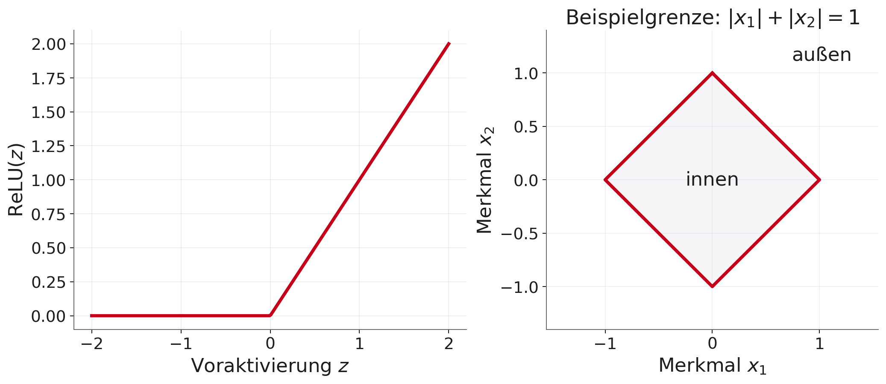
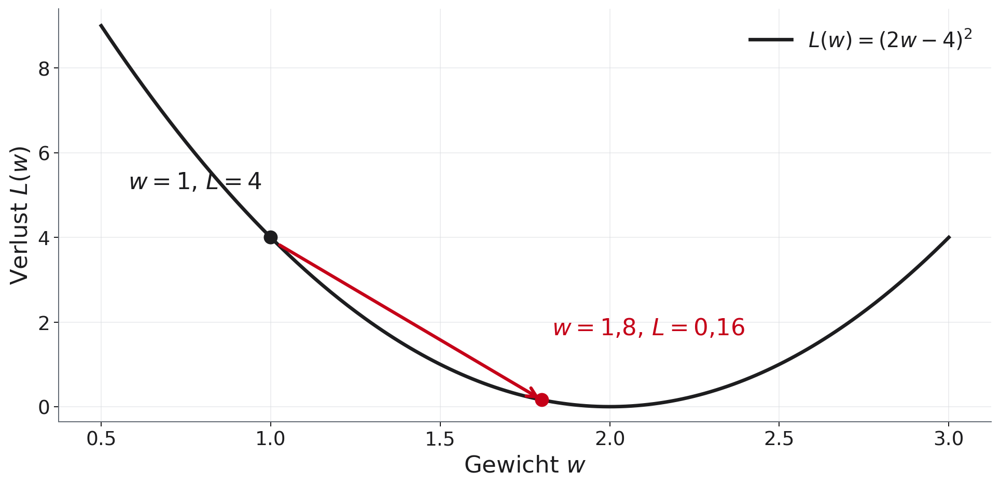
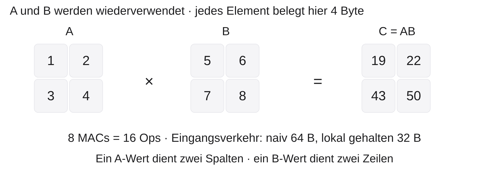
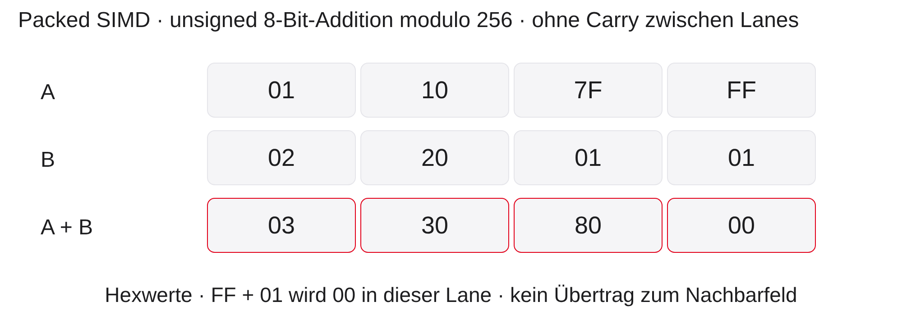
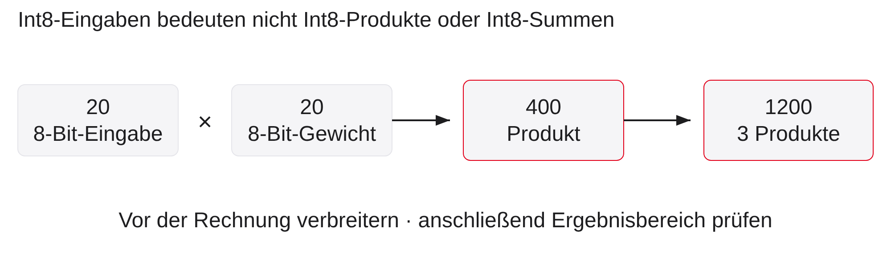
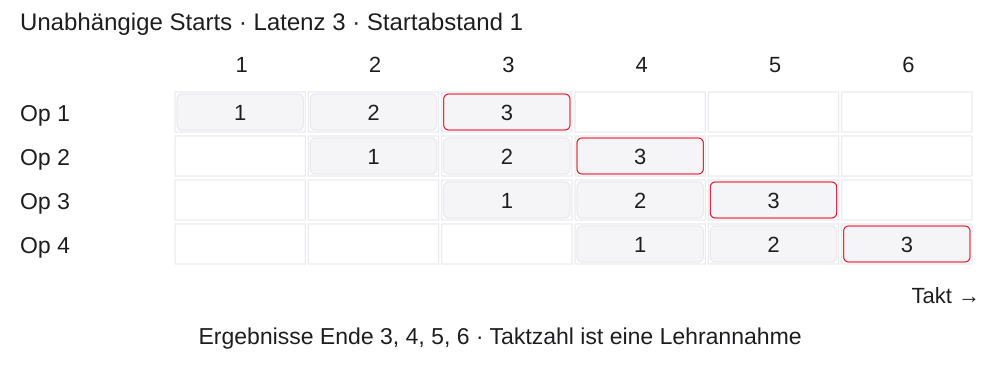
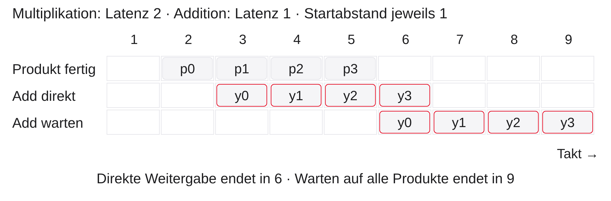

## Stehen, Gehen oder Laufen: Wie würden Sie das programmieren?

::: {.section-label}
Einstieg · Eine Entscheidung aus Beschleunigungswerten
:::

Ein Gerät erhält 32 Zeitpunkte mit je drei Beschleunigungsachsen.
Es soll daraus eine Aktivität melden.

- Welche Eigenschaft der Messwerte würden Sie auswerten?
- Wie sähe Ihre erste Entscheidungsregel aus?
- An welchem anderen Menschen oder Bewegungsablauf würden Sie die Regel prüfen?

Zwei Minuten zu zweit: Regel skizzieren und eine mögliche Grenze nennen.

::: notes
Eine Entscheidung beginnt bei einer beobachtbaren Eigenschaft der Messdaten. Die Einstiegsfrage verlangt deshalb zunächst eine eigene Regel und noch keinen KI-Begriff. Mit C-Arrays, Schleifen und Vergleichen lässt sich beispielsweise ein zeitlicher Ausschnitt auswerten; ein einzelner Messwert beschreibt dagegen noch keinen vollständigen Bewegungsablauf. Zwei Minuten zum Nachdenken und Austauschen gehören zum Zeitbudget.

Erwartbare Vorschläge sind eine Grenze für den Beschleunigungsbetrag, die Stärke seiner Schwankung oder ein wiederkehrendes Muster. Sammeln Sie zu jeder Regel auch einen Fall, in dem sie überprüft werden müsste: anderes Tempo, eine andere Person oder eine andere Lage des Sensors. Die Frage bleibt zunächst offen. Die folgenden Messverläufe machen sichtbar, welche Unterschiede die gewählte Darstellung überhaupt enthält. Später wird die manuell vorgeschlagene Regel mit einer aus Beispielen angepassten Rechenvorschrift verglichen. Erst dann lässt sich beurteilen, welche Rechnung der Prozessor ausführen muss und ob zusätzliche Rechenhardware der Anwendung hilft.
:::

## Vom CPU-Kern zur Entscheidung auf dem Gerät

::: {.section-label}
Einstieg · Vorwissen und Lernziel
:::

- Vorwissen: C-Arrays und Zeiger, Caches, gewichtete Summen und Befehlsparallelität
- Heute: aus Messdaten ein Modell und daraus ein regelmäßiges Rechenmuster entwickeln
- Edge: Die Auswertung findet nahe am Sensor statt
- Beschleuniger: wie GPU und NPU programmiert werden und wo Herstellerbindung entsteht
- Am Ende: Rechenarbeit, Datenverkehr, Speicher und Gesamtzeit begründet vergleichen

::: notes
Ein Sensorgerät kann Messwerte lokal auswerten und eine Entscheidung liefern, ohne jedes Fenster an einen entfernten Server zu senden. Diesen Verarbeitungsort bezeichnet Edge. Er legt noch keinen bestimmten Prozessortyp fest: Eine geeignete Anwendung kann auf einem gewöhnlichen Mikrocontroller laufen. Ein neuronaler Beschleuniger wird erst dann interessant, wenn sein Rechenmuster und seine Kosten zur Aufgabe passen.

Aus Vorlesung 7 ist bekannt, dass abhängige Summen auf ihre Vorgänger warten und unabhängige Arbeit andere Rechenplätze nutzen kann. Ein Cache hält nahe Kopien von Speicherblöcken; begrenzte Bandbreite kann deshalb auch bei vielen verfügbaren Rechenwerken den Durchsatz bestimmen. Diese Überlegungen werden auf wiederholte gewichtete Summen übertragen. Die benötigten KI-Grundlagen entstehen im ersten Abschnitt aus dem Sensorbeispiel. Besondere Kenntnisse eines Lernframeworks werden nicht vorausgesetzt. Das Ziel ist, von einer verständlichen Entscheidung über die benötigten Zahlen und Operationen zu einer begründeten Hardware- und Firmwarewahl zu gelangen. Dazu gehört auch, wie Beschleuniger programmiert werden und welche Herstellerbindung dabei entsteht.
:::

## Vier Schulstunden: vier Themenblöcke und Abschlussquiz

::: {.section-label}
Einstieg · Ablauf und Arbeitsformen
:::

| Block | Theorie und Besprechung | Papierphase, Teil A |
|---|---|---|
| 1 | Daten, Modell und Datenversorgung: 30 min | nach Folie 21: 1.1, 1.2, 2.1 · 10 min |
| 2 | Datenparallelität und RVV: 30 min | nach Folie 33: 3.1, 3.2, 3.4 · 15 min |
| 3 | NPU und GPU programmieren: 25 min | nach Folie 40: 4.1–4.3 · 15 min |
| 4 | Gesamtbilanz und Amdahl: 20 min | nach Folie 45: 5.1, 5.2 · 10 min |

Abschließend: zwölf Quizfragen · 15 Minuten.

::: notes
Die Planung umfasst 180 Minuten: 105 Minuten für Erklärung, kurze Vorhersagen und gemeinsame Lösungsbesprechung, 50 Minuten für angeleitete Papierarbeit, 15 Minuten für das abschließende Quiz und zehn Minuten Puffer für Rückfragen. Der erste und der dritte Themenblock dauern einschließlich Papierphase je vierzig Minuten, der zweite fünfundvierzig. Der zweite enthält zusätzlich die übliche Int8-Praxis und verbreiternde Befehle. Der dritte Block behandelt die Programmierung von GPU und NPU sowie die daraus entstehende Herstellerbindung nur im Überblick. Der vierte Block umfasst dreißig Minuten, danach folgt das Quiz; diese Blöcke sind keine einzelnen Schulstunden. Die Abschnitte beginnen mit einer Orientierung; längere Rechnungen erhalten mehr gemeinsame Zeit als eine kurze Begriffszuordnung. Die Notizen dienen zusätzlich als zusammenhängender Lerntext zum Nachlesen.

Teil A des Übungsblatts enthält fünf Aufgaben mit 32 Orientierungspunkten. In der Präsenz werden die hier genannten Teilaufgaben ausgewählt und bei Bedarf mit gemeinsamen Zwischenständen bearbeitet. Die vollständige selbstständige Bearbeitung umfasst weitere Teile. Teil B enthält zwei längere Aufgaben mit weiteren 28 Punkten und einem geschätzten Umfang von 50 Minuten zur Nachbereitung. Diese Richtwerte sind keine verbindliche Klausurvorgabe. Zwölf Quizfragen verbinden am Ende die behandelten Modelle. Eigene kurze Vorhersagen zwischendurch prüfen den aktuellen Gedanken. Die abschließenden Hintergrundfolien zu Begriffen, Quellen und eigenen Messungen dienen dem Nachlesen und verlängern den Pflichtvortrag nicht.
:::

## 1 · Von Messdaten zum Modell {.section-divider}

Welche Rechnung verbindet ein Bewegungsfenster mit einer Aktivität?

Messverlauf → Merkmale → gewichtete Summe → Lernen → Entscheidung

::: {.callout-note}
Die Messdaten stammen aus MotionSense. Geometrische Mini-Rechnungen erklären
Prinzipien; das Rohdatenmodell nutzt 32 Zeitpunkte mit je drei Achsen.
:::

::: notes
Der erste Abschnitt stellt zuerst die Daten und dann die mathematische Beschreibung vor. Aus einem Beschleunigungsverlauf werden zunächst zwei verständliche Eigenschaften eines kurzen Fensters gebildet. Sie lassen sich als Punkte zeichnen und mit einer Geraden untersuchen. Diese Darstellung erklärt, wie Zahlen eine Entscheidung beeinflussen und was Gewichte und Bias bewirken.

Die echten MotionSense-Aufnahmen sind mit 50 Messpunkten je Sekunde erfasst. Drei Achsen enthalten die Beschleunigung einschließlich des Gravitationsanteils; ihre Einheit ist g. Ein Fenster mit 32 Punkten enthält damit 96 einzelne Eingangswerte. Das später trainierte kleine Netz verwendet diese Werte in zeitpunktweiser Achsenreihenfolge. Mittelwert und Streuung des Beschleunigungsbetrags dienen zunächst einer leichter sichtbaren Zwei-Merkmal-Darstellung. Vor der Netzrechnung wird jede der 96 Eingabepositionen mit einem nur aus Trainingsdaten bestimmten Mittelwert und einer Standardabweichung standardisiert. Dafür werden 192 zusätzliche feste Zahlen benötigt; sie gehören zur Vorverarbeitung. Die Zwei-Merkmal-Darstellung und die 96-Eingabe-Rechnung werden getrennt gehalten. Ebenso wird der kurze Handrechenfall nicht als gelernte Parameterzeile ausgegeben.
:::

## Welche Eigenschaft trennt die Bewegungen? {.compact-figure .sensor-plot}

::: {.section-label}
1 / 5 · Von Messdaten zum Modell
:::

{fig-alt="Echte MotionSense-Zeitverläufe des Beschleunigungsbetrags für Stehen, Gehen und Laufen. Zeit und Betrag sind mit Einheiten beschriftet; die drei Aktivitäten sind zusätzlich durch getrennte Bahnen gekennzeichnet."}

Ein Schwellenwert auf einem einzelnen Messwert oder auf einem ganzen Fenster?

::: notes
Die Grafik zeigt drei echte Ausschnitte derselben Art von Messung. Auf der waagrechten Achse steht die Zeit in Sekunden, auf der senkrechten der Betrag des Beschleunigungsvektors in g. Dafür werden die drei Achsenwerte zu $|a|=\sqrt{a_x^2+a_y^2+a_z^2}$ zusammengefasst. Auch im Stehen liegt dieser Betrag wegen der Gravitation ungefähr bei eins; null wäre deshalb keine passende allgemeine Ruhebedingung.

Beim Betrachten bieten sich die Stärke der Schwankungen und die zeitliche Wiederholung als Eigenschaften eines Fensters an. Ein einzelner hoher oder niedriger Wert kann dagegen auch in mehreren Aktivitäten auftreten. Lassen Sie vor der nächsten Folie eine Eigenschaft nennen, die ein kurzes Fenster besser beschreibt als einen Einzelwert. Die gezeichneten Beispiele beweisen noch keine allgemeingültige Schwelle für alle Menschen und Situationen. Ihre Aufgabe ist, einen nachvollziehbaren Startpunkt für eine Regel zu liefern. Anschließend prüfen wir viele Fenster gemeinsam und erkennen, wie gut diese Eigenschaften die beobachteten Klassen trennen.
:::

## Zwei Merkmale machen viele Fenster sichtbar {.compact-figure .sensor-plot}

::: {.section-label}
1 / 5 · Von Messdaten zum Modell
:::

{fig-alt="Streudiagramm vieler MotionSense-Fenster: Mittelwert und Standardabweichung des Beschleunigungsbetrags, jeweils in g. Farben und Markierungen unterscheiden Stehen, Gehen und Laufen."}

Jeder Punkt steht für ein Fenster mit 32 Zeitpunkten, nicht für einen Einzelwert.

::: notes
Zwei Eigenschaften bilden aus einem zeitlichen Fenster einen Punkt: Der Mittelwert beschreibt die mittlere Höhe des Beschleunigungsbetrags, die Standardabweichung seine Schwankung um diesen Mittelwert. Beide Größen werden hier aus denselben 32 Messpunkten berechnet. Für den Mittelwert wird durch 32 geteilt; die dargestellte Standardabweichung verwendet ebenfalls diesen Nenner. Die Achsen sind in g beschriftet. Farben und unterschiedliche Markierungen kennzeichnen die drei aufgenommenen Aktivitäten.

Eine vorgeschlagene Regel lässt sich nun an vielen Punkten beurteilen. Ein waagrechter Schwellenwert benutzt nur die Streuung, eine schräg verlaufende Grenze kombiniert beide Merkmale. Liegen Punkte verschiedener Klassen dicht zusammen, kann eine kleine Änderung der Beobachtung die Entscheidung verändern. Mehr Messwerte allein beseitigen das Problem einer ungeeigneten Darstellung nicht. Die Punktwolke ist bewusst eine übersichtliche Beschreibung mit zwei Merkmalen. Das spätere Netz erhält stattdessen die 96 Achsenwerte des Rohfensters; es kann daraus andere Zwischenmerkmale bilden. Die Grafik behauptet daher keine vollständige Darstellung seiner internen Entscheidung.
:::

## Ein Neuron legt eine Trenngerade fest {.compact-figure}

::: {.section-label}
1 / 5 · Von Messdaten zum Modell
:::

{fig-alt="Didaktische Trenngeraden in der Zwei-Merkmal-Ebene. Geänderte Gewichte verändern die Normalenrichtung, ein geänderter Bias verschiebt die Grenze. Die Linien sind keine Ausgabe des Rohdatenmodells."}

$$z=w_1x_1+w_2x_2+b;\qquad z=0\ \text{ist die Grenze.}$$

Was ändert sich an der Grenze, wenn nur $b$ verändert wird?

::: notes
Eine gewichtete Summe kann eine geometrische Entscheidung beschreiben. In der Ebene der beiden Merkmale bilden alle Punkte mit $w_1x_1+w_2x_2+b=0$ eine Gerade. Die Zahlen $w_1$ und $w_2$ sind ihre Gewichte; gemeinsam legen sie die Richtung senkrecht zur Grenze fest. Ein Bias $b$ verschiebt bei festen Gewichten die Gerade parallel. Die vorzeichenbehaftete Lage entlang der Normalen ist $-b/\lVert w\rVert$; der Abstand zum Ursprung beträgt $|b|/\lVert w\rVert$. Werden die Gewichte verändert, können sich deshalb sowohl Richtung als auch Abstand ändern.

Für diese Grafik werden die beiden Merkmale jeweils um ihren Trainingsmittelwert zentriert und durch ihre Trainingsstandardabweichung geteilt. Die Achsen sind dadurch dimensionslos; die vorherige Punktwolke zeigte noch die ursprünglichen g-Werte. Die Grafik variiert die Gewichte und den Bias getrennt. Lassen Sie zunächst die Wirkung einer Biasänderung vorhersagen und verfolgen Sie dann die parallele Verschiebung. Der Wert $z$ heißt Voraktivierung. Sein Vorzeichen unterscheidet zwei Seiten der Geraden. Eine solche binäre Grenze ist anschaulich, beschreibt aber noch keine vollständige Drei-Klassen-Entscheidung. Dafür werden später mehrere Ausgabewerte verglichen. Drei Klassen allein erzwingen außerdem keine verborgene Schicht: Auch mehrere lineare Scores können mehrere Entscheidungsregionen bilden. Eine Nichtlinearität wird nützlich, wenn die benötigte Grenze über diese linearen Regionen hinausgeht.
:::

## Aus der gewichteten Summe wird eine Aktivierung

::: {.section-label}
1 / 5 · Von Messdaten zum Modell
:::

Didaktisches Zwei-Merkmal-Beispiel:

$$
x=\begin{bmatrix}1\\0{,}2\end{bmatrix},\quad
w=\begin{bmatrix}-1\\5\end{bmatrix},\quad b=0{,}5
$$

$$z=-1\cdot1+5\cdot0{,}2+0{,}5=0{,}5,$$
$$h=\operatorname{ReLU}(z)=\max(0,z)=0{,}5.$$

Bei $z=-0{,}25$ wäre die Aktivierung null.

::: notes
Ein Neuron führt eine gewichtete Summe aus und kann darauf eine Aktivierungsfunktion anwenden. Im kleinen Rechenfall werden der erste Eingang mit minus eins und der zweite mit fünf multipliziert. Der Bias kommt einmal zur Summe hinzu. Daraus entsteht die Voraktivierung $z=0{,}5$. ReLU bedeutet Rectified Linear Unit und liefert das Maximum aus null und ihrem Eingang. Ein positiver Wert bleibt deshalb erhalten, ein negativer wird zu null.

Die Aktivierung $h$ ist eine Zahl dieser konkreten Auswertung; die Aktivierungsfunktion ist dagegen die allgemeine Rechenregel. Diese Begriffe sollten beim späteren Speicherzählen auseinandergehalten werden. Ändert sich der zweite Eingang bei sonst gleichen Zahlen auf $0{,}05$, ergibt sich $z=-0{,}25$ und damit $h=0$. Die Funktion behandelt beide Seiten der Grenze unterschiedlich. Das Beispiel besitzt bewusst nur zwei Merkmale, damit jeder Beitrag von Hand verfolgt werden kann. Es ist keine behauptete gelernte Gewichtszeile des 96-Eingangs-Modells. Derselbe Aufbau aus Produkten, Bias und Aktivierungsfunktion wiederholt sich dort mit mehr Eingängen und Ausgängen.
:::

## Verborgene Schichten verbinden lineare Teilbereiche {.compact-figure}

::: {.section-label}
1 / 5 · Von Messdaten zum Modell
:::

{fig-alt="Didaktisches Zwei-Merkmal-Beispiel: Vier ReLU-Terme bilden eine rautenförmige Nullgrenze. Die Grenze besteht aus vier Geradenstücken und ist nicht aus den MotionSense-Daten gelernt."}

Das Hauptmodell verbindet 96 Eingaben über 16 ReLU-Werte mit drei Scores.

::: notes
Eine verborgene Schicht kann mehrere lineare Teilbereiche verbinden. Die Grafik zeigt dafür ein kleines geometrisches Beispiel: Vier ReLU-Terme bilden zusammen $|x_1|+|x_2|$. Der Score $s=\operatorname{ReLU}(x_1)+\operatorname{ReLU}(-x_1)+\operatorname{ReLU}(x_2)+\operatorname{ReLU}(-x_2)-1$ besitzt eine rautenförmige Nullgrenze. Jede Kante ist gerade, die gesamte Grenze aber keine einzelne Gerade. Das Beispiel erklärt die Wirkung der Nichtlinearität; es ist keine gelernte Grenze des Aktivitätsmodells.

Dessen erste Dense-Schicht bildet aus 96 Rohwerten sechzehn gewichtete Summen mit ReLU. Die zweite kombiniert diese Zwischenwerte zu drei Scores. Jeder Ausgang einer Dense-Schicht verwendet jeden Eingang. Ohne Nichtlinearität ließen sich zwei affine Schichten wieder zu einer einzigen affinen Abbildung zusammenfassen. Drei Klassen allein erfordern allerdings noch keine verborgene Schicht: Auch mehrere lineare Scores können mehrere Regionen bilden. Ob diese Regionen für neue Messdaten genügen, ist eine Daten- und Modellfrage. Die Architektur bleibt hier fest, damit Rechenarbeit und Speicher im weiteren Verlauf am selben Objekt untersucht werden können.
:::

## Drei Scores werden zu einer Entscheidung

::: {.section-label}
1 / 5 · Von Messdaten zum Modell
:::

Tatsächlich berechnetes Beispiel: Person 21, Gehen, Fenster 0.

| Index und Klasse | Float32-Score, gerundet |
|---|---:|
| 0 · Stehen | $-6{,}243$ |
| 1 · Gehen | $0{,}901$ |
| 2 · Laufen | $-1{,}240$ |

$$\operatorname{argmax}_i s_i=1\quad\Rightarrow\quad\text{Gehen}.$$

Scores sind keine Wahrscheinlichkeiten.

::: notes
Die letzte Schicht liefert für jede Klasse eine Vergleichszahl, einen Score. Hier stammen die drei Werte aus der tatsächlich ausgeführten Float32-Auswertung des trainierten Lehrmodells: Person 21, Aktivität Gehen, Fenster mit lokalem Index null. Sie sind auf drei Nachkommastellen gerundet. Die Funktion argmax gibt die Position des größten Eintrags zurück. Der größte Score steht an Position eins und bedeutet mit der vereinbarten Klassenreihenfolge Gehen. Die Vorhersage stimmt in diesem Fenster mit der aufgezeichneten Aktivität überein.

Ein negativer Score ist zulässig: Entscheidend für argmax ist die Reihenfolge der Werte. Die Zahlen sind ohne weitere Normalisierung keine Wahrscheinlichkeiten. Auch ein deutlich größter Score beweist nicht, dass eine Klasse im Alltag richtig ist. Dafür werden Vorhersage und bekannte Aktivität über viele getrennte Testfenster verglichen. Der Eingabevertrag muss außerdem festlegen, wann ein Fenster vollständig ist und wie lange seine Entscheidung gültig bleibt. Diese Verbindung zur Anwendung kehrt in der Firmwarebilanz wieder.
:::

## Lernen verändert Gewichte in Richtung kleinerer Fehler {.compact-figure}

::: {.section-label}
1 / 5 · Von Messdaten zum Modell
:::

{fig-alt="Verlustkurve L(w) gleich (2w minus 4) zum Quadrat. Ein Gradienten-Schritt führt von w gleich 1 mit Verlust 4 zu w gleich 1,8 mit Verlust 0,16; das Minimum liegt bei w gleich 2."}

$$w_{\mathrm{neu}}=w-\eta\frac{\mathrm dL}{\mathrm dw}
=1-0{,}1(-8)=1{,}8.$$

::: notes
Lernen lässt sich an einem einzelnen Gewicht nachvollziehen. Ein Eingang mit Wert zwei soll den Zielwert vier ergeben. Die Vorhersage lautet $2w$, der quadratische Fehler deshalb $L(w)=(2w-4)^2$. Bei $w=1$ ist der Verlust vier. Die Ableitung beträgt $\mathrm dL/\mathrm dw=4(2w-4)=-8$. Sie beschreibt die lokale Änderung des Verlusts; mit der Lernrate $\eta=0{,}1$ wird das Gewicht entgegen dieser Steigung verändert und erreicht $1{,}8$.

Auf der Grafik steht das Gewicht auf der waagrechten Achse, der Verlust auf der senkrechten. Der Schritt bewegt sich entlang der Kurve in Richtung ihres Minimums. Der neue Verlust beträgt $(3{,}6-4)^2=0{,}16$. Das Beispiel isoliert den Optimierungsschritt und benutzt keine Aktivitätsklassen. Beim vollständigen Netz werden viele Gewichte und Biaswerte anhand vieler beschrifteter Fenster angepasst. Ihre Fehlerbeiträge werden mit der Kettenregel durch die Schichten zurückgerechnet. Wiederholte Vorwärtsrechnungen, Ableitungen und Änderungen machen Training aufwendiger als eine einzelne Auswertung mit festgehaltenen Parametern.
:::

## Training bestimmt Parameter, Inferenz verwendet sie

::: {.section-label}
1 / 5 · Von Messdaten zum Modell
:::

$$s=f_\theta(x),\qquad \theta=\{W_1,b_1,W_2,b_2\}$$

| Training | Inferenz |
|---|---|
| bekannte Aktivität zum Fenster | neues Fenster |
| Fehler berechnen und Parameter ändern | Scores berechnen und Entscheidung liefern |
| viele wiederholte Schritte | ein Vorwärtslauf je Auswertung |

Unser Ablauf: auf dem Entwicklungsrechner trainieren, auf dem Gerät auswerten.

::: notes
Nach dem konkreten Rechenweg fasst die Schreibweise $s=f_\theta(x)$ das Modell zusammen. $x$ ist die Eingabe, $s$ der Scorevektor und $\theta$ die Menge der Gewichte und Biaswerte. Beim Training werden diese Parameter verändert. Die bekannte Aktivität eines Trainingsfensters heißt Zielwert oder Label und erlaubt, einen Fehler der Vorhersage zu bestimmen. Bei der Inferenz bleiben die Parameter fest; die Eingabe und die dadurch entstehenden Aktivierungen ändern sich mit jedem Fenster.

Im betrachteten Entwicklungsablauf findet das Training auf dem Entwicklungsrechner statt. Die später eingesetzte Firmware benötigt die festgelegten Parameter und denselben Eingabevertrag, einschließlich der beim Training festgelegten Vorverarbeitung. Das ist eine gewählte Aufgabenteilung und kein allgemeines Verbot von Training auf Edge-Geräten. Der Begriff Edge beschreibt den Verarbeitungsort nahe am Sensor. Für die spätere Hardwarebilanz zählt, dass die Inferenz viele gleichartige Produkte und Summen ausführt, während die Modellparameter wiederverwendet werden. Wie teuer diese Rechnung ist, hängt von ihren Formen, Datentypen, Datenbewegungen und dem Ausführungsmodell ab.
:::

## Neue Personen brauchen einen getrennten Test

::: {.section-label}
1 / 5 · Von Messdaten zum Modell
:::

| Datenrolle | MotionSense-Personen | Verwendung |
|---|---|---|
| Training | 1–16 | Gewichte und Bias anpassen |
| Validierung | 17–20 | Einstellungen beurteilen |
| Test | 21–24 | festgelegtes Modell an neuen Personen bewerten |

Beobachtet: 768/768 Trainingsfenster, aber nur 159/192 Testfenster richtig.

Benachbarte Fenster derselben Aufnahme bleiben in derselben Gruppe.

::: notes
Ein Modell soll mehr leisten als bekannte Aufnahmen wiederzuerkennen. Deshalb werden hier die Personen getrennt: Die Fenster von Personen eins bis sechzehn dienen zur Anpassung der Parameter, die von siebzehn bis zwanzig zur Validierung und die von einundzwanzig bis vierundzwanzig zum abschließenden Test. Validierung bedeutet, Einstellungen zu beurteilen, bevor das endgültige Modell am Test bewertet wird. Testergebnisse dürfen nicht zugleich zur nachträglichen Auswahl günstiger Einstellungen verwendet werden.

Der ausgeführte Versuch verwendet je Person und Aktivität 512 Punkte und daraus sechzehn nicht überlappende Fenster. Eine Epoche ist ein vollständiger Durchlauf der Trainingsbeispiele. Die 600 Trainingsepochen waren vorab festgelegt. Danach werden alle 768 Trainingsfenster richtig zugeordnet, in der Validierung 157 von 192 und im Test 159 von 192, also rund 82,8 Prozent. Der Abstand zeigt, weshalb Trainingsgüte eine Prüfung an neuen Personen nicht ersetzt. Die Gruppentrennung hält benachbarte Fenster derselben Aufnahme zusammen. Eine zufällige Fensteraufteilung könnte nahezu gleiche Abschnitte in Training und Test verteilen und dadurch eine zu günstige Bewertung ergeben.
:::

## Eine 1D-Faltung knüpft an bekannte FIR-Filter an

::: {.section-label}
1 / 5 · Von Messdaten zum Modell
:::

$$u[t]=\sum_{k=0}^{K-1}h[k]x[t-k]$$

- FIR: lokale gewichtete Summe über ein Zeitfenster
- Conv1D: Koeffizienten aus Daten lernen; mehrere Kanäle und Filter möglich
- Bias und beispielsweise ReLU ergänzen die Filterrechnung

Neu: gelernte Koeffizienten und weitere Verarbeitung.

::: notes
Ein FIR-Filter bildet eine gewichtete Summe aus einer begrenzten Zahl zeitlich versetzter Eingangswerte. FIR steht für Finite Impulse Response, endliche Impulsantwort. Die Koeffizienten $h[k]$ bestimmen, welche Muster im zeitlichen Verlauf hervorgehoben oder gedämpft werden. Damit besitzt die Rechnung denselben Grundbaustein aus Multiplikation und Akkumulation wie die bisher betrachtete gewichtete Summe.

Eine eindimensionale Faltungsschicht, Conv1D, wendet kleine gelernte Gewichtsgruppen an vielen Zeitpositionen an. Mehrere Eingangsachsen können gemeinsam zu mehreren Ausgangskanälen beitragen; Bias und eine Aktivierungsfunktion ergänzen die lineare Filterrechnung. Der Unterschied zum klassischen Filterentwurf liegt unter anderem darin, dass geeignete Koeffizienten anhand der Lernaufgabe angepasst werden. Viele Lernframeworks verwenden dabei technisch eine Kreuzkorrelation, also eine Indizierung ohne die Kernelumkehr der mathematischen Faltung. Die Gewichte und die Indizierung müssen zusammen betrachtet werden. Für die Hardwarefrage bleibt der gemeinsame Kern eine wiederholte lokale Produktsumme mit Möglichkeiten zur Wiederverwendung. Das Hauptmodell dieser Vorlesung bleibt jedoch ein Dense-Netz; die Filterbrücke führt keine zusätzliche Pflichtarchitektur ein.
:::

## Formen machen die regelmäßige Matrixrechnung sichtbar

::: {.section-label}
1 / 5 · Von Messdaten zum Modell
:::

$$H=\operatorname{ReLU}(W_1X+b_1\mathbf{1}_B^T),\qquad
S=W_2H+b_2\mathbf{1}_B^T$$

| Größe | Form bei $B$ Fenstern |
|---|---|
| Eingaben $X$ | $96\times B$ |
| Zwischenwerte $H$ | $16\times B$ |
| Scores $S$ | $3\times B$ |

Die Gewichtsmatrizen werden für alle Beispielspalten wiederverwendet.

::: notes
Mehrere gewichtete Summen lassen sich als Matrixprodukt schreiben. Im Hauptmodell besitzt $W_1$ sechzehn Zeilen und sechsundneunzig Spalten: Eine Zeile erzeugt einen Zwischenwert, eine Spalte gehört zu einem Eingang. $W_2$ hat drei Zeilen und sechzehn Spalten. Die Biasvektoren enthalten sechzehn beziehungsweise drei Einträge. Diese Formen folgen aus dem vereinbarten Datenweg und sind vor jeder Zahlenrechnung überprüfbar.

Werden $B$ Fenster gemeinsam ausgewertet, bilden ihre Eingaben die Spalten der Matrix $X$. Ein solcher Eingabestapel heißt Batch. Die Ergebnisse stehen ebenfalls spaltenweise; Gewichte ändern sich dabei nicht zwischen den Beispielen. Der Vektor $\mathbf{1}_B$ enthält $B$ Einsen, sodass $b_1\mathbf{1}_B^T$ denselben Bias in jede Spalte einträgt. Damit sind auch die Additionen formal dimensionsgleich. Die Schreibweise bündelt viele einzelne Produkte und Summen, ohne deren Ergebnis zu verändern. Als Nächstes werden deshalb Parameter, ausgeführte MACs und übertragene Bytes getrennt gezählt. Erst diese Bilanz zeigt, ob mehr Rechenplätze oder bessere Datenversorgung der Anwendung helfen können.
:::

## 2 · Rechenarbeit und Daten zählen {.section-divider}

Welche Grenze bremst unser Aktivitätsmodell: Rechnung oder Datenversorgung?

Modellannahmen für diesen Abschnitt:

- Eine produktbezogene MAC zählt zwei Operationen; Bias startet die Summe.
- Modell R: externer Speicher → lokaler Puffer, zunächst nur Eingangsverkehr.
- Vier Byte je Operand; Peak und Bandbreite werden ausdrücklich angegeben.

::: notes
Die Form des Modells legt seine Rechenarbeit fest; wie schnell die Hardware diese Arbeit versorgen kann, ist eine zweite Frage. Eine Dense-Schicht bildet für jeden Ausgang eine Produktsumme. Die gleichen Eingaben werden von mehreren Ausgängen gebraucht. Schon daraus entstehen sowohl echte Summenabhängigkeiten als auch Chancen zur Wiederverwendung.

Für die folgenden Rechnungen werden die Annahmen hier gebündelt. Eine MAC, Multiply-Accumulate, bedeutet ein Produkt zu einer laufenden Summe zu addieren. Wir zählen dafür zwei arithmetische Operationen und initialisieren den Akkumulator mit dem Bias. Das Verkehrsmodell R betrachtet zunächst nur Eingangsbytes vom externen Speicher zum lokalen Operandenpuffer. Später kommen die Ausgaben ausdrücklich hinzu. Die gezeigten kleinen Matrizen sind überschaubare Rechenkerne, an denen sich die Arbeit des größeren Aktivitätsmodells nachvollziehen lässt. Ihre Zahlen sind nicht dessen gelernte Gewichte.
:::

## Parameter sind gespeicherte Zahlen, MACs sind Arbeit

::: {.section-label}
2 / 5 · Rechenarbeit und Daten
:::


Dense mit $n$ Eingängen und $m$ Ausgängen:

| Größe | Anzahl |
|---|---:|
| Gewichte und Biaswerte | $mn+m$ |
| MACs je Eingabe | $mn$ |
| Operationen je Eingabe | $2mn$ |

```c
/* C17: Nullpunkte null.
   Bias in der Produktskala; gueltige Arrays.
   Produkte und Summen passen in Int64. */
int64_t sum = bias;
for (size_t i = 0; i < n; ++i)
    sum += (int64_t)input[i] * weight[i];
```

::: notes
Parameterzahl und Rechenarbeit beantworten verschiedene Fragen. Die Matrix einer Dense-Schicht enthält für jedes Eingangs-/Ausgangspaar ein Gewicht, insgesamt $mn$. Dazu kommt ein Bias je Ausgang. Eine neue Eingabe verändert diese Parameter nicht; sie benötigt aber erneut $mn$ Produkte mit Akkumulation. Ein Batch wiederholt die Arbeit für mehrere Eingaben und verwendet dieselben Parameter weiter.

Der C-Ausschnitt zeigt eine einzelne Zeile nach Quantisierung mit Nullpunkten null und einem Bias in der Produktskala. Bei anderen Nullpunkten müssen diese vor der Multiplikation abgezogen werden; wie Int8-Werte gespeichert und am Schichtende requantisiert werden, zeigt die Folie „Schmal speichern, breit rechnen“ im dritten Abschnitt. `sum` beginnt mit dem Bias. Jede Iteration liest ein Wertepaar und erweitert die laufende Summe. Die Typumwandlung vor der Multiplikation verbreitert die Rechnung; passende Wertebereiche bleiben Voraussetzung. Innerhalb der Summe benötigt jeder Schritt den vorherigen Akkumulatorwert. Verschiedene Ausgangszeilen haben dagegen eigene Summen und können unabhängig fortschreiten. Deshalb sind Parameter, Operationen und Maschinenbefehle getrennt zu zählen: Eine MAC kann je nach Zielhardware einen Befehl, mehrere Befehle oder einen Teil eines größeren Auftrags bilden.
:::

## Mehr Peak – mehr nutzbare Rate? {.compact-figure}

::: {.section-label}
2 / 5 · Rechenarbeit und Daten
:::

Was ändert ein verdoppelter Peak bei unveränderter Datenversorgung?

{fig-alt="Roofline R: Peak acht Operationen je Takt, Bandbreite acht Byte je Takt. Die Grenze steigt bis Intensität eins linear und bleibt danach bei acht."}

$I=O/D$ in Operationen/Byte · $P\leq\min(P_{\mathrm{peak}},B I)$

::: notes
Ein größerer Peak hilft nur, wenn das Rechenwerk die engere Grenze setzt. Die Intensität $I=O/D$ beschreibt Operationen pro übertragenem Byte über die vereinbarte Speichergrenze. Im Roofline-Bild steht sie waagrecht; senkrecht steht die nutzbare Operationsrate. Die steigende Linie hat die Steigung der Bandbreite $B$, das waagrechte Dach die Höhe des Rechenpeaks.

In Modell R sind Peak und Bandbreite jeweils acht in ihren unterschiedlichen Einheiten. Der Knick liegt bei $P_{\mathrm{peak}}/B=1$ Operation je Byte. Bei Intensität $0{,}25$ lassen sich höchstens zwei Operationen je Takt versorgen, bei $0{,}5$ vier. Ein höheres waagrechtes Dach verändert diese beiden Grenzen zunächst nicht. Lassen Sie vor der Auflösung begründen, welcher Teil der Kurve sich überhaupt verschiebt. Die Kurve beschreibt eine Obergrenze; Abhängigkeiten, Anlauf und Ressourcenkonflikte können die tatsächlich erreichte Rate zusätzlich senken.
:::

## Dieselbe Matrixrechnung mit Wiederverwendung

::: {.section-label}
2 / 5 · Rechenarbeit und Daten
:::

{fig-alt="A=[[1,2],[3,4]], B=[[5,6],[7,8]] und C=[[19,22],[43,50]]. Acht MACs verwenden acht unterschiedliche Eingangswerte mehrfach."}

Ein Tile ist ein gemeinsam lokal gehaltener Matrixausschnitt.

::: notes
Wiederverwendung senkt den Verkehr, ohne die mathematische Aufgabe zu verändern. Die beiden Zwei-mal-zwei-Matrizen dienen als kleiner Ausschnitt einer Matrixrechnung. Jede Ausgabesumme braucht zwei Produkte: $C_{00}=1\cdot5+2\cdot7=19$, $C_{01}=1\cdot6+2\cdot8=22$, $C_{10}=3\cdot5+4\cdot7=43$ und $C_{11}=3\cdot6+4\cdot8=50$. Insgesamt entstehen acht MACs beziehungsweise sechzehn Operationen.

Jeder A-Wert wird für zwei Ausgabespalten und jeder B-Wert für zwei Ausgabezeilen benötigt. Lädt die naive Rechnung beide Operanden je MAC neu, sind das sechzehn Transfers zu je vier Byte, also 64 Byte. Werden die acht verschiedenen Eingangswerte einmal geladen und lokal gehalten, genügen 32 Byte über dieselbe Grenze. Die Intensität steigt von $16/64=0{,}25$ auf $16/32=0{,}5$. Diese Optimierung kann ebenso eine CPU verwenden; ein lokales Tile ist kein exklusives Merkmal einer NPU.
:::

## Auch Ausgaben und Wartezeiten gehören zur Bilanz

::: {.section-label}
2 / 5 · Rechenarbeit und Daten
:::


| Zählbasis für $C=AB$ | Naiv | Lokales Tile |
|---|---:|---:|
| Eingänge | $64$ B | $32$ B |
| mit vier Ausgaben zu je $4$ B | $80$ B | $48$ B |
| Intensität mit Ausgaben | $16/80=0{,}2$ | $16/48=1/3$ |

- Bandbreite begrenzt die ankommenden Bytes pro Zeit.
- Latenz bestimmt, wann ein benötigter Wert bereitsteht.
- Eine Summenabhängigkeit bleibt eine weitere Grenze.

::: notes
Zur vollständigen Verkehrsbilanz gehören auch die Ausgaben. Hier starten die Summen bei null und die Operation lautet $C=AB$; ein altes C wird deshalb nicht eingelesen. Vier fertige Ausgaben kosten weitere sechzehn Byte. Naiv entstehen 80, mit lokalem Tile 48 Byte. Die Intensitäten sinken entsprechend auf $0{,}2$ und $1/3$ Operation je Byte. Der Vergleich erweitert ausdrücklich die Zählbasis um die Gegenrichtung.

Verkehrsmenge, Bandbreite und Latenz sind dennoch verschiedene Größen. Vier unabhängige Transfers mit Latenz drei können bei Startabstand eins in den Takten eins bis vier starten und an den Enden von drei bis sechs fertig werden. Ihre Überlappung verkürzt die einzelne Latenz nicht. Tiling verringert dagegen die benötigte Datenmenge. Eine abhängige Summenkette kann zusätzlich auf ihr voriges Ergebnis warten. Diese Unterscheidung erklärt, weshalb weder breite Speicherpfade noch mehr Multiplikatoren für sich allein jede Verzögerung beseitigen.
:::

## Papierphase 1: Rechnung und Speichergrenze

::: {.section-label}
2 / 5 · Rechenarbeit und Daten
:::


Teil A: 1.1, 1.2 und 2.1 · 10 Minuten

- Zwei Schichten mit ReLU bis zur Ausgabe verfolgen
- Parameter und produktbezogene MACs getrennt zählen
- Roofline-Knick und obere Rate bestimmen

Weitere Teilaufgaben dienen der Nachbereitung.

::: notes
Die erste Papierphase überträgt die Regeln auf ein kleines zweischichtiges Netz. Für die gegebenen Matrizen entsteht zunächst $z=[7,-15,-1]^T$, nach ReLU $h=[7,0,0]^T$ und schließlich $y=10$. Die erste Schicht besitzt sechs Gewichte und drei Biaswerte, die zweite drei Gewichte und einen Bias. Zusammen sind es dreizehn Parameter und neun produktbezogene MACs. Lassen Sie Zwischenergebnisse erklären, bevor die Endzahlen verglichen werden.

Im getrennten Roofline-Fall des Blatts liegen Peak und Bandbreite bei zwölf Operationen beziehungsweise sechs Byte je Takt. Der Knick ist daher zwei Operationen je Byte; bei Intensität $0{,}5$ und drei sind die Obergrenzen drei und zwölf Operationen je Takt. Die weiteren Teilaufgaben untersuchen die affine Zusammenfassung, lebende Aktivierungspuffer und die nötige Tilegröße. Vollständige Herleitungen stehen im Lösungsprofil; die Präsenzphase bearbeitet ausdrücklich die angegebene Auswahl.
:::

## 3 · Gleiche Rechnung auf vielen Daten {.section-divider}

Wie wird aus vielen ähnlichen Produkten parallele Arbeit?

Modellannahmen für diesen Abschnitt:

- Gepackte Beispielbytes werden modulo 256 addiert, ohne Lane-Übertrag.
- RVV 1.0: nur ausdrücklich unterstützte Konfigurationen.
- Ergebnis bei Start $t$ und Latenz $L$: Ende von $t+L-1$.

::: notes
Das Aktivitätsmodell enthält viele ähnliche Produkte. Datenparallelität nutzt diese Gleichartigkeit; Befehlsparallelität nutzt unabhängige Maschinenbefehle. Die Begriffe beschreiben unterschiedliche Ebenen und können gemeinsam auftreten. Eine breite Operation bedeutet außerdem noch nicht, dass für jedes Element dauerhaft ein eigenes Rechenwerk vorhanden ist.

Die Zahlen- und Zeitannahmen stehen am Anfang des Abschnitts. Gepackte Bytes werden im Beispiel getrennt modulo 256 addiert. Bei der RISC-V-Vektorerweiterung RVV 1.0 unterscheiden wir Registerkapazität, aktive Länge und physische Lanes. Für Zeitbilder gilt: Ein Start in Takt $t$ mit Latenz $L$ liefert sein Ergebnis am Ende von $t+L-1$; ein abhängiger Nutzer beginnt frühestens danach. Diese Verträge erlauben einen nachvollziehbaren Vergleich, während der Befehlssatz selbst die Wirkung der Operationen beschreibt.

Der Abschnitt führt von Lane-Grenzen und Akkumulatorbreite zur üblichen Int8-Praxis: schmal speichern, breit rechnen. Danach fassen drei Folien die Grundideen von RVV zusammen, bevor verbreiternde Befehle zeigen, was diese Praxis an Registern und Takten kostet.
:::

## Datenparallelität respektiert Elementgrenzen

::: {.section-label}
3 / 5 · Datenparallelität
:::

{fig-alt="Vier unsigned Acht-Bit-Lanes addieren getrennt 1+2,16+32,127+1 und255+1 zu3,48,128 und0; kein Übertrag in die Nachbarlane."}

DLP: gleiche Arbeit an mehreren Daten · SIMD: gemeinsame Befehlssteuerung

Int8-Netze: Ein Lane-Überlauf verfälscht unbemerkt.

::: notes
Gleiche Arbeit an vielen Werten ist Datenparallelität, DLP oder Data-Level Parallelism. SIMD, Single Instruction, Multiple Data, ist eine mögliche Umsetzung mit gemeinsamer Befehlssteuerung. ILP aus der CPU-Vorlesung kann gleichzeitig unabhängige Befehle oder Ausgabesummen nutzen. Innerhalb einer einzelnen Akkumulation bleibt deren Wertabhängigkeit bestehen.

Die Abbildung betrachtet vier vorzeichenlose Acht-Bit-Felder in einem breiteren Register. Jede Lane addiert ihre beiden Bytes modulo 256: Es entstehen 3, 48, 128 und 0, hexadezimal 03, 30, 80 und 00. Ein Übertrag verlässt das betreffende Feld nicht. Ein gewöhnliches 32-Bit-`add` behandelt dagegen das gesamte Wort als eine Zahl und kann einen Byteübertrag weiterreichen. Das Beispiel zeigt deshalb eine bestimmte gepackte Semantik, keinen beliebigen RISC-V-Basisbefehl. Sättigung wäre nochmals eine andere Regel; sie begrenzt statt umzuschlagen.

Für Int8-Netze ist diese Regel entscheidend. Gepackte Rechnungen sind schnell, liefern aber nur dann richtige Werte, wenn jedes Ergebnis in seine Lane passt. Produkte und Summen tun das meist nicht: $20\cdot20=400$ ergibt in einer Acht-Bit-Lane modulo 256 den Wert 144, als vorzeichenbehafteter Int8-Wert also $144-256=-112$. Ein solcher Fehler löst keine Ausnahme aus. Die beiden folgenden Folien zeigen, welche Breite eine Produktsumme benötigt und wie Integer-Netzkerne deshalb üblicherweise vorgehen.
:::

## Schmale Operanden brauchen breite Produktsummen

::: {.section-label}
3 / 5 · Datenparallelität
:::

{fig-alt="Zwei Int8-Werte20 ergeben Produkt400; drei solche Produkte ergeben1200. Der Akkumulator benötigt mehr als acht Bit."}

Int8 speichert die Operanden; es legt die Akkumulatorbreite nicht fest.

::: notes
Ein kleines Eingabeformat begrenzt nicht den Wert eines Produkts. Int8 reicht von $-128$ bis 127. Bereits $20\cdot20=400$ und die Summe dreier solcher Produkte, 1200, passen dort nicht hinein. Der Akkumulator muss den Wertebereich der ganzen Produktsumme einschließlich Bias und Nullpunktkorrektur aufnehmen.

Deshalb verwenden Integer-Netzkerne häufig Int8-Operanden und eine breitere Int32-Akkumulation. Auch deren Bereich ist endlich. Schon zwei maximal positive Produkte $(-128)(-128)$ überschreiten den Int16-Bereich. Die Breite muss aus Zeilenlänge und Operandenbereichen begründet werden. Verbreitern, englisch Widening, muss vor einer zu schmalen Rechnung erfolgen; abgeschnittene Bits entstehen durch einen späteren Cast nicht neu. Der begleitende Hostcode rechnet für seine Bereichsprüfung zunächst in Int64. Die spätere Rückskalierung auf einen Ausgangscode heißt Requantisierung. Wie Speicherformat, Rechenformat und Ausgabeformat in der Praxis zusammenspielen, fasst die nächste Folie zusammen.
:::

## Schmal speichern, breit rechnen

::: {.section-label}
3 / 5 · Datenparallelität
:::

| Schritt | Format | Zweck |
|---|---|---|
| Gewichte, Aktivierungen speichern | Int8 | Flash, SRAM und Transfers sparen |
| Multiplizieren | Int8 · Int8 → Int16 | jedes Produkt exakt |
| Akkumulieren, Bias addieren | Int32 | ganze Zeile ohne Überlauf |
| Schichtende | Int32 → Int8 | requantisieren, sättigen |

Statt Int8-Produkten mit Überlauf: verbreiternde Multiplikations-, MAC- oder Skalarproduktbefehle.

::: notes
Die beiden vorigen Folien beschreiben eine Gefahr und eine Bedingung: Eine schmale Lane verfälscht ein zu großes Ergebnis ohne Meldung, und eine Produktsumme braucht mehr Bits als ihre Operanden. Integer-Netzkerne lösen beides üblicherweise, indem sie das Speicherformat vom Rechenformat trennen. Die Tabelle liest sich von oben nach unten als Weg eines Werts durch eine Schicht.

Gewichte und Aktivierungen liegen als Int8 im Speicher. Ein Wert belegt dann ein Byte statt vier Byte bei Int32 oder Float32. Das schont Flash und SRAM, und jeder Ladevorgang bringt über dieselbe Busbreite viermal so viele Werte heran. Bei geringer Rechenintensität begrenzen gerade diese übertragenen Bytes die nutzbare Rate, wie die Roofline-Betrachtung im zweiten Abschnitt gezeigt hat.

Beim Rechnen wird verbreitert. Das Produkt zweier Int8-Werte liegt zwischen $-128\cdot127=-16\,256$ und $(-128)\cdot(-128)=16\,384$ und passt damit exakt in Int16. Für die Summe genügt Int16 nicht: Schon zwei Produkte von $16\,384$ ergeben $32\,768$. Akkumuliert wird deshalb in Int32. Dort passen auch die 96 Produkte einer Zeile des Aktivitätsmodells mit großer Reserve, denn $96\cdot16\,384=1\,572\,864<2^{31}$. Der Bias wird als Int32 in derselben Produktskala addiert. Viele Befehlssätze bieten dafür verbreiternde Multiplikationen, Multiply-Accumulate-Befehle oder Skalarproduktbefehle. Sie lesen Int8-Operanden und schreiben breitere Ergebnisse oder summieren direkt in breitere Elemente. Ein Int8-Produkt mit Überlauf, das erst danach umgewandelt würde, entsteht so gar nicht.

Erst am Schichtende, wenn die Int32-Summe vollständig ist, folgen Aktivierung wie ReLU und Skalierung. Für eine nachfolgende Int8-Schicht wird der Wert requantisiert: skaliert, gerundet, um den Nullpunkt verschoben und auf $-128$ bis $127$ begrenzt. Mit den Skalen $s_x$ und $s_w$ von Eingängen und Gewichten sowie Skala $s_y$ und Nullpunkt $z_y$ des Ausgangs gilt $q_y=\operatorname{clip}_{[-128,127]}\bigl(\operatorname{round}(a\,s_xs_w/s_y)+z_y\bigr)$; dabei enthält die Summe $a$ bereits die korrigierten Nullpunkte von Eingängen und Gewichten. Die Begrenzung, also Sättigung, ist hier gewollt: Werte außerhalb des Int8-Bereichs werden auf den nächsten Rand gesetzt, statt modulo umzuschlagen. Welche verbreiternden Befehle eine Plattform besitzt und wie schnell sie arbeiten, bestimmen Befehlssatz und Mikroarchitektur. Nach den RVV-Grundideen zeigen zwei Folien am Ende dieses Abschnitts ein Beispiel.
:::

## Ein Start pro Takt ist nicht Latenz eins

::: {.section-label}
3 / 5 · Datenparallelität
:::

{fig-alt="Vier unabhängige Operationen starten in1,2,3,4. Bei Latenz3 enden sie in3,4,5,6; der Startabstand beträgt1."}

Ergebnislatenz $3$ Takte · Initiationsintervall $1$ Takt

Folge für Netze: Viele unabhängige Ausgabesummen halten die Pipeline voll.

::: notes
Latenz und Initiationsintervall bestimmen verschiedene Teile eines Zeitplans. Latenz ist die Dauer bis zum fertigen Ergebnis; das Initiationsintervall ist der kleinste Abstand zweier Starts auf derselben Ressource. Eine gepipelinete Einheit kann eine neue unabhängige Operation beginnen, während ältere noch spätere Stufen durchlaufen.

Im Bild starten vier Operationen in den Takten eins bis vier. Bei Latenz drei entstehen ihre Ergebnisse an den Enden der Takte drei bis sechs. Die roten letzten Stufen markieren Fertigstellung. Das kurze Fenster enthält damit vier Operationen in sechs Takten; ein langer Strom könnte trotzdem ein Ergebnis pro Takt liefern. Bei einer einzigen abhängigen Akkumulatorkette ist dieser Startabstand allein nicht ausreichend: Der nächste Schritt benötigt sein Vorgängerergebnis. Mehrere unabhängige Ausgabesummen des Netzes können solche Latenzlücken füllen. Auch die spätere Vektorlänge sagt daher allein noch nichts über die Laufzeit eines Befehls. Am Ende des Abschnitts verwendet eine Kette aus verbreiternder Multiplikation und Addition genau dieses Modell mit Latenz drei und Initiationsintervall eins.
:::

## RVV-Idee 1: Die Hardware wählt die aktive Länge

::: {.section-label}
3 / 5 · Datenparallelität
:::


$$\mathrm{VLMAX}=\mathrm{LMUL}\,\frac{\mathrm{VLEN}}{\mathrm{SEW}}$$

| VLEN | SEW | LMUL | VLMAX |
|---:|---:|---:|---:|
| $128$ Bit | $32$ Bit | $1$ | $4$ Elemente |
| $1024$ Bit | $32$ Bit | $1$ | $32$ Elemente |

Derselbe Code erhält zur Laufzeit von `vsetvli` die aktive Länge $\mathrm{VL}\leq\mathrm{VLMAX}$.

::: notes
Die RISC-V-Vektorerweiterung RVV legt im Programm keine feste Vektorbreite fest. Sie stellt 32 architektonische Vektorregister `v0` bis `v31` bereit. VLEN ist deren implementierte Breite in Bit. SEW, Selected Element Width, ist die gewählte Elementbreite und LMUL die Größe der verwendeten Registergruppe. Daraus folgt VLMAX, die maximale Elementzahl einer unterstützten Konfiguration.

Bei LMUL eins ergeben 128 Registerbits und 32 Bit je Element vier Plätze, 1024 Registerbits zweiunddreißig. Das Programm fragt deshalb mit `vsetvli` nach, wie viele Elemente ein Vektorbefehl jetzt bearbeiten darf. Die zurückgegebene aktive Länge VL ist höchstens VLMAX und kann kleiner sein; Plätze dahinter heißen Tail, inaktiver Rest. Der praktische Nutzen: Derselbe Maschinencode läuft auf Kernen mit 128 oder 1024 Registerbits, ohne dass für jede Breite eine eigene Schleife geschrieben werden muss. Bei SIMD-Erweiterungen mit fester Registerbreite steht die Elementzahl dagegen im Befehl; eine breitere Einheit verlangt andere Befehle oder eine neue Übersetzung.

VL zählt die Elemente eines Befehls, nicht die physischen Rechenwerke. Eine Lane ist ein tatsächlich vorhandener elementweiser Rechenpfad. Eine Implementierung kann VL Elemente mit wenigen Lanes über mehrere Takte bearbeiten; die Befehlswirkung bleibt dieselbe. Für die Programmlogik zählt daher zuerst die aktive Länge, für die Zeitrechnung kommen Lanes und Datenversorgung hinzu. Offen bleibt, wie eine Schleife eine beliebige Elementzahl mit diesen wechselnden Längen vollständig bearbeitet.
:::

## RVV-Idee 2: Strip-Mining ohne Nachspann

::: {.section-label}
3 / 5 · Datenparallelität
:::

```asm
# RVV 1.0; a0=N, a1=A, a2=B, a3=C; uint32_t-Arrays
beqz a0, done
loop:
    vsetvli t0, a0, e32, m1, ta, ma
    vle32.v v0, (a1)
    vle32.v v1, (a2)
    vadd.vv v2, v0, v1
    vse32.v v2, (a3)
    slli t1, t0, 2
    add a1, a1, t1
    add a2, a2, t1
    add a3, a3, t1
    sub a0, a0, t0
    bnez a0, loop
done:
    ret
```

Rest und Zeiger rücken um das zurückgegebene VL weiter.

::: notes
Reale Datenlängen sind nicht immer ein Vielfaches der aktiven Länge; die 96 Eingänge des Aktivitätsmodells sind es beispielsweise bei VLMAX 64 nicht. Strip-Mining zerlegt ein Array deshalb in aufeinanderfolgende Streifen der jeweils gewählten Länge VL. In jedem Durchlauf fordert die Schleife mit dem verbleibenden Rest an, bearbeitet die zurückgegebenen VL Elemente und zieht VL vom Rest ab, bis nichts mehr übrig ist. Ein eigener skalarer Nachspann für die letzten Elemente entfällt, weil der letzte Streifen einfach kürzer ist.

Den angeforderten Rest nennt RVV AVL, Application Vector Length. RVV 1.0 legt für unterstützte Konfigurationen fest: Passt der Rest, gilt $\mathrm{VL}=\mathrm{AVL}$. Ab $\mathrm{AVL}\geq2\,\mathrm{VLMAX}$ gilt $\mathrm{VL}=\mathrm{VLMAX}$. Dazwischen darf die Hardware jede Länge von $\lceil\mathrm{AVL}/2\rceil$ bis VLMAX wählen und so die letzten beiden Streifen ausgleichen. Bei Rest 40 und VLMAX 32 sind $32+8$ und $20+20$ zulässig, $16+24$ dagegen nicht. Bei 1000 Elementen sind zunächst 30 volle Streifen erzwungen, danach zwei Reststreifen, zusammen 32 Durchläufe. Eine Schleife darf also weder VLMAX noch das Minimum aus AVL und VLMAX voraussetzen; sie verwendet stets die Rückgabe von `vsetvli`.

Die RVV-1.0-Lehrfolge setzt das für eine elementweise Addition um. `a0` hält den Rest, `a1` bis `a3` die Adressen gültiger, ausgerichteter `uint32_t`-Arrays A, B und C; C überschneidet sich nicht mit den Quellen. Bei N null überspringt `beqz` alle Zugriffe. `vsetvli` wählt `e32` und `m1` und schreibt VL nach `t0`; `ta` und `ma` erlauben, Tail- und maskierte Inhalte nicht zu erhalten. Die Loads holen die aktiven Elemente, `vadd.vv` addiert modulo $2^{32}$, und der Store schreibt nur aktive Ergebnisse. `slli` berechnet mit dem Shift um zwei genau $4\cdot\mathrm{VL}$ Byte; um diese Bytezahl rücken die Zeiger, der Rest sinkt dagegen um VL Elemente. Die Folge wurde hier nicht als RISC-V-Programm ausgeführt; ihre Zeigerregel lässt sich direkt aus dem Vertrag prüfen. SIMD-Erweiterungen mit fester Breite brauchen für denselben Rest dagegen eigenen Code, etwa einen skalaren Nachspann oder Masken.
:::

## RVV-Idee 3: Gruppen tauschen Anzahl gegen Länge

::: {.section-label}
3 / 5 · Datenparallelität
:::

VLEN $128$ Bit, SEW $32$ Bit, Lehrmodell mit zwei Lanes:

| LMUL | Registergruppen | VLMAX | Takte je Befehl |
|---:|---:|---:|---:|
| $1$ | $32$ | $4$ | $2$ |
| $2$ | $16$ | $8$ | $4$ |
| $4$ | $8$ | $16$ | $8$ |
| $8$ | $4$ | $32$ | $16$ |

Verbreiternde Befehle belegen für doppelt breite Ergebnisse $\mathrm{EMUL}=2\,\mathrm{LMUL}$ Register.

::: notes
LMUL fasst mehrere Vektorregister zu einer logischen Gruppe zusammen. Mit LMUL zwei bilden etwa `v2` und `v3` eine Gruppe, die im Befehl über `v2` angesprochen wird; eine Gruppe beginnt deshalb bei einer durch LMUL teilbaren Registernummer. Gruppen helfen, wenn ein einzelnes Register für einen Schritt zu wenige Elemente fasst oder breitere Zwischenwerte gehalten werden müssen. RVV erlaubt für schmale Typen außerdem gebrochene Werte wie ein halb; sie werden hier nicht benötigt.

Die Tabelle rechnet beide Seiten der Abwägung für VLEN 128 und SEW 32. VLMAX wächst proportional zu LMUL von 4 auf 32. Eine Schleife braucht damit weniger Durchläufe sowie weniger `vsetvli`- und Zeigerbefehle. Zugleich sinkt die Zahl unabhängig nutzbarer Gruppen von 32 auf 4. Schon die Additionsschleife benötigt drei Gruppen für A, B und C. Bei LMUL acht blieben nur `v0`, `v8`, `v16` und `v24`; `v0` dient bei maskierten Befehlen zusätzlich als Maske.

Die letzte Spalte verwendet das Lehrzeitmodell der Übung: Ein arithmetischer Befehl mit VL aktiven Elementen belegt auf zwei Lanes $\lceil\mathrm{VL}/2\rceil$ Takte, hier mit VL gleich VLMAX. Eine größere Gruppe macht die Arbeit je Element also nicht schneller; jeder einzelne Befehl dauert länger. VL bestimmt die wirksamen Elemente, die Lanes die interne Bearbeitungszeit.

Für Int8-Netze ist diese Abwägung besonders wichtig. Ein verbreiternder Befehl schreibt Ergebnisse doppelter Elementbreite: EEW, Effective Element Width, ist gleich zweimal SEW. Damit dieselben VL Elemente Platz finden, belegt das Ergebnis eine Gruppe mit EMUL, Effective LMUL, gleich zweimal LMUL. Bei LMUL acht ist deshalb kein verbreiternder Befehl möglich. Nach der Weitergabe fertiger Elemente zeigt ein Beispiel am Ende des Abschnitts, wie sich diese Registerfolge auswirkt.
:::

## Chaining gibt fertige Elemente direkt weiter

::: {.section-label}
3 / 5 · Datenparallelität
:::

{fig-alt="Vier Produkte enden in2 bis5. Mit Weitergabe starten zugehörige Additionen in3 bis6, ohne erst in6 bis9."}

Multiplikationslatenz $2$, Additionslatenz $1$, je ein Start pro Takt

::: notes
Chaining verkürzt das Warten zwischen zwei elementweisen Operationen. Ein fertiges Produkt kann bereits zur zugehörigen Addition gelangen, während spätere Produkte noch gerechnet werden. Die Abbildung verbindet vier unabhängige Multiplikationen mit vier unabhängigen Additionen; sie zeigt keine einzige abhängige Summenkette und keine verschmolzene FMA-Operation.

Die Produkte starten in eins bis vier und enden bei Latenz zwei in zwei bis fünf. Mit Weitergabe beginnen die Additionen frühestens im Folgetakt, also in drei bis sechs. Bei Additionslatenz eins enden sie in denselben Takten. Ohne Chaining wartet das Vergleichsmodell zuerst auf alle Produkte und beginnt dann in sechs bis neun. Der Ausschnitt endet folglich in sechs statt neun. Die roten Ergebnisse markieren den früheren Abschluss. Dieser Gewinn setzt die angegebenen Startabstände und passende Ports voraus. Die beiden nächsten Folien wenden Chaining auf verbreiternde Befehle an; die Papieraufgabe verändert danach die Latenzen und das Initiationsintervall, um gerade diese Bedingung zu prüfen.
:::

## Verbreitern verdoppelt die Registergruppe

::: {.section-label}
3 / 5 · Datenparallelität
:::

```asm
vsetvli  t0, a0, e8, m1, ta, ma   # SEW 8, LMUL 1
vle8.v   v1, (a1)                 # Int8-Aktivierungen
vle8.v   v2, (a2)                 # Int8-Gewichte
vwmul.vv v4, v1, v2               # Int16-Produkte
vsetvli  x0, x0, e16, m2, tu, ma  # gleiche VL
vwadd.wv v8, v8, v4               # Int32-Teilsummen
```

| Werte | Elementbreite | Registergruppe |
|---|---:|---|
| Aktivierungen, Gewichte | $8$ Bit | `v1`, `v2` |
| Produkte | $16$ Bit | `v4`–`v5`, EMUL $2$ |
| Teilsummen | $32$ Bit | `v8`–`v11`, EMUL $4$ |

::: notes
Die übliche Int8-Rechnung von der Folie „Schmal speichern, breit rechnen“ lässt sich mit RVV-Befehlen formulieren. Die RVV-1.0-Lehrfolge zeigt einen Durchlauf eines Int8-Skalarprodukts nach dem Strip-Mining-Muster. Schleifenrahmen, Zeigerfortschritt und das vorherige Nullsetzen der Teilsummen sind ausgelassen. `a0` hält den Rest, `a1` und `a2` zeigen auf gültige Int8-Arrays mit Aktivierungen und Gewichten.

`vsetvli` wählt SEW acht und LMUL eins und liefert VL nach `t0`. Die beiden `vle8.v` laden je VL Bytes; aus dem Speicher kommen also weiterhin schmale Werte. `vwmul.vv` ist eine verbreiternde vorzeichenbehaftete Multiplikation: Sie liest Int8-Elemente und schreibt Int16-Produkte. Die Ergebnisbreite EEW, Effective Element Width, ist doppelt so groß wie SEW. Damit dieselben VL Elemente Platz finden, belegt das Ergebnis eine Gruppe mit EMUL, Effective LMUL, gleich zwei: `v4` und `v5`.

Das zweite `vsetvli` mit `x0` als Ziel und Quelle behält die aktive Länge und wechselt auf SEW 16 mit LMUL zwei. Diese Form ist nur zulässig, weil das Verhältnis von SEW zu LMUL gleich bleibt und sich VLMAX daher nicht ändert. `tu`, tail undisturbed, lässt Teilsummen hinter der aktuellen VL unverändert; das ist nötig, weil der letzte Streifen kürzer sein kann. `vwadd.wv` addiert die vorzeichenerweiterten Int16-Produkte zu Int32-Teilsummen. Breite Quelle und Ziel sind dieselbe Gruppe `v8` bis `v11` mit EMUL vier. Jede Elementposition führt ihre eigene Teilsumme; nach dem letzten Streifen addiert eine Reduktion wie `vredsum.vs` mit SEW 32 alle Teilsummen zur Zeilensumme. Alternativ summiert `vwredsum.vs` Int16-Produkte direkt in ein 32-Bit-Ergebnis.

Die Tabelle zeigt die Kosten im Registersatz: Aus je einem Register für die Quellen werden zwei für die Produkte und vier für die Teilsummen. Bei fester VLEN bleiben dadurch weniger Gruppen für weitere Werte, und mit LMUL acht wäre schon `vwmul.vv` nicht erlaubt. Die Folge wurde nicht als RISC-V-Programm ausgeführt. Offen ist noch, ob die doppelte Breite auch Zeit kostet.
:::

## Doppelte Breite halbiert Elemente je Datenpfad

::: {.section-label}
3 / 5 · Datenparallelität
:::

Je Befehl: Latenz $3$, Initiationsintervall $1$, Chaining

| Datenpfad | `vwmul` fertig | `vwadd` fertig |
|---|---|---|
| ein Element je Takt, VL $4$ | Ende $3$ bis $6$ | Ende $6$ bis $9$ |
| $32$ Ergebnisbit je Takt, VL $8$ | $4$ Takte: Ende $3$ bis $6$ | $8$ Takte: Ende $6$ bis $13$ |

Elementmodell: keine Zusatztakte · Bitmodell: doppelte Breite, halbe Elementrate.

::: notes
Ob das Verbreitern Zeit kostet, hängt davon ab, was die Hardware je Takt bewegt. Beide Tabellenzeilen verwenden das Zeitmodell dieses Abschnitts: Jeder Befehl startet mit Initiationsintervall eins, ein Ergebnis mit Start $t$ liegt am Ende von $t+2$ vor, und Chaining beginnt die Addition eines Elements frühestens im Takt nach seinem Produkt. Laden, Speichern und der Typwechsel durch `vsetvli` kosten in diesem Modell keine Zeit.

Die erste Zeile überträgt den Fall der Folie „Ein Start pro Takt ist nicht Latenz eins“ auf die beiden verbreiternden Befehle. Eine Lane bearbeitet je Befehl ein Element pro Takt und kann dabei ein ganzes Int32-Ergebnis aufnehmen. Element $e$ startet die Multiplikation in Takt $1+e$ und ist am Ende von $3+e$ fertig. Die zugehörige Addition beginnt in $4+e$ und endet in $6+e$. Für die vier Elemente ergeben sich die Enden drei bis sechs und sechs bis neun. Das sind dieselben Takte wie bei einer nicht verbreiternden Multiplikation mit Addition. Chaining gelingt, weil die Addition je Takt ein Element annimmt, genauso schnell wie die Multiplikation liefert; beide Befehle arbeiten auf denselben VL Elementen.

Die zweite Zeile legt stattdessen 32 Ergebnisbits je Befehl und Takt fest, wie bei einem Datenpfad fester Breite. Darin passen vier Int8-, zwei Int16- oder ein Int32-Ergebnis. Für VL acht bräuchte eine schmale Int8-Multiplikation nur zwei Takte, rechnete aber modulo 256 falsch. `vwmul.vv` benötigt vier Takte: Je Takt startet ein Paar, und die Paare enden in den Takten drei bis sechs. `vwadd.wv` schreibt Int32 und schafft nur ein Element je Takt. Mit Chaining beginnen die Additionen deshalb in den Takten vier bis elf und enden in sechs bis dreizehn; die Addition ist der Engpass.

Im Elementmodell kostet das Verbreitern also keine zusätzlichen Takte, im Bitmodell halbiert jede Verdopplung der Ergebnisbreite die Elementrate. Darum fassen Skalarproduktbefehle mehrere Int8-Produkte zusammen, bevor sie einen Int32-Wert schreiben, und MAC-Zellen halten ihren breiten Akkumulator lokal. NPUs mit lokalen MAC-Feldern folgen diesem Gedanken; der nächste Abschnitt zeigt, wie man sie und GPUs programmiert. Alle Takte sind Annahmen des Lehrmodells; ein realer Kern kann insbesondere Chaining über einen Typwechsel hinweg anders behandeln.
:::

## Papierphase 2: Vektorlängen und Ablauf

::: {.section-label}
3 / 5 · Datenparallelität
:::


Teil A: 3.1, 3.2 und 3.4 · 15 Minuten

- VLMAX aus den Bitbreiten berechnen
- Zulässige VL-Folgen prüfen
- Chaining mit geändertem Initiationsintervall verfolgen

Die Zeigerfehler aus 3.3 gehören zur Nachbereitung.

::: notes
Die erste Konfiguration der Aufgabe fasst $2\cdot256/16=32$ Elemente. Daraus ergibt sich keine physische Lanezahl. Im getrennten Fall mit VLMAX 32 und N 70 ist die erste VL zwingend 32. Danach bleiben 38 Elemente; die zweite Wahl liegt zwischen 19 und 32. Zulässig sind deshalb $32+32+6$, $32+19+19$ und $32+26+12$. Die Folge mit zweiter Länge 18 verletzt die Untergrenze, die erste Länge 35 bereits VLMAX. Alle zulässigen Aufteilungen benötigen genau drei Iterationen.

Im Zeitmodell enden sechs Produkte in drei bis acht. Mit Chaining und Additionslatenz zwei liegen die Additionsstarts in vier bis neun und die letzten Ergebnisse in fünf bis zehn. Ohne Chaining endet der Ausschnitt in 15. Mit Additions-Initiationsintervall zwei liegen die Starts trotz Chaining in vier, sechs, acht, zehn, zwölf und vierzehn, das letzte Ergebnis wieder in 15. Die Ressourcenbedingung erklärt den Unterschied. Fehlerhafte Zeiger werden in der Nachbereitung ausschließlich als Indexbereiche simuliert.
:::

## 4 · Beschleuniger programmieren {.section-divider}

Wie gelangt ein Modell auf eine GPU oder NPU – und wer legt den Weg fest?

Modell → Werkzeugkette des Herstellers → Laufzeit und Treiber → Hardware

::: notes
Die bisherigen Abschnitte haben gezeigt, welche Rechenarbeit ein Netz verursacht und wie Vektoren dieselben Produkte organisieren. Ein Beschleuniger nützt der Anwendung aber erst, wenn ein Programm oder Modell ihn tatsächlich erreicht. Dieser Weg unterscheidet sich zwischen GPU und NPU deutlich, und in beiden Fällen prägt ihn der Hersteller stark.

Der Abschnitt betrachtet deshalb nicht die innere Taktung eines Rechenfelds, sondern die Programmierung. Für eine GPU schreibt man Kernelfunktionen, die in sehr vielen Threads parallel laufen, oder ruft Bibliotheken auf, die solche Funktionen enthalten. Eine NPU erreicht man meist nur über einen Modellcompiler des Herstellers, der ein trainiertes Modell in einen Befehlsstrom für genau diese Hardware übersetzt. Aus beiden Wegen entsteht leicht eine Herstellerbindung, englisch Vendor-Lock-in. Zum Schluss des Abschnitts geht es darum, wie sich diese Abhängigkeit begrenzen lässt. Der letzte Abschnitt bilanziert anschließend, was ein Beschleuniger der gesamten Anwendung tatsächlich bringt.
:::

## Eine Produktsumme, mehrere Hardwareorganisationen {.compact-figure}

::: {.section-label}
4 / 5 · Beschleuniger programmieren
:::

{fig-alt="Skalare CPU akkumuliert1,3,5,14. GPU-Prinzip bildet Produkte2,2,9 und reduziert sie mit Bias1. NPU-Prinzip hält ladbare Gewichte lokal und gibt Teilsummen3,5,14 weiter."}

$y_0=1+1\cdot2+2\cdot1+3\cdot3=14$

Auch ein Entscheidungsbaum im Sensor kann Aktivitäten erkennen, etwa beim LSM6DSOX.

::: notes
Die Hardwareklasse verändert die Organisation, nicht das Sollresultat. CPU bezeichnet den allgemeinen Prozessor, GPU eine ursprünglich für Grafik entwickelte breite Parallelorganisation und NPU einen Beschleuniger neuronaler Verarbeitung. Die Grafik zeigt drei mögliche Wege für einen kleinen Rechenkern; seine Zahlen illustrieren eine einzelne Produktsumme und sind keine neu gelernten Parameter des Aktivitätsmodells.

Links verwendet der skalare CPU-Pfad eine MAC wiederholt: Aus Bias eins werden die Teilsummen drei, fünf und vierzehn. In der Mitte entstehen die Produkte zwei, zwei und neun parallel; eine Reduktion addiert sie und den Bias zum gleichen Resultat. Rechts bleiben ladbare Gewichte während des Nutzungsabschnitts lokal, während Eingaben und Teilsummen weitergegeben werden. Die Pfeile stellen Informationswege und keine Taktzahlen dar. Eine CPU kann selbst SIMD und mehrere Rechenwerke besitzen; eine NPU muss nicht genau diesen Datenfluss verwenden. Die Auswahl folgt Operatoren, Formen, Datentypen und Übergabekosten. Ein anderer Ansatz kommt ohne neuronales Netz aus: Das [Aktivitätserkennungsbeispiel von ST für den LSM6DSOX](https://github.com/STMicroelectronics/st-mems-machine-learning-core/blob/main/examples/activity_recognition_for_mobile/lsm6dsox/README.md) dokumentiert statistische Merkmale und einen Entscheidungsbaum im Sensor, unter anderem für Stationary, Walking und Jogging. Edge bezeichnet den Ort der Auswertung und keine NPU-Pflicht; eine feste Zahl parallel arbeitender Bäume wird hier nicht vorausgesetzt. Für die Anwendung zählt neben dieser Organisation, wie Software sie erreicht: Eine GPU wird mit Kernelfunktionen programmiert, eine NPU meist über einen Modellcompiler des Herstellers.
:::

## GPU: Eine Kernelfunktion läuft in vielen Threads

::: {.section-label}
4 / 5 · Beschleuniger programmieren
:::

```cpp
// CUDA C++, Lehrcode: ein Thread je Ausgang j
__global__ void dense(const float *W, const float *x,
    const float *b, float *y, int n, int m)
{
    int j = blockIdx.x * blockDim.x + threadIdx.x;
    if (j < m) {
        float sum = b[j];
        for (int i = 0; i < n; ++i)
            sum += W[j * n + i] * x[i];
        y[j] = sum;
    }
}
// Start im Hostprogramm, blocks = (m + 127) / 128:
// dense<<<blocks, 128>>>(dW, dx, db, dy, n, m);
```

Speicher anfordern und Daten kopieren steuert das Hostprogramm auf der CPU.

::: notes
Eine GPU, Graphics Processing Unit, enthält sehr viele einfache Recheneinheiten und ist auf Datenparallelität ausgelegt. Ein verbreitetes Programmiermodell dafür ist CUDA von NVIDIA. Der Lehrcode berechnet die Dense-Schicht aus dem ersten Abschnitt: Jeder Thread, also jeder unabhängig laufende Programmfaden, bildet genau einen Ausgang $y_j=b_j+\sum_i W_{ji}x_i$. Die Gewichtsmatrix liegt zeilenweise im Speicher; Zeile $j$ beginnt bei Index $j\cdot n$.

`__global__` kennzeichnet eine Kernelfunktion, die auf der GPU läuft und vom Hostprogramm auf der CPU gestartet wird. Die Threads sind in Blöcke gruppiert. `blockIdx.x`, `blockDim.x` und `threadIdx.x` liefern Blocknummer, Threads je Block und Position im Block; daraus entsteht der Ausgangsindex `j`. Der Start mit `<<<blocks, 128>>>` erzeugt `blocks` Blöcke zu je 128 Threads. Mit `blocks = (m + 127) / 128` rundet die Ganzzahldivision auf, sodass alle m Ausgänge abgedeckt sind. Der letzte Block kann überzählige Threads enthalten. Die Bedingung `j < m` verhindert, dass sie außerhalb der Arrays lesen oder schreiben. NVIDIA-GPUs führen Threads in Gruppen von 32, sogenannten Warps, gemeinsam aus.

Ausgelassen sind die Schritte des Hostprogramms: GPU-Speicher anfordern, W, x und b kopieren, den Kernel starten und y zurückkopieren. Die Startzeile übergibt deshalb die Zeiger `dW`, `dx`, `db` und `dy` auf die Kopien im GPU-Speicher. Diese Kopien kosten Zeit und gehören zur Gesamtbilanz des letzten Abschnitts. Für Netze schreibt man selten eigene Kernel; man ruft optimierte Herstellerbibliotheken auf, etwa cuBLAS für Matrixprodukte oder cuDNN für Netzoperatoren, und Frameworks wie PyTorch tun das automatisch. CUDA-Code wird mit NVIDIAs Compiler für NVIDIA-GPUs übersetzt. AMDs HIP verwendet eine sehr ähnliche Schreibweise für AMD- und NVIDIA-GPUs; offene Standards wie OpenCL oder SYCL zielen auf Geräte mehrerer Hersteller. Der Lehrcode wurde hier nicht auf einer GPU ausgeführt.
:::

## NPU: Ein Modellcompiler statt eigener Kernel

::: {.section-label}
4 / 5 · Beschleuniger programmieren
:::

```{mermaid}
flowchart LR
  M["Trainiertes Modell<br/>TFLite oder ONNX, Int8"] --> C["Compiler des<br/>NPU-Herstellers"]
  C --> N["NPU-Befehlsstrom<br/>für unterstützte Teile"]
  C --> R["Unveränderte Operatoren<br/>für die CPU"]
  N --> L["Laufzeit und Treiber<br/>auf dem Gerät"]
  R --> L
  style C fill:#FFFFFF,stroke:#E2001A,stroke-width:2px !important;
  style N fill:#FFFFFF,stroke:#E2001A,stroke-width:2px !important;
```

Beispiel Arm Ethos-U: Der Compiler Vela ersetzt beschleunigbare Teile durch einen NPU-Operator.

::: notes
Eine NPU, Neural Processing Unit, wird in Mikrocontrollern selten mit eigenen Kernelfunktionen programmiert; ihr interner Befehlssatz ist meist nicht für Anwendungsentwickler beschrieben. Stattdessen liefert man ein trainiertes Modell in einem Austauschformat, etwa im TFLite-Format von LiteRT, früher TensorFlow Lite, oder in ONNX, Open Neural Network Exchange. Viele NPUs verlangen ein nach den Regeln des Herstellers auf Int8 quantisiertes Modell, also schmal gespeicherte Werte wie im dritten Abschnitt.

Die Abbildung liest sich von links nach rechts. Der Compiler des Herstellers prüft jeden Operator auf Unterstützung, Form und Datentyp. Unterstützte Teile übersetzt er in einen Befehlsstrom samt Speicherplan und Gewichtsanordnung für genau diese NPU; die rot umrandeten Kästen markieren diese herstellergebundenen Schritte. Nicht unterstützte Operatoren bleiben unverändert und werden später auf dem Prozessor ausgeführt. Auf dem Gerät ruft eine Laufzeit wie TFLM, TensorFlow Lite for Microcontrollers, die Operatoren nacheinander auf und übergibt die NPU-Teile über einen Treiber an die Hardware.

Beim Arm Ethos-U heißt der Compiler Vela. Er erzeugt aus einem TFLite-Modell wieder ein TFLite-Modell, in dem die beschleunigbaren Teile durch einen herstellerspezifischen Operator mit dem Befehlsstrom ersetzt sind; nicht beschleunigbare Teile bleiben unverändert. Andere Hersteller bieten vergleichbare Werkzeugketten, etwa NXP eIQ oder ST Edge AI, die untereinander nicht austauschbar sind. Für die Leistung zählt deshalb nicht nur der Rechenpeak der NPU. Jeder nicht unterstützte Operator zwischen zwei NPU-Teilen erzwingt eine Übergabe an den Prozessor und zurück. Der Compilerbericht, welche Operatoren tatsächlich auf der NPU laufen, gehört damit zur Hardwarebewertung.
:::

## Vendor-Lock-in entsteht in der Werkzeugkette

::: {.section-label}
4 / 5 · Beschleuniger programmieren
:::

| Bindung | GPU-Beispiel | NPU-Beispiel |
|---|---|---|
| Programmiermodell, Bibliotheken | CUDA, cuBLAS, cuDNN | Compiler mit eigener Operatorliste |
| Binärformat, Treiber | Code für NVIDIA-GPUs | Befehlsstrom für eine NPU-Familie |
| Zahlenformat, Optimierung | Tuning je GPU-Generation | Quantisierungsregeln, Speicherplan |

Wechselkosten: Code anpassen, Modell neu übersetzen, Ergebnisse neu prüfen.

::: notes
Vendor-Lock-in, deutsch Herstellerbindung, bezeichnet eine Abhängigkeit, bei der ein Wechsel zu einem anderen Anbieter so hohe Kosten verursacht, dass er praktisch unterbleibt. Bei Beschleunigern entsteht diese Bindung nicht an einer einzelnen Stelle, sondern auf jeder Ebene der Werkzeugkette. Die Tabelle ordnet diese Ebenen zeilenweise.

Programmiermodell und Bibliotheken: CUDA-Code und Aufrufe von cuBLAS oder cuDNN setzen NVIDIAs Werkzeuge und Hardware voraus. Viele Frameworks, Beispiele und Fachleute sind zuerst darauf ausgerichtet; dieser Vorsprung des Ökosystems verstärkt die Bindung. Bei NPUs bestimmt die Operatorliste des Herstellercompilers, welche Netzstrukturen überhaupt beschleunigt werden. Ein Modell wird deshalb oft so umgebaut, dass es zu dieser Liste passt.

Binärformat und Treiber: Übersetzter GPU-Code und ein NPU-Befehlsstrom entstehen für eine bestimmte Hardwarefamilie. Ein für NPU A kompiliertes Modell lässt sich nicht auf NPU B laden. Es muss mit dem Compiler von B neu übersetzt werden, sofern dieser alle Operatoren unterstützt.

Zahlenformat und Optimierung: Quantisierungsregeln, Rundung und Speicherplan können sich zwischen Herstellern unterscheiden. Dieselbe Eingabe kann dann leicht abweichende Scores liefern; Genauigkeit, Zeit und Speicher müssen neu geprüft werden. Auch Kernel-Tuning und Profilerwissen gelten meist nur für eine Hardwaregeneration.

Die Wechselkosten umfassen damit Programmänderungen, eine neue Modellübersetzung, erneute Validierung und in regulierten Produkten gegebenenfalls eine erneute Freigabe. Herstellerbindung ist nicht automatisch falsch: Herstellerwerkzeuge liefern oft die beste Leistung und den schnellsten Einstieg. Sie ist aber eine Entwurfsentscheidung mit Risiken wie Lieferengpässen, Preisänderungen oder dem Ende der Unterstützung und sollte bewusst getroffen werden.
:::

## Abhängigkeiten bewusst begrenzen

::: {.section-label}
4 / 5 · Beschleuniger programmieren
:::

- Modell im offenen Format halten: ONNX oder TFLite
- Portable Referenz auf der CPU mit festen Testfenstern
- Herstellerteile hinter einer schmalen Schnittstelle kapseln
- Offene Programmiermodelle prüfen: OpenCL, SYCL, Vulkan Compute
- Erst den Gewinn messen, dann sich binden

::: notes
Herstellerbindung lässt sich selten ganz vermeiden, aber begrenzen. Das trainierte Modell wird in einem offenen Austauschformat wie ONNX oder TFLite gespeichert, zusammen mit dem dokumentierten Exportweg. Damit lässt es sich für eine andere Zielplattform erneut übersetzen; ob deren Compiler alle Operatoren unterstützt, bleibt allerdings zu prüfen.

Eine portable Referenzimplementierung auf der CPU, etwa das NumPy-Lehrmodell dieser Vorlesung oder ein C-Programm, liefert für feste Testfenster die erwarteten Scores. Jede Zielplattform wird gegen diese Referenz mit einer vereinbarten Toleranz geprüft. Der Eingabe- und Ausgabevertrag aus dem nächsten Abschnitt gehört dazu: Fensterlänge, Reihenfolge und Klassenzuordnung bleiben herstellerunabhängig.

Herstellerspezifische Aufrufe wie Laufzeitinitialisierung oder Treiberfunktionen werden hinter einer schmalen eigenen Schnittstelle gekapselt, etwa einer Funktion `classify` für ein Fenster. Ein Wechsel betrifft dann wenige Dateien statt der ganzen Firmware. Für GPUs gibt es offene Programmiermodelle wie OpenCL, SYCL oder Vulkan Compute; Compilerprojekte wie Apache TVM oder IREE erzeugen Code für mehrere Zielplattformen. Auch sie benötigen passende Hardware-Backends und erreichen nicht in jedem Fall die Leistung der Herstellerbibliotheken.

Zuletzt gilt: Eine Bindung lohnt nur für einen nachgewiesenen Gewinn. Ob die schnellere Matrixphase die gesamte Entscheidung spürbar verkürzt, zeigt erst die Gesamtbilanz im nächsten Abschnitt. Ein großer Teilfaktor bei kleinem Zeitanteil rechtfertigt selten hohe Wechselkosten.
:::

## Papierphase 3: Portierung bewerten

::: {.section-label}
4 / 5 · Beschleuniger programmieren
:::


Teil A: 4.1–4.3 · 15 Minuten

- Portable und herstellergebundene Ergebnisse unterscheiden
- Compilerberichte zweier Plattformen in Zeiten übersetzen
- Einen herstellereigenen Kernel gegen die Bindung abwägen

::: notes
Die Aufgabe überträgt die Werkzeugkette auf zwei NPU-Plattformen für das Aktivitätsmodell. Weiterverwendbar sind das quantisierte TFLite-Modell als Eingabe für den neuen Compiler sowie die Testfenster mit Referenzscores der CPU-Implementierung. Das von Compiler A erzeugte Modell mit Befehlsstrom und ein mit der Kernel-Schnittstelle von A geschriebener Kernel sind an A gebunden.

Im Lehrzeitmodell kostet jeder zusammenhängende NPU-Abschnitt $0{,}10$ ms plus $0{,}02$ ms je enthaltenem Teil. Plattform A rechnet die Normierung auf der CPU in $0{,}08$ ms, Dense, ReLU und Dense in einem NPU-Abschnitt mit $0{,}16$ ms und argmax in $0{,}02$ ms: zusammen $0{,}26$ ms. Plattform B führt zwar vier Teile auf der NPU aus, muss die ReLU aber auf der CPU rechnen. Das teilt die NPU-Arbeit in zwei Abschnitte zu je $0{,}14$ ms; mit $0{,}01$ ms ReLU ergeben sich $0{,}29$ ms. Mehr NPU-Teile bedeuten also nicht automatisch weniger Zeit, weil jeder Abschnitt eine Übergabe kostet.

Ein eigener Normierungskernel für A verlängert dessen einzigen NPU-Abschnitt auf vier Teile mit $0{,}18$ ms; mit argmax sind es $0{,}20$ ms statt $0{,}26$ ms. Bei einem neuen Fenster alle $0{,}5$ s ist dieser Gewinn für die Reaktionszeit unerheblich, die Bindung an die Schnittstelle von A dagegen dauerhaft. Sinnvolle Maßnahmen sind eine portable Referenz der Normierung mit Testfenstern, die Kapselung herstellerspezifischer Aufrufe und eine Messung des tatsächlichen Gewinns vor der Entscheidung.
:::

## 5 · Die gesamte Anwendung beurteilen {.section-divider}

Wann wird aus einer schnellen Matrixphase eine brauchbare Aktivitätserkennung?

Gemeinsame Bewertungsgrenze:

- Beginn: ein neues Sensorfenster liegt bereit.
- Ende: eine gültige Entscheidung liegt vor.
- Vorverarbeitung, Kopien, übrige Operatoren und Nachbereitung zählen mit.

::: notes
Für die Anwendung zählt die Entscheidung zur rechten Zeit, nicht der isolierte Abschluss eines Operators. Die gemeinsame Grenze reicht daher vom bereitstehenden Sensorfenster bis zum gültigen Ausgang. Alle seriellen Phasen innerhalb dieser Grenze werden mitgezählt. Ebenso müssen Modellgüte, Speicher und Energie unter passenden Bedingungen bewertet werden.

Die folgenden Zahlen verwenden ausdrücklich serielle Lehrzeiten ohne Überlappung. Sie zeigen das Amdahlsche Prinzip: Ein nur teilweise beschleunigter Ablauf bleibt durch seine anderen Anteile begrenzt; zusätzliche Übergaben können einen Teil des Gewinns verbrauchen. Davon getrennt ist die Gültigkeit der Entscheidung. Ein schnell berechneter Score nach falscher Kanalreihenfolge oder ein alter Puffer nach Fehler ist kein brauchbares Ergebnis. Der abschließende Blick auf das Sensorgerät verbindet diese Systemfragen wieder mit den Messdaten und dem gewählten Modell vom Einstieg.
:::

## Amdahl: Teilgewinn und Gesamtgewinn

::: {.section-label}
5 / 5 · Gesamtbilanz
:::


Dense zehnmal schneller: Welchen Gesamtfaktor erwarten Sie?

Serielle Zeiten in Millisekunden; gleicher Input und gleiche Ausgabe:

| Phase | CPU-Pfad | Beschleunigerpfad |
|---|---:|---:|
| Vorverarbeitung | $2$ | $2$ |
| zusätzliche Kopie | $0$ | $1$ |
| Dense | $10$ | $1$ |
| übrige Operatoren | $3$ | $3$ |
| Nachbereitung | $1$ | $1$ |

::: notes
Das Amdahlsche Gesetz begrenzt den Gesamtgewinn einer Teilbeschleunigung. Der CPU-Pfad braucht $2+10+3+1=16$ Millisekunden. Mit Beschleuniger sind es $2+1+1+3+1=8$ Millisekunden einschließlich der Kopie. Die Dense-Phase wird Faktor zehn schneller, die gesamte Entscheidung Faktor zwei. Lassen Sie zuerst eine Vermutung begründen und anschließend die komplette Grenze bilanzieren.

Ohne neue Übergabekosten lautet die bekannte Form $S=1/((1-f)+f/s)$: f ist der bisherige Zeitanteil des beschleunigten Teils und s dessen Teilfaktor. Hier gilt $f=10/16$; die zusätzliche Kopie ergänzt im Nenner den Anteil $1/16$. Selbst eine Dense-Zeit null lässt sieben Millisekunden übrig, also höchstens Faktor $16/7$. Die Rechnung begründet eine Latenzaussage, noch keine Energieersparnis. Gerade beim kleinen Aktivitätsmodell können Übergabe und übrige Firmwarearbeit die Hardwarewahl stärker bestimmen als der isolierte Rechenpeak. Ein kleiner Gesamtgewinn rechtfertigt dann auch keine starke Herstellerbindung.
:::

## Sensorfenster und Ausgabe brauchen einen Vertrag

::: {.section-label}
5 / 5 · Gesamtbilanz
:::


Aktivitätsmodell aus der Übung: 32 Zeitpunkte × drei Achsen → 96 Eingabewerte

- Reihenfolge, Abtastrate und Vorverarbeitung müssen zum Training passen.
- Float32-Quelle und Int8-Zieltensor sind getrennte Speicheranteile.
- Drei Scores → größter Score → Klassenindex
- Ausgaben erst nach erfolgreicher Inferenz interpretieren.

::: notes
Die Bedeutung einer Eingabe folgt nicht allein aus ihrer Länge. Für das Aktivitätsmodell der Übung werden 32 Zeitpunkte mit je drei Achsen zeitpunktweise angeordnet. Das ergibt 96 Elemente. Dieselbe Anzahl in einer anderen Reihenfolge oder mit anderer Vorverarbeitung beschreibt jedoch eine andere Eingabe. Auch ein Zeiger enthält nur die Adresse: `sizeof` eines Zeigers liefert keine Arraylänge.

Ein Float32-Quellfenster und ein quantisierter Int8-Eingabetensor besitzen unterschiedliche Größen und können zeitweise zugleich leben. Der Zieltensor liegt gegebenenfalls bereits im Arbeitsspeicher der Laufzeit und wird dann im Budget nicht erneut addiert. Am Ausgang sind drei Scores zunächst drei Bewertungswerte. Argmax wählt deren größten und liefert den Klassenindex; Wahrscheinlichkeiten benötigen zusätzlich eine entsprechend definierte Ausgabe. Eine korrekt erkannte Klasse Gehen ist außerdem noch keine Schrittzahl. Dieser Vertrag führt die konkrete Klassifikationsaufgabe und die Firmwareintegration zusammen. Er ist zugleich die herstellerunabhängige Schnittstelle, gegen die jede Beschleunigerplattform geprüft wird.
:::

## Die Funktion bestimmt die Hardwarewahl

::: {.section-label}
5 / 5 · Gesamtbilanz
:::


Aus dem Sensorfenster wird eine brauchbare Entscheidung, wenn …

- Modell und Vorverarbeitung an neuen Fällen bestehen,
- Operatoren, Formen und Zahlenformate zusammenpassen,
- Speicher, Reaktionszeit und Energie im Gesamtsystem passen,
- Werkzeugkette und Herstellerbindung tragbar bleiben.

CPU, Vektoren, GPU und NPU sind mögliche Werkzeuge für diese Anforderungen.

::: notes
Die Einstiegsfrage nach dem Programmieren von Stehen, Gehen und Laufen hat jetzt eine vollständige Antwort. Messdaten werden zu einem festgelegten Eingabefenster, das Modell berechnet daraus Scores und die Anwendung interpretiert die gewählte Klasse. Training und unabhängige Prüfung begründen, ob diese Entscheidung für die beabsichtigten neuen Fälle geeignet ist. Mehr Multiplikationsleistung kann diese Prüfung nicht ersetzen.

Die Hardware folgt dem Bedarf. Ein kleines Modell kann auf einer CPU laufen; Vektoren, eine GPU oder eine passende NPU können regelmäßige Teilrechnungen anders organisieren. Entscheidend bleiben Datenversorgung und Operatorunterstützung. Zur Wahl gehört auch die Werkzeugkette: Je stärker eine Lösung an Compiler, Bibliotheken und Treiber eines Herstellers gebunden ist, desto teurer wird ein späterer Wechsel. Auch Nullgewichte sparen erst mit einer passenden dünnbesetzten Darstellung oder einem tatsächlich überspringenden Kernel Bytes beziehungsweise Arbeit. Ein funktionaler Host- oder Simulatorlauf prüft wiederum andere Eigenschaften als eine Hardwaremessung. Für die Bewertung werden deshalb numerische Korrektheit, Modellgüte, Speicher, Zeit und Energie getrennt nachgewiesen und anschließend unter derselben Anwendungsgrenze zusammengeführt.
:::

## Papierphase 4: Sensorfenster und Gesamtzeit

::: {.section-label}
5 / 5 · Gesamtbilanz
:::


Teil A: 5.1 und 5.2 · 10 Minuten

- Quellfenster und Int8-Eingang bemessen
- Gesamtzeit und Gesamtfaktor eines Beschleunigers bilanzieren
- Grenzen für Teilgewinn und Kopierzeit bestimmen

::: notes
Die Aufgabe wendet den Eingabevertrag und die Amdahl-Bilanz auf neue Zahlen an. Ein Fenster mit 200 Zeitpunkten und zwei Kanälen enthält 400 Elemente: als Float32-Quelle 1600 Byte, als Int8-Eingabetensor 400 Byte.

Auf der CPU dauert die Entscheidung $1{,}5+12+2{,}5+0{,}5=16{,}5$ ms, mit Beschleuniger einschließlich Kopie $1{,}5+0{,}75+2+2{,}5+0{,}5=7{,}25$ ms. Dense wird um Faktor sechs schneller, die ganze Anwendung nur um etwa Faktor 2,28. Für Gesamtfaktor 2,5 dürfte Dense höchstens 1,35 ms dauern; selbst bei Dense-Zeit null bleibt der Gesamtfaktor unter $16{,}5/5{,}25\approx3{,}14$. Ab einer Kopierzeit von 10 ms ist der beschleunigte Pfad nicht mehr schneller als die CPU. Die vollständigen Rechenwege stehen im Lösungsprofil.
:::

## Abschlussquiz: Grenzen begründen

::: {.section-label}
5 / 5 · Gesamtbilanz
:::


Zwölf QuizAcademy-Fragen · 15 Minuten

- Erst allein entscheiden, dann die benötigte Annahme begründen
- Parameter, MACs, Bytes und Takte auseinanderhalten
- Fehlerfälle und geänderte Bedingungen prüfen

Teil B des Übungsblatts: zwei längere Fälle zur selbstständigen Vertiefung

::: notes
Das vollständige Quiz schließt die inhaltliche Arbeit ab. Es verbindet die Begriffe wieder mit konkreten Bedingungen: Parameter werden im Batch wiederverwendet, MACs je Eingabe erneut ausgeführt. Ein Roofline-Peak ist eine obere Rate; eine große Vektorkapazität ist keine Lanezahl. Ein für eine NPU übersetztes Modell und ein portables Modell sind ebenfalls verschiedene Ergebnisse.

Für die zwölf Fragen sind fünfzehn Minuten vorgesehen, etwa zwölf zur eigenen Entscheidung und drei zur gezielten Besprechung ausgewählter Fehlvorstellungen. Die drei schwierigeren Fragen verlangen die Übertragung von bekannten Regeln auf neue Größen. Jede Frage besitzt vier Optionen und genau eine richtige Antwort. Die Diskussion sollte die entscheidende Annahme benennen, nicht nur eine Optionsnummer. Die beiden längeren Fälle aus Teil B verbinden anschließend selbstständig Modellformen, Speicher, Wartezeit, Gesamtzeit und Datenbreite. Zeitrichtwerte und Orientierungspunkte ersetzen keine verbindliche, gesondert festzulegende Klausurregelung.
:::

## Begriffe zum Nachlesen

::: {.section-label}
Hintergrund · Deutsch und Englisch zuordnen
:::

| Daten und Modell | Rechnen und Datenwege | Programmierung |
|---|---|---|
| Merkmal · feature | MAC · Multiply-Accumulate | Kernel · GPU-Funktion |
| Gewichte · weights | SIMD · Single Instruction, Multiple Data | Modellcompiler · model compiler |
| Aktivierung · activation | RVV · RISC-V Vector Extension | Laufzeit · runtime |
| Inferenz · inference | Verbreitern · widening | Herstellerbindung · vendor lock-in |

[Definitionen und weitere Kursbegriffe im Glossar](../GLOSSAR.md)

::: notes
Ein Fachbegriff hilft, wenn seine Bedeutung und seine Grenze klar bleiben. Ein Merkmal beschreibt eine Eingabe; ein Gewicht ist ein fester Modellparameter während der betrachteten Inferenz. Eine Aktivierung entsteht dagegen für das aktuelle Fenster. Die Aktivierungsfunktion ist die Regel, die auf eine Voraktivierung angewendet wird. Diese Unterscheidungen verbinden die ersten Messdaten mit der späteren Speicherbilanz.

Ebenso bezeichnet eine MAC eine Rechenoperation mit Multiplikation und Akkumulation, aber keine feste Zahl von Prozessortakten. Die Vektorkapazität begrenzt die Zahl aktiver Elemente; die physischen Lanes und ihre Datenversorgung bestimmen das zeitliche Verhalten. Das Kursglossar ordnet die deutschen und englischen Bezeichnungen zusammen und nennt die Stellen der Einführung. Es dient zum Nachlesen, nicht als zusätzliche Liste auswendig zu lernender Abkürzungen. Ein Kernel ist eine Funktion, die auf einer GPU in vielen Threads läuft. Ein Modellcompiler übersetzt ein Modell für eine bestimmte NPU, und eine Laufzeit führt es auf dem Gerät aus; aus solchen Werkzeugketten entsteht die Herstellerbindung. Die Tabelle fasst die drei Ebenen Daten, Rechnung und Programmierung zusammen; die folgenden Quellen ermöglichen das gezielte Vertiefen einzelner Ebenen.
:::

## Quellen für Modelle, Daten und Hardware

::: {.section-label}
Hintergrund · Primärquellen und Literatur
:::

- Harris & Harris: *Digital Design and Computer Architecture — RISC-V Edition*
- [Williams, Waterman, Patterson (2009): Roofline](https://doi.org/10.1145/1498765.1498785)
- [RISC-V Vector 1.0](https://github.com/riscv/riscv-v-spec/blob/v1.0/v-spec.adoc) · [Kung (1982): Why Systolic Architectures?](https://doi.org/10.1109/MC.1982.1653825)
- [CUDA C++ Programming Guide](https://docs.nvidia.com/cuda/cuda-c-programming-guide/) · [HIP](https://rocm.docs.amd.com/projects/HIP/en/latest/) · [OpenCL](https://www.khronos.org/opencl/)
- [Arm Ethos-U Vela](https://pypi.org/project/ethos-u-vela/) · [ONNX](https://onnx.ai/) · [TFLM](https://github.com/tensorflow/tflite-micro)
- [MotionSense: Daten, Urheberschaft und MIT-Lizenz](../assets/data/08_motion_sense/README.md)

::: notes
Die Grundlagen orientieren sich an Sarah L. Harris und David Money Harris, Digital Design and Computer Architecture, RISC-V Edition. David A. Patterson und John L. Hennessy, Computer Organization and Design, RISC-V Edition, vertiefen die Verbindung von Software und Rechnerorganisation. Die aktuellen technischen Einzelheiten werden zusätzlich an den jeweils genannten Primärquellen geprüft.

Das Roofline-Modell stammt von Samuel Williams, Andrew Waterman und David Patterson: Roofline: An Insightful Visual Performance Model for Multicore Architectures, Communications of the ACM 52(4), 2009, Seiten 65–76. H. T. Kungs Beitrag Why Systolic Architectures?, Computer, 1982, erläutert den Ansatz lokaler regelmäßiger Datenflüsse. Die eigenen Lehrabbildungen übernehmen keine Grafiken aus diesen Artikeln. Für die aktive Vektorlänge ist die RISC-V Vector Extension Version 1.0 maßgeblich. Die GPU- und NPU-Beispiele stützen sich auf die Herstellerdokumentation zu CUDA, HIP und Vela sowie auf die Projektseiten von OpenCL, ONNX und TFLM; sie beschreiben Programmiermodelle und Werkzeuge, keine Messungen der Lehrmodelle. Der CUDA-Ausschnitt ist eigener Lehrcode.

Die MotionSense-Messungen stammen von Mohammad Malekzadeh, Richard G. Clegg, Andrea Cavallaro und Hamed Haddadi; die Original-README nennt Mobile Sensor Data Anonymization, IoTDI 2019, Seiten 49–58, DOI 10.1145/3302505.3310068. Im Repository stehen ein gepinnter Datenausschnitt, Herkunft und ursprünglicher MIT-Lizenztext. Die Zeitverläufe und Diagramme dieser Einheit wurden daraus beziehungsweise aus den angegebenen Gleichungen selbst erzeugt. Die Ausführung des NumPy-Lehrmodells und die abstrakten Hardware-Zeitmodelle sind getrennte Nachweise.
:::

## Mit eigenen Messdaten weiterarbeiten

::: {.section-label}
Hintergrund · Optionaler Praxisversuch
:::

1. Mit [phyphox](https://phyphox.org/) Beschleunigung aufzeichnen und als CSV exportieren.
2. Abtastrate, Einheit, Sensorlage, Aktivitätslabel und Personenaufteilung prüfen.
3. [Lehrtraining im Notebook nachvollziehen](../code/vl08_activity_demo.ipynb) und erst danach passende eigene Fenster ergänzen.

[Ausführbares Trainings- und Abbildungsskript](../code/vl08_activity_demo.py)

::: notes
Eine eigene Messung verbindet den aufgezeichneten Verlauf mit der anfangs vorgeschlagenen Regel. phyphox ist eine an der RWTH Aachen entwickelte Anwendung für Smartphone-Sensorversuche und bietet einen CSV-Export. Für einen Vergleich muss klar sein, ob die Aufzeichnung den Schwerkraftanteil enthält, welche Achsenreihenfolge verwendet wird und welche tatsächliche Abtastrate vorliegt. Das vorliegende Lehrmodell erwartet 32 aufeinanderfolgende XYZ-Punkte bei nominell 50 Hertz. Ein anderer Eingabevertrag verlangt eine passende Vorbereitung oder ein neu angepasstes Modell.

Das Notebook führt zuerst den vorhandenen MotionSense-Versuch mit dem mitgelieferten Python-Skript aus. Es benötigt NumPy und Matplotlib und läuft aus dem Repository; ein neuronales Framework oder eine NPU wird nicht benötigt. Die eigenen Messungen sind eine anschließende Erweiterung, keine bereits ausgeführte Datenerhebung dieser Vorlesung. Für reale Geräteprojekte führen unter anderem die Mikrocontroller-Laufzeit TFLM, NXP eIQ im MCUXpresso-Umfeld und STs STM32-/STEdgeAI-Werkzeuge weiter. Deren Operatorunterstützung, Speicherplanung und Zahlenformate sind pro Plattform zu prüfen. Dieser optionale Ausblick liegt außerhalb des 180-Minuten-Pflichtablaufs.
:::
