## Stehen, Gehen oder Laufen: Wie würden Sie das programmieren?

::: {.section-label}
Einstieg · Eine Entscheidung aus Beschleunigungswerten
:::

Ein Gerät erhält 32 Zeitpunkte mit je drei Beschleunigungsachsen.
Es soll daraus eine Aktivität melden.

- Welche Eigenschaft der Messwerte würden Sie auswerten?
- Wie sähe Ihre erste Entscheidungsregel aus?
- An welchem anderen Menschen oder Bewegungsablauf würden Sie die Regel prüfen?

Zwei Minuten zu zweit: Regel skizzieren und eine mögliche Grenze nennen.

::: notes
Eine Entscheidung beginnt bei einer beobachtbaren Eigenschaft der Messdaten. Die Einstiegsfrage verlangt deshalb zunächst eine eigene Regel und noch keinen KI-Begriff. Mit C-Arrays, Schleifen und Vergleichen lässt sich beispielsweise ein zeitlicher Ausschnitt auswerten; ein einzelner Messwert beschreibt dagegen noch keinen vollständigen Bewegungsablauf. Zwei Minuten zum Nachdenken und Austauschen gehören zum Zeitbudget.

Erwartbare Vorschläge sind eine Grenze für den Beschleunigungsbetrag, die Stärke seiner Schwankung oder ein wiederkehrendes Muster. Sammeln Sie zu jeder Regel auch einen Fall, in dem sie überprüft werden müsste: anderes Tempo, eine andere Person oder eine andere Lage des Sensors. Die Frage bleibt zunächst offen. Die folgenden Messverläufe machen sichtbar, welche Unterschiede die gewählte Darstellung überhaupt enthält. Später wird die manuell vorgeschlagene Regel mit einer aus Beispielen angepassten Rechenvorschrift verglichen. Erst dann lässt sich beurteilen, welche Rechnung der Prozessor ausführen muss und ob zusätzliche Rechenhardware der Anwendung hilft.
:::

## Vom CPU-Kern zur Entscheidung auf dem Gerät

::: {.section-label}
Einstieg · Vorwissen und Lernziel
:::

- Vorwissen: C-Arrays und Zeiger, Caches, gewichtete Summen und Befehlsparallelität
- Heute: aus Messdaten ein Modell und daraus ein regelmäßiges Rechenmuster entwickeln
- Edge: Die Auswertung findet nahe am Sensor statt
- Am Ende: Rechenarbeit, Datenverkehr, Speicher und Gesamtzeit begründet vergleichen

::: notes
Ein Sensorgerät kann Messwerte lokal auswerten und eine Entscheidung liefern, ohne jedes Fenster an einen entfernten Server zu senden. Diesen Verarbeitungsort bezeichnet Edge. Er legt noch keinen bestimmten Prozessortyp fest: Eine geeignete Anwendung kann auf einem gewöhnlichen Mikrocontroller laufen. Ein neuronaler Beschleuniger wird erst dann interessant, wenn sein Rechenmuster und seine Kosten zur Aufgabe passen.

Aus Vorlesung 7 ist bekannt, dass abhängige Summen auf ihre Vorgänger warten und unabhängige Arbeit andere Rechenplätze nutzen kann. Ein Cache hält nahe Kopien von Speicherblöcken; begrenzte Bandbreite kann deshalb auch bei vielen verfügbaren Rechenwerken den Durchsatz bestimmen. Diese Überlegungen werden auf wiederholte gewichtete Summen übertragen. Die benötigten KI-Grundlagen entstehen im ersten Abschnitt aus dem Sensorbeispiel. Besondere Kenntnisse eines Lernframeworks werden nicht vorausgesetzt. Das Ziel ist, von einer verständlichen Entscheidung über die benötigten Zahlen und Operationen zu einer begründeten Hardware- und Firmwarewahl zu gelangen.
:::

## Vier Schulstunden: vier Themenblöcke und Abschlussquiz

::: {.section-label}
Einstieg · Ablauf und Arbeitsformen
:::

| Block | Theorie und Besprechung | Papierphase, Teil A |
|---|---|---|
| 1 | Daten, Modell und Datenversorgung: 30 min | nach Folie 21: 1.1, 1.2, 2.1 · 10 min |
| 2 | Datenparallelität und RVV: 25 min | nach Folie 31: 3.1, 3.2, 3.4 · 15 min |
| 3 | Systolisches Array: 25 min | nach Folie 40: 4.1–4.3 · 15 min |
| 4 | Quantisierung, Firmware und Amdahl: 30 min | nach Folie 51: 5.1, 5.3, 6.3 · 15 min |

Abschließend: zwölf Quizfragen · 15 Minuten.

::: notes
Die Planung umfasst 180 Minuten: 110 Minuten für Erklärung, kurze Vorhersagen und gemeinsame Lösungsbesprechung, 55 Minuten für angeleitete Papierarbeit und 15 Minuten für das abschließende Quiz. Die ersten drei Themenblöcke dauern einschließlich Papierphase je vierzig Minuten. Der letzte Block dauert mit dem anschließenden Quiz sechzig Minuten; diese Blöcke sind keine einzelnen Schulstunden. Die Abschnitte beginnen mit einer Orientierung; längere Rechnungen erhalten mehr gemeinsame Zeit als eine kurze Begriffszuordnung. Die Notizen dienen zusätzlich als zusammenhängender Lerntext zum Nachlesen.

Teil A des Übungsblatts enthält sechs Aufgaben mit 44 Orientierungspunkten. In der Präsenz werden die hier genannten Teilaufgaben ausgewählt und bei Bedarf mit gemeinsamen Zwischenständen bearbeitet. Die vollständige selbstständige Bearbeitung umfasst weitere Teile. Teil B enthält drei längere, verkettete Aufgaben mit weiteren 44 Punkten und einem geschätzten Umfang von 75 Minuten zur Nachbereitung. Diese Richtwerte sind keine verbindliche Klausurvorgabe. Zwölf Quizfragen verbinden am Ende die behandelten Modelle. Eigene kurze Vorhersagen zwischendurch prüfen den aktuellen Gedanken. Die abschließenden Hintergrundfolien zu Begriffen, Quellen und eigenen Messungen dienen dem Nachlesen und verlängern den Pflichtvortrag nicht.
:::

## 1 · Von Messdaten zum Modell {.section-divider}

Welche Rechnung verbindet ein Bewegungsfenster mit einer Aktivität?

Messverlauf → Merkmale → gewichtete Summe → Lernen → Entscheidung

::: {.callout-note}
Die Messdaten stammen aus MotionSense. Geometrische Mini-Rechnungen erklären
Prinzipien; das Rohdatenmodell nutzt 32 Zeitpunkte mit je drei Achsen.
:::

::: notes
Der erste Abschnitt stellt zuerst die Daten und dann die mathematische Beschreibung vor. Aus einem Beschleunigungsverlauf werden zunächst zwei verständliche Eigenschaften eines kurzen Fensters gebildet. Sie lassen sich als Punkte zeichnen und mit einer Geraden untersuchen. Diese Darstellung erklärt, wie Zahlen eine Entscheidung beeinflussen und was Gewichte und Bias bewirken.

Die echten MotionSense-Aufnahmen sind mit 50 Messpunkten je Sekunde erfasst. Drei Achsen enthalten die Beschleunigung einschließlich des Gravitationsanteils; ihre Einheit ist g. Ein Fenster mit 32 Punkten enthält damit 96 einzelne Eingangswerte. Das später trainierte kleine Netz verwendet diese Werte in zeitpunktweiser Achsenreihenfolge. Mittelwert und Streuung des Beschleunigungsbetrags dienen zunächst einer leichter sichtbaren Zwei-Merkmal-Darstellung. Vor der Netzrechnung wird jede der 96 Eingabepositionen mit einem nur aus Trainingsdaten bestimmten Mittelwert und einer Standardabweichung standardisiert. Dafür werden 192 zusätzliche feste Zahlen benötigt; sie gehören zur Vorverarbeitung. Die Zwei-Merkmal-Darstellung und die 96-Eingabe-Rechnung werden getrennt gehalten. Ebenso wird der kurze Handrechenfall nicht als gelernte Parameterzeile ausgegeben.
:::

## Welche Eigenschaft trennt die Bewegungen? {.compact-figure .sensor-plot}

::: {.section-label}
1 / 6 · Von Messdaten zum Modell
:::

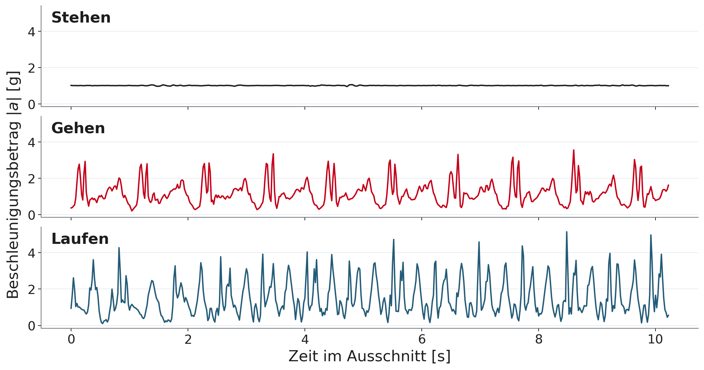{fig-alt="Echte MotionSense-Zeitverläufe des Beschleunigungsbetrags für Stehen, Gehen und Laufen. Zeit und Betrag sind mit Einheiten beschriftet; die drei Aktivitäten sind zusätzlich durch getrennte Bahnen gekennzeichnet."}

Ein Schwellenwert auf einem einzelnen Messwert oder auf einem ganzen Fenster?

::: notes
Die Grafik zeigt drei echte Ausschnitte derselben Art von Messung. Auf der waagrechten Achse steht die Zeit in Sekunden, auf der senkrechten der Betrag des Beschleunigungsvektors in g. Dafür werden die drei Achsenwerte zu $|a|=\sqrt{a_x^2+a_y^2+a_z^2}$ zusammengefasst. Auch im Stehen liegt dieser Betrag wegen der Gravitation ungefähr bei eins; null wäre deshalb keine passende allgemeine Ruhebedingung.

Beim Betrachten bieten sich die Stärke der Schwankungen und die zeitliche Wiederholung als Eigenschaften eines Fensters an. Ein einzelner hoher oder niedriger Wert kann dagegen auch in mehreren Aktivitäten auftreten. Lassen Sie vor der nächsten Folie eine Eigenschaft nennen, die ein kurzes Fenster besser beschreibt als einen Einzelwert. Die gezeichneten Beispiele beweisen noch keine allgemeingültige Schwelle für alle Menschen und Situationen. Ihre Aufgabe ist, einen nachvollziehbaren Startpunkt für eine Regel zu liefern. Anschließend prüfen wir viele Fenster gemeinsam und erkennen, wie gut diese Eigenschaften die beobachteten Klassen trennen.
:::

## Zwei Merkmale machen viele Fenster sichtbar {.compact-figure .sensor-plot}

::: {.section-label}
1 / 6 · Von Messdaten zum Modell
:::

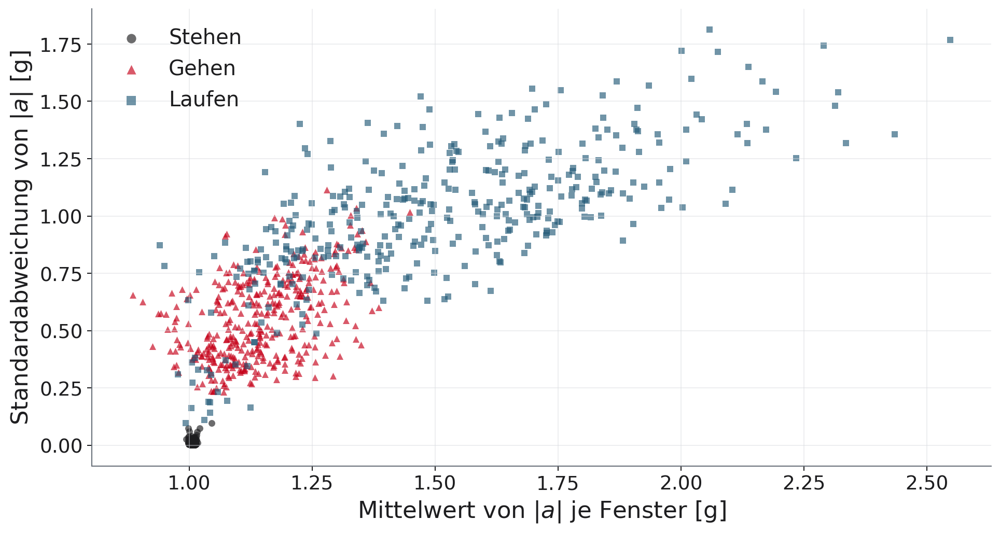{fig-alt="Streudiagramm vieler MotionSense-Fenster: Mittelwert und Standardabweichung des Beschleunigungsbetrags, jeweils in g. Farben und Markierungen unterscheiden Stehen, Gehen und Laufen."}

Jeder Punkt steht für ein Fenster mit 32 Zeitpunkten, nicht für einen Einzelwert.

::: notes
Zwei Eigenschaften bilden aus einem zeitlichen Fenster einen Punkt: Der Mittelwert beschreibt die mittlere Höhe des Beschleunigungsbetrags, die Standardabweichung seine Schwankung um diesen Mittelwert. Beide Größen werden hier aus denselben 32 Messpunkten berechnet. Für den Mittelwert wird durch 32 geteilt; die dargestellte Standardabweichung verwendet ebenfalls diesen Nenner. Die Achsen sind in g beschriftet. Farben und unterschiedliche Markierungen kennzeichnen die drei aufgenommenen Aktivitäten.

Eine vorgeschlagene Regel lässt sich nun an vielen Punkten beurteilen. Ein waagrechter Schwellenwert benutzt nur die Streuung, eine schräg verlaufende Grenze kombiniert beide Merkmale. Liegen Punkte verschiedener Klassen dicht zusammen, kann eine kleine Änderung der Beobachtung die Entscheidung verändern. Mehr Messwerte allein beseitigen das Problem einer ungeeigneten Darstellung nicht. Die Punktwolke ist bewusst eine übersichtliche Beschreibung mit zwei Merkmalen. Das spätere Netz erhält stattdessen die 96 Achsenwerte des Rohfensters; es kann daraus andere Zwischenmerkmale bilden. Die Grafik behauptet daher keine vollständige Darstellung seiner internen Entscheidung.
:::

## Ein Neuron legt eine Trenngerade fest {.compact-figure}

::: {.section-label}
1 / 6 · Von Messdaten zum Modell
:::

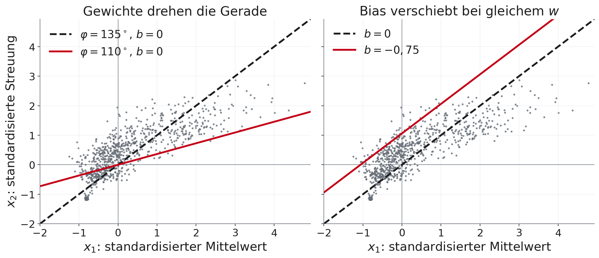{fig-alt="Didaktische Trenngeraden in der Zwei-Merkmal-Ebene. Geänderte Gewichte verändern die Normalenrichtung, ein geänderter Bias verschiebt die Grenze. Die Linien sind keine Ausgabe des Rohdatenmodells."}

$$z=w_1x_1+w_2x_2+b;\qquad z=0\ \text{ist die Grenze.}$$

Was ändert sich an der Grenze, wenn nur $b$ verändert wird?

::: notes
Eine gewichtete Summe kann eine geometrische Entscheidung beschreiben. In der Ebene der beiden Merkmale bilden alle Punkte mit $w_1x_1+w_2x_2+b=0$ eine Gerade. Die Zahlen $w_1$ und $w_2$ sind ihre Gewichte; gemeinsam legen sie die Richtung senkrecht zur Grenze fest. Ein Bias $b$ verschiebt bei festen Gewichten die Gerade parallel. Die vorzeichenbehaftete Lage entlang der Normalen ist $-b/\lVert w\rVert$; der Abstand zum Ursprung beträgt $|b|/\lVert w\rVert$. Werden die Gewichte verändert, können sich deshalb sowohl Richtung als auch Abstand ändern.

Für diese Grafik werden die beiden Merkmale jeweils um ihren Trainingsmittelwert zentriert und durch ihre Trainingsstandardabweichung geteilt. Die Achsen sind dadurch dimensionslos; die vorherige Punktwolke zeigte noch die ursprünglichen g-Werte. Die Grafik variiert die Gewichte und den Bias getrennt. Lassen Sie zunächst die Wirkung einer Biasänderung vorhersagen und verfolgen Sie dann die parallele Verschiebung. Der Wert $z$ heißt Voraktivierung. Sein Vorzeichen unterscheidet zwei Seiten der Geraden. Eine solche binäre Grenze ist anschaulich, beschreibt aber noch keine vollständige Drei-Klassen-Entscheidung. Dafür werden später mehrere Ausgabewerte verglichen. Drei Klassen allein erzwingen außerdem keine verborgene Schicht: Auch mehrere lineare Scores können mehrere Entscheidungsregionen bilden. Eine Nichtlinearität wird nützlich, wenn die benötigte Grenze über diese linearen Regionen hinausgeht.
:::

## Aus der gewichteten Summe wird eine Aktivierung

::: {.section-label}
1 / 6 · Von Messdaten zum Modell
:::

Didaktisches Zwei-Merkmal-Beispiel:

$$
x=\begin{bmatrix}1\\0{,}2\end{bmatrix},\quad
w=\begin{bmatrix}-1\\5\end{bmatrix},\quad b=0{,}5
$$

$$z=-1\cdot1+5\cdot0{,}2+0{,}5=0{,}5,$$
$$h=\operatorname{ReLU}(z)=\max(0,z)=0{,}5.$$

Bei $z=-0{,}25$ wäre die Aktivierung null.

::: notes
Ein Neuron führt eine gewichtete Summe aus und kann darauf eine Aktivierungsfunktion anwenden. Im kleinen Rechenfall werden der erste Eingang mit minus eins und der zweite mit fünf multipliziert. Der Bias kommt einmal zur Summe hinzu. Daraus entsteht die Voraktivierung $z=0{,}5$. ReLU bedeutet Rectified Linear Unit und liefert das Maximum aus null und ihrem Eingang. Ein positiver Wert bleibt deshalb erhalten, ein negativer wird zu null.

Die Aktivierung $h$ ist eine Zahl dieser konkreten Auswertung; die Aktivierungsfunktion ist dagegen die allgemeine Rechenregel. Diese Begriffe sollten beim späteren Speicherzählen auseinandergehalten werden. Ändert sich der zweite Eingang bei sonst gleichen Zahlen auf $0{,}05$, ergibt sich $z=-0{,}25$ und damit $h=0$. Die Funktion behandelt beide Seiten der Grenze unterschiedlich. Das Beispiel besitzt bewusst nur zwei Merkmale, damit jeder Beitrag von Hand verfolgt werden kann. Es ist keine behauptete gelernte Gewichtszeile des 96-Eingangs-Modells. Derselbe Aufbau aus Produkten, Bias und Aktivierungsfunktion wiederholt sich dort mit mehr Eingängen und Ausgängen.
:::

## Verborgene Schichten verbinden lineare Teilbereiche {.compact-figure}

::: {.section-label}
1 / 6 · Von Messdaten zum Modell
:::

{fig-alt="Didaktisches Zwei-Merkmal-Beispiel: Vier ReLU-Terme bilden eine rautenförmige Nullgrenze. Die Grenze besteht aus vier Geradenstücken und ist nicht aus den MotionSense-Daten gelernt."}

Das Hauptmodell verbindet 96 Eingaben über 16 ReLU-Werte mit drei Scores.

::: notes
Eine verborgene Schicht kann mehrere lineare Teilbereiche verbinden. Die Grafik zeigt dafür ein kleines geometrisches Beispiel: Vier ReLU-Terme bilden zusammen $|x_1|+|x_2|$. Der Score $s=\operatorname{ReLU}(x_1)+\operatorname{ReLU}(-x_1)+\operatorname{ReLU}(x_2)+\operatorname{ReLU}(-x_2)-1$ besitzt eine rautenförmige Nullgrenze. Jede Kante ist gerade, die gesamte Grenze aber keine einzelne Gerade. Das Beispiel erklärt die Wirkung der Nichtlinearität; es ist keine gelernte Grenze des Aktivitätsmodells.

Dessen erste Dense-Schicht bildet aus 96 Rohwerten sechzehn gewichtete Summen mit ReLU. Die zweite kombiniert diese Zwischenwerte zu drei Scores. Jeder Ausgang einer Dense-Schicht verwendet jeden Eingang. Ohne Nichtlinearität ließen sich zwei affine Schichten wieder zu einer einzigen affinen Abbildung zusammenfassen. Drei Klassen allein erfordern allerdings noch keine verborgene Schicht: Auch mehrere lineare Scores können mehrere Regionen bilden. Ob diese Regionen für neue Messdaten genügen, ist eine Daten- und Modellfrage. Die Architektur bleibt hier fest, damit Rechenarbeit und Speicher im weiteren Verlauf am selben Objekt untersucht werden können.
:::

## Drei Scores werden zu einer Entscheidung

::: {.section-label}
1 / 6 · Von Messdaten zum Modell
:::

Tatsächlich berechnetes Beispiel: Person 21, Gehen, Fenster 0.

| Index und Klasse | Float32-Score, gerundet |
|---|---:|
| 0 · Stehen | $-6{,}243$ |
| 1 · Gehen | $0{,}901$ |
| 2 · Laufen | $-1{,}240$ |

$$\operatorname{argmax}_i s_i=1\quad\Rightarrow\quad\text{Gehen}.$$

Scores sind keine Wahrscheinlichkeiten.

::: notes
Die letzte Schicht liefert für jede Klasse eine Vergleichszahl, einen Score. Hier stammen die drei Werte aus der tatsächlich ausgeführten Float32-Auswertung des trainierten Lehrmodells: Person 21, Aktivität Gehen, Fenster mit lokalem Index null. Sie sind auf drei Nachkommastellen gerundet. Die Funktion argmax gibt die Position des größten Eintrags zurück. Der größte Score steht an Position eins und bedeutet mit der vereinbarten Klassenreihenfolge Gehen. Die Vorhersage stimmt in diesem Fenster mit der aufgezeichneten Aktivität überein.

Ein negativer Score ist zulässig: Entscheidend für argmax ist die Reihenfolge der Werte. Die Zahlen sind ohne weitere Normalisierung keine Wahrscheinlichkeiten. Auch ein deutlich größter Score beweist nicht, dass eine Klasse im Alltag richtig ist. Dafür werden Vorhersage und bekannte Aktivität über viele getrennte Testfenster verglichen. Der Eingabevertrag muss außerdem festlegen, wann ein Fenster vollständig ist und wie lange seine Entscheidung gültig bleibt. Diese Verbindung zur Anwendung kehrt in der Firmwarebilanz wieder.
:::

## Lernen verändert Gewichte in Richtung kleinerer Fehler {.compact-figure}

::: {.section-label}
1 / 6 · Von Messdaten zum Modell
:::

{fig-alt="Verlustkurve L(w) gleich (2w minus 4) zum Quadrat. Ein Gradienten-Schritt führt von w gleich 1 mit Verlust 4 zu w gleich 1,8 mit Verlust 0,16; das Minimum liegt bei w gleich 2."}

$$w_{\mathrm{neu}}=w-\eta\frac{\mathrm dL}{\mathrm dw}
=1-0{,}1(-8)=1{,}8.$$

::: notes
Lernen lässt sich an einem einzelnen Gewicht nachvollziehen. Ein Eingang mit Wert zwei soll den Zielwert vier ergeben. Die Vorhersage lautet $2w$, der quadratische Fehler deshalb $L(w)=(2w-4)^2$. Bei $w=1$ ist der Verlust vier. Die Ableitung beträgt $\mathrm dL/\mathrm dw=4(2w-4)=-8$. Sie beschreibt die lokale Änderung des Verlusts; mit der Lernrate $\eta=0{,}1$ wird das Gewicht entgegen dieser Steigung verändert und erreicht $1{,}8$.

Auf der Grafik steht das Gewicht auf der waagrechten Achse, der Verlust auf der senkrechten. Der Schritt bewegt sich entlang der Kurve in Richtung ihres Minimums. Der neue Verlust beträgt $(3{,}6-4)^2=0{,}16$. Das Beispiel isoliert den Optimierungsschritt und benutzt keine Aktivitätsklassen. Beim vollständigen Netz werden viele Gewichte und Biaswerte anhand vieler beschrifteter Fenster angepasst. Ihre Fehlerbeiträge werden mit der Kettenregel durch die Schichten zurückgerechnet. Wiederholte Vorwärtsrechnungen, Ableitungen und Änderungen machen Training aufwendiger als eine einzelne Auswertung mit festgehaltenen Parametern.
:::

## Training bestimmt Parameter, Inferenz verwendet sie

::: {.section-label}
1 / 6 · Von Messdaten zum Modell
:::

$$s=f_\theta(x),\qquad \theta=\{W_1,b_1,W_2,b_2\}$$

| Training | Inferenz |
|---|---|
| bekannte Aktivität zum Fenster | neues Fenster |
| Fehler berechnen und Parameter ändern | Scores berechnen und Entscheidung liefern |
| viele wiederholte Schritte | ein Vorwärtslauf je Auswertung |

Unser Ablauf: auf dem Entwicklungsrechner trainieren, auf dem Gerät auswerten.

::: notes
Nach dem konkreten Rechenweg fasst die Schreibweise $s=f_\theta(x)$ das Modell zusammen. $x$ ist die Eingabe, $s$ der Scorevektor und $\theta$ die Menge der Gewichte und Biaswerte. Beim Training werden diese Parameter verändert. Die bekannte Aktivität eines Trainingsfensters heißt Zielwert oder Label und erlaubt, einen Fehler der Vorhersage zu bestimmen. Bei der Inferenz bleiben die Parameter fest; die Eingabe und die dadurch entstehenden Aktivierungen ändern sich mit jedem Fenster.

Im betrachteten Entwicklungsablauf findet das Training auf dem Entwicklungsrechner statt. Die später eingesetzte Firmware benötigt die festgelegten Parameter und denselben Eingabevertrag, einschließlich der beim Training festgelegten Vorverarbeitung. Das ist eine gewählte Aufgabenteilung und kein allgemeines Verbot von Training auf Edge-Geräten. Der Begriff Edge beschreibt den Verarbeitungsort nahe am Sensor. Für die spätere Hardwarebilanz zählt, dass die Inferenz viele gleichartige Produkte und Summen ausführt, während die Modellparameter wiederverwendet werden. Wie teuer diese Rechnung ist, hängt von ihren Formen, Datentypen, Datenbewegungen und dem Ausführungsmodell ab.
:::

## Neue Personen brauchen einen getrennten Test

::: {.section-label}
1 / 6 · Von Messdaten zum Modell
:::

| Datenrolle | MotionSense-Personen | Verwendung |
|---|---|---|
| Training | 1–16 | Gewichte und Bias anpassen |
| Validierung | 17–20 | Einstellungen beurteilen |
| Test | 21–24 | festgelegtes Modell an neuen Personen bewerten |

Beobachtet: 768/768 Trainingsfenster, aber nur 159/192 Testfenster richtig.

Benachbarte Fenster derselben Aufnahme bleiben in derselben Gruppe.

::: notes
Ein Modell soll mehr leisten als bekannte Aufnahmen wiederzuerkennen. Deshalb werden hier die Personen getrennt: Die Fenster von Personen eins bis sechzehn dienen zur Anpassung der Parameter, die von siebzehn bis zwanzig zur Validierung und die von einundzwanzig bis vierundzwanzig zum abschließenden Test. Validierung bedeutet, Einstellungen zu beurteilen, bevor das endgültige Modell am Test bewertet wird. Testergebnisse dürfen nicht zugleich zur nachträglichen Auswahl günstiger Einstellungen verwendet werden.

Der ausgeführte Versuch verwendet je Person und Aktivität 512 Punkte und daraus sechzehn nicht überlappende Fenster. Eine Epoche ist ein vollständiger Durchlauf der Trainingsbeispiele. Die 600 Trainingsepochen waren vorab festgelegt. Danach werden alle 768 Trainingsfenster richtig zugeordnet, in der Validierung 157 von 192 und im Test 159 von 192, also rund 82,8 Prozent. Der Abstand zeigt, weshalb Trainingsgüte eine Prüfung an neuen Personen nicht ersetzt. Die Gruppentrennung hält benachbarte Fenster derselben Aufnahme zusammen. Eine zufällige Fensteraufteilung könnte nahezu gleiche Abschnitte in Training und Test verteilen und dadurch eine zu günstige Bewertung ergeben.
:::

## Eine 1D-Faltung knüpft an bekannte FIR-Filter an

::: {.section-label}
1 / 6 · Von Messdaten zum Modell
:::

$$u[t]=\sum_{k=0}^{K-1}h[k]x[t-k]$$

- FIR: lokale gewichtete Summe über ein Zeitfenster
- Conv1D: Koeffizienten aus Daten lernen; mehrere Kanäle und Filter möglich
- Bias und beispielsweise ReLU ergänzen die Filterrechnung

Neu: gelernte Koeffizienten und weitere Verarbeitung.

::: notes
Ein FIR-Filter bildet eine gewichtete Summe aus einer begrenzten Zahl zeitlich versetzter Eingangswerte. FIR steht für Finite Impulse Response, endliche Impulsantwort. Die Koeffizienten $h[k]$ bestimmen, welche Muster im zeitlichen Verlauf hervorgehoben oder gedämpft werden. Damit besitzt die Rechnung denselben Grundbaustein aus Multiplikation und Akkumulation wie die bisher betrachtete gewichtete Summe.

Eine eindimensionale Faltungsschicht, Conv1D, wendet kleine gelernte Gewichtsgruppen an vielen Zeitpositionen an. Mehrere Eingangsachsen können gemeinsam zu mehreren Ausgangskanälen beitragen; Bias und eine Aktivierungsfunktion ergänzen die lineare Filterrechnung. Der Unterschied zum klassischen Filterentwurf liegt unter anderem darin, dass geeignete Koeffizienten anhand der Lernaufgabe angepasst werden. Viele Lernframeworks verwenden dabei technisch eine Kreuzkorrelation, also eine Indizierung ohne die Kernelumkehr der mathematischen Faltung. Die Gewichte und die Indizierung müssen zusammen betrachtet werden. Für die Hardwarefrage bleibt der gemeinsame Kern eine wiederholte lokale Produktsumme mit Möglichkeiten zur Wiederverwendung. Das Hauptmodell dieser Vorlesung bleibt jedoch ein Dense-Netz; die Filterbrücke führt keine zusätzliche Pflichtarchitektur ein.
:::

## Formen machen die regelmäßige Matrixrechnung sichtbar

::: {.section-label}
1 / 6 · Von Messdaten zum Modell
:::

$$H=\operatorname{ReLU}(W_1X+b_1\mathbf{1}_B^T),\qquad
S=W_2H+b_2\mathbf{1}_B^T$$

| Größe | Form bei $B$ Fenstern |
|---|---|
| Eingaben $X$ | $96\times B$ |
| Zwischenwerte $H$ | $16\times B$ |
| Scores $S$ | $3\times B$ |

Die Gewichtsmatrizen werden für alle Beispielspalten wiederverwendet.

::: notes
Mehrere gewichtete Summen lassen sich als Matrixprodukt schreiben. Im Hauptmodell besitzt $W_1$ sechzehn Zeilen und sechsundneunzig Spalten: Eine Zeile erzeugt einen Zwischenwert, eine Spalte gehört zu einem Eingang. $W_2$ hat drei Zeilen und sechzehn Spalten. Die Biasvektoren enthalten sechzehn beziehungsweise drei Einträge. Diese Formen folgen aus dem vereinbarten Datenweg und sind vor jeder Zahlenrechnung überprüfbar.

Werden $B$ Fenster gemeinsam ausgewertet, bilden ihre Eingaben die Spalten der Matrix $X$. Ein solcher Eingabestapel heißt Batch. Die Ergebnisse stehen ebenfalls spaltenweise; Gewichte ändern sich dabei nicht zwischen den Beispielen. Der Vektor $\mathbf{1}_B$ enthält $B$ Einsen, sodass $b_1\mathbf{1}_B^T$ denselben Bias in jede Spalte einträgt. Damit sind auch die Additionen formal dimensionsgleich. Die Schreibweise bündelt viele einzelne Produkte und Summen, ohne deren Ergebnis zu verändern. Als Nächstes werden deshalb Parameter, ausgeführte MACs und übertragene Bytes getrennt gezählt. Erst diese Bilanz zeigt, ob mehr Rechenplätze oder bessere Datenversorgung der Anwendung helfen können.
:::

## 2 · Rechenarbeit und Daten zählen {.section-divider}

Welche Grenze bremst unser Aktivitätsmodell: Rechnung oder Datenversorgung?

Modellannahmen für diesen Abschnitt:

- Eine produktbezogene MAC zählt zwei Operationen; Bias startet die Summe.
- Modell R: externer Speicher → lokaler Puffer, zunächst nur Eingangsverkehr.
- Vier Byte je Operand; Peak und Bandbreite werden ausdrücklich angegeben.

::: notes
Die Form des Modells legt seine Rechenarbeit fest; wie schnell die Hardware diese Arbeit versorgen kann, ist eine zweite Frage. Eine Dense-Schicht bildet für jeden Ausgang eine Produktsumme. Die gleichen Eingaben werden von mehreren Ausgängen gebraucht. Schon daraus entstehen sowohl echte Summenabhängigkeiten als auch Chancen zur Wiederverwendung.

Für die folgenden Rechnungen werden die Annahmen hier gebündelt. Eine MAC, Multiply-Accumulate, bedeutet ein Produkt zu einer laufenden Summe zu addieren. Wir zählen dafür zwei arithmetische Operationen und initialisieren den Akkumulator mit dem Bias. Das Verkehrsmodell R betrachtet zunächst nur Eingangsbytes vom externen Speicher zum lokalen Operandenpuffer. Später kommen die Ausgaben ausdrücklich hinzu. Die gezeigten kleinen Matrizen sind überschaubare Rechenkerne, an denen sich die Arbeit des größeren Aktivitätsmodells nachvollziehen lässt. Ihre Zahlen sind nicht dessen gelernte Gewichte.
:::

## Parameter sind gespeicherte Zahlen, MACs sind Arbeit

::: {.section-label}
2 / 6 · Rechenarbeit und Daten
:::


Dense mit $n$ Eingängen und $m$ Ausgängen:

| Größe | Anzahl |
|---|---:|
| Gewichte und Biaswerte | $mn+m$ |
| MACs je Eingabe | $mn$ |
| Operationen je Eingabe | $2mn$ |

```c
/* C17: Nullpunkte null.
   Bias in der Produktskala; gueltige Arrays.
   Produkte und Summen passen in Int64. */
int64_t sum = bias;
for (size_t i = 0; i < n; ++i)
    sum += (int64_t)input[i] * weight[i];
```

::: notes
Parameterzahl und Rechenarbeit beantworten verschiedene Fragen. Die Matrix einer Dense-Schicht enthält für jedes Eingangs-/Ausgangspaar ein Gewicht, insgesamt $mn$. Dazu kommt ein Bias je Ausgang. Eine neue Eingabe verändert diese Parameter nicht; sie benötigt aber erneut $mn$ Produkte mit Akkumulation. Ein Batch wiederholt die Arbeit für mehrere Eingaben und verwendet dieselben Parameter weiter.

Der C-Ausschnitt zeigt eine einzelne Zeile nach Quantisierung mit Nullpunkten null und einem Bias in der Produktskala. Bei anderen Nullpunkten müssen diese vor der Multiplikation abgezogen werden; die Quantisierung wird im fünften Abschnitt erklärt. `sum` beginnt mit dem Bias. Jede Iteration liest ein Wertepaar und erweitert die laufende Summe. Die Typumwandlung vor der Multiplikation verbreitert die Rechnung; passende Wertebereiche bleiben Voraussetzung. Innerhalb der Summe benötigt jeder Schritt den vorherigen Akkumulatorwert. Verschiedene Ausgangszeilen haben dagegen eigene Summen und können unabhängig fortschreiten. Deshalb sind Parameter, Operationen und Maschinenbefehle getrennt zu zählen: Eine MAC kann je nach Zielhardware einen Befehl, mehrere Befehle oder einen Teil eines größeren Auftrags bilden.
:::

## Mehr Peak – mehr nutzbare Rate? {.compact-figure}

::: {.section-label}
2 / 6 · Rechenarbeit und Daten
:::

Was ändert ein verdoppelter Peak bei unveränderter Datenversorgung?

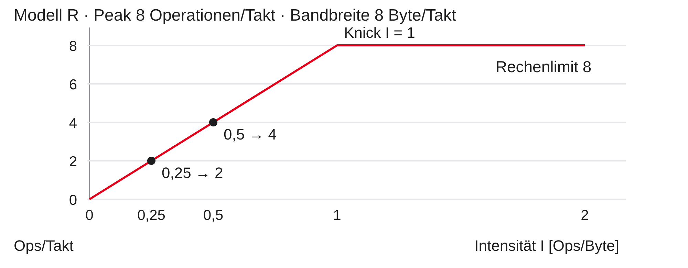{fig-alt="Roofline R: Peak acht Operationen je Takt, Bandbreite acht Byte je Takt. Die Grenze steigt bis Intensität eins linear und bleibt danach bei acht."}

$I=O/D$ in Operationen/Byte · $P\leq\min(P_{\mathrm{peak}},B I)$

::: notes
Ein größerer Peak hilft nur, wenn das Rechenwerk die engere Grenze setzt. Die Intensität $I=O/D$ beschreibt Operationen pro übertragenem Byte über die vereinbarte Speichergrenze. Im Roofline-Bild steht sie waagrecht; senkrecht steht die nutzbare Operationsrate. Die steigende Linie hat die Steigung der Bandbreite $B$, das waagrechte Dach die Höhe des Rechenpeaks.

In Modell R sind Peak und Bandbreite jeweils acht in ihren unterschiedlichen Einheiten. Der Knick liegt bei $P_{\mathrm{peak}}/B=1$ Operation je Byte. Bei Intensität $0{,}25$ lassen sich höchstens zwei Operationen je Takt versorgen, bei $0{,}5$ vier. Ein höheres waagrechtes Dach verändert diese beiden Grenzen zunächst nicht. Lassen Sie vor der Auflösung begründen, welcher Teil der Kurve sich überhaupt verschiebt. Die Kurve beschreibt eine Obergrenze; Abhängigkeiten, Anlauf und Ressourcenkonflikte können die tatsächlich erreichte Rate zusätzlich senken.
:::

## Dieselbe Matrixrechnung mit Wiederverwendung

::: {.section-label}
2 / 6 · Rechenarbeit und Daten
:::

{fig-alt="A=[[1,2],[3,4]], B=[[5,6],[7,8]] und C=[[19,22],[43,50]]. Acht MACs verwenden acht unterschiedliche Eingangswerte mehrfach."}

Ein Tile ist ein gemeinsam lokal gehaltener Matrixausschnitt.

::: notes
Wiederverwendung senkt den Verkehr, ohne die mathematische Aufgabe zu verändern. Die beiden Zwei-mal-zwei-Matrizen dienen als kleiner Ausschnitt einer Matrixrechnung. Jede Ausgabesumme braucht zwei Produkte: $C_{00}=1\cdot5+2\cdot7=19$, $C_{01}=1\cdot6+2\cdot8=22$, $C_{10}=3\cdot5+4\cdot7=43$ und $C_{11}=3\cdot6+4\cdot8=50$. Insgesamt entstehen acht MACs beziehungsweise sechzehn Operationen.

Jeder A-Wert wird für zwei Ausgabespalten und jeder B-Wert für zwei Ausgabezeilen benötigt. Lädt die naive Rechnung beide Operanden je MAC neu, sind das sechzehn Transfers zu je vier Byte, also 64 Byte. Werden die acht verschiedenen Eingangswerte einmal geladen und lokal gehalten, genügen 32 Byte über dieselbe Grenze. Die Intensität steigt von $16/64=0{,}25$ auf $16/32=0{,}5$. Diese Optimierung kann ebenso eine CPU verwenden; ein lokales Tile ist kein exklusives Merkmal einer NPU.
:::

## Auch Ausgaben und Wartezeiten gehören zur Bilanz

::: {.section-label}
2 / 6 · Rechenarbeit und Daten
:::


| Zählbasis für $C=AB$ | Naiv | Lokales Tile |
|---|---:|---:|
| Eingänge | $64$ B | $32$ B |
| mit vier Ausgaben zu je $4$ B | $80$ B | $48$ B |
| Intensität mit Ausgaben | $16/80=0{,}2$ | $16/48=1/3$ |

- Bandbreite begrenzt die ankommenden Bytes pro Zeit.
- Latenz bestimmt, wann ein benötigter Wert bereitsteht.
- Eine Summenabhängigkeit bleibt eine weitere Grenze.

::: notes
Zur vollständigen Verkehrsbilanz gehören auch die Ausgaben. Hier starten die Summen bei null und die Operation lautet $C=AB$; ein altes C wird deshalb nicht eingelesen. Vier fertige Ausgaben kosten weitere sechzehn Byte. Naiv entstehen 80, mit lokalem Tile 48 Byte. Die Intensitäten sinken entsprechend auf $0{,}2$ und $1/3$ Operation je Byte. Der Vergleich erweitert ausdrücklich die Zählbasis um die Gegenrichtung.

Verkehrsmenge, Bandbreite und Latenz sind dennoch verschiedene Größen. Vier unabhängige Transfers mit Latenz drei können bei Startabstand eins in den Takten eins bis vier starten und an den Enden von drei bis sechs fertig werden. Ihre Überlappung verkürzt die einzelne Latenz nicht. Tiling verringert dagegen die benötigte Datenmenge. Eine abhängige Summenkette kann zusätzlich auf ihr voriges Ergebnis warten. Diese Unterscheidung erklärt, weshalb weder breite Speicherpfade noch mehr Multiplikatoren für sich allein jede Verzögerung beseitigen.
:::

## Papierphase 1: Rechnung und Speichergrenze

::: {.section-label}
2 / 6 · Rechenarbeit und Daten
:::


Teil A: 1.1, 1.2 und 2.1 · 10 Minuten

- Zwei Schichten mit ReLU bis zur Ausgabe verfolgen
- Parameter und produktbezogene MACs getrennt zählen
- Roofline-Knick und obere Rate bestimmen

Weitere Teilaufgaben dienen der Nachbereitung.

::: notes
Die erste Papierphase überträgt die Regeln auf ein kleines zweischichtiges Netz. Für die gegebenen Matrizen entsteht zunächst $z=[7,-15,-1]^T$, nach ReLU $h=[7,0,0]^T$ und schließlich $y=10$. Die erste Schicht besitzt sechs Gewichte und drei Biaswerte, die zweite drei Gewichte und einen Bias. Zusammen sind es dreizehn Parameter und neun produktbezogene MACs. Lassen Sie Zwischenergebnisse erklären, bevor die Endzahlen verglichen werden.

Im getrennten Roofline-Fall des Blatts liegen Peak und Bandbreite bei zwölf Operationen beziehungsweise sechs Byte je Takt. Der Knick ist daher zwei Operationen je Byte; bei Intensität $0{,}5$ und drei sind die Obergrenzen drei und zwölf Operationen je Takt. Die weiteren Teilaufgaben untersuchen die affine Zusammenfassung, lebende Aktivierungspuffer und die nötige Tilegröße. Vollständige Herleitungen stehen im Lösungsprofil; die Präsenzphase bearbeitet ausdrücklich die angegebene Auswahl.
:::

## 3 · Gleiche Rechnung auf vielen Daten {.section-divider}

Wie wird aus vielen ähnlichen Produkten parallele Arbeit?

Modellannahmen für diesen Abschnitt:

- Gepackte Beispielbytes werden modulo 256 addiert, ohne Lane-Übertrag.
- RVV 1.0: nur ausdrücklich unterstützte Konfigurationen.
- Ergebnis bei Start $t$ und Latenz $L$: Ende von $t+L-1$.

::: notes
Das Aktivitätsmodell enthält viele ähnliche Produkte. Datenparallelität nutzt diese Gleichartigkeit; Befehlsparallelität nutzt unabhängige Maschinenbefehle. Die Begriffe beschreiben unterschiedliche Ebenen und können gemeinsam auftreten. Eine breite Operation bedeutet außerdem noch nicht, dass für jedes Element dauerhaft ein eigenes Rechenwerk vorhanden ist.

Die Zahlen- und Zeitannahmen stehen am Anfang des Abschnitts. Gepackte Bytes werden im Beispiel getrennt modulo 256 addiert. Bei der RISC-V-Vektorerweiterung RVV 1.0 unterscheiden wir Registerkapazität, aktive Länge und physische Lanes. Für Zeitbilder gilt: Ein Start in Takt $t$ mit Latenz $L$ liefert sein Ergebnis am Ende von $t+L-1$; ein abhängiger Nutzer beginnt frühestens danach. Diese Verträge erlauben einen nachvollziehbaren Vergleich, während der Befehlssatz selbst die Wirkung der Operationen beschreibt.
:::

## Datenparallelität respektiert Elementgrenzen

::: {.section-label}
3 / 6 · Datenparallelität
:::

{fig-alt="Vier unsigned Acht-Bit-Lanes addieren getrennt 1+2,16+32,127+1 und255+1 zu3,48,128 und0; kein Übertrag in die Nachbarlane."}

DLP: gleiche Arbeit an mehreren Daten · SIMD: gemeinsame Befehlssteuerung

::: notes
Gleiche Arbeit an vielen Werten ist Datenparallelität, DLP oder Data-Level Parallelism. SIMD, Single Instruction, Multiple Data, ist eine mögliche Umsetzung mit gemeinsamer Befehlssteuerung. ILP aus der CPU-Vorlesung kann gleichzeitig unabhängige Befehle oder Ausgabesummen nutzen. Innerhalb einer einzelnen Akkumulation bleibt deren Wertabhängigkeit bestehen.

Die Abbildung betrachtet vier vorzeichenlose Acht-Bit-Felder in einem breiteren Register. Jede Lane addiert ihre beiden Bytes modulo 256: Es entstehen 3, 48, 128 und 0, hexadezimal 03, 30, 80 und 00. Ein Übertrag verlässt das betreffende Feld nicht. Ein gewöhnliches 32-Bit-`add` behandelt dagegen das gesamte Wort als eine Zahl und kann einen Byteübertrag weiterreichen. Das Beispiel zeigt deshalb eine bestimmte gepackte Semantik, keinen beliebigen RISC-V-Basisbefehl. Sättigung wäre nochmals eine andere Regel; sie begrenzt statt umzuschlagen.
:::

## Schmale Operanden brauchen breite Produktsummen

::: {.section-label}
3 / 6 · Datenparallelität
:::

{fig-alt="Zwei Int8-Werte20 ergeben Produkt400; drei solche Produkte ergeben1200. Der Akkumulator benötigt mehr als acht Bit."}

Int8 speichert die Operanden; es legt die Akkumulatorbreite nicht fest.

::: notes
Ein kleines Eingabeformat begrenzt nicht den Wert eines Produkts. Int8 reicht von $-128$ bis 127. Bereits $20\cdot20=400$ und die Summe dreier solcher Produkte, 1200, passen dort nicht hinein. Der Akkumulator muss den Wertebereich der ganzen Produktsumme einschließlich Bias und Nullpunktkorrektur aufnehmen.

Deshalb verwenden Integer-Netzkerne häufig Int8-Operanden und eine breitere Int32-Akkumulation. Auch deren Bereich ist endlich. Schon zwei maximal positive Produkte $(-128)(-128)$ überschreiten den Int16-Bereich. Die Breite muss aus Zeilenlänge und Operandenbereichen begründet werden. Verbreitern, englisch Widening, muss vor einer zu schmalen Rechnung erfolgen; abgeschnittene Bits entstehen durch einen späteren Cast nicht neu. Der begleitende Hostcode rechnet für seine Bereichsprüfung zunächst in Int64. Die spätere Rückskalierung auf einen Ausgangscode heißt Requantisierung und wird im Firmwareabschnitt behandelt.
:::

## Ein Start pro Takt ist nicht Latenz eins

::: {.section-label}
3 / 6 · Datenparallelität
:::

{fig-alt="Vier unabhängige Operationen starten in1,2,3,4. Bei Latenz3 enden sie in3,4,5,6; der Startabstand beträgt1."}

Ergebnislatenz $3$ Takte · Initiationsintervall $1$ Takt

::: notes
Latenz und Initiationsintervall bestimmen verschiedene Teile eines Zeitplans. Latenz ist die Dauer bis zum fertigen Ergebnis; das Initiationsintervall ist der kleinste Abstand zweier Starts auf derselben Ressource. Eine gepipelinete Einheit kann eine neue unabhängige Operation beginnen, während ältere noch spätere Stufen durchlaufen.

Im Bild starten vier Operationen in den Takten eins bis vier. Bei Latenz drei entstehen ihre Ergebnisse an den Enden der Takte drei bis sechs. Die roten letzten Stufen markieren Fertigstellung. Das kurze Fenster enthält damit vier Operationen in sechs Takten; ein langer Strom könnte trotzdem ein Ergebnis pro Takt liefern. Bei einer einzigen abhängigen Akkumulatorkette ist dieser Startabstand allein nicht ausreichend: Der nächste Schritt benötigt sein Vorgängerergebnis. Mehrere unabhängige Ausgabesummen des Netzes können solche Latenzlücken füllen. Auch die spätere Vektorlänge sagt daher allein noch nichts über die Laufzeit eines Befehls.
:::

## RVV: Registerplätze sind noch keine Rechen-Lanes

::: {.section-label}
3 / 6 · Datenparallelität
:::


$$\mathrm{VLMAX}=\mathrm{LMUL}\,\frac{\mathrm{VLEN}}{\mathrm{SEW}}$$

| VLEN | SEW | LMUL | VLMAX |
|---:|---:|---:|---:|
| $128$ Bit | $32$ Bit | $1$ | $4$ Elemente |
| $1024$ Bit | $32$ Bit | $1$ | $32$ Elemente |

VL ist die aktuell aktive Elementzahl und kann kleiner sein.

::: notes
Die Registerbreite einer Vektoreinheit beschreibt zuerst Speicherplätze. RVV stellt 32 architektonische Vektorregister von `v0` bis `v31` bereit. VLEN ist deren implementierte Breite in Bit. SEW, Selected Element Width, ist die gewählte Elementbreite, LMUL die Größe der verwendeten Registergruppe. Aus diesen Größen folgt VLMAX, die maximale Elementzahl einer unterstützten Konfiguration.

Bei LMUL eins ergeben 128 Registerbits und 32 Bit je Element vier Plätze; 1024 Registerbits ergeben zweiunddreißig. Die aktuell aktive Länge VL kann darunter liegen. Plätze hinter ihr sind Tail, also inaktiver Rest. Diese Zahlen sind keine Anzahl physischer Rechenwerke. Eine Mikroarchitektur kann eine große Registergruppe mit wenigen Lanes über mehrere Takte bearbeiten. Für die Programmlogik wird daher zunächst bestimmt, wie viele Elemente tatsächlich aktiv sind; für die Zeitrechnung kommen anschließend die verfügbaren Rechenpfade hinzu.
:::

## Die zurückgegebene Länge steuert den Fortschritt

::: {.section-label}
3 / 6 · Datenparallelität
:::


| Angeforderter Rest AVL | Zulässige aktive Länge VL |
|---|---|
| $\mathrm{AVL}\leq\mathrm{VLMAX}$ | $\mathrm{VL}=\mathrm{AVL}$ |
| $\mathrm{VLMAX}<\mathrm{AVL}<2\mathrm{VLMAX}$ | $\lceil\mathrm{AVL}/2\rceil\leq\mathrm{VL}\leq\mathrm{VLMAX}$ |
| $\mathrm{AVL}\geq2\mathrm{VLMAX}$ | $\mathrm{VL}=\mathrm{VLMAX}$ |

Rest $40$, VLMAX $32$: $32+8$ und $20+20$ sind zulässig.

::: notes
Eine portable Vektorschleife muss den tatsächlichen Abschnitt statt einer vermuteten Registerbreite verwenden. `vsetvli` konfiguriert Elementbreite und Registergruppe und gibt die gewählte aktive Länge in einem Integerregister zurück. AVL, Application Vector Length, bezeichnet dabei den angeforderten Rest. Die Tabelle fasst die RVV-1.0-Regel für unterstützte Konfigurationen zusammen.

Passt der Rest vollständig, wird er exakt bearbeitet. Ab doppelter Kapazität wird ein voller Abschnitt gewählt. Dazwischen sind die ganzzahligen Längen von der aufgerundeten Hälfte bis VLMAX erlaubt. Bei Rest 40 und Kapazität 32 ist die erste Länge also mindestens 20: $32+8$ und $20+20$ sind erlaubt, $16+24$ beginnt unzulässig. Eine Implementierung entscheidet für dieselben Eingaben deterministisch, andere Implementierungen können anders aufteilen. Bei 1000 Elementen sind zunächst 30 volle Abschnitte erzwungen, danach zwei Restabschnitte. Die Schleife benötigt somit 32 Iterationen und aktualisiert ihre Zeiger jeweils mit dem zurückgegebenen VL.
:::

## Eine Schleife für elementweise Addition

::: {.section-label}
3 / 6 · Datenparallelität
:::

```asm
# RVV 1.0; a0=N, a1=A, a2=B, a3=C; uint32_t-Arrays
beqz a0, done
loop:
    vsetvli t0, a0, e32, m1, ta, ma
    vle32.v v0, (a1)
    vle32.v v1, (a2)
    vadd.vv v2, v0, v1
    vse32.v v2, (a3)
    slli t1, t0, 2
    add a1, a1, t1
    add a2, a2, t1
    add a3, a3, t1
    sub a0, a0, t0
    bnez a0, loop
done:
    ret
```

::: notes
Die Schleife setzt den Längenvertrag in Zeigerfortschritt um. Die RVV-1.0-Lehrfolge erwartet N gültige, ausgerichtete `uint32_t`-Elemente je Array. `a0` hält den Rest, `a1` bis `a3` die Adressen von A, B und C. C überschneidet sich nicht mit den Quellen; Bytefortschritt und Adressen bleiben darstellbar. Bei N null überspringt `beqz` alle Zugriffe.

`vsetvli` wählt `e32` und `m1` und schreibt VL nach `t0`. `ta` und `ma` erlauben, unbenutzte Tail- beziehungsweise maskierte Inhalte nicht zu erhalten. Die beiden Loads holen aktive Elemente; `vadd.vv` addiert sie modulo $2^{32}$ und der Store schreibt nur aktive Ergebnisse. `slli` berechnet mit dem Shift um zwei genau vier mal VL Byte. Um diese Bytezahl rücken die Zeiger; der Rest sinkt dagegen um VL Elemente. Die Folge zeigt elementweise Addition und kein Skalarprodukt. Sie wurde hier nicht als RISC-V-Programm ausgeführt; ihre Zeigerregel lässt sich jedoch direkt aus dem Vertrag prüfen.
:::

## Vier aktive Elemente brauchen nicht vier Lanes

::: {.section-label}
3 / 6 · Datenparallelität
:::

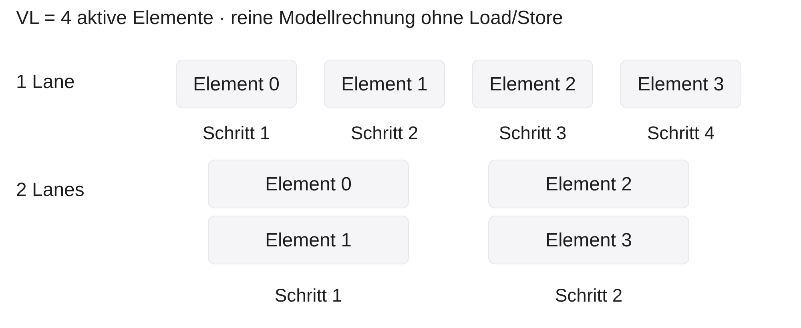{fig-alt="Vier aktive Elemente benötigen im ausgeblendeten Lade-/Startmodell auf einer Lane vier Schritte, auf zwei Lanes zwei Schritte."}

Gleiche Befehlssatzwirkung · unterschiedliche interne Breite und Zeit

::: notes
VL bestimmt die Zahl der wirksamen Elemente, nicht die physische Ausführungsbreite. Eine Lane ist hier ein tatsächlich vorhandener elementweiser Rechenpfad. Das Bild nimmt vier unabhängige Additionen und ein Ergebnis je Lane und Schritt an; Laden, Speichern und Startkosten sind ausgeblendet.

Mit einer Lane werden die vier Elemente in vier internen Schritten bearbeitet, mit zwei Lanes in zwei. Die nummerierten Felder zeigen Daten, ihre horizontalen Gruppen einen Rechenschritt. Beide Umsetzungen liefern dieselbe Befehlssatzwirkung. Deshalb kann ein großes Vektorregister durch wenige Rechenpfade mehrfach durchlaufen werden. Umgekehrt benötigt ein breiter Pfad genügend Operanden, um tatsächlich beschäftigt zu sein. Die Datenversorgung aus dem vorherigen Abschnitt bleibt also relevant. Portable VL-Schleifen sichern die logische Abschnittsverarbeitung; eine Zeit- oder Energieaussage verlangt zusätzlich Angaben zur Mikroarchitektur und zu den übertragenen Bytes.
:::

## Chaining gibt fertige Elemente direkt weiter

::: {.section-label}
3 / 6 · Datenparallelität
:::

{fig-alt="Vier Produkte enden in2 bis5. Mit Weitergabe starten zugehörige Additionen in3 bis6, ohne erst in6 bis9."}

Multiplikationslatenz $2$, Additionslatenz $1$, je ein Start pro Takt

::: notes
Chaining verkürzt das Warten zwischen zwei elementweisen Operationen. Ein fertiges Produkt kann bereits zur zugehörigen Addition gelangen, während spätere Produkte noch gerechnet werden. Die Abbildung verbindet vier unabhängige Multiplikationen mit vier unabhängigen Additionen; sie zeigt keine einzige abhängige Summenkette und keine verschmolzene FMA-Operation.

Die Produkte starten in eins bis vier und enden bei Latenz zwei in zwei bis fünf. Mit Weitergabe beginnen die Additionen frühestens im Folgetakt, also in drei bis sechs. Bei Additionslatenz eins enden sie in denselben Takten. Ohne Chaining wartet das Vergleichsmodell zuerst auf alle Produkte und beginnt dann in sechs bis neun. Der Ausschnitt endet folglich in sechs statt neun. Die roten Ergebnisse markieren den früheren Abschluss. Dieser Gewinn setzt die angegebenen Startabstände und passende Ports voraus. Die Papieraufgabe verändert anschließend die Latenzen und das Initiationsintervall, um gerade diese Bedingung zu prüfen.
:::

## Papierphase 2: Vektorlängen und Ablauf

::: {.section-label}
3 / 6 · Datenparallelität
:::


Teil A: 3.1, 3.2 und 3.4 · 15 Minuten

- VLMAX aus den Bitbreiten berechnen
- Zulässige VL-Folgen prüfen
- Chaining mit geändertem Initiationsintervall verfolgen

Die Zeigerfehler aus 3.3 gehören zur Nachbereitung.

::: notes
Die erste Konfiguration der Aufgabe fasst $2\cdot256/16=32$ Elemente. Daraus ergibt sich keine physische Lanezahl. Im getrennten Fall mit VLMAX 32 und N 70 ist die erste VL zwingend 32. Danach bleiben 38 Elemente; die zweite Wahl liegt zwischen 19 und 32. Zulässig sind deshalb $32+32+6$, $32+19+19$ und $32+26+12$. Die Folge mit zweiter Länge 18 verletzt die Untergrenze, die erste Länge 35 bereits VLMAX. Alle zulässigen Aufteilungen benötigen genau drei Iterationen.

Im Zeitmodell enden sechs Produkte in drei bis acht. Mit Chaining und Additionslatenz zwei liegen die Additionsstarts in vier bis neun und die letzten Ergebnisse in fünf bis zehn. Ohne Chaining endet der Ausschnitt in 15. Mit Additions-Initiationsintervall zwei liegen die Starts trotz Chaining in vier, sechs, acht, zehn, zwölf und vierzehn, das letzte Ergebnis wieder in 15. Die Ressourcenbedingung erklärt den Unterschied. Fehlerhafte Zeiger werden in der Nachbereitung ausschließlich als Indexbereiche simuliert.
:::

## 4 · Daten lokal durch ein Array führen {.section-divider}

Wie treffen die richtigen Operanden in den richtigen Zellen zusammen?

Modellannahmen für diesen Abschnitt:

- Pro gültigem Paar höchstens eine MAC je Zelle und Takt.
- Nachbarweitergabe benötigt einen Takt; Summen starten bei null.
- Vorladen und Auslesen liegen außerhalb des internen Rechenfensters.

::: notes
Ein räumliches Rechengitter kann Operanden von Nachbar zu Nachbar weiterreichen und dadurch ihre lokale Wiederverwendung organisieren. Dieses systolische Prinzip ergänzt die zuvor betrachteten Vektoren. Die Mathematik bleibt eine Matrixmultiplikation; geändert werden Datenwege, Pufferorte und zeitliche Ankunft.

Die Annahmen der nächsten Zeitbilder sind hier zusammengefasst. Eine Zelle darf ein gültiges Operandenpaar in einem Takt multiplizieren und zur Summe addieren. Ein Wert erreicht den Nachbarn erst im folgenden Takt. Alle Summen beginnen bei null; das Zeitfenster umfasst weder Vorladen noch anschließendes Auslesen. Eine numerische Null ist weiterhin ein gültiger Operand und darf nicht mit einem fehlenden Paar verwechselt werden. An vier Zellen lässt sich nun vollständig verfolgen, wie das Gitter gefüllt wird, welche Teilsumme wann entsteht und weshalb seine momentane Belegung schwankt.
:::

## Eine Produktsumme, mehrere Hardwareorganisationen {.compact-figure}

::: {.section-label}
4 / 6 · Systolisches Array
:::

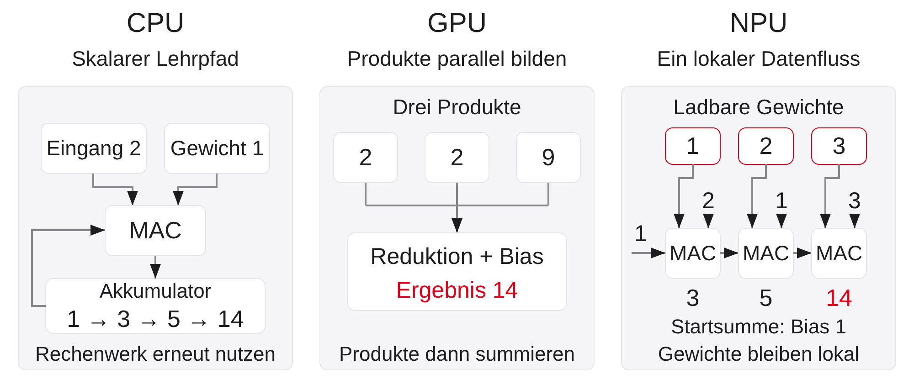{fig-alt="Skalare CPU akkumuliert1,3,5,14. GPU-Prinzip bildet Produkte2,2,9 und reduziert sie mit Bias1. NPU-Prinzip hält ladbare Gewichte lokal und gibt Teilsummen3,5,14 weiter."}

$y_0=1+1\cdot2+2\cdot1+3\cdot3=14$

Auch ein Entscheidungsbaum im Sensor kann Aktivitäten erkennen, etwa beim LSM6DSOX.

::: notes
Die Hardwareklasse verändert die Organisation, nicht das Sollresultat. CPU bezeichnet den allgemeinen Prozessor, GPU eine ursprünglich für Grafik entwickelte breite Parallelorganisation und NPU einen Beschleuniger neuronaler Verarbeitung. Die Grafik zeigt drei mögliche Wege für einen kleinen Rechenkern; seine Zahlen illustrieren eine einzelne Produktsumme und sind keine neu gelernten Parameter des Aktivitätsmodells.

Links verwendet der skalare CPU-Pfad eine MAC wiederholt: Aus Bias eins werden die Teilsummen drei, fünf und vierzehn. In der Mitte entstehen die Produkte zwei, zwei und neun parallel; eine Reduktion addiert sie und den Bias zum gleichen Resultat. Rechts bleiben ladbare Gewichte während des Nutzungsabschnitts lokal, während Eingaben und Teilsummen weitergegeben werden. Die Pfeile stellen Informationswege und keine Taktzahlen dar. Eine CPU kann selbst SIMD und mehrere Rechenwerke besitzen; eine NPU muss nicht genau diesen Datenfluss verwenden. Die Auswahl folgt Operatoren, Formen, Datentypen und Übergabekosten. Ein anderer Ansatz kommt ohne neuronales Netz aus: Das [Aktivitätserkennungsbeispiel von ST für den LSM6DSOX](https://github.com/STMicroelectronics/st-mems-machine-learning-core/blob/main/examples/activity_recognition_for_mobile/lsm6dsox/README.md) dokumentiert statistische Merkmale und einen Entscheidungsbaum im Sensor, unter anderem für Stationary, Walking und Jogging. Edge bezeichnet den Ort der Auswertung und keine NPU-Pflicht; eine feste Zahl parallel arbeitender Bäume wird hier nicht vorausgesetzt. Der nächste Schritt konkretisiert einen dieser lokalen Datenflüsse als getaktetes Array.
:::

## Eine Zelle rechnet und reicht weiter

::: {.section-label}
4 / 6 · Systolisches Array
:::

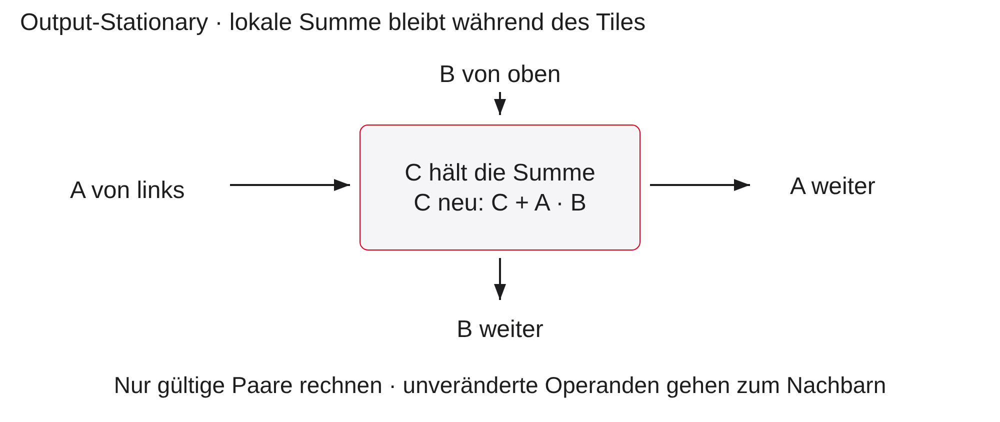{fig-alt="Die Zelle empfängt A von links und B von oben, addiert das Produkt zur lokalen Summe C und reicht A rechts sowie B unten weiter."}

Output-Stationary: Die Ausgabeteilsumme bleibt während des Tiles lokal.

::: notes
Eine systolische Zelle verbindet lokale Rechnung mit regelmäßiger Nachbarweitergabe. Der Name erinnert an rhythmisches Pumpen: Operanden bewegen sich in einer getakteten Welle durch das Gitter. Im gezeigten Output-Stationary-Datenfluss bleibt die Ausgabeteilsumme während des Tiles, also des bearbeiteten Matrixausschnitts, an ihrem Platz.

A kommt von links und wird unverändert nach rechts gegeben; B kommt von oben und wandert unverändert nach unten. Die Zelle leitet weder das Produkt als neues A noch die Summe als neues B weiter. Bei einem gültigen zusammengehörigen Paar aktualisiert sie $C\leftarrow C+AB$. Die rote Umrandung markiert den lokalen Zustand. Fehlt ein gültiger Operand, bleibt die Summe in diesem Takt unverändert. Vier solcher Zellen können gemeinsam vier Ausgänge bilden. Entscheidend ist nun, dass Werte mit demselben inneren Summenindex gleichzeitig an derselben Zelle eintreffen.
:::

## Die Randeinspeisung passt die Ankunftszeiten an

::: {.section-label}
4 / 6 · Systolisches Array
:::

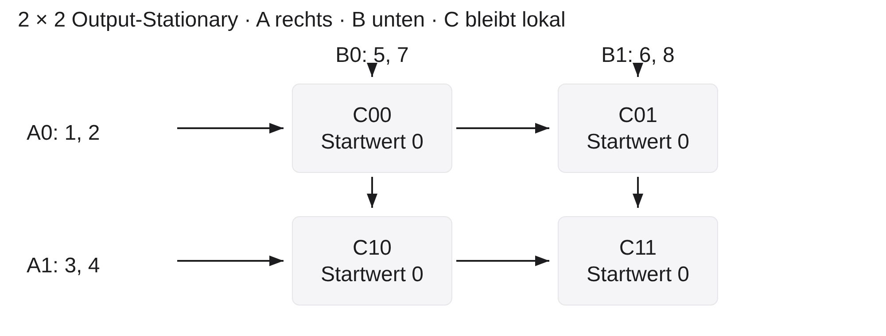{fig-alt="Vier Zellen C00,C01,C10,C11 bilden das Zwei-mal-zwei-Gitter. A wandert zeilenweise rechts, B spaltenweise unten, C bleibt lokal."}

$A_{ik}$ links in $1+k+i$, $B_{kj}$ oben in $1+k+j$

Gemeinsame Ankunft in $(i,j)$: $1+k+i+j$

::: notes
Die räumliche Anordnung reicht für eine richtige Rechnung noch nicht aus. Die Randeinspeisung muss zusätzlich die Laufwege ausgleichen. Im Zwei-mal-zwei-Beispiel gelten wieder $A=[[1,2],[3,4]]$ und $B=[[5,6],[7,8]]$. Die Indizes beginnen bei null. Zelle $C_{ij}$ benötigt für jeden Summenschritt die Werte $A_{ik}$ und $B_{kj}$ mit demselben k.

A wird links in Takt $1+k+i$ und B oben in $1+k+j$ eingespeist. Nach j Schritten nach rechts beziehungsweise i nach unten erreichen beide die Zielzelle in $1+k+i+j$. Bei $C_{00}$ sind das die Paare $(1,5)$ in eins und $(2,7)$ in zwei. Bei $C_{11}$ treffen $(3,6)$ erst in drei und $(4,8)$ in vier ein. Diese Staffelung heißt auch Skewing. Leere Zeitplätze sind ungültig; sie dürfen nicht als numerische Nullprodukte mitgezählt werden. Aus den Ankünften folgt nun die ganze Rechenwelle.
:::

## Welche Zelle ist zuerst vollständig fertig? {.compact-figure}

::: {.section-label}
4 / 6 · Systolisches Array
:::

Verfolgen Sie zur aktiven Zelle auch ihre Summe am Taktende.

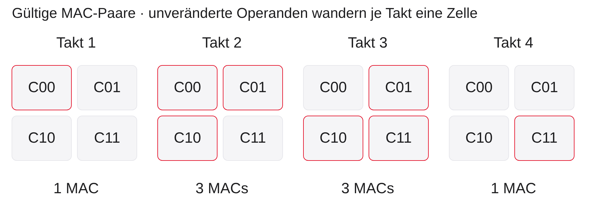{fig-alt="Die aktiven Zellen pro Takt sind C00; dann C00,C01,C10; dann C01,C10,C11; zuletzt C11. Es entstehen1,3,3,1 gültige MACs."}

::: notes
Die erste vollständige Ausgabe liegt in $C_{00}$ am Ende von Takt zwei. Lassen Sie zuerst zwischen einer aktiven Zelle und einer bereits fertigen Ausgabe unterscheiden. In eins rechnet nur $C_{00}$ und hält fünf. In zwei entsteht dort $5+2\cdot7=19$; zugleich beginnen $C_{01}$ mit sechs und $C_{10}$ mit fünfzehn. In drei enden diese beiden mit 22 und 43, während $C_{11}$ erst achtzehn hält. In vier endet die letzte Summe mit 50.

Die Zustände am Taktende lauten damit $[[5,0],[0,0]]$, $[[19,6],[15,0]]$, $[[19,22],[43,18]]$ und $[[19,22],[43,50]]$. Die gültigen MAC-Zahlen sind eins, drei, drei und eins, insgesamt acht. Das Gitter ist in keinem Takt vollständig beschäftigt. Eine noch unveränderte Null ist ein Anfangszustand und keine zusätzliche geleistete MAC. Fertig in der Zelle bedeutet außerdem erst nach einem geeigneten Ausleseschritt außerhalb des Arrays verfügbar.
:::

## Stationary: welcher Wert bleibt lokal?

::: {.section-label}
4 / 6 · Systolisches Array
:::

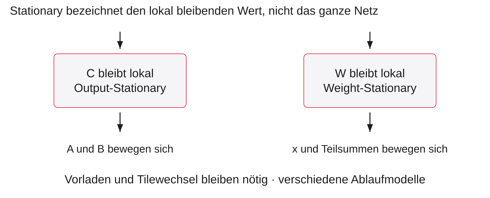{fig-alt="Output-Stationary hält eine Teilsumme lokal und bewegt Operanden. Weight-Stationary hält ein Gewicht und bewegt Eingaben sowie Teilsummen."}

Ortsfeste Werte sparen Wiederholungen; alle anderen Datenwege bleiben nötig.

::: notes
Stationary bezeichnet den Wert, der während eines Nutzungsabschnitts ortsfest bleibt. Links hält Output-Stationary eine Ausgabeteilsumme in der Zelle; passende Operanden kommen nacheinander dazu. Rechts hält Weight-Stationary ein Gewicht lokal, während Aktivierungen und Teilsummen nach einem anderen Plan bewegt werden. Rot markiert den jeweils bleibenden Wert, graue Pfeile die weitergegebenen Größen.

Der bisherige Vier-Takte-Ablauf gehört zur linken Organisation. Für die rechte müssen Einspeisung, Summenweitergabe und Reduktion neu festgelegt werden. Ein ortsfestes Gewicht ist dabei ladbar und nicht unveränderlich in Silizium eingebaut. Beim nächsten Tile oder einer anderen Schicht können neue Gewichte nötig sein. Welche Variante besonders wenig Verkehr verursacht, hängt von Matrixformen, verfügbaren Puffern und Wiederverwendung ab. Die beiden Bilder liefern daher eine Frage zur Datenorganisation, keine pauschale Rangliste von Geschwindigkeit oder Energie.
:::

## Räumliche Belegung und zeitliche Auslastung trennen

::: {.section-label}
4 / 6 · Systolisches Array
:::

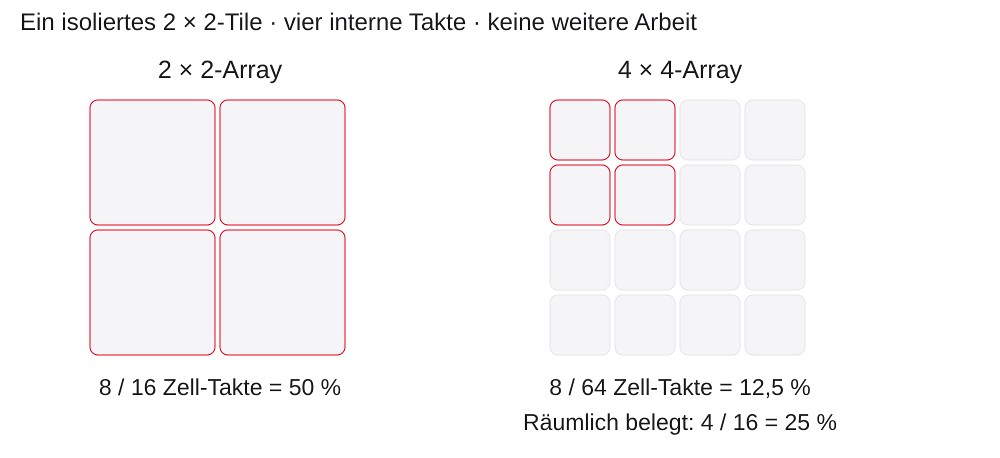{fig-alt="Das einzelne Zwei-mal-zwei-Tile belegt vier Zellen. Im2×2-Array acht von16 Zell-Takten; im sonst leeren4×4-Array acht von64. Räumliche Belegung dort25Prozent."}

$U=\dfrac{\text{gültige MACs}}{\text{Zellen}\cdot\text{Takte}}$

::: notes
Die Auslastung zählt genutzte Rechengelegenheiten über ein benanntes Zeitfenster. Weil jede Zelle höchstens eine MAC je Takt ausführen kann, ist ein Zell-Takt eine solche Gelegenheit. Unser einzelnes Tile erledigt acht gültige MACs. Auf vier Zellen in vier Takten sind das $8/16=50\,\%$. Wird es allein in den oberen linken vier Zellen eines sonst leeren 4×4-Arrays ausgeführt, sind es $8/64=12{,}5\,\%$.

Räumlich belegt dasselbe Tile dort vier von sechzehn Zellen, also 25 Prozent. Bezogen nur auf diese aktiven vier bleiben es über die vier Takte fünfzig Prozent zeitliche Auslastung. Die Bezugsmenge gehört deshalb zur Zahl. Für ein vollständig belegtes $M\times N$-Array mit innerer Dimension K folgt aus der Ankunftsformel das Fenster $K+M+N-2$ und $U=K/(K+M+N-2)$. Größere K verringern den relativen Anteil des Füllens und Leerens. Zusätzliche Tiles oder eine andere Überlappung benötigen einen eigenen Ablauf.
:::

## TPU v1: einen Peak richtig lesen {.compact-figure}

::: {.section-label}
4 / 6 · Systolisches Array
:::

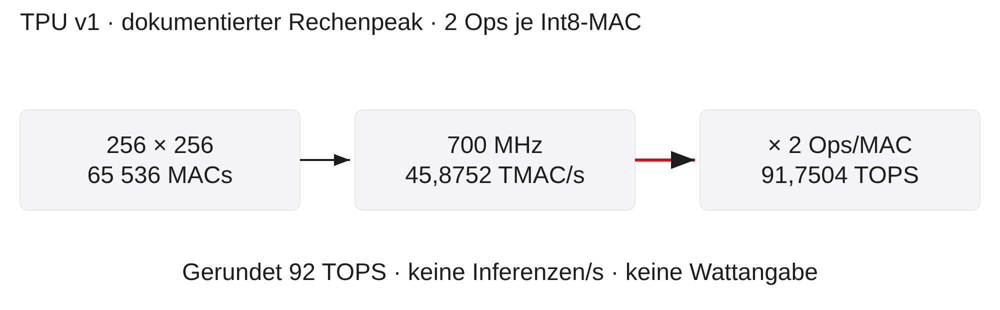{fig-alt="256×256 Int8-MAC-Zellen bei700MHz ergeben45,8752TMAC/s und bei zweiOperationen jeMAC91,7504TOPS, gerundet92."}

Historisches Rechenzentrumsbeispiel · Hintergrund zur Einordnung

::: notes
Ein dokumentierter Peak lässt sich rechnerisch einordnen. Die erste TPU-Generation aus der Arbeit von Jouppi und Mitautoren von 2017 besitzt $256\cdot256=65\,536$ Int8-MAC-Einheiten bei 700 MHz. TPU heißt Tensor Processing Unit und bezeichnet hier einen Rechenzentrumsbeschleuniger, kein kleines Sensorgerät.

Unter voller Versorgung entstehen $65\,536\cdot700\cdot10^6=45{,}8752\cdot10^{12}$ MACs pro Sekunde. Mit zwei gezählten Operationen je MAC sind das $91{,}7504$ TOPS, gerundet 92. TOPS bedeutet Billionen arithmetische Operationen je Sekunde. Die Grafik führt genau diese Zählkette vor. Für die Übung wichtig ist ihre Methode, nicht das Auswendiglernen der Chipzahl: Datentyp und MAC-Konvention müssen zur Peakangabe gehören. Inferenzen je Sekunde brauchen zusätzlich die Modellarbeit und die erreichte Auslastung. Energie je Inferenz verlangt darüber hinaus eine passende Leistungsaufnahme und dieselbe Systemgrenze.
:::

## Papierphase 3: das Array selbst verfolgen

::: {.section-label}
4 / 6 · Systolisches Array
:::


Teil A: 4.1–4.3 · 15 Minuten

- Gültige Paare und Teilsummen je Takt eintragen
- Nullprodukt von einem leeren Platz unterscheiden
- Zeitliche Auslastung und räumliche Belegung getrennt nennen

Die Verallgemeinerung in 4.4–4.5 vertieft den Datenfluss.

::: notes
Das Übungsblatt verlängert die innere Dimension des Tiles auf drei. Mit derselben Einspeiseregel entstehen fünf Takte. Die vier Teilsummen lauten nacheinander $[[2,0],[0,0]]$, $[[0,8],[3,0]]$, $[[-5,11],[3,12]]$, $[[-5,12],[13,12]]$ und $[[-5,12],[13,10]]$. Die letzten gültigen MACs liegen in drei für $C_{00}$, vier für $C_{01}$ und $C_{10}$ sowie fünf für $C_{11}$.

Bei $C_{11}$ treffen $(3,4)$, $(0,3)$ und $(2,-1)$ in drei, vier und fünf ein. Das Nullprodukt in vier bleibt eine gültige MAC. Die Zahlen pro Takt sind eins, drei, vier, drei und eins, insgesamt zwölf. Auf vier Zellen in fünf Takten folgen sechzig Prozent, auf allen sechzehn Zellen eines ansonsten leeren 4×4-Arrays fünfzehn Prozent; die räumliche Belegung dort beträgt 25 Prozent. Die allgemeine Vollbelegungsformel ergibt für 4×4 mindestens neunzig Prozent erst ab K 54. Vorladen und Auslesen sind weiterhin gesonderte Phasen.
:::

## 5 · Das Modell in die Firmware bringen {.section-divider}

Welche Zahlen und Speicherbereiche muss das Gerät tatsächlich bereitstellen?

Modellannahmen für diesen Abschnitt:

- Flash hält Modelldaten; SRAM hält unter anderem Aktivierungen und Arbeitsbereich.
- Int8: $[-128,127]$; Skala positiv; Halbfälle werden weg von null gerundet.
- Beispiele mit einer Skala je Tensor; Bias mit Produktskala und Nullpunkt null.

::: notes
Eine passende Rechenarchitektur braucht weiterhin ein ausführbares Modell mit einem eindeutigen Zahlenvertrag. Zuerst wird geprüft, welche Daten im Flash und welche während der Inferenz im Arbeitsspeicher leben. Erst daraus lässt sich beurteilen, ob ein anderes Zahlenformat eine sinnvolle Lösung für ein Speicherproblem ist.

Die folgenden Beispielzahlen verwenden Int8-Codes von $-128$ bis 127 und eine positive Skala. Gerundet wird zum nächsten Integer, bei exakten Halbfällen weg von null. Eingaben und Gewichte besitzen jeweils eine Skala und einen Nullpunkt; Biaswerte verwenden die Produktskala. Die Laufzeit muss dieselben Vereinbarungen wie die Modellvorbereitung verwenden. Konkrete Operatorvarianten können kanalweise Skalen oder andere festgelegte Rundungen haben. Solche Verträge werden bei der Integration geprüft, statt aus dem Dateinamen oder der Speicherbreite geraten zu werden.
:::

## Flash und Tensor Arena getrennt planen

::: {.section-label}
5 / 6 · Quantisierung und Speicher
:::

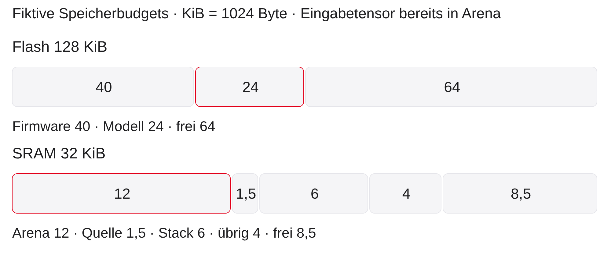{fig-alt="Fiktives Budget:128KiB Flash mit40KiB Firmware,24KiB Modell,64KiB frei;32KiB SRAM mit12KiB Arena,1,5KiB Quelle,6KiB Stack,4KiB übrigen Daten,8,5KiB frei."}

Reine Gewichte: Float32 braucht viermal so viele Bytes wie Int8.

::: notes
Dauerhafte Parameter und laufende Arbeit belegen unterschiedliche Budgets. Flash hält nichtflüchtige Daten; SRAM ist flüchtiger Arbeitsspeicher. Die Tensor Arena ist ein geplanter zusammenhängender Bereich für Tensoren, vorübergehende Kernelpuffer und Verwaltungsdaten. Ihre Größe folgt aus Lebensdauern und Operatoren, nicht allein aus der Modelldatei.

Das Bild zeigt ein ausdrücklich anderes, fiktives Plattformbudget: Im Flash bleiben $128-40-24=64$ KiB frei, im SRAM $32-12-1{,}5-6-4=8{,}5$ KiB. Ein KiB sind 1024 Byte. Der Int8-Eingabetensor ist bereits in der Arena enthalten; das Float32-Quellfenster liegt daneben. Für größere Modelle kann Float32 die Flashreserve überschreiten. Int8 reduziert reine Gewichtbytes auf ein Viertel, lässt Bias, Verwaltungsdaten und Arena aber nicht automatisch im gleichen Verhältnis schrumpfen. Auch das kleinere Aktivitätsmodell muss mit seiner konkreten Arena geplant werden. `const` allein bestimmt nicht die physische Ablage; dazu gehören Linkerplatzierung und Startcode.
:::

## Quantisierung ordnet Codes reale Werte zu

::: {.section-label}
5 / 6 · Quantisierung und Speicher
:::


$$\widehat r=s(q-z),\qquad
q=\operatorname{clip}_{[-128,127]}\!\left(\operatorname{round}(r/s)+z\right)$$

- $s>0$: realer Wert je Codeschritt
- $z$: Code für die reale Null
- $q$: gespeicherter Int8-Code

Kleinere Codes sparen Speicher; Skala und Nullpunkt erhalten ihre Bedeutung.

::: notes
Quantisierung stellt reale Werte durch endlich viele Codes dar. Ein Int8-Code hat für sich allein noch keine physikalische oder mathematische Bedeutung. Diese entsteht erst durch Skala s und Nullpunkt z. Zum Kodieren wird durch s geteilt, gerundet, z addiert und auf den Codebereich begrenzt. Zum Rückrechnen wird z subtrahiert und mit s multipliziert.

Bei Nullpunkt minus drei repräsentiert Code minus drei die reale Null: $s((-3)-(-3))=0$. Code null muss somit nicht dem realen Wert null entsprechen. Der Skalierungsschritt bestimmt Auflösung und Wertebereich zugleich. Ohne Begrenzung ist der absolute Rundungsfehler höchstens $s/2$. Außerhalb des darstellbaren Bereichs tritt Sättigung auf; dort gilt diese kleine Fehlerschranke nicht. Die gewählten Quantisierungsparameter müssen anhand repräsentativer Daten festgelegt und bei der späteren Inferenz unverändert korrekt benutzt werden. Die resultierende Modellgüte bleibt Teil der Prüfung an neuen Daten.
:::

## Rundungsfehler und Sättigung unterscheiden

::: {.section-label}
5 / 6 · Quantisierung und Speicher
:::

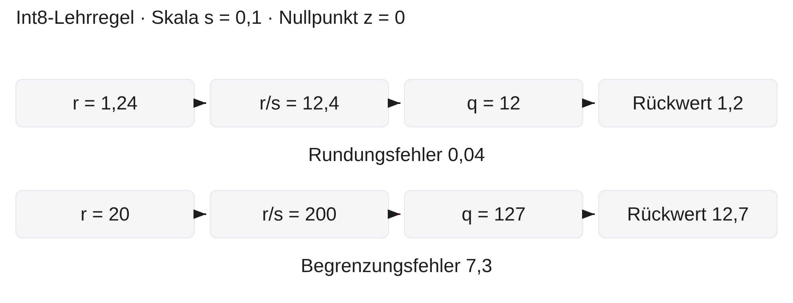{fig-alt="MitSkala0,1 undNullpunkt0 wird1,24 zuCode12 undRückwert1,2;Wert20 sättigt auf127 undRückwert12,7."}

Mehr Wertebereich und feinere Auflösung stehen im Zielkonflikt.

::: notes
Rundung und Sättigung verlieren auf unterschiedliche Weise Information. Bei $s=0{,}1$ und $z=0$ wird $1{,}24/0{,}1=12{,}4$ auf zwölf gerundet. Der Rückwert 1,2 hat Fehler 0,04 und bleibt innerhalb der Schranke 0,05. Der entsprechende negative Wert wird zu minus zwölf und Rückwert minus 1,2.

Für zwanzig wäre der Code zweihundert nötig. Er liegt außerhalb von Int8 und wird auf 127 begrenzt. Der Rückwert 12,7 hat nun Fehler 7,3. Minus zwanzig wird auf minus 128 und Rückwert minus 12,8 begrenzt. Die untere Zeile der Grafik zeigt diesen anderen Fehlerfall. Eine größere Skala kann den Bereich erweitern, macht aber jeden Codeschritt gröber. Ob die geringeren Gewichtbytes die Erkennung weiterhin ausreichend genau erlauben, wird deshalb am quantisierten Modell und nicht allein am Speichergewinn beurteilt.
:::

## Quantisierte Produkte brauchen eine Produktskala

::: {.section-label}
5 / 6 · Quantisierung und Speicher
:::


$$a=\sum_i(q_{x,i}-z_x)(q_{w,i}-z_w)+q_b,\qquad r_y\approx s_xs_w a$$

Rechenkern: $q_x=[12,-4]$, $z_x=-3$, $q_w=[2,3]$, $z_w=0$.

$s_x=0{,}1$, $s_w=0{,}2$, $q_b=5$ ergeben $a=32$ und $r_y\approx0{,}64$.

::: notes
Ein quantisiertes Skalarprodukt muss vor dem Multiplizieren seine Nullpunkte berücksichtigen. Der Biascode besitzt hier Nullpunkt null und dieselbe Skala $s_xs_w$ wie die Produktsumme. Dadurch lassen sich alle Beiträge im breiten Akkumulator a addieren. Das kleine Zahlenbeispiel isoliert diese Rechenregel; es ist keine Behauptung über einen bestimmten trainierten Neuronenausgang.

Nach der Korrektur sind die Eingaben $15$ und $-1$, die Gewichte zwei und drei. Die Produktsumme ist $15\cdot2-1\cdot3=27$, mit Bias fünf also 32. Die Produktskala ist 0,02 und liefert Realwert 0,64. Für eine anschließende Int8-Ausgabe mit $s_y=0{,}05$ und $z_y=-2$ wird erneut gerundet: $q_y=\operatorname{round}(0{,}64/0{,}05)-2=11$. Der Rückwert ist 0,65. Requantisierung fügt somit einen eigenen Fehler hinzu. Biaswerte und Akkumulatoren werden dabei weiterhin mit ihrer breiten Darstellung budgetiert.
:::

## Modelldaten laden, Laufzeit einrichten, Status prüfen {.compact-figure}

::: {.section-label}
5 / 6 · Quantisierung und Speicher
:::

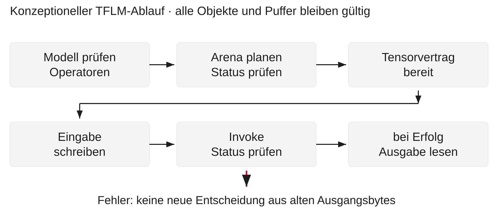{fig-alt="SetupprüftModell,Operatoren,Arena undTensorvertrag. DerZyklus schreibtEingaben,prüftInvoke undliestAusgabennurbeiErfolg. Fehlerführen zumFehlerpfad."}

Eine `.tflite`-Datei oder ein C-Byte-Array enthält Modelldaten, keinen Modell-Maschinencode.

::: notes
Ein exportiertes Modell wird erst zusammen mit passenden Operator-Kerneln und einer Laufzeit ausführbar. Eine `.tflite`-Datei kann beispielsweise als C-Byte-Array in die Firmware eingebunden werden. Das verändert die Darstellung der Daten, erzeugt aber keine Maschinenbefehle aus ihren Gewichten. Der Interpreter organisiert die Operationen; ein Resolver ordnet sie den vorhandenen Implementierungen zu.

Vor dem ersten Aufruf werden Modellstruktur und unterstützte Operatoren geprüft, die Tensorpuffer in der Arena geplant und Formen, Datentypen sowie Quantisierungsparameter kontrolliert. Die Werkzeugfamilie LiteRT setzt TensorFlow Lite fort; die gepflegte Mikrocontroller-Laufzeit heißt in ihrem Repository weiterhin TensorFlow Lite for Microcontrollers, kurz TFLM. Die Namen vorhandener Klassen und API-Aufrufe werden deshalb nicht pauschal geändert. In der TFLM-Schnittstelle gehört dazu ein erfolgreicher Status von `AllocateTensors()`. Modell, Interpreter und Arena müssen während sämtlicher späterer Aufrufe leben. Der Zyklus schreibt passende Eingaben, ruft `Invoke()` auf und liest nur nach Erfolg eine neue Ausgabe. Ein alter Puffer nach einem Fehler ist keine neue Entscheidung. Die Abbildung zeigt diese Zustände und Fehlerpfade, den vorgesehenen Gerätezustand. Unser NumPy-Modell wurde tatsächlich trainiert und ausgewertet; ein TFLM-Export und ein Mikrocontrollerlauf sind weitere, hier nicht ausgeführte Schritte.
:::

## 6 · Die gesamte Anwendung beurteilen {.section-divider}

Wann wird aus einer schnellen Matrixphase eine brauchbare Aktivitätserkennung?

Gemeinsame Bewertungsgrenze:

- Beginn: ein neues Sensorfenster liegt bereit.
- Ende: eine gültige Entscheidung liegt vor.
- Vorverarbeitung, Kopien, übrige Operatoren und Nachbereitung zählen mit.

::: notes
Für die Anwendung zählt die Entscheidung zur rechten Zeit, nicht der isolierte Abschluss eines Operators. Die gemeinsame Grenze reicht daher vom bereitstehenden Sensorfenster bis zum gültigen Ausgang. Alle seriellen Phasen innerhalb dieser Grenze werden mitgezählt. Ebenso müssen Modellgüte, Speicher und Energie unter passenden Bedingungen bewertet werden.

Die folgenden Zahlen verwenden ausdrücklich serielle Lehrzeiten ohne Überlappung. Sie zeigen das Amdahlsche Prinzip: Ein nur teilweise beschleunigter Ablauf bleibt durch seine anderen Anteile begrenzt; zusätzliche Übergaben können einen Teil des Gewinns verbrauchen. Davon getrennt ist die Gültigkeit der Entscheidung. Ein schnell berechneter Score nach falscher Kanalreihenfolge oder ein alter Puffer nach Fehler ist kein brauchbares Ergebnis. Der abschließende Blick auf das Sensorgerät verbindet diese Systemfragen wieder mit den Messdaten und dem gewählten Modell vom Einstieg.
:::

## Amdahl: Teilgewinn und Gesamtgewinn

::: {.section-label}
6 / 6 · Firmware und Gesamtbilanz
:::


Dense zehnmal schneller: Welchen Gesamtfaktor erwarten Sie?

Serielle Zeiten in Millisekunden; gleicher Input und gleiche Ausgabe:

| Phase | CPU-Pfad | Beschleunigerpfad |
|---|---:|---:|
| Vorverarbeitung | $2$ | $2$ |
| zusätzliche Kopie | $0$ | $1$ |
| Dense | $10$ | $1$ |
| übrige Operatoren | $3$ | $3$ |
| Nachbereitung | $1$ | $1$ |

::: notes
Das Amdahlsche Gesetz begrenzt den Gesamtgewinn einer Teilbeschleunigung. Der CPU-Pfad braucht $2+10+3+1=16$ Millisekunden. Mit Beschleuniger sind es $2+1+1+3+1=8$ Millisekunden einschließlich der Kopie. Die Dense-Phase wird Faktor zehn schneller, die gesamte Entscheidung Faktor zwei. Lassen Sie zuerst eine Vermutung begründen und anschließend die komplette Grenze bilanzieren.

Ohne neue Übergabekosten lautet die bekannte Form $S=1/((1-f)+f/s)$: f ist der bisherige Zeitanteil des beschleunigten Teils und s dessen Teilfaktor. Hier gilt $f=10/16$; die zusätzliche Kopie ergänzt im Nenner den Anteil $1/16$. Selbst eine Dense-Zeit null lässt sieben Millisekunden übrig, also höchstens Faktor $16/7$. Die Rechnung begründet eine Latenzaussage, noch keine Energieersparnis. Gerade beim kleinen Aktivitätsmodell können Übergabe und übrige Firmwarearbeit die Hardwarewahl stärker bestimmen als der isolierte Rechenpeak.
:::

## Sensorfenster und Ausgabe brauchen einen Vertrag

::: {.section-label}
6 / 6 · Firmware und Gesamtbilanz
:::


Aktivitätsmodell aus der Übung: 32 Zeitpunkte × drei Achsen → 96 Eingabewerte

- Reihenfolge, Abtastrate und Vorverarbeitung müssen zum Training passen.
- Float32-Quelle und Int8-Zieltensor sind getrennte Speicheranteile.
- Drei Scores → größter Score → Klassenindex
- Ausgaben erst nach erfolgreicher Inferenz interpretieren.

::: notes
Die Bedeutung einer Eingabe folgt nicht allein aus ihrer Länge. Für das Aktivitätsmodell der Übung werden 32 Zeitpunkte mit je drei Achsen zeitpunktweise angeordnet. Das ergibt 96 Elemente. Dieselbe Anzahl in einer anderen Reihenfolge oder mit anderer Vorverarbeitung beschreibt jedoch eine andere Eingabe. Auch ein Zeiger enthält nur die Adresse: `sizeof` eines Zeigers liefert keine Arraylänge.

Ein Float32-Quellfenster und ein quantisierter Int8-Eingabetensor besitzen unterschiedliche Größen und können zeitweise zugleich leben. Der Zieltensor liegt gegebenenfalls bereits in der Arena und wird dann im Budget nicht erneut addiert. Am Ausgang sind drei Scores zunächst drei Bewertungswerte. Argmax wählt deren größten und liefert den Klassenindex; Wahrscheinlichkeiten benötigen zusätzlich eine entsprechend definierte Ausgabe. Eine korrekt erkannte Klasse Gehen ist außerdem noch keine Schrittzahl. Dieser Vertrag führt die konkrete Klassifikationsaufgabe und die Firmwareintegration zusammen.
:::

## Die Funktion bestimmt die Hardwarewahl

::: {.section-label}
6 / 6 · Firmware und Gesamtbilanz
:::


Aus dem Sensorfenster wird eine brauchbare Entscheidung, wenn …

- Modell und Vorverarbeitung an neuen Fällen bestehen,
- Operatoren, Formen und Zahlenformate zusammenpassen,
- Speicher, Reaktionszeit und Energie im Gesamtsystem passen.

CPU, Vektoren und NPU sind mögliche Werkzeuge für diese Anforderungen.

::: notes
Die Einstiegsfrage nach dem Programmieren von Stehen, Gehen und Laufen hat jetzt eine vollständige Antwort. Messdaten werden zu einem festgelegten Eingabefenster, das Modell berechnet daraus Scores und die Anwendung interpretiert die gewählte Klasse. Training und unabhängige Prüfung begründen, ob diese Entscheidung für die beabsichtigten neuen Fälle geeignet ist. Mehr Multiplikationsleistung kann diese Prüfung nicht ersetzen.

Die Hardware folgt dem Bedarf. Ein kleines Modell kann auf einer CPU laufen; Vektoren oder eine passende NPU können regelmäßige Teilrechnungen anders organisieren. Entscheidend bleiben Datenversorgung und Operatorunterstützung. Auch Nullgewichte sparen erst mit einer passenden dünnbesetzten Darstellung oder einem tatsächlich überspringenden Kernel Bytes beziehungsweise Arbeit. Ein funktionaler Host- oder Simulatorlauf prüft wiederum andere Eigenschaften als eine Hardwaremessung. Für die Bewertung werden deshalb numerische Korrektheit, Modellgüte, Speicher, Zeit und Energie getrennt nachgewiesen und anschließend unter derselben Anwendungsgrenze zusammengeführt.
:::

## Papierphase 4: Quantisierung und Firmware

::: {.section-label}
6 / 6 · Firmware und Gesamtbilanz
:::


Teil A: 5.1, 5.3 und 6.3 · 15 Minuten

- Negative Werte quantisieren und Fehler erklären
- Produktskalen und Requantisierung verfolgen
- Lebensdauer, Zeigergröße und Fehlerstatus diagnostizieren

Weitere Budget- und Gesamtzeitfragen dienen der Nachbereitung.

::: notes
Bei Skala 0,2 und Nullpunkt null liefert $-1{,}37$ den Code $-7$, Rückwert $-1{,}4$ und Fehler 0,03. $-30$ sättigt dagegen auf $-128$, Rückwert $-25{,}6$ und Fehler 4,4. Im getrennten Skalarprodukt der Aufgabe entsteht nach Nullpunktkorrektur $6(-2)+(-4)3+4=-20$. Mit Produktskala 0,025 sind das $-0{,}5$; Requantisierung führt zu Code $-3$ und Rückwert $-0{,}48$.

Im separaten Firmwarefall des Übungsblatts werden C-Grundlagen auf ein anderes Sensorfenster angewendet. Lokale Arena und lokaler Interpreter leben nach Verlassen von `setup` nicht weiter. Eine globale Zeigervariable verlängert ihre Lebensdauer nicht. `sizeof(window)` ergibt im RV32-Vertrag vier Zeigerbytes, nicht die benötigten 400 Elemente. Außerdem müssen Initialisierung, Tensorvertrag und Fehlerstatus geprüft werden. Die separat budgetierte dauerhafte Arena ersetzt den ungültigen lokalen Speicher; sie wird nicht als zweite Arena hinzuaddiert. Die vollständigen Korrekturen und weiteren Zeitrechnungen stehen im Lösungsprofil.
:::

## Abschlussquiz: Grenzen begründen

::: {.section-label}
6 / 6 · Firmware und Gesamtbilanz
:::


Zwölf QuizAcademy-Fragen · 15 Minuten

- Erst allein entscheiden, dann die benötigte Annahme begründen
- Parameter, MACs, Bytes und Takte auseinanderhalten
- Fehlerfälle und geänderte Bedingungen prüfen

Teil B des Übungsblatts: drei längere Fälle zur selbstständigen Vertiefung

::: notes
Das vollständige Quiz schließt die inhaltliche Arbeit ab. Es verbindet die Begriffe wieder mit konkreten Bedingungen: Parameter werden im Batch wiederverwendet, MACs je Eingabe erneut ausgeführt. Ein Roofline-Peak ist eine obere Rate; eine große Vektorkapazität ist keine Lanezahl. Ein zurückgesetzter Rechenpfad und ein gültiger neuer Ausgang sind ebenfalls verschiedene Aussagen.

Für die zwölf Fragen sind fünfzehn Minuten vorgesehen, etwa zwölf zur eigenen Entscheidung und drei zur gezielten Besprechung ausgewählter Fehlvorstellungen. Die drei schwierigeren Fragen verlangen die Übertragung von bekannten Regeln auf neue Größen. Jede Frage besitzt vier Optionen und genau eine richtige Antwort. Die Diskussion sollte die entscheidende Annahme benennen, nicht nur eine Optionsnummer. Die längeren Fälle aus Teil B verbinden anschließend selbstständig Modellformen, Speicher, Wartezeit, Quantisierung und Datenbreite. Zeitrichtwerte und Orientierungspunkte ersetzen keine verbindliche, gesondert festzulegende Klausurregelung.
:::

## Begriffe zum Nachlesen

::: {.section-label}
Hintergrund · Deutsch und Englisch zuordnen
:::

| Daten und Modell | Rechnen und Datenwege | Firmware |
|---|---|---|
| Merkmal · feature | MAC · Multiply-Accumulate | Inferenz · inference |
| Gewichte · weights | SIMD · Single Instruction, Multiple Data | Tensor Arena · Arbeitsbereich |
| Aktivierung · activation | RVV · RISC-V Vector Extension | Nullpunkt · zero point |
| Verlust · loss | Roofline · Rechen-/Bandbreitengrenze | Requantisierung · requantization |

[Definitionen und weitere Kursbegriffe im Glossar](../GLOSSAR.md)

::: notes
Ein Fachbegriff hilft, wenn seine Bedeutung und seine Grenze klar bleiben. Ein Merkmal beschreibt eine Eingabe; ein Gewicht ist ein fester Modellparameter während der betrachteten Inferenz. Eine Aktivierung entsteht dagegen für das aktuelle Fenster. Die Aktivierungsfunktion ist die Regel, die auf eine Voraktivierung angewendet wird. Diese Unterscheidungen verbinden die ersten Messdaten mit der späteren Speicherbilanz.

Ebenso bezeichnet eine MAC eine Rechenoperation mit Multiplikation und Akkumulation, aber keine feste Zahl von Prozessortakten. Die Vektorkapazität begrenzt die Zahl aktiver Elemente; die physischen Lanes und ihre Datenversorgung bestimmen das zeitliche Verhalten. Das Kursglossar ordnet die deutschen und englischen Bezeichnungen zusammen und nennt die Stellen der Einführung. Es dient zum Nachlesen, nicht als zusätzliche Liste auswendig zu lernender Abkürzungen. Die Tabelle fasst die drei Ebenen Daten, Rechnung und Firmware zusammen; die folgenden Quellen ermöglichen das gezielte Vertiefen einzelner Ebenen.
:::

## Quellen für Modelle, Daten und Hardware

::: {.section-label}
Hintergrund · Primärquellen und Literatur
:::

- Harris & Harris: *Digital Design and Computer Architecture — RISC-V Edition*
- [Williams, Waterman, Patterson (2009): Roofline](https://doi.org/10.1145/1498765.1498785)
- [Kung (1982): Why Systolic Architectures?](https://doi.org/10.1109/MC.1982.1653825)
- [RISC-V Vector 1.0](https://github.com/riscv/riscv-v-spec/blob/v1.0/v-spec.adoc) · [TFLM-Speicherplanung](https://github.com/tensorflow/tflite-micro/blob/main/docs/memory_management.md)
- [MotionSense: Daten, Urheberschaft und MIT-Lizenz](../assets/data/08_motion_sense/README.md)

::: notes
Die Grundlagen orientieren sich an Sarah L. Harris und David Money Harris, Digital Design and Computer Architecture, RISC-V Edition. David A. Patterson und John L. Hennessy, Computer Organization and Design, RISC-V Edition, vertiefen die Verbindung von Software und Rechnerorganisation. Die aktuellen technischen Einzelheiten werden zusätzlich an den jeweils genannten Primärquellen geprüft.

Das Roofline-Modell stammt von Samuel Williams, Andrew Waterman und David Patterson: Roofline: An Insightful Visual Performance Model for Multicore Architectures, Communications of the ACM 52(4), 2009, Seiten 65–76. H. T. Kungs Beitrag Why Systolic Architectures?, Computer, 1982, erläutert den Ansatz lokaler regelmäßiger Datenflüsse. Die eigenen Lehrabbildungen übernehmen keine Grafiken aus diesen Artikeln. Für die aktive Vektorlänge ist die RISC-V Vector Extension Version 1.0 maßgeblich; TFLMs Dokumentation beschreibt die tatsächliche Mikrocontroller-Speicherplanung.

Die MotionSense-Messungen stammen von Mohammad Malekzadeh, Richard G. Clegg, Andrea Cavallaro und Hamed Haddadi; die Original-README nennt Mobile Sensor Data Anonymization, IoTDI 2019, Seiten 49–58, DOI 10.1145/3302505.3310068. Im Repository stehen ein gepinnter Datenausschnitt, Herkunft und ursprünglicher MIT-Lizenztext. Die Zeitverläufe und Diagramme dieser Einheit wurden daraus beziehungsweise aus den angegebenen Gleichungen selbst erzeugt. Die Ausführung des NumPy-Lehrmodells und die abstrakten Hardware-Zeitmodelle sind getrennte Nachweise.
:::

## Mit eigenen Messdaten weiterarbeiten

::: {.section-label}
Hintergrund · Optionaler Praxisversuch
:::

1. Mit [phyphox](https://phyphox.org/) Beschleunigung aufzeichnen und als CSV exportieren.
2. Abtastrate, Einheit, Sensorlage, Aktivitätslabel und Personenaufteilung prüfen.
3. [Lehrtraining im Notebook nachvollziehen](../code/vl08_activity_demo.ipynb) und erst danach passende eigene Fenster ergänzen.

[Ausführbares Trainings- und Abbildungsskript](../code/vl08_activity_demo.py)

::: notes
Eine eigene Messung verbindet den aufgezeichneten Verlauf mit der anfangs vorgeschlagenen Regel. phyphox ist eine an der RWTH Aachen entwickelte Anwendung für Smartphone-Sensorversuche und bietet einen CSV-Export. Für einen Vergleich muss klar sein, ob die Aufzeichnung den Schwerkraftanteil enthält, welche Achsenreihenfolge verwendet wird und welche tatsächliche Abtastrate vorliegt. Das vorliegende Lehrmodell erwartet 32 aufeinanderfolgende XYZ-Punkte bei nominell 50 Hertz. Ein anderer Eingabevertrag verlangt eine passende Vorbereitung oder ein neu angepasstes Modell.

Das Notebook führt zuerst den vorhandenen MotionSense-Versuch mit dem mitgelieferten Python-Skript aus. Es benötigt NumPy und Matplotlib und läuft aus dem Repository; ein neuronales Framework oder eine NPU wird nicht benötigt. Die eigenen Messungen sind eine anschließende Erweiterung, keine bereits ausgeführte Datenerhebung dieser Vorlesung. Für reale Geräteprojekte führen unter anderem die Mikrocontroller-Laufzeit TFLM, NXP eIQ im MCUXpresso-Umfeld und STs STM32-/STEdgeAI-Werkzeuge weiter. Deren Operatorunterstützung, Speicherplanung und Zahlenformate sind pro Plattform zu prüfen. Dieser optionale Ausblick liegt außerhalb des 180-Minuten-Pflichtablaufs.
:::
