## Mehrere Kerne: gemeinsame Werte richtig nutzen

- Vorlesung 8: gleichartige Rechnung und lokale Wiederverwendung
- Heute: mehrere Ausführungsfäden auf gemeinsamen Daten
- Kopien koordinieren, Updates schützen, Daten geordnet übergeben
- Zum Abschluss: Grenzen der Beschleunigung und Systemwiederholung

::: notes
Ein Kern ist eine physische Prozessoreinheit. Ein Ausführungsfaden oder Thread ist eine Folge von Programmschritten. Multicore bezeichnet mehrere Kerne in einem System. Die vorige Vorlesung hat Datenparallelität, lokale Wiederverwendung und die Gesamtkosten einer Inferenz erklärt. Inferenz bedeutet das Auswerten neuer Eingaben mit festgelegten Modellparametern. Das dortige Hostprogramm prüfte Zahlenbeispiele; ein TensorFlow-Micro-Labor auf einem RISC-V-Gerät wurde nicht ausgeführt.

Heute können mehrere Fäden gleichzeitig unterschiedliche Teile einer Aufgabe bearbeiten. Sobald sie Adressen gemeinsam nutzen, reichen unabhängige Rechenwerke nicht mehr aus. Ein Cache kann eine Kopie halten, ein Update aus mehreren Schritten bestehen und eine Übergabe mehrere verschiedene Objekte betreffen. Diese drei Probleme verlangen unterschiedliche Mechanismen.

Wir beginnen mit den gültigen Kopien einer Cachezeile, verfolgen anschließend einen gemeinsamen Zähler und ordnen schließlich Datenübergabe und Fortschritt. Eigene Zustands- und Zeitfolgen sind Lehrmodelle. Der ergänzte C-Versuch läuft auf dem Entwicklungsrechner. Der Semesterabschluss verbindet die neuen Begriffe mit den bisherigen Speicher-, Timer- und Transferaufgaben.
:::

## Voraussetzungen und drei Leitfragen

- Arrays, Load/Store und Write-Back-Caches aus Vorlesung 2
- Interrupt-Kontexte aus Vorlesung 3; DMA-Ownership aus Vorlesung 6
- Abhängigkeit und interne Parallelität aus Vorlesungen 7–8
- Welche Kopie gilt? Welches Update ist unteilbar? Wann gelten weitere Daten?

::: notes
Load und Store sind Speicherlesen und Speicherschreiben. Write-Back ist die Cachepolitik, bei der eine geänderte Zeile zunächst lokal bleibt und später zurückgeschrieben wird. Ein Cache hält nahe Kopien von Speicherblöcken. DMA heißt Direct Memory Access, Übertragung durch einen eigenständigen Transfercontroller. Ownership bezeichnet die vereinbarte Zuständigkeit für Daten oder Schreibrechte. Ein Interrupt unterbricht den laufenden Kontext, dessen Arbeit bis zur Rückkehr nicht fortgesetzt wird.

Diese Vorkenntnisse werden in den folgenden Folien gezielt wiederholt. Neu sind drei Leitfragen. Kohärenz koordiniert gültige Kopien und Schreibbeobachtungen derselben Speicherstelle. Atomizität beschreibt eine als unteilbar wirkende Operation, beispielsweise ein Lesen-Ändern-Schreiben. Speicherordnung bestimmt, in welcher Beziehung Zugriffe auf mehrere Objekte von anderen Fäden beobachtet werden dürfen.

Sie sollen stabile Cachezustände und Werte verfolgen, ein verlorenes Inkrement erklären und einen atomaren Übernahmeerfolg vom gelesenen Wert unterscheiden können. Weiter sollen Sie eine geordnete Datenübergabe, einen blockierten Lockhalter und eine Beschleunigungsgrenze begründen. Ein Lock ist eine Sperre für einen geschützten Abschnitt. Keine dieser Aufgaben setzt ein bereits bekanntes Betriebssystem oder eine Multicore-Toolchain voraus.
:::

## Vier Schulstunden: Ablauf

| Stunde | Erklärung und Besprechung | Arbeitsphase |
|--------|---------------------------|--------------|
| 1 | Threads, Kohärenz und MESI: 35 min | Aufgaben 1–2: 10 min |
| 2 | Verlorene Updates und LR/SC: 30 min | Aufgabe 3: 15 min |
| 3 | Speicherordnung, Locks und Interrupts: 30 min | Aufgabe 4: 15 min |
| 4 | Amdahl und Systemwiederholung: 15 min | Aufgaben 5–6: 15 min; Quiz: 15 min |

::: notes
Vier Schulstunden entsprechen hundertachtzig Minuten ohne zusätzliche Pausen. Die Planung enthält hundertzehn Minuten Erklärung, Denkfragen und Lösungsbesprechung, fünfundfünfzig Minuten angeleitete Papierarbeit und fünfzehn Minuten Quiz. Fünfzig Folien verteilen die Erklärschritte; eine Zustandsfolge braucht mehr gemeinsame Arbeit als eine kurze Orientierung.

MESI steht für Modified, Exclusive, Shared, Invalid, die vier stabilen Cachezeilenzustände unseres Modells. LR/SC bedeutet Load-Reserved/Store-Conditional, reservierend lesen und bedingt schreiben. Beide werden vollständig eingeführt. Das Übungsblatt enthält sechs Pflichtaufgaben mit zweiunddreißig Orientierungspunkten und nennt einen längeren Zeitrichtwert für die vollständige selbstständige Bearbeitung.

In der ersten Phase zählen Sie Zustand und Datenwert getrennt. Danach verfolgen Sie ein verlorenes Update und seine atomare LR/SC-Wiederholung. Die dritte Phase verbindet Datenordnung mit einem Interruptkontext. Am Ende rechnen Sie Beschleunigung und wiederholen Speicher- und Timergrößen. Musterlösungen gehören zum Lösungsprofil. Das optionale Hostexperiment ergänzt diese Papierarbeit; es ersetzt weder ein Hardware-Kohärenzmodell noch eine Zeitmessung eines RISC-V-Systems.
:::

## Thread, Hart und Kern auseinanderhalten

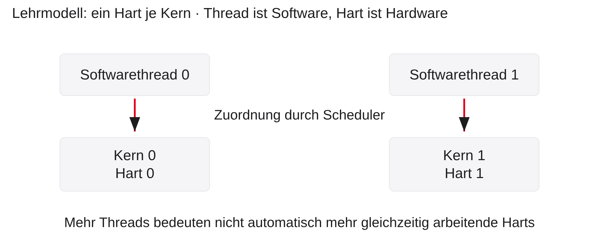{fig-alt="Zwei Softwarethreads werden zwei Harts zugeordnet. Im Lehrmodell besitzt jeder der zwei Kerne genau einen Hart. Ein Scheduler entscheidet die Zuordnung."}

Ein Thread ist Software; ein Hart ist eine Hardware-Ausführungsinstanz.

::: notes
Ein Softwarethread ist ein eigenständig fortsetzbarer Programmablauf. Ein Hart, Hardware Thread, ist in RISC-V eine Hardwareinstanz mit eigenem architektonischem Ausführungszustand. RISC steht für Reduced Instruction Set Computer, Rechner mit reduziertem Befehlssatz. Ein Kern ist die physische Prozessoreinheit. Im Lehrmodell besitzt jeder unserer beiden Kerne genau einen Hart; andere Zuordnungen sind möglich.

Das Bild zeigt oben zwei Softwarefäden, darunter die Zuordnung durch einen Scheduler, die Instanz zur Auswahl lauffähiger Arbeit. Die roten Pfeile markieren gleichzeitig zugewiesene Abläufe. Ein Faden ist nicht dauerhaft mit dem gezeichneten Kern identisch. Affinity bedeutet eine erlaubte oder erzwungene Bindung an bestimmte Ausführungsinstanzen. Migration ist das spätere Verlegen eines Ablaufs; beides hängt vom Software- und Plattformvertrag ab.

Zwei Fäden können gleichzeitig laufen, wenn zwei geeignete Harts verfügbar sind und ihre Arbeit nicht aufeinander warten muss. Ein einzelner Faden wird durch einen unbenutzten zweiten Kern nicht automatisch schneller. Auch mehrere Softwarefäden auf nur einem Hart können durch zeitlichen Wechsel nebenläufig sein. Nebenläufigkeit beschreibt überlappende Lebenszeiten, Parallelität tatsächlich gleichzeitige Arbeit. Diese Unterscheidung verhindert, dass eine Threadzahl als unmittelbare Rechenrate gelesen wird.
:::

## TLP ergänzt ILP und DLP

| Ebene | Parallelität | Beispiel |
|-------|--------------|----------|
| ILP | unabhängige Befehle | Load und unabhängige Addition |
| DLP | gleiche Arbeit an vielen Daten | mehrere elementweise Produkte |
| TLP | mehrere Ausführungsfäden | zwei getrennte Arraybereiche |

Ein Thread kann selbst Vektoren verwenden; mehrere Kerne teilen trotzdem Ressourcen.

::: notes
ILP heißt Instruction-Level Parallelism, Parallelität zwischen Maschinenbefehlen. DLP ist Data-Level Parallelism, gleiche Rechnung an unterschiedlichen Daten. TLP bedeutet Thread-Level Parallelism, Parallelität zwischen Ausführungsfäden. Ein Thread ist ein Softwareablauf, ein Load ein Speicherladebefehl. Die drei Ebenen können sich in derselben Anwendung ergänzen.

Ein einzelner Thread kann mehrere unabhängige Befehle anbieten und mit einer Vektorinstruktion viele Elemente bearbeiten. Zwei Threads können zusätzlich verschiedene Arraybereiche übernehmen. Das ersetzt die innerhalb jedes Bereichs vorhandenen Wertabhängigkeiten nicht. Eine fortlaufende Summe braucht weiterhin ihre vorherige Teilsumme. Ebenso wächst die verfügbare Speicherbandbreite nicht allein dadurch, dass zwei Fäden Daten anfordern.

Die Tabelle beschreibt Arbeitspotenzial, keine Zusage bestimmter Laufzeit. Parallelität muss zu verfügbaren Rechenwerken, Speicherwegen und einer korrekten Datenaufteilung passen. Ein typisches Muster ist deshalb: gemeinsame unveränderte Eingaben lesen, getrennte Ergebnisse erzeugen und erst nach Abschluss zusammenführen. Dieses Muster lässt sich ohne gemeinsam inkrementierten Zähler formulieren. Es dient als erster Entwurf, bevor wir die Schwierigkeiten wirklich gemeinsamer Schreibdaten untersuchen.
:::

## Erst Arbeit und Ergebnisse aufteilen

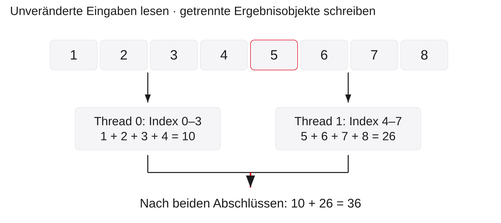{fig-alt="Arraywerte1bis8 werden in zwei Bereiche aufgeteilt. Thread0 bildet Teilsumme10, Thread1 Teilsumme26. Nach Abschluss entsteht die Gesamtsumme36."}

$$\sum_{i=0}^{7}x_i=\sum_{i=0}^{3}x_i+\sum_{i=4}^{7}x_i=10+26=36$$

::: notes
$x$ ist ein Array mit den acht Werten eins bis acht; Indizes beginnen bei null. Der erste Thread, Softwareausführungsfaden, bearbeitet die ersten vier Elemente, der zweite die letzten vier. Die Abbildung liest sich von den Arrayplätzen über die zwei getrennten Bereiche zu den Teilergebnissen. Rot markiert die spätere Zusammenführung, eine Reduction oder Reduktion.

Die erste Summe ist $1+2+3+4=10$, die zweite $5+6+7+8=26$, zusammen sechsunddreißig. Beide Threads lesen nur unveränderte Eingaben und schreiben ausschließlich ihr eigenes Ergebnisobjekt. Erst nachdem beide beendet sind, darf der aufrufende Ablauf die zwei Ergebnisse lesen und addieren. In der Hostdatei `labs/src/lab09_atomics.c` sichert `pthread_join` diese abgeschlossene Nutzung; die Schnittstelle wird im optionalen Versuch erklärt.

Getrennte Zuständigkeit reduziert erforderliche Synchronisation während der Rechnung. Ein gemeinsamer Akkumulator, den jeder Thread bei jedem Element ändert, würde stattdessen fortlaufende Abstimmung verlangen. Trotzdem garantiert diese Aufteilung keine Verdopplung der Geschwindigkeit: Threadstart, Abschluss, Summenabhängigkeiten und geteilte Speicherressourcen kosten Zeit. Wir verwenden das Beispiel als korrektes Datenmuster, nicht als gemessenen Beschleunigungsversuch.
:::

## SMP und AMP beschreiben eine Organisation

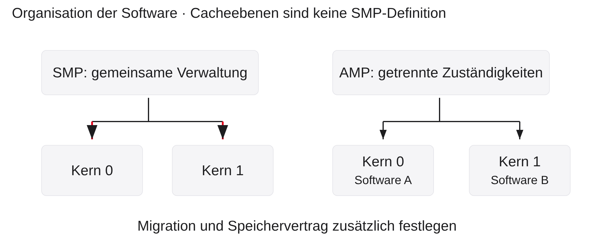{fig-alt="SMP-Lehrmodell mit gemeinsamer Betriebssystemverwaltung und gemeinsamem Speicher, gegenüber AMP mit getrennten Softwarezuständigkeiten. Private Caches und ein L2 sind keine Definition."}

Gleicher Speicherzugriff bestimmt noch nicht jede Cache- oder Gerätearchitektur.

::: notes
SMP bedeutet Symmetric Multiprocessing, symmetrische Mehrprozessororganisation. Unser Lehrmodell hat gleichberechtigte Kerne mit gemeinsamem Speicher und einer gemeinsamen Betriebssystemverwaltung. AMP heißt Asymmetric Multiprocessing, asymmetrische Organisation mit getrennten Softwarezuständigkeiten oder fest zugeteilten Aufgaben. Ein Betriebssystem organisiert unter anderem laufende Aufgaben und Ressourcen. Es wird hier kein konkretes Betriebssystem vorausgesetzt.

Das Bild zeigt links eine gemeinsame Verwaltung über zwei Kerne, rechts getrennte Verantwortungen. Die roten Verbindungen markieren gemeinsam koordinierte Software im SMP-Beispiel. Private L1-Caches oder ein gemeinsames L2 sind mögliche Speicherorganisationsentscheidungen, keine Definition von SMP. L1 und L2 bedeuten erste und zweite Cacheebene. Auch unterschiedliche Aufgabenbindungen sagen noch nicht, ob bestimmte Speicherregionen kohärent sind.

Migration, das Verlegen eines Threads auf einen anderen Kern, braucht geeigneten Scheduler und Plattformunterstützung. Sie passiert nicht allein wegen eines geteilten Speichers. Bei AMP können explizite Übergaben und nichtcachebare Bereiche sinnvoll sein. Die Organisation legt deshalb weder einen universellen Locktyp noch automatische DMA-Kohärenz fest. DMA, Direct Memory Access, ist ein eigenständiger Datenübertrager, dessen Teilnahme an der Kopienkoordination zusätzlich beschrieben werden muss.
:::

## Welche Teilnehmer gehören zur Kohärenzdomäne?

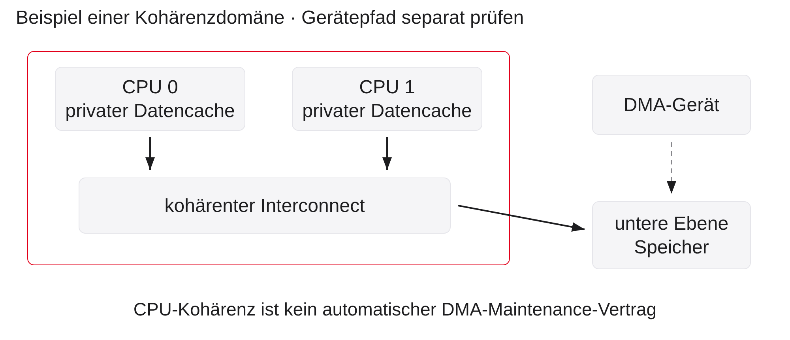{fig-alt="Zwei CPU-Kerne mit privaten Datencaches gehören zur gezeichneten Kohärenzdomäne. Ein DMA-Gerät hat einen gesondert zu prüfenden Zugriffspfad zur unteren Speicherhierarchie."}

DMA-Maintenance und atomare CPU-Zugriffe bleiben eigene Verträge.

::: notes
CPU bedeutet Central Processing Unit, Prozessor. DMA steht für Direct Memory Access, Übertragung durch einen eigenständigen Controller. Eine Kohärenzdomäne ist die Menge von Teilnehmern und Speicherbereichen, deren gültige Kopien durch ein gemeinsames Protokoll koordiniert werden. Der Interconnect ist das Verbindungsnetz für Anfragen und Datenantworten.

Die Umrandung umfasst im Bild zwei Kerne mit privaten Datencaches. Ein gemeinsamer unterer Speicherpfad ist ein Beispiel, keine vorgeschriebene Hierarchie. Der gestrichelte DMA-Pfad weist darauf hin, dass ein Gerät nicht automatisch durch die CPU-Kohärenz erfasst ist. Bei einem nichtkohärenten Transfer sind weiterhin vereinbarte Ownership, Zuständigkeit, sowie Clean und Invalidate nötig. Clean schreibt geänderte Daten zurück; Invalidate entzieht die lokale Gültigkeit. Eine Reihenfolgesicherung und Abschlussmeldung kommen gesondert hinzu.

Die atomare Änderung eines CPU-Objekts erlaubt ebenfalls keine beliebigen atomaren Gerätezugriffe. MMIO, Memory-Mapped Input/Output, sind Speicheradressen mit Gerätewirkungen; ihr Vertrag unterscheidet sich von gewöhnlichem Speicher. Ein Fence, eine Ordnungsanweisung, aktualisiert nicht automatisch eine schmutzige Cachekopie. Die Teilnehmergrenze erklärt damit, warum aus korrekt koordinierten CPU-Kopien noch kein vollständiger Peripherietransfer folgt.
:::

## Write-Back: unten darf noch ein alter Wert stehen

- Variable $x$: Anfangswert $0$
- Kern 0 hält eine gültige geänderte Kopie mit $x=5$
- Der untere Speicherstand darf im Write-Back-Modell noch $0$ sein
- Ein kohärenter Leser muss dennoch den aktuellen Wert erhalten

::: notes
Write-Back bedeutet, dass Änderungen zunächst in einer Cachezeile verbleiben und erst später an die nächsttiefere Ebene zurückgeschrieben werden. Dirty heißt verändert gegenüber dieser Ebene. Eine Cachezeile ist ein gemeinsam verwalteter Speicherblock. $x$ ist hier eine gewöhnliche Integer-Speicherstelle, anfangs null; Kern null schreibt fünf.

Ein alter unterer Stand ist nicht für sich ein Fehler. Wenn die private Kopie als gültiger Besitzer des neuen Werts bekannt ist, muss eine spätere kohärente Leseanfrage diesen Wert erhalten. Der Controller darf also nicht einfach die alte Null aus dem unteren Speicher als aktuelle Antwort benutzen. Owner bezeichnet hier den protokollberechtigten Besitzer einer exklusiven Kopie, kein vom Programm gehaltenes Lock.

Wir verwenden ab den MESI-Folien ein ausdrücklich vereinfachtes Modell mit zwei Datencaches und einem unteren Speicherstand $L$. $L$ kann eine weitere Cacheebene darstellen; er ist nicht die Aussage, dass jeder reale DRAM-Chip sofort denselben Wert enthält. DRAM heißt Dynamic Random Access Memory, dynamischer Arbeitsspeicher. Zunächst zeigt ein Gegenbeispiel, was ohne Kopienkoordination schiefgeht. Danach trennen wir Gültigkeit von atomarem Update und Datenordnung.
:::

## Write-Through allein beseitigt keine fremde Kopie

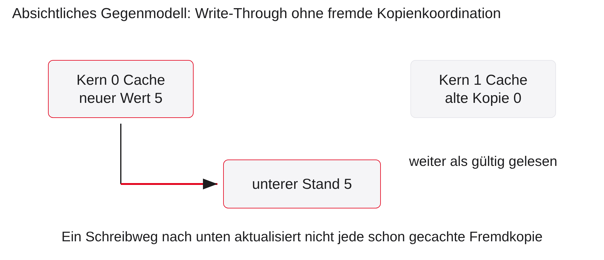{fig-alt="Ohne Kopienkoordination schreiben Kern0 und unterer Speicher den Wert5, während Kern1 seine alte gültige Cachekopie0 behält. Write-Through allein aktualisiert diese Kopie nicht."}

Eine Änderung unten macht eine bereits gecachte Fremdkopie nicht automatisch ungültig.

::: notes
Write-Through ist die Cachepolitik, bei der ein Schreiben auch an die untere Speicherebene weitergereicht wird. Stale Data bezeichnet veraltete Daten, die noch als gültig verwendet werden. Das Bild ist ein absichtlich unkoordiniertes Gegenmodell, kein zulässiger stabiler MESI-Zustand; MESI steht für Modified, Exclusive, Shared, Invalid.

Zunächst halten zwei Datencaches denselben Wert null. Kern null schreibt fünf und aktualisiert mit Write-Through den unteren Stand auf fünf. Wenn kein zusätzlicher Mechanismus die fremde Cachekopie invalidiert oder aktualisiert, liest Kern eins weiterhin seine lokal gültige Null. Rot markiert die neue Fünf, das getrennte alte Feld die fehlerhaft fortbestehende Kopie. Die Pfeile zeigen, dass ein Schreibweg nach unten nicht automatisch einen Weg zur anderen Kopie einschließt.

Kohärenz muss diese widersprüchlichen gültigen Beobachtungen verhindern. Dafür können Schreibrechte und Invalidierungen koordiniert werden. Manuelles Clean, Zurückschreiben einer lokalen Kopie, ersetzt diese Koordination nicht. Nichtcachebare Bereiche oder ausdrücklich getrennte Zuständigkeit können andere Systementwürfe ermöglichen, verlangen jedoch ebenfalls einen beschriebenen Vertrag. In unserem folgenden Modell übernimmt ein Protokoll die Kopienverwaltung für die beteiligten Datencaches.
:::

## Drei Mechanismen beantworten drei Fragen

{fig-alt="Kohärenz koordiniert Kopien derselben Speicherstelle, atomare RMW schützt ein Update, Acquire/Release ordnet die Übergabe weiterer Daten. Keine der drei Fragen ersetzt die anderen."}

Ein kohärenter Zähler ist noch kein atomarer Zähler.

::: notes
Kohärenz betrifft gültige Kopien und eine gemeinsam verträgliche Reihenfolge der Änderungen derselben Speicherstelle. RMW bedeutet Read-Modify-Write, Lesen, Ändern und Zurückschreiben. Eine atomare RMW wirkt für konkurrierende Zugreifer als ein unteilbares Update. Acquire und Release sind Ordnungssemantiken beim Übernehmen und Freigeben beziehungsweise Publizieren.

Das Bild legt diese Fragen nebeneinander. Links müssen Kopien von $x$ den richtigen Wert liefern. In der Mitte sollen zwei Inkremente eines Zählers nicht dasselbe alte Ergebnis überschreiben. Rechts soll ein Empfänger nach einer passenden Freigabe auch die zugehörigen Daten sehen. Die drei Felder stellen unterschiedliche Eigenschaften dar; keine ist eine automatische Leistung der Nachbarspalte.

Eine Cachekohärenz kann zwei einzelne Stores korrekt ordnen und trotzdem zwei vorher getrennt berechnete Einsen erhalten. Der Zähler verliert dann im Hardwaremodell einen Beitrag. Umgekehrt kann ein atomarer Flagstore unteilbar sein, ohne die Beobachtung eines anderen Datenobjekts zu ordnen. Ein Flag ist eine Markierung, etwa bereit oder nicht bereit. Für diese Veröffentlichung werden später konkrete Sprachbedingungen erklärt. Zuerst bauen wir die Kopienverwaltung vollständig auf, damit man den aktuellen Datenwert nicht mit einer geschützten Programmaktion verwechselt.
:::

## Snooping und Directory: Anfragen koordinieren

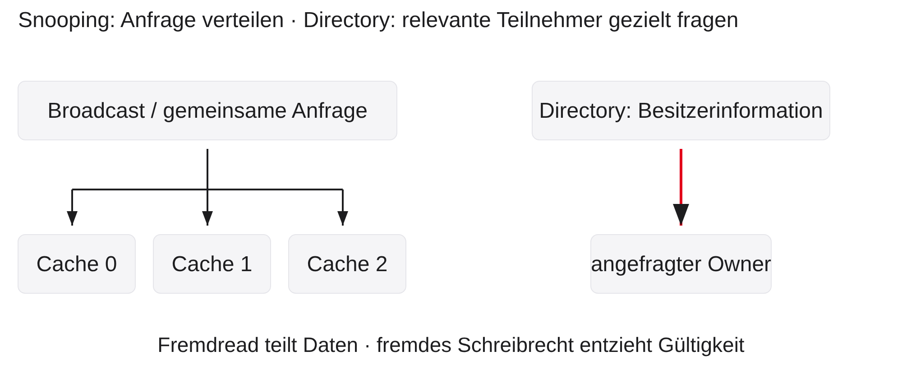{fig-alt="Bei Snooping prüfen beteiligte Cachecontroller eine verteilte Anfrage. Ein Directory kann anhand gespeicherter Teilnehmerinformation gezielt den Besitzer oder weitere Kopien anfragen."}

Ein Fremdread und ein fremder Schreibrechtswunsch lösen unterschiedliche Reaktionen aus.

::: notes
Snooping heißt Mithören relevanter Transaktionen. Ein Cachecontroller prüft, ob eine Anfrage eine von ihm verwaltete Zeile betrifft. Das linke Schema verteilt eine Anfrage an beteiligte Controller. Broadcast bedeutet solche Verteilung an alle relevanten Teilnehmer. Ein Directory, Verzeichnis, hält dagegen Teilnehmer- oder Besitzerinformation und kann gezielter anfragen; das rechte Schema zeigt einen angefragten Besitzerpfad.

Beide Organisationsformen müssen sicherstellen, dass ein Leser aktuelle Daten erhält und ein Schreiber geeignete Rechte bekommt. Ein fremder Read, Lesezugriff, verlangt nicht automatisch Invalidierung aller anderen Kopien. Mehrere saubere Kopien können danach gemeinsam gültig sein. Ein fremder exklusiver Schreibrechtswunsch muss konkurrierende Gültigkeit dagegen entziehen. Bei einer geänderten Kopie ist außerdem der aktuelle Datenwert zu übertragen.

Die Pfeile zeigen Anfragen und Antworten, keine feste Topologie oder garantierte Taktzahl. Ein Ring oder Mesh, gitterartiges Netz, beschreibt die physische Verbindungsform; Directory und Broadcast beschreiben die Organisation der Koordination. Wir verwenden nachfolgend ein vereinfachtes Snooping-Modell. Seine vier stabilen Rechtezustände sind MESI, Modified, Exclusive, Shared und Invalid. Zwischenzustände während Anfragen und Bestätigungen werden ausdrücklich nicht als fertige Zustände ausgegeben.
:::

## MESI: Gültigkeit und Schreibrecht je Zeile

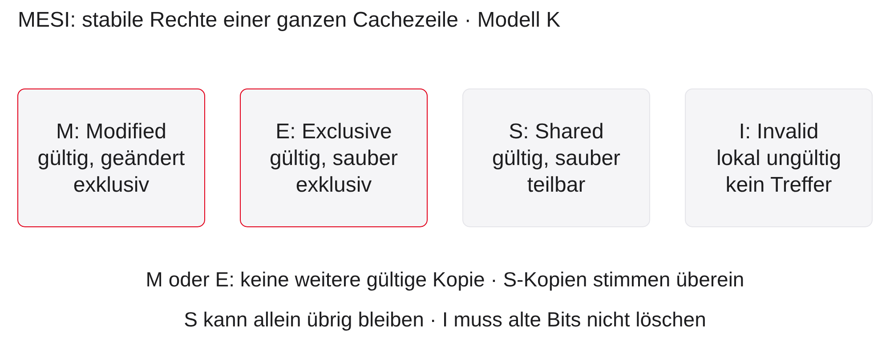{fig-alt="MESI-Rechte: M gültig, geändert und exklusiv; E gültig, sauber und exklusiv; S gültig, sauber und teilbar; I lokal ungültig."}

Lehrmodell K: zwei Datencaches, Write-Back, Write-Allocate, unterer Stand $L$.

::: notes
MESI steht für Modified, Exclusive, Shared und Invalid. Modified, M, heißt gültig, geändert und exklusiv: Im Modell darf kein weiterer Datencache dieselbe Zeile gültig halten. Exclusive, E, ist gültig, sauber und exklusiv. Shared, S, ist gültig, sauber und teilbar. Invalid, I, ist lokal ungültig und darf keinen Treffer liefern. Die rote Markierung hebt das exklusive Schreibrecht hervor; graue Rechteflächen zeigen teilbares Lesen oder fehlende Gültigkeit.

Lehrmodell K hat zwei Datencaches, Write-Back und Write-Allocate. Write-Back hält Änderungen zunächst lokal. Write-Allocate beschafft bei einem Schreibmiss die Zeile und ihre Rechte. $L$ ist die vereinfachte untere kohärente Speicherebene. Sauber, clean, bedeutet Übereinstimmung mit dieser Ebene. Bei M darf $L$ noch alt sein. Beim Fremdread auf M wird $L$ in unserem Modell mit den aktuellen Daten aktualisiert; reale Mehrstufenhierarchien können andere Wege haben.

Zustände gelten für eine ganze Cachezeile, nicht nur eine Variable. Wir betrachten stabile Zustände nach abgeschlossenem Protokollschritt. M oder E schließt eine zweite gültige Kopie aus; gemeinsame S-Kopien müssen übereinstimmen. S beweist nicht, dass gerade mehrere Kopien existieren. I beschreibt Gültigkeit, nicht das Löschen aller alten Datenbits. Diese Invarianten kontrollieren anschließend jede Zustandsfolge.
:::

## E erlaubt den stillen Wechsel nach M

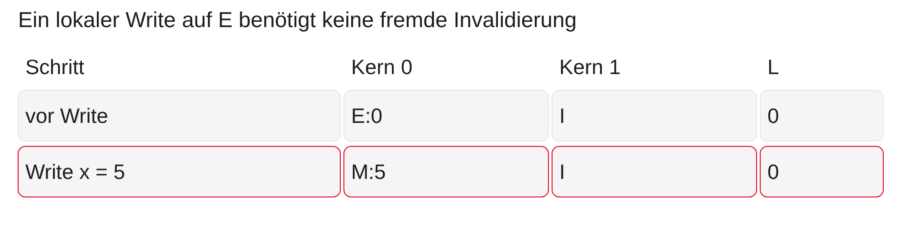{fig-alt="Kern0 hat allein E mit Wert0. Ein lokaler Write5 verändert die Kopie still nach M5; Kern1 bleibt I und der untere Stand bleibt0."}

Keine fremde gültige Kopie muss bei diesem Schritt invalidiert werden.

::: notes
E bedeutet Exclusive, sauber und exklusiv; M Modified, geändert und exklusiv; I Invalid, lokal ungültig. Kern null hält im Lehrmodell K die einzige gültige Kopie von $x$ mit Wert null. Kern eins ist I, der untere Stand $L$ enthält ebenfalls null. Ein lokaler Schreibzugriff setzt $x$ auf fünf.

Die Abbildung zeigt den Vorher-Nachher-Wechsel der lokalen Zeile von E:0 nach M:5. Rot markiert die neue geänderte Kopie. Der untere Stand bleibt im Write-Back-Modell zunächst null. Es muss keine fremde gültige Kopie invalidiert werden, weil E bereits Exklusivität zusichert. Still bedeutet hier ohne zusätzliche Anfrage zum Entziehen fremder Leserechte, nicht ohne jede physische Aktivität im Kern.

Ein lokaler Read, Lesen, darf sowohl E als auch M nutzen. Ein weiterer lokaler Write auf der bereits eigenen M-Zeile braucht ebenfalls keine erneute Rechteübernahme. Das ist ein wichtiger Unterschied zu häufigen Besitzerwechseln zwischen Kernen. E ist aber kein Software-Lock für mehrere Zugriffe. Es koordiniert die Cachezeile und macht einen aus Load, Add und Store zusammengesetzten Programmabschnitt nicht automatisch unteilbar. Zuerst verfolgen wir nun den Fall, dass ein zweiter Leser hinzukommt.
:::

## Ein Read-Miss hat unterschiedliche Lieferanten

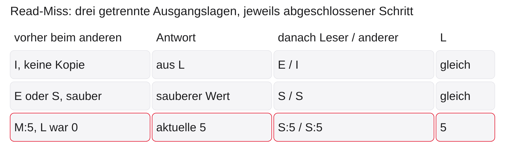{fig-alt="Bei keiner Fremdkopie liefert L und der Leser wird E. Bei sauberer Fremdkopie werden beide S. Bei M liefert der aktuelle Besitzer; im Modell werden beide S und L aktualisiert."}

Eine alte untere Antwort darf den aktuellen M-Wert nicht ersetzen.

::: notes
Read-Miss ist ein Lesen ohne gültige lokale Cachekopie. Der Leser ist zunächst I, Invalid. E heißt Exclusive, S Shared und M Modified. $L$ bezeichnet den unteren Speicherstand unseres Lehrmodells. Die drei Reihen des Bildes beschreiben getrennte Ausgangslagen, nicht drei nacheinander ausgeführte Schritte.

Ohne andere gültige Kopie liefert $L$ den Wert und der Leser erhält E. Hält ein anderer Kern eine saubere E- oder S-Kopie, darf der neue Leser eine S-Kopie erhalten; die andere gültige Kopie ist danach ebenfalls S. Hält ein anderer Kern M, muss dessen aktueller Wert in die Antwort eingehen. Der Besitzer gibt seine Exklusivität auf und wird S; auch der neue Leser wird S. In diesem klassischen Modell wird $L$ dabei aktualisiert.

Mit M:5 bei $L=0$ muss der abgeschlossene Read daher fünf liefern. Null wäre kein zulässiger aktueller Wert allein deshalb, weil sie unten noch gespeichert ist. Die rote Zeile markiert die Antwort vom geänderten Besitzer. Die Auswahl konkreter Datenlieferanten bei sauberen Kopien und reale Speicherzyklen werden nicht festgelegt. Es geht um eine korrekte stabile Beobachtung. Ein Schreiber benötigt im nächsten Fall mehr als das gemeinsame Leserecht S.
:::

## Schreiben auf S braucht abgeschlossene Übernahme

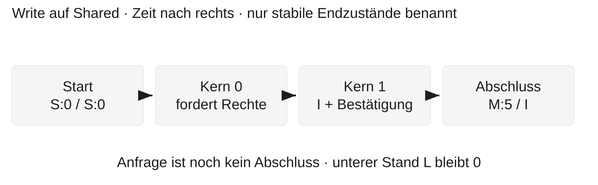{fig-alt="Start S0 und S0. Kern0 fordert Schreibrecht, Kern1 invalidiert und bestätigt. Erst der abgeschlossene stabile Schritt ergibt M5 und I, L bleibt0."}

Anfrage senden, fremde Gültigkeit entziehen und Abschluss sind verschiedene Ereignisse.

::: notes
S steht für Shared, sauber und teilbar; M für Modified, geändert und exklusiv; I für Invalid. Beide Kerne halten im Ausgangszustand S mit Wert null. Kern null möchte fünf schreiben. Ownership ist hier das exklusive Schreibrecht der Cachezeile, kein Programm-Mutex.

Im Diagramm läuft die Zeit nach rechts. Der Schreiber fordert Rechte an, der andere Controller entzieht seiner Kopie die Gültigkeit und bestätigt die Aktion. Erst nach den für dieses Protokoll nötigen Bestätigungen kann der stabile Abschluss als M:5 bei Kern null und I bei Kern eins angegeben werden. Ein gesendeter Broadcast, eine verteilte Anfrage, ist noch kein solcher Abschluss. Reale Controller können intern Zwischenzustände und Schreibpuffer verwenden; diese sind im Lehrmodell ausgeblendet.

Invalidate bedeutet das Entziehen der Gültigkeit. Die alten Nullbits dürfen physisch weiter im anderen Cache liegen, aber nicht mehr als Treffer gelesen werden. $L$, der untere Stand, bleibt bei diesem Write-Back-Schritt null. Der nächste fremde Read muss über einen aktuellen Datenpfad fünf erhalten. Manuelles Clean oder ein Fence, eine Ordnungsanweisung, ersetzt diesen abgeschlossenen Rechtewechsel nicht. Die Gesamtfolge lässt sich nun mit Zuständen und Werten getrennt protokollieren.
:::

## MESI-Folge mit Zuständen und Datenwerten

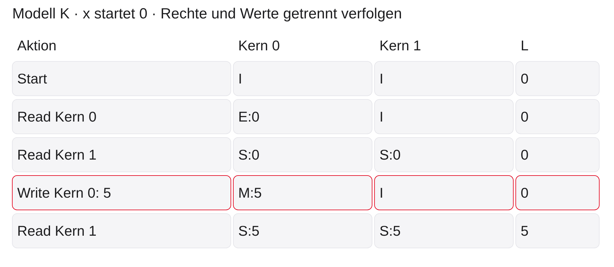{fig-alt="Start I,I,L0. Read0 ergibt E0,I,L0. Read1 ergibt S0,S0,L0. Write0 mit5 ergibt M5,I,L0. Read1 ergibt S5,S5,L5."}

Jede Zeile zeigt einen abgeschlossenen Schritt im Lehrmodell K.

::: notes
MESI bedeutet Modified, Exclusive, Shared, Invalid. Die Kombination E:0 enthält zwei Angaben: Rechtzustand E und Datenwert null. $L$ ist der untere kohärente Stand des vereinfachten Write-Back-Modells, anfangs null. Beide Datencaches beginnen lokal ungültig, I.

Zuerst liest Kern null $x$. Keine andere gültige Kopie existiert; er erhält E:0. Danach liest Kern eins dieselbe Speicherstelle. Beide Kopien sind nun S:0, $L$ bleibt null. Kern null schreibt fünf, nachdem er exklusive Rechte erhalten und fremde Gültigkeit entzogen hat. Der stabile Zustand ist M:5, I, $L=0$. Nun liest Kern eins erneut. Seine I-Kopie ist kein Treffer. Er erhält fünf über den aktuellen Besitzerpfad; beide werden S:5 und $L$ wird im Modell fünf.

Die rote dritte Zeile hebt hervor, dass ein alter unterer Stand mit einem aktuellen M-Besitzer vereinbar ist. Die vierte kontrolliert die Folgen: Eine gültige Null beim zweiten Leser wäre nach diesem abgeschlossenen Read falsch. Prüfen Sie außerdem, dass nie M zusammen mit einer anderen gültigen Kopie und nie zwei unterschiedliche S-Werte auftreten. Die letzte Aktualisierung von $L$ ist eine Modellannahme, keine Aussage über jeden realen DRAM-Chip. Auswerfen einer Zeile ist ein weiteres, davon getrenntes Ereignis.
:::

## Auswerfen: geänderte Daten erhalten

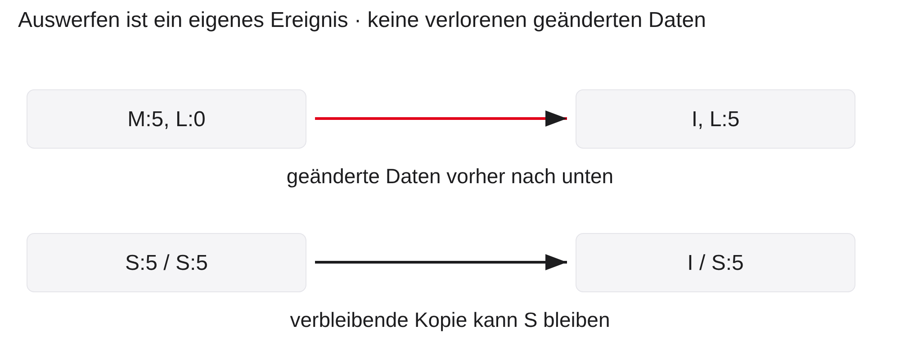{fig-alt="Beim Auswerfen von M5 wird der untere Stand von0auf5 aktualisiert und die lokale Zeile I. Beim Auswerfen einer S-Kopie darf eine andere S-Kopie S bleiben."}

Eine verbleibende S-Kopie wird nicht allein durch fremdes Auswerfen automatisch E.

::: notes
Eviction bedeutet Auswerfen einer Cachezeile, beispielsweise weil ihr Platz für einen anderen Speicherblock benötigt wird. M, Modified, enthält geänderte Daten; S, Shared, eine saubere teilbare Kopie; I, Invalid, ist lokal nicht nutzbar; E, Exclusive, ist sauber und exklusiv. Die Abbildung stellt zwei verschiedene Ausgangslagen gegenüber.

Oben hält Kern null M:5, während $L$, der untere Stand, noch null enthält. Vor dem Verlust dieser einzigen aktuellen Kopie müssen ihre geänderten Daten im Modell nach unten geschrieben werden. Der abgeschlossene Auswurf ergibt I und $L=5$. Ein späterer Read ohne andere gültige Kopie kann daraus wieder E:5 erzeugen. Die neuen Daten dürfen nicht zusammen mit der Zeile verloren gehen.

Unten halten beide Kerne S:5. Wenn Kern null seine saubere Kopie auswirft, kann Kern eins weiter S:5 bleiben. Sein Controller muss nicht automatisch wissen, dass er inzwischen allein ist. Deshalb ist S nicht der Beweis für mindestens zwei derzeitige Kopien. Ein späterer Schreibwunsch kann trotzdem eine Rechteübernahme auslösen. Rot markiert die notwendige Datenübertragung bei M, grau den reinen Gültigkeitsverlust bei S. Diese Unterscheidung hilft, saubere Daten, exklusive Rechte und Softwarezuständigkeit auseinanderzuhalten.
:::

## False Sharing: verschiedene Variablen, eine Zeile

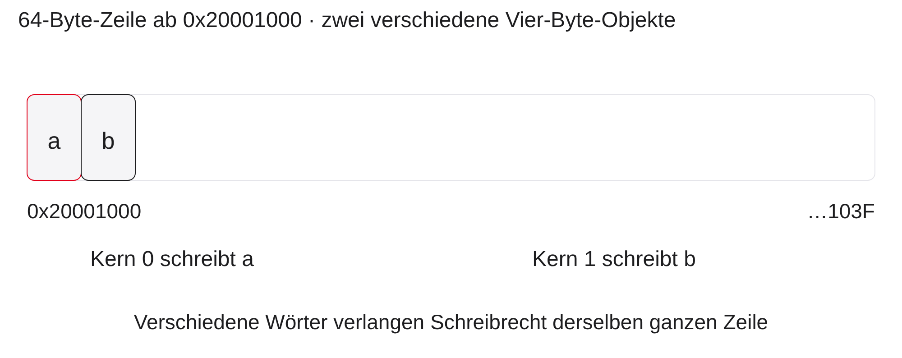{fig-alt="Eine64Byte-Zeile ab0x20001000 enthält Variablea beiOffset0 und b beiOffset4. Verschiedene Kerne schreiben verschiedene Wörter, benötigen aber Schreibrecht derselben Zeile."}

Wechselnde Schreiber können die ganze Zeile zwischen den Kernen verschieben.

::: notes
False Sharing bedeutet falsches Teilen: Logisch unabhängige Objekte liegen in derselben Kohärenzeinheit. True Sharing ist dagegen das gemeinsame Nutzen desselben Objekts. Eine Cachezeile, Line, umfasst in diesem Lehrbeispiel vierundsechzig Byte; ein Integerobjekt belegt vier. Die Basisadresse ist `0x20001000`, passend auf vierundsechzig Byte ausgerichtet.

Objekt $a$ beginnt bei Offset null, $b$ bei Offset vier. Beide liegen in der Zeile bis einschließlich `0x2000103F`. Die Abbildung zeigt die zwei Wörter als getrennte Felder innerhalb derselben breiteren Zeile. Wenn Kern null $a$ und Kern eins $b$ abwechselnd schreiben, brauchen sie trotzdem wechselnd das exklusive Schreibrecht des ganzen Blocks. Eine fremde Invalidierung betrifft also auch das andere logisch unabhängige Wort.

Ein Kern, der die M-Zeile, Modified, schon besitzt, erzeugt nicht bei jedem weiteren lokalen Schreiben erneut einen Besitzerwechsel. Häufigkeit und Reihenfolge der Zugriffe entscheiden. False Sharing ist ein möglicher Leistungsengpass, kein Beweis eines Sprach-Data-Race. Verschiedene korrekt zugeteilte Objekte können race-frei sein und dennoch Zeilenrechte hin- und herbewegen. Ein Simulator ohne validiertes Kohärenzzeitmodell misst daraus keine reale Verlangsamung. Der nächste Entwurf trennt die Objekte räumlich.
:::

## Basis und Abstand gemeinsam prüfen

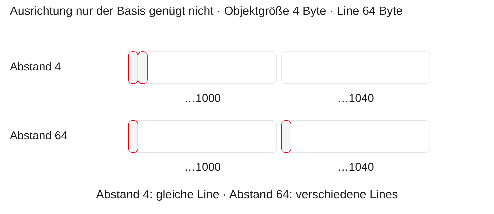{fig-alt="Bei64Byte-ausgerichteter Basis liegen Elemente mit4Byte-Abstand in derselben Zeile. Abstand64Byte legt die gezeigten kleinen Objekte in verschiedene Zeilen."}

Padding kostet Platz und repariert kein konkurrierendes Update derselben Variable.

::: notes
Padding bezeichnet eingefügten Abstand oder ungenutzten Platz zwischen Objekten. Stride ist der Adressabstand zweier benachbarter betrachteter Elemente. Im Bild bleibt die Basis `0x20001000` auf vierundsechzig Byte ausgerichtet. Bei Stride vier befinden sich die ersten zwei Vier-Byte-Objekte in derselben Zeile. Bei Stride vierundsechzig beginnt das zweite an `0x20001040`, in der nächsten Zeile.

Die roten Objektfelder zeigen, dass eine ausgerichtete Arraybasis allein die Elemente nicht voneinander trennt. Ihre Abstände und tatsächlichen Größen gehören zur Prüfung. Eine bekannte reale Cachezeilengröße ist ebenfalls nötig. Vierundsechzig Byte sind hier eine Lehrannahme, keine allgemeine C-Eigenschaft. Ein größerer Abstand kostet Speicher und kann die räumliche Lokalität, Nutzung benachbarter Daten, verschlechtern.

False Sharing, logisch unabhängige Objekte in einer gemeinsamen Zeile, lässt sich damit unter den Modellbedingungen vermeiden. Für True Sharing, gemeinsame Änderung derselben Variable, hilft Padding nicht: Das Update muss weiterhin korrekt synchronisiert sein. Ebenso beseitigt Padding weder fehlende Datenordnung noch den Widerspruch eines ungültigen Cachetreffers. Die Papierphase prüft deshalb zunächst Adressbereich und Rechtefolge, bevor ein gemeinsamer Zähler als neues Problem hinzukommt.
:::

## Papierphase 1: Zustände und Zeilengrenzen

Übungsblatt, Aufgaben 1–2 · 10 Minuten

- Zustandsfolge mit Werten und unterem Stand ausfüllen
- Exklusivität und saubere Kopien als Invarianten prüfen
- False Sharing aus Adresse, Größe und Abstand begründen

::: notes
MESI steht für Modified, Exclusive, Shared, Invalid. Eine Invariante ist eine Bedingung jedes stabilen Zustands. Eine M- oder E-Kopie darf keine zweite gültige Kopie neben sich haben. Gemeinsame S-Kopien sind sauber und gleich. I liefert keinen Treffer. L bezeichnet die vereinfachte untere Speicherebene. Im neuen Fall lesen und schreiben drei Kerne statt zwei.

Anfangs sind alle Kopien I und L enthält vier. Read von Kern zwei ergibt E:4; sein Write macht daraus M:9, während L noch vier enthält. Der folgende Read von Kern null liefert neun und erzeugt S:9 in null und zwei sowie L neun. Nach Read von Kern eins besitzen alle S:9. Write von Kern null macht dessen Kopie M:13 und die beiden anderen I, L bleibt neun. Sein Auswurf schreibt dreizehn zurück. Danach erhält der allein lesende Kern eins E:13. Read und Write bedeuten Lesen und Schreiben. Ein sauberer Fremdauswurf erzwingt bei einer verbleibenden S-Kopie keinen automatischen E-Wechsel.

Die neue Zeile reicht bei $128$ Byte von `0x30004000` bis `0x3000407F`. Die Acht-Byte-Objekte bei `0x30004008` und `0x30004018` teilen sie. Die Schreibfolge verursacht vier Besitzerwechsel. Versetzen von b nach `0x30004080` trennt die Zeilen; Basisausrichtung allein reicht dafür nicht. Padding, eingefügter Abstand, beseitigt diese Konkurrenz unabhängiger Objekte, aber keine verlorenen Updates auf demselben Zähler.
:::

## Ein Inkrement kann drei Schritte enthalten

```asm
# RV32I-Lehrfolge; s1: ausgerichtetes Wort, Anfangswert 0
lw   t0, 0(s1)
addi t0, t0, 1
sw   t0, 0(s1)
```

Read → Modify → Write ist hier keine unteilbare Gruppe.

::: notes
RMW heißt Read-Modify-Write, Lesen, Ändern und Zurückschreiben. Die Folge ist RISC-V-Assembler für RV32I, die Zweiunddreißig-Bit-Integerbasis, und ausdrücklich kein behaupteter Compileroutput. RISC bedeutet Reduced Instruction Set Computer. `s1` enthält die gültige auf vier Byte ausgerichtete Adresse eines gewöhnlichen Speicherworts, `t0` ist ein lokales temporäres Register. Anfangs liegt dort null; der Beispielbereich erzeugt keinen Zahlenüberlauf.

`lw`, Load Word, liest ein vier Byte großes Wort nach `t0`. `addi`, Add Immediate, addiert die Konstante eins nur im Register. `sw`, Store Word, schreibt dieses Register zurück. Selbst wenn die einzelnen ausgerichteten Speicherzugriffe unteilbar wirken, ist die ganze Folge damit noch keine atomare RMW. Zwischen Lesen und Schreiben kann ein anderer Hart, eine Hardware-Ausführungsinstanz, denselben alten Wert gelesen haben.

Kohärenz koordiniert aktuelle Kopien und einzelne Änderungen. Sie weiß nicht, dass die lokale Registerrechnung Teil eines gemeinsamen Inkrements sein soll. Ein Quelltextoperator wie `++` verrät allein ebenso wenig: Bei einem gewöhnlichen Integer kann eine nichtatomare Folge entstehen, bei einem passenden atomaren C-Typ gilt für das Inkrement eine andere Sprachsemantik. Zunächst verfolgen wir den getrennten Hardwareablauf.
:::

## Lost Update trotz kohärenter Einzelzugriffe

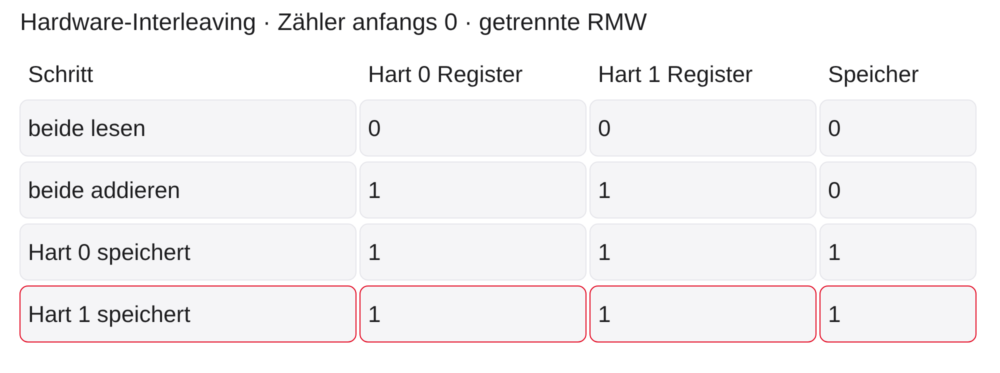{fig-alt="Beide Harts lesen0, rechnen lokal1und speichern nacheinander1. Der gemeinsame Endwert ist1 statt2. Kohärenz ordnet die Stores, ergänzt aber keinen fehlenden Beitrag."}

Das Diagramm beschreibt ein Hardware-Interleaving, keine Ergebnisgarantie fehlerhaften C-Codes.

::: notes
Lost Update heißt verlorene Änderung. Ein Interleaving ist eine Verschachtelung der Schritte mehrerer Abläufe. Hart bezeichnet eine Hardware-Ausführungsinstanz. Das Zeitbild liest sich von links nach rechts und nimmt einen Zähler mit Anfangswert null sowie einzeln korrekt beobachtete Speicherzugriffe an.

Hart null liest null in sein Register, Hart eins liest ebenfalls null. Beide Registeradditionen ergeben eins. Danach schreibt Hart null eins und Hart eins ebenfalls eins. Der gemeinsame Endwert bleibt eins. Zwei beabsichtigte Inkremente haben nicht zwei beigetragen, weil beide dieselbe alte Grundlage verwendeten. Eine geordnete Reihenfolge der Stores, Speicherwrites, kann diese schon berechneten gleichen Werte nicht nachträglich zu zwei addieren.

Rot markiert der letzte Store das Überschreiben mit dem gleichen Ergebnis. Der Fehler liegt in der getrennten RMW, Read-Modify-Write, nicht in einer zufällig noch alten gültigen Cachekopie. Zwei atomare Inkremente ab null würden dagegen alte Werte null und eins erhalten und bei zwei enden. Für ein gewöhnliches gemeinsam geschriebenes C-Integerobjekt gelten zusätzlich die Sprachregeln: Ein ungeschützter Data Race erlaubt keine solche garantierte Ergebnisliste. Diese wichtige Grenze wird auf der nächsten Folie von der logischen Race Condition getrennt.
:::

## Race Condition und C-Data-Race unterscheiden

| Begriff | Aussage |
|---------|---------|
| Race Condition | Ablaufreihenfolge gefährdet die gewünschte Programmlogik |
| C11-Data-Race | konkurrierende Konfliktzugriffe ohne ausreichende Synchronisation |
| Atomare Load/Store einzeln | können trotzdem ein getrenntes Update verlieren |

C11-Data-Race bedeutet undefiniertes Verhalten, keine zugesicherte Auswahl aus zwei Endwerten.

::: notes
C11 ist der C-Sprachstandard von 2011. Ein Data Race liegt bei konfliktierenden Zugriffen verschiedener Threads vor, wenn mindestens einer nichtatomar ist und keine erforderliche Happens-before-Beziehung besteht. Konfliktierend bedeutet hier dieselbe Speicherstelle mit mindestens einem Schreibzugriff. Happens before beschreibt die im Sprachmodell abgesicherte Ordnung zwischen Aktionen. Ein solcher Data Race führt zu undefiniertem Verhalten; der Standard garantiert dann keine Liste möglicher Endwerte.

Race Condition ist der allgemeinere Begriff für eine problematische Abhängigkeit von der Ablaufreihenfolge. Auch einzeln atomare Operationen können eine logische Race Condition bilden. Wenn zwei Fäden jeweils einen atomaren Zähler laden, lokal erhöhen und getrennt atomar speichern, ist das noch keine atomare RMW, Read-Modify-Write. Das vorangegangene Lost Update kann in einem solchen wohldefinierten Einzelzugriffsmodell auftreten.

Die Hostdatei bildet genau diese Verschachtelung mit atomaren Load/Store-Schritten seriell nach und prüft Endwert eins. Sie führt kein gewöhnliches racy C-Programm aus und behauptet keine Hardwaremessung. Der eigentliche parallele Zählerversuch nutzt stattdessen eine atomare RMW. Diese Trennung macht ein didaktisches Gegenbeispiel nachvollziehbar, ohne undefiniertes Sprachverhalten als Experimentbeweis auszugeben.
:::

## Auch atomarer Check und Set bleiben getrennt

```c
#include <stdbool.h>
#include <stdatomic.h>
static atomic_bool lock = false;
bool broken_try_lock(void) {
    if (atomic_load_explicit(&lock, memory_order_relaxed))
        return false;
    atomic_store_explicit(
        &lock, true, memory_order_relaxed);
    return true;
}
```

Absichtlich falsche Übernahme: Zwei Aufrufer können beide Erfolg melden.

::: notes
Das C11-Beispiel verwendet `atomic_bool`, einen atomaren Wahrheitswert, und die Header `stdbool.h` für `bool`, `true`, `false` sowie `stdatomic.h` für atomare Operationen. `lock` ist vor konkurrierender Nutzung falsch, also frei. `broken_try_lock` soll bei erfolgreicher Übernahme wahr zurückgeben. Sie ist absichtlich kein korrektes Sperrprimitiv und wird nicht als Lock ausgeführt.

`atomic_load_explicit` liest unteilbar; `atomic_store_explicit` schreibt unteilbar. `memory_order_relaxed` hält diese einzelnen Zugriffe atomar, ordnet aber keine weiteren Daten. Ein Aufrufer kann falsch lesen, bevor ein anderer wahr speichert. Der zweite kann ebenfalls falsch gelesen haben. Beide speichern anschließend wahr und melden Erfolg. Die Einzelzugriffe auf dieses atomare Objekt haben keinen C-Data-Race, dennoch ist die logische Sperrübernahme falsch.

`volatile` würde Prüfen und Setzen ebenfalls nicht zusammenfügen. Es betrifft gekennzeichnete Zugriffe nach Compilervertrag, liefert aber keine solche atomare Gruppenwirkung und keine Veröffentlichung gewöhnlicher Nutzdaten. Die benötigte Eigenschaft ist eine unteilbare Entscheidung über den vorigen Zustand und die Übernahme. Dafür darf der kritische Abschnitt, geschützte Arbeit, erst nach nachgewiesenem Erfolg beginnen. Im nächsten Schritt wird genau dieser Entscheidungspunkt sichtbar.
:::

## Die atomare RMW entscheidet die Übernahme

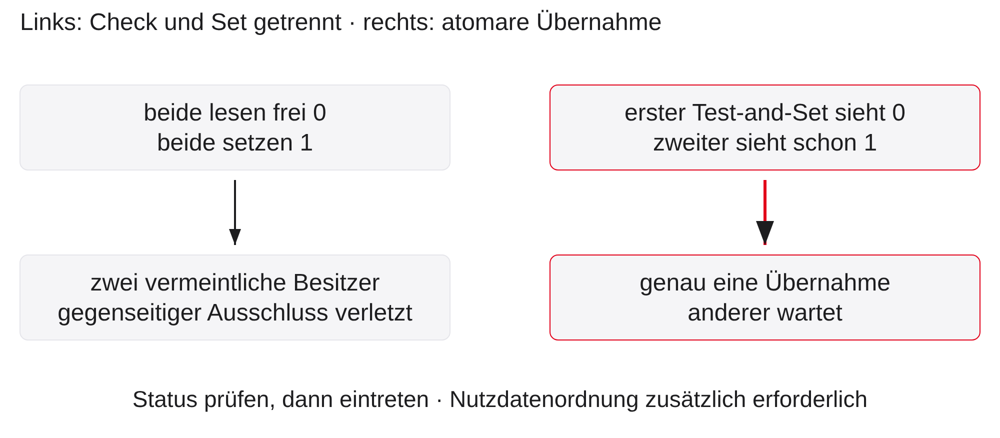{fig-alt="Getrennter Check und Set lässt zwei Aufrufer freie0lesen und beide eintreten. Atomarer Test-and-Set ordnet Übernahmen: der erste sieht0, setzt1 und gewinnt, der zweite sieht1und wartet."}

Der frühere Wert entscheidet; der Speicherwert und der Status sind getrennt zu lesen.

::: notes
RMW bedeutet Read-Modify-Write, unteilbares Lesen, Ändern und Schreiben. Test-and-Set ist eine atomare RMW, die den vorherigen Zustand zurückgibt und zugleich gesetzt markiert. Die zwei Bildhälften stellen getrennten Check und Set einer einzigen Übernahmeaktion gegenüber. Der Schlosswert null bedeutet frei, eins belegt.

Links können beide Aufrufer null lesen und anschließend eins schreiben; beide glauben, Besitzer zu sein. Rechts erfolgt eine Übernahme zuerst. Dieser Aufrufer erhält den alten freien Zustand und setzt belegt. Der andere erhält den bereits belegten Zustand und darf nicht eintreten. Rot hebt die atomare Entscheidung und die korrekte Übernahme hervor. Die atomare Reihenfolge muss nicht vorher einem bestimmten Kern zugeordnet sein.

Mutual Exclusion heißt gegenseitiger Ausschluss: Höchstens ein Besitzer betritt den geschützten Abschnitt. Damit die dort verwendeten Daten vom vorigen Besitzer übernommen werden, kommt später Speicherordnung hinzu. Atomizität ist weder eine Ein-Takt-Garantie noch das Sperren jedes anderen Buszugriffs. Ein Algorithmus kann außerdem korrekt ausschließen und trotzdem schlecht vorankommen. Zuerst klären wir, welche zugesicherten Operationen ein RISC-V-Ziel unter passenden Voraussetzungen anbieten kann.
:::

## RISC-V-Atomics brauchen Ziel und Speichervertrag

- A-Erweiterung: LR/SC und AMO als atomare Primitive
- Unterstützter Kern und unterstützte gewöhnliche Speicherregion
- `.w`: vier Byte breit und hier auf vier Byte ausgerichtet
- Kein universeller Ersatz für MMIO oder nichtkohärente DMA-Übergaben

::: notes
RISC-V ist die im Kurs verwendete Befehlssatzfamilie; RISC heißt Reduced Instruction Set Computer. ISA bedeutet Instruction Set Architecture, Befehlssatzarchitektur. Die A-Erweiterung stellt atomare Operationen bereit: LR/SC, Load-Reserved/Store-Conditional, sowie AMO, Atomic Memory Operation. Die Teilmengen Zalrsc und Zaamo bezeichnen diese beiden Familien in der herangezogenen Spezifikation. Nicht jeder Kern unterstützt sie.

Wir setzen für `.w` ein vier Byte großes ausgerichtetes Wort in einer unterstützten gewöhnlichen Speicherregion voraus. Ein MMIO-Register, Memory-Mapped Input/Output, hat zusätzliche Gerätewirkungen und unterstützt nicht automatisch dieselben Operationen. DMA heißt Direct Memory Access, eigenständiger Datentransfer. Seine Teilnahme an der Kohärenz- und Reservationsbeobachtung muss zur Plattform passen.

Die Atomizität wirkt auf die betreffende Speicheroperation in ihrer zugesicherten Domäne. Sie ist kein pauschaler Bus-Lock und keine Aussage über alle Speicherregionen des Systems. Fehlt eine bestimmte Erweiterung, kann Software gegebenenfalls andere zugesicherte Primitive oder einen geeigneten Bibliotheksweg verwenden; das muss der Zielvertrag bestimmen. RISC-V-Assembler wird hier als Lehrfolge verwendet, nicht als ausgeführte Firmware. Die folgenden Folien verfolgen deshalb Rückgabewerte und Rechte, ohne eine Mikroarchitektur oder Laufzeit zu erfinden.
:::

## LR liest; SC versucht den bedingten Store

| Operation | Wirkung |
|-----------|---------|
| `lr.w` | Wort lesen und Reservation registrieren |
| erfolgreicher `sc.w` | Wort schreiben, Status $0$ |
| fehlgeschlagener `sc.w` | kein Datenstore, Status ungleich $0$ |

Ein gelesener Wert $0$ ist noch kein Übernahmeerfolg.

::: notes
LR bedeutet Load-Reserved, reservierend lesen, SC Store-Conditional, bedingt schreiben. `.w` bezeichnet ein vier Byte großes Wort. Eine Reservation ist die registrierte Bedingung für einen späteren Store, kein gehaltenes Mutex, also keine bereits erworbene gegenseitige Sperre. Die Reservationsmenge enthält die gelesenen Bytes, ihre Größe kann implementierungsabhängig darüber hinausgehen. Sie muss nicht mit der Cachezeilengröße übereinstimmen.

`lr.w` liefert den Speicherwert in ein Register. Mehrere Harts, Hardware-Ausführungsinstanzen, können daher zunächst denselben freien Schlosswert null lesen. `sc.w` versucht den angegebenen neuen Wert zu schreiben und gibt separat einen Status zurück. Bei Erfolg wird geschrieben und der Status ist null. Bei Fehlschlag erfolgt kein Datenstore und der Status ist ungleich null, nicht zwingend genau eins. Jeder SC beendet die eigene Reservation, auch wenn er scheitert.

Ein beobachteter konkurrierender Store auf die Reservationsmenge kann den Erfolg verhindern. Ein Fehlschlag ist auch ohne solchen Store zulässig; er beweist keine konkrete Ursache. Ein Lockalgorithmus muss deshalb wiederholen und erst nach erfolgreichem SC eintreten. Der gelesene Schlosswert null, der gespeicherte belegt-Wert eins und der Erfolgsstatus null sind drei verschiedene Rollen von Zahlen.
:::

## Zwei gelesene Nullen, nur eine Übernahme

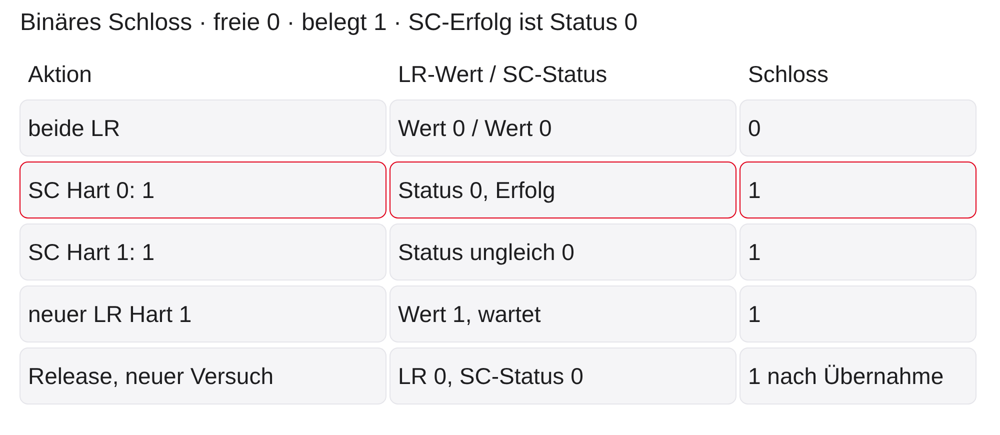{fig-alt="Beide LR lesen Schloss0. Hart0 speichert1mitSC-Status0. Hart1 hat SC-Fehlerstatus ungleich0 und speichert nichts. Sein neuer LR liest1. Nach Release0kann er erneut übernehmen."}

Ein belegt gelesenes Schloss wird nicht auf $2$ inkrementiert.

::: notes
LR/SC bedeutet Load-Reserved/Store-Conditional. Die Zeit läuft im Bild nach rechts. Das binäre Schloss startet bei null, frei. Beide Harts, Hardware-Ausführungsinstanzen, lesen mit LR diesen Wert und haben noch keinen geschützten Abschnitt betreten.

In der gezeigten zulässigen Folge gewinnt Hart null: Sein SC schreibt eins und liefert Status null. Der konkurrierende Store macht den folgenden SC von Hart eins erfolglos; der Status ist ungleich null und der Speicher bleibt eins. Hart eins beginnt erneut bei LR. Liest er jetzt eins, erkennt er belegt und wartet ohne SC. Er erhöht den Schlosswert nicht. Nach der Freigabe, Release, auf null kann ein späterer LR wieder null liefern und ein erfolgreicher SC die eins speichern.

Die rote Zeile markiert den ersten SC-Erfolg; die folgenden Statusfelder zeigen Fehler und Wiederholung. Die Reihenfolge ist ein Beispiel, keine Fairnessgarantie zugunsten eines bestimmten Harts. Ein zusätzlicher erfolgloser SC ohne fremden Store wäre ebenfalls möglich. Für ein korrektes Schloss bleiben die Werte null oder eins; ein Ergebnis zwei wäre ein anderes Update, etwa ein Zähler. Acquire- und Release-Ordnung für die geschützten Nutzdaten werden nach der Papierphase zusätzlich erklärt.
:::

## Papierphase 2: Update und SC-Status

Übungsblatt, Aufgabe 3 · 15 Minuten

- Load, lokale Änderung und Store zeitlich verschachteln
- Hardwaremodell von undefiniertem C-Data-Race unterscheiden
- LR-Wert, SC-Status und neuen Zählerwert getrennt eintragen

::: notes
Load und Store sind Speicherlesen und -schreiben. RMW heißt Read-Modify-Write, Lesen, Ändern und Zurückschreiben. Im neuen Hardwaremodell lesen beide Harts den Zähler zehn, addieren lokal zwei und speichern zwölf. Endwert zwölf verliert eine der beabsichtigten Erhöhungen; korrekt wären vierzehn. Ein Hart ist eine Hardware-Ausführungsinstanz. MESI, Modified, Exclusive, Shared, Invalid, ordnet einzelne Kopien und Änderungen, nicht automatisch diese Rechengruppe.

C11 bezeichnet den Sprachstandard von 2011. Ein gewöhnliches konkurrierend ungeschütztes C-Objekt hat bei den beschriebenen Konflikten einen Data Race und undefiniertes Verhalten. Zwölf ist deshalb keine zugesicherte Ergebnisliste dieses C-Programms. Atomare Einzel-Loads und -Stores können zwar das Sprachproblem vermeiden, verlieren aber weiterhin die logische Gruppenwirkung.

LR/SC bedeutet Load-Reserved/Store-Conditional. Beide LR lesen zehn. Der erfolgreiche SC von Hart eins schreibt zwölf und liefert Status null. Der scheiternde SC von Hart null schreibt nichts und liefert einen Status ungleich null. Beim Wiederholen liest Hart null zwölf neu, berechnet vierzehn und schreibt dies mit erfolgreichem Status null. Er darf den alten Zwölferwert nicht einfach wiederverwenden. Ein SC kann auch ohne fremden Store scheitern; Fehlstatus allein beweist dessen Ursache nicht. Anschließend geht es darum, welche weiteren Daten nach einer atomaren Übergabe sichtbar werden.
:::

## Acquire und Release ordnen die Nutzdaten

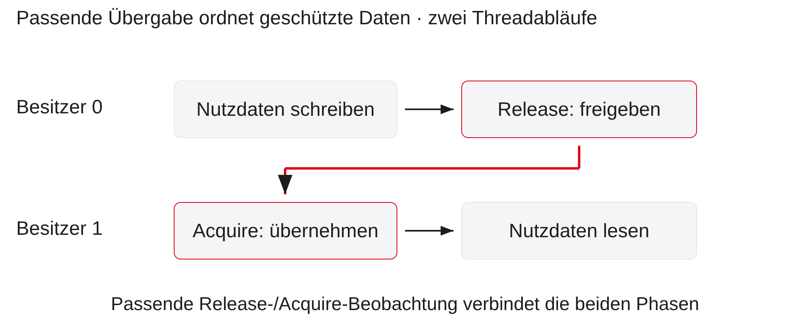{fig-alt="Ein Besitzer schreibt Nutzdaten vor Release des Schlosses. Der nächste übernimmt mit Acquire und liest danach. Die Ordnung verbindet geschützte Zugriffe über die passende Übernahme."}

Atomare Übernahme und geordnete Nutzung sind zwei Anforderungen.

::: notes
Acquire bedeutet Übernahmeordnung: Nachfolgende gewöhnliche Speicherzugriffe dürfen nicht vor die passende Übernahmebeobachtung gezogen werden. Release bedeutet Freigabeordnung: Vorherige geschützte Zugriffe müssen vor der Freigabe stehen. Nutzdaten oder Payload sind die tatsächlichen Daten im geschützten Abschnitt, nicht der Schlosswert selbst.

Das Bild zeigt zwei Abläufe entlang der Zeit. Besitzer null schreibt einen Datenwert, gibt anschließend die Sperre frei. Der nächste Besitzer übernimmt und liest danach. Der rote Verbindungspfad markiert die passende Synchronisation über dieselbe Sperre. Es genügt nicht, irgendeine Acquire-Operation irgendwo im Programm zu verwenden. Der Übernahmealgorithmus und seine Beobachtung müssen zum Release des vorherigen Besitzers passen.

Die C-Sprache beschreibt dies mit Happens-before-Beziehungen, abgesicherter Ordnung zwischen Aktionen. Die RISC-V-Hardware bietet dazu unter anderem Acquire-/Release-Bits und Fences, Ordnungsanweisungen, in einer bestimmten Zugriffsdomain. Eine korrekte Compilerübersetzung muss die Spracheigenschaft auf passende Zieloperationen abbilden. Acquire/Release ist kein Cacheflush: Clean und Invalidate, Zurückschreiben und Gültigkeit entziehen, sind andere Pflichten. Das Prinzip erklärt sowohl die geschützte Variable als auch die spätere Veröffentlichung eines Datenfensters.
:::

## LR/SC-Übernahme mit Acquire

```asm
# Lehrfolge: a0 zeigt auf ausgerichtetes Schloss, 0 frei
acquire:
    lr.w.aq t0, (a0)
    bnez    t0, acquire
    li      t1, 1
    sc.w    t2, t1, (a0)
    bnez    t2, acquire
# Erst jetzt: geschuetzte Daten nutzen
```

Gewöhnlicher Speicher mit zugesicherter Unterstützung; kein universelles ISR-Rezept.

::: notes
Die Folge ist RISC-V-Lehrassembler mit unterstütztem Load-Reserved/Store-Conditional, LR/SC, und wird hier nicht assembliert. `a0` zeigt auf ein gültiges, vier Byte ausgerichtetes binäres Schloss in gewöhnlichem Speicher. Alle Nutzer müssen denselben Vertrag verwenden. `t0` enthält den LR-Wert, `t1` den belegt-Wert eins und `t2` den separaten SC-Status. `li`, Load Immediate, setzt die Konstante; `bnez`, Branch if Not Equal to Zero, verzweigt bei einem Wert ungleich null.

`lr.w.aq` liest ein Wort mit Acquire-Ordnung, markiert durch `.aq`. Wenn `t0` belegt, also ungleich null ist, beginnt die Prüfung erneut. Bei frei null versucht `sc.w`, eins zu schreiben. Ist `t2` ungleich null, war der Versuch erfolglos und wird wiederholt. Nur mit Status null beginnt der geschützte Abschnitt. Das Acquire-Bit am LR ordnet die nachfolgende Speichernutzung dieser Übernahme; es ist keine zusätzliche Sperre auf alle Busse.

Ein Spinlock wartet durch wiederholtes Prüfen. Er braucht einen fortschrittsfähigen Besitzer und geeigneten Kontext. Hier fehlen absichtlich ein Nutzdatenabschnitt und Rückkehrkonventionen; gezeigt wird nur das Übernahmeprimitiv. Als Inline-Assembler in C wäre außerdem ein korrekter Compilervertrag nötig. ISR heißt Interrupt Service Routine, Unterbrechungsroutine; ihre besonderen Fortschrittsbedingungen werden später gesondert betrachtet. Die Freigabe muss nun die umgekehrte Ordnung sichern.
:::

## Freigeben: Daten vor dem freien Schloss

```asm
# Nach dem geschuetzten Abschnitt;
# a0 ist dieselbe Lockadresse
fence rw, w
sw    zero, 0(a0)
```

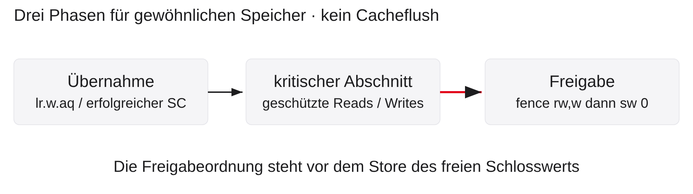{fig-alt="Übernahme mit Acquire, geschützte Datenzugriffe und Freigabeordnung bilden drei Phasen. Fence rw,w steht vor dem Store0, nicht dahinter."}

::: notes
`fence` ist eine RISC-V-Ordnungsanweisung. `r` bezeichnet gewöhnliche Speicherreads, `w` Speicherwrites. `fence rw,w` ordnet vorherige Reads und Writes vor folgenden Writes, insbesondere dem anschließenden Freigabestore. `sw`, Store Word, schreibt vier Byte; `zero` ist der Registername für die konstante Null. `a0` ist dieselbe gültige ausgerichtete Schlossadresse wie bei der Übernahme.

Das Bild zeigt drei Phasen: Übernahme mit Acquire, geschützte Nutzdatenzugriffe, Freigabe mit Release-Wirkung. Die Freigabeordnung muss vor dem Store des freien Werts null liegen. Stünde sie erst dahinter, wäre die erforderliche Beziehung zwischen vorigen Nutzdaten und Freigabe nicht auf diese Weise hergestellt. Erst der neue Besitzer, der korrekt übernimmt, darf daraus die geordnete Nutzung ableiten.

Die gezeigte Sequenz betrifft gewöhnlichen Speicher. RISC-V unterscheidet zusätzlich Ein-/Ausgabezugriffe; MMIO, Memory-Mapped Input/Output, braucht seinen eigenen Geräte- und Ordnungsvertrag. Ein Fence schreibt auch keine Dirty-Cachezeile zurück und bestätigt keinen DMA-Abschluss. DMA bedeutet Direct Memory Access. Die Kombination ist ein Lehrprimitiv, kein ausgeführtes Firmwareprogramm. Ein eigener Lockalgorithmenbeweis benötigt darüber hinaus alle Zugreifer, Lebensdauern und Fortschrittsbedingungen. Für einfache Updates bietet die Architektur eine weitere Instruktionsfamilie.
:::

## AMO: alten Wert zurückgeben, neuen speichern

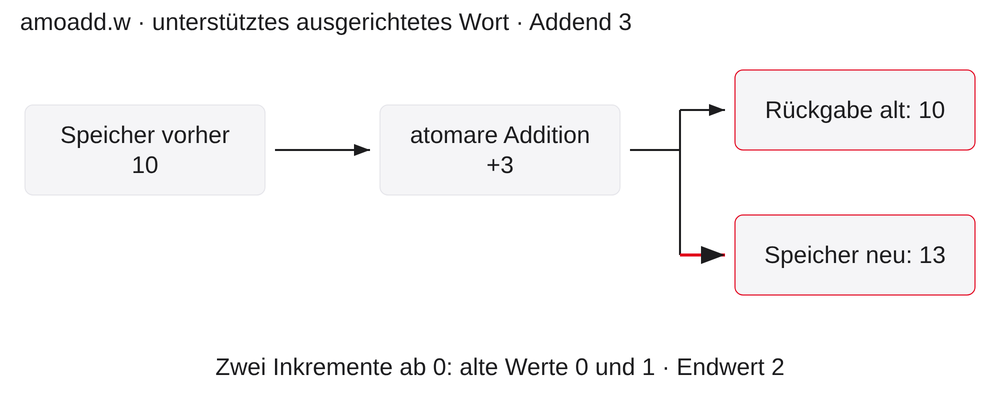{fig-alt="Amoadd.w mit Speicherwert10 und Addend3gibt den alten10zurück und speichert13. Zwei atomare Inkremente ab0enden bei2 und liefern alte Werte0und1."}

Ohne `.aq`/`.rl` bleibt die RMW atomar; zusätzliche Ordnung anderer Daten fehlt.

::: notes
AMO heißt Atomic Memory Operation, atomare Speicheroperation. `amoadd.w rd, rs2, (rs1)` addiert einen Registerwert atomar zu einem vier Byte großen Speicherwort. `rs1` enthält die unterstützte ausgerichtete Adresse, `rs2` den Addenden und `rd` erhält den alten Speicherwert. RMW bedeutet Read-Modify-Write, unteilbares Lesen, Ändern und Schreiben.

Bei Speicher zehn und Addend drei erhält das Zielregister zehn, der neue Speicherwert wird dreizehn. Die Abbildung trennt diese zwei Ergebnisse sichtbar. Zwei atomare Inkremente mit Addend eins ab null erhalten alte Werte null und eins und enden bei zwei. Welcher Hart, Hardware-Ausführungsinstanz, den ersten alten Wert bekommt, ist nicht vorher festgelegt. Die roten Felder trennen altes Rückgabeergebnis und neuen Speicherwert; daraus folgt keine garantierte Taktzahl.

`.aq` steht für Acquire, `.rl` für Release. Ohne diese zusätzliche Ordnung bleibt die Operation atomar, sichert aber nicht automatisch die Beobachtung anderer Nutzdaten. Das ist kein globaler Bus-Lock. Die Speichernutzung muss weiterhin in einer unterstützten Region stattfinden. Ein C-Aufruf kann daraus eine solche AMO erzeugen, ist aber kein Versprechen genau dieser Übersetzung. Die nächste Folie beschreibt deshalb zuerst die Spracheigenschaft des Zählers.
:::

## C11: ein atomarer Zähler

```c
#include <stdatomic.h>
static atomic_uint count = 0;
void increment(void) {
    atomic_fetch_add_explicit(
        &count, 1u, memory_order_relaxed);
}
```

Zwei fertige Worker mit je $N$ Inkrementen ergeben $2N$ ohne Zahlenüberlauf.

::: notes
C11 ist der C-Sprachstandard von 2011. `stdatomic.h` stellt die atomaren Typen und Operationen bereit. `atomic_uint` ist ein atomarer vorzeichenloser Integer. `count` wird vor dem Threadstart mit null initialisiert; ein Thread ist ein Softwareausführungsfaden. `atomic_fetch_add_explicit` erhöht unteilbar und gibt den alten Wert zurück, den die Funktion hier nicht weiterverwendet. `1u` ist die vorzeichenlose Konstante eins.

`memory_order_relaxed` genügt in diesem Beispiel für den reinen Zähler: Wir benötigen unteilbare Inkremente und die Änderungsordnung desselben Objekts, aber veröffentlichen über ihn keine anderen Nutzdaten. Nachdem beide Worker vollständig beendet und mit dem Hauptablauf synchronisiert sind, ist der Endwert $2N$, solange der Zahlenbereich nicht überläuft. In der Hostdatei gibt es je zwanzigtausend Inkremente, also vierzigtausend.

`atomic_fetch_add` ohne explizite Ordnungsangabe verwendet dagegen standardmäßig `memory_order_seq_cst`, sequential consistency, eine zusätzliche gemeinsame Ordnung entsprechender atomarer Operationen. Sie macht nicht das gesamte Programm seriell. Der Compiler kann AMO, Atomic Memory Operation, LR/SC, Load-Reserved/Store-Conditional, oder einen Bibliotheksweg wählen. Atomic bedeutet nicht zwingend lock-free, ohne interne Sperre, und lock-free bedeutet nicht wait-free, Abschluss jedes einzelnen Aufrufs in begrenzten eigenen Schritten. Ein ISR-Kontext, Interrupt Service Routine, verlangt deshalb zusätzliche Plattformprüfung.
:::

## C11-Lock: Test-and-Set und Clear

```c
#include <stdatomic.h>
static atomic_flag lock = ATOMIC_FLAG_INIT;
void take_lock(void) {
    while (atomic_flag_test_and_set_explicit(
               &lock, memory_order_acquire)) { }
}
void drop_lock(void) {
    atomic_flag_clear_explicit(
        &lock, memory_order_release);
}
```

Alle Zugreifer müssen denselben Lock für dieselben geschützten Daten nutzen.

::: notes
Der C11-Header `stdatomic.h` beschreibt die Sprachsemantik atomarer Operationen. `atomic_flag` ist ein atomarer gesetzter oder freier Zustand; `ATOMIC_FLAG_INIT` initialisiert ihn vor konkurrierender Nutzung frei. Der Standard verlangt für diesen Typ lock-free Operationen, also ohne intern blockierende Sperre. Das macht einen damit geschriebenen Spinlock nicht selbst wait-free oder automatisch interruptgeeignet.

`atomic_flag_test_and_set_explicit` gibt den vorherigen Flagzustand zurück und setzt ihn in derselben atomaren Aktion. `take_lock` wiederholt bei zuvor gesetzt und kehrt erst nach einem freien vorigen Zustand zurück. `memory_order_acquire` liefert die Übernahmeordnung für spätere geschützte Daten. `drop_lock` löscht mit `atomic_flag_clear_explicit`; `memory_order_release` ordnet frühere Zugriffe vor der Freigabe. Der Besitz endet erst durch diese passende Freigabe.

Der C-Ausschnitt ist ein vollständiges kleines Sperrprimitiv für geeignete Threadkontexte, kein allgemeines Betriebssystem-Lock. Während des geschützten Abschnitts darf hier keine blockierende Arbeit erfolgen. Alle konkurrierenden Zugreifer müssen dieselbe Disziplin nutzen; ein einzelner ungeschützter Zugriff bleibt ein Problem. `volatile` ergänzt keine solche Synchronisation. Der Hostversuch verwendet diese Sperre zum Prüfen einer gewöhnlichen Zählervariable, ohne Laufzeit- oder Fairnessbehauptung. Eine andere korrekte Datenübergabe benötigt nicht zwingend einen gemeinsamen Lock.
:::

## Einmalige Veröffentlichung: bereit heißt Daten bereit

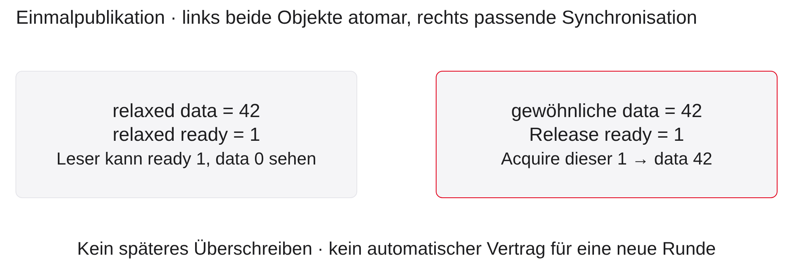{fig-alt="Links sind Daten und Flag einzeln atomar-relaxed: ready1bei data0ist sprachlich möglich. Rechts schreibt der Produzent gewöhnliche Daten42 vor ready-Release; ein Acquire-Leser dieser1darf42nutzen."}

Einmaliger Produzent, kein späterer Rewrite; Acquire muss den passenden Release-Wert lesen.

::: notes
Ein Produzent erzeugt Daten, ein Konsument verwendet sie. Das Beispiel veröffentlicht einmalig den Wert zweiundvierzig über ein Bereitschaftsflag `ready`, anfangs null. Acquire ist Übernahmeordnung, Release Publikationsordnung. Die Grafik stellt zwei unterschiedliche, ausdrücklich benannte Sprachmodelle gegenüber.

Links sind sowohl `data` als auch `ready` atomare Objekte mit relaxed Zugriffen. Diese verhindern Data Races auf den einzelnen Objekten, stellen aber keine Synchronisation zwischen ihnen her. Ein Konsument, der ready eins liest, darf im schwachen Sprachmodell noch data null beobachten. Das ist eine erlaubte Möglichkeit, keine Vorhersage für jeden Hostprozessor. Mit gewöhnlicher ungeschützter Payload wäre ein solcher Versuch stattdessen ein C-Data-Race und nicht dieses wohldefinierte Gegenmodell.

Rechts schreibt ein Produzent die gewöhnlichen Daten zweiundvierzig und speichert danach ready eins mit Release. Der Konsument liest ready mit Acquire. Wenn er den zugehörigen freigegebenen Wert eins liest, ist die vorherige Datenschreibung gegenüber seinem späteren Lesen abgesichert. Das Hostprogramm prüft diese einmalige korrekte Übergabe. Ein erneutes Überschreiben oder Zurücksetzen des Flags ist nicht enthalten; dafür wären neue Lebensdauer- und Nutzungsregeln nötig. Die rote Bildhälfte stellt passende Synchronisation dar, keine automatische Wirkung beliebiger atomarer Flags.
:::

## Deadlock: korrekte Atomics, falsche Wartebeziehung

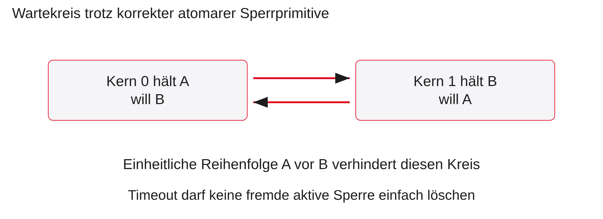{fig-alt="Kern0hältAund wartetaufB, Kern1hältBund wartetaufA. Eine einheitliche ÜbernahmereihenfolgeAvorBverhindert diesen Kreis."}

Atomizität garantiert weder Fortschritt noch eine günstige Lockreihenfolge.

::: notes
Deadlock ist ein Zustand wechselseitigen oder zyklischen Wartens, bei dem die Beteiligten nicht mehr fortschreiten können. Im Bild hält Kern null Lock A und verlangt B. Kern eins hält B und verlangt A. Beide könnten korrekte atomare Sperrprimitive verwenden; trotzdem kann keiner seine angeforderte Sperre erhalten. Die roten Pfeile bilden den Wartekreis.

Eine für alle Beteiligten geltende Reihenfolge A vor B verhindert genau diesen Kreis: Wer B besitzt, hat A bereits übernommen und verlangt A nicht erst danach. Das ist eine Lockhierarchie, festgelegte Übernahmereihenfolge. Sie beweist nicht automatisch die Abwesenheit jedes anderen Deadlocks im System. Starvation bedeutet, dass ein Teilnehmer dauerhaft keinen Fortschritt erreicht, auch ohne Wartekreis. Livelock ist wiederholte Aktivität ohne nützlichen Abschluss.

Ein Timeout darf nicht einfach ein fremdes Schloss freigeben, während der Besitzer noch geschützte Daten verändert. Dafür wäre ein eigenes Abbruch- und Konsistenzkonzept nötig. Atomare RMW, Read-Modify-Write, ändert zudem weder Scheduling noch die Möglichkeit einer Unterbrechung des Besitzers. Ein besonders greifbarer Wartefehler entsteht deshalb im Interruptkontext desselben Harts und lässt sich mit der bekannten Unterbrechungslogik aus Vorlesung 3 erklären.
:::

## Die ISR darf ihren unterbrochenen Halter nicht blockieren

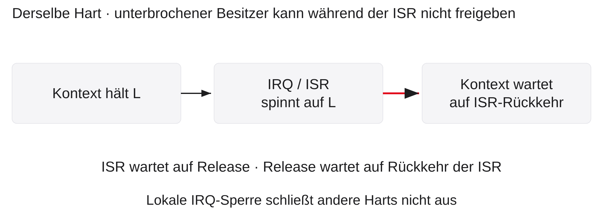{fig-alt="Ein Kontext hältLockL, wird auf demselben Hart unterbrochen, die ISR spinntaufL. Der Besitzer kann erstnachISR-Rückkehr freigeben, die ISRkehrtwegenWarten aber nichtzurück."}

Lokale Interrupts sperren hält andere Harts nicht von gemeinsamen Daten fern.

::: notes
ISR bedeutet Interrupt Service Routine, Unterbrechungsroutine; IRQ Interrupt Request, Unterbrechungsanforderung. Ein Hart ist eine Hardware-Ausführungsinstanz. Das Zeitbild zeigt ausdrücklich denselben Hart: Ein normaler Kontext hält Lock L, ein IRQ unterbricht ihn, und die ISR versucht L durch Spinning, wiederholtes Prüfen, zu übernehmen.

Der unterbrochene Halter kann seine Arbeit und die spätere Freigabe erst nach Rückkehr der ISR fortsetzen. Die ISR wartet aber gerade auf diese Freigabe. Der Ablauf kann daher nicht vorankommen, selbst wenn jedes Test-and-Set unteilbar ist. Der rote Pfeil und die Wartebeschreibung markieren die blockierte Rückkehrbedingung. Ein weiteres atomisches Primitiv beseitigt diese Wartebeziehung nicht.

Ein geeignetes Konzept kann kurze gemeinsame Abschnitte gegen die betreffende lokale Unterbrechung schützen oder die Arbeit aus der ISR verschieben. Dabei bleiben andere Harts und die Plattformregeln zu beachten: Lokale IRQ-Sperre ist keine globale Multicore-Sperre. Lock-free, intern ohne Sperre, bedeutet ebenfalls nicht automatisch für jede ISR geeignet oder bounded, zeitlich begrenzt. Wir führen hier keine Interrupt-Firmware aus; das Diagramm ist eine Fortschrittsanalyse. Die Papieraufgabe verbindet deshalb Datenordnung, Lockreihenfolge und den blockierten Halter.
:::

## Papierphase 3: Ordnung und Fortschritt

Übungsblatt, Aufgabe 4 · 15 Minuten

- Passende Release-/Acquire-Verbindung für Nutzdaten erklären
- Einen Wartekreis anhand der gehaltenen Locks erkennen
- ISR-Selbstdeadlock von fehlender Atomizität unterscheiden

::: notes
Acquire ist Übernahmeordnung, Release Freigabe- oder Publikationsordnung. Für die einmalige Datenübergabe wird zuerst die gewöhnliche Payload, der Nutzdatenwert dreiundsiebzig, geschrieben und danach das atomare Bereitschaftsflag auf sieben gesetzt. Liest der Konsument genau diesen Release-Wert mit Acquire und erfolgen keine späteren Überschreibungen, erhält er anschließend Payload dreiundsiebzig. Bei ausschließlich atomar-relaxed Zugriffen ist dagegen Flag sieben mit altem Datenwert minus eins erlaubt. Eine gewöhnliche konfliktierende ungeschützte Payload hätte einen C-Data-Race, also undefiniertes Verhalten.

Der neue Wartekreis ist $A\to Y\to B\to Z\to C\to X\to A$: Jeder Kontext hält eine Sperre, die ein anderer benötigt. Eine überall eingehaltene Erwerbsreihenfolge X vor Y vor Z verhindert diesen Kreis. Ein Timeout erlaubt nicht, eine fremde noch genutzte Sperre zu löschen. Deadlock bedeutet ausbleibenden Fortschritt durch eine Wartebeziehung und setzt keine kaputte atomare Operation voraus.

ISR heißt Interrupt Service Routine. Wartet diese auf die Sperre des unterbrochenen Kontexts desselben Harts, kann der Halter bis zur Rückkehr nicht freigeben. Ein Hart ist eine Hardware-Ausführungsinstanz. Atomizität löst diesen Selbstdeadlock nicht. Eine lokale Interruptsperre hält wiederum andere Harts nicht fern. Die Schutzdisziplin muss den tatsächlich benötigten Fortschritt des Besitzers ermöglichen. Auch bei korrekter Synchronisation bleibt zu untersuchen, wie viel der Anwendung überhaupt parallel läuft.
:::

## Amdahl: feste Arbeit enthält serielle Zeit

$$T(N)=T(1)\left(s+\frac{1-s}{N}\right),\qquad
S(N)=\frac{T(1)}{T(N)}$$

- $s$: serieller Anteil der Ein-Kern-Zeit
- $N$: gleiche Kerne; ideal verteilbarer Rest
- Feste Aufgabe, perfekte Verteilung, zunächst kein Zusatzaufwand

::: notes
Amdahls Gesetz beschreibt die Beschleunigungsgrenze einer festgehaltenen Aufgabe, wenn ein Anteil ihrer Ein-Kern-Laufzeit nicht parallel verkürzt werden kann. $T(1)$ ist die gesamte Ausgangszeit, $s$ deren serieller Anteil zwischen null und eins, $1-s$ der parallel verteilbare Rest. $N$ ist die Zahl gleicher nutzbarer Kerne. $T(N)$ ist die idealisierte verkürzte Zeit und $S(N)$ der Speedup, Faktor der Beschleunigung.

Die serielle Zeit bleibt $sT(1)$. Nur der andere Anteil wird unter perfekter Verteilung durch $N$ geteilt. Deshalb ist $S(N)=1/(s+(1-s)/N)$. Für $s>0$ und sehr viele Kerne nähert sich der Faktor $1/s$. Bei rein paralleler Arbeit, $s=0$, wäre ideal $S(N)=N$. Bei rein serieller Arbeit bleibt er eins.

Die Anteile beziehen sich auf die ursprüngliche Ein-Kern-Zeit, nicht auf die schon verkürzte Multicore-Zeit. Threadstart, Synchronisation, Datenkopien und zusätzliche Kohärenzarbeit sind hier noch null. Größere Datenmengen oder andere Algorithmen wären eine geänderte Aufgabe. Das Gesetz ist somit eine Rechnung unter benannten Voraussetzungen, keine gemessene Hardwareeigenschaft. Mit einer Ausgangszeit von hundert Zeiteinheiten lässt sich diese Grenze besonders klar an Balken und Zahlen verfolgen.
:::

## Vier Kerne sind hier Faktor 2,5

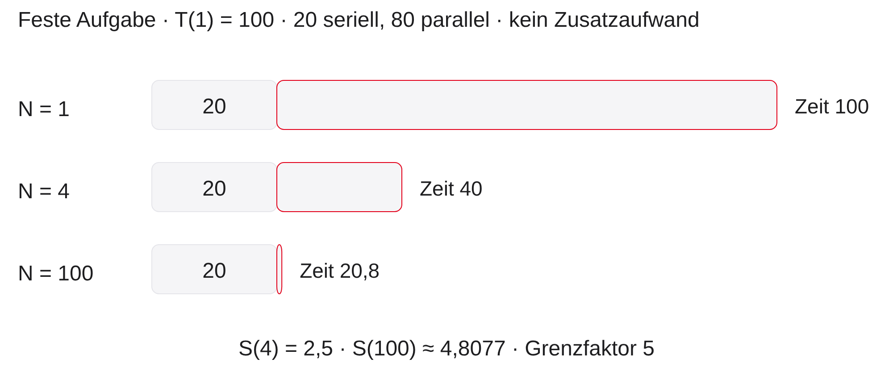{fig-alt="Feste Aufgabe mit20seriellen und80parallelen Zeiteinheiten. Zeiten bei1,4,100Kernen sind100,40,20,8. Speedup2,5bei4und4,8077bei100; Grenze5."}

$$S(4)=2{,}5,\quad E(4)=S(4)/4=62{,}5\,\%$$

::: notes
$S$ ist der Speedup, Beschleunigungsfaktor, $E$ die Effizienz als $S(N)/N$. Effizienz ist hier ein normierter Beschleunigungskennwert, keine direkte Messung jedes einzelnen Rechenwerks. Das Bild verwendet $T(1)=100$ Zeiteinheiten, seriellen Anteil $s=0{,}2$ und parallelen Anteil $0{,}8$. Grau markiert die unveränderten zwanzig seriellen Einheiten, rot den verkürzten parallelen Abschnitt.

Für vier Kerne ist $T(4)=20+80/4=40$. Daraus folgt $S(4)=100/40=2{,}5$ und $E(4)=2{,}5/4=0{,}625$, zweiundsechzig Komma fünf Prozent. Für hundert Kerne ist $T(100)=20+80/100=20{,}8$, $S(100)=100/20{,}8\approx4{,}8077$ und $E(100)\approx0{,}04808$, etwa vier Komma acht Prozent. Der Grenzfaktor ist $1/0{,}2=5$.

Der Speedup kann also nahe an seiner Grenze liegen, während das Verhältnis zur großen Kernzahl klein bleibt. Mehr Kerne verkürzen nur den noch übrig gebliebenen parallelen Anteil. Die Balkenlängen beziehen sich linear auf Zeit, nicht auf eine ungleichmäßige Kernzahlachse. Alle Werte sind Modellrechnungen ohne Overhead, zusätzlichen Aufwand. Dieser wird nun als eigene Zeitgröße ergänzt.
:::

## Kommunikation und Locks kosten Zusatzzeit

$$S(N)=\frac{1}{s+(1-s)/N+h(N)}$$

Bei $s=0{,}2$, $N=4$, $h(4)=0{,}05$:

$$S(4)=1/0{,}45\approx2{,}2222$$

$h(N)$ zählt Zusatzzeit relativ zu $T(1)$, keine zusätzliche Kernzahl.

::: notes
$S(N)$ ist der Beschleunigungsfaktor, $s$ der serielle Anteil der ursprünglichen Ein-Kern-Zeit und $N$ die Zahl nutzbarer gleicher Kerne. $h(N)$ ist zusätzlicher Aufwand durch die parallele Organisation, ausgedrückt als Anteil von $T(1)$. Dazu können Starten, Zusammenführen, Kommunikation, Sperren oder zusätzliche Datenbewegung gehören. Im hier erweiterten Vergleich ist die Ein-Kern-Referenz unverändert.

Mit $T(1)=100$, $s=0{,}2$ und vier Kernen bleiben zwanzig serielle und zwanzig ideal parallele Zeiteinheiten. $h(4)=0{,}05$ ergänzt fünf Einheiten. Die Zeit beträgt daher fünfundvierzig und der Speedup $100/45\approx2{,}2222$. Die Effizienz ist $S(4)/4\approx0{,}5556$, etwa fünfundfünfzig Komma sechs Prozent. Ohne diesen Aufwand waren es vierzig Zeiteinheiten und Faktor zwei Komma fünf.

Diese fünf Zusatzzeiteinheiten sind eine eigene Lehrannahme, keine Messung eines Locks. Man darf nicht dieselbe serielle Sperrzeit zugleich in $s$ und nochmals in $h$ zählen. Auch muss der Aufwand mit steigender Kernzahl nicht konstant bleiben. Auf einer bandbreitenbegrenzten Aufgabe können zusätzliche Teilnehmer sogar mehr konkurrieren. Selbst ohne solche Zusatzzeit kann eine schlechte Verteilung die ideale Teilung durch $N$ verhindern; das zeigt der nächste Vergleich.
:::

## Der langsamste Teil bestimmt den Abschluss

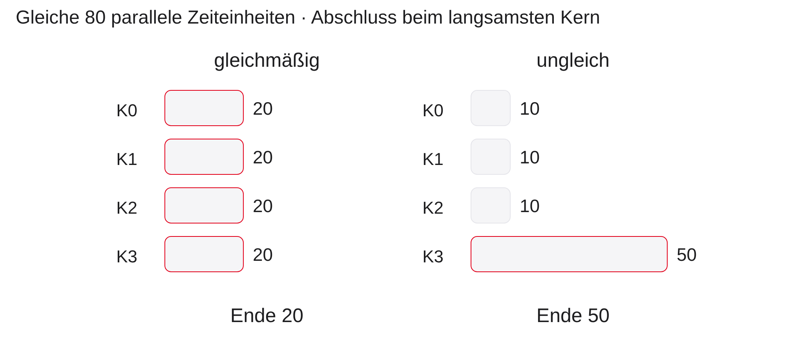{fig-alt="Achtzig parallele Zeiteinheiten sind gleichmäßig als20,20,20,20oder ungleich als10,10,10,50aufgeteilt. Abschluss nach20beziehungsweise50; mit20seriellen Einheiten Gesamt40oder70."}

Gleiche Gesamtarbeit garantiert noch keine gleiche Verteilung.

::: notes
Load Balance bedeutet gleichmäßige Arbeitsverteilung. Die Grafik vergleicht dieselben achtzig parallelen Zeiteinheiten auf vier Kernen; K0 bis K3 bezeichnen diese Kerne. Jede Zahl bezeichnet die Dauer der diesem Kern zugeteilten Arbeit, keine Elementanzahl. Wir nehmen gleichzeitigen Start, keine überlappte Nachverteilung und keinen zusätzlichen Kommunikationsaufwand an.

Im oberen Plan erhält jeder Kern zwanzig Einheiten. Die parallele Phase endet nach zwanzig. Im unteren Plan erhalten drei Kerne je zehn, der vierte fünfzig; die Summe bleibt achtzig. Die parallele Phase endet aber erst nach fünfzig. Rot markiert den letzten Abschluss, grau die früheren fertigen Bereiche. Die drei frühen Kerne dürfen das Gesamtergebnis nicht vor dem vierten als vollständig behandeln.

Mit unveränderten zwanzig seriellen Einheiten ergibt der erste Fall $T=20+20=40$, der zweite $T=20+50=70$. Gegenüber der Ein-Kern-Zeit hundert sind das Speedups $2{,}5$ und $100/70\approx1{,}4286$. Eine Aufteilung nach gleichen Elementzahlen genügt nicht, wenn Elemente unterschiedlichen Aufwand haben. Das Maximum der Teilzeiten, nicht ihr Durchschnitt, bestimmt hier den Abschluss. Ein Scheduler oder andere Partitionierung könnte helfen, bringt jedoch eigene Kosten. Dieselbe klare Zählweise wenden wir zum Semesterabschluss auf Speicher und Timer an.
:::

## Wiederholung: Cacheadresse und mittlere Zeit

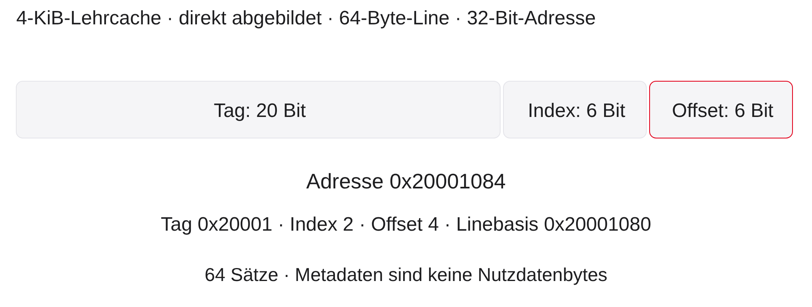{fig-alt="Direct-Mapped-Lehrcache4KiBmit64Byte-Zeilen und32Bit-Adressen:20Tag-,6Index-,6Offsetbits. Adresse0x20001084hat Tag0x20001,Index2,Offset4,Zeilenbasis0x20001080."}

$$\mathrm{AMAT}=2+0{,}1\cdot40=6\ \text{Takte}$$

::: notes
AMAT bedeutet Average Memory Access Time, mittlere Speicherzugriffszeit. Direct-Mapped heißt direkt abgebildet: Jeder Block kann nur in den durch seinen Index festgelegten Satz. Ein KiB, Kibibyte, sind eintausendvierundzwanzig Byte. Der Lehrcache enthält vier KiB Nutzdaten mit vierundsechzig Byte je Zeile und verwendet zweiunddreißig Bit breite Byteadressen.

Die Zeilenanzahl ist $4096/64=64$. Der Byteoffset in einer Zeile benötigt $\log_2(64)=6$ Bit, der Satzindex ebenfalls sechs. Der Tag, Vergleichskennung, besitzt $32-6-6=20$ Bit. Das Bild liest die Adresse von den oberen Tagbits zu den unteren Offsetbits. Für `0x20001084` sind Offset vier, Index zwei, Tag `0x20001` und Zeilenbasis `0x20001080`. Metadaten wie Valid, Gültigkeit, und Dirty, verändert, sind keine mitgezählten Nutzdatenbytes.

Separat nehmen wir Hitzeit zwei Takte, Hitrate neunzig Prozent und zusätzliche Misspenalty vierzig Takte an. Missrate ist daher $0{,}1$. $\mathrm{AMAT}=2+0{,}1\cdot40=6$ Takte. Bei hundert MHz, Millionen Takte je Sekunde, dauern diese sechzig ns, Nanosekunden. Misspenalty ist hier ausdrücklich Zusatzzeit. Mapping und mittlere Zeit sind unterschiedliche Rechnungen; beide beruhen auf gegebenen Modellgrößen, nicht auf einer konkreten Platine.
:::

## Wiederholung: Periodenlänge vor Registerwert

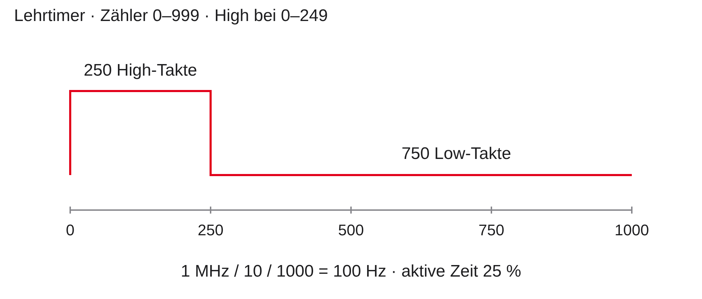{fig-alt="Timer mit1MHzEingang,Teiler10und1000Zählertakten proPeriode ergibt100Hz. Zähler0bis999,Highbei0bis249:250von1000Takte,25Prozent."}

$f_{\mathrm{PWM}}=10^6/(10\cdot1000)=100\,\mathrm{Hz},\quad D=250/1000=25\,\%$

::: notes
PWM heißt Pulse Width Modulation, Pulsweitenmodulation. $f_{\mathrm{PWM}}$ ist die Wiederholfrequenz, $D$ der Duty Cycle, Anteil der aktiven Zeit an einer Periode. MHz bedeutet Millionen Hertz; Hertz ist Perioden je Sekunde. Ein Prescaler ist der vorgeschaltete Teiler einer Zeitbasis. Die Abbildung zeigt ein Lehrmodell mit einem MHz Eingang, Teiler zehn und eintausend Zählertakten je Periode.

Nach dem Teiler bleiben hunderttausend Zählertakte pro Sekunde. Geteilt durch eintausend ergibt das hundert Perioden pro Sekunde. Eine Periode dauert zehn Millisekunden. Der Zähler läuft null bis neunhundertneunundneunzig, also genau eintausend Werte. High gilt bei Werten null bis zweihundertneunundvierzig, zweihundertfünfzig Takte. Die aktive Dauer beträgt zweieinhalb Millisekunden und $D=250/1000=0{,}25$.

Die obere Achse zeigt Zählertakte, die rote Rechteckkurve High und Low, aktive und inaktive Phase. Es wird kein universelles Timerregisterlayout vorausgesetzt; End- und Vergleichsregister sind plattformspezifisch. Vor einem Registerwert muss geprüft werden, ob ein Endwert inklusive zählt, wie ein Teiler kodiert wird und welche Vergleichsbedingung High erzeugt. Genau diese Zählgrenze verhindert typische Fehler um einen Takt.
:::

## Systemweg: vom Sensor zur gemeinsamen Rechnung

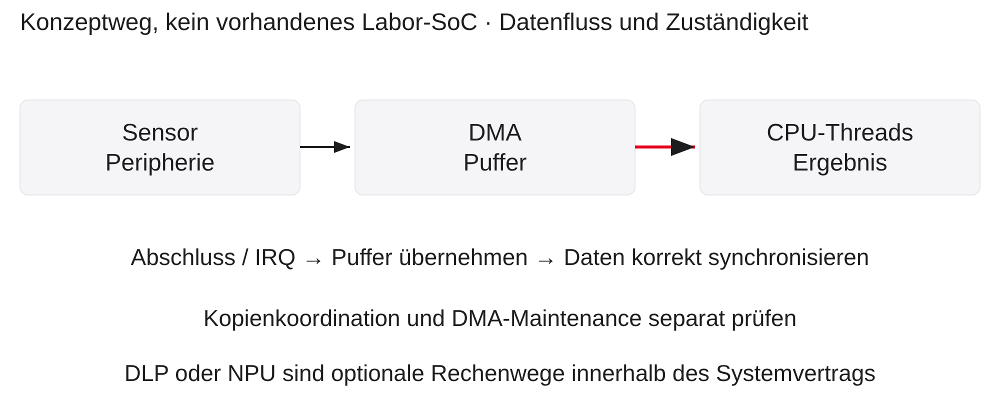{fig-alt="Konzeptweg Sensor,Peripherie,DMA,Puffer,CPU-ThreadsundErgebnis. Ein Interrupt meldet Abschluss, Pufferzuständigkeit und Kopienkoordination sind getrennte Bedingungen. Vektoren oderNPUbleiben optionaleRechenwege."}

Ein Konzeptplan ist keine Aussage über ein vorhandenes Labor-SoC.

::: notes
SoC bedeutet System on Chip, integriertes System auf einem Chip. DMA heißt Direct Memory Access, eigenständiger Datentransfer, CPU Central Processing Unit, Prozessor. Ein IRQ, Interrupt Request, meldet eine Unterbrechungsanforderung. DLP ist Data-Level Parallelism, gleiche Arbeit an vielen Daten; NPU Neural Processing Unit, Beschleuniger neuronaler Verarbeitung. Die Grafik ist ein Konzeptweg aus den Kursbausteinen, kein vorhandenes Multicore-Gerät.

Sensordaten gelangen über eine Peripherieschnittstelle in einen Puffer. Bei einem DMA-Transfer sind Quelle, Ziel, Breite und Adressinkrement aus dem Gerätevertrag festzulegen. Abschlussmeldung und Übergabe der Pufferzuständigkeit sind zusätzliche Ereignisse. Eine CPU darf den Puffer nicht während einer ungeklärten Geräteänderung als fertig behandeln. Bei nichtkohärenten Transfers sind passende Cachemaintenance und Ordnung erforderlich.

Danach können Threads getrennte Bereiche verarbeiten oder Vektoren im jeweiligen Thread eingesetzt werden. Die gemeinsame Ergebnisübergabe braucht eine korrekte Synchronisation. MESI, Modified, Exclusive, Shared, Invalid, würde Cachekopien beteiligter CPU-Teilnehmer koordinieren, aber keinen beliebigen DMA-Pfad automatisch einschließen. Ein Interrupt vermeidet bestimmte Pollingschritte; DMA übernimmt Transfers, ohne die Leitung schneller zu machen. Die Zeichnung verbindet deshalb Datenweg und Zuständigkeit statt bloß alle bekannten Hardwareabkürzungen in einen Chip zu setzen.
:::

## Was der Hostversuch tatsächlich prüft

`labs/src/lab09_atomics.c`

- Getrennte Teilsummen, anschließend zusammengeführt
- Verlorenes Update als atomare Einzelzugriffsfolge
- Zwei Worker mit atomarem Zähler und mit C11-Lock
- Einmalige Release-/Acquire-Veröffentlichung

RISC-V GCC und Renode sind eigene Zielwerkzeuge; dieser Versuch ist kein Kohärenzbenchmark.

::: notes
Ein Host ist der Entwicklungsrechner. Die angegebene C-Datei enthält ein vollständiges Programm mit zwei Threads über POSIX Threads. POSIX heißt Portable Operating System Interface, portable Betriebssystemschnittstelle, hier für Ausführungsfäden. C11 ist der Sprachstandard von 2011. `pthread_create` startet einen Worker mit einem Datenargument, `pthread_join` wartet auf dessen Ende und sichert die danach verwendeten Ergebnisse. Fehler der Threaderzeugung und des Wartens werden behandelt.

Die Teilsummen sind zehn und sechsundzwanzig, zusammen sechsunddreißig. Ein seriell vorgegebenes Interleaving, verschachtelte Schrittfolge, mit atomaren Loads und Stores bildet das verlorene Update eins nach. Zwei tatsächlich gestartete Worker mit je zwanzigtausend atomaren Inkrementen liefern vierzigtausend. Ein weiterer Durchlauf schützt eine gewöhnliche Variable mit `atomic_flag` und Acquire/Release und prüft denselben Endwert. Eine einmalige geordnete Veröffentlichung liefert zweiundvierzig.

Das Programm prüft diese funktionalen Eigenschaften und seine Fehlerauswertung. Es misst keine MESI-Transaktionen, Geschwindigkeit, Fairness oder Energie. GCC, GNU Compiler Collection, übersetzt hier für den Host. RISC-V GCC wäre eine andere Zielübersetzung; Renode ist der im Kurs verwendete Systemsimulator und bräuchte passende Firmware und Plattform. Ohne validiertes Zeitmodell wäre auch dessen funktionaler Erfolg kein Nachweis einer Multicore-Beschleunigung.
:::

## Papierphase 4 und Abschlussquiz

Aufgaben 5–6: 15 Minuten · anschließend Quiz: 15 Minuten

- Speedup, Effizienz und Zusatzaufwand berechnen
- Cachemapping, AMAT und PWM mit Einheiten prüfen
- Zusammenführen: gültige Kopie, unteilbares Update, geordnete Übergabe

::: notes
Speedup ist die Beschleunigung gegenüber derselben Ein-Kern-Aufgabe. Effizienz ist dieser Faktor geteilt durch die Kernzahl. Die neue Referenz dauert hundertfünfzig Einheiten, davon fünfundvierzig seriell und hundertfünf parallel. Drei Kerne ergeben ideal $45+105/3=80$, Speedup $1{,}875$ und $62{,}5\,\%$ Effizienz. Sechzig Kerne ergeben $46{,}75$ Einheiten, Faktor $3{,}20856$ und etwa $5{,}3476\,\%$ Effizienz; die ideale Grenze ist $1/0{,}3$. Sechs Zusatzeinheiten bei drei Kernen erhöhen die Zeit auf sechsundachtzig, Faktor $1{,}74419$, normierter Zusatz $6/150=0{,}04$. Ungleiche Pakete fünfzehn, fünfundzwanzig und fünfundsechzig dauern parallel fünfundsechzig, insgesamt hundertzehn, Faktor $1{,}36364$.

AMAT bedeutet Average Memory Access Time, mittlere Zugriffszeit. Im neuen Cachemodell gibt es vierundsechzig Sets sowie sieben Offset-, sechs Index- und neunzehn Tagbits. Die Adresse `0x30004298` hat Offset vierundzwanzig, Index fünf, Tag `0x18002` und Basis `0x30004280`. $3+0{,}08\cdot50=7$ Takte dauern bei hundertfünfundzwanzig MHz sechsundfünfzig Nanosekunden; MHz bedeutet Millionen Takte pro Sekunde. PWM, Pulse Width Modulation oder Pulsweitenmodulation, hat nach Teiler acht $250000$ Zählticks je Sekunde. $1250$ Intervalle ergeben zweihundert Hertz, fünf Millisekunden Periode und bei fünfhundert HIGH-Ticks zwei Millisekunden, also vierzig Prozent. Geräte-Kohärenz, Pufferbesitz, Sichtbarkeit, Ordnung und vollständiger Abschluss müssen zusätzlich zur Kohärenz der Prozessorkopien feststehen.

Das Quiz prüft zehn Unterscheidungen derselben Vorlesung. Begründen Sie die Antworten mit Zustandsfolge, Sprachregel oder Rechnung. Der Abschluss verbindet gültige Cachekopien, unteilbare Updates und geordnete Datenübergaben. Die neuen Übungsfälle verlangen den Transfer der Folienmethoden. Diese Materialien legen keine zusätzlichen Prüfungsformalien fest.
:::

## Quellen und Schlussfolgerung

- Harris & Harris: *Digital Design and Computer Architecture — RISC-V Edition*
- Patterson & Hennessy: *Computer Organization and Design — RISC-V Edition*
- [RISC-V-Atomics, Spezifikation 20240411](https://github.com/riscv/riscv-isa-manual/blob/20240411/src/a-st-ext.adoc)
- [C11-Draft N1570](https://www.open-std.org/jtc1/sc22/wg14/www/docs/n1570.pdf) und [GCC: volatile](https://gcc.gnu.org/onlinedocs/gcc/Volatiles.html)
- [Linux-Dokumentation: False Sharing](https://docs.kernel.org/kernel-hacking/false-sharing.html)

::: notes
Die empfohlenen Modulbücher von Harris und Harris sowie Patterson und Hennessy liefern den Rahmen für Speicherhierarchie, Befehlssatz, Parallelität und Systementwurf. Die verlinkte RISC-V-Spezifikation beschreibt LR/SC, Load-Reserved/Store-Conditional, sowie AMO, Atomic Memory Operation, deren Rückgabewerte und Ordnungsbits. Der C11-Draft N1570 beschreibt Atomics, Data Races und Sprachordnung; die GCC-Dokumentation präzisiert den Compilervertrag von `volatile`. GCC heißt GNU Compiler Collection. Die Linux-Dokumentation erläutert False Sharing anhand gemeinsam verwalteter Cachezeilen.

MESI, Modified, Exclusive, Shared, Invalid, wurde als ausdrücklich vereinfachtes stabiles Write-Back-Modell behandelt. Zeit-, Adress- und Timerzahlen sind eigene Lehrannahmen. Der Hostversuch auf dem Entwicklungsrechner prüft tatsächlich ausführbare C-Beispiele, aber weder RISC-V-Firmware noch ein MESI-Zeitmodell. Für ein späteres Multicore-Labor müssten Zielplattform, Kohärenzdomäne und Messgrenzen zuerst festgelegt werden.

Damit schließt sich der Kursbogen: Speicherorganisation liefert Daten, Busse und DMA bewegen sie, Interrupts melden Ereignisse, interne Parallelität und Vektoren nutzen Rechenpotenzial und mehrere Threads brauchen zusätzlich korrekte gemeinsame Zustände. DMA bedeutet Direct Memory Access. Mehr Hardware ist erst dann hilfreich, wenn das Programm mit seinen Datenwegen, Zahlenformaten, Zuständigkeiten und Fortschrittsbedingungen zusammenpasst.
:::
