## Zwei Kerne, doppelte Geschwindigkeit?

Eine lange Schleife soll auf 2 Kerne verteilt werden.
Beide Abläufe erhöhen außerdem denselben Ergebniszähler.

- Wird die Rechnung automatisch doppelt so schnell?
- Ist der gemeinsame Zähler automatisch richtig?
- Welche Daten würden Sie lieber getrennt halten?

Zwei Minuten zu zweit: Vermutung und Begründung sammeln.

::: notes
Zwei Kerne bieten gleichzeitig nutzbare Rechenhardware. Mit C-Arrays, Schleifen und Cachekopien lässt sich deshalb eine erste Vermutung über die Aufteilung bilden. Häufig werden eine halbierte Laufzeit und ein automatisch richtiger gemeinsamer Zähler erwartet. Sammeln Sie beide Vermutungen zunächst, ohne sie bereits als Zusage zu übernehmen.

Ein Entwurf lässt jeden Worker einen eigenen Bereich und ein eigenes Zwischenergebnis bearbeiten. Ein anderer erhöht bei jedem Element einen gemeinsamen Zähler. Im späteren definierten Einzelzugriffsmodell können beide denselben alten Wert 0 lesen und anschließend jeweils 1 speichern. Eine ungeschützte gewöhnliche C-Variable wäre dagegen ein Data Race mit undefiniertem Verhalten. Diese Sprachgrenze wird im Atomizitätsabschnitt erklärt.

Vorbereitung, Übergabe und Zusammenführen bleiben mögliche Zeitanteile. Die Vorlesung entwickelt daher 5 konkrete Prüffragen für Kopien, Updates, Veröffentlichung, Fortschritt und Laufzeit. Am Schluss werden die Vermutungen anhand derselben Fragen erneut beurteilt.
:::

## Fünf Fragen für einen Multicore-Entwurf

1. Ist die Kopie gültig?
2. Ist das Update unteilbar?
3. Sind die Daten nach der Meldung sichtbar?
4. Wird jeder Beteiligte fertig?
5. Wird es schneller?

Vorwissen: C-Arrays, Load/Store, Write-Back und Interrupts aus VL 1–3;
Befehls- und Datenparallelität aus VL 7–8.

::: notes
Ein Multicore-Entwurf lässt sich mit 5 wiederkehrenden Fragen prüfen. Gültige Kopien betreffen die Cache-Kohärenz. Ein unteilbares Update verlangt eine passende atomare Aktion. Die Sichtbarkeit nach einer Meldung benötigt eine begründete Speicherordnung. Das Fertigwerden ist eine Frage des Fortschritts; die Laufzeit schließlich muss gegen eine feste Referenz verglichen werden. Diese Ebenen bleiben während der gesamten Einheit dieselben.

Thread, Hart und Sperre werden hier eingeführt. Im Lehrmodell besitzt jeder Kern einen Hart, also eine Hardware-Ausführungsinstanz. Die Assemblerbeispiele verwenden RV32I mit A-Erweiterung und ausgerichtete 32-Bit-Wörter in gewöhnlichem, von der Plattform für Atomics unterstütztem Speicher. C-Beispiele beziehen sich auf C11. Damit kann der Lernweg ohne die ausgeblendeten Vorlesungen 4–6 verfolgt werden. Das Ziel ist, Zustände und Abläufe herzuleiten, eine Datenübergabe zu begründen und den Nutzen zusätzlicher Kerne getrennt davon zu beurteilen.
:::

## 180 Minuten: Erklärung, Papierarbeit und Quiz

| Themenblock | Erklärung | Papierphase |
|---|---|---|
| 1 · Aufteilung und MESI | 30 min | Aufgabe 1 · 15 min |
| 2 · Layout und Atomizität | 25 min | Aufgabe 3 a–c · 15 min |
| 3 · Ordnung und Fortschritt | 25 min | Aufgabe 4 a–b · 15 min |
| 4 · Skalierung und Entwurf | 25 min | Aufgabe 5 a–b, 6 c · 15 min |

Abschlussquiz: 12 Fragen · 15 Minuten.

::: notes
Das Zeitbudget umfasst 180 Minuten: 105 Minuten Erklärung, kurze Denkphasen und gemeinsame Besprechung, 60 Minuten Papierarbeit und 15 Minuten Quiz. Die Themenblöcke dauern einschließlich Papierphase 45, 40, 40 und 55 Minuten; sie sind keine vier gleich langen Unterrichtsabschnitte. False Sharing und das Layout eröffnen den zweiten Block, nachdem der erste bereits die MESI-Aufgabe bearbeitet hat. Die Nachschlagetabellen und die optionale Protokollorganisation stehen im Hintergrundanhang. So gewinnt der Beginn Zeit für die grundlegenden Zustandswechsel; der Schluss erhält Zeit für Zusatzaufwand und die Ergebnisübergabe.

Für die Abbildungen gelten gemeinsame Lesehinweise: Pfeile zeigen logische Ordnung, sofern die Achse nicht ausdrücklich eine Zeitgröße nennt. Abstände sind keine Zeit. Rot markiert den entscheidenden Schritt. Zahlen sind Lehrannahmen. Quantitative Laufzeitkurven besitzen dagegen beschriftete Achsen und eine angegebene Modellgleichung. Die C11-Ordnungsbeziehungen koordinieren Zugriffe; sie werden nicht als Cacheflush interpretiert.

Die mit „Kern“ bezeichneten Übungsteile werden in der Präsenz bearbeitet. Das gesamte Blatt mit 76 Orientierungspunkten enthält zusätzliche Nacharbeit. Die Punkte sind keine verbindliche Klausurvorgabe. In den Notizen der Papierphasen stehen Arbeitsaufträge; vollständige Lösungen bleiben im getrennten Lösungsprofil des Übungsblatts.
:::

## 1 · Arbeit aufteilen {.section-divider}

Welche Arbeit darf gleichzeitig laufen?

::: {.section-route}
Arbeit teilen → Cachekopien → Atomizität → Ordnung → Skalierung → Anwendung
:::

Von einer Schleife zu getrennten Zuständigkeiten.

::: notes
Getrennte Zuständigkeiten machen zusätzliche Kerne nutzbar. Eine unveränderte Eingabe kann gemeinsam gelesen werden; Zwischenergebnisse bleiben während der Rechnung beim jeweiligen Worker. Damit bietet das Programm unabhängige Arbeit an, statt nur dieselbe Folge auf mehr Hardware zu starten.

Thread, Hart und Kern beschreiben dabei Software, Ausführungsinstanz und physische Recheneinheit. Nach der Aufteilung bleibt eine gemeinsame Aufgabe: Der Sammler muss erkennen, wann alle benötigten Ergebnisse vollständig vorliegen. Datenaufteilung und geregelte Übergabe gehören deshalb von Anfang an zusammen.
:::

## Thread, Hart und Kern auseinanderhalten {.compact-figure}

::: {.section-label}
1 / 6 · Arbeit aufteilen
:::

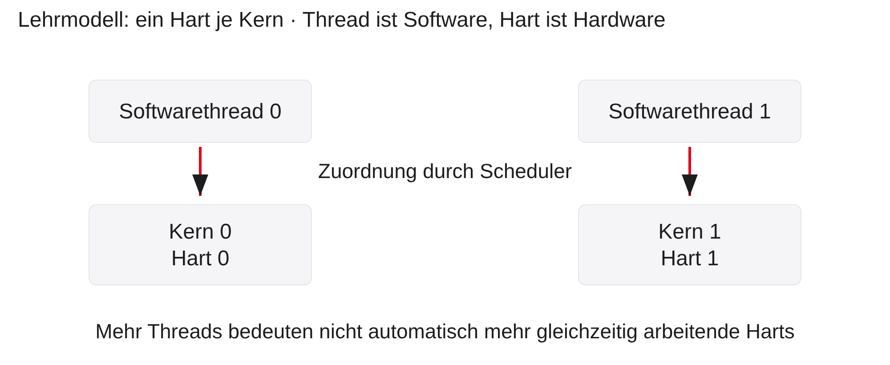{fig-alt="Zwei Softwarethreads werden zwei Harts zugeordnet. Im Lehrmodell besitzt jeder der zwei Kerne genau einen Hart. Ein Scheduler entscheidet die Zuordnung."}

Ein Thread ist Software; ein Hart ist eine Hardware-Ausführungsinstanz.

::: notes
Ein Thread ist ein eigenständig fortsetzbarer Softwareablauf. Zu seinem Zustand gehören die nächste Operation und seine Zwischenwerte. Ein Hart, Hardware Thread, ist eine Hardwareinstanz mit eigenem architektonischem Ausführungszustand. Ein Kern ist die physische Prozessoreinheit. Im gezeichneten Lehrmodell besitzt jeder der 2 Kerne einen Hart; andere Prozessoren können mehrere Harts je Kern bereitstellen.

Die Grafik führt von Softwarethreads über die zuteilende Software zu den Harts. Ein Scheduler wählt, welcher lauffähige Thread auf welcher Instanz ausgeführt wird. Die roten Pfeile zeigen eine mögliche Zuordnung. Ein Thread kann später auf eine andere Instanz verlagert werden; das heißt Migration. Eine Bindung an erlaubte Instanzen heißt Affinity.

Mehrere Threads können auf einem Hart abwechseln: Sie sind dann nebenläufig. Parallel laufen sie erst auf gleichzeitig nutzbarer Hardware. Zusätzliche Threads schaffen daher erst zusammen mit geeigneter Arbeit und verfügbaren Ressourcen einen möglichen Geschwindigkeitsgewinn.
:::

## Gemeinsame Eingabe, private Zwischenwerte {.compact-figure}

::: {.section-label}
1 / 6 · Arbeit aufteilen
:::

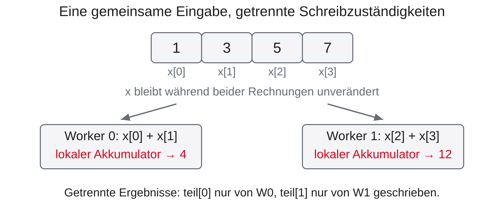{fig-alt="Die unveränderten Werte 1,3,5,7 werden in zwei Lesebereiche geteilt. Worker 0 berechnet lokal 4, Worker 1 lokal 12. Jeder schreibt ausschließlich seinen eigenen Ergebnisslot."}

Gemeinsam erreichbar heißt nicht: gemeinsam verändern müssen.

::: notes
Getrennte Schreiber vermeiden viele gemeinsame Änderungen. Die unveränderte Eingabe enthält hier $1,3,5,7$. Worker 0 berechnet lokal $1+3=4$, Worker 1 berechnet $5+7=12$. Die Pfeile ordnen Eingabebereiche und Rechenergebnisse einander zu.

Ein lokaler Akkumulator gehört zum jeweiligen Ablauf. Die Felder `teil[0]` und `teil[1]` sind gemeinsam erreichbar, haben aber jeweils genau einen Schreiber. Privat bezeichnet hier die Schreibzuständigkeit und verlangt keinen eigenen Speicherchip. Jeder Worker kann so rechnen, ohne nach jedem Element den gemeinsamen Zähler zu ändern.

Der Sammler benötigt trotzdem eine passende Abschlussmeldung, bevor er die Slots liest. Außerdem können benachbarte Slots dieselbe Cachezeile teilen. Die erste Frage betrifft die sichere Übergabe, die zweite den Datenverkehr. Beides wird später mit denselben Ergebnisslots untersucht.
:::

## Parallelität und Mehrprozessororganisation

::: {.section-label}
1 / 6 · Arbeit aufteilen
:::

| Ebene | Verfügbare Arbeit |
|---|---|
| ILP | unabhängige Befehle eines Threads |
| DLP | gleiche Operation an mehreren Daten |
| TLP | mehrere Softwarethreads |

SMP: gemeinsame Softwareverwaltung · AMP: getrennte Zuständigkeiten

::: notes
Parallelität und Mehrprozessororganisation beschreiben verschiedene Ebenen. Instruction-Level Parallelism, ILP, bietet unabhängige Maschinenbefehle innerhalb eines Threads an. Data-Level Parallelism, DLP, wendet gleichartige Operationen auf mehrere Elemente an. Thread-Level Parallelism, TLP, verwendet mehrere Softwareabläufe. Zwei Worker können also getrennte Arraybereiche bearbeiten und dabei jeweils Vektorbefehle nutzen.

Symmetric Multiprocessing, SMP, bezeichnet hier gleichberechtigte Prozessoren mit gemeinsamer Softwareverwaltung und gemeinsamem Speicher. Asymmetric Multiprocessing, AMP, ordnet Softwarezuständigkeiten getrennt zu, etwa Regelung auf einem Kern und Kommunikation auf einem anderen. Ein Betriebssystem kann die gemeinsame Verwaltung übernehmen; seine Interna werden hier nicht benötigt.

Die Organisationsbegriffe legen weder private L1-Caches noch ein gemeinsames L2 zwingend fest. Für den Entwurf bleiben konkrete Fragen offen: Welche Objekte werden gemeinsam verändert, welche Ressourcen geteilt und wie werden Ergebnisse übergeben? Die Aufteilung der Arbeit beantwortet diese Fragen konkreter als das Etikett der Architektur.
:::

## Erst Arbeit und Ergebnisse aufteilen {.compact-figure}

::: {.section-label}
1 / 6 · Arbeit aufteilen
:::

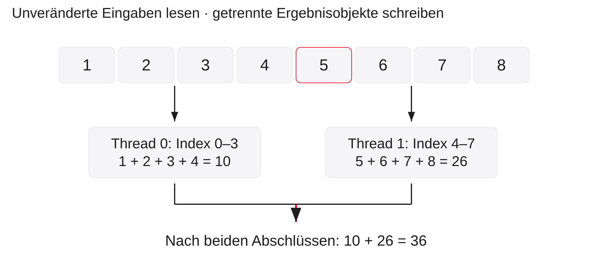{fig-alt="Arraywerte1bis8 werden in zwei Bereiche aufgeteilt. Thread0 bildet Teilsumme10, Thread1 Teilsumme26. Nach Abschluss entsteht die Gesamtsumme36."}

$$\sum_{i=0}^{7}x_i=\sum_{i=0}^{3}x_i+\sum_{i=4}^{7}x_i=10+26=36$$

::: notes
Eine Reduktion fasst viele Eingaben zu einem Ergebnis zusammen. Das Array enthält die Werte $1$ bis $8$. Thread 0 bearbeitet die Indizes $0$ bis $3$ und erhält $1+2+3+4=10$. Thread 1 bearbeitet die Indizes $4$ bis $7$ und erhält $5+6+7+8=26$. Nach beiden Abschlüssen ergibt sich $10+26=36$.

Der rote Rahmen um die $5$ markiert den ersten Wert des zweiten Bereichs, also die Aufteilungsgrenze. Er kennzeichnet keinen Fehler und keinen geänderten Messwert. Die Pfeile führen von den Bereichen zu den getrennten Teilsummen und anschließend zum gemeinsamen Ergebnis.

Während der Rechnung schreibt jeder Thread nur sein Ergebnisobjekt. Für die kleinen Ganzzahlen wird kein Überlauf angenommen. Bei Gleitkommazahlen kann eine andere Additionsreihenfolge Rundungen verändern. Die Aufteilung beseitigt den gemeinsamen Akkumulator in der inneren Schleife; Start, Abschluss und Zusammenführen bleiben gemeinsame Aufgaben.
:::

## Zusammenführen erst nach beiden Abschlüssen

::: {.section-label}
1 / 6 · Arbeit aufteilen
:::

- Worker starten mit getrennten Eingabebereichen und Ergebnisslots
- Der erste fertige Worker macht nicht die gesamte Aufgabe fertig
- Ein Join wartet auf das Ende genau dieses Threads
- Nach beiden passenden Joins dürfen die Teilsummen zusammengeführt werden

Starten, Rechnen und Zusammenführen sind verschiedene Phasen.

::: notes
Ein Join sichert den Abschluss eines bestimmten Threads. Der Start gibt einen Worker zur Ausführung frei; seine Rechnung kann danach noch laufen. Der Sammler darf deshalb den Abschluss von Worker 0 nicht zugleich als Abschluss von Worker 1 behandeln.

Im POSIX-Hostprogramm stellt ein erfolgreicher `pthread_join` auch die nötige Synchronisation für die anschließend gelesenen Ergebnisse her. Nach beiden passenden Joins kann der Sammler $10+26=36$ berechnen. Eine nur vermutete Wartezeit stellt diese Beziehung nicht her.

Für dauerhaft laufende Worker kann eine ausdrücklich synchronisierte Bereitschaftsmeldung an die Stelle des Threadendes treten. Dann muss der Empfänger zu jeder verwendeten Teilsumme deren passende Meldung abwarten. Diese Überlegung führt später von der einfachen Threadverwaltung zu einer C11-Datenübergabe.
:::

## 2 · Cachekopien koordinieren {.section-divider}

Wie können zwei private Caches denselben Speicher richtig nutzen?

::: {.section-route}
Arbeit teilen → Cachekopien → Atomizität → Ordnung → Skalierung → Anwendung
:::

Von der gemeinsamen Adresse zu gültigen Kopien und Schreibrechten.

::: notes
Cache-Kohärenz koordiniert die gültigen Kopien einer Speicherstelle. Mehrere Kerne können dieselbe Adresse erreichen und dennoch über eigene Datencaches lesen. Ein neuer Leser muss passende aktuelle Daten erhalten; ein Schreiber benötigt Rechte, die gültige alte Fremdkopien ausschließen.

Das Protokoll arbeitet auf ganzen Cachezeilen. Sein Zeilenschreibrecht schützt deshalb auch andere Wörter desselben Blocks, während es eine Folge mehrerer Programmbefehle noch nicht unteilbar macht. Das folgende Modell unterscheidet Gültigkeit, Sauberkeit und Exklusivität anhand abgeschlossener Schritte. Damit lassen sich zulässige alte untere Daten von unzulässigen alten gültigen Lesergebnissen trennen.
:::

## Welche Teilnehmer gehören zur Kohärenzdomäne? {.compact-figure}

::: {.section-label}
2 / 6 · Cachekopien koordinieren
:::

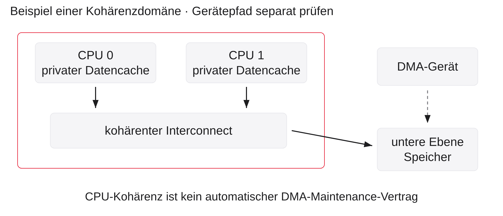{fig-alt="Zwei CPU-Kerne mit privaten Datencaches gehören zur gezeichneten Kohärenzdomäne. Ein DMA-Gerät hat einen gesondert zu prüfenden Zugriffspfad zur unteren Speicherhierarchie."}

Ein gemeinsamer Adressraum beweist noch keinen gemeinsamen Kohärenzvertrag.

::: notes
Die Kohärenzdomäne benennt die gemeinsam koordinierten Teilnehmer und Speicherbereiche. Die Umrandung der Grafik enthält 2 CPU-Kerne mit privaten Datencaches und ihren Verbindungspfad. CPU bedeutet Central Processing Unit; das Verbindungsnetz wird Interconnect genannt.

Der gestrichelte Gerätepfad liegt außerhalb dieser Zusage. DMA, Direct Memory Access, bezeichnet einen eigenständigen Datenübertrager und dient hier als Beispiel eines weiteren möglichen Speicherteilnehmers. Gemeinsames RAM allein garantiert seine Teilnahme am selben Kohärenzprotokoll nicht. Dafür muss die Plattform einen ausdrücklichen Vertrag bereitstellen.

Die folgenden Zustandsfolgen betrachten gewöhnlichen Speicher und die beteiligten CPU-Datencaches. Gerätezugriffe über MMIO, Memory-Mapped Input/Output, werden gesondert nach Plattformregeln behandelt. Innerhalb der Domäne bleiben Kopienkoordination, unteilbare Änderungen und geordnete Veröffentlichung eigene Anforderungen.
:::

## Write-Through allein beseitigt keine fremde Kopie {.compact-figure}

::: {.section-label}
2 / 6 · Cachekopien koordinieren
:::

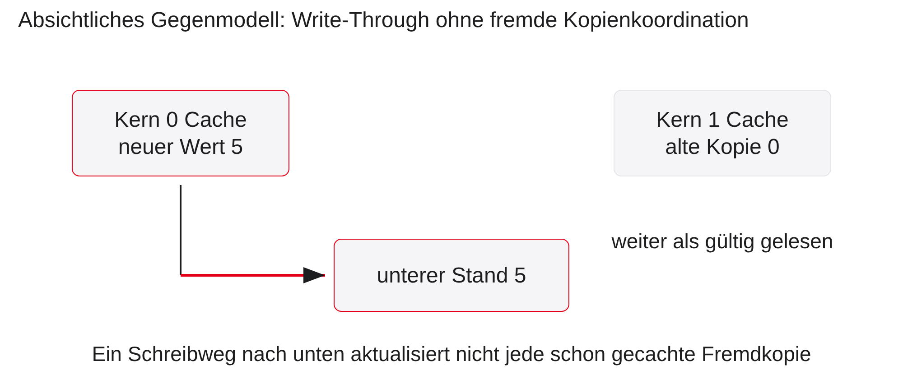{fig-alt="Ohne Kopienkoordination schreiben Kern0 und unterer Speicher den Wert5, während Kern1 seine alte gültige Cachekopie0 behält. Write-Through allein aktualisiert diese Kopie nicht."}

Eine Änderung unten macht eine bereits gecachte Fremdkopie nicht automatisch ungültig.

::: notes
Write-Through aktualisiert die untere Speicherebene bei jedem Store. Eine schon gültige Kopie in einem anderen Cache benötigt zusätzlich eine Koordination. Das Bild stellt den Fehlerfall ohne diese Koordination dar.

Anfangs enthalten beide Kopien $0$. Kern 0 schreibt $5$; die rote Markierung verfolgt den neuen Wert von seiner Kopie zum unteren Speicher. Kern 1 hält dagegen weiter eine als gültig behandelte $0$. Sein lokaler Treffer würde deshalb einen alten Wert liefern, obwohl unten bereits $5$ liegt.

Ein Kohärenzprotokoll muss fremde Kopien beispielsweise invalidieren oder aktualisieren. Invalidieren entzieht ihnen das Recht, als Treffer verwendet zu werden; beim nächsten Zugriff werden passende Daten beschafft. Write-Back und Write-Through beschreiben den Schreibweg nach unten, während das Kohärenzprotokoll die Kopien koordiniert.
:::

## Fünf Fragen für den gesamten Entwurf

::: {.section-label}
2 / 6 · Cachekopien koordinieren
:::

1. Ist die Kopie gültig?
2. Ist das Update unteilbar?
3. Sind die Daten nach der Meldung sichtbar?
4. Wird jeder Beteiligte fertig?
5. Wird es schneller?

::: notes
Die fünf Prüffragen verbinden Kopienverwaltung mit dem späteren Programmentwurf. Kohärenz beantwortet die erste Frage: Welche lokale Kopie darf einen passenden Wert liefern? Atomizität betrifft die zweite: Bleibt ein vollständiges Update gegenüber konkurrierenden Zugriffen unteilbar?

Die dritte Frage betrachtet mehrere Objekte gemeinsam, etwa Nutzdaten und Bereitschaftsflag. Passende Speicherordnung macht die Nutzdaten nach einer gelesenen Meldung verfügbar. Fortschritt fragt anschließend, ob die Beteiligten ihre Arbeit überhaupt abschließen können. Erst ein korrekter, fertig werdender Entwurf lässt sich sinnvoll auf Beschleunigung untersuchen.

Ein kohärent koordinierter Zähler kann daher noch Zählbeiträge verlieren: Laden, Addieren und Speichern sind mehrere Schritte. Ebenso kann ein atomarer Flagstore ohne passende Ordnung die übrigen Daten noch nicht sicher veröffentlichen. Die Fragen bleiben über die nächsten Abschnitte hinweg gleich; neu werden jeweils die Mittel, mit denen sie begründet beantwortet werden.
:::

## Gemeinsam lesen, zum Schreiben übernehmen {.compact-figure}

::: {.section-label}
2 / 6 · Cachekopien koordinieren
:::

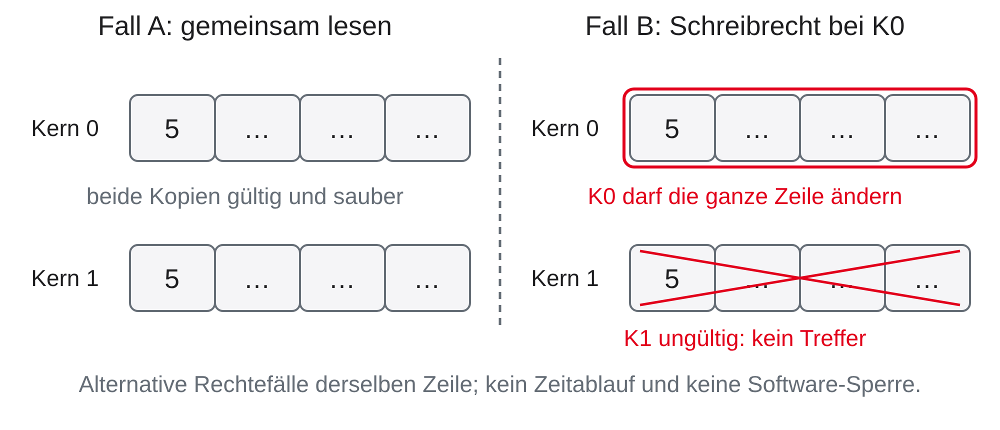{fig-alt="Zwei alternative Rechtezustände derselben Zeile: gemeinsames Lesen mit zwei gültigen Kopien oder exklusives Schreibrecht bei Kern 0 und ungültiger Kopie bei Kern 1. Das Recht umfasst jeweils die gesamte Zeile."}

Das Zeilenrecht schützt keine Folge mehrerer Programmbefehle.

::: notes
Gemeinsames Lesen und exklusives Schreiben sind unterschiedliche Rechte an derselben Zeile. Links zeigt die Grafik mehrere gültige saubere Lesekopien. Rechts ist die Übernahme durch Kern 0 abgeschlossen; dessen Kopie besitzt das Schreibrecht, die Kopie von Kern 1 ist ungültig.

Die Markierung umfasst den ganzen Speicherblock. Ein Kern darf seine Kopie erst ändern, nachdem konkurrierende gültige Kopien entsprechend koordiniert wurden. Der Besitzer kann später wechseln; ungültige Datenbits dürfen dabei physisch im anderen Cache verbleiben, liefern aber keinen Treffer.

Das Zeilenrecht wird durch den Cachecontroller verwaltet. Eine Programmsperre schützt dagegen einen festgelegten Softwareabschnitt. Zwischen zwei gewöhnlichen Befehlen desselben Threads kann daher auch bei korrekt koordiniertem Cache eine andere Aktion stattfinden. Für die Kopienverwaltung ist das zulässig, für ein mehrteiliges Zählerupdate möglicherweise bereits zu viel.
:::

## MESI: Gültigkeit und Schreibrecht je Zeile {.compact-figure}

::: {.section-label}
2 / 6 · Cachekopien koordinieren
:::

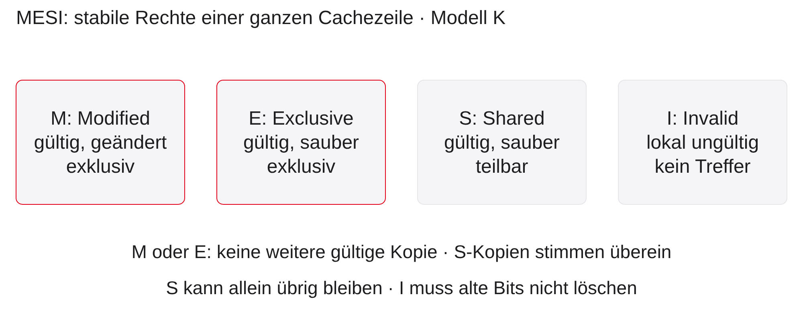{fig-alt="MESI-Rechte: M gültig, geändert und exklusiv; E gültig, sauber und exklusiv; S gültig, sauber und teilbar; I lokal ungültig."}

Lehrmodell K: $n$ Datencaches, Write-Back, Write-Allocate, unterer Stand $L$.

::: notes
MESI beschreibt stabile Rechte einer Cachezeile. Modified, M, ist gültig, geändert und exklusiv. Exclusive, E, ist gültig, sauber und exklusiv. Shared, S, ist gültig, sauber und teilbar. Invalid, I, ist lokal ungültig. Die Abbildung ordnet diese Eigenschaften; die rote Markierung betont das exklusive Recht.

Modell K gilt für $n$ beteiligte Datencaches mit Write-Back und Write-Allocate. Ein Schreibmiss beschafft die aktuelle Zeile und das nötige Schreibrecht. $L$ ist der vereinfachte untere kohärente Stand; sauber bedeutet Übereinstimmung mit $L$. Wir betrachten nur abgeschlossene Schritte. Ein Fremdread auf M liefert dessen aktuelle Daten, aktualisiert $L$ und lässt Besitzer und Leser in S zurück. Bei einem Fremdwrite auf M liefert der bisherige Besitzer die aktuelle Zeile direkt an den neuen Schreiber, wird I und lässt $L$ unverändert.

Nach jedem Schritt darf neben M oder E keine weitere gültige Kopie existieren. Alle S-Kopien stimmen mit $L$ überein. Eine einzelne verbleibende S-Kopie darf S bleiben. Diese Invarianten gelten unabhängig davon, ob das Bild 2 Caches zeigt oder die Übung 3 verwendet.
:::

## E erlaubt den stillen Wechsel nach M {.compact-figure}

::: {.section-label}
2 / 6 · Cachekopien koordinieren
:::

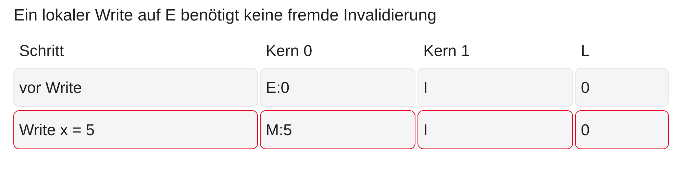{fig-alt="Kern0 hat allein E mit Wert0. Ein lokaler Write5 verändert die Kopie still nach M5; Kern1 bleibt I und der untere Stand bleibt0."}

Keine fremde gültige Kopie muss bei diesem Schritt invalidiert werden.

::: notes
Eine exklusive saubere Kopie kann lokal zum geänderten Besitzer werden. Ein Cachetreffer verwendet seine gültige lokale Zeile statt bei jedem Load bis zum RAM zu gehen. Darum müssen bereits vorhandene Fremdkopien beim Schreiben berücksichtigt werden. E sichert zu, dass solche gültigen Fremdkopien hier fehlen.

Kern 0 beginnt mit E:0, Kern 1 mit I und $L=0$. Der lokale Write setzt den Wert auf $5$ und den Zustand auf M. Danach gelten M:5, I und weiterhin $L=0$. Die rote Hervorhebung zeigt den neuen Datenwert. Der Wechsel E nach M ist still, weil keine fremde Gültigkeit entzogen werden muss.

Auch weitere lokale Writes auf M benötigen keine erneute Rechteübernahme. Der Unterschied zwischen vielen Writes desselben Besitzers und wechselnden Schreibern wird später für False Sharing wichtig. Im nächsten Schritt kommt ein weiterer Leser hinzu; damit endet die bisherige Exklusivität.
:::

## Ein Read-Miss hat unterschiedliche Lieferanten {.compact-figure}

::: {.section-label}
2 / 6 · Cachekopien koordinieren
:::

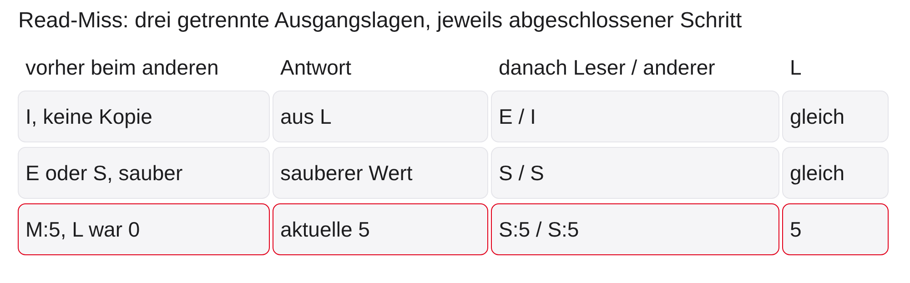{fig-alt="Bei keiner Fremdkopie liefert L und der Leser wird E. Bei sauberer Fremdkopie werden beide S. Bei M liefert der aktuelle Besitzer; im Modell werden beide S und L aktualisiert."}

Eine alte untere Antwort darf den aktuellen M-Wert nicht ersetzen.

::: notes
Ein Read-Miss beschafft den aktuellen Wert von der passenden Quelle. Die drei Reihen der Grafik sind alternative Ausgangslagen: keine gültige Fremdkopie, eine saubere Fremdkopie oder ein geänderter M-Besitzer. Der lokale Leser beginnt jeweils in I.

Ohne gültige Fremdkopie liefert $L$; der Leser erhält E. Gibt es bereits saubere E- oder S-Kopien, enden alle beteiligten Leser in S. Für saubere Daten ist kein bestimmter physischer Lieferant festgelegt. Hält ein anderer Cache M, muss dessen aktueller Wert in die Antwort eingehen. Modell K aktualisiert dabei $L$ und setzt den bisherigen Besitzer sowie den neuen Leser auf S.

Bei M:5 und $L=0$ erhält der neue Leser folglich $5$. Für $n$ Caches gelten dieselben Regeln: Weitere saubere Leser können S hinzufügen, ohne die vorhandenen S-Kopien zu verdrängen. Ein Schreiber benötigt anschließend wieder ein exklusives Recht für die ganze Zeile.
:::

## Schreiben auf S braucht abgeschlossene Übernahme {.compact-figure}

::: {.section-label}
2 / 6 · Cachekopien koordinieren
:::

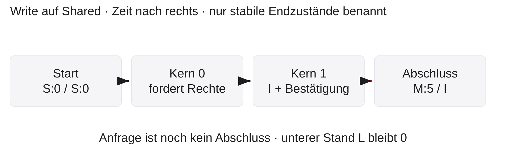{fig-alt="Start S0 und S0. Kern0 fordert Schreibrecht, Kern1 invalidiert und bestätigt. Erst der abgeschlossene stabile Schritt ergibt M5 und I, L bleibt0."}

Anfrage senden, fremde Gültigkeit entziehen und Abschluss sind verschiedene Ereignisse.

::: notes
Ein Write auf S übernimmt das Zeilenschreibrecht von allen anderen gültigen Kopien. Der Schreiber beginnt mit einer aktuellen sauberen Zeile, muss aber vor ihrer Änderung die fremde Nutzbarkeit beenden. Ownership bezeichnet hier das exklusive Zeilenrecht.

In der Grafik fordert Kern 0 Schreibrecht an. Kern 1 invalidiert seine Kopie und bestätigt dies. Der abgeschlossene Schritt endet mit M:5 bei Kern 0, I bei Kern 1 und unverändertem $L=0$. Bei mehr Teilnehmern müssen entsprechend alle fremden gültigen Kopien invalidiert sein.

Invalidieren entfernt die Treffergültigkeit; die alten Datenbits können liegen bleiben. Eine gesendete Anfrage allein ist deshalb noch kein abgeschlossener Rechtewechsel. Die folgende Zustandsfolge notiert die Zustände erst nach diesem Abschluss und hält den Datenwert getrennt vom Zustandsbuchstaben fest.
:::

## MESI-Folge mit Zuständen und Datenwerten {.compact-figure}

::: {.section-label}
2 / 6 · Cachekopien koordinieren
:::

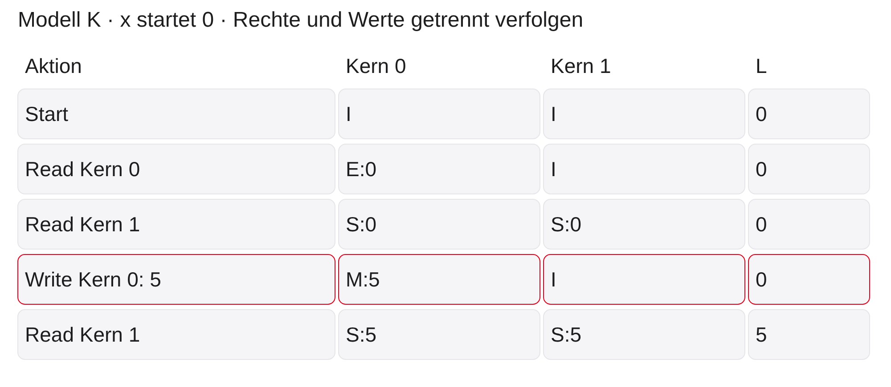{fig-alt="Start I,I,L0. Read0 ergibt E0,I,L0. Read1 ergibt S0,S0,L0. Write0 mit5 ergibt M5,I,L0. Read1 ergibt S5,S5,L5."}

Jede Zeile zeigt einen abgeschlossenen Schritt im Lehrmodell K.

::: notes
Zustand und Datenwert gehören in zwei getrennte Angaben. E:0 bedeutet exklusiv, sauber und Datenwert $0$. Anfangs sind die 2 gezeichneten Caches I und $L=0$. Der erste Read von Kern 0 erhält E:0; der Read von Kern 1 macht beide zu S:0.

Kern 0 schreibt danach $5$. Nach Übernahme und Invalidierung hält er M:5, während Kern 1 I und $L$ weiterhin $0$ sind. Bei Write-Back darf die einzige aktuelle Kopie also über dem unteren Stand liegen. Der nächste Read von Kern 1 beschafft $5$ vom aktuellen Besitzerpfad. Beide enden in S:5, und Modell K aktualisiert $L$ auf $5$.

Die hervorgehobene Write-Zeile zeigt den zulässigen Unterschied zwischen M und $L$. $L$ bezeichnet eine untere kohärente Ebene, nicht zwingend einen bereits aktualisierten DRAM-Chip. Entscheidend ist die Invariante: M oder E stehen allein; gemeinsame S-Kopien sind sauber und gleich. Beim Auswurf muss derselbe aktuelle Datenwert erhalten bleiben.
:::

## Auswerfen: geänderte Daten erhalten {.compact-figure}

::: {.section-label}
2 / 6 · Cachekopien koordinieren
:::

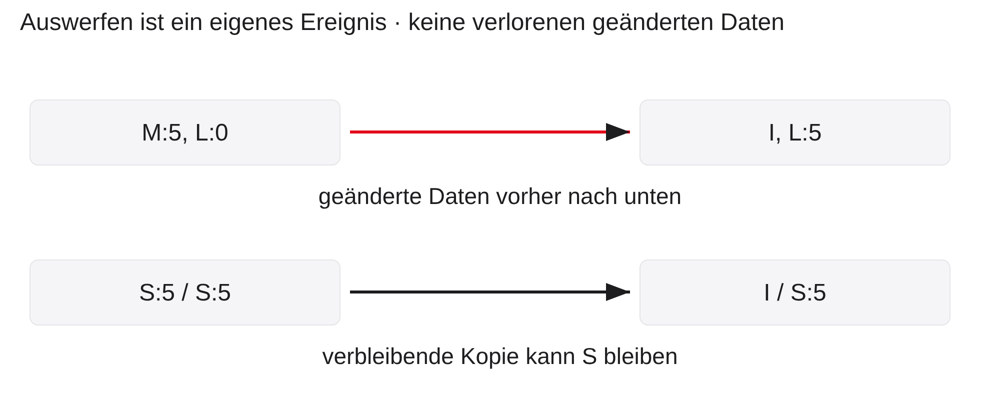{fig-alt="Beim Auswerfen von M5 wird der untere Stand von0auf5 aktualisiert und die lokale Zeile I. Beim Auswerfen einer S-Kopie darf eine andere S-Kopie S bleiben."}

Eine verbleibende S-Kopie wird nicht allein durch fremdes Auswerfen automatisch E.

::: notes
Ein Auswurf erhält die aktuellen Daten vor dem Verlust der Kopie. Eviction bezeichnet das Freimachen einer Cachezeile für einen anderen Block. Die beiden Bildhälften unterscheiden eine geänderte M-Zeile von einer sauberen S-Zeile.

Oben besitzt Kern 0 M:5 bei $L=0$. Vor dem Übergang nach I schreibt er $5$ nach $L$ zurück. Ein späterer alleiniger Leser kann daraus wieder E:5 erhalten. Die rote Markierung zeigt diese nötige Datenübertragung. Beim Auswerfen von E oder S sind die Daten bereits sauber; die lokale Kopie kann ohne Rückschreibung I werden.

Unten bleibt nach dem Auswurf einer S-Kopie die andere Kopie S. Ihr Controller muss nicht automatisch erfahren, dass der letzte weitere Leser verschwunden ist. Ein späterer Write dieser verbleibenden S-Kopie folgt daher weiter dem Übernahmeweg und wird nicht allein wegen ihrer tatsächlichen Einzigartigkeit zu einem stillen E-nach-M-Schritt.
:::

## Papierphase 1: MESI mit 3 Caches

::: {.section-label}
2 / 6 · Cachekopien koordinieren
:::

Aufgabe 1 · 15 Minuten

- Zustände und Werte nach jeder abgeschlossenen Aktion eintragen
- Datenquelle, Invalidierungen und Rückschreibungen notieren
- Die Invarianten für alle gültigen Kopien prüfen

::: notes
Bearbeiten Sie die MESI-Folge der Aufgabe 1 mit 3 Caches. Halten Sie Zustand und Datenwert getrennt fest und verfolgen Sie außerdem den unteren Stand L. Begründen Sie die Koordination jedes Schritts anhand des Lehrmodells K. Die beiden Referenztabellen im Hintergrundanhang dürfen zum Nachschlagen dienen.

Prüfen Sie nach jedem Schritt, ob ein exklusives Schreibrecht mit den übrigen gültigen Kopien vereinbar ist. Kennzeichnen Sie insbesondere, wer aktuelle Daten liefern darf und wann der untere Stand aktualisiert wird. Zählen Sie die gefragten Ereignisse erst aus der vollständig begründeten Folge. Die Lösung wird anschließend gemeinsam besprochen; weitere Cachefälle sind Nachbereitung.
:::

## False Sharing: verschiedene Variablen, eine Zeile {.compact-figure}

::: {.section-label}
2 / 6 · Cachekopien koordinieren
:::

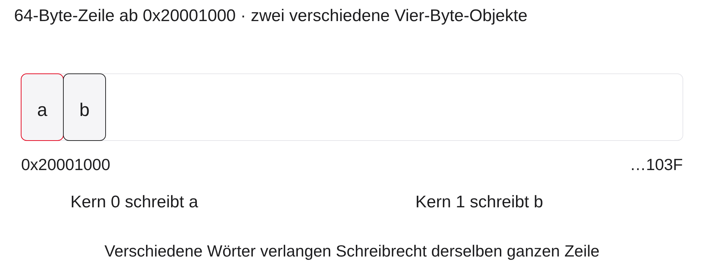{fig-alt="Eine64Byte-Zeile ab0x20001000 enthält Variablea beiOffset0 und b beiOffset4. Verschiedene Kerne schreiben verschiedene Wörter, benötigen aber Schreibrecht derselben Zeile."}

Wechselnde Schreiber können die ganze Zeile zwischen den Kernen verschieben.

::: notes
False Sharing koppelt getrennte Programmobjekte über dieselbe Cachezeile. Die 64-Byte-Zeile ab `0x20001000` enthält $a$ bei Offset $0$ und $b$ bei Offset $4$, jeweils 4 Byte groß. Der Zeilenbereich endet einschließlich bei `0x2000103F`. Kern 0 verändert nur $a$, Kern 1 nur $b$.

Das Programm trennt damit die Schreiber, der Cache vergibt das Schreibrecht aber für beide Wörter gemeinsam. Wechselnde Schreiber können die Zeile wiederholt übernehmen und die andere Kopie invalidieren. Hält ein Kern bereits M, bleiben weitere lokale Writes dagegen beim selben Besitzer.

False Sharing ist ein möglicher Leistungsengpass und für sich kein C-Data-Race. True Sharing bezeichnet die gemeinsame Nutzung desselben Objekts. Zur tatsächlichen Wechselzahl gehören die Zugriffsfolge und der Datenverkehr. Das Layout kann hier Rechtewechsel vermeiden, während die spätere C-Synchronisation weiterhin den Abschluss der Ergebnisse absichert.
:::

## Basis und Abstand gemeinsam prüfen {.compact-figure}

::: {.section-label}
2 / 6 · Cachekopien koordinieren
:::

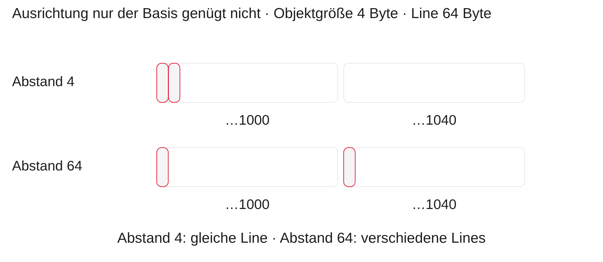{fig-alt="Bei64Byte-ausgerichteter Basis liegen Elemente mit4Byte-Abstand in derselben Zeile. Abstand64Byte legt die gezeigten kleinen Objekte in verschiedene Zeilen."}

```c
#include <stdint.h>
#include <stdalign.h>
struct Slot { alignas(64) int32_t wert; };
struct Slot teil[3];
```

Zeilengröße, Alignment und Strukturgröße am Ziel prüfen.

::: notes
Padding trennt hier unabhängige Ergebnisslots auf verschiedene Cachezeilen. Ausrichtung legt den Beginn eines Objekts fest, Stride den Abstand aufeinanderfolgender Elemente. Die Grafik zeigt bei Basis `0x20001000` den Unterschied zwischen Abstand 4 und Abstand 64 Byte: Das zweite kleine Objekt liegt entweder in derselben Zeile oder bei `0x20001040`.

Der C11-Code bindet `alignas` aus `stdalign.h` ein. Ein auf 64 Byte ausgerichtetes `int32_t`-Feld erhält in der Struktur eine entsprechende Ausrichtungsanforderung. Auf einer Implementierung mit 4-Byte-`int32_t`, 64-Byte-Unterstützung und `sizeof(struct Slot)==64` liegen die Arrayelemente 64 Byte auseinander. Beides wird im konkreten Programm geprüft; mindestens gilt, dass die Strukturgröße ein Vielfaches ihrer Ausrichtung ist.

Für 3 Slots wären 12 Byte Nutzwerte statt 192 Byte belegter Strukturfläche nötig. Ein lokaler Akkumulator und nur ein abschließender Store sparen häufig günstiger Datenverkehr. Die reale Zeilengröße und die unterstützte Ausrichtung sind pro Zielplattform nachzuschlagen.
:::

## 3 · Gemeinsame Aktionen schützen {.section-divider}

Wann sind mehrere korrekte Speicherzugriffe zusammen noch falsch?

::: {.section-route}
Arbeit teilen → Cachekopien → Atomizität → Ordnung → Skalierung → Anwendung
:::

Von verlorenen Beiträgen zur unteilbaren Entscheidung.

::: notes
Eine atomare Aktion erhält jeden konkurrierenden Beitrag zu einem gemeinsamen Objekt. Kohärenz hatte gültige Kopien und einzelne Speicheränderungen koordiniert; ein Zählerupdate verbindet dagegen mehrere Schritte zu einer Entscheidung. Ohne zusätzliche Hilfe können zwei Harts denselben alten Wert verwenden und einen Beitrag verlieren.

Eine Read-Modify-Write-Operation, kurz RMW, verbindet Lesen, Ändern und Schreiben unteilbar. RISC-V stellt dafür Hardwareprimitive bereit, C11 atomare Typen und Operationen. Beide Ebenen werden getrennt untersucht: Ein nachvollziehbares Hardware-Interleaving ist noch keine zulässige Ergebnisbeschreibung eines C-Programms mit Data Race. Nach dem Update wird zu prüfen sein, wie andere Nutzdaten geordnet übergeben werden.
:::

## Eine Aktion, ein geschützter Abschnitt

::: {.section-label}
3 / 6 · Gemeinsame Aktionen schützen
:::

- RMW: Lesen, Ändern und Schreiben als eine unteilbare Aktion
- Kritischer Abschnitt: mehrere zusammengehörige Zugriffe auf gemeinsame Daten
- Sperre / Mutex: gegenseitiger Ausschluss für einen Abschnitt
- Alle konkurrierenden Zugreifer müssen dieselbe Schutzregel einhalten

Unteilbar beschreibt die Wirkung, keine Ein-Takt-Ausführung.

::: notes
Eine Sperre regelt den gegenseitigen Ausschluss für einen kritischen Abschnitt. Ein solcher Abschnitt enthält zusammengehörige Zugriffe auf gemeinsame Daten; höchstens ein Besitzer darf ihn gleichzeitig ausführen. Mutex steht für Mutual Exclusion, gegenseitiger Ausschluss. Lock ist die englische Bezeichnung einer Sperre; das Speicherwort, das ihren Zustand festhält, heißt hier Schlosswort.

Eine einzelne atomare RMW kann bereits genügen, wenn nur ein Zähler zu ändern ist. Müssen mehrere Datenfelder konsistent zusammenpassen, wird vor ihrem gemeinsamen Zugriff die Sperre übernommen und danach freigegeben. Alle konkurrierenden Zugreifer müssen diese Regel einhalten. Ein ungeschützter Fremdzugriff bleibt fehlerhaft.

Die Sperre hat drei Aufgaben: Die Übernahme muss einen eindeutigen Besitzer bestimmen, die Freigabe muss dessen Daten für den nächsten Besitzer ordnen, und der Besitzer muss schließlich weiterlaufen und freigeben können. Zunächst betrachten wir nur die erste Aufgabe. Unteilbarkeit bezeichnet dabei die Wirkung gegenüber Konkurrenten, nicht eine bestimmte Befehlsdauer.
:::

## Ein Inkrement kann drei Schritte enthalten

::: {.section-label}
3 / 6 · Gemeinsame Aktionen schützen
:::

```asm
# RV32I; s1: ausgerichtete Wortadresse
# Anfangswert 0
lw   t0, 0(s1)
addi t0, t0, 1
sw   t0, 0(s1)
```

Read → Modify → Write ist hier keine unteilbare Gruppe.

::: notes
Ein gewöhnliches Inkrement kann in drei voneinander trennbare Maschinenbefehle zerfallen. Die RV32I-Lehrfolge beginnt mit einem Speicherwort 0; `s1` enthält dessen gültige, auf 4 Byte ausgerichtete Adresse. Das temporäre Register `t0` gehört zum jeweils ausführenden Hart.

`lw` bedeutet Load Word und liest das 4-Byte-Wort nach `t0`. `addi`, Add Immediate, erhöht nur diesen Registerwert um 1. `sw`, Store Word, schreibt ihn anschließend zurück. Ein anderer Hart kann zwischen diesen Befehlen auf dasselbe Wort zugreifen. Auch bei korrekt ausgeführten Einzelzugriffen bilden die drei Schritte deshalb noch keine atomare RMW.

Im betrachteten Wertebereich tritt kein Überlauf auf. Die Folge illustriert die Maschinenebene und ist keine behauptete konkrete Compilerübersetzung von `++`. Ob ein C-Update atomar wirkt, richtet sich nach dem Objekttyp und den verwendeten Operationen. Der nächste Ablauf zeigt, warum diese Unterscheidung für das gemeinsame Ergebnis entscheidend ist.
:::

## Lost Update trotz kohärenter Einzelzugriffe {.compact-figure}

::: {.section-label}
3 / 6 · Gemeinsame Aktionen schützen
:::

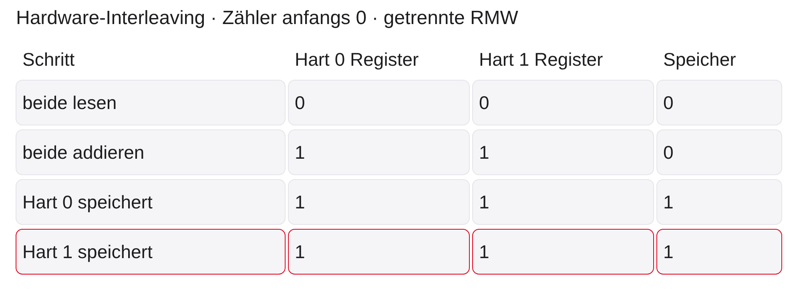{fig-alt="Beide Harts lesen 0, berechnen lokal 1 und speichern nacheinander 1. Der Endwert ist 1 statt 2. Kohärenz ordnet die Stores, ergänzt aber keinen fehlenden Beitrag."}

Das Diagramm beschreibt ein Hardware-Interleaving, keine Ergebnisgarantie fehlerhaften C-Codes.

::: notes
Ein Lost Update entsteht, wenn mehrere Beiträge auf demselben alten Wert aufbauen. Im Hardwareablauf beginnt der Zähler bei 0. Hart 0 liest 0 in sein Register, anschließend liest Hart 1 ebenfalls 0. Beide berechnen lokal 1 und speichern nacheinander 1 zurück. Der rot markierte letzte Store hinterlässt somit 1 statt der beabsichtigten 2.

Alle Einzelzugriffe können dabei kohärent sein. Es muss keine veraltete gültige Cachekopie geben: Die zweite Rechnung berücksichtigt den ersten Beitrag schlicht nicht. Zwei atomare Inkremente würden als zwei unteilbare Änderungen wirken und bei 2 enden.

Der gezeichnete Ablauf beschreibt ein Hardwaremodell. Bei einem gewöhnlichen C-Objekt mit konfliktierenden, nicht synchronisierten Threadzugriffen läge dagegen ein Data Race mit undefiniertem Verhalten vor. Dort ist 1 kein zugesichertes Versuchsergebnis. Eine sprachlich definierte Nachstellung verwendet atomare Einzelzugriffe und untersucht deren weiterhin zerlegte Rechengruppe.
:::

## Race Condition und C-Data-Race unterscheiden

::: {.section-label}
3 / 6 · Gemeinsame Aktionen schützen
:::

| Begriff | Aussage |
|---------|---------|
| Race Condition | Ablaufreihenfolge gefährdet die gewünschte Programmlogik |
| C11-Data-Race | konkurrierende Konfliktzugriffe ohne ausreichende Synchronisation |
| Atomare Load/Store einzeln | können trotzdem ein getrenntes Update verlieren |

C11-Data-Race bedeutet undefiniertes Verhalten, keine zugesicherte Auswahl aus zwei Endwerten.

::: notes
Race Condition und C-Data-Race unterscheiden einen Logikfehler von einer Verletzung des Sprachmodells. Eine Race Condition liegt vor, wenn die Reihenfolge konkurrierender Abläufe die beabsichtigte Programmlogik gefährdet. Selbst ausschließlich atomare Zugriffe können diesen Fehler enthalten, wenn sie eine gemeinsame Entscheidung in getrennte Aktionen zerlegen.

Ein C11-Data-Race entsteht bei konfliktierenden Zugriffen verschiedener Threads auf dieselbe Speicherstelle, wenn mindestens ein Zugriff nicht atomar ist und die erforderliche Happens-before-Ordnung fehlt. Konfliktierend heißt: Mindestens einer schreibt. Happens-before bezeichnet eine durch das Sprachmodell abgesicherte Ordnung; ihre Kanten werden im nächsten Abschnitt aufgebaut. Ein Data Race bedeutet undefiniertes Verhalten, also keine zugesicherte Auswahl zwischen 1 und 2.

Der Hostversuch unter `labs/src/lab09_atomics.c`, relativ zum Repository-Stamm, stellt das verlorene Update mit atomaren Loads und Stores in einer festgelegten Verschachtelung nach. Sein paralleler Zähler verwendet echte atomare RMWs. So lassen sich der definierte Logikfehler und die korrekte Gegenmaßnahme prüfen, ohne gewöhnliches undefiniertes C-Verhalten als Zahlenbeweis zu verwenden.
:::

## Auch atomarer Check und Set bleiben getrennt

::: {.section-label}
3 / 6 · Gemeinsame Aktionen schützen
:::

```c
#include <stdbool.h>
#include <stdatomic.h>
static atomic_bool lock = false;
bool broken_try_lock(void) {
    if (atomic_load_explicit(
            &lock, memory_order_relaxed))
        return false;
    atomic_store_explicit(
        &lock, true, memory_order_relaxed);
    return true;
}
```

Absichtlich falsche Übernahme: Zwei Aufrufer können beide Erfolg melden.

::: notes
Die Übernahme einer Sperre muss Prüfen und Setzen in einer einzigen atomaren Entscheidung verbinden. Der absichtlich falsche C11-Ausschnitt verwendet dafür nur zwei getrennte atomare Zugriffe. `atomic_bool` ist ein atomarer Wahrheitswert; `stdbool.h` stellt `bool`, `true` und `false` bereit. Das Schlosswort `lock` beginnt vor konkurrierender Nutzung mit `false`, also frei.

Aufrufer A kann frei lesen und vor seinem Store unterbrochen werden. B liest dann ebenfalls frei. Speichern beide anschließend `true`, melden auch beide erfolgreiches Übernehmen. Auf dem atomaren Schlosswort entsteht dabei kein C-Data-Race; der gegenseitige Ausschluss ist trotzdem verletzt.

`memory_order_relaxed` erhält die Atomizität der Einzelzugriffe. Auch eine stärkere Speicherordnung würde die getrennten Aktionen nicht nachträglich zu einer unteilbaren Entscheidung machen. Erforderlich ist eine RMW, die den alten Zustand zurückliefert und zugleich den belegten Zustand hinterlegt. Erst ihr Rückgabewert entscheidet, wer eintreten darf.
:::

## Die atomare RMW entscheidet die Übernahme {.compact-figure}

::: {.section-label}
3 / 6 · Gemeinsame Aktionen schützen
:::

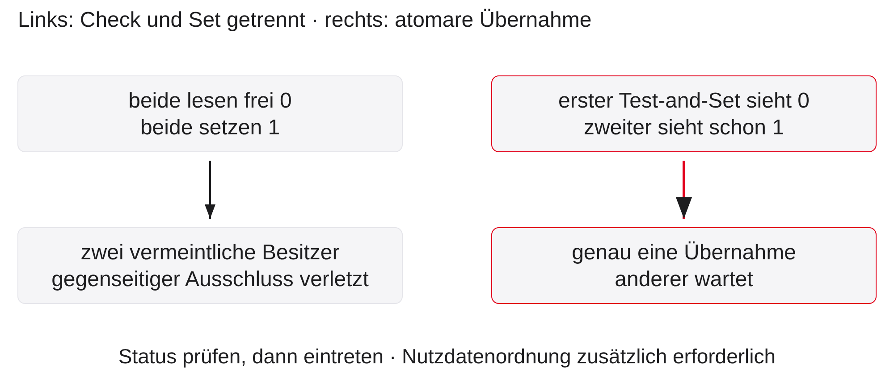{fig-alt="Getrennter Check und Set lässt zwei Aufrufer 0 lesen und beide eintreten. Beim atomaren Test-and-Set erhält der erste Aufrufer 0, setzt 1 und gewinnt; der zweite erhält 1 und wartet."}

Der frühere Wert entscheidet; der Speicherwert und der Status sind getrennt zu lesen.

::: notes
Test-and-Set entscheidet eine Übernahme durch eine atomare RMW. Die Operation liefert den vorherigen Schlosswert zurück und setzt im selben unteilbaren Schritt den belegten Zustand. Im binären Beispiel bedeutet 0 frei und 1 belegt.

Die linke Bildhälfte zeigt den getrennten Check und Set: Beide Aufrufer lesen 0, bevor einer 1 speichert, und halten sich für den Besitzer. Rechts wirkt eine atomare Übernahme zuerst. Dieser Aufrufer erhält 0 und hinterlegt 1. Die andere Aktion liest bereits den alten Wert 1 und muss warten. Rot markiert den entscheidenden Übernahmeschritt; welcher Hart gewinnt, hängt vom Ablauf ab.

Damit lässt sich gegenseitiger Ausschluss erreichen. Die Nutzdaten zwischen zwei Besitzern benötigen zusätzlich eine passende Übernahme- und Freigabeordnung. Fairness und eine begrenzte Wartezeit folgen ebenfalls nicht allein aus Test-and-Set. Die folgenden RISC-V-Primitive werden daher zunächst nach ihrer Wirkung auf das Zielwort beurteilt.
:::

## RISC-V-Atomics brauchen Ziel und Speichervertrag

::: {.section-label}
3 / 6 · Gemeinsame Aktionen schützen
:::

- A-Erweiterung: LR/SC und AMO als atomare Primitive
- Unterstützter Kern und unterstützte gewöhnliche Speicherregion
- `.w`: 4 Byte breit und hier auf 4 Byte ausgerichtet
- Kein universeller Ersatz für Gerätezugriffe und deren Speichervertrag

::: notes
RISC-V-Atomics gelten für einen ausdrücklich unterstützten Prozessor und Speicherbereich. Die A-Erweiterung ergänzt atomare Primitive: LR/SC steht für Load-Reserved/Store-Conditional, reservierend lesen und bedingt schreiben; AMO für Atomic Memory Operation. Die entsprechenden Teilmengen heißen in der Spezifikation Zalrsc und Zaamo.

Für die Lehrfolgen wird RV32 mit dieser Unterstützung verwendet. `.w` bezeichnet ein 4-Byte-Wort, dessen Adresse hier auf 4 Byte ausgerichtet ist. Die Plattform sichert LR/SC und AMO für die betrachtete gewöhnliche Speicherregion zu. Ein beliebiger RISC-V-Kern und ein beliebiges Geräte-Register erfüllen diese Bedingungen nicht automatisch.

Gerätezugriffe über Memory-Mapped Input/Output, MMIO, können eigene Seiteneffekte und Ordnungsregeln besitzen. Auch eigenständige DMA-Datenübertrager gehören nicht allein wegen einer gemeinsamen Adresse zur CPU-Kohärenzdomäne. Die folgenden Assemblerausschnitte erklären deshalb den benannten Speichervertrag; sie werden nicht als ausgeführte Firmware oder als allgemeines Rezept für jede Adresse dargestellt.
:::

## LR liest; SC versucht den bedingten Store

::: {.section-label}
3 / 6 · Gemeinsame Aktionen schützen
:::

| Operation | Wirkung |
|-----------|---------|
| `lr.w` | Wort lesen und Reservation registrieren |
| erfolgreicher `sc.w` | Wort schreiben, Status $0$ |
| fehlgeschlagener `sc.w` | kein Datenstore, Status ungleich $0$ |

Ein gelesener Wert $0$ ist noch kein Übernahmeerfolg.

::: notes
LR liefert einen Datenwert, SC liefert einen davon getrennten Erfolgsstatus. Load-Reserved liest das Wort und registriert eine Reservation. Diese ist noch keine erworbene Sperre; mehrere Harts können denselben freien Zustand lesen. Die Reservationsmenge umfasst die Wortbytes und kann implementierungsabhängig größer sein.

Store-Conditional versucht, den angegebenen neuen Wert zu speichern. Bei Erfolg geschieht der Store und das Zielregister erhält Status 0. Bei Fehlschlag bleibt der Speicher unverändert und der Status ist ungleich 0, nicht zwingend 1. Jeder SC beendet die eigene Reservation, auch ein gescheiterter.

Ein beobachteter konkurrierender Store auf die Reservationsmenge verhindert den entsprechenden Erfolg. SC darf jedoch auch aus anderen zulässigen Gründen scheitern. Deshalb muss eine Wiederholung neu mit LR beginnen und ihre Berechnung auf dem neu gelesenen Wert aufbauen. Ein Fehlerstatus beweist keinen bestimmten Fremdstore. Fortschrittszusagen verlangen weitere Bedingungen an Schleife und Speicherbereich; eine beliebige LR/SC-Folge hat keine zugesicherte maximale Versuchszahl.
:::

## Zwei gelesene Nullen, nur eine Übernahme {.compact-figure}

::: {.section-label}
3 / 6 · Gemeinsame Aktionen schützen
:::

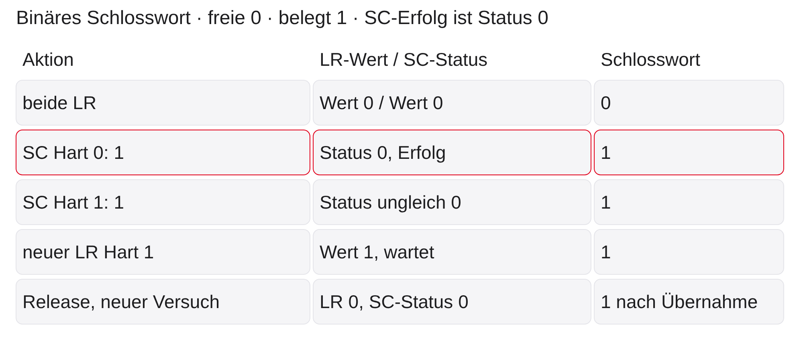{fig-alt="Beide LR lesen das freie Schlosswort 0. Hart 0 speichert 1 mit SC-Status 0. Hart 1 erhält einen Nichtnullstatus und speichert nichts. Sein neuer LR liest 1. Nach Freigabe auf 0 kann er erneut übernehmen."}

Ein belegtes Schlosswort wird nicht auf $2$ inkrementiert.

::: notes
Erst der erfolgreiche SC macht einen Hart zum Besitzer der binären Sperre. Das Schlosswort beginnt bei 0. Beide Harts lesen mit LR zunächst diese 0 und registrieren eine Reservation, ohne dadurch schon einzutreten.

Hart 0 schreibt im gezeigten Ablauf mit seinem erfolgreichen SC die 1 und erhält Status 0. Der rote Schritt markiert diese Übernahme. Der nachfolgende SC von Hart 1 scheitert wegen des konkurrierenden Stores, liefert einen Nichtnullstatus und ändert den Speicher nicht. Hart 1 beginnt erneut mit LR. Liest er nun 1, wartet er auf die Freigabe, statt einen SC zum Inkrementieren auszuführen: Das Schlosswort besitzt nur die Zustände frei und belegt.

Nach der Freigabe auf 0 kann ein neuer Versuch erfolgreich werden. Der dargestellte Gewinner und die gezeigte Reihenfolge gehören zum Beispiel; zusätzliche zulässige SC-Fehlschläge bleiben möglich. Ob der nächste Besitzer auch die früheren Nutzdaten geordnet verwenden darf, wird nach dem atomaren Zähler als eigene Frage behandelt.
:::

## AMO: alten Wert zurückgeben, neuen speichern {.compact-figure}

::: {.section-label}
3 / 6 · Gemeinsame Aktionen schützen
:::

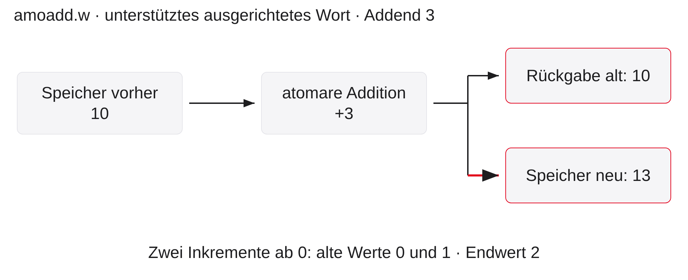{fig-alt="amoadd.w gibt bei Speicherwert 10 und Addend 3 den alten Wert 10 zurück und speichert 13. Zwei atomare Inkremente ab 0 enden bei 2 und liefern die alten Werte 0 und 1."}

Ohne `.aq`/`.rl` bleibt die RMW atomar; zusätzliche Ordnung anderer Daten fehlt.

::: notes
Eine AMO liefert den alten Wert und hinterlegt atomar den geänderten Wert. Bei `amoadd.w rd, rs2, (rs1)` enthält `rs1` die gültige ausgerichtete Wortadresse, `rs2` den Addenden und `rd` nachher den vorherigen Speicherwert. Die Operation bildet auf diesem Objekt eine unteilbare RMW.

Bei Anfangswert 10 und Addend 3 erhält `rd` die 10, während im Speicher anschließend 13 steht. Die Grafik hebt diese unterschiedlichen Zahlenrollen hervor. Zwei Additionen um 1 ab Anfangswert 0 liefern entsprechend die alten Werte 0 und 1 und enden bei 2. Welcher Hart welchen Rückgabewert erhält, hängt von ihrer Reihenfolge ab.

Ohne `.aq` und `.rl` bleibt die Änderung des Zielworts atomar. Eine Veröffentlichung anderer Nutzdaten folgt daraus nicht; diese zusätzliche Ordnungsfrage beginnt im nächsten Abschnitt. Ein C-Compiler darf die Spracheigenschaft je nach Ziel durch AMO, LR/SC oder einen anderen zugesicherten Implementierungsweg realisieren.
:::

## C11: ein atomarer Zähler

::: {.section-label}
3 / 6 · Gemeinsame Aktionen schützen
:::

```c
#include <stdatomic.h>
static atomic_uint count = 0;
void increment(void) {
    atomic_fetch_add_explicit(
        &count, 1u, memory_order_relaxed);
}
```

Zwei fertige Worker mit je $N$ Inkrementen ergeben $2N$ ohne Zahlenüberlauf.

::: notes
Eine atomare C11-Addition erhält jeden Beitrag zu einem gemeinsamen Zähler. `stdatomic.h` stellt `atomic_uint` und die zugehörigen Operationen bereit. Das statische vorzeichenlose Objekt `count` beginnt vor dem Threadstart bei 0. `atomic_fetch_add_explicit` addiert `1u` unteilbar und liefert den alten Wert zurück; die Funktion benötigt hier nur die Änderung.

Für diesen reinen Zähler genügt `memory_order_relaxed`: Alle Beiträge gehen in die Änderungsordnung desselben Objekts ein. Wenn beide Worker je $N$ Inkremente ausführen und der Hauptthread beide anschließend erfolgreich mit `pthread_join` verbunden hat, liest er ohne Zahlenüberlauf den Endwert $2N$. Die vorhandene Hostdatei verwendet je 20000 Inkremente und erwartet 40000. Die Abschlussordnung für den Hauptthread stammt vom Join-Vertrag.

Soll der Zähler zugleich andere Daten veröffentlichen, reicht diese Begründung nicht aus. Atomare Operationen ohne explizite Ordnungsangabe verwenden standardmäßig `memory_order_seq_cst`; eine konkrete C-Atomik muss aber nicht als einzelne Maschineninstruktion oder ohne interne Sperre implementiert sein.
:::

## Papierphase 2: Ein atomarer Zähler

::: {.section-label}
3 / 6 · Gemeinsame Aktionen schützen
:::

Aufgabe 3 a–c · 15 Minuten

- Eine LR/SC-Schleife für die Erhöhung um 2 selbst schreiben
- Die vorgegebene Verschachtelung fortsetzen
- Datenwert und SC-Status unterscheiden

::: notes
Schreiben Sie zunächst die LR/SC-Schleife, bevor Sie den Ablauf der beiden Harts verfolgen. Verwenden Sie die vorgegebenen Register für alten Wert, neuen Wert und Erfolgsstatus. Nach einem fehlgeschlagenen Versuch beginnt die Bearbeitung wieder an der passenden Stelle der eigenen Schleife.

Ergänzen Sie die Tabelle bis zum Abschluss beider Harts und begründen Sie jeden SC-Ausgang mit der für Teilaufgabe b ausdrücklich festgelegten Reservationsregel. Vergleichen Sie anschließend diese Regel mit der allgemeineren ISA-Aussage in Teilaufgabe c. Ein Statuswert und der zu speichernde Zählerwert beantworten unterschiedliche Fragen. Die AMO- und C11-Varianten sind weitere Aufgaben zur Nachbereitung.
:::

## 4 · Daten übergeben und fertig werden {.section-divider}

Wann bedeutet eine Fertigmeldung, dass auch die Daten nutzbar sind?

::: {.section-route}
Arbeit teilen → Cachekopien → Atomizität → Ordnung → Skalierung → Anwendung
:::

Atomizität ergänzen: passende Ordnung und mögliche Freigabe.

::: notes
Eine passende Veröffentlichung verbindet Nutzdaten und Fertigmeldung zu einer geordneten Übergabe. Die atomare Meldung wird zum Synchronisationsobjekt: Der Empfänger muss genau die Veröffentlichung beobachten, zu der die benötigten Daten gehören.

Release und Acquire stellen diese Verbindung im C11-Modell unter benannten Bedingungen her. Die folgende Ordnungskette erklärt ihre Kanten, bevor dieselbe Idee auf eine Sperre angewendet wird. Danach wird der Fortschritt geprüft: Auch ein korrekt geordnetes Programm kann durch zyklisches Warten stillstehen. Für jeden Entwurf sind somit sowohl nutzbare Daten als auch ein möglicher Abschluss nachzuweisen.
:::

## Eine Veröffentlichung verbindet drei Kantenarten

::: {.section-label}
4 / 6 · Daten übergeben und fertig werden
:::


Verkettung: Datenschreiben $\xrightarrow{\text{happens-before}}$ Datenlesen.

sb = sequenced-before · sw = synchronizes-with

```{mermaid}
flowchart LR
    D["data = 42"] -->|"sb"| R["Release:<br/>ready = 1"]
    R -->|"sw"| A["Acquire<br/>liest diese 1"]
    A -->|"sb"| C["data lesen"]
    style R fill:#FFFFFF,stroke:#E2001A,stroke-width:2px !important;
    style A fill:#FFFFFF,stroke:#E2001A,stroke-width:2px !important;
```

::: notes
Eine einmalige Veröffentlichung ordnet die Datenschreibung des Produzenten vor dem späteren Datenlesen des Konsumenten. `ready` ist ein atomares Flag und beginnt bei 0. Ein Produzent schreibt die gewöhnlichen Daten 42 und speichert danach 1 mit Release. Ein Konsument lädt das Flag mit Acquire, bis er diese veröffentlichte 1 beobachtet; danach liest er die Daten. Später werden sie in diesem Beispiel nicht überschrieben.

Die Zeichnung benennt drei Kantenarten. Innerhalb eines Threads heißt die durch den Programmablauf festgelegte Ordnung sequenced-before: Datenschreiben vor Release und Acquire vor Datenlesen. Liest der Acquire-Load den Wert des Release-Stores desselben Flags, entsteht zwischen ihnen synchronizes-with. Die Verkettung dieser Beziehungen ergibt happens-before vom Datenschreiben bis zum Datenlesen. Der Konsument darf deshalb 42 verwenden.

Sind beide Objekte dagegen atomar und werden ausschließlich relaxed benutzt, bleiben die Einzelzugriffe definiert. Ein Leser der Meldung kann beim Datenobjekt dann noch dessen Anfangswert oder bereits den neuen Wert beobachten. Der Fall ist vom gewöhnlichen Nutzdatenobjekt zu unterscheiden.

Ein relaxed Load schafft diese Synchronisationskante nicht. Sind die Nutzdaten gewöhnlicher Speicher, entsteht ohne andere Ordnung ein C-Data-Race; eine Liste erlaubter alter und neuer Datenwerte beschreibt dieses undefinierte Verhalten nicht. Bei erneutem Überschreiben wäre außerdem eine Rückgabe- und Lebensdauerregel nötig.
:::

## Acquire und Release ordnen die Nutzdaten {.compact-figure}

::: {.section-label}
4 / 6 · Daten übergeben und fertig werden
:::

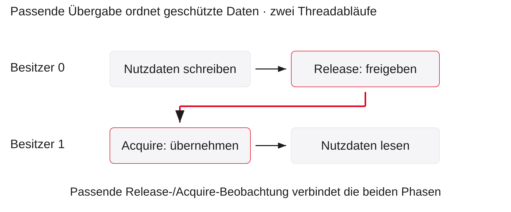{fig-alt="Ein Besitzer schreibt Nutzdaten vor der Release-Freigabe des Schlossworts. Der nächste übernimmt mit Acquire und liest danach. Die Ordnung verbindet geschützte Zugriffe über die passende Übernahme."}

Atomare Übernahme und geordnete Nutzung sind zwei Anforderungen.

::: notes
Die Übernahme und Freigabe einer Sperre verbinden aufeinanderfolgende Besitzer über ihre Nutzdaten. Besitzer 0 führt zunächst die geschützten Zugriffe aus und gibt dann die Sperre mit Release-Wirkung frei. Der nächste Besitzer übernimmt passend mit Acquire und verwendet anschließend dieselben geschützten Daten.

Die Grafik zeigt diese Reihenfolge und hebt die Synchronisationsverbindung rot hervor. Wie bei der Veröffentlichung wird die Reihenfolge innerhalb eines Threads mit der passenden Verbindung zwischen Threads verkettet. Im C11-Sprachmodell entsteht so happens-before zwischen den früheren geschützten Zugriffen und den späteren Zugriffen des neuen Besitzers.

Die Übernahme hat damit zwei getrennte Anforderungen: Ihre RMW entscheidet eindeutig den Besitzer; Acquire ordnet dessen anschließende Datennutzung. Release ordnet die frühere Arbeit vor der Freigabe. Diese Begriffe beschreiben Speicherordnung, keinen Cacheflush. Welche Maschinenbefehle sie umsetzen, richtet sich nach Zielarchitektur und Speichervertrag; für RISC-V wird das nun an der LR/SC-Sperre gezeigt.
:::

## LR/SC-Übernahme mit Acquire

::: {.section-label}
4 / 6 · Daten übergeben und fertig werden
:::

```asm
# a0: ausgerichtetes Schlosswort, 0 bedeutet frei
acquire:
    lr.w.aq t0, (a0)
    bnez    t0, acquire
    li      t1, 1
    sc.w    t2, t1, (a0)
    bnez    t2, acquire
# Erst jetzt: geschuetzte Daten nutzen
```

Gewöhnlicher Speicher mit zugesicherter Unterstützung; kein universelles ISR-Rezept.

::: notes
Die LR/SC-Übernahme verbindet den erfolgreichen Besitzerwechsel mit Acquire-Ordnung. `a0` enthält die gültige, auf 4 Byte ausgerichtete Adresse des zunächst freien Schlossworts 0. Für diese gewöhnliche Speicherregion ist LR/SC unterstützt; alle Nutzer verwenden dieselbe Sperrendisziplin.

`lr.w.aq` liest das Wort und registriert eine Reservation. `.aq` liefert Acquire-Ordnung für nachfolgende Nutzdatenzugriffe. `bnez`, Branch if Not Equal to Zero, verzweigt zurück, wenn das Schlosswort bereits belegt ist. Sonst lädt `li`, Load Immediate, die 1 nach `t1`. `sc.w` versucht, diese 1 zu speichern; sein Status in `t2` entscheidet über den Erfolg. Bei Fehlschlag beginnt der Versuch erneut mit LR. Nur nach Status 0 wird der kritische Abschnitt betreten.

Die Schleife ist ein Spinlock: Sie wartet aktiv. Der Besitzer muss weiterlaufen und freigeben können; eine maximale Wartezeit ist nicht zugesichert. Der Assemblerausschnitt lässt Nutzdaten, Rückkehrkonvention und Compilerangaben für Inline-Assembler aus. Zur vollständigen Sperre gehört außerdem die geordnete Freigabe.
:::

## Freigeben: zuerst Daten, dann das Schlosswort {.compact-figure}

::: {.section-label}
4 / 6 · Daten übergeben und fertig werden
:::

```asm
# Nach dem geschuetzten Abschnitt;
# a0 ist dieselbe Schlosswortadresse
fence rw, w
sw    zero, 0(a0)
```

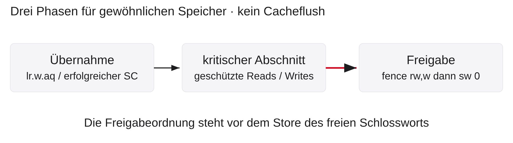{fig-alt="Übernahme mit Acquire, geschützte Datenzugriffe und Freigabeordnung bilden drei Phasen. Fence rw,w steht vor dem Store der 0."}

::: notes
Die Freigabe ordnet geschützte Datenzugriffe vor dem Speichern des freien Schlosswerts. `fence rw,w` steht dazu vor `sw zero,0(a0)`. Das `r` bezeichnet normale Speicherlesezugriffe und `w` normale Speicherschreibzugriffe. Der Fence ordnet vorherige Reads und Writes vor nachfolgenden Writes, hier insbesondere vor dem Freigabestore.

`sw` schreibt das 4-Byte-Schlosswort an dieselbe Adresse wie die Übernahme. Das Register `zero` liefert die Konstante 0, also frei. Die Grafik verbindet Übernahme, kritischen Abschnitt und Freigabe zu den drei Phasen einer Sperrennutzung.

Ein erst nach dem Freigabestore gesetzter Fence stellt die benötigte Beziehung zu genau diesem Store nicht her. Der nächste Besitzer könnte die Sperre übernehmen, ohne durch diese fehlerhafte Folge die früheren Daten geordnet zu erhalten. Die Reihenfolge muss deshalb vor der Freigabe hergestellt werden. Der gezeigte Vertrag betrifft gewöhnlichen Speicher; MMIO-Gerätezugriffe benötigen eine eigene Prüfung.
:::

## C11-Sperre: Test-and-Set und Clear

::: {.section-label}
4 / 6 · Daten übergeben und fertig werden
:::

```c
#include <stdatomic.h>
static atomic_flag lock = ATOMIC_FLAG_INIT;
void take_lock(void) {
    while (atomic_flag_test_and_set_explicit(
               &lock, memory_order_acquire)) { }
}
void drop_lock(void) {
    atomic_flag_clear_explicit(
        &lock, memory_order_release);
}
```

Alle Zugreifer schützen dieselben Daten mit derselben Sperre.

::: notes
C11 stellt mit `atomic_flag` ein atomares Schlosswort für eine kleine Spinlock-Sperre bereit. `ATOMIC_FLAG_INIT` initialisiert das statische Objekt vor konkurrierender Nutzung frei. Die Operationen dieses Typs sind laut C11 lock-free: Das einzelne Primitiv braucht keine intern gehaltene Sperre. Eine daraus aufgebaute Warteschleife kann dennoch unbegrenzt warten. Wait-free wäre die stärkere Zusage, dass eine Operation nach beschränkt vielen eigenen Schritten endet; Fairness regelt zusätzlich, ob wartende Teilnehmer zum Zug kommen.

`atomic_flag_test_and_set_explicit` liefert den alten Flagzustand und setzt ihn in derselben atomaren Aktion. Solange die Funktion `take_lock` einen zuvor gesetzten Zustand erhält, wiederholt sie den Versuch. Ein zuvor freies Flag bestätigt die Übernahme. `memory_order_acquire` ordnet die nachfolgenden Nutzdatenzugriffe. `drop_lock` löscht das Flag durch `atomic_flag_clear_explicit`; `memory_order_release` ordnet die vorherigen Zugriffe vor dieser Freigabe.

Alle Zugreifer auf dieselben geschützten Daten müssen dieselbe Sperre verwenden. Für einen geeigneten Threadkontext erhält man damit Ausschluss und Datenordnung, aber noch keine Fairness oder maximale Wartezeit. Der Hostversuch schützt so einen gewöhnlichen Zähler und prüft dessen Endwert; eine allgemeine ISR-Eignung folgt daraus nicht.
:::

## Wartegraph: feste Erwerbsreihenfolge verhindert den Kreis

::: {.section-label}
4 / 6 · Daten übergeben und fertig werden
:::


Pfeil: wartender Thread → Halter der benötigten Sperre.

Feste Reihenfolge A vor B bricht das zirkuläre Warten.

```{mermaid}
flowchart LR
    A["Thread 0 hält A<br/>wartet auf B"] -->|"wartet auf Halter"| B["Thread 1 hält B<br/>wartet auf A"]
    B -->|"wartet auf Halter"| A
    style A fill:#FFFFFF,stroke:#E2001A,stroke-width:2px !important;
    style B fill:#FFFFFF,stroke:#E2001A,stroke-width:2px !important;
```

::: notes
Ein Wartegraph macht sichtbar, welche Threads auf die Freigabe anderer Threads angewiesen sind. Ein Knoten bezeichnet hier einen Thread; ein Pfeil führt vom wartenden Thread zum Halter der benötigten Sperre. Im Beispiel hält Thread 0 die Sperre A und wartet auf B. Thread 1 hält B und wartet auf A. Die beiden Abhängigkeiten schließen sich zum Kreis: Keiner erreicht seine Freigabe. Das ist ein Deadlock, obwohl jede einzelne Sperroperation korrekt atomar sein kann.

Eine überall eingehaltene feste Erwerbsreihenfolge A vor B bricht dieses zirkuläre Warten. Wer beide benötigt, übernimmt zuerst A und danach B. Wer nur B hält, darf nicht zusätzlich A verlangen. Dieselbe Regel lässt sich auf mehrere Sperren übertragen.

Für Fortschritt muss außerdem der Besitzer ausführbar bleiben. Verhungern eines Teilnehmers, englisch Starvation, ist auch ohne Wartekreis möglich. Ein Timeout berechtigt nicht dazu, eine fremde noch genutzte Sperre auf frei zu setzen: Der Besitzer könnte weiterhin die geschützten Daten verändern. Ein sicherer Abbruch benötigt ein eigenes Konsistenzkonzept.
:::

## Die ISR darf ihren unterbrochenen Halter nicht blockieren {.compact-figure}

::: {.section-label}
4 / 6 · Daten übergeben und fertig werden
:::

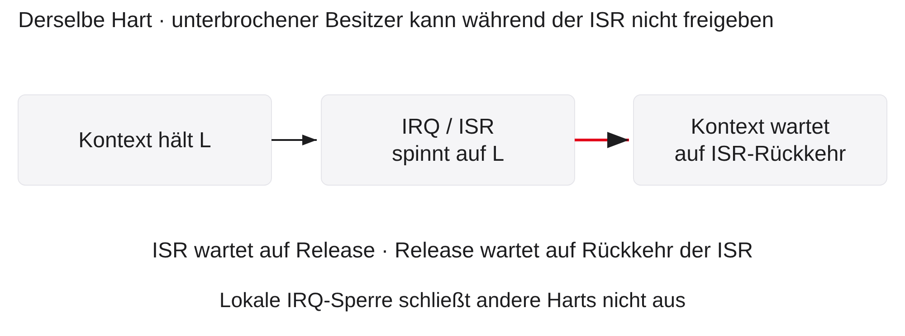{fig-alt="Ein Kontext hält die Sperre L und wird auf demselben Hart unterbrochen. Die ISR wartet aktiv auf L. Der Besitzer kann erst nach ISR-Rückkehr freigeben; die wartende ISR kehrt aber nicht zurück."}

Lokale Interrupts sperren hält andere Harts nicht von gemeinsamen Daten fern.

::: notes
Eine ISR kann auf demselben Hart nicht auf die Freigabe ihres unterbrochenen Besitzers warten. Der normale Kontext hat die Sperre L übernommen, als eine Interrupt Request, IRQ, eintritt. Die Interrupt Service Routine, ISR, versucht daraufhin ebenfalls L durch Spinning zu erwerben.

Der Besitzer kann erst nach der ISR-Rückkehr weiterlaufen und freigeben. Die ISR kehrt jedoch erst nach der erwarteten Freigabe zurück. Der rote Rückbezug in der Grafik zeigt diese zyklische Abhängigkeit. Ein zusätzliches atomisches Test-and-Set kann die fehlende Ausführung des Besitzers nicht ersetzen.

Ein Entwurf kann die betreffende lokale Unterbrechung für einen kurzen gemeinsamen Abschnitt verhindern oder die Arbeit aus der ISR in einen späteren Kontext verschieben. Greifen zugleich andere Harts auf die Daten zu, bleibt eine gemeinsame Synchronisation nötig: Lokales Interruptsperren hält diese Harts nicht fern. Maßnahmen müssen zu Plattform und Fristen passen; die reine Atomizität der Übernahme beantwortet die Fortschrittsfrage nicht.
:::

## Papierphase 3: Ordnung und Fortschritt

::: {.section-label}
4 / 6 · Daten übergeben und fertig werden
:::

Aufgabe 4 a–b · 15 Minuten

- Speicherordnungen für eine einmalige Übergabe wählen und begründen
- Die Ordnungskette vom Nutzdatenschreiben zum Lesen zeichnen
- Zwei Ordnungsfehler in einer Assembler-Sperre finden

::: notes
Begründen Sie die Übergabe aus Aufgabe 4 a als Kette zwischen den gewöhnlichen Nutzdatenzugriffen. Benennen Sie die Kanten und die Bedingung, unter der die atomare Meldung tatsächlich eine Beziehung zwischen den Threads herstellt. Prüfen Sie die veränderte Speicherordnung aus der zweiten Frage am selben Ablauf.

Analysieren Sie danach die Assembler-Sperre in Aufgabe 4 b. Trennen Sie die unteilbare Rechteübernahme von der Ordnung der vorherigen und nachfolgenden Nutzdaten. Korrigieren Sie die beiden Ordnungsfehler und begründen Sie die Wirkung für den folgenden Besitzer. Wartegraph und ISR-Fall vertiefen die Fortschrittsfrage in der Nachbereitung.
:::

## 5 · Beschleunigung begrenzen {.section-divider}

Wird es schneller?

Feste Arbeit → serieller Anteil → Zusatzaufwand → Lastverteilung

::: notes
Mehr Kerne verkürzen die Laufzeit, wenn sich genügend Arbeit gleichzeitig und mit vertretbaren Zusatzkosten ausführen lässt. Vorbereitung, Übergabe und Zusammenführen bleiben Bestandteile der vollständigen Aufgabe. Die fünfte Prüffrage verlangt deshalb einen Zeitvergleich zusätzlich zur bereits begründeten Korrektheit.

Das folgende Modell hält zunächst die Eingabe und die Ein-Kern-Referenz fest. Es trennt serielle Zeit und ideal verteilbaren Rest. Danach kommen mit der Kernzahl wachsende Kosten und ungleiche Arbeitspakete hinzu. Die bekannten 100 Zeiteinheiten mit 20 seriellen Einheiten bleiben der gemeinsame Zahlenfall für diese Gegenüberstellung.
:::

## Feste Arbeit: Was lässt sich überhaupt teilen?

::: {.section-label}
5 / 6 · Beschleunigung begrenzen
:::

Eine feste Aufgabe benötigt auf 1 Kern 100 Zeiteinheiten.

- Vorbereitung und Zusammenführen: 20 bleiben seriell
- Unabhängige Rechnung: 80 sind ideal verteilbar
- Auf 4 Kernen werden die 80 durch 4 geteilt

Verglichen wird die vollständige Laufzeit derselben Aufgabe.

::: notes
Ein vergleichbarer Speedup bezieht sich auf dieselbe Aufgabe und dasselbe Ergebnis. Von den 100 Zeiteinheiten bleiben hier 20 seriell; die übrigen 80 lassen sich ideal auf gleiche Kerne verteilen. Bei 4 Kernen dauert die parallele Phase 20, sodass insgesamt $20+20=40$ Einheiten entstehen. Der Quotient $100/40=2{,}5$ beschreibt die Beschleunigung dieses gesamten Ablaufs.

Der serielle Anteil bezieht sich auf die ursprüngliche Ein-Kern-Zeit. Er wird nach der Beschleunigung nicht neu aus der verkürzten Zeit bestimmt. Zunächst sind die Arbeit gleich verteilt und zusätzliche Start- oder Übergabekosten null. Diese Annahmen werden anschließend einzeln erweitert, damit ihr Einfluss erkennbar bleibt.
:::

## Amdahl: feste Arbeit enthält serielle Zeit

::: {.section-label}
5 / 6 · Beschleunigung begrenzen
:::

$$T(N)=T(1)\left(s+\frac{1-s}{N}\right),\qquad
S(N)=\frac{T(1)}{T(N)}$$

$s$: serieller Anteil · $N$: gleiche Kerne · fester Arbeitsumfang

Andere Frage: Bei Weak Scaling wächst die Arbeit mit der Kernzahl.

::: notes
Amdahls Gesetz zerlegt die Ein-Kern-Zeit $T(1)$ in den seriellen Anteil $sT(1)$ und den parallelisierbaren Rest $(1-s)T(1)$. Auf $N$ gleichen Kernen verkürzt sich nur der Rest auf $(1-s)T(1)/N$. Aus der Summe folgt die angegebene Zeitgleichung, aus dem Verhältnis der beiden vollständigen Zeiten der dimensionslose Speedup $S(N)$.

Für $s>0$ nähert sich die Beschleunigung bei wachsendem $N$ der Grenze $1/s$. Bei $s=1$ bleibt sie 1; bei $s=0$ wäre sie unter den Idealannahmen $N$. Hier liegt Strong Scaling vor: Die Problemgröße bleibt fest. Weak Scaling vergrößert dagegen die Arbeit mit der Kernzahl. Gustafsons Sicht fragt nach größerer bearbeitbarer Arbeit bei annähernd fester Laufzeit; ihr serieller Anteil wird auf diese skalierte Ausführung bezogen. Die beiden Sichten beantworten unterschiedliche Anwendungsfragen. Unsere folgenden Rechnungen bleiben beim festen Arbeitsumfang und ergänzen dessen konkrete Kosten.
:::

## 4 Kerne sind hier Faktor 2,5 {.compact-figure}

::: {.section-label}
5 / 6 · Beschleunigung begrenzen
:::

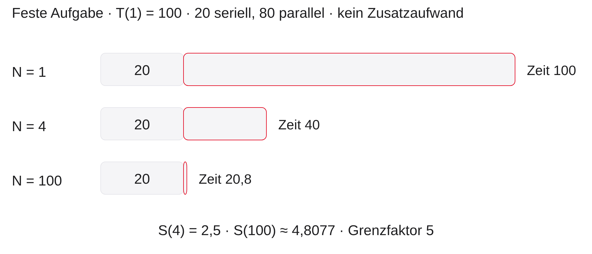{fig-alt="Feste Aufgabe mit 20 seriellen und 80 parallelen Zeiteinheiten. Zeiten für 1, 4 und 100 Kerne: 100, 40 und 20,8. Der ideale Grenzfaktor ist 5."}

$$S(4)=2{,}5,\qquad E(4)=S(4)/4=62{,}5\,\%$$

::: notes
Die Effizienz vergleicht den erzielten Speedup mit der eingesetzten Kernzahl. Bei $T(1)=100$ und $s=0{,}2$ ergeben 4 Kerne die Zeit $20+80/4=40$. Damit sind $S(4)=2{,}5$ und $E(4)=2{,}5/4=0{,}625$. Grau zeigt in der Grafik den unveränderten seriellen Teil, Rot den verkürzten parallelen Teil.

Bei 100 Kernen sinkt die Zeit auf $20{,}8$, der Speedup steigt auf ungefähr $4{,}8077$. Die Effizienz beträgt dennoch nur rund $4{,}8077\,\%$. Die serielle Arbeit hält die Beschleunigung unter 5. Eine kleine Effizienz ist hier also eine erwartbare Folge des Modells; sie ist kein Messwert für die Belegung jedes einzelnen Rechenwerks.
:::

## Mehr Kerne können wieder mehr Zeit kosten {.compact-figure}

::: {.section-label}
5 / 6 · Beschleunigung begrenzen
:::

$$T(N)=T(1)\left(s+\frac{1-s}{N}+cN\right),\qquad N\geq2$$

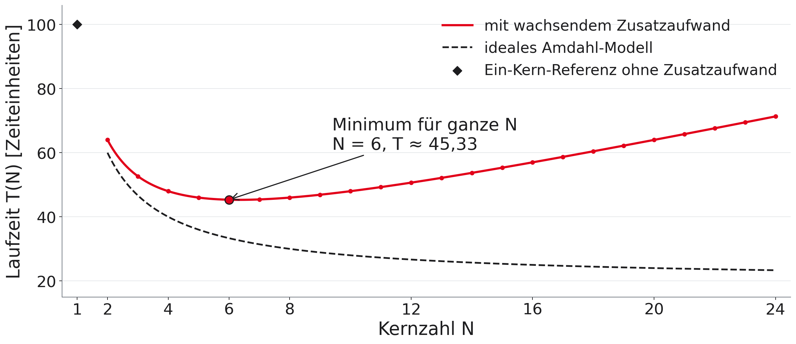{fig-alt="Berechnetes Zeitmodell mit Referenz 100, seriellem Anteil 0,2 und Zusatzanteil 0,02 mal Kernzahl. Die Kostenkurve hat ihr ganzzahliges Minimum bei 6 Kernen und steigt danach; das Idealmodell fällt weiter."}

::: notes
Wachsende Abstimmungskosten können einen besten Punkt bei endlich vielen Kernen erzeugen. Der dimensionslose Zusatzanteil $h(N)=cN$ wächst hier linear mit der Kernzahl. Mit $T(1)=100$, $s=0{,}2$ und $c=0{,}02$ gilt für $N\geq2$ die Zeit $T(N)=20+80/N+2N$. Die Ein-Kern-Referenz 100 enthält diesen Zusatz nicht und steht deshalb als eigener Referenzpunkt in der Grafik. Rot ist die Kostenkurve, gestrichelt das ideale Modell ohne Zusatz.

Bei 4 Kernen entstehen $20+20+8=48$ Einheiten statt 40. Für das Minimum der kontinuierlichen Modellkurve folgt aus $T'(N)=-80/N^2+2=0$ der Wert $N=\sqrt{40}\approx6{,}325$. Die benachbarten ganzen Zahlen liefern $T(6)\approx45{,}333$ und $T(7)\approx45{,}429$; daher sind 6 Kerne am günstigsten. Der größte Speedup beträgt $100/T(6)\approx2{,}206$. Die Kurve fällt nicht unbegrenzt, weil der Kostenterm schließlich stärker wächst als die Rechnung kürzer wird. Im neuen Übungsfall werden die unbekannten Anteile zunächst aus Laufzeiten bestimmt.
:::

## Der langsamste Teil bestimmt den Abschluss {.compact-figure}

::: {.section-label}
5 / 6 · Beschleunigung begrenzen
:::

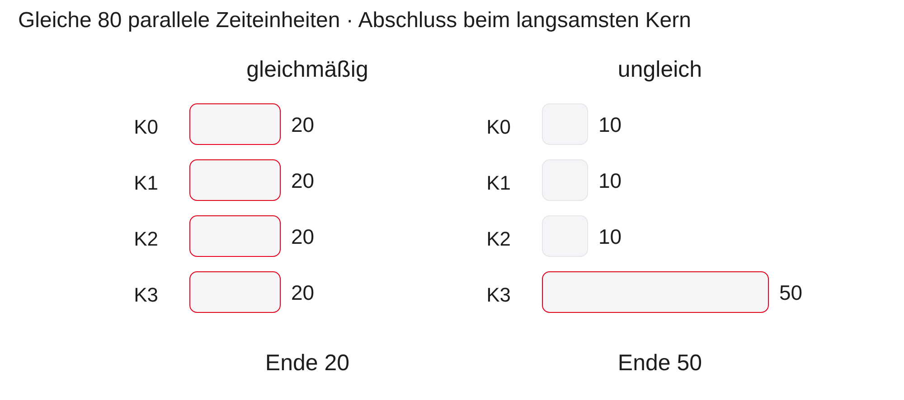{fig-alt="80 parallele Zeiteinheiten werden entweder als 20,20,20,20 oder als 10,10,10,50 verteilt. Mit 20 seriellen Einheiten entstehen Gesamtzeiten 40 beziehungsweise 70."}

Gleiche Gesamtarbeit garantiert noch keine gleiche Verteilung.

::: notes
Die späteste Teilrechnung bestimmt, wann ein vollständiges Ergebnis vorliegt. Load Balance bezeichnet eine möglichst gleichmäßige Verteilung des Aufwands. Die Grafik verteilt dieselben 80 Einheiten auf 4 gleichzeitig startende Kerne. Bei $20,20,20,20$ endet die parallele Phase nach 20; bei $10,10,10,50$ erst nach 50. Rot kennzeichnet den bestimmenden letzten Abschluss.

Mit den 20 seriellen Einheiten entstehen Gesamtzeiten von 40 und 70. Die Speedups lauten $2{,}5$ und $100/70\approx1{,}429$. Entscheidend ist das Maximum der Teilzeiten, nicht deren Mittelwert. Eine Partitionierung nach gleicher Elementzahl genügt deshalb nur bei vergleichbarem Aufwand je Element. Bessere Zuteilung oder dynamisches Nachholen kann helfen, muss aber seinen eigenen Abstimmungsaufwand rechtfertigen.
:::

## 6 · Einen Multicore-Entwurf begründen {.section-divider}

1. Ist die Kopie gültig?
2. Ist das Update unteilbar?
3. Sind die Daten nach der Meldung sichtbar?
4. Wird jeder Beteiligte fertig?
5. Wird es schneller?

::: notes
Der Gesamtentwurf wird mit denselben 5 Fragen wie am Einstieg geprüft. Die Gültigkeit der Cachekopie ist Voraussetzung für die verwendeten Daten. Getrennte Ergebnisslots vermeiden gemeinsame Updates in der inneren Schleife. Für ihre spätere Nutzung braucht jeder Slot eine passende Veröffentlichung. Das Warten muss außerdem im Erfolgs- und Fehlerfall einen geregelten Ausgang haben. Erst danach lässt sich die vollständige Laufzeit vergleichen.

Das folgende Beispiel behält 2 Worker, je einen Schreiber pro Slot und einen einmaligen Durchlauf. Der größere Fall des Übungsblatts verwendet 3 Worker und verlangt zusätzlich den Umgang mit Ausfall und Wiederverwendung. Der Prüfrahmen bleibt derselbe, auch wenn Teilnehmerzahl und Datenaufteilung wachsen.
:::

## Zwei Worker, zwei Ordnungsketten {.order-chains}

::: {.section-label}
6 / 6 · Einen Multicore-Entwurf begründen
:::


Je Slot folgt: Datenschreiben happens-before Datenlesen.

```{mermaid}
flowchart TD
  D0["Worker 0: teil[0] = 4"] -->|sequenced-before| R0["fertig[0] = 1 · Release"]
  R0 -->|synchronizes-with| A0["Sammler: Acquire<br/>liest fertig[0] = 1"]
  A0 -->|sequenced-before| L0["Sammler liest teil[0]"]
  D1["Worker 1: teil[1] = 12"] -->|sequenced-before| R1["fertig[1] = 1 · Release"]
  R1 -->|synchronizes-with| A1["Sammler: Acquire<br/>liest fertig[1] = 1"]
  A1 -->|sequenced-before| L1["Sammler liest teil[1]"]
  style R0 fill:#FFFFFF,stroke:#E2001A,stroke-width:2px !important;
  style R1 fill:#FFFFFF,stroke:#E2001A,stroke-width:2px !important;
```

::: notes
Jeder gelesene Ergebnisslot erhält seine eigene Ordnungskette. Worker 0 berechnet aus 1 und 3 den Wert 4, Worker 1 aus 5 und 7 den Wert 12. Jeder schreibt zuerst seinen gewöhnlichen Slot und veröffentlicht danach 1 im eigenen atomaren Flag mit Release. Dieser Ablauf innerhalb eines Threads heißt sequenced-before.

Liest der Sammler die zugehörige 1 mit Acquire, verbindet diese Beobachtung den Release-Store über synchronizes-with mit dem Acquire-Load. Von dort ist das spätere Lesen des Slots wieder sequenced-before geordnet. Die zusammengesetzte Beziehung ordnet damit das Datenschreiben happens-before vor dem Datenlesen. Erst beide Ketten erlauben die Gesamtsumme $4+12=16$. Eine Meldung von Worker 0 sichert nur dessen Slot ab.

Die einmal veröffentlichten Werte bleiben im betrachteten Durchlauf unverändert. Ein ausgefallener Worker erfordert eine Fehlerregel; ein weiterer Durchlauf benötigt eine geregelte Rückgabe der Slots. Layout, Veröffentlichung und Fortschritt werden mit dem eingeführten Rahmen gemeinsam beurteilt.
:::

## Der Sammler wartet auf jede passende Meldung

::: {.section-label}
6 / 6 · Einen Multicore-Entwurf begründen
:::

```c
/* C11: 2 Slots, vor Threadstart initialisiert. */
static int32_t teil[2];
static atomic_uint fertig[2] = {0, 0};
/* Worker i, genau einmal: */
teil[i] = lokale_summe;
atomic_store_explicit(&fertig[i], 1u,
                      memory_order_release);
/* Sammler: erst nach BEIDEN Schleifen lesen. */
for (size_t i = 0; i < 2; ++i)
    while (atomic_load_explicit(&fertig[i],
               memory_order_acquire) == 0u) { }
int32_t gesamt = teil[0] + teil[1];
```

::: notes
Der Sammler wartet auf die Veröffentlichung jedes benötigten Slots. Der C11-Ausschnitt verwendet `int32_t` aus `stdint.h`, `atomic_uint` aus `stdatomic.h` und `size_t` aus `stddef.h`. Beide Flags beginnen vor dem Threadstart bei 0; die Worker-Indizes sind 0 und 1. `lokale_summe` bezeichnet den bereits fertig berechneten lokalen Wert. Alle Summen liegen im Wertebereich.

Jeder Worker führt seinen gekennzeichneten Abschnitt einmal aus. Der Sammler führt anschließend eine eigene Acquire-Warteschleife für jeden Index aus und liest die gewöhnlichen Slots erst hinter beiden Schleifen. Die Verteilung der Codeabschnitte auf verschiedene Threads gehört zum Vertrag dieses Lehrausschnitts; Threadstart und Argumentübergabe bleiben beim Hostprogramm. Das Warten setzt voraus, dass jeder Worker seine Meldung irgendwann veröffentlicht. Bei Wiederverwendung müssen die vorangehenden Nutzer die Objekte freigegeben haben, bevor sie zurückgesetzt werden.
:::

## Papierphase 4 und Abschlussquiz

::: {.section-label}
6 / 6 · Einen Multicore-Entwurf begründen
:::

Aufgabe 5 a–b und Aufgabe 6 c · 15 Minuten

- Seriellen Anteil und Zusatzaufwand aus 2 Laufzeiten bestimmen
- Speedup und Effizienz vergleichen
- Worker-Ende und Sammler in C11 schreiben

Anschließend: 12 Quizfragen · 15 Minuten.

::: notes
Nutzen Sie für Aufgabe 5 die beiden gemessenen Modelllaufzeiten und die vereinbarte Form des Zusatzaufwands. Stellen Sie die Gleichungen für dieselbe Ein-Kern-Referenz auf, bestimmen Sie die unbekannten Größen und vergleichen Sie anschließend die geforderten Beschleunigungswerte. Weiterführende Optimierung und Paketverteilung gehören zur Nachbereitung.

Entwerfen Sie für Aufgabe 6 c das Ende aller 3 Worker und den Sammler mit expliziten C11-Speicherordnungen. Jeder benötigte Ergebnisslot braucht seine passende Abschlussmeldung. Prüfen Sie den Entwurf anhand der 5 Leitfragen; die weiteren Teilaufgaben ergänzen Layout, Fehlerfall und Wiederverwendung. Das abschließende Quiz verbindet diese fachlichen Unterscheidungen in 12 Fragen.
:::

## Fünf Fragen und Quellen zum Abschluss {.closing-reference}

:::: {.columns}
::: {.column width="50%"}
1. Ist die Kopie gültig?
2. Ist das Update unteilbar?
3. Sind die Daten nach der Meldung sichtbar?
4. Wird jeder Beteiligte fertig?
5. Wird es schneller?
:::
::: {.column width="50%"}
::: {.source-links}
C11 N1570 · 5.1.2.4 und 7.17:

[https://www.open-std.org/jtc1/sc22/wg14/www/docs/n1570.pdf](https://www.open-std.org/jtc1/sc22/wg14/www/docs/n1570.pdf)

RISC-V Atomics · Fassung 20240411:

[https://github.com/riscv/riscv-isa-manual/blob/20240411/src/a-st-ext.adoc](https://github.com/riscv/riscv-isa-manual/blob/20240411/src/a-st-ext.adoc)
:::
:::
::::

::: notes
Ein tragfähiger Entwurf beantwortet alle 5 Fragen. Kohärenz koordiniert gültige Kopien, eine RMW schützt ein gemeinsames Update, und eine passende Release-/Acquire-Kette macht veröffentlichte Daten nutzbar. Ein geregelter Warte- und Fehlerpfad begründet den Fortschritt. Die vollständige Laufzeit enthält schließlich auch serielle Arbeit, Übergabe und Lastverteilung.

Damit werden die Einstiegsvermutungen aufgelöst: Eine Aufteilung auf 2 Kerne halbiert die vollständige Laufzeit nur unter passenden Bedingungen. Bei 20 seriellen und 80 ideal verteilbaren Einheiten beträgt sie $20+80/2=60$ statt 50. Der Speedup ist ungefähr $1{,}667$. Ein gemeinsamer Zähler wird erst durch eine passende unteilbare Aktion oder Sperre korrekt; getrennte Teilsummen vermeiden viele solcher Updates.

Die Grundlagen orientieren sich an Harris und Harris, Digital Design and Computer Architecture — RISC-V Edition, sowie Patterson und Hennessy, Computer Organization and Design — RISC-V Edition. Die auf der Folie ausgeschriebenen URLs bleiben im PDF nutzbar. N1570 behandelt in 5.1.2.4 die nebenläufigen Ausführungen einschließlich Data Races und in 7.17 die Atomics. Die RISC-V-Fassung 20240411 beschreibt LR/SC, AMO und deren Ordnungsbits. Ergänzend erläutern die [GCC-Dokumentation zu volatile](https://gcc.gnu.org/onlinedocs/gcc/Volatiles.html) und die [Linux-Dokumentation zu False Sharing](https://docs.kernel.org/kernel-hacking/false-sharing.html) die jeweiligen Grenzen. Der Hostversuch im Labor prüft ausgewählte C-Eigenschaften; die Cache- und Zeitmodelle werden argumentativ beziehungsweise rechnerisch untersucht.
:::

## Modell K nachschlagen: lokale Zugriffe

::: {.section-label}
2 / 6 · Nachschlagetabelle für abgeschlossene Schritte
:::

| Eigener Zustand | Lokaler Read | Lokaler Write |
|---|---|---|
| M | M | M |
| E | E | M, still |
| S | S | M; fremde Kopien → I |
| I | beschaffen → E oder S | beschaffen → M |

Read-Miss: ohne Fremdkopie E, sonst S.\
Write-Miss: aktuelle Zeile beschaffen, alle fremden Kopien invalidieren.

::: notes
Die Tabelle fasst die bisher erklärten lokalen Zugriffe für beliebig viele beteiligte Caches zusammen. Ein Read-Treffer in M, E oder S erhält die Rechte. Ein Write auf M bleibt beim Besitzer. E erlaubt den stillen Wechsel nach M; S verlangt die abgeschlossene Invalidierung aller fremden gültigen Kopien.

In I muss der Cache die aktuelle Zeile beschaffen. Ein Read ohne gültige Fremdkopie liefert aus $L$ und ergibt E. Bei sauberen Fremdkopien werden die Leser S. Existiert M, liefert der Besitzer seine aktuellen Daten, aktualisiert $L$ und geht mit dem Leser nach S. Für einen Write-Miss wird dagegen direkt exklusives Schreibrecht beschafft. Bei fremdem M liefert dieser Besitzer die ganze aktuelle Zeile an den neuen Schreiber und wird I; $L$ bleibt dabei unverändert. Bei ausschließlich sauberen Daten ist der Inhalt mit $L$ identisch.

Die Zeilenwerte werden beim anschließenden lokalen Write entsprechend der Instruktion verändert. Ein etwaiges Auswerfen eines anderen Opferblocks folgt vorher der gesonderten Auswurfregel. Die Tabelle ersetzt dadurch die erneute Suche nach einem passenden Zweikernbild.
:::

## Modell K nachschlagen: Fremdzugriffe und Auswurf

::: {.section-label}
2 / 6 · Nachschlagetabelle für die eigene Kopie
:::

| Eigener Zustand | Fremdread | Fremdwrite | Auswurf |
|---|---|---|---|
| M | S; liefern und $L$ aktualisieren | I; an Schreiber liefern | I; nach $L$ schreiben |
| E | S | I | I |
| S | S | I | I |
| I | I | I | I |

Fremdwrite auf M: aktueller Besitzertransfer; $L$ bleibt unverändert.

::: notes
Ein Fremdzugriff verändert die Rechte der eigenen Kopie nach einer einheitlichen Regel. Ein neuer Leser beendet die Exklusivität von E oder M. E wird sauber geteilt; M liefert zuvor den aktuellen Wert und aktualisiert im Modell $L$. Bereits vorhandene S-Kopien bleiben dabei gültig und gleich.

Ein fremder Schreiber benötigt dagegen das alleinige Zeilenschreibrecht. Eigene E- oder S-Kopien werden I. Hält die eigene Kopie M, muss sie zuerst die aktuelle ganze Zeile an den neuen Schreiber liefern und wird dann I. $L$ bleibt bei diesem Besitzertransfer unverändert. Dadurch gehen auch die jüngsten Werte anderer Wörter derselben Zeile zum neuen Besitzer; die alte untere Zeile wäre eine falsche Quelle.

Beim Auswurf schreibt nur M vor dem Übergang nach I die aktuellen Daten nach $L$. Das Auswerfen einer sauberen Kopie verlangt keine Rückschreibung. Andere verbleibende S-Kopien bleiben S. Die Tabelle beschreibt die betrachtete eigene Kopie; der anfragende Leser oder Schreiber erhält die Rechte der vorherigen lokalen Tabelle.
:::

## Snooping und Directory: Anfragen koordinieren {.compact-figure}

::: {.section-label}
Hintergrund · Optionale technische Umsetzung
:::

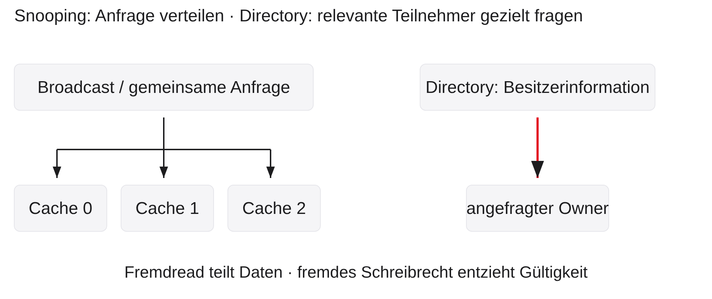{fig-alt="Bei Snooping prüfen beteiligte Cachecontroller eine verteilte Anfrage. Ein Directory kann anhand gespeicherter Teilnehmerinformation gezielt den Besitzer oder weitere Kopien anfragen."}

Ein Fremdread und ein fremder Schreibrechtswunsch lösen unterschiedliche Reaktionen aus.

::: notes
Snooping und Directory organisieren, wer auf eine fremde Anfrage reagiert. Beim Snooping hören relevante Cachecontroller die verteilte Transaktion mit. Broadcast bezeichnet die Verteilung an alle betreffenden Empfänger. Links zeigt die Grafik diesen gemeinsamen Anfrageweg.

Ein Directory hält dagegen Verzeichnisinformationen über Besitzer und weitere Kopien. Rechts kann es damit gezielt den aktuellen Besitzer oder die zu invalidierenden Leser ansprechen. Beide Varianten müssen dieselben Datenrechte erhalten: Leser bekommen aktuelle Daten, Schreiber übernehmen exklusiv, und geänderte Werte bleiben erhalten.

Ein Ring oder Mesh beschreibt die physische Verbindung, Snooping und Directory dagegen die Koordination. Reale Controller verwenden während laufender Nachrichten zusätzliche Zwischenzustände. Für die Pflichtaufgaben reicht das abgeschlossene Modell K; diese Folie vertieft seine mögliche technische Umsetzung.
:::
