## Zwei Kerne, doppelte Geschwindigkeit?

Eine lange Schleife soll auf zwei Kerne verteilt werden.

Beide Abläufe erhöhen außerdem denselben Ergebniszähler.

- Wird die Rechnung automatisch doppelt so schnell?
- Ist der gemeinsame Zähler automatisch richtig?
- Welche Daten würden Sie lieber getrennt halten?

Begründen Sie Ihre Vermutung aus dem bisherigen Wissen.

::: notes
Ein Programm verarbeitet viele Werte. Mit Arrays, Schleifen und Speicherzugriffen ist bereits bekannt, wie ein einzelner Ablauf diese Arbeit erledigt. Zwei Kerne bieten nun zwei gleichzeitig nutzbare Ausführungsinstanzen. Daraus entsteht die naheliegende Vermutung, dass eine Aufteilung der Schleife die Laufzeit halbiert und ein gemeinsamer Zähler die Beiträge einfach zusammenfasst. Beides braucht zusätzliche Voraussetzungen.

Ein möglicher Entwurf teilt die Eingaben auf und lässt beide Abläufe ihre Teilergebnisse getrennt berechnen. Ein anderer lässt beide denselben Zähler erhöhen. Für dessen Hardwaremodell können beide denselben alten Wert null laden, jeweils eins berechnen und nacheinander eins speichern. Das Endergebnis ist dann eins statt zwei, obwohl alle einzelnen Speicherzugriffe korrekt koordiniert wurden. Bei gewöhnlichen ungeschützten C-Zugriffen wäre dies sogar ein Data Race mit undefiniertem Verhalten; ein bestimmter Endwert dürfte dort nicht zugesichert werden.

Auch bei korrekten Ergebnissen halbiert sich nicht jede Laufzeit. Vorbereitung, Start, Warten und Zusammenführen können seriell bleiben, während Speicherwege gemeinsam genutzt werden. Die beiden Einstiegsfragen führen deshalb zu zwei getrennten Zielen: gemeinsame Arbeit korrekt organisieren und den verbleibenden Nutzen zusätzlicher Kerne beurteilen. Ihre begründete Auflösung ergibt sich aus Datenaufteilung, atomaren Updates und dem späteren Zeitmodell.
:::

## Voraussetzungen und drei Leitfragen

- Arrays, Load/Store und Write-Back-Caches aus Vorlesungen 1–2
- Interrupt-Kontexte aus Vorlesung 3; Parallelität aus Vorlesungen 7–8
- Thread, gemeinsame Daten und Sperren werden hier eingeführt
- Kopien verfolgen, Updates schützen und Datenübergaben begründen
- Korrektheit, Fortschritt und Beschleunigung getrennt beurteilen

::: notes
Die Speicherhierarchie liefert den Ausgangspunkt: Ein Cache hält nahe Kopien von Speicherblöcken. Write-Back erlaubt, dass eine Änderung zunächst nur in einer geänderten Cachezeile vorliegt. Ein Load liest, ein Store schreibt Speicher. Aus der Interruptbehandlung ist außerdem bekannt, dass mehrere Abläufe auf dieselben Daten zugreifen können, auch wenn der unterbrochene Ablauf gerade nicht weiterläuft. Interne Befehlsparallelität und Datenparallelität erklären zusätzliche Rechenmöglichkeiten innerhalb eines Threads.

Ein Betriebssystemkurs wird nicht vorausgesetzt. Thread, Hart, gemeinsame Daten und Sperren werden hier eingeführt. Im RISC-V-Lehrmodell besitzt jeder der betrachteten Kerne einen Hart, also eine Hardware-Ausführungsinstanz. Assemblerbeispiele verwenden 32-Bit-Wörter und setzen die ausdrücklich genannte Atomics-Unterstützung voraus; C-Beispiele beziehen sich auf C11 und gewöhnlichen Speicher.

Drei Fragen strukturieren den Lernweg. Kohärenz koordiniert gültige Kopien derselben Speicherstelle. Atomizität schützt eine zusammengesetzte Aktion gegen konkurrierende Teilaktionen. Speicherordnung sichert Beziehungen zwischen mehreren Objekten, etwa Nutzdaten und Bereitschaft. Diese Unterschiede ermöglichen es, Cachezustände herzuleiten, verlorene Updates zu diagnostizieren und eine Datenübergabe zu begründen. Fortschrittsanalyse und Laufzeitrechnung ergänzen anschließend die Frage, ob ein korrekter Entwurf tatsächlich fertig und schneller wird.
:::

## Vier Schulstunden: Ablauf

| Stunde | Erklärung und Besprechung | Arbeitsphase |
|--------|---------------------------|--------------|
| 1 | Arbeit teilen, Cachekopien und MESI: 35 min | Aufgaben 1–2: 10 min |
| 2 | Verlorene Updates und LR/SC: 30 min | Aufgabe 3: 15 min |
| 3 | Speicherordnung, Locks und Fortschritt: 30 min | Aufgabe 4: 15 min |
| 4 | Skalierung und Anwendungsentwurf: 15 min | Aufgaben 5–6: 15 min; Quiz: 15 min |

::: notes
Die vier Schulstunden umfassen zusammen 180 Minuten ohne zusätzliche Pausen. Der Arbeitsweg beginnt bei der Aufteilung eines Programms und verfolgt dann die drei verschiedenen Probleme gemeinsamer Daten: gültige Cachekopien, unteilbare Updates und geordnete Veröffentlichung. Der letzte Abschnitt verbindet diese Mechanismen in einem kleinen Entwurf und beurteilt seine Beschleunigungsgrenzen.

Die Papierphasen sind über die Einheit verteilt, damit der jeweils neue Gedanke unmittelbar angewendet wird. Zustandsfolgen prüfen die Cacheinvarianten, LR/SC-Aufgaben trennen Datenwert und Erfolgsstatus, und Übergabe- und Wartefälle verlangen eine Begründung statt bloßer Begriffswiedergabe. Die neuen Anwendungsaufgaben verbinden mehrere dieser Entscheidungen. Das Quiz prüft dieselben fachlichen Unterscheidungen mit kurzen Antwortformaten.

Das Zeitbudget enthält Erklärungen, kurze Denkphasen einschließlich des Einstiegs und die gemeinsame Lösungsbesprechung. Die rund 64 Folien teilen vor allem anspruchsvolle Erklärschritte auf; Abschnittsübersichten benötigen deutlich weniger Zeit als Zustands- oder Codebeispiele. Die 55 Minuten Papierarbeit sind eine angeleitete Auswahl- und Bearbeitungszeit. Für das vollständige selbstständige Durcharbeiten nennt das Übungsblatt einen längeren Richtwert. Der optionale Hostversuch ergänzt die Papieranalyse und gehört nicht als zusätzliche Pflichtaufgabe in dieses Zeitbudget.
:::

## 1 · Arbeit aufteilen {.section-divider}

Welche Arbeit darf gleichzeitig laufen?

::: {.section-route}
Arbeit teilen → Cachekopien → Atomizität → Ordnung → Skalierung → Anwendung
:::

Von einer Schleife zu getrennten Zuständigkeiten.

::: notes
Ein zusätzlicher Kern braucht Arbeit, die ein zweiter Ablauf unabhängig übernehmen kann. Ausgangspunkt ist deshalb die Programmstruktur und nicht eine bestimmte Sperrinstruktion. Unveränderte Eingaben können gemeinsam gelesen werden; während der Rechnung getrennte Ergebnisse vermeiden viele gemeinsame Änderungen.

Thread, Hart und Kern beschreiben unterschiedliche Ebenen dieses Entwurfs. Ihre Unterscheidung verhindert, dass das Starten zusätzlicher Softwareabläufe bereits mit zusätzlicher Hardwareleistung gleichgesetzt wird. Die erste Aufteilung endet außerdem nicht mit zwei richtigen Teilsummen: Der zusammenführende Ablauf muss wissen, wann beide Ergebnisse vollständig und nutzbar sind. Daraus entsteht der erste Zusammenhang zwischen Arbeitsteilung und Synchronisation.
:::

## Thread, Hart und Kern auseinanderhalten {.compact-figure}

::: {.section-label}
1 / 6 · Arbeit aufteilen
:::

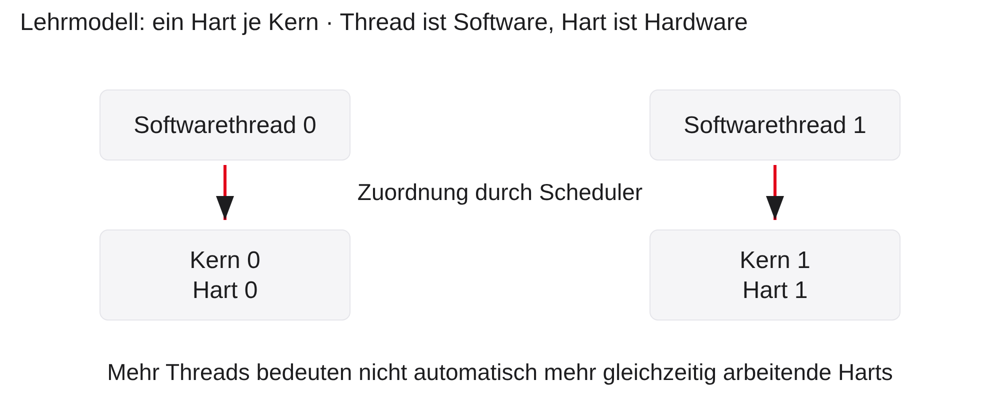{fig-alt="Zwei Softwarethreads werden zwei Harts zugeordnet. Im Lehrmodell besitzt jeder der zwei Kerne genau einen Hart. Ein Scheduler entscheidet die Zuordnung."}

Ein Thread ist Software; ein Hart ist eine Hardware-Ausführungsinstanz.

::: notes
Ein Thread ist ein eigenständig fortsetzbarer Ablauf eines Programms. Zu seinem Zustand gehören insbesondere die nächste auszuführende Operation und seine aktuellen Zwischenwerte. Ein Programm kann mehrere solche Ausführungsfäden starten. Ein Hart ist dagegen eine Hardwareinstanz mit eigenem architektonischem Ausführungszustand; die Bezeichnung stammt von Hardware Thread. Ein Kern ist die physische Prozessoreinheit. Im betrachteten Lehrmodell besitzt jeder von zwei Kernen genau einen Hart. Andere Prozessoren können mehrere Harts je Kern bereitstellen.

In der Abbildung stehen oben zwei Softwarethreads, darunter die auswählende Software und unten die Hardware. Ein Scheduler entscheidet, welcher lauffähige Thread auf welcher Hardwareinstanz ausgeführt wird. Er muss hier nur als Zuteilungsmechanismus verstanden werden. Die roten Pfeile markieren eine mögliche gleichzeitige Zuordnung, keine dauerhafte Identität zwischen Thread und Kern. Eine spätere Verlagerung heißt Migration, eine erlaubte oder erzwungene Bindung Affinity.

Mehrere Threads können auf einem einzigen Hart zeitlich abwechseln. Ihre Lebenszeiten überlappen dann, sie sind nebenläufig. Parallele Ausführung verlangt tatsächlich gleichzeitig nutzbare Hardware und geeignete Arbeit. Ein zusätzlicher Kern beschleunigt einen einzelnen unveränderten Thread daher nicht automatisch. Zuerst muss das Programm beschreiben, welche Abläufe unabhängig fortschreiten dürfen und welche Daten sie gemeinsam verwenden.
:::

## Gemeinsame Eingabe, private Zwischenwerte {.compact-figure}

::: {.section-label}
1 / 6 · Arbeit aufteilen
:::

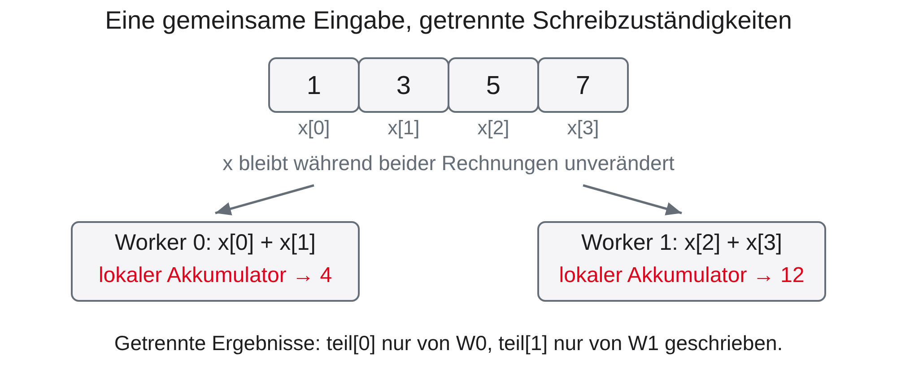{fig-alt="Die unveränderten Werte 1,3,5,7 werden in zwei Lesebereiche geteilt. Worker 0 berechnet lokal 4, Worker 1 lokal 12. Jeder schreibt ausschließlich seinen eigenen Ergebnisslot."}

Gemeinsam erreichbar heißt nicht: gemeinsam verändern müssen.

::: notes
Ein gemeinsamer Adressraum bedeutet, dass mehrere Threads dieselben Speicherobjekte erreichen können. Daraus folgt keine Pflicht, diese Objekte gleichzeitig zu verändern. Die Eingabe $x$ enthält hier eins, drei, fünf und sieben und bleibt während der gesamten Rechnung unverändert. Beide Worker dürfen sie lesen; ihre vereinbarte Aufteilung beschränkt die benötigten Lesezugriffe auf je zwei Elemente.

Die Pfeile der Grafik ordnen Daten räumlich ihrer Rechnung zu und bilden keine Zeitachse. Worker null berechnet lokal $1+3=4$, Worker eins $5+7=12$. Ein lokaler Akkumulator gehört jeweils zum Zustand dieses Ablaufs. Die Ergebnisfelder `teil[0]` und `teil[1]` sind zwar gemeinsam erreichbar, haben aber je einen exklusiven Schreiber. Privat bezeichnet hier die Schreibzuständigkeit und verlangt nicht zwingend einen physisch anderen Speicherbaustein.

So kann jeder Worker rechnen, ohne nach jedem Element auf den anderen zu warten. Der Sammler verwendet die beiden Slots erst nach einer geregelten Übergabe. Die Trennung der Schreibzuständigkeiten verhindert konkurrierende Änderungen desselben Slots, aber sie allein signalisiert noch keinen Abschluss. Ebenso können räumlich benachbarte Slots trotz logisch getrennter Nutzung eine Cachezeile teilen. Beide Grenzen werden später gesondert untersucht.
:::

## TLP ergänzt ILP und DLP

::: {.section-label}
1 / 6 · Arbeit aufteilen
:::

| Ebene | Parallelität | Beispiel |
|-------|--------------|----------|
| ILP | unabhängige Befehle | Load und unabhängige Addition |
| DLP | gleiche Arbeit an vielen Daten | mehrere elementweise Produkte |
| TLP | mehrere Ausführungsfäden | zwei getrennte Arraybereiche |

Ein Thread kann selbst Vektoren verwenden; mehrere Kerne teilen trotzdem Ressourcen.

::: notes
Parallelität lässt sich auf mehreren Ebenen anbieten. Instruction-Level Parallelism, ILP, sind unabhängige Maschinenbefehle innerhalb eines Ablaufs. Data-Level Parallelism, DLP, beschreibt gleichartige Operationen an mehreren Datenelementen. Thread-Level Parallelism, TLP, verteilt Arbeit auf mehrere Ausführungsfäden. Diese drei Möglichkeiten schließen einander nicht aus.

Eine Arrayverarbeitung kann beispielsweise zwei Threads für getrennte Bereiche starten. Jeder Thread kann Vektorbefehle für mehrere Elemente verwenden und zugleich unabhängige Befehle für eine superskalare Ausführung anbieten. Ein Rechenschritt, der die vorherige Teilsumme benötigt, behält jedoch seine Wertabhängigkeit. Ebenso wachsen gemeinsame Speicherbandbreite und Cachekapazität nicht automatisch mit der Anzahl gestarteter Threads.

Die Tabelle ordnet deshalb verfügbare Arbeit zu, ohne eine konkrete Laufzeit zu versprechen. Für die Programmstruktur ist zunächst wichtiger, ob die Threads dieselben Daten nur lesen oder auch verändern. Unveränderte Eingaben lassen sich oft problemlos gemeinsam nutzen. Getrennte Ergebnisobjekte vermeiden dagegen, dass jeder einzelne Rechenschritt eine gemeinsame Variable aktualisieren muss. Dieses Muster führt von vorhandener Datenparallelität zu einem ersten korrekten Multicore-Entwurf.
:::

## Erst Arbeit und Ergebnisse aufteilen {.compact-figure}

::: {.section-label}
1 / 6 · Arbeit aufteilen
:::

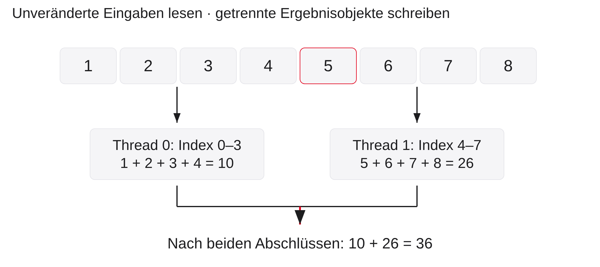{fig-alt="Arraywerte1bis8 werden in zwei Bereiche aufgeteilt. Thread0 bildet Teilsumme10, Thread1 Teilsumme26. Nach Abschluss entsteht die Gesamtsumme36."}

$$\sum_{i=0}^{7}x_i=\sum_{i=0}^{3}x_i+\sum_{i=4}^{7}x_i=10+26=36$$

::: notes
Eine Reduktion fasst mehrere Eingabewerte zu einem Ergebnis zusammen, hier zu einer Summe. Das Array enthält die acht Werte eins bis acht. Der erste Thread bearbeitet die Indizes null bis drei, der zweite die Indizes vier bis sieben. Die Aufteilung in zwei Bereiche ist in der Abbildung räumlich eingezeichnet; Pfeile führen von den Eingabeelementen zu ihren Teilsummen und anschließend zur gemeinsamen Summe.

Die erste Teilsumme lautet $1+2+3+4=10$, die zweite $5+6+7+8=26$. Nach Abschluss beider Rechnungen ergibt ihre Addition $10+26=36$. Während der parallelen Phase bleiben die Eingaben unverändert. Jeder Thread schreibt nur sein eigenes Ergebnisobjekt. Der zusammenführende Ablauf darf diese Ergebnisse erst benutzen, wenn ihr Abschluss und ihre geordnete Übergabe gesichert sind.

Damit entfällt ein gemeinsamer Akkumulator in der inneren Schleife. Die Reihenfolge unabhängiger Eingabelesezugriffe muss nicht abgestimmt werden. Für die kleinen Ganzzahlen wird kein Überlauf angenommen; bei Gleitkommazahlen könnte eine geänderte Additionsreihenfolge außerdem Rundungsergebnisse verändern. Das Bild beschreibt einen funktional korrekten Entwurf unter diesen Voraussetzungen, keine gemessene Beschleunigung. Start, Warten, Zusammenführen und gemeinsam genutzte Speicherwege bleiben mögliche Kosten.
:::

## Zusammenführen erst nach beiden Abschlüssen

::: {.section-label}
1 / 6 · Arbeit aufteilen
:::

- Worker starten mit getrennten Eingabebereichen und Ergebnisslots
- Der erste fertige Worker macht nicht die gesamte Aufgabe fertig
- Ein Join wartet auf das Ende genau dieses Threads
- Nach beiden passenden Joins dürfen die Teilsummen zusammengeführt werden

Starten, Rechnen und Zusammenführen sind verschiedene Phasen.

::: notes
Ein Startaufruf gibt einen Ablauf zur Ausführung frei. Er bedeutet noch nicht, dass dessen Rechnung bereits abgeschlossen ist. Selbst wenn Worker null schon fertig ist, kann Worker eins noch am zweiten Bereich arbeiten. Der Sammler benötigt daher für jeden verwendeten Teil eine passende Abschlussbeziehung.

Ein Join ist das Warten auf das Ende eines bestimmten Threads. Im POSIX-Hostbeispiel stellt `pthread_join` zusätzlich die nötige Synchronisation für die danach gelesenen Ergebnisse her. Nach beiden erfolgreichen Joins darf der aufrufende Ablauf die zehn und sechsundzwanzig des Acht-Werte-Beispiels zu sechsunddreißig addieren. Ein einzelner Join auf Worker null würde das Ergebnis von Worker eins noch nicht absichern. Auch eine feste, nur vermutete Wartezeit wäre kein Ersatz für eine zugesicherte Beziehung.

Das ist ein einfaches einmaliges Übergabemuster. Bei dauerhaft laufenden Workern kann eine passend synchronisierte Bereitschaftsmeldung an die Stelle des Threadendes treten. Dann müssen deren Sprachregeln und die Lebensdauer der Ergebnisdaten eigens geklärt werden. Die grundlegende Forderung bleibt gleich: Der Empfänger liest erst nach dem zugesicherten Abschluss der betreffenden Datenschreibung. Eine zweite Hardwareinstanz entfernt diese Abhängigkeit nicht.
:::

## SMP und AMP beschreiben eine Organisation {.compact-figure}

::: {.section-label}
1 / 6 · Arbeit aufteilen
:::

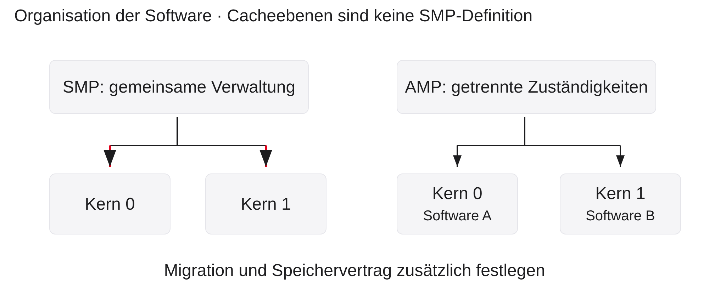{fig-alt="SMP-Lehrmodell mit gemeinsamer Betriebssystemverwaltung und gemeinsamem Speicher, gegenüber AMP mit getrennten Softwarezuständigkeiten. Private Caches und ein L2 sind keine Definition."}

Gleicher Speicherzugriff bestimmt noch nicht jede Cache- oder Gerätearchitektur.

::: notes
Symmetric Multiprocessing, SMP, bezeichnet eine symmetrische Mehrprozessororganisation. Im hier verwendeten Lehrmodell sind die Kerne gleichberechtigt und werden durch eine gemeinsame Softwareverwaltung für den gemeinsamen Speicher genutzt. Ein Betriebssystem kann diese Verwaltung übernehmen, indem es ausführbare Aufgaben und Ressourcen zuteilt. Für das Verständnis genügt diese Grundidee; Kenntnisse über einen konkreten Betriebssystemkern sind nicht erforderlich.

Asymmetric Multiprocessing, AMP, beschreibt dagegen getrennte Softwarezuständigkeiten oder fest zugeordnete Aufgaben. Beispielsweise kann ein Kern eine Regelung ausführen, während ein anderer Kommunikationsdaten aufbereitet. Die linke Bildhälfte betont die gemeinsame Verwaltung, die rechte die getrennten Zuständigkeiten. Die roten Verbindungen gehören zur Softwareorganisation. Private L1-Caches oder ein gemeinsames L2 sind mögliche Speicheraufbauten, aber keine Definition dieser Organisationsbegriffe.

Aus gemeinsam erreichbaren Adressen folgt noch nicht, wie gültige Cachekopien koordiniert werden. Auch die Frage, ob ein Thread auf einen anderen Kern verlagert werden kann, verlangt einen Softwarevertrag. Die Organisationsform allein ersetzt weder eine beschriebene Datenübergabe noch eine Synchronisation gemeinsam veränderter Objekte. Für den weiteren Entwurf muss deshalb zuerst feststehen, welche Speicherteilnehmer überhaupt gemeinsam an einem Kohärenzprotokoll beteiligt sind.
:::

## 2 · Cachekopien koordinieren {.section-divider}

Wie können zwei private Caches denselben Speicher richtig nutzen?

::: {.section-route}
Arbeit teilen → Cachekopien → Atomizität → Ordnung → Skalierung → Anwendung
:::

Von der gemeinsamen Adresse zu gültigen Kopien und Schreibrechten.

::: notes
Getrennte Schreibzuständigkeiten vereinfachen das Programm. Trotzdem greifen die Kerne über eigene Caches auf gemeinsam erreichbaren Speicher zu. Zwei gültige Kopien derselben Adresse müssen deshalb so koordiniert werden, dass ein neuer Leser einen passenden aktuellen Wert erhält und ein Schreiber keine konkurrierend gültige alte Kopie zurücklässt.

Das Kohärenzprotokoll behandelt dabei ganze Cachezeilen. Sein Schreibrecht ist etwas anderes als eine Programmsperre für mehrere Operationen. Das folgende Modell unterscheidet Gültigkeit, Sauberkeit und Exklusivität und betrachtet ausschließlich abgeschlossene Schritte. Diese klare Grenze macht verständlich, weshalb ein korrekt koordinierter Cache sowohl alte untere Daten erlauben als auch noch ungeschützte Programmupdates enthalten kann.
:::

## Welche Teilnehmer gehören zur Kohärenzdomäne? {.compact-figure}

::: {.section-label}
2 / 6 · Cachekopien koordinieren
:::

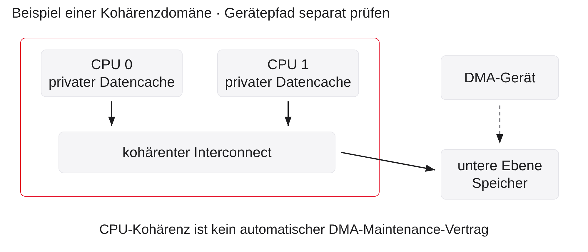{fig-alt="Zwei CPU-Kerne mit privaten Datencaches gehören zur gezeichneten Kohärenzdomäne. Ein DMA-Gerät hat einen gesondert zu prüfenden Zugriffspfad zur unteren Speicherhierarchie."}

Ein gemeinsamer Adressraum beweist noch keinen gemeinsamen Kohärenzvertrag.

::: notes
Eine Kohärenzdomäne umfasst diejenigen Teilnehmer und Speicherbereiche, deren gültige Kopien ein gemeinsames Protokoll koordiniert. Die gezeichnete Umrandung schließt zwei CPU-Kerne mit privaten Datencaches ein. CPU bedeutet Central Processing Unit, Prozessor. Das Verbindungsnetz zwischen den Teilnehmern heißt Interconnect. Die eingezeichnete untere Speicherhierarchie ist eine mögliche Organisation und kein bestimmtes vorhandenes Gerät.

Der gestrichelte Gerätepfad außerhalb der Umrandung verdeutlicht die Grenze dieser Aussage. Ein DMA-Gerät, Direct Memory Access, ist ein eigenständiger Datenübertrager. Es wird hier nur als Beispiel eines weiteren möglichen Speicherteilnehmers eingeordnet. Seine Funktionsweise ist keine Voraussetzung der folgenden Aufgaben. Ein gemeinsam erreichbares RAM garantiert nicht, dass auch ein solcher Gerätepfad dieselben Cachekopien koordiniert. Dafür müsste die Plattform ausdrücklich einen passenden Vertrag bereitstellen.

Im weiteren Lehrmodell werden ausschließlich die beteiligten CPU-Datencaches und gewöhnlicher Speicher betrachtet. Gerätezugriffe über MMIO, Memory-Mapped Input/Output, haben eigene Wirkungen und Zugriffsregeln. Auch für die CPU-Teilnehmer bleiben drei Aufgaben getrennt: Das Kohärenzprotokoll koordiniert Kopien, atomare Operationen schützen bestimmte Änderungen und zusätzliche Ordnungsregeln ermöglichen eine sichere Datenübergabe. Keine der drei Eigenschaften folgt allein aus der gemeinsamen Speicheradresse.
:::

## Eine Adresse kann mehrere Kopien besitzen

::: {.section-label}
2 / 6 · Cachekopien koordinieren
:::

- `x` bezeichnet für beide Kerne dasselbe Speicherobjekt
- Eine Cachekopie ist ein Abbild seines Speicherblocks
- Ein Cachetreffer benutzt die lokale gültige Kopie
- Ein fremder Store muss deshalb auch fremde Gültigkeit berücksichtigen

Gemeinsamer Speicher bedeutet nicht, dass jeder Load bis zum RAM geht.

::: notes
Die Adresse eines gemeinsam genutzten Objekts bleibt für beide Kerne gleich. Der jeweilige Load kann aber bereits im lokalen Datencache beantwortet werden. Er muss nicht bei jedem Zugriff den Arbeitsspeicher erreichen. Gerade dieser schnelle lokale Treffer erklärt, weshalb eine Änderung nur am unteren Speicherstand für fremde Leser nicht ausreicht.

Eine Cachekopie umfasst eine Zeile, also einen ganzen Speicherblock mit Metadaten. Dazu gehört insbesondere die Information, ob ihre Daten noch als Treffer verwendet werden dürfen. Physisch vorhandene alte Bits sind daher von einer logisch gültigen Kopie zu unterscheiden. Das Entziehen der Gültigkeit kann einen späteren Zugriff zur Neubeschaffung zwingen, ohne jedes alte Datenbit löschen zu müssen.

Bei unveränderten Daten sind mehrere saubere Kopien unproblematisch. Mit dem ersten Schreiber entsteht eine Rechtefrage: Welche Kopie darf geändert werden, und was erfahren die anderen Controller? Diese Frage löst das Kohärenzprotokoll. Die spätere Programmlogik kann sich auf die zugesagten Einzelzugriffe stützen, muss aber weiterhin zusammengesetzte Updates und mehrteilige Datenübergaben selbst absichern.
:::

## Write-Back: unten darf noch ein alter Wert stehen

::: {.section-label}
2 / 6 · Cachekopien koordinieren
:::

- Variable $x$: Anfangswert $0$
- Kern 0 hält eine gültige geänderte Kopie mit $x=5$
- Der untere Speicherstand darf im Write-Back-Modell noch $0$ sein
- Ein kohärenter Leser muss dennoch den aktuellen Wert erhalten

::: notes
Bei Write-Back bleiben Änderungen zunächst in einer Cachezeile. Erst bei bestimmten späteren Ereignissen werden sie an die untere Speicherebene zurückgeschrieben. Dirty bezeichnet eine gegenüber dieser Ebene geänderte Kopie. Wenn Kern null den anfänglichen Wert von $x$ von null auf fünf ändert, kann daher seine Kopie bereits fünf enthalten, während der untere Stand noch null ist.

Dies ist kein Widerspruch, solange das Protokoll den gültigen Besitzer der aktuellen Daten kennt. Ein späterer kohärenter Leser muss einen Wert erhalten, der zu den bereits abgeschlossenen Änderungen passt. Er darf nicht allein deshalb die alte Null bekommen, weil diese unten noch liegt. Der Cachecontroller benötigt einen Antwortweg, in den der geänderte Besitzer einbezogen wird.

Für die folgenden Zustandsfolgen bezeichnet $L$ die vereinfachte untere kohärente Speicherebene. Sie kann eine weitere Cacheebene repräsentieren. Eine Aktualisierung von $L$ behauptet daher nicht, dass jeder reale DRAM-Chip sofort aktualisiert wurde. DRAM ist dynamischer Arbeitsspeicher. Diese begrenzte Bedeutung von $L$ erlaubt klare Tabellen, ohne eine vollständige mehrstufige Hardware zu modellieren. Entscheidend ist zunächst, dass gültige Beobachtungen der beteiligten Kerne zusammenpassen.
:::

## Write-Through allein beseitigt keine fremde Kopie {.compact-figure}

::: {.section-label}
2 / 6 · Cachekopien koordinieren
:::

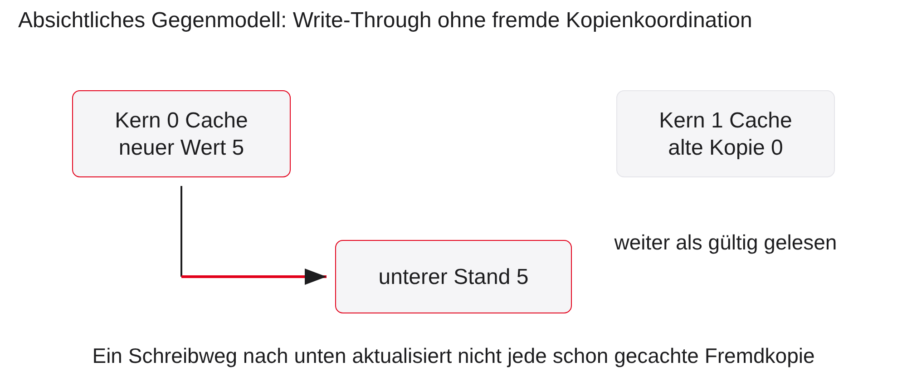{fig-alt="Ohne Kopienkoordination schreiben Kern0 und unterer Speicher den Wert5, während Kern1 seine alte gültige Cachekopie0 behält. Write-Through allein aktualisiert diese Kopie nicht."}

Eine Änderung unten macht eine bereits gecachte Fremdkopie nicht automatisch ungültig.

::: notes
Write-Through reicht einen Schreibzugriff auch an die untere Speicherebene weiter. Dadurch wird dort der neue Wert abgelegt. Eine bereits gültige Kopie in einem anderen Cache verschwindet jedoch nicht allein durch diese Weitergabe. Das Bild stellt bewusst ein unkoordiniertes Gegenmodell dar, keinen zulässigen Abschluss eines Kohärenzprotokolls.

Anfangs besitzen beide Kerne null. Kern null schreibt fünf; die rote Markierung verfolgt den neuen Wert über seine eigene Kopie zum unteren Speicher. Die andere Cachekopie enthält weiterhin null und gilt im Gegenmodell noch als nutzbar. Ein Treffer auf diese Kopie würde den alten Wert liefern, obwohl unten längst fünf steht. Der Schreibweg nach unten enthält also nicht automatisch eine Nachricht, die jede fremde Kopie invalidiert oder aktualisiert.

Kohärenz muss genau diese fehlende Koordination bereitstellen. In einem invalidierenden Protokoll entzieht ein Schreibrechtswechsel anderen Kopien ihre Gültigkeit. Danach können sie nicht mehr als Treffer verwendet werden und müssen bei Bedarf aktuelle Daten beschaffen. Die Wahl zwischen Write-Back und Write-Through beantwortet somit die Frage nach dem unteren Schreibweg; sie ersetzt nicht die Verwaltung fremder Kopien. Ebenso wenig entsteht daraus schon eine unteilbare Programmaktion.
:::

## Drei Mechanismen beantworten drei Fragen {.compact-figure}

::: {.section-label}
2 / 6 · Cachekopien koordinieren
:::

{fig-alt="Kohärenz koordiniert Kopien derselben Speicherstelle, atomare RMW schützt ein Update, Acquire/Release ordnet die Übergabe weiterer Daten. Keine der drei Fragen ersetzt die anderen."}

Ein kohärenter Zähler ist noch kein atomarer Zähler.

::: notes
Kohärenz, Atomizität und Speicherordnung behandeln unterschiedliche Ebenen gemeinsamer Daten. Die drei Felder der Abbildung sind daher als drei nebeneinander bestehende Anforderungen zu lesen. Links geht es um Kopien derselben Speicherstelle, in der Mitte um ein vollständiges Update und rechts um Beziehungen zwischen verschiedenen Datenobjekten.

Kohärenz ermöglicht eine verträgliche Reihenfolge der Änderungen einer Speicherstelle und passende gültige Kopien. Ein Zählerupdate kann trotzdem aus Laden, Addieren und Speichern bestehen. Lesen zwei Abläufe zuerst denselben alten Wert, können sie anschließend denselben neuen Wert schreiben. Die beiden Einzelstores dürfen kohärent geordnet sein und dennoch einen beabsichtigten Zählbeitrag verlieren. Eine atomare Read-Modify-Write-Operation, kurz RMW, fasst dagegen Lesen, Ändern und Schreiben zu einer unteilbar wirkenden Aktion zusammen.

Auch ein atomarer Bereitschaftsstore garantiert für sich keine Veröffentlichung weiterer Daten. Ein Empfänger soll nach einer Meldung nicht nur die Meldung selbst, sondern die zugehörige Nutzlast verlässlich lesen dürfen. Dies verlangt passende Speicherordnung und Synchronisation. Acquire und Release werden dafür später als Übernahme- und Freigabeordnung eingeführt. Zunächst wird die Kopienverwaltung vollständig aufgebaut, damit ein gültiger Datenwert nicht mit einem geschützten zusammengesetzten Ablauf verwechselt wird.
:::

## Snooping und Directory: Anfragen koordinieren {.compact-figure}

::: {.section-label}
2 / 6 · Cachekopien koordinieren
:::

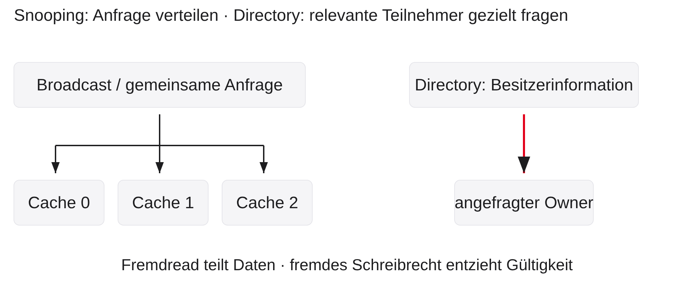{fig-alt="Bei Snooping prüfen beteiligte Cachecontroller eine verteilte Anfrage. Ein Directory kann anhand gespeicherter Teilnehmerinformation gezielt den Besitzer oder weitere Kopien anfragen."}

Ein Fremdread und ein fremder Schreibrechtswunsch lösen unterschiedliche Reaktionen aus.

::: notes
Ein Cachecontroller muss erfahren, wenn eine fremde Anfrage seine Zeile betrifft. Snooping bedeutet Mithören solcher relevanten Transaktionen. Die linke Bildhälfte verteilt eine Anfrage an die beteiligten Controller; Broadcast nennt man diese Verteilung an alle relevanten Empfänger. Ein Directory, also ein Verzeichnis, hält dagegen Informationen über Besitzer oder weitere Kopien. Die rechte Hälfte zeigt, wie solche Informationen eine gezieltere Anfrage ermöglichen.

Beide Organisationsformen haben dieselben grundsätzlichen Pflichten. Ein fremder Leser muss aktuelle Daten erhalten. Liegen saubere Kopien vor, können mehrere Leser anschließend gemeinsam gültige Kopien behalten. Ein fremder Schreibrechtswunsch verlangt dagegen den Entzug konkurrierender Gültigkeit. Bei einer geänderten Kopie muss außerdem der aktuelle Datenwert erhalten und bei Bedarf geliefert werden.

Die Pfeile bezeichnen Nachrichten und Datenantworten, keine garantierten Zeitdauern. Ein Ring oder ein Mesh, ein gitterartiges Netz, beschreibt eine mögliche physische Verbindung. Snooping und Directory beschreiben dagegen die Organisation der Koordination. Das folgende vereinfachte Modell betrachtet nur abgeschlossene Schritte mit stabilen Rechten. Während Nachrichten und Bestätigungen unterwegs sind, benötigen reale Controller zusätzliche Zwischenzustände. Diese werden nicht als bereits abgeschlossene MESI-Zustände ausgegeben.
:::

## Gemeinsam lesen, zum Schreiben übernehmen {.compact-figure}

::: {.section-label}
2 / 6 · Cachekopien koordinieren
:::

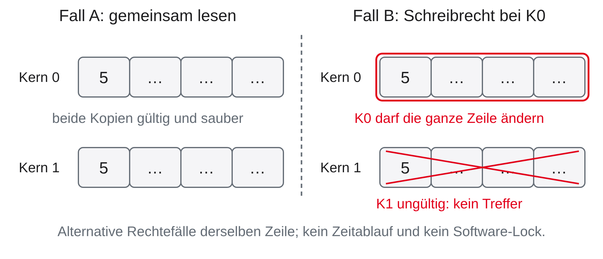{fig-alt="Zwei alternative Rechtezustände derselben Zeile: gemeinsames Lesen mit zwei gültigen Kopien oder exklusives Schreibrecht bei Kern 0 und ungültiger Kopie bei Kern 1. Das Recht umfasst jeweils die gesamte Zeile."}

Das Zeilenrecht schützt keine Folge mehrerer Programmbefehle.

::: notes
Mehrere Leser können dieselben unveränderten Daten als gültige saubere Kopien halten. Ein Schreiber darf dagegen nicht einfach seine eigene Kopie ändern und die andere als gültigen alten Stand zurücklassen. Er benötigt ein exklusives Schreibrecht für die betreffende Zeile. Diese Grundidee erklärt die späteren Zustandsnamen, bevor die einzelnen Übergänge verfolgt werden.

Die Grafik stellt die beiden Rechtefälle schematisch gegenüber. Links sind beide Kopien gültige Leser; rechts ist die Übernahme durch Kern null bereits abgeschlossen. Die Speicherfelder zeigen Kopien desselben Blocks; die Markierungen betreffen jeweils die gesamte Zeile. Bei gemeinsamer Leseberechtigung sind beide Kopien nutzbar. Bei exklusiver Übernahme besitzt Kern null das Schreibrecht, während die durchgestrichene Kopie von Kern eins keinen Treffer mehr liefern darf. Die Darstellung ordnet Rechte zu und behauptet weder konkrete Nachrichtenlaufzeiten noch eine Zahl benötigter Takte.

Der Controller kann das Schreibrecht später an einen anderen Kern übergeben. Damit ist kein zusammenhängender Softwareabschnitt geschützt. Zwischen zwei Befehlen desselben Threads kann eine andere Speicheraktion stattfinden. Für den Cache ist dies bei passender Koordination korrekt; für einen aus mehreren Befehlen bestehenden Zählerupdate kann es bereits zu spät sein. Die Begriffe Gültigkeit, Sauberkeit und Exklusivität müssen daher von gegenseitigem Ausschluss einer Programmaktion getrennt bleiben.
:::

## MESI: Gültigkeit und Schreibrecht je Zeile {.compact-figure}

::: {.section-label}
2 / 6 · Cachekopien koordinieren
:::

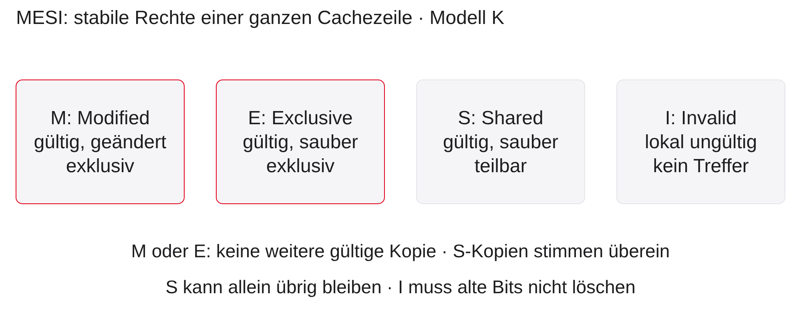{fig-alt="MESI-Rechte: M gültig, geändert und exklusiv; E gültig, sauber und exklusiv; S gültig, sauber und teilbar; I lokal ungültig."}

Lehrmodell K: zwei Datencaches, Write-Back, Write-Allocate, unterer Stand $L$.

::: notes
MESI benennt vier stabile Zustände einer Cachezeile. Modified, M, ist gültig, geändert und exklusiv. Exclusive, E, ist gültig, sauber und exklusiv. Shared, S, ist gültig, sauber und teilbar. Invalid, I, ist lokal ungültig und darf keinen Treffer liefern. Die Grafik ordnet die Zustände nach Gültigkeit, Sauberkeit und Schreibrecht; die rote Markierung betont das exklusive Recht.

Lehrmodell K verwendet zwei Datencaches, Write-Back und Write-Allocate. Ein Schreibmiss beschafft damit die Zeile samt nötigen Rechten. $L$ bezeichnet den vereinfachten unteren kohärenten Stand. Sauber bedeutet Übereinstimmung mit $L$. Bei M darf $L$ noch alt sein; ein Fremdread auf M aktualisiert $L$ in diesem Modell mit den aktuellen Daten. Dies ist eine bewusste Modellfestlegung, kein universeller Datenweg realer Mehrstufenhierarchien.

Die Zustände gelten für die gesamte Cachezeile. Nach einem abgeschlossenen Schritt darf neben M oder E keine weitere gültige Kopie existieren. Mehrere S-Kopien müssen sauber sein und übereinstimmen. S behauptet nicht, dass tatsächlich mehrere Kopien vorhanden sind; eine einzelne Kopie kann S bleiben. I löscht keine Datenbits, sondern entzieht ihre Nutzbarkeit. Diese Invarianten liefern eine Kontrolle aller nachfolgenden Zustandsfolgen.
:::

## E erlaubt den stillen Wechsel nach M {.compact-figure}

::: {.section-label}
2 / 6 · Cachekopien koordinieren
:::

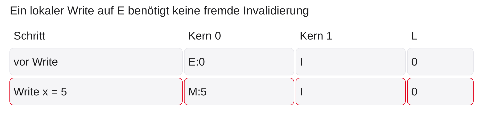{fig-alt="Kern0 hat allein E mit Wert0. Ein lokaler Write5 verändert die Kopie still nach M5; Kern1 bleibt I und der untere Stand bleibt0."}

Keine fremde gültige Kopie muss bei diesem Schritt invalidiert werden.

::: notes
Der Zustand E sichert bereits zu, dass kein anderer beteiligter Datencache eine gültige Kopie dieser Zeile hält. Deshalb kann ein lokaler Schreiber von Exclusive nach Modified wechseln, ohne zuerst fremden Lesern die Gültigkeit zu entziehen. Still bezieht sich auf diese entfallende Rechteanfrage, nicht auf die Behauptung, der Kern führe keinerlei interne Arbeit aus.

Im Beispiel beginnt Kern null mit E:0, Kern eins mit I und $L$ mit null. Ein lokaler Write setzt $x$ auf fünf. Der abgeschlossene Zustand lautet M:5 bei Kern null, I bei Kern eins und weiterhin $L=0$. Die rote Markierung hebt den geänderten neuen Datenwert hervor. Da Write-Back verwendet wird, darf der untere Stand zunächst unverändert bleiben.

Ein lokaler Read kann sowohl E als auch M nutzen. Wiederholte lokale Writes auf der eigenen M-Zeile brauchen nicht bei jedem Zugriff neue fremde Invalidierungen. Häufige Wechsel des Schreibers haben deshalb andere Kosten als viele Zugriffe desselben Besitzers. Das exklusive Zeilenrecht ist allerdings kein Software-Lock. Ein mehrteiliger Programmablauf wird durch E oder M nicht als Ganzes unteilbar. Sobald ein weiterer Leser hinzukommt, muss das Protokoll außerdem die bisherige Exklusivität neu koordinieren.
:::

## Ein Read-Miss hat unterschiedliche Lieferanten {.compact-figure}

::: {.section-label}
2 / 6 · Cachekopien koordinieren
:::

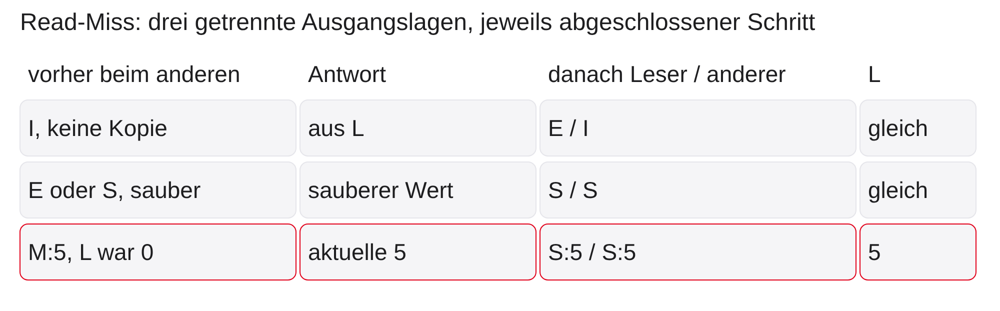{fig-alt="Bei keiner Fremdkopie liefert L und der Leser wird E. Bei sauberer Fremdkopie werden beide S. Bei M liefert der aktuelle Besitzer; im Modell werden beide S und L aktualisiert."}

Eine alte untere Antwort darf den aktuellen M-Wert nicht ersetzen.

::: notes
Ein Read-Miss ist ein Lesen ohne gültige lokale Cachekopie. Die drei Reihen der Grafik sind alternative Ausgangslagen, keine Folge von drei Zugriffen. Der angefragte Leser beginnt jeweils ungültig. Die Frage ist, woher der aktuelle Wert stammt und welche Rechte nach dem Abschluss bestehen.

Existiert überhaupt keine andere gültige Kopie, liefert der untere Stand $L$ die Daten und der neue Leser erhält E. Bei einer sauberen fremden Kopie können anschließend beide Beteiligten S halten. Ein geänderter M-Besitzer ist dagegen die maßgebliche Quelle des aktuellen Werts. Sein Wert muss in die Antwort eingehen. Im Lehrmodell K werden nach diesem Fremdread beide Kopien S und $L$ wird aktualisiert.

Bei M:5 und $L=0$ muss der neue Leser daher fünf bekommen. Die alte Null unten ist kein ausreichender Grund für eine Null als abgeschlossene Antwort. Die rote Reihe markiert den Fall des geänderten Besitzers. Bei sauberen Kopien wird kein bestimmter physischer Datenlieferant vorgeschrieben; auch konkrete Taktzahlen bleiben offen. Das Modell legt die richtige Beobachtung und die stabilen Rechte fest. Ein Schreibzugriff braucht mehr als dieses gemeinsam nutzbare Leserecht.
:::

## Schreiben auf S braucht abgeschlossene Übernahme {.compact-figure}

::: {.section-label}
2 / 6 · Cachekopien koordinieren
:::

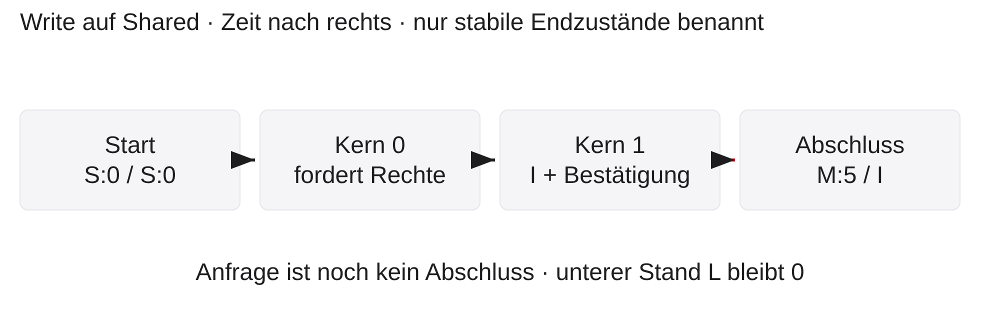{fig-alt="Start S0 und S0. Kern0 fordert Schreibrecht, Kern1 invalidiert und bestätigt. Erst der abgeschlossene stabile Schritt ergibt M5 und I, L bleibt0."}

Anfrage senden, fremde Gültigkeit entziehen und Abschluss sind verschiedene Ereignisse.

::: notes
Zwei S-Kopien erlauben gemeinsames Lesen. Ein Kern darf auf dieser Grundlage noch nicht beliebig lokal schreiben, weil der andere sonst eine gültige alte Kopie behalten würde. Der Schreiber muss zunächst ein exklusives Schreibrecht erhalten. Ownership bezeichnet hier dieses Zeilenrecht, keine vom Programm erworbene Sperre.

Die Pfeile geben eine logische Ereignisfolge von links nach rechts an. Kern null fordert Schreibrecht an. Kern eins entzieht seiner Kopie die Gültigkeit und bestätigt den Vorgang. Erst nach den erforderlichen Bestätigungen wird der abgeschlossene Schritt als M:5 bei Kern null und I bei Kern eins beschrieben. Die Breiten der Abstände sind keine gemessenen Zeiten. Reale Controller können zusätzliche Zwischenzustände und Puffer nutzen, die im stabilen Lehrmodell nicht aufgelöst werden.

Invalidieren bedeutet, die Kopie als nicht mehr nutzbar zu kennzeichnen. Ihre alten Datenbits können physisch erhalten bleiben, dürfen aber keinen Treffer liefern. Der untere Stand $L$ bleibt bei diesem Write-Back-Schritt null. Eine spätere fremde Leseantwort muss dennoch den neuen Wert fünf enthalten. Eine gesendete Anfrage ist damit von einem abgeschlossenen Rechtewechsel zu unterscheiden. Das erlaubt nun eine vollständige Folge mit getrennt notierten Zuständen und Datenwerten.
:::

## MESI-Folge mit Zuständen und Datenwerten {.compact-figure}

::: {.section-label}
2 / 6 · Cachekopien koordinieren
:::

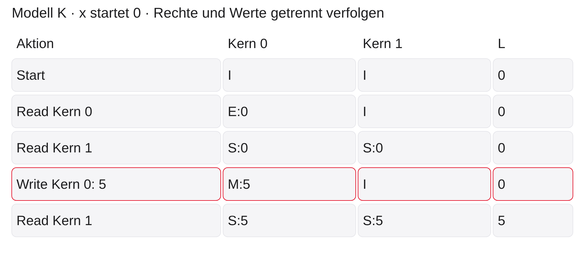{fig-alt="Start I,I,L0. Read0 ergibt E0,I,L0. Read1 ergibt S0,S0,L0. Write0 mit5 ergibt M5,I,L0. Read1 ergibt S5,S5,L5."}

Jede Zeile zeigt einen abgeschlossenen Schritt im Lehrmodell K.

::: notes
E:0 verbindet zwei verschiedene Angaben: den Rechtzustand E und den Datenwert null. $L$ enthält den unteren kohärenten Stand. Anfangs sind beide Datencaches I und $L$ enthält null. Jede Tabellenzeile der Abbildung beschreibt genau einen abgeschlossenen Schritt im Lehrmodell K.

Kern null liest zuerst. Da keine weitere gültige Kopie vorhanden ist, erhält er E:0. Der anschließende Read von Kern eins führt zu S:0 in beiden Caches; $L$ bleibt null. Kern null möchte danach fünf schreiben. Nach abgeschlossener Übernahme und fremder Invalidierung besitzt er M:5, Kern eins ist I und $L$ bleibt null. Der nächste Read von Kern eins kann daher keinen Treffer auf seinen alten Bits liefern. Er beschafft fünf über den aktuellen Besitzerpfad. Beide Caches enden bei S:5 und $L$ wird im Modell fünf.

Die hervorgehobene Write-Zeile macht den zulässigen Unterschied zwischen M-Daten und unterem Stand sichtbar. Die folgende Zeile zeigt dessen Konsequenz für einen neuen Leser. Über die gesamte Folge tritt nie M neben einer weiteren gültigen Kopie auf; ebenso gibt es keine unterschiedlich bewerteten S-Kopien. Die Aktualisierung von $L$ ist die vereinbarte Vereinfachung und kein Nachweis eines bestimmten DRAM-Zeitpunkts. Auch das spätere Auswerfen einer Zeile muss den aktuellen Wert erhalten.
:::

## Auswerfen: geänderte Daten erhalten {.compact-figure}

::: {.section-label}
2 / 6 · Cachekopien koordinieren
:::

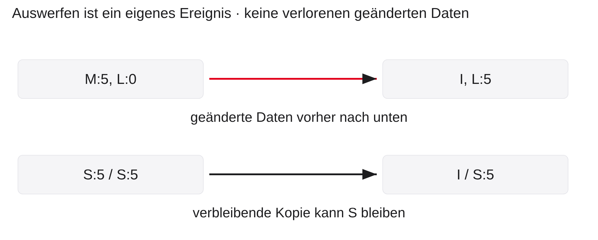{fig-alt="Beim Auswerfen von M5 wird der untere Stand von0auf5 aktualisiert und die lokale Zeile I. Beim Auswerfen einer S-Kopie darf eine andere S-Kopie S bleiben."}

Eine verbleibende S-Kopie wird nicht allein durch fremdes Auswerfen automatisch E.

::: notes
Ein Cache kann eine Zeile auswerfen, wenn ihr Platz für einen anderen Block benötigt wird. Eviction ist die englische Bezeichnung dafür. Ob dabei Daten übertragen werden müssen, hängt davon ab, ob die bisherige Kopie geändert war. Die beiden Bildhälften behandeln deshalb unterschiedliche Ausgangslagen.

Oben besitzt Kern null M:5, während der untere Stand $L$ noch null enthält. Vor dem Verlust dieser einzigen aktuellen Kopie müssen die geänderten Daten erhalten werden. Im Lehrmodell schreibt der Cache fünf nach $L$ zurück und wird anschließend I. Ein späterer alleiniger Leser kann aus $L$ wieder E:5 erhalten. Ein Auswurf ohne Erhaltung der fünf wäre ein Datenverlust.

Unten halten beide Kerne saubere S:5-Kopien. Das Auswerfen einer davon braucht keinen neuen Datenwert nach unten zu liefern. Die andere Kopie kann trotzdem S bleiben. Ihr Controller muss nicht automatisch erfahren, dass alle übrigen Leser verschwunden sind. S bedeutet daher teilbar und sauber, nicht zwingend mehrfach vorhanden. Rot kennzeichnet die notwendige Datenübertragung des M-Falls, während der S-Fall nur lokale Gültigkeit verliert. Diese Rechte gelten weiterhin pro Zeile und können dadurch auch logisch getrennte Variablen verbinden.
:::

## False Sharing: verschiedene Variablen, eine Zeile {.compact-figure}

::: {.section-label}
2 / 6 · Cachekopien koordinieren
:::

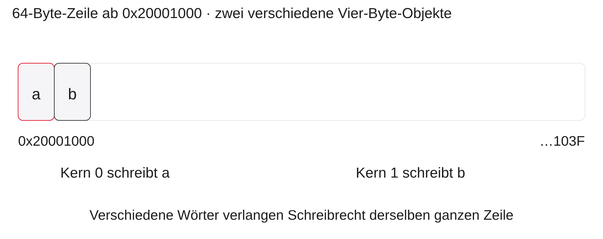{fig-alt="Eine64Byte-Zeile ab0x20001000 enthält Variablea beiOffset0 und b beiOffset4. Verschiedene Kerne schreiben verschiedene Wörter, benötigen aber Schreibrecht derselben Zeile."}

Wechselnde Schreiber können die ganze Zeile zwischen den Kernen verschieben.

::: notes
False Sharing liegt vor, wenn unabhängig verwendete Objekte dieselbe Kohärenzeinheit teilen. True Sharing ist dagegen die gemeinsame Nutzung desselben Objekts. In der Grafik enthält die 64-Byte-Zeile ab `0x20001000` zwei getrennte Vier-Byte-Objekte: $a$ bei Offset null und $b$ bei Offset vier. Der gemeinsame Zeilenbereich endet einschließlich bei `0x2000103F`.

Kern null schreibt ausschließlich $a$, Kern eins ausschließlich $b$. Aus Programmsicht sind ihre Schreibzuständigkeiten getrennt. Das Kohärenzprotokoll vergibt jedoch das Schreibrecht für den ganzen Block. Wechselnde Schreiber können daher die gesamte Zeile wiederholt übernehmen und beim anderen Kern invalidieren. Das breite Zeilenfeld der Abbildung erklärt, warum getrennte Wörter nicht automatisch getrennte Rechte besitzen.

Ein Kern, der die M-Zeile schon hält, löst nicht bei jedem weiteren lokalen Write einen Besitzerwechsel aus. Die konkrete Zugriffsfolge entscheidet über die Wechselzahl. False Sharing ist somit ein möglicher Leistungsengpass und für sich kein Nachweis eines C-Data-Race. Ein funktionales Bild belegt außerdem keine bestimmte reale Verlangsamung. Die 64 Byte sind eine Lehrannahme; ein konkreter Entwurf benötigt die tatsächliche Cachezeilengröße und das tatsächliche Objektlayout.
:::

## Basis und Abstand gemeinsam prüfen {.compact-figure}

::: {.section-label}
2 / 6 · Cachekopien koordinieren
:::

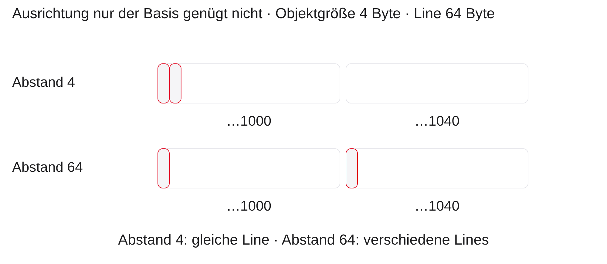{fig-alt="Bei64Byte-ausgerichteter Basis liegen Elemente mit4Byte-Abstand in derselben Zeile. Abstand64Byte legt die gezeigten kleinen Objekte in verschiedene Zeilen."}

Padding kostet Platz und repariert kein konkurrierendes Update derselben Variable.

::: notes
Ausrichtung und Objektabstand beantworten unterschiedliche Fragen. Eine auf 64 Byte ausgerichtete Basis beginnt an einer Zeilengrenze. Benachbarte kleine Objekte können danach trotzdem in derselben Zeile liegen. Stride bezeichnet den Adressabstand der betrachteten Elemente; Padding ist eingefügter Abstand oder ungenutzter Speicher zwischen Objekten.

Die Grafik behält die Basis `0x20001000` bei. Mit Stride vier liegen die ersten beiden Vier-Byte-Objekte noch in derselben 64-Byte-Zeile. Mit Stride 64 beginnt das zweite Objekt bei `0x20001040`, also in der nächsten Zeile. Die roten Felder markieren die tatsächlichen Objekte und nicht die gesamte reservierte Fläche. Zur Prüfung gehören daher Basis, Abstand, Objektgröße und reale Zeilengröße gemeinsam.

Das vergrößerte Layout trennt hier die Schreibrechte unabhängiger Objekte. Es kostet aber Speicher und kann die räumliche Lokalität verschlechtern. Eine automatisch optimale Layoutregel folgt daraus nicht. Noch weniger repariert Padding ein gemeinsames ungeschütztes Update derselben Variable. Dafür ist eine atomare RMW oder eine geeignete Sperre nötig. Mit diesen Grenzen lassen sich nun sowohl Zustandsfolgen als auch Adressbereiche selbstständig prüfen.
:::

## Papierphase 1: Zustände und Zeilengrenzen

::: {.section-label}
2 / 6 · Cachekopien koordinieren
:::

Übungsblatt, Aufgaben 1–2 · 10 Minuten

- Zustandsfolge mit Werten und unterem Stand ausfüllen
- Exklusivität und saubere Kopien als Invarianten prüfen
- False Sharing aus Adresse, Größe und Abstand begründen

::: notes
Der Übungsfall erweitert das Modell auf drei Kerne. Anfangs sind alle Kopien I und $L=4$. Der Read von Kern zwei liefert E:4. Sein Write erzeugt M:9, während $L$ vier bleiben darf. Der folgende Read von Kern null muss neun erhalten; danach halten Kern null und zwei S:9, und $L$ ist im Modell neun. Nach dem Read von Kern eins besitzen alle drei S:9.

Für seinen anschließenden Write muss Kern null die fremden gültigen Kopien von Kern eins und zwei invalidieren. Der Abschluss lautet M:13 bei Kern null und I bei den anderen; $L$ bleibt neun. Der Auswurf von Kern null schreibt dreizehn zurück und macht auch dessen Kopie I. Danach erhält der allein lesende Kern eins E:13. Falls von zwei sauberen S-Kopien eine ausgeworfen wird, darf die verbleibende S bleiben; ein automatischer E-Wechsel ist keine Invariante.

Im unabhängigen Layoutfall umfasst die 128-Byte-Zeile `0x30004000` bis `0x3000407F`. Die Acht-Byte-Objekte beginnen bei `0x30004008` und `0x30004018` und teilen sie. Bei anfänglichem Besitz durch Kern eins und Schreibfolge eins, null, null, eins, null, eins entstehen vier Besitzerwechsel. Offset 128 platziert $b$ bei `0x30004080` in der nächsten Zeile. Die Basisausrichtung allein genügte dafür nicht. Diese Trennung verhindert das gegebene False Sharing, schützt aber weiterhin kein konkurrierendes Update desselben Zählers.
:::

## 3 · Gemeinsame Aktionen schützen {.section-divider}

Wann sind mehrere korrekte Speicherzugriffe zusammen noch falsch?

::: {.section-route}
Arbeit teilen → Cachekopien → Atomizität → Ordnung → Skalierung → Anwendung
:::

Von verlorenen Beiträgen zur unteilbaren Entscheidung.

::: notes
Kohärente Einzelzugriffe geben dem Programm passende Datenwerte und Rechte, fassen aber keine Befehlsgruppe zu einer Aktion zusammen. Ein gemeinsamer Zähler und die Übernahme einer Sperre führen zum selben Grundproblem: Lesen und anschließendes Schreiben dürfen nicht unbemerkt von einer konkurrierenden Entscheidung getrennt werden.

Eine atomare Read-Modify-Write-Operation wirkt für konkurrierende Zugreifer als ein unteilbares Update. RISC-V bietet dafür besondere Primitive. Der C-Sprachstandard beschreibt dieselbe benötigte Eigenschaft auf einer anderen Ebene. Die Unterscheidung zwischen Sprachsemantik und Hardwaremodell bleibt wichtig, weil ein gewöhnlicher C-Data-Race keine garantierte Liste anschaulicher Endwerte erlaubt.
:::

## Eine Aktion, ein geschützter Abschnitt

::: {.section-label}
3 / 6 · Gemeinsame Aktionen schützen
:::

- RMW: Lesen, Ändern und Schreiben als eine unteilbare Aktion
- Kritischer Abschnitt: mehrere zusammengehörige Zugriffe auf gemeinsame Daten
- Mutex: gegenseitiger Ausschluss; höchstens ein Besitzer im Abschnitt
- Alle konkurrierenden Zugreifer müssen dieselbe Schutzregel einhalten

Unteilbar beschreibt die Wirkung, keine Ein-Takt-Ausführung.

::: notes
Read-Modify-Write, RMW, verbindet das Lesen eines alten Werts mit seiner Änderung und Speicherung. Atomar bedeutet, dass diese Wirkung für konkurrierende Zugreifer nicht in ungeschützte Teilschritte zerfällt. Eine atomare Addition kann deshalb zwei Beiträge erhalten, obwohl jede reale Implementierung intern mehrere Arbeitsschritte benötigen darf.

Für mehrere gemeinsame Objekte genügt eine einzelne Addition nicht. Ein kritischer Abschnitt umfasst die Programmschritte, deren Zwischenzustände andere Abläufe nicht zugleich verändern dürfen. Ein Mutex, Mutual Exclusion, ist ein Objekt beziehungsweise Mechanismus für gegenseitigen Ausschluss. Vor Eintritt wird er übernommen, nach dem Abschnitt freigegeben. Höchstens ein Besitzer darf den geschützten Abschnitt betreten. Eine Sperre schützt dabei nur die Zugreifer, die ihre Disziplin tatsächlich einhalten.

Der Lockwert selbst ist noch nicht die gesamte Schutzwirkung. Seine Übernahme muss erstens eindeutig entscheiden, wer gewonnen hat. Zweitens müssen Datenzugriffe passend zwischen zwei Besitzern geordnet werden. Drittens muss der aktuelle Besitzer überhaupt weiterlaufen und freigeben können. Zunächst wird die unteilbare Entscheidung untersucht; Datenordnung und Fortschritt folgen anschließend als zusätzliche Anforderungen.
:::

## Ein Inkrement kann drei Schritte enthalten

::: {.section-label}
3 / 6 · Gemeinsame Aktionen schützen
:::

```asm
# RV32I-Lehrfolge; s1: ausgerichtetes Wort, Anfangswert 0
lw   t0, 0(s1)
addi t0, t0, 1
sw   t0, 0(s1)
```

Read → Modify → Write ist hier keine unteilbare Gruppe.

::: notes
Ein Inkrement wirkt im Quelltext wie eine einzige Aktion, kann auf Maschinenebene aber aus mehreren Befehlen bestehen. Die gezeigte Lehrfolge verwendet RV32I, die 32-Bit-Integerbasis von RISC-V. Sie ist kein behauptetes Ergebnis einer bestimmten Compilerübersetzung. `s1` enthält die gültige, auf vier Byte ausgerichtete Adresse eines Speicherworts; `t0` ist ein temporäres Register des ausführenden Harts. Der Speicherwert beginnt bei null, und im betrachteten Wertebereich tritt kein Überlauf auf.

`lw`, Load Word, liest das vier Byte große Wort nach `t0`. `addi`, Add Immediate, erhöht ausschließlich diesen lokalen Registerwert. Erst `sw`, Store Word, schreibt ihn an dieselbe Speicheradresse zurück. Das zusammengehörige Lesen, Ändern und Schreiben heißt Read-Modify-Write, kurz RMW. Drei einzeln korrekt ausgeführte Schritte bilden noch keine unteilbare Gesamtaktion. Zwischen Load und Store kann ein anderer Hart ebenfalls lesen oder schreiben.

Kohärenz koordiniert Kopien und einzelne Speicheränderungen. Sie erkennt nicht, dass die lokale Addition Teil eines gemeinsamen Zählerupdates sein soll. Ob ein C-Operator `++` eine atomare Wirkung besitzt, hängt daher auch vom Objekttyp und der Sprachsemantik ab. Für ein gewöhnliches Objekt darf diese Wirkung nicht einfach vorausgesetzt werden.
:::

## Lost Update trotz kohärenter Einzelzugriffe {.compact-figure}

::: {.section-label}
3 / 6 · Gemeinsame Aktionen schützen
:::

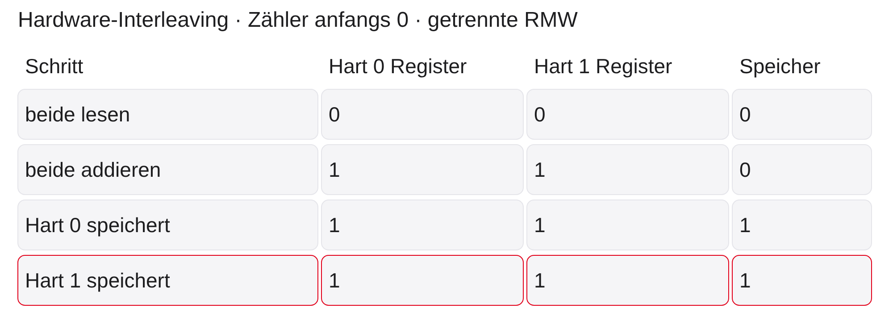{fig-alt="Beide Harts lesen0, rechnen lokal1und speichern nacheinander1. Der gemeinsame Endwert ist1 statt2. Kohärenz ordnet die Stores, ergänzt aber keinen fehlenden Beitrag."}

Das Diagramm beschreibt ein Hardware-Interleaving, keine Ergebnisgarantie fehlerhaften C-Codes.

::: notes
Eine verlorene Änderung, englisch Lost Update, entsteht, wenn mehrere Updates auf demselben alten Wert aufbauen. Die beiden Bahnen gehören zu zwei Harts. Ihre Ereignisreihenfolge verläuft von links nach rechts; die Abstände stellen keine gemessenen Laufzeiten dar. Der Zähler beginnt bei null. Einzelne Loads und Stores liefern in diesem Hardwaremodell jeweils korrekt koordinierte Werte.

Zuerst liest Hart 0 die Null in sein Register, dann liest Hart 1 ebenfalls null. Beide addieren lokal eins und besitzen anschließend den Registerwert eins. Hart 0 speichert eins, danach speichert Hart 1 ebenfalls eins. Der letzte Store ist rot hervorgehoben. Im Speicher steht nun eins, obwohl zwei Inkremente beabsichtigt waren. Die Reihenfolge der beiden Stores ist kohärent; keine veraltete gültige Cachekopie ist nötig, um den Fehler zu erklären. Die zweite lokale Rechnung hatte den ersten Beitrag schlicht noch nicht berücksichtigt.

Zwei atomare Inkremente würden dagegen als zwei unteilbare Änderungen wirken und bei zwei enden. Das Diagramm motiviert diese Anforderung, ist aber keine Ergebnisgarantie für ungeschützten C-Code. Ein gewöhnliches C-Objekt mit konfliktierenden, nicht synchronisierten Threadzugriffen unterliegt strengeren Sprachregeln. Für solche Programme darf aus dem anschaulichen Ablauf keine zugesicherte Endwertliste abgeleitet werden.
:::

## Race Condition und C-Data-Race unterscheiden

::: {.section-label}
3 / 6 · Gemeinsame Aktionen schützen
:::

| Begriff | Aussage |
|---------|---------|
| Race Condition | Ablaufreihenfolge gefährdet die gewünschte Programmlogik |
| C11-Data-Race | konkurrierende Konfliktzugriffe ohne ausreichende Synchronisation |
| Atomare Load/Store einzeln | können trotzdem ein getrenntes Update verlieren |

C11-Data-Race bedeutet undefiniertes Verhalten, keine zugesicherte Auswahl aus zwei Endwerten.

::: notes
Race Condition bezeichnet eine fehlerhafte Abhängigkeit der gewünschten Programmlogik von der Reihenfolge konkurrierender Abläufe. Der Begriff ist weiter als Data Race. Auch ein Programm mit ausschließlich atomaren Einzelzugriffen kann eine Race Condition enthalten, wenn eine zusammengehörige Entscheidung in mehrere Aktionen zerfällt.

Im C11-Sprachmodell liegt ein Data Race vor, wenn verschiedene Threads auf dieselbe Speicherstelle konfliktierend zugreifen, mindestens einer dieser Zugriffe nichtatomar ist und die erforderliche Happens-before-Beziehung fehlt. Konfliktierend bedeutet, dass mindestens ein Zugriff schreibt. Happens before ist die im Sprachmodell abgesicherte Ordnung zwischen Aktionen. Ein Data Race führt zu undefiniertem Verhalten. Der Standard verspricht dann weder Endwert eins noch eine Auswahl aus eins und zwei.

Wer den Zähler dagegen atomar lädt, lokal erhöht und danach getrennt atomar speichert, vermeidet für dieses atomare Objekt den Data Race. Die gesamte RMW bleibt trotzdem zerlegt: Zwei Fäden können denselben alten Wert verwenden und einen Beitrag verlieren. Atomare Einzelzugriffe und atomare Updates sind verschiedene Zusicherungen.

Die Hostdatei `labs/src/lab09_atomics.c` bildet die verlorene Änderung mit atomaren Loads und Stores in einer absichtlich vorgegebenen, seriell nachgestellten Verschachtelung ab. Sie führt keinen gewöhnlichen C-Data-Race als Zahlenexperiment aus. Der parallele Zählerversuch verwendet eine echte atomare RMW. Damit bleiben Anschauungsmodell, Sprachregel und ausführbarer Versuch sauber unterscheidbar.
:::

## Auch atomarer Check und Set bleiben getrennt

::: {.section-label}
3 / 6 · Gemeinsame Aktionen schützen
:::

```c
#include <stdbool.h>
#include <stdatomic.h>
static atomic_bool lock = false;
bool broken_try_lock(void) {
    if (atomic_load_explicit(&lock, memory_order_relaxed))
        return false;
    atomic_store_explicit(
        &lock, true, memory_order_relaxed);
    return true;
}
```

Absichtlich falsche Übernahme: Zwei Aufrufer können beide Erfolg melden.

::: notes
Ein Schloss soll genau einem Aufrufer den Eintritt in einen geschützten Abschnitt erlauben. Der C11-Ausschnitt verwendet `atomic_bool`, einen atomaren Wahrheitswert aus `stdatomic.h`. Der Header `stdbool.h` stellt `bool`, `true` und `false` bereit. `lock` wird vor konkurrierender Nutzung mit falsch initialisiert; falsch bedeutet frei. Die Funktion `broken_try_lock` soll wahr zurückgeben, wenn sie die Sperre übernehmen konnte. Ihr Name kennzeichnet die absichtlich fehlerhafte Lösung.

`atomic_load_explicit` liest den Zustand unteilbar, und `atomic_store_explicit` schreibt ihn unteilbar. Trotzdem kann Aufrufer A zuerst falsch lesen und vor seinem Store unterbrochen werden. Aufrufer B liest ebenfalls falsch. Speichern danach beide wahr, geben auch beide wahr zurück und betreten vermeintlich exklusiv denselben Abschnitt. Auf dem atomaren Schlossobjekt liegt kein C-Data-Race vor; die logische Übernahmeentscheidung ist dennoch falsch.

`memory_order_relaxed` erhält die Atomizität der Einzelzugriffe, liefert aber keine Ordnung anderer Daten. Eine stärkere Speicherordnung allein würde die getrennten Aktionen ebenfalls nicht zu einer gemeinsamen Entscheidung verbinden. Auch `volatile` ersetzt diese Gruppenwirkung nicht. Erforderlich ist eine Operation, die den alten Zustand prüft und die Übernahme unteilbar festlegt. Erst nach ihrem nachgewiesenen Erfolg darf die geschützte Arbeit beginnen.
:::

## Die atomare RMW entscheidet die Übernahme {.compact-figure}

::: {.section-label}
3 / 6 · Gemeinsame Aktionen schützen
:::

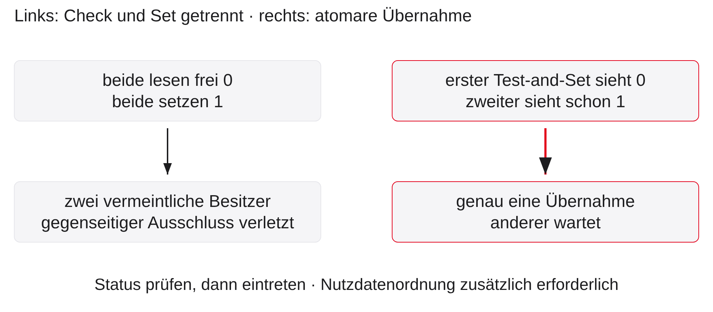{fig-alt="Getrennter Check und Set lässt zwei Aufrufer freie0lesen und beide eintreten. Atomarer Test-and-Set ordnet Übernahmen: der erste sieht0, setzt1 und gewinnt, der zweite sieht1und wartet."}

Der frühere Wert entscheidet; der Speicherwert und der Status sind getrennt zu lesen.

::: notes
Test-and-Set verbindet das Prüfen und Setzen eines Zustands zu einer atomaren Read-Modify-Write-Operation. Sie gibt den alten Zustand zurück und hinterlegt zugleich den gesetzten Zustand. Der Schlosswert null bedeutet frei, eins bedeutet belegt. Die beiden Bildhälften vergleichen diese eine Entscheidung mit einem getrennten Check und Set. Die Pfeile geben eine mögliche logische Ereignisreihenfolge an.

Links lesen beide Aufrufer null, bevor einer die eins speichert. Daher halten sich beide für den Besitzer. Rechts wird dagegen eine der Übernahmen zuerst wirksam: Dieser Aufrufer erhält den alten Wert null und setzt eins. Die andere atomare Aktion erhält bereits eins und muss warten. Rot kennzeichnet den entscheidenden Übernahmeschritt. Welcher Hart gewinnt, ist dadurch noch nicht vorgegeben.

Die erreichte Eigenschaft heißt gegenseitiger Ausschluss oder Mutual Exclusion: Höchstens ein Besitzer darf den geschützten Abschnitt betreten. Die später dort gelesenen Nutzdaten benötigen zusätzlich eine passende Übernahme- und Freigabeordnung. Ebenso folgt aus dem Ausschluss weder Fairness noch eine maximale Wartezeit.

Atomizität beschreibt die beobachtbare unteilbare Wirkung, keine Ausführung in einem Takt und kein pauschales Sperren aller Buszugriffe. Welche Primitive diese Wirkung liefern, hängt vom Befehlssatz und von der angesprochenen Speicherregion ab. Für RISC-V müssen diese Voraussetzungen ausdrücklich benannt werden.
:::

## RISC-V-Atomics brauchen Ziel und Speichervertrag

::: {.section-label}
3 / 6 · Gemeinsame Aktionen schützen
:::

- A-Erweiterung: LR/SC und AMO als atomare Primitive
- Unterstützter Kern und unterstützte gewöhnliche Speicherregion
- `.w`: vier Byte breit und hier auf vier Byte ausgerichtet
- Kein universeller Ersatz für Gerätezugriffe und deren Speichervertrag

::: notes
RISC-V beschreibt mit seiner Befehlssatzarchitektur, der Instruction Set Architecture oder ISA, die für Software zugesicherten Operationen. Die A-Erweiterung ergänzt atomare Speicherprimitive. LR/SC steht für Load-Reserved/Store-Conditional, reservierend lesen und bedingt schreiben. AMO bedeutet Atomic Memory Operation, atomare Speicheroperation. Die verwendete Spezifikation bezeichnet die entsprechenden Teilmengen als Zalrsc und Zaamo. Ihre Unterstützung darf für einen beliebigen RISC-V-Kern nicht vorausgesetzt werden.

Für die `.w`-Beispiele gelten ein vier Byte großes Wort, eine auf vier Byte ausgerichtete Adresse und eine gewöhnliche Speicherregion, für die die Plattform diese Operationen unterstützt. Die zugesicherte Atomizität gilt innerhalb dieses Speichervertrags. Sie ist kein universeller Bus-Lock und keine Aussage über jede Adresse des Systems.

Ein Geräte-Register mit Memory-Mapped Input/Output, kurz MMIO, kann zusätzliche Seiteneffekte besitzen und dieselben Atomics gerade nicht unterstützen. Auch ein eigenständiger Datenübertrager, DMA für Direct Memory Access, nimmt nicht automatisch an der CPU-Kohärenz oder Reservationsbeobachtung teil. Dafür wären gesonderte Plattformangaben erforderlich.

Die Assemblerfolgen sind Lehrbeispiele, keine hier ausgeführte Firmware. Ein nicht unterstütztes Primitiv kann nur durch einen tatsächlich zugesicherten anderen Weg ersetzt werden, etwa eine passende Bibliotheksimplementierung. Aus der C-Spracheigenschaft allein folgt deshalb noch keine bestimmte Maschineninstruktion oder Laufzeit.
:::

## LR liest; SC versucht den bedingten Store

::: {.section-label}
3 / 6 · Gemeinsame Aktionen schützen
:::

| Operation | Wirkung |
|-----------|---------|
| `lr.w` | Wort lesen und Reservation registrieren |
| erfolgreicher `sc.w` | Wort schreiben, Status $0$ |
| fehlgeschlagener `sc.w` | kein Datenstore, Status ungleich $0$ |

Ein gelesener Wert $0$ ist noch kein Übernahmeerfolg.

::: notes
Load-Reserved, kurz LR, liest einen Speicherwert und registriert eine Reservation für einen späteren bedingten Store. Eine Reservation ist keine bereits erworbene Sperre. Mehrere Harts dürfen denselben freien Schlosswert lesen, ohne dass damit schon einer Besitzer wäre. `.w` bezeichnet in diesen Beispielen ein vier Byte großes Wort. Die Reservationsmenge umfasst dessen Bytes, kann implementierungsabhängig aber größer sein; sie muss nicht genau einer Cachezeile entsprechen.

Store-Conditional, kurz SC, versucht den angegebenen neuen Wert zu speichern und liefert unabhängig davon einen Status. Bei Erfolg geschieht der Datenstore und der Status ist null. Bei Fehlschlag findet kein Datenstore statt und der Status ist ungleich null; er muss nicht genau eins sein. Jeder SC beendet die eigene Reservation, auch ein gescheiterter.

Ein vom Hart beobachteter konkurrierender Store auf die Reservationsmenge kann einen Erfolg verhindern. Ein SC darf jedoch auch aus anderen zulässigen Gründen scheitern. Ein Fehlerstatus beweist deshalb keinen bestimmten fremden Zugriff. Ein Algorithmus muss nach einem Fehlschlag erneut reservierend lesen und seine Entscheidung auf dem neuen Wert aufbauen.

Damit sind drei Zahlenrollen getrennt: Der LR kann frei null lesen, der SC soll belegt eins speichern, und Status null bestätigt erst dessen Erfolg. Aus diesen Regeln allein folgt keine begrenzte Wiederholungszahl. Die Architektur knüpft Fortschrittszusagen an zusätzliche Bedingungen für die Schleife und den Speicherbereich; eine beliebige LR/SC-Folge ist nicht automatisch wait-free.
:::

## Zwei gelesene Nullen, nur eine Übernahme {.compact-figure}

::: {.section-label}
3 / 6 · Gemeinsame Aktionen schützen
:::

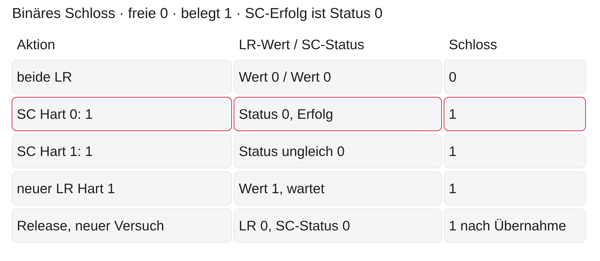{fig-alt="Beide LR lesen Schloss0. Hart0 speichert1mitSC-Status0. Hart1 hat SC-Fehlerstatus ungleich0 und speichert nichts. Sein neuer LR liest1. Nach Release0kann er erneut übernehmen."}

Ein belegt gelesenes Schloss wird nicht auf $2$ inkrementiert.

::: notes
Das binäre Schloss beginnt bei null, also frei. Beide Harts lesen mit LR zunächst diesen Wert und registrieren jeweils eine Reservation. Keiner hat dadurch bereits den geschützten Abschnitt übernommen. In den zwei Bahnen verläuft eine mögliche Ereignisreihenfolge nach rechts; die gezeichneten Abstände sind keine Laufzeitmessung.

Hart 0 führt den ersten erfolgreichen SC aus. Er schreibt eins und erhält Status null. Die rote Markierung hebt diesen Erfolg hervor. Der danach ausgeführte SC von Hart 1 scheitert aufgrund des konkurrierenden Stores: Sein Status ist ungleich null, und er verändert den Speicher nicht. Hart 1 muss beim LR neu beginnen. Liest er jetzt eins, erkennt er das belegte Schloss und wartet ohne weiteren SC. Er addiert insbesondere nichts auf den Schlosswert; zwei wäre kein sinnvoller Zustand dieses binären Modells.

Erst nach der Freigabe auf null kann ein neuer Versuch frei lesen und mit einem erfolgreichen SC übernehmen. Die Grafik legt den Gewinner nur für dieses Beispiel fest. Sie garantiert weder Fairness noch eine begrenzte Wartezeit für Hart 1. Ein zusätzlicher SC-Fehlschlag ohne fremden Store ist ebenfalls zulässig.

Die Folge erklärt den gegenseitigen Ausschluss. Ob der neue Besitzer zugleich die Nutzdaten des vorherigen Besitzers korrekt übernehmen darf, bleibt eine eigene Frage. Dafür benötigt das Schloss zusätzlich eine passende Acquire-/Release-Ordnung.
:::

## Papierphase 2: Update und SC-Status

::: {.section-label}
3 / 6 · Gemeinsame Aktionen schützen
:::

Übungsblatt, Aufgabe 3 · 15 Minuten

- Load, lokale Änderung und Store zeitlich verschachteln
- Hardwaremodell von undefiniertem C-Data-Race unterscheiden
- LR-Wert, SC-Status und neuen Zählerwert getrennt eintragen

::: notes
Die Aufgabe verändert sowohl den Anfangswert als auch die Operation: Zwei Harts sollen einen Zähler von zehn aus jeweils um zwei erhöhen. Eine mögliche verlorene Änderung lautet Load 0 liefert zehn, Load 1 liefert zehn, beide lokalen Additionen liefern zwölf, Store 1 schreibt zwölf und Store 0 schreibt ebenfalls zwölf. Der Endwert ist zwölf statt des gewünschten vierzehn. Kohärenz kann die einzelnen Zugriffe korrekt koordinieren und diesen Fehler trotzdem zulassen, weil die Rechengruppe nicht unteilbar ist.

Dieser Hardwareablauf ist von gewöhnlichem ungeschütztem C-Code zu unterscheiden. Dort bilden konfliktierende Threadzugriffe ohne ausreichende Synchronisation einen Data Race mit undefiniertem Verhalten. Zwölf ist keine zugesicherte Ausgabe. Getrennte atomare Loads und Stores vermeiden zwar dieses Sprachproblem für das Objekt, können die logische Änderung aber weiterhin verlieren.

In der vorgegebenen LR/SC-Folge liefern beide LR zunächst zehn. Der SC von Hart 1 schreibt erfolgreich zwölf und liefert Status null. Der SC von Hart 0 liefert einen Status ungleich null und schreibt nichts. Hart 0 wiederholt nun seinen LR, liest zwölf, berechnet neu vierzehn und schreibt diesen Wert mit einem erfolgreichen SC. Der gemeinsame Endwert ist vierzehn.

Das erneute Lesen ist wesentlich: Ein weiteres Speichern des alten Zwölferwerts würde den Beitrag wieder verlieren. Ein SC-Fehler allein beweist außerdem keinen fremden Store, weil auch andere zulässige Fehlschläge möglich sind. LR-Wert, berechneter Speicherwert und SC-Status müssen deshalb bei jedem Versuch getrennt verfolgt werden.
:::

## 4 · Daten übergeben und fertig werden {.section-divider}

Wann bedeutet eine Fertigmeldung, dass auch die Daten nutzbar sind?

::: {.section-route}
Arbeit teilen → Cachekopien → Atomizität → Ordnung → Skalierung → Anwendung
:::

Atomizität ergänzen: passende Ordnung und mögliche Freigabe.

::: notes
Eine unteilbare Meldung sagt zunächst nur etwas über das Meldungsobjekt selbst aus. Der Empfänger benötigt aber häufig weitere Daten, die vor dieser Meldung erzeugt wurden. Ihre Nutzung verlangt eine abgesicherte Beziehung zwischen der Veröffentlichung und der passenden Beobachtung durch den Empfänger.

Release und Acquire stellen diese Verbindung unter benannten Bedingungen her. Sie können die vorherigen Datenzugriffe mit den nachfolgenden verbinden, ohne jedes Nutzdatenobjekt atomar machen zu müssen. Doch auch ein korrekt geordnetes Programm kann warten, ohne je fertig zu werden. Wartekreise und ein unterbrochener Lockhalter verdeutlichen deshalb, weshalb Speicherordnung und Fortschritt getrennt zu prüfen sind.
:::

## Eine Meldung muss die Daten mitbringen

::: {.section-label}
4 / 6 · Daten übergeben und fertig werden
:::

Produzent: Daten schreiben → Meldung mit Release veröffentlichen

Konsument: genau diese Meldung mit Acquire beobachten → Daten lesen

- Das Flag selbst ist atomar
- Die Nutzdaten dürfen unter diesem Vertrag gewöhnliche Objekte sein
- Kein späteres ungeschütztes Überschreiben im einmaligen Beispiel

::: notes
Ein Produzent erzeugt ein Ergebnis, ein Konsument verwendet es. Die Nutzdaten sind das eigentliche Ergebnis; ein Flag meldet nur deren Bereitschaft. Damit der Konsument nach einer Eins auf dem Flag sicher lesen darf, muss mehr zugesichert sein als ein unteilbarer Zugriff auf diese Eins.

Release heißt Freigabe- oder Publikationsordnung. Der Produzent schreibt zunächst die Nutzdaten und veröffentlicht anschließend den Bereitschaftswert mit Release. Acquire heißt Übernahmeordnung. Wenn der Konsument genau diesen veröffentlichten Wert mit Acquire liest, verbindet die Synchronisation die vorangegangene Datenschreibung mit seinem nachfolgenden Lesen. In C11 wird daraus eine Happens-before-Beziehung, also eine durch das Sprachmodell abgesicherte Ordnung.

Eine beliebige Acquire-Operation an anderer Stelle genügt nicht. Sie muss die passende Veröffentlichung desselben Synchronisationsobjekts beobachten. Für den einfachen einmaligen Fall gibt es einen Produzenten und kein späteres Überschreiben der Nutzdaten. Eine Wiederverwendung des Puffers bräuchte zusätzlich einen Vertrag, wann der Konsument fertig ist und die nächste Runde beginnen darf. Acquire/Release ist außerdem keine Aufforderung, alle Caches zu leeren; es beschreibt Beobachtungs- und Ordnungsregeln der beteiligten Zugriffe.
:::

## Acquire und Release ordnen die Nutzdaten {.compact-figure}

::: {.section-label}
4 / 6 · Daten übergeben und fertig werden
:::

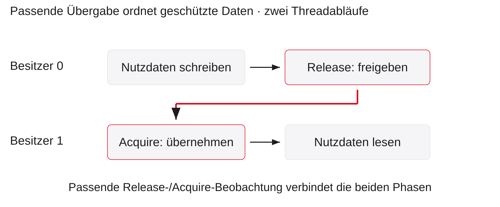{fig-alt="Ein Besitzer schreibt Nutzdaten vor Release des Schlosses. Der nächste übernimmt mit Acquire und liest danach. Die Ordnung verbindet geschützte Zugriffe über die passende Übernahme."}

Atomare Übernahme und geordnete Nutzung sind zwei Anforderungen.

::: notes
Eine korrekte Schlossübernahme entscheidet, wer den geschützten Abschnitt betreten darf. Für dessen Inhalt kommt eine weitere Anforderung hinzu: Die Nutzdaten des vorigen Besitzers müssen gegenüber dem späteren Zugriff des neuen Besitzers geordnet sein. Nutzdaten heißen auch Payload; sie sind vom Schlosswert selbst zu unterscheiden.

Release ist die Freigabeordnung: Frühere geschützte Zugriffe werden vor der Freigabe angeordnet. Acquire ist die Übernahmeordnung: Spätere geschützte Zugriffe werden nach der passenden Übernahme angeordnet. In der Darstellung schreibt Besitzer 0 zuerst seine Daten und gibt danach das Schloss frei. Der nächste Besitzer übernimmt korrekt und liest anschließend die Daten. Der rote Verbindungspfad bezeichnet die Synchronisationsbeziehung. Die Pfeile zeigen logische Ereignisordnung, keine gemessenen Zeitabstände.

Es genügt nicht, irgendwo irgendeine Acquire-Operation auszuführen. Die konkrete Übernahme muss zur Freigabe desselben Synchronisationsobjekts passen. Im C-Sprachmodell entsteht daraus eine Happens-before-Beziehung zwischen der früheren Datenschreibung und dem späteren Lesen. Die Compilerübersetzung muss diese Spracheigenschaft mit den geeigneten Zieloperationen realisieren.

RISC-V stellt dafür unter anderem Acquire-/Release-Markierungen und Fences, also Ordnungsanweisungen, bereit. Diese Begriffe bezeichnen keinen Cacheflush. Zurückschreiben geänderter Daten und Entziehen lokaler Cachegültigkeit sind andere Operationen. Die Trennung erlaubt es, zuerst das gewünschte Datenverhältnis zu begründen und erst danach dessen konkrete Umsetzung zu beurteilen.
:::

## LR/SC-Übernahme mit Acquire

::: {.section-label}
4 / 6 · Daten übergeben und fertig werden
:::

```asm
# Lehrfolge: a0 zeigt auf ausgerichtetes Schloss, 0 frei
acquire:
    lr.w.aq t0, (a0)
    bnez    t0, acquire
    li      t1, 1
    sc.w    t2, t1, (a0)
    bnez    t2, acquire
# Erst jetzt: geschuetzte Daten nutzen
```

Gewöhnlicher Speicher mit zugesicherter Unterstützung; kein universelles ISR-Rezept.

::: notes
Die Lehrfolge setzt unterstütztes LR/SC, eine gültige auf vier Byte ausgerichtete Schlossadresse in `a0` und gewöhnlichen Speicher voraus. Das Schloss beginnt bei null. Alle Nutzer müssen dieselbe Übernahme- und Freigabedisziplin einhalten. `t0` enthält den gelesenen Zustand, `t1` den gewünschten belegt-Wert eins und `t2` den separat zurückgegebenen SC-Status.

`lr.w.aq` liest das Wort und registriert die Reservation. `.aq` kennzeichnet die Acquire-Ordnung für die spätere Speichernutzung. `bnez`, Branch if Not Equal to Zero, springt bei einem Wert ungleich null zurück: Ein bereits belegtes Schloss wird erneut geprüft. War es frei, lädt `li`, Load Immediate, die Konstante eins in `t1`. `sc.w` versucht diese eins zu speichern. Ein Fehlerstatus in `t2` führt ebenfalls zurück zum LR. Nur nach einem SC-Status null darf der geschützte Abschnitt beginnen.

Das Acquire-Bit liefert die Übernahmeordnung, nicht den alleinigen Übernahmeerfolg. Diesen bestätigt erst der erfolgreiche SC. Die Wiederholung ist ein Spinlock: Der wartende Ablauf prüft aktiv weiter. Ein geeigneter Kontext und ein Besitzer, der tatsächlich weiterlaufen und freigeben kann, bleiben notwendig; eine begrenzte Wartezeit ist damit nicht bewiesen.

Der Ausschnitt wird nicht als Firmware ausgeführt. Nutzdatenabschnitt und Rückkehrkonventionen sind bewusst ausgelassen. Für Inline-Assembler in C wären zusätzlich korrekte Compilerangaben erforderlich. Ebenso sind architektonische LR/SC-Fortschrittszusagen an weitere Schleifen- und Plattformbedingungen gebunden. Zur vollständigen Sperre fehlt nun die passende Freigabeordnung.
:::

## Freigeben: Daten vor dem freien Schloss {.compact-figure}

::: {.section-label}
4 / 6 · Daten übergeben und fertig werden
:::

```asm
# Nach dem geschuetzten Abschnitt;
# a0 ist dieselbe Lockadresse
fence rw, w
sw    zero, 0(a0)
```

{fig-alt="Übernahme mit Acquire, geschützte Datenzugriffe und Freigabeordnung bilden drei Phasen. Fence rw,w steht vor dem Store0, nicht dahinter."}

::: notes
Beim Freigeben muss die vorherige geschützte Arbeit vor der erneuten Benutzbarkeit der Sperre angeordnet sein. Die Lehrfolge verwendet dafür `fence rw,w` vor einem gewöhnlichen Wortstore. `r` bezeichnet normale Speicherlesezugriffe, `w` normale Speicherschreibzugriffe. Der Fence ordnet die vorigen Reads und Writes vor den folgenden Writes, insbesondere vor dem Store des freien Schlosswerts.

`sw`, Store Word, schreibt vier Byte an die Adresse in `a0`. Das Register `zero` liefert konstant null; derselbe binäre Schlosszustand wird damit wieder frei. Die Adresse und der Speichervertrag entsprechen der Übernahme. In der Abbildung bilden Übernahme mit Acquire, geschützte Datenzugriffe und Freigabe mit Release-Wirkung die drei Phasen. Ihre Pfeile geben die erforderliche Ordnung an, keine Taktzahl.

Ein erst hinter den Freigabestore gesetzter Fence würde die hier benötigte Beziehung zwischen den früheren Nutzdatenzugriffen und genau diesem Store nicht auf dieselbe Weise herstellen. Erst eine nachfolgende passende Übernahme darf aus der korrekten Freigabe auf geordnete Nutzdaten schließen.

Diese Folge gilt für gewöhnlichen Speicher. Gerätezugriffe über MMIO, Memory-Mapped Input/Output, benötigen einen eigenen Vertrag. Ein Fence schreibt auch keine geänderte Cachezeile zurück und bestätigt keinen abgeschlossenen Gerätetransfer. Der Ausschnitt ist ein Lehrprimitiv; ein vollständiger Algorithmus muss außerdem Lebensdauer, alle Zugreifer und deren Fortschritt berücksichtigen.
:::

## AMO: alten Wert zurückgeben, neuen speichern {.compact-figure}

::: {.section-label}
4 / 6 · Daten übergeben und fertig werden
:::

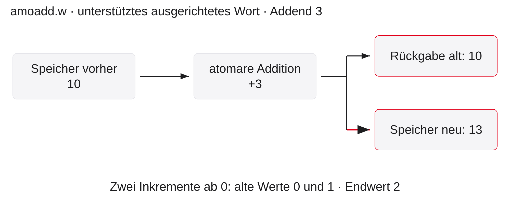{fig-alt="Amoadd.w mit Speicherwert10 und Addend3gibt den alten10zurück und speichert13. Zwei atomare Inkremente ab0enden bei2 und liefern alte Werte0und1."}

Ohne `.aq`/`.rl` bleibt die RMW atomar; zusätzliche Ordnung anderer Daten fehlt.

::: notes
Eine Atomic Memory Operation, kurz AMO, führt eine Speicheränderung als unteilbare RMW aus. `amoadd.w rd, rs2, (rs1)` addiert den Registerwert in `rs2` atomar zum vier Byte großen Wort an der Adresse in `rs1`. Das Zielregister `rd` erhält dabei den alten Speicherwert. Die Adresse muss nach dem hier angenommenen Plattformvertrag ausgerichtet sein und solche Operationen unterstützen.

Beim Anfangswert zehn und Addenden drei erhält `rd` zehn, während im Speicher danach dreizehn steht. Die Abbildung trennt diese beiden Ergebnisse: Rückgabewert und neuer Speicherinhalt sind gerade nicht dieselbe Zahl. Zwei atomare Additionen um eins ab null erhalten die alten Werte null und eins und enden bei zwei. Welcher Hart welchen alten Wert bekommt, ist ohne weitere Reihenfolgevorgabe offen. Rot hebt die unterschiedlichen Ergebnisrollen hervor; die Darstellung enthält keine garantierte Taktzahl.

Auch ohne `.aq` für Acquire und `.rl` für Release bleibt die AMO auf ihrem Zielobjekt atomar. Die zusätzliche Ordnung anderer Nutzdaten folgt daraus jedoch nicht. Das ist dieselbe Trennung wie beim Zähler und beim Bereitschaftsflag.

Eine solche Operation sperrt nicht pauschal den gesamten Bus. Auch muss eine C-Atomik nicht genau in diese Instruktion übersetzt werden: Der Compiler kann je nach Ziel andere zugesicherte Mittel verwenden. Für C-Code ist daher zuerst die Spracheigenschaft entscheidend.
:::

## C11: ein atomarer Zähler

::: {.section-label}
4 / 6 · Daten übergeben und fertig werden
:::

```c
#include <stdatomic.h>
static atomic_uint count = 0;
void increment(void) {
    atomic_fetch_add_explicit(
        &count, 1u, memory_order_relaxed);
}
```

Zwei fertige Worker mit je $N$ Inkrementen ergeben $2N$ ohne Zahlenüberlauf.

::: notes
C11, der C-Sprachstandard von 2011, stellt mit `stdatomic.h` atomare Typen und Operationen bereit. `atomic_uint` bezeichnet hier einen atomaren vorzeichenlosen Integer. Das statische Objekt `count` wird vor dem Start der Worker mit null initialisiert. `atomic_fetch_add_explicit` erhöht es unteilbar um `1u`, die vorzeichenlose Konstante eins. Die Operation liefert den alten Wert zurück; `increment` benötigt ihn nicht.

`memory_order_relaxed` genügt für diesen reinen Zähler. Jeder Beitrag muss atomar in die Änderungsordnung desselben Objekts eingehen, aber der Zähler veröffentlicht in diesem Beispiel keine weiteren Daten. Nach vollständigem Abschluss beider Worker und beiden erfolgreichen `pthread_join`-Aufrufen gilt ohne Zahlenüberlauf der Endwert $2N$. Bei den je zwanzigtausend Inkrementen der Hostdatei sind das vierzigtausend. Die Joins ordnen die vorangegangenen Workerzugriffe vor anschließenden Leserzugriffen des wartenden Hauptablaufs. Diese Ordnung stammt vom Join-Vertrag; die relaxed RMW allein veröffentlicht keine weiteren Objekte. Ein bloßes Warten anhand einer gewöhnlichen Variablen wäre keine entsprechende Synchronisation.

`atomic_fetch_add` ohne explizite Ordnungsangabe verwendet standardmäßig `memory_order_seq_cst`, sequential consistency. Diese Semantik ergänzt eine gemeinsame Ordnung der entsprechend markierten atomaren Operationen; sie macht nicht das gesamte Programm seriell.

Die Implementierung kann AMO, LR/SC oder einen Bibliotheksweg verwenden. Atomar bedeutet nicht zwingend lock-free, also ohne interne blockierende Sperre. Lock-free garantiert wiederum nicht den Abschluss jedes einzelnen Aufrufs in begrenzten eigenen Schritten; diese stärkere Eigenschaft heißt wait-free. Eine Eignung für Interruptkontexte lässt sich deshalb nicht aus dem Wort atomar allein ableiten.
:::

## C11-Lock: Test-and-Set und Clear

::: {.section-label}
4 / 6 · Daten übergeben und fertig werden
:::

```c
#include <stdatomic.h>
static atomic_flag lock = ATOMIC_FLAG_INIT;
void take_lock(void) {
    while (atomic_flag_test_and_set_explicit(
               &lock, memory_order_acquire)) { }
}
void drop_lock(void) {
    atomic_flag_clear_explicit(
        &lock, memory_order_release);
}
```

Alle Zugreifer müssen denselben Lock für dieselben geschützten Daten nutzen.

::: notes
Der Typ `atomic_flag` stellt einen atomaren freien oder gesetzten Zustand bereit. `ATOMIC_FLAG_INIT` initialisiert das statische Objekt vor konkurrierender Nutzung frei. C11 verlangt für die Operationen dieses Typs Lock-Freiheit. Das bedeutet, dass das einzelne Primitiv keine intern blockierende Sperre benötigt; eine mit ihm programmierte Warteschleife kann trotzdem unbegrenzt warten.

`atomic_flag_test_and_set_explicit` gibt den vorherigen Flagzustand zurück und setzt das Flag in derselben atomaren Aktion. Solange `take_lock` zuvor gesetzt erhält, wiederholt die Schleife. Erst ein zuvor freier Zustand bestätigt die eigene Übernahme. `memory_order_acquire` liefert dazu die Ordnung für die späteren geschützten Datenzugriffe. `drop_lock` löscht das Flag mit `atomic_flag_clear_explicit`; `memory_order_release` ordnet die früheren Zugriffe vor der Freigabe.

Der Ausschnitt ist ein kleines Spinlock-Primitiv für geeignete Threadkontexte. Ein Spinlock wartet aktiv; ein Betriebssystem-Mutex kann stattdessen andere Warteverfahren verwenden. Der hier gezeigte Entwurf garantiert weder Fairness noch eine maximale Wartezeit. Der Besitzer muss fortschreiten können und darf in diesem kurzen Abschnitt keine blockierende Arbeit beginnen.

Alle Zugreifer auf dieselben geschützten Daten müssen dasselbe Schloss korrekt verwenden. Ein ungeschützter Fremdzugriff wird durch die Disziplin der übrigen Teilnehmer nicht repariert, ebenso wenig durch `volatile`. Der Hostversuch schützt damit einen gewöhnlichen Zähler und prüft dessen Ergebnis. Daraus wird keine allgemeine Laufzeit- oder Interrupttauglichkeit abgeleitet.
:::

## Einmalige Veröffentlichung: bereit heißt Daten bereit {.compact-figure}

::: {.section-label}
4 / 6 · Daten übergeben und fertig werden
:::

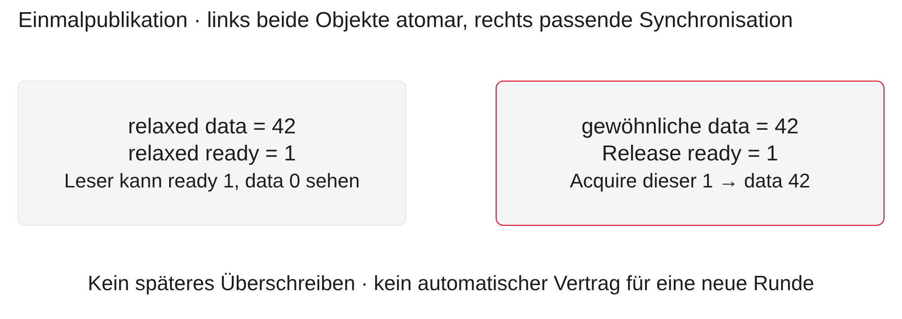{fig-alt="Links sind Daten und Flag einzeln atomar-relaxed: ready1bei data0ist sprachlich möglich. Rechts schreibt der Produzent gewöhnliche Daten42 vor ready-Release; ein Acquire-Leser dieser1darf42nutzen."}

Einmaliger Produzent, kein späterer Rewrite; Acquire muss den passenden Release-Wert lesen.

::: notes
Bei einer Veröffentlichung erzeugt ein Produzent Daten, die ein Konsument später verwenden soll. Das Beispiel besitzt einen einzigen Durchlauf: `ready` beginnt bei null, der Produzent erzeugt den Datenwert zweiundvierzig, und danach werden die Daten nicht mehr überschrieben. Die beiden Bildhälften vergleichen unterschiedliche Sprachmodelle, nicht zwei garantierte Messresultate.

Links sind sowohl `data` als auch `ready` atomare Objekte, deren Zugriffe ausschließlich relaxed erfolgen. Das verhindert Data Races auf den Einzelobjekten, schafft aber keine Synchronisationsbeziehung zwischen ihnen. Der Konsument darf deshalb ready eins zusammen mit dem alten data-Wert null beobachten. Diese Kombination ist im Sprachmodell erlaubt; sie muss nicht bei jedem Versuch oder auf jedem Prozessor auftreten. Wäre die konfliktierend genutzte Payload gewöhnlicher ungeschützter Speicher, läge stattdessen ein C-Data-Race mit undefiniertem Verhalten vor. Dafür wäre diese Endwertkombination keine vollständige Beschreibung.

Rechts schreibt der Produzent zuerst die gewöhnlichen Daten und speichert danach ready eins mit Release. Der Konsument lädt ready mit Acquire. Beobachtet er genau die vom Release-Store veröffentlichte eins, entsteht die Synchronisationsverbindung: Die vorherige Datenschreibung ist gegenüber seinem anschließenden Datenlesen abgesichert. Er erhält zweiundvierzig.

Die rote Verbindung markiert diese passende Ordnung, keine automatische Wirkung jedes atomaren Flags. Das Hostprogramm prüft die einmalige korrekte Übergabe. Für wiederholtes Überschreiben, Zurücksetzen oder Wiederverwenden des Datenplatzes wären zusätzliche Regeln über Abschluss, Lebensdauer und erneute Besitzübergabe nötig.
:::

## Warten braucht einen möglichen Ausweg

::: {.section-label}
4 / 6 · Daten übergeben und fertig werden
:::

- Ein wartender Thread darf auf einen fortschrittsfähigen Besitzer angewiesen sein
- Spinning verbraucht Rechenzeit durch wiederholtes Prüfen
- Ein unterbrochener Besitzer kann auf demselben Hart gerade nicht freigeben
- Ein Kreis aus gegenseitigen Wartebedingungen blockiert alle Beteiligten

Ein atomarer Befehl garantiert noch keinen Abschluss des Algorithmus.

::: notes
Eine Sperre begrenzt, wer gemeinsame Daten nutzen darf. Sie entscheidet aber nicht, ob ihr Besitzer genügend Rechenzeit bekommt, seine Arbeit beendet und die Sperre freigibt. Ein Spinlock wartet aktiv durch wiederholte Übernahmeversuche. Ein solcher Versuch kann nur nützlich werden, wenn der Besitzer schließlich freigeben kann.

Aus der Interruptbehandlung ist eine besonders klare Grenze bekannt: Ein unterbrochener Ablauf setzt seine Arbeit erst nach Rückkehr der ISR fort. Wartet die ISR ihrerseits auf eine Freigabe dieses Ablaufs, kann das bloße Warten keinen Fortschritt erzeugen. Ein anderer Fall entsteht, wenn mehrere Abläufe je eine Ressource halten und auf eine Ressource des anderen warten. Schließt sich daraus ein Kreis ohne mögliche Freigabe, liegt ein Deadlock vor.

Eine korrekte Atomik beseitigt solche Abhängigkeiten nicht. Auch ein lock-free einzelnes Primitiv, das keine intern blockierende Sperre benötigt, macht einen darauf aufgebauten Spinlock nicht automatisch warteschrankenbegrenzt. Für einen Entwurf sind daher drei Fragen getrennt zu beantworten: Wer darf eintreten, welche Daten sind danach geordnet nutzbar und wodurch kann ein wartender Teilnehmer schließlich fertig werden?
:::

## Deadlock: korrekte Atomics, falsche Wartebeziehung {.compact-figure}

::: {.section-label}
4 / 6 · Daten übergeben und fertig werden
:::

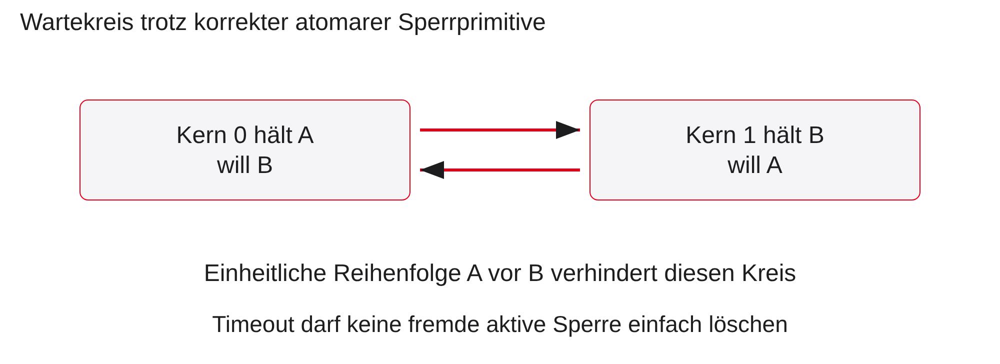{fig-alt="Kern0hältAund wartetaufB, Kern1hältBund wartetaufA. Eine einheitliche ÜbernahmereihenfolgeAvorBverhindert diesen Kreis."}

Atomizität garantiert weder Fortschritt noch eine günstige Lockreihenfolge.

::: notes
Ein Deadlock ist ein Zustand zyklischen Wartens, aus dem die beteiligten Abläufe mit ihren vorgesehenen Aktionen nicht mehr fortschreiten können. Im gezeichneten Beispiel hält Kern 0 die Sperre A und wartet auf B. Kern 1 hält B und wartet auf A. Die roten Pfeile schließen den Kreis. Keine Sperroperation muss dabei fehlerhaft sein: Gerade der korrekt garantierte Ausschluss verhindert, dass ein Teilnehmer die bereits gehaltene fremde Sperre übernimmt.

Eine überall eingehaltene Erwerbsreihenfolge A vor B verhindert diesen konkreten Kreis. Wer beide Sperren benötigt, darf B erst nach A übernehmen. Ein Teilnehmer, der nur B braucht, darf nicht später zusätzlich A verlangen, solange er B hält. Diese Lockhierarchie schließt den gezeichneten Erwerbszyklus aus, beweist aber ohne weitere Untersuchung nicht die Abwesenheit jeder anderen Warteabhängigkeit des Systems.

Andere Fortschrittsfehler haben eigene Namen. Starvation ist dauerhaft ausbleibender Fortschritt eines Teilnehmers, auch ohne Wartekreis. Livelock bezeichnet wiederholte Aktivität, die keinen nützlichen Abschluss erzielt. Gegenseitiger Ausschluss allein verhindert keines von beidem.

Ein Timeout berechtigt insbesondere nicht dazu, eine fremde noch genutzte Sperre zu löschen. Der Besitzer könnte weiterhin geschützte Daten verändern. Ein sicherer Abbruch benötigt ein eigenes Konsistenzkonzept. Auch Unterbrechungen können eine unauflösbare Wartebeziehung erzeugen, selbst wenn nur ein Hart beteiligt ist.
:::

## Die ISR darf ihren unterbrochenen Halter nicht blockieren {.compact-figure}

::: {.section-label}
4 / 6 · Daten übergeben und fertig werden
:::

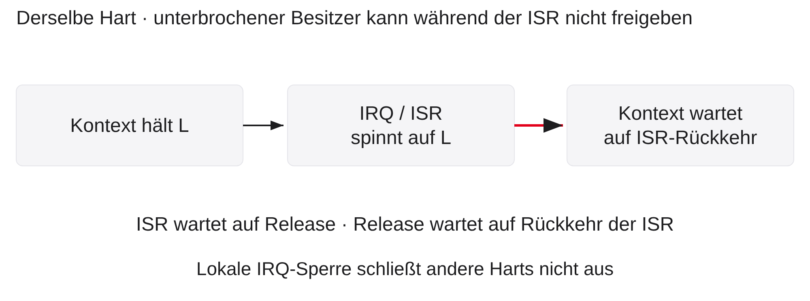{fig-alt="Ein Kontext hältLockL, wird auf demselben Hart unterbrochen, die ISR spinntaufL. Der Besitzer kann erstnachISR-Rückkehr freigeben, die ISRkehrtwegenWarten aber nichtzurück."}

Lokale Interrupts sperren hält andere Harts nicht von gemeinsamen Daten fern.

::: notes
Eine Interrupt Service Routine, kurz ISR, unterbricht den laufenden Kontext. Die Darstellung betrachtet ausdrücklich denselben Hart, also dieselbe Hardware-Ausführungsinstanz. Der normale Kontext hat Lock L übernommen, als eine Interrupt Request, kurz IRQ, eintritt. Die ISR versucht nun, L durch aktives wiederholtes Prüfen, Spinning, selbst zu erwerben.

Der Besitzer kann L erst freigeben, nachdem er weitergelaufen ist. Weiterlaufen kann er aber erst nach der Rückkehr der ISR. Diese kehrt nicht zurück, solange sie auf genau seine Freigabe wartet. Der rote Rückbezug markiert diese zyklische Fortschrittsabhängigkeit. Ein zusätzliches atomisches Test-and-Set würde daran nichts ändern: Die Sperre ist bereits korrekt belegt. Das Problem ist die unerreichbare Freigabe.

Ein geeignetes Konzept kann die betroffene lokale Unterbrechung für einen kurzen gemeinsamen Abschnitt verhindern oder die benötigte Arbeit aus der ISR in einen späteren Kontext verschieben. Welche Maßnahme geeignet ist, hängt von Plattform, Fristen und allen Zugreifern ab. Eine lokale Interruptsperre hält andere Harts nicht von denselben Daten fern und ist deshalb keine globale Multicore-Sperre.

Auch Lock-Freiheit eines einzelnen Primitivs bedeutet nicht automatisch Eignung für jede ISR oder eine begrenzte Ausführungsdauer. Die Grafik ist eine Analyse der Ereignis- und Warteordnung, keine gemessene Interrupt-Firmware. Korrekte Datenwerte, korrekte Synchronisation und gesicherter Fortschritt müssen getrennt begründet werden.
:::

## Papierphase 3: Ordnung und Fortschritt

::: {.section-label}
4 / 6 · Daten übergeben und fertig werden
:::

Übungsblatt, Aufgabe 4 · 15 Minuten

- Passende Release-/Acquire-Verbindung für Nutzdaten erklären
- Einen Wartekreis anhand der gehaltenen Locks erkennen
- ISR-Selbstdeadlock von fehlender Atomizität unterscheiden

::: notes
Bei der einmaligen Übergabe schreibt der Produzent zuerst die gewöhnliche Payload dreiundsiebzig und veröffentlicht danach ready sieben mit Release. Liest der Konsument genau diesen veröffentlichten Wert mit Acquire, liegt die Datenschreibung vor seinem anschließenden Lesen. Ohne spätere Überschreibung erhält er deshalb dreiundsiebzig. Ein Acquire allein genügt nicht; es muss die passende Veröffentlichung beobachten.

Im gesonderten Gegenmodell sind beide Objekte atomar und sämtliche Zugriffe relaxed. Ready sieben zusammen mit dem alten Datenwert minus eins ist dann erlaubt, weil die objektübergreifende Synchronisation fehlt. Gewöhnliche konfliktierend ungeschützte Payload hätte dagegen einen C-Data-Race und undefiniertes Verhalten. Diese beiden Fälle dürfen nicht durch dieselbe Liste möglicher Zahlen beschrieben werden.

Der Wartekreis lautet $A\to Y\to B\to Z\to C\to X\to A$: A wartet auf die von B gehaltene Sperre Y, B auf das von C gehaltene Z, C auf das von A gehaltene X. Eine globale Erwerbsreihenfolge X vor Y vor Z verhindert diesen Kreis, auch wenn ein Beteiligter nur zwei der Sperren benötigt. Ein Timeout erlaubt nicht, eine fremde noch genutzte Sperre zu löschen.

Im Interruptfall hält der unterbrochene Kontext P, während seine ISR auf P wartet. Da der Halter erst nach ISR-Rückkehr freigeben könnte, entsteht ein Selbstdeadlock. Eine atomare Übernahme beseitigt ihn nicht. Lokales Sperren von Interrupts betrifft außerdem keine anderen Harts. Die Aufgabe verlangt somit drei verschiedene Begründungen: Datenordnung, Erwerbsreihenfolge und die Fortschrittsmöglichkeit des Besitzers.
:::

## 5 · Beschleunigung begrenzen {.section-divider}

Welcher Teil der festen Arbeit bleibt trotz mehr Kernen bestehen?

::: {.section-route}
Arbeit teilen → Cachekopien → Atomizität → Ordnung → Skalierung → Anwendung
:::

Serielle Zeit, Verteilung und Zusatzkosten zusammenführen.

::: notes
Korrekte Parallelisierung ist eine notwendige Voraussetzung für ein brauchbares Ergebnis. Ob sie sich zeitlich lohnt, folgt daraus noch nicht. Vorbereitung, Start, Warten und Zusammenführen können Zeit kosten, die nicht einfach durch die Kernzahl geteilt wird. Zusätzlich können gemeinsame Speicherressourcen und ungleiche Teilaufgaben den Abschluss begrenzen.

Ein bewusst einfaches Modell hält zunächst dieselbe Aufgabe und dieselbe Ein-Kern-Referenz fest. Es trennt die seriell verbleibende Zeit vom ideal verteilbaren Rest. Amdahls Gesetz macht daraus eine klare Beschleunigungsgrenze. Anschließend werden Zusatzaufwand und unausgeglichene Verteilung als getrennte Abweichungen vom Ideal ergänzt. Sämtliche Zahlen sind Modellannahmen und keine gemessene Eigenschaft eines bestimmten Prozessors.
:::

## Feste Arbeit: Was lässt sich überhaupt teilen?

::: {.section-label}
5 / 6 · Beschleunigung begrenzen
:::

Eine festgelegte Aufgabe benötigt auf einem Kern 100 Zeiteinheiten.

- Vorbereitung und Zusammenführen: 20 bleiben seriell
- Unabhängige Rechenarbeit: 80 sind ideal aufteilbar
- Bei vier Kernen werden nur die 80 durch vier geteilt

Die Aufgabe bleibt gleich; verglichen wird ihre vollständige Laufzeit.

::: notes
Ein Beschleunigungsfaktor braucht eine feste Vergleichsaufgabe. Wenn auf mehr Kernen gleichzeitig eine größere Eingabe verarbeitet würde, wäre dies ein anderes Experiment. Hier bleiben Eingabe, gewünschtes Ergebnis und ursprüngliche Ein-Kern-Zeit unverändert. Die Einheit ist eine frei gewählte Zeiteinheit, nicht eine gemessene Mikrosekunde oder ein aus Befehlen abgeleiteter Takt.

Von den angenommenen 100 Einheiten werden 20 für Arbeit benötigt, die in diesem Entwurf seriell bleibt. Dazu könnten Vorbereitung und Zusammenführen gehören. Die übrigen 80 Einheiten lassen sich ideal in unabhängige Teilaufgaben teilen. Bei vier gleichen Kernen dauern diese Teile je 20, wenn sie gleichzeitig starten und perfekt verteilt sind. Die gesamte Aufgabe benötigt damit $20+20=40$ Einheiten und nicht $100/4=25$.

Der serielle Anteil ist ein Anteil der ursprünglichen Ein-Kern-Laufzeit. Er darf nicht nach der Beschleunigung neu aus der verkürzten Gesamtzeit abgelesen werden. Zusatzkosten sind in diesem ersten Modell ausdrücklich null. Genau diese Annahmen ermöglichen eine Formel, deren Ergebnis und Grenzfälle sich anschließend getrennt von realen Übertragungs- oder Sperrkosten beurteilen lassen.
:::

## Amdahl: feste Arbeit enthält serielle Zeit

::: {.section-label}
5 / 6 · Beschleunigung begrenzen
:::

$$T(N)=T(1)\left(s+\frac{1-s}{N}\right),\qquad
S(N)=\frac{T(1)}{T(N)}$$

- $s$: serieller Anteil der Ein-Kern-Zeit
- $N$: gleiche Kerne; ideal verteilbarer Rest
- Feste Aufgabe, perfekte Verteilung, zunächst kein Zusatzaufwand

::: notes
Amdahls Gesetz betrachtet eine unveränderte Aufgabe. Ein Anteil ihrer Ein-Kern-Laufzeit bleibt seriell, während sich der Rest im idealisierten Modell auf gleiche Kerne verteilen lässt. $T(1)$ bezeichnet die gesamte Ein-Kern-Zeit, $s$ deren seriellen Anteil zwischen null und eins und $1-s$ den parallelisierbaren Anteil. $N$ ist die Zahl der nutzbaren gleichen Kerne. Zusatzaufwand und ungleiche Verteilung werden zunächst ausgeschlossen.

Die serielle Dauer bleibt $sT(1)$. Nur die parallele Dauer verkürzt sich auf $(1-s)T(1)/N$. Ihre Summe ergibt $T(N)=T(1)(s+(1-s)/N)$. Der Speedup $S(N)$ ist der dimensionslose Quotient der Referenzzeit und der neuen Zeit, also $T(1)/T(N)=1/(s+(1-s)/N)$.

Für $s>0$ nähert sich der Speedup bei wachsender Kernzahl dem Grenzfaktor $1/s$. Bei rein serieller Arbeit bleibt er eins. Bei $s=0$ wäre im idealen Modell $S(N)=N$. Diese Grenzfälle prüfen zugleich die Plausibilität der Formel.

Der Anteil $s$ bezieht sich auf die ursprüngliche Ein-Kern-Zeit, nicht auf die bereits verkürzte Multicore-Zeit. Eine größere Eingabe wäre eine veränderte Aufgabe und daher eine andere Fragestellung. Threadstart, Synchronisation und zusätzliche Datenbewegung sind hier noch null. Die Rechnung beschreibt Voraussetzungen und Grenzen eines Modells; sie ist keine gemessene Eigenschaft einer konkreten CPU.
:::

## Vier Kerne sind hier Faktor 2,5 {.compact-figure}

::: {.section-label}
5 / 6 · Beschleunigung begrenzen
:::

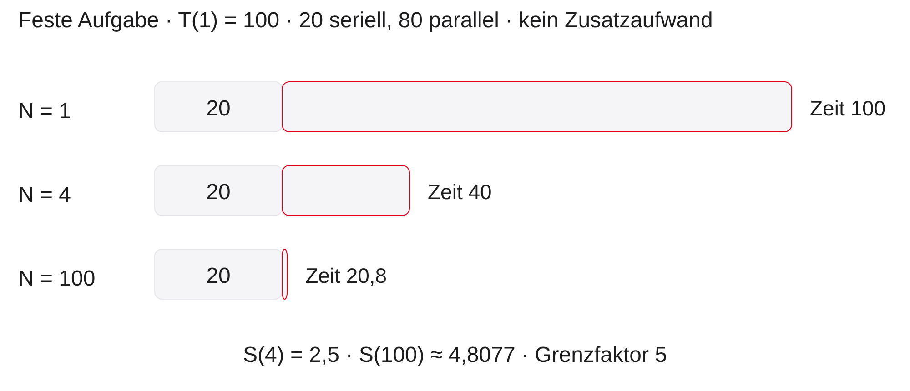{fig-alt="Feste Aufgabe mit20seriellen und80parallelen Zeiteinheiten. Zeiten bei1,4,100Kernen sind100,40,20,8. Speedup2,5bei4und4,8077bei100; Grenze5."}

$$S(4)=2{,}5,\quad E(4)=S(4)/4=62{,}5\,\%$$

::: notes
Die Balken beruhen auf einer festen Referenzaufgabe mit $T(1)=100$ Zeiteinheiten. Davon bleiben zwanzig seriell; achtzig lassen sich ideal verteilen. Der serielle Anteil ist also $s=0{,}2$. Grau bezeichnet den unveränderten seriellen Teil, rot die mit der Kernzahl verkürzte parallele Phase. Die Balkenlängen sind linear zur angenommenen Zeit; die ausgewählten Kernzahlen bilden keine gleichmäßig abgestufte Zeitachse.

Bei vier Kernen beträgt die parallele Dauer $80/4=20$. Zusammen mit den seriellen zwanzig ergibt das $T(4)=40$. Der Speedup ist $S(4)=100/40=2{,}5$. Die Effizienz $E(N)=S(N)/N$ normiert diesen Beschleunigungsfaktor auf die Kernzahl. Damit folgt $E(4)=2{,}5/4=0{,}625=62{,}5\,\%$.

Bei hundert Kernen gilt $T(100)=20+80/100=20{,}8$ und $S(100)=100/20{,}8\approx4{,}8077$. Die Effizienz beträgt nur noch etwa $4{,}8077\,\%$. Gleichzeitig liegt der Speedup bereits nahe am Grenzfaktor $1/0{,}2=5$.

Eine kleine Effizienz bei großer Kernzahl widerspricht somit keinem Rechenfehler: Die unveränderte serielle Zeit begrenzt den Nutzen weiterer Kerne. Effizienz ist hier ein normierter Zeitvergleich, keine unmittelbare Messung der Auslastung jedes Rechenwerks. Die Zahlen setzen außerdem weiterhin perfekte Verteilung und keinen Zusatzaufwand voraus.
:::

## Kommunikation und Locks kosten Zusatzzeit

::: {.section-label}
5 / 6 · Beschleunigung begrenzen
:::

$$S(N)=\frac{1}{s+(1-s)/N+h(N)}$$

Bei $s=0{,}2$, $N=4$, $h(4)=0{,}05$:

$$S(4)=1/0{,}45\approx2{,}2222$$

$h(N)$ zählt Zusatzzeit relativ zu $T(1)$, keine zusätzliche Kernzahl.

::: notes
Parallele Organisation erzeugt häufig Arbeit, die im idealen Amdahl-Modell fehlt: Worker müssen gestartet, Ergebnisse zusammengeführt und gemeinsame Daten abgestimmt werden. $h(N)$ fasst diese zusätzliche Dauer relativ zur unveränderten Ein-Kern-Referenz $T(1)$ zusammen. Es ist ein dimensionsloser Zeitanteil, keine weitere Kernzahl. Mit diesem Zusatz lautet die Modellgleichung $S(N)=1/(s+(1-s)/N+h(N))$.

Für die Lehrannahmen $T(1)=100$, $s=0{,}2$, $N=4$ und $h(4)=0{,}05$ bleiben zwanzig serielle Einheiten und zwanzig ideal verteilte parallele Einheiten. Der Zusatz entspricht $0{,}05\cdot100=5$ Einheiten. Insgesamt werden daraus fünfundvierzig. Daher ist $S(4)=100/45\approx2{,}2222$ statt $2{,}5$. Die Effizienz beträgt $S(4)/4\approx0{,}5556$, also etwa $55{,}56\,\%$.

Die fünf Einheiten sind eine didaktische Annahme und keine Lockmessung. Dieselbe Sperrzeit darf nicht zugleich im seriellen Referenzanteil $s$ und nochmals in $h(N)$ gezählt werden. Auch ist ein konstanter Zusatz bei jeder Kernzahl keine allgemeine Eigenschaft: Mehr Teilnehmer können mehr Kommunikation oder Konkurrenz um Speicherbandbreite verursachen.

Selbst ein korrekt synchronisiertes Programm muss deshalb nicht schneller werden. Neben zusätzlichem Aufwand kann schon eine ungleiche Verteilung verhindern, dass sich die parallele Arbeit ideal durch $N$ teilen lässt.
:::

## Der langsamste Teil bestimmt den Abschluss {.compact-figure}

::: {.section-label}
5 / 6 · Beschleunigung begrenzen
:::

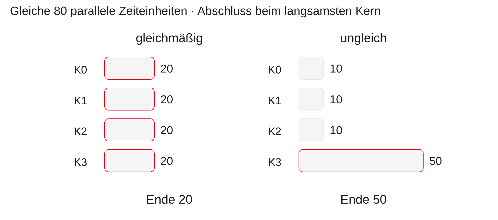{fig-alt="Achtzig parallele Zeiteinheiten sind gleichmäßig als20,20,20,20oder ungleich als10,10,10,50aufgeteilt. Abschluss nach20beziehungsweise50; mit20seriellen Einheiten Gesamt40oder70."}

Gleiche Gesamtarbeit garantiert noch keine gleiche Verteilung.

::: notes
Gleiche Gesamtarbeit lässt sich unterschiedlich günstig aufteilen. Load Balance bezeichnet eine möglichst gleichmäßige Verteilung des Bearbeitungsaufwands. Die Abbildung vergleicht achtzig parallele Zeiteinheiten auf vier gleichzeitig startenden Kernen K0 bis K3. Es gibt keine nachträgliche Arbeitsumverteilung und keinen zusätzlichen Kommunikationsaufwand. Die Zahlen stehen für Dauern, nicht für Elementanzahlen.

Bei der Verteilung zwanzig, zwanzig, zwanzig, zwanzig endet die parallele Phase nach zwanzig Einheiten. Bei zehn, zehn, zehn, fünfzig bleibt die Summe zwar achtzig, aber das vollständige Ergebnis liegt erst nach fünfzig Einheiten vor. Der rote letzte Abschluss kennzeichnet diesen bestimmenden Teil; die früher fertigen Kerne können die fehlende Arbeit nicht allein durch Warten verkürzen.

Mit denselben zwanzig seriellen Einheiten ergeben sich Gesamtzeiten vierzig und siebzig. Gegenüber der Ein-Kern-Referenz hundert sind die Speedups $100/40=2{,}5$ und $100/70\approx1{,}4286$. Das Maximum der Teilzeiten bestimmt hier die parallele Dauer, nicht ihr Durchschnitt.

Eine Aufteilung nach gleichen Elementzahlen genügt nur, wenn auch der Aufwand pro Element vergleichbar ist. Eine andere Partitionierung oder dynamische Arbeitszuteilung kann helfen, erzeugt aber selbst Abstimmungsaufwand. Ein tragfähiger Multicore-Entwurf verbindet daher getrennte Zuständigkeiten, sichere Ergebnisübergabe und passende Arbeitsverteilung. Diese Anforderungen lassen sich nun in einem gemeinsamen Anwendungsfall zusammenführen.
:::

## 6 · Einen Multicore-Entwurf begründen {.section-divider}

Wie entsteht aus zwei richtigen Teilsummen ein verlässliches Gesamtergebnis?

::: {.section-route}
Arbeit teilen → Cachekopien → Atomizität → Ordnung → Skalierung → Anwendung
:::

Aufteilung, Veröffentlichung, Layout und Fortschritt gemeinsam prüfen.

::: notes
Die einzelnen Mechanismen lassen sich nun an einem kleinen Gesamtentwurf zusammenführen. Die Eingabe bleibt unverändert, zwei Worker schreiben getrennte Teilsummen, und ein Sammler liest beide erst nach passenden Fertigmeldungen. Dafür ist kein Geräte- oder DMA-Vorwissen nötig; die einzige neue Abhängigkeit ist die zwischen Datenproduktion und Ergebnisnutzung.

Der Entwurf wird auf vier Ebenen beurteilt. Die Arbeitsteilung legt die Zuständigkeiten fest. Die Synchronisation erlaubt die Ergebnisnutzung. Das physische Layout kann unnötige Zeilenwechsel beeinflussen. Eine Abschluss- oder Fehlerpolitik verhindert unbegründete Fortschrittsannahmen. Das sind unterschiedliche Prüfungen: Ein günstiges Layout repariert keine fehlende Release-Beziehung, und eine korrekte Veröffentlichung garantiert noch keine halbierte Laufzeit.
:::

## Zwei Worker, zwei Veröffentlichungen {.compact-figure}

::: {.section-label}
6 / 6 · Einen Multicore-Entwurf begründen
:::

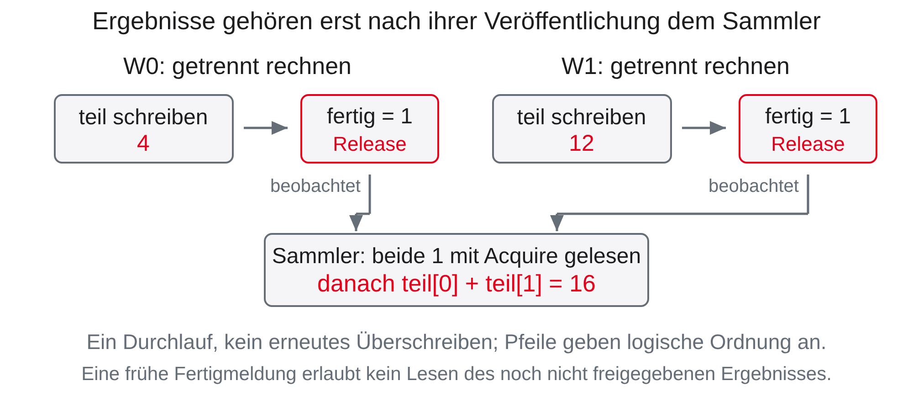{fig-alt="Worker 0 schreibt Teilergebnis 4 und veröffentlicht sein Flag mit Release. Worker 1 schreibt 12 und veröffentlicht sein eigenes Flag mit Release. Erst nach beiden passenden Acquire-Beobachtungen liest der Sammler die Slots und bildet 16. Pfeile zeigen logische Ordnung, keine Laufzeiten."}

Unveränderte Eingabe $[1,3,5,7]$ · genau ein Durchlauf.

::: notes
Der Abschlussfall verwendet die Eingabe eins, drei, fünf und sieben. Worker null liest die ersten beiden Werte und schreibt vier nach `teil[0]`. Worker eins liest die letzten beiden und schreibt zwölf nach `teil[1]`. Die Slots sind gewöhnliche 32-Bit-Ganzzahlen mit je einem Schreiber. Während dieses einmaligen Durchlaufs werden die Eingaben und einmal veröffentlichten Ergebnisse nicht mehr überschrieben.

Die zwei nebeneinander angeordneten Wege der Grafik zeigen voneinander unabhängige Veröffentlichungen. Jeder Worker schreibt zuerst seine Nutzdaten und speichert danach eins in sein eigenes atomar initialisiertes Bereitschaftsflag mit Release. Die Pfeile markieren eine logische Ordnung; Abstände sind keine Zeitangaben. Der Sammler muss beide zugehörigen Einsen mit Acquire lesen, bevor er beide Slots benutzt. Dann gilt $4+12=16$.

Eine frühe Meldung von Worker null macht den zweiten Slot nicht fertig. Ebenso würde ein relaxed Store des zweiten Flags keine passende Synchronisationsbeziehung zu dessen Nutzdaten herstellen. Warten bleibt außerdem eine Fortschrittsannahme: Veröffentlicht ein Worker nie, fehlt dem Sammler ein Abschluss. Ein realer Entwurf braucht für diesen Fall eine Fehler- oder Abbruchregel. Die räumliche Trennung der Slots kann daneben False Sharing reduzieren, ersetzt aber keine dieser Ordnungsbedingungen.
:::

## Der Sammler wartet auf jede passende Meldung

::: {.section-label}
6 / 6 · Einen Multicore-Entwurf begründen
:::

```c
// C11-Lehrausschnitt: vor Threadstart initialisiert
static int32_t teil[2];
static atomic_uint fertig[2] = {0, 0};
// Worker i, genau einmal:
teil[i] = lokale_summe;
atomic_store_explicit(&fertig[i], 1u, memory_order_release);
// Sammler, fuer i = 0 und i = 1:
while (atomic_load_explicit(&fertig[i],
                           memory_order_acquire) == 0u) { }
// Erst nach BEIDEN Schleifen: teil[0] + teil[1]
```

`stdint.h` und `stdatomic.h`; kein späteres Überschreiben.

::: notes
Der C11-Lehrausschnitt benennt die gemeinsamen Objekte des Entwurfs. `int32_t` aus `stdint.h` bezeichnet einen exakt 32 Bit breiten vorzeichenbehafteten Ganzzahltyp, soweit die Implementierung ihn anbietet. `atomic_uint` und die expliziten Speicherordnungen stammen aus `stdatomic.h`. Beide Flags sind vor dem Start der Threads null. Die jeweiligen Worker-Indizes sind null und eins; `lokale_summe` ist ihr fertig berechneter lokaler Wert. Die Zahlen bleiben im darstellbaren Bereich.

Der Worker speichert zuerst in seinen Slot und veröffentlicht anschließend die Eins mit Release. Der Sammler führt die gezeigte Acquire-Warteschleife einmal für jeden Index aus. Erst nachdem beide Schleifen ihre zugehörige Eins beobachtet haben, liest er beide Ergebnisfelder. Damit ist jede gewöhnliche Datenschreibung vor dem entsprechenden späteren Lesen geordnet. Ein Join wird in diesem Ausschnitt nicht zusätzlich als Synchronisation benutzt.

Dies ist ein Ausschnitt für einen einmaligen Durchlauf, keine vollständige Threadverwaltung. Start, Argumentübergabe und Fehlerbehandlung sind nicht enthalten. Die Reihenfolge der Warteprüfung null, dann eins ist für das Ergebnis zulässig, kann aber die Beobachtung eines bereits fertigen zweiten Workers verzögern. Die Schleifen garantieren weder eine Wartezeitschranke noch ein Fertigwerden eines fehlerhaften Workers. Bei Wiederverwendung müsste außerdem der nächste Schreiber auf eine geregelte Rückgabe der Slots warten.
:::

## Was der Hostversuch tatsächlich prüft

::: {.section-label}
6 / 6 · Einen Multicore-Entwurf begründen
:::

`labs/src/lab09_atomics.c`

- Getrennte Teilsummen, anschließend zusammengeführt
- Verlorenes Update als atomare Einzelzugriffsfolge
- Zwei Worker mit atomarem Zähler und mit C11-Lock
- Einmalige Release-/Acquire-Veröffentlichung

RISC-V GCC und Renode sind eigene Zielwerkzeuge; dieser Versuch ist kein Kohärenzbenchmark.

::: notes
Der Host ist der Entwicklungsrechner. `labs/src/lab09_atomics.c` verwendet C11 und POSIX Threads. POSIX steht für Portable Operating System Interface; die hier genutzte Schnittstelle startet und verbindet Softwarethreads. `pthread_create` beginnt einen Worker mit seinem Argument, `pthread_join` wartet auf dessen Ende; erfolgreiche Joins ordnen die vorherigen Workerzugriffe vor anschließenden Leserzugriffen im wartenden Hauptablauf. Die relaxed RMW des Zählers allein veröffentlicht keine weiteren Objekte. Das Programm prüft auch Fehler bei Erzeugung und Warten.

Die getrennten Teilsummen der Werte eins bis acht sind zehn und sechsundzwanzig; nach beiden Joins ergibt sich sechsunddreißig. Eine seriell vorgegebene Folge atomarer Einzel-Loads und -Stores erzeugt das verlorene Update mit Endwert eins, ohne einen gewöhnlichen C-Data-Race auszuführen. Zwei tatsächlich gestartete Worker mit je 20000 atomaren Inkrementen ergeben 40000. Ein weiterer Durchlauf schützt einen gewöhnlichen Zähler mit dem C11-Spinlock und prüft denselben Endwert. Die einmalige Release-/Acquire-Veröffentlichung liefert 42.

Dies sind funktionale Eigenschaften. Das Programm misst weder MESI-Transaktionen noch Beschleunigung, Fairness, Energie oder eine maximale Wartezeit. Eine Übersetzung mit dem Host-GCC ist außerdem keine Ausführung von RISC-V-Firmware. Ein funktionaler Erfolg in einem Systemsimulator würde ohne geprüftes Zeitmodell ebenfalls noch keinen Geschwindigkeitsnachweis liefern. Der Versuch ergänzt die argumentativen Papiermodelle, statt deren Hardwareaussagen zu ersetzen.
:::

## Papierphase 4 und Abschlussquiz

::: {.section-label}
6 / 6 · Einen Multicore-Entwurf begründen
:::

Aufgaben 5–6: 15 Minuten · anschließend Quiz: 15 Minuten

- Speedup, Effizienz und Zusatzaufwand herleiten
- Einen neuen Zwei-Worker-Entwurf samt Fehlerfall beurteilen
- Nutzdatenordnung von False Sharing unterscheiden
- Gültige Kopie, unteilbares Update und geordnete Übergabe begründen

::: notes
Die Amdahl-Aufgabe hält die Ein-Kern-Arbeit bei 150 Zeiteinheiten fest. Davon bleiben $0{,}3\cdot150=45$ seriell und 105 sind parallel verteilbar. Drei Kerne ergeben $T=45+105/3=80$, $S=150/80=1{,}875$ und $E=S/3=62{,}5\,\%$. Bei 60 Kernen ist $T=46{,}75$, $S\approx3{,}20856$ und $E\approx5{,}3476\,\%$. Die theoretische Grenze lautet $1/0{,}3\approx3{,}3333$. Sechs Zusatzzeiteinheiten bei drei Kernen ergeben $T=86$, $S\approx1{,}74419$ und $h(3)=6/150=0{,}04$. Die ungleichen Pakete 15, 25 und 65 brauchen parallel 65 Einheiten. Insgesamt folgen $T=110$ und $S\approx1{,}36364$.

Der neue Übergabefall verwendet die unveränderte Eingabe drei, sechs, neun, zwölf. Worker null berechnet neun, Worker eins 21 und der Sammler nach korrekter Übergabe 30. Ein relaxed Store auf `fertig[i]` stellt keine Release-/Acquire-Synchronisation mit dem Acquire-Leser her. Die gewöhnlichen Ergebniszugriffe sind so nicht abgesichert und dürfen nicht mit einer garantierten Liste alter Werte beschrieben werden. Die Reparatur schreibt zuerst `teil[i]` und veröffentlicht danach eins mit Release; der Sammler liest beide zugehörigen Einsen mit Acquire, bevor er die Ergebnisse nutzt. Genau ein Durchlauf und kein späteres Überschreiben sind vorausgesetzt.

Im separaten Layoutmodell teilen die Vier-Byte-Slots bei `0x20002000` und `0x20002004` eine 64-Byte-Zeile bis `0x2000203F`. Der zweite Slot bei `0x20002040` beginnt eine neue Zeile. Die Kontrollflags liegen laut Aufgabe anderswo. Das Layout behebt potenzielles False Sharing, keine fehlende Synchronisation oder Atomizität. Veröffentlicht Worker eins nie, kann der Sammler trotz korrekter Ordnung endlos warten; eine Fehler- oder Abbruchpolitik ist zusätzlich erforderlich. Das Quiz prüft anschließend dieselben Unterscheidungen zwischen Rechten, Updates, Übergabe, Fortschritt und Laufzeit.
:::

## Zurück zum Einstieg: Zwei getrennte Zusagen

::: {.section-label}
6 / 6 · Einen Multicore-Entwurf begründen
:::

Wird die Rechnung automatisch doppelt so schnell?

→ Nur der aufteilbare Anteil wird kürzer; Übergabe und Kosten bleiben.

Ist der gemeinsame Zähler automatisch richtig?

→ Kohärenz genügt nicht; RMW oder geschützter Abschnitt sind nötig.

Getrennte Teilsummen vermeiden viele gemeinsame Updates.

::: notes
Die anfängliche Erwartung verbindet mehr Rechenhardware mit zwei verschiedenen Zusagen. Die erste betrifft das Ergebnis: Ein kohärenter Speicher koordiniert gültige Kopien, macht aber den Ablauf aus Laden, Erhöhen und Speichern nicht zu einer atomaren Addition. Zwei Beiträge können im definierten Einzelzugriffsmodell verloren gehen. Bei gewöhnlichen ungeschützten C-Konflikten ist die Grenze noch strenger: Ein Data Race erlaubt keine garantierte Liste solcher Endwerte. Eine atomare RMW oder eine korrekt verwendete Sperre schützt den gemeinsamen Update.

Die zweite Zusage betrifft die Laufzeit. Bei 20 seriellen und 80 ideal verteilbaren Einheiten führen vier Kerne zu 40 und nicht 25 Einheiten. Zwei Kerne würden $20+80/2=60$ benötigen, also den Faktor $100/60\approx1{,}6667$ statt zwei. Zusätzliche Kommunikation oder schlechte Verteilung können den Nutzen weiter verringern.

Der Entwurf mit privaten Teilsummen beantwortet zugleich die dritte Frage. Er verlegt gemeinsame Arbeit aus der inneren Schleife in eine begrenzte Ergebnisübergabe. Diese muss weiterhin geordnet und vollständig erfolgen. Korrektes Ergebnis, möglicher Abschluss und geringere Laufzeit sind somit drei eigenständige Aussagen, die ein Multicore-Entwurf jeweils begründen muss.
:::

## Quellen und Schlussfolgerung

::: {.section-label}
6 / 6 · Einen Multicore-Entwurf begründen
:::

- Harris & Harris: *Digital Design and Computer Architecture — RISC-V Edition*
- Patterson & Hennessy: *Computer Organization and Design — RISC-V Edition*
- [RISC-V-Atomics, Spezifikation 20240411](https://github.com/riscv/riscv-isa-manual/blob/20240411/src/a-st-ext.adoc)
- [C11-Draft N1570](https://www.open-std.org/jtc1/sc22/wg14/www/docs/n1570.pdf) und [GCC: volatile](https://gcc.gnu.org/onlinedocs/gcc/Volatiles.html)
- [Linux-Dokumentation: False Sharing](https://docs.kernel.org/kernel-hacking/false-sharing.html)

::: notes
Die Modulbücher von Harris und Harris sowie Patterson und Hennessy liefern den Zusammenhang zwischen Speicherhierarchie, Befehlssatz und Parallelität. Die RISC-V-Atomics-Spezifikation in der verlinkten Fassung 20240411 beschreibt LR/SC und AMO einschließlich ihrer Rückgabewerte und Ordnungsbits. Im C11-Entwurf N1570 sind insbesondere Abschnitt 5.1.2.4 zu nebenläufigen Ausführungen und Data Races sowie Abschnitt 7.17 zu atomaren Operationen einschlägig. Die GCC-Dokumentation grenzt `volatile` von Synchronisation ab. Die Linux-Dokumentation ordnet False Sharing als Problem des gemeinsam verwalteten Zeilenlayouts ein.

MESI wurde als begrenztes Modell stabiler Write-Back-Zustände verwendet. Adresse, Zeilengröße, Anfangswerte und Zeitanteile sind ausdrücklich gewählte Lehrannahmen. Der Hostversuch prüft funktionale C-Beispiele, aber keine bestimmte RISC-V-Mikroarchitektur und kein Kohärenzzeitmodell. Diese Trennung macht Aussagen überprüfbar, ohne aus einer passenden Zahl einen Hardwarebeweis abzuleiten.

Ein tragfähiger Multicore-Entwurf beginnt mit aufteilbarer Arbeit und eindeutiger Schreibzuständigkeit. Wo gemeinsame Änderungen bleiben, braucht er passende atomare Aktionen. Wo Daten weitergereicht werden, benötigt er eine begründete Synchronisationsbeziehung und einen gültigen Lebenszyklus. Fortschritt und Beschleunigung sind danach eigenständige Prüfungen. Erst wenn diese Bedingungen zusammenpassen, wird aus zusätzlicher Hardware eine verlässliche Verbesserung des Programms.
:::
