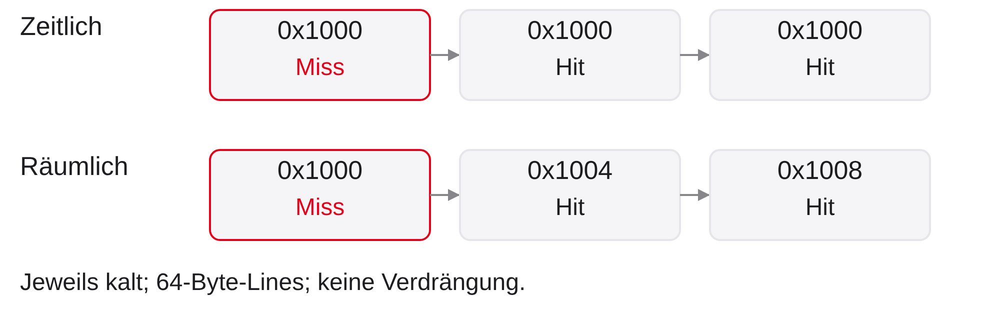
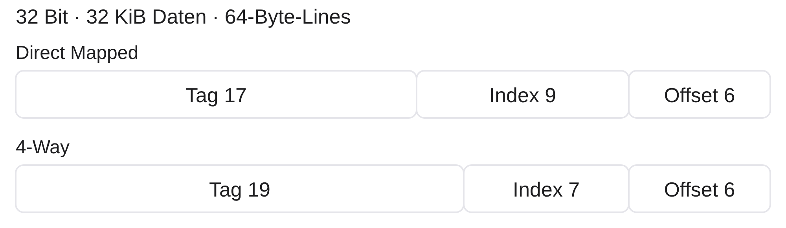
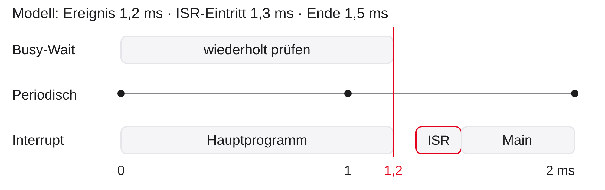
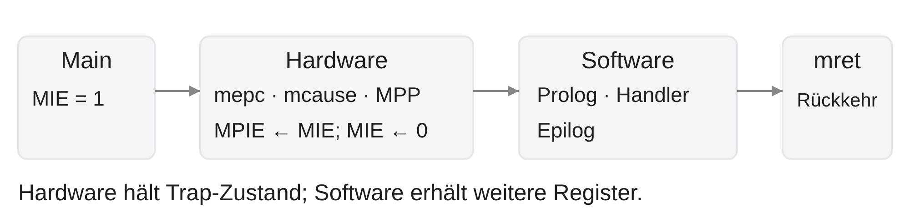
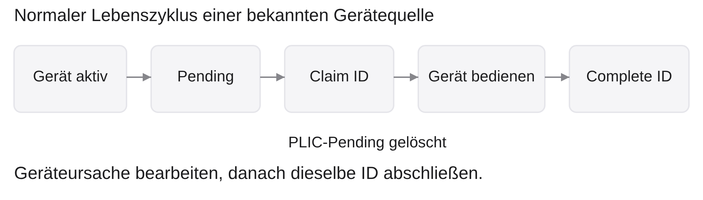
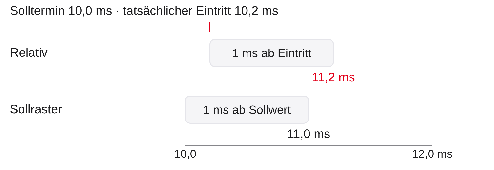
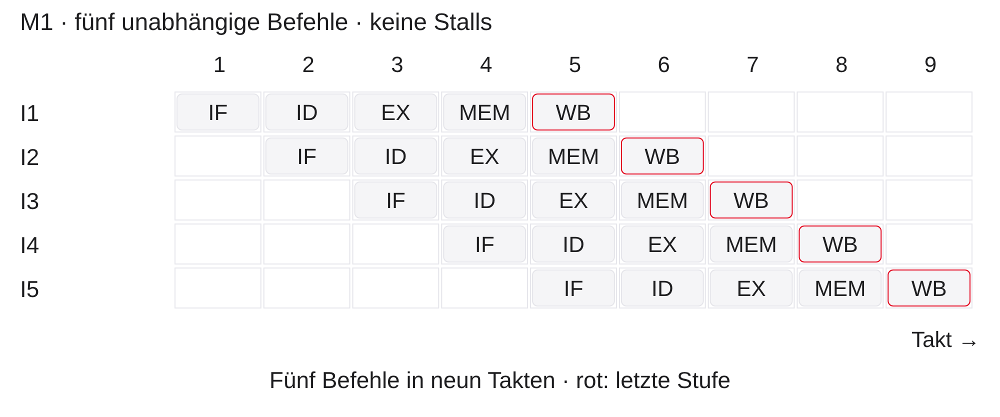
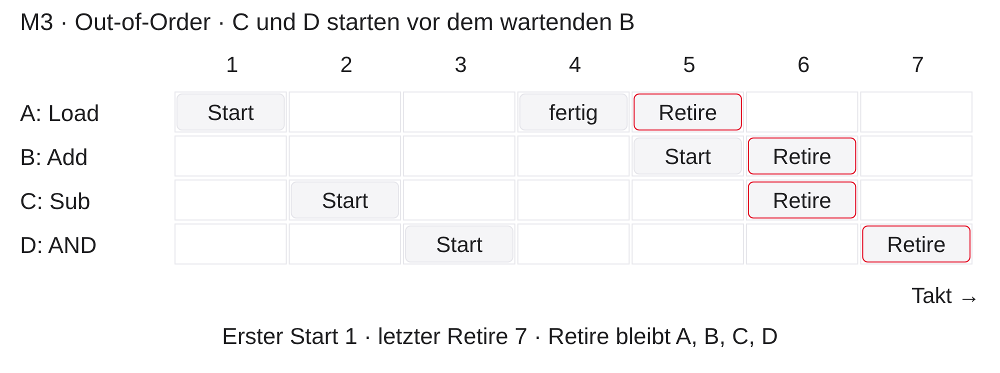
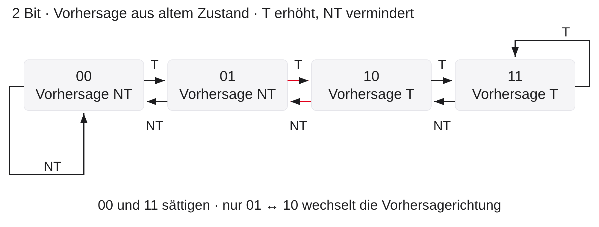
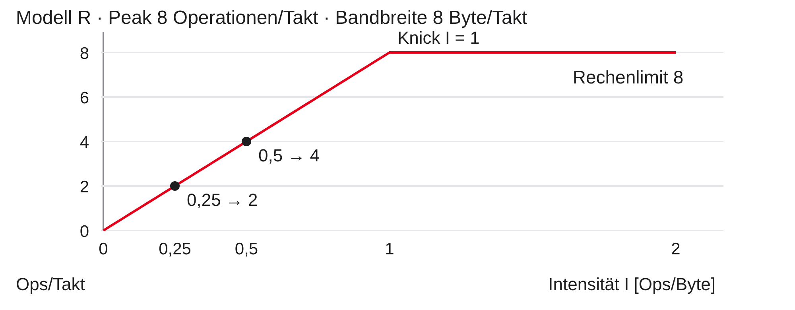

## Speichereigenschaften getrennt benennen

::: {.section-label}
Vorlesung 1 · Speicherphysik & RAM-Typen
:::

| Eigenschaft | Bedeutung | Beispiele |
|-------------|-----------|-----------|
| flüchtig | Erhalt nur mit Versorgung | SRAM, DRAM |
| nichtflüchtig | Erhalt ohne Versorgung | Flash, ROM |
| wahlfrei lesbar | Stelle gezielt auswählbar | SRAM, speicherabbildbares NOR |
| seitenorientiert | größere Einheit je Anfrage | rohes NAND |

Cache: Rolle · SRAM: Zelltechnologie · Latenz ≠ Bandbreite

$1\,\mathrm{MiB}=2^{20}\,\mathrm{Byte}$ · $1\,\mathrm{MB}=10^{6}\,\mathrm{Byte}$

::: notes
Diese Zusammenfassung bündelt die Kernaussagen, Modelle und Rechenmuster der gehaltenen Einheiten 1–3, 7 und 8. Jede Folie nennt oben ihre Herkunftsvorlesung. Ausführliche Herleitungen, alle Abbildungen und die Übungsblätter finden Sie in den jeweiligen Einheiten; die Zahlenwerte hier sind dieselben didaktischen Lehrwerte wie dort.

Die erste Einheit trennt Eigenschaften, die im Alltag oft vermischt werden. Flüchtig bedeutet: Der Inhalt bleibt nur bei anliegender Versorgung erhalten. SRAM (Static Random-Access Memory) und DRAM (Dynamic Random-Access Memory) sind flüchtig. Nichtflüchtig bedeutet: Der Erhalt ohne Versorgung ist spezifiziert, etwa bei Flash und ROM (Read-Only Memory). Davon unabhängig ist die Zugriffsart. Wahlfreies Lesen wählt gezielt eine Stelle aus; seitenorientierte Speicher wie rohes NAND-Flash verarbeiten je Anfrage eine größere Einheit. Das C-Schlüsselwort `volatile` gehört zu keiner dieser Kategorien: Es betrifft die Übersetzung von Speicherzugriffen, nicht die Zellphysik.

In der Speicherhierarchie liegen Register, nahe Cache-Kopien, Arbeitsspeicher und nichtflüchtiger Speicher auf verschiedenen Ebenen. Ein Cache ist eine Rolle in dieser Hierarchie; er wird häufig, aber nicht begrifflich notwendig aus SRAM aufgebaut. Latenz ist die Wartezeit bis zu einem angefragten Datum, Bandbreite die übertragene Datenmenge pro Zeit. Vier unabhängige Anfragen mit je drei Zeitschritten Latenz enden seriell nach 3, 6, 9 und 12 Schritten, überlappt mit Startabstand eins nach 3, 4, 5 und 6. Die einzelne Latenz bleibt drei.

Bei Größenangaben gehört die Basis dazu. Ein MiB sind $2^{20}=1\,048\,576$ Byte oder $8\,388\,608$ Bit, ein MB dagegen $10^6$ Byte. Für ein MiB benötigt klassisches 6T-SRAM, dessen Zelle aus sechs Transistoren besteht und ihr Bit durch zwei rückgekoppelte Inverter hält, $6\cdot8\,388\,608=50\,331\,648$ Zelltransistoren. 1T1C-DRAM speichert jedes Bit als Ladung in einem Kondensator hinter einem Zugriffstransistor und braucht deshalb je $8\,388\,608$ Transistoren und Kondensatoren sowie regelmäßiges Auffrischen; die Peripherie ist dabei nicht gezählt.
:::

## Lokalität: Warum nahe Kopien wirken {.compact-figure}

::: {.section-label}
Vorlesung 2 · Speicherhierarchie & Caches
:::

{fig-alt="Zwei getrennte Zugriffsspuren: Wiederholung derselben Adresse und Zugriff auf benachbarte Wörter."}

Zeitlich: dieselbe Adresse bald wieder · Räumlich: Nachbaradressen bald

Ein Miss lädt die ganze Cache-Zeile: $q=\lfloor a/B\rfloor,\quad a_\mathrm{Basis}=qB,\quad o=a\bmod B$

::: notes
Caches lohnen sich, weil Speicher langsam im Vergleich zum Prozessor ist. Bei $1\,\mathrm{GHz}$ Prozessortakt und $100\,\mathrm{ns}$ Speicherlatenz wartet ein abhängiger Befehl $100$ Takte. Eine kleine, nahe Kopie häufig benötigter Daten verkürzt diese Wartezeit, sofern spätere Zugriffe sie wieder treffen.

Dafür sorgen zwei Arten von Lokalität. Zeitliche Lokalität bedeutet, dass eine kürzlich genutzte Adresse bald erneut benötigt wird, etwa eine Schleifenvariable. Räumliche Lokalität bedeutet, dass benachbarte Adressen zeitnah folgen, etwa beim Durchlauf eines Arrays. Ein Cache nutzt die räumliche Lokalität, indem er bei einem Miss nicht nur das angefragte Byte, sondern eine ganze Cache-Zeile (Cache-Line, Block) holt. Bei 64 Byte je Zeile und vier Byte je Element sind das 16 Elemente.

Die Zeile zu einer Byteadresse $a$ folgt aus der Division mit Rest durch die Blockgröße $B$: Blocknummer $q=\lfloor a/B\rfloor$, Blockbasis $qB$ und Offset $o=a\bmod B$. Beispiel: $a=1000$, $B=64$ ergibt $q=15$, Basis $960$ und Offset $40$; die Zeile umfasst die Adressen 960 bis 1023.

Wichtig ist die Abgrenzung: Ein Cache verschiebt weder ein Array noch dessen Adressbereich. Er liefert eine Kopie desselben Blocks auf einem kürzeren Weg. Die Arbeitsmenge (Working Set) einer Programmphase muss zusammen mit einer geeigneten Platzwahl in den Cache passen; acht wiederverwendete Zeilen zu 64 Byte belegen 512 Byte. Ein Array liegt zusammenhängend, eine verkettete Liste kann dagegen über viele Blöcke verstreut sein – entscheidend ist das tatsächliche Layout.
:::

## Trefferquote und mittlere Zugriffszeit

::: {.section-label}
Vorlesung 2 · Speicherhierarchie & Caches
:::

$$h=\frac{N_H}{N},\qquad m=1-h,\qquad \mathrm{AMAT}=t_H+m\cdot p$$

| Fall | Rechnung | AMAT |
|------|----------|------|
| $t_H=1$, $p=100$, $h=0{,}95$ | $1+0{,}05\cdot100$ | $6$ Takte |
| dasselbe, $h=0{,}80$ | $1+0{,}20\cdot100$ | $21$ Takte |
| L1 → L2 → Speicher | $1+0{,}1\,(8+0{,}2\cdot80)$ | $3{,}4$ Takte |

$t_H$ bei jedem Zugriff · $p$ zusätzlich je Miss · $\mathrm{AMAT}\le5$ ⇒ $h\ge0{,}96$

::: notes
Ein Treffer (Hit) liegt vor, wenn der Cache eine gültige Kopie des angefragten Blocks enthält; sonst ist es ein Fehlschlag (Miss). Die Trefferquote $h$ ist der Anteil der Hits an allen $N$ Zugriffen, die Missquote $m=1-h$. Diese Quote ist eine Eigenschaft der Zugriffsspur zusammen mit Cache-Konfiguration und Anfangszustand. Die Folge `0x1000, 0x1004, 0x1040, 0x1000` ergibt bei 64-Byte-Zeilen im kalten Cache Miss, Hit, Miss, Hit; derselbe Durchlauf ohne Reset im warmen Cache vier Hits.

AMAT (Average Memory Access Time) ist die mittlere Zugriffszeit im blockierenden Ein-Ebenen-Modell. Jeder Zugriff kostet die Prüfzeit $t_H$; nur Misses kosten zusätzlich die Miss Penalty $p$. Ein Miss dauert insgesamt also $t_H+p$. Ein typischer Fehler ist, die Hitzeit mit $h$ zu gewichten und die Penalty als Gesamtzeit zu lesen. Mit $t_H=1$, $p=100$ und $h=0{,}95$ ergeben sich sechs Takte; sinkt die Trefferquote auf $0{,}80$, sind es 21 Takte. Wenige Prozentpunkte Trefferquote verändern die mittlere Zeit stark, weil $p$ groß ist.

Bei zwei Ebenen ersetzt die mittlere Zeit der zweiten Ebene die Penalty der ersten: $1+0{,}10\cdot(8+0{,}20\cdot80)=1+0{,}10\cdot24=3{,}4$ Takte, mit lokalen Missquoten je Ebene. Rückwärts lässt sich eine erforderliche Quote bestimmen: Aus $1+(1-h)\cdot100\le5$ folgt $1-h\le0{,}04$, also $h\ge0{,}96$.

Ein Vergleich zeigt die Grenzen einer einzelnen Kennzahl: Variante A mit einem Takt und $95\,\%$ sowie Variante B mit zwei Takten und $96\,\%$ erreichen beide $6$ Takte AMAT. Für eine Hardwareentscheidung fehlen dann noch Taktperiode, Fläche und Energie.
:::

## Adresse zerlegen: Tag, Index, Offset {.compact-figure}

::: {.section-label}
Vorlesung 2 · Speicherhierarchie & Caches
:::

{fig-alt="Bei gleicher Datenkapazität und Blockgröße besteht die 32-Bit-Adresse direkt abgebildet aus 17 Tag-, 9 Index- und 6 Offsetbits; bei vier Wegen aus 19, 7 und 6 Bit."}

$$S=\frac{C}{B\,W},\quad b=\log_2B,\quad s=\log_2S,\quad \tau=P-b-s$$

`0x12345678`, Direct Mapped: Offset $56$ · Index $345$ · Tag `0x2468`

::: notes
Ein Cache muss zu jeder Adresse schnell entscheiden, wo eine Kopie liegen darf und ob sie die richtige ist. Dazu wird die Adresse in drei Felder zerlegt. Der Offset mit $b=\log_2B$ Bit wählt das Byte innerhalb einer Zeile. Der Index mit $s=\log_2S$ Bit wählt das Set. Die restlichen $\tau=P-b-s$ Bit bilden das Tag, das den gespeicherten Block kennzeichnet. Dabei ist $C$ die Datenkapazität, $B$ die Blockgröße, $W$ die Zahl der Plätze (Ways) je Set und $P$ die Adressbreite. Tags und Zustandsbits zählen nicht zur Datenkapazität.

Im Referenzmodell mit $32\,\mathrm{KiB}$, 64-Byte-Zeilen und 32-Bit-Adressen gibt es 512 Zeilen. Direct Mapped bedeutet $W=1$, also 512 Sets: sechs Offsetbits, neun Indexbits und 17 Tagbits. Bei vier Ways bleiben 128 Sets: sechs Offset-, sieben Index- und 19 Tagbits. Mehr Ways verschieben also Bits vom Index ins Tag.

Für `0x12345678` gilt: Offset $=\texttt{0x78}\bmod64=56$, Blocknummer $q=\texttt{0x48D159}$, Index $q\bmod512=345$ und Tag $\lfloor q/512\rfloor=\texttt{0x2468}$. Zur Kontrolle setzt man zusammen: $\texttt{0x2468}\cdot32768+345\cdot64+56=305\,419\,896=\texttt{0x12345678}$. Im 4-Way-Cache ergeben sich Index $89$ und Tag `0x91A2`.

Beim Lesen wählt der Index das Set, die gespeicherten Tags werden mit dem Anfrage-Tag verglichen und das Valid-Bit geprüft. Ein Hit erfordert $\mathrm{Valid}=1$ und ein passendes Tag; dann wählt der Offset die Daten aus. Bei einem Miss wird der Block aus der nächsten Ebene beschafft und der Eintrag aktualisiert.
:::

## Platzwahl, Miss-Ursachen und Ersetzung

::: {.section-label}
Vorlesung 2 · Speicherhierarchie & Caches
:::

| Organisation | Sets | Ways je Set | Tag-Vergleiche je Anfrage |
|--------------|------|-------------|---------------------------|
| Direct Mapped | $512$ | $1$ | $1$ |
| 4-Way | $128$ | $4$ | $4$ |
| Fully Associative | $1$ | $512$ | $512$ |

- Miss-Ursachen: Compulsory (erster Zugriff) · Capacity (zu große Arbeitsmenge) · Conflict (eingeschränkte Platzwahl)
- Volles Set: FIFO verdrängt den zuerst geladenen, LRU den am längsten ungenutzten Block

::: notes
Die Assoziativität legt fest, wie viele Plätze ein Block zur Auswahl hat. Direct Mapped erlaubt genau einen Platz, ein $W$-Way-Cache $W$ Plätze innerhalb des Sets, ein vollassoziativer Cache jeden Platz. Mehr Wahlfreiheit vermeidet Konflikte, kostet aber parallele Tag-Vergleiche: einen, vier oder 512 je Anfrage bei gleicher Kapazität von $32\,\mathrm{KiB}$.

Misses werden nach ihrer Ursache unterschieden. Ein Compulsory Miss ist der erste Zugriff auf einen Block; er tritt auch im idealen Cache auf. Ein Capacity Miss entsteht, wenn die aktive Arbeitsmenge nicht in die Kapazität passt, etwa 513 verschiedene Blöcke zyklisch in einem vollassoziativen Cache mit 512 Plätzen und LRU. Ein Conflict Miss entsteht, wenn noch Platz frei wäre, die eingeschränkte Platzwahl aber einen nutzbaren Block verdrängt.

Das Standardbeispiel ist Thrashing: `0x1000` und `0x9000` werden viermal abwechselnd gelesen. Beide Blöcke (Nummern 64 und 576) haben im Direct-Mapped-Cache den Index 64 und verdrängen sich gegenseitig: acht Misses, davon zwei Compulsory und sechs Conflict. Im 4-Way-Cache landen beide im selben Set, passen aber in zwei Ways: zwei Misses und sechs Hits.

Ist ein Set voll, entscheidet die Ersetzungsregel. Freie Plätze werden immer zuerst genutzt. FIFO (First In, First Out) verdrängt den zuerst geladenen Block, LRU (Least Recently Used) den am längsten nicht genutzten. Nach der Folge A, B, C, D, A in einem 4-Way-Set verdrängt ein neuer Block E bei FIFO den Block A, bei LRU dagegen B, weil A zuletzt erneut genutzt wurde.
:::

## Schreiben: zwei unabhängige Entscheidungen

::: {.section-label}
Vorlesung 2 · Speicherhierarchie & Caches
:::

| Frage | Varianten |
|-------|-----------|
| Wann wird eine Änderung weitergegeben? | Write-Through: bei jedem Store · Write-Back: beim Verdrängen, markiert durch Dirty |
| Was geschieht bei einem Store-Miss? | Write-Allocate: Block holen, dann ändern · No-Write-Allocate: nur weitergeben |

- $100$ Stores auf dasselbe 4-Byte-Wort, 64-Byte-Zeile: Write-Through $400$ Byte, Write-Back einmal $64$ Byte
- Dirty-Opfer an seine alte Adresse zurückschreiben: aus altem Tag und Index

::: notes
Bei Schreibzugriffen sind zwei Fragen zu trennen. Die erste betrifft die Weitergabe: Write-Through aktualisiert bei einem Store-Hit den Cache und die nächste Ebene. Ein Write Buffer kann diese Weitergabe puffern; ist er voll, hält der Prozessor an. Write-Back ändert zunächst nur die Cache-Kopie und setzt das Dirty-Bit. Dirty bedeutet: Die Zeile ist gegenüber der nächsten Ebene verändert – nicht ungültig und nicht beschädigt. Ein älterer Wert in der unteren Ebene ist dann zunächst zulässig. Spätestens vor dem Verdrängen muss die Zeile zurückgeschrieben werden.

Die zweite Frage betrifft den Store-Miss. Write-Allocate holt den Block in den Cache und ändert dann die Kopie; No-Write-Allocate gibt den Store nur weiter und legt keinen Eintrag an. Beide Regeln lassen sich mit beiden Weitergabestrategien kombinieren. Für `Store 0x1000; Store 0x1004; Store 0x1008; Load 0x1000` im kalten Cache mit Write-Through ergibt Write-Allocate Miss, Hit, Hit, Hit, No-Write-Allocate dagegen vier Misses.

Der Schreibverkehr unterscheidet sich deutlich: 100 Store-Hits auf dasselbe Wort geben bei Write-Through ohne Zusammenfassen $400$ Byte Nutzdaten weiter, bei Write-Back einmal die ganze Zeile mit $64$ Byte. Das ist eine Bytezählung, keine vollständige Laufzeitmessung.

Wird eine Dirty-Zeile verdrängt, gehört sie an ihre alte Adresse. Ersetzt `0x9000` im Direct-Mapped-Cache die Zeile von `0x1000`, so ergibt sich die Rückschreibadresse aus altem Tag null und Index 64: $(0\cdot512+64)\cdot64=\texttt{0x1000}$. Danach wird der neue Block geladen, mit Tag eins und Dirty null. Das Modell gilt für einen Prozessor und normalen Speicher; Geräte und weitere Kerne erfordern zusätzliche Regeln.
:::

## Ereignisse erfassen: Polling oder Interrupt {.compact-figure}

::: {.section-label}
Vorlesung 3 · Interrupts & Timer
:::

{fig-alt="Ereignis bei 1,2 ms; periodisches Polling entdeckt es bei 2 ms, Interruptbehandlung beginnt im Modell bei 1,3 ms." style="max-height: 290px;"}

Erfassen → Benachrichtigen → Bearbeiten

Polling alle $250\,\mu\mathrm{s}$, je $3\,\mu\mathrm{s}$: $W_{\max}=250\,\mu\mathrm{s}$, $U=1{,}2\,\%$

Bit: mindestens ein Ereignis · Zähler: Anzahl · Puffer: einzelne Daten

::: notes
Jede Reaktion auf ein Ereignis besteht aus drei Schritten. Zuerst muss das Ereignis einen Zustand hinterlassen, etwa ein Bereitschaftsbit im Gerät. Dann muss die Software davon erfahren. Schließlich werden Daten gesichert und die Ursache behandelt.

Beim Polling fragt die Software den Gerätezustand selbst ab. Busy Waiting fragt wiederholt und tut sonst nichts; periodisches Polling erledigt zwischen den Abfragen andere Arbeit. Bei periodischer Abfrage kann ein gespeichertes Ereignis bis zu einer ganzen Abfrageperiode unbemerkt bleiben. Im Lehrmodell mit $250\,\mu\mathrm{s}$ Abstand ist $W_{\max}=250\,\mu\mathrm{s}$; eine Erkennungsfrist von $100\,\mu\mathrm{s}$ ist damit nicht garantiert. Der Abfrageaufwand beträgt $3\,\mu\mathrm{s}/250\,\mu\mathrm{s}=1{,}2\,\%$ der Prozessorzeit. Ein kürzeres Intervall verringert die Wartezeit und erhöht den Aufwand. Kurze, nicht gespeicherte Impulse können zwischen zwei Abfragen ganz verloren gehen. Die Abbildung zeigt ein Ereignis bei $1{,}2\,\mathrm{ms}$, das periodisches Polling erst bei $2\,\mathrm{ms}$ entdeckt; die Interruptbehandlung beginnt im Modell bei $1{,}3\,\mathrm{ms}$. Auch ein Interrupt hat also eine eigene Eintrittslatenz.

Gespeichert heißt nicht gezählt. Treten vor der Behandlung drei Ereignisse ein, zeigt ein Bereitschaftsbit nur „mindestens eines“. Die Anzahl liefert erst ein Ereigniszähler ohne Überlauf, einzelne Messwerte nur ein ausreichend großer Datenpuffer. Die Strategie richtet sich nach dem Ereignis: Bleibt die Bereitschaft sichtbar, genügt eine passende Abfrageperiode; kurze Impulse brauchen Erfassung in Hardware; feste Fristen verlangen eine Betrachtung der gesamten Verzögerung.
:::

## Interruptnahme und Trap-Eintritt {.compact-figure}

::: {.section-label}
Vorlesung 3 · Interrupts & Timer
:::

{fig-alt="Die Hardware sichert Rückkehradresse und Ursache, sperrt M-Interrupts; Software erhält weitere Register, behandelt die Ursache und kehrt mit mret zurück."}

Annahme: Pending $\land$ `mie`-Freigabe $\land$ `mstatus.MIE`

Hardware: `mepc`, `mcause`, Sperre · Software: Register, Ursache, `mret`

::: notes
Ein Interrupt ist eine asynchrone Anforderung, etwa vom Timer; eine Exception entsteht synchron aus einem ausgeführten Befehl, etwa bei einem ungültigen Befehl. Trap bezeichnet den gemeinsamen Übergang in die Behandlung. Der gleiche Einsprungmechanismus macht die Ursachen nicht gleich.

Im Lehrmodell gibt es einen Hart, also einen Hardware-Ausführungskontext für einen Befehlsstrom, im Machine Mode ohne verschachtelte Interrupts. Ein Interrupt wird nur angenommen, wenn drei Bedingungen zugleich gelten. Er muss wartend (pending) sein, sichtbar im CSR `mip`. Seine Kategorie muss im CSR `mie` freigegeben sein, für den Timer über das Bit MTIE. Und die globale Freigabe `mstatus.MIE` muss gesetzt sein. CSR steht für Control and Status Register. Fehlt eine Freigabe, wartet die Anforderung; das Sperren hält weder die Zeitquelle an noch beseitigt es die Ursache.

Beim Trap-Eintritt arbeitet die Hardware zuerst: Sie schreibt die Fortsetzungsadresse nach `mepc`, die Ursache nach `mcause`, sperrt die M-Interrupts und springt an die Adresse aus `mtvec`. Die allgemeinen Register sichert sie nicht. Das übernimmt der Prolog der Software in einem Stackrahmen, soweit die Behandlung Register verändert, die das unterbrochene Programm noch braucht. Danach wird die Ursache behandelt, der Kontext wiederhergestellt und mit `mret` zurückgekehrt. `mret` setzt bei der Adresse in `mepc` fort und stellt den beim Eintritt gesicherten Freigabezustand wieder her; die allgemeinen Register stellt es nicht wieder her.

Während der Behandlung ist MIE im Grundmodell null. Neue Anforderungen können entstehen und warten, unterbrechen die laufende Behandlung aber nicht.
:::

## Ursache und Einsprung: `mcause` und `mtvec`

::: {.section-label}
Vorlesung 3 · Interrupts & Timer
:::

$$I=(\mathrm{raw}\gg31)\ \&\ 1,\qquad c=\mathrm{raw}\ \&\ \texttt{0x7FFFFFFF}\qquad(\text{RV32})$$

| `mcause` | Interrupt-Bit | Code | Bedeutung |
|----------|---------------|------|-----------|
| `0x80000007` | $1$ | $7$ | Machine Timer Interrupt |
| `0x8000000B` | $1$ | $11$ | Machine External Interrupt (PLIC) |
| `0x00000002` | $0$ | $2$ | Exception: ungültiger Befehl |
| `0x0000000B` | $0$ | $11$ | Exception: `ecall` im Machine Mode |

`mtvec` Vectored: Interrupt → $\mathrm{BASE}+4c$, Exception → BASE · BASE `0x80000100`, Timer → `0x8000011C`

::: notes
Nach dem Trap-Eintritt bestimmt die Software die Ursache aus `mcause`. Auf RV32, also RISC-V mit 32-Bit-Registern, ist Bit 31 das Interrupt-Bit; die übrigen Bits bilden den Code. Erst beide zusammen sind eindeutig. Code elf bedeutet mit gesetztem Interrupt-Bit einen externen Maschineninterrupt, ohne Interrupt-Bit dagegen die Exception durch `ecall` (Environment Call) im Machine Mode, eine bewusst ausgelöste Anforderung an die Ausführungsumgebung. Code sieben mit Interrupt-Bit ist der Timer-Interrupt, Code zwei ohne Interrupt-Bit ein ungültiger Befehl.

Für externe Geräte liefert `mcause` nur die Kategorie. Alle Geräte am Interruptcontroller PLIC teilen Code elf; welches Gerät gemeint ist, liefert erst der Claim am PLIC.

Das CSR `mtvec` legt den ersten Einsprung fest. Es enthält die Basisadresse BASE in den oberen Bits und den Modus in den Bits eins und null. Im Direct-Modus (MODE null) beginnen alle Traps bei BASE. Im Vectored-Modus (MODE eins) beginnen Interrupts bei $\mathrm{BASE}+4c$, Exceptions weiterhin bei BASE. Der Slotabstand beträgt vier Byte, also genau einen Befehl. Dort steht typischerweise ein Sprung wie `j timer_entry`, kein Zeiger.

Beispiel: BASE `0x80000100` und Timer-Code sieben ergeben $\texttt{0x80000100}+28=\texttt{0x8000011C}$. Ein externer Interrupt mit Code elf beginnt bei $\texttt{0x80000100}+44=\texttt{0x8000012C}$, die `ecall`-Exception trotz Code elf bei BASE selbst. Ein typischer Fehler ist, auch Exceptions vektoriell zu verteilen oder den Code ohne Interrupt-Bit zu deuten.
:::

## PLIC: Claim, Geräteursache, Complete {.compact-figure}

::: {.section-label}
Vorlesung 3 · Interrupts & Timer
:::

{fig-alt="Gerät meldet eine Ursache, PLIC setzt Pending, Software übernimmt per Claim, bearbeitet die Geräteursache und sendet Complete derselben ID." style="max-height: 290px;"}

- Höhere Priorität zuerst, bei Gleichstand kleinere ID
- Claim liefert ID, löscht PLIC-Pending · ID $0$: nichts zu tun
- Geräteursache quittieren, dann Complete mit derselben ID

::: notes
Der PLIC (Platform-Level Interrupt Controller) bündelt externe Interruptquellen. Jede Quelle hat eine Geräte-ID und eine Priorität; ein Kontext gehört zu einem Hart und einer Privilegstufe. Warten mehrere freigegebene Quellen, meldet der PLIC dem Hart die Kategorie Machine External, Code elf.

Die Software liest dann das Claim-Register. Dieser Lesezugriff hat einen Seiteneffekt: Er liefert die ID der höchstpriorisierten wartenden und freigegebenen Quelle und löscht deren Pending im PLIC. Bei gleicher Priorität gewinnt die kleinere ID; Priorität null macht eine Quelle unwirksam. Beispiel: UART mit ID eins und Priorität drei, Sensor mit ID zwei und Taster mit ID drei, beide Priorität sieben. Ohne neue Ereignisse lautet die Claim-Reihenfolge 2, 3, 1. Liefert ein Claim die ID null, gibt es keine claimbare Quelle: kein Handler und kein Complete.

Ein Claim bearbeitet nicht die Ursache im Gerät. Der vollständige Pfad lautet: Claim lesen, Daten und Status des Geräts bearbeiten, die Geräteursache nach Gerätebeschreibung quittieren und dieselbe ID als Complete zurückschreiben. Fehlt die Gerätequittierung, bleibt eine pegelgesteuerte (Level-)Anforderung aktiv. Nach dem Complete meldet der PLIC sie erneut als wartend, und die Behandlung beginnt von vorn. Eine höhere Priorität behebt diesen Fehler nicht.

Priorität ordnet wartende Quellen, unterbricht aber im Grundmodell keine laufende Behandlung, denn dort ist MIE null. Lange Behandlungsroutinen verlängern deshalb die Wartezeit anderer Quellen.
:::

## Timer: Zeitquelle, Vergleichstermin, Sollraster {.compact-figure}

::: {.section-label}
Vorlesung 3 · Interrupts & Timer
:::

{fig-alt="Zwei Softwareplanungen am frei laufenden Zähler: Behandlung bei 10,2 ms nach Solltermin 10 ms; relativ folgt 11,2 ms, im absoluten Sollraster 11 ms." style="max-height: 290px;"}

`mtime` $\geq$ `mtimecmp`: Anforderung · `mret` quittiert nicht

$f_T=10\,\mathrm{MHz}$: $1\,\mathrm{ms}=10\,000$ Ticks · $d'=d+k\Delta$, $k=\left\lfloor\frac{n-d}{\Delta}\right\rfloor+1$

::: notes
`mtime` (Machine Time) ist ein 64-Bit-Zähler, auch auf RV32. Seine Frequenz bestimmt die Plattform; sie muss nicht mit dem Prozessortakt übereinstimmen. Timer-Ticks sind daher keine Prozessorzyklen. Bei $f_T=10\,\mathrm{MHz}$ entspricht eine Millisekunde $10\,000$ Ticks, bei einem Prozessortakt von $100\,\mathrm{MHz}$ dagegen $100\,000$ Zyklen. Eine Änderung des Prozessortakts ändert die Timerrechnung nicht.

Die Timeranforderung besteht, solange `mtime` $\geq$ `mtimecmp` gilt. `mret` setzt den Vergleichswert nicht weiter. Die Behandlung muss den nächsten Termin strikt in die Zukunft schreiben; sonst wird bei wirksamen Freigaben sofort erneut ein Trap ausgelöst. Bei der Initialisierung wird erst alles vorbereitet und zuletzt freigegeben: gültiger Stack und `mtvec`, globale Freigabe zunächst gesperrt, ersten Zukunftstermin schreiben, MTIE setzen, zuletzt `mstatus.MIE`.

Für periodische Abläufe ist die Planungsregel entscheidend. Relativ geplant, als „jetzt plus Periode“, übernimmt jeder Termin die Eintrittsverspätung: Eine Behandlung bei $10{,}2\,\mathrm{ms}$ führt zu $11{,}2\,\mathrm{ms}$, und das Raster driftet. Im absoluten Sollraster folgt $d+\Delta=11\,\mathrm{ms}$.

War die Behandlung länger verhindert, sind mehrere Termine fällig. Mit Solltermin $d=10\,\mathrm{ms}$, Periode $\Delta=1\,\mathrm{ms}$ und aktueller Zeit $n=15{,}3\,\mathrm{ms}$ gilt $k=\lfloor5{,}3\rfloor+1=6$ und $d'=16\,\mathrm{ms}$. Sechs Termine sind verstrichen, aber nur ein Handler-Aufruf hat stattgefunden. Ein Flag zählt keine Perioden; die verstrichene Zeit liefert die Zeitbasis selbst. Historische Messwerte lassen sich nachträglich nicht erzeugen – sie müssen zuvor gespeichert worden sein.
:::

## Pipeline: Durchlaufzeit und Ergebnisrate {.compact-figure}

::: {.section-label}
Vorlesung 7 · Moderne CPU-Architekturen
:::

{fig-alt="Fünf unabhängige Befehle durchlaufen die fünf Stufen diagonal über neun Takte. Ab Takt fünf beendet pro Takt einer die letzte Stufe." style="max-height: 330px;"}

Ein Befehl: fünf Takte · gefüllt: ein Ergebnis je Takt

$C=N+k-1$ · $N=5$: $9$ Takte · $N=100$: $104$ Takte

::: notes
Vorlesung 7 trennt zunächst zwei Ebenen. Die Befehlssatzarchitektur (ISA, Instruction Set Architecture) legt fest, was ein Befehl bewirkt, etwa dass `add` ein Registerergebnis berechnet. Die Mikroarchitektur legt fest, wie die Hardware das umsetzt. Gleicher Befehlssatz bedeutet deshalb nicht gleiche Taktzahl.

Das Modell M1 besteht aus fünf Stufen: IF holt den Befehl, ID dekodiert und liest Register, EX rechnet, MEM bedient Datenzugriffe und WB schreibt das Ergebnis zurück. In einer Pipeline überlappen die Stufen verschiedener Befehle. Ein einzelner Befehl braucht weiterhin fünf Takte (Durchlaufdauer), bei gefüllter Pipeline folgt aber ein Ergebnis je Takt (Ergebnisrate). Die Pipeline verkürzt also nicht den Weg eines Befehls, sondern erhöht den Durchsatz.

Für $N$ unabhängige Befehle und $k$ gleich lange Stufen ohne Wartezyklen gilt $C=N+k-1$: Der erste Befehl braucht $k$ Takte, jeder weitere einen zusätzlichen. Fünf Befehle benötigen neun Takte, nicht fünf; hundert Befehle 104 Takte. Bei kurzen Fenstern fallen Füllen und Leeren stark ins Gewicht.

Abhängigkeiten erzeugen Wartezeit. Im Beispiel liegt ein ALU-Ergebnis am Ende von Takt drei vor. Mit Forwarding, der direkten Weiterleitung an die nächste Rechnung, kann der Verbraucher in Takt vier rechnen. Ohne Forwarding liest er das Register erst in Takt fünf, wenn das Ergebnis zurückgeschrieben wird, und rechnet in Takt sechs. Forwarding verkürzt also die Wartezeit, beseitigt die Abhängigkeit aber nicht.
:::

## IPC, CPI, Laufzeit und Leistung

::: {.section-label}
Vorlesung 7 · Moderne CPU-Architekturen
:::

$$\mathrm{IPC}=\frac{N}{C},\qquad \mathrm{CPI}=\frac{C}{N},\qquad T=\frac{N\cdot\mathrm{CPI}}{f}$$

| Übersetzung | Befehle $N$ | CPI | Takte | $T$ bei $100\,\mathrm{MHz}$ |
|-------------|-------------|-----|-------|-----------------------------|
| A | $100$ | $1{,}0$ | $100$ | $1{,}0\,\mu\mathrm{s}$ |
| B | $150$ | $0{,}8$ | $120$ | $1{,}2\,\mu\mathrm{s}$ |

$P_\mathrm{dyn}\approx\alpha\,C_\mathrm{eff}\,V^2f$: $\;1{,}5\cdot f$ und $1{,}1\cdot V$ ergeben $1{,}815\cdot P_\mathrm{dyn}$

::: notes
IPC (Instructions Per Cycle) ist die Zahl bestätigter ISA-Befehle $N$ je Kerntakt, CPI (Cycles Per Instruction) der Kehrwert. Beide brauchen dieselbe Zählbasis und dasselbe nichtleere Zeitfenster $C$. Im Pipelinebeispiel mit fünf Befehlen in neun Takten gilt $\mathrm{IPC}=5/9\approx0{,}56$ und $\mathrm{CPI}=9/5=1{,}8$.

Die Laufzeit ergibt sich bei konstanter Frequenz $f$ als $T=N\cdot\mathrm{CPI}/f$. Ein besseres CPI allein garantiert daher keine kürzere Laufzeit. Übersetzung B hat das kleinere CPI von $0{,}8$, braucht aber 150 statt 100 Befehle. Mit 120 gegenüber 100 Takten ist sie bei $100\,\mathrm{MHz}$ mit $1{,}2\,\mu\mathrm{s}$ langsamer als A mit $1{,}0\,\mu\mathrm{s}$. Vergleiche über IPC oder CPI setzen also gleiche Befehlszahlen voraus.

Höhere Frequenz und mehr Hardware haben einen Preis. Die dynamische Leistung lässt sich vereinfacht als $P_\mathrm{dyn}\approx\alpha C_\mathrm{eff}V^2f$ schreiben, mit Schaltaktivität $\alpha$, effektiver geschalteter Kapazität $C_\mathrm{eff}$, Versorgungsspannung $V$ und Taktfrequenz $f$. Bleiben $\alpha$ und $C_\mathrm{eff}$ fest, ergibt ein $1{,}5$-facher Takt bei $1{,}1$-facher Spannung den Faktor $1{,}5\cdot1{,}21=1{,}815$. Die Spannung geht quadratisch ein; ein höherer Takt erfordert oft auch eine höhere Spannung. Leckleistung und der Mehraufwand zusätzlicher Recheneinheiten kommen gesondert hinzu.

Damit verbindet die Folie die Leitfrage der Einheit: Mehr Takt oder mehr Recheneinheiten bringen nur dann Laufzeitgewinn, wenn das Programm sie nutzen kann – und sie kosten in jedem Fall Energie.
:::

## Abhängigkeiten: RAW, WAR und WAW

::: {.section-label}
Vorlesung 7 · Moderne CPU-Architekturen
:::

```asm
lw  t0, 0(s1)     # A
add t1, t0, t2    # B: RAW zu A
sub t0, t4, t5    # C: WAR zu B, WAW zu A
and t6, t0, t3    # D: RAW zu C
```

| Art | Bedeutung | Renaming |
|-----|-----------|----------|
| RAW | Leser braucht den erzeugten Wert | bleibt: echter Wertfluss |
| WAR | älterer Leser braucht die alte Version | beseitigt: neues Ziel |
| WAW | jüngerer Schreiber bestimmt den Endwert | beseitigt: getrennte Ziele |

::: notes
ILP (Instruction-Level Parallelism) ist die verfügbare Unabhängigkeit zwischen Befehlen. Wie viel davon nutzbar ist, entscheiden die Abhängigkeiten. Die RISC-V-Lehrfolge A bis D zeigt alle drei Arten. Im Beispiel lädt A den Speicherwert 10 nach `t0`; mit `t2` gleich eins berechnet B daraus 11. C schreibt mit $8-3$ den neuen Wert fünf nach `t0`, und D verknüpft ihn bitweise mit `t3` gleich sieben zu $5\ \mathrm{AND}\ 7=5$.

RAW (Read After Write) ist eine echte Datenabhängigkeit: B braucht den von A erzeugten Wert, D den von C. Diese Reihenfolge kann keine Hardware umgehen; sie kann nur das Warten verkürzen. WAR (Write After Read) bedeutet: Der ältere Leser B braucht noch die alte Version von `t0`, bevor der jüngere C sie überschreibt. WAW (Write After Write) bedeutet: A und C schreiben denselben Namen, und im sichtbaren Endzustand muss der Wert des jüngeren C stehen.

WAR und WAW sind Namensabhängigkeiten. Sie entstehen nur, weil zwei Werte denselben Architekturregisternamen tragen. Register-Renaming ordnet jedem neuen Ergebnis ein eigenes physisches Register zu, etwa A nach P10 und C nach P12. B liest weiterhin P10 mit dem Wert 10, D liest P12 mit dem Wert fünf. Damit kann C unabhängig von A rechnen. Die Bestätigung in Programmreihenfolge sorgt dafür, dass am Ende `t0` den Wert von C trägt.

Renaming löst keine Speicheraliase: Zeigen ein Store über `a0` und ein Load über `a1` auf dieselbe Adresse, besteht trotz verschiedener Registernamen eine Abhängigkeit über den Speicher.
:::

## Breite braucht unabhängige Arbeit

::: {.section-label}
Vorlesung 7 · Moderne CPU-Architekturen
:::

| Begriff | Parallel bearbeitete Arbeit |
|---------|-----------------------------|
| superskalar | mehrere Befehle eines Befehlsstroms je Takt |
| Vektor / SIMD | dieselbe Operation auf mehreren Datenelementen |
| Multicore | mehrere Kerne mit eigenen Befehlsströmen |

- Breite ist Kapazität: eine abhängige Kette lässt die zweite ALU frei
- Der engste Abschnitt begrenzt die dauerhafte Rate
- Latenz $\neq$ Initiationsintervall · mehrere Akkumulatoren verkürzen Ketten

::: notes
Ein superskalarer Kern kann mehrere gewöhnliche Befehle eines Befehlsstroms pro Takt starten (Issue). Die Breite ist eine Kapazität, keine zugesagte Rate. Für einen Doppelstart müssen zwei bereite Operationen mit verfügbaren Operanden, zwei passende freie Ausführungseinheiten, genügend Operandenzugriffe und Platz für die spätere geordnete Bestätigung zusammenkommen. Davon zu unterscheiden sind Vektor- beziehungsweise SIMD-Befehle (Single Instruction, Multiple Data), die eine Operation auf mehrere Datenelemente anwenden, und Multicore mit mehreren Kernen.

Ohne unabhängige Arbeit hilft die Breite nicht. In der M2-Variante mit vier Additionen, von denen jede das vorherige Ergebnis braucht, starten die Befehle in den Takten eins bis vier und werden in zwei bis fünf bestätigt – trotz zweier ALUs (Arithmetic Logic Units). Vier unabhängige Operationen schafft derselbe Kern dagegen mit zwei Starts und zwei Bestätigungen je Takt in drei statt fünf Takten.

Die dauerhafte Rate begrenzt der engste Abschnitt. Holt ein fiktiver Kern vier Befehle je Takt, dekodiert und startet zwei, bestätigt aber nur einen, bleibt es dauerhaft bei einem Befehl je Takt; Puffer gleichen nur kurze Schwankungen aus.

Außerdem sind Latenz und Initiationsintervall zu trennen. Eine Einheit mit drei Takten Latenz kann bei Initiationsintervall eins in jedem Takt eine neue unabhängige Operation beginnen. Eine Summenschleife bildet aber eine RAW-Kette über den Akkumulator. Mehrere Teilakkumulatoren erzeugen kürzere, unabhängige Ketten, die erst am Ende zusammengeführt werden. Bloßes Ausrollen ohne zusätzliche Akkumulatoren entfernt die Kette nicht. Bei Gleitkommazahlen kann die geänderte Summationsreihenfolge das Rundungsergebnis verändern.
:::

## Out-of-Order: früh starten, geordnet bestätigen {.compact-figure}

::: {.section-label}
Vorlesung 7 · Moderne CPU-Architekturen
:::

{fig-alt="M3: A startet in eins, C in zwei, D in drei und B erst in fünf. Geordnetes Retire erfolgt A in fünf, B und C in sechs sowie D in sieben." style="max-height: 330px;"}

In-Order $8$ Takte · Out-of-Order $7$ Takte

Start A, C, D, B · Retire A, B, C, D (ROB)

::: notes
Startbreite und Startreihenfolge sind zwei unabhängige Achsen. Ein In-Order-Kern startet Befehle in Programmreihenfolge; ein Out-of-Order-Kern darf bereite jüngere Befehle vor wartenden älteren starten. Auch ein Kern mit Startbreite eins kann Out-of-Order arbeiten.

Das Modell M3 startet höchstens einen Befehl je Takt, besitzt eine ALU und eine Load/Store Unit (LSU) und bestätigt höchstens zwei Befehle je Takt, frühestens im Folgetakt der Fertigstellung. Der Load A liefert sein Ergebnis am Ende von Takt vier, ALU-Ergebnisse am Ende ihres Starttakts. In-Order muss B bis Takt fünf abwarten; C und D folgen in sechs und sieben, die letzte Bestätigung in Takt acht. Out-of-Order startet die von A unabhängigen C und D in den Takten zwei und drei; B folgt in Takt fünf. Die letzte Bestätigung liegt in Takt sieben. Für vier Befehle ergibt das IPC $4/8=0{,}5$ gegenüber $4/7\approx0{,}571$, eine Zeitreduktion um $12{,}5\,\%$ oder den Faktor $8/7\approx1{,}143$. Out-of-Order nutzt die Ladezeit, verkürzt sie aber nicht.

Die Programmwirkung bleibt trotzdem korrekt, weil Retire, also die architektonische Bestätigung, in Programmreihenfolge erfolgt. Der Reorder Buffer (ROB) hält Reihenfolge und Status der Befehle; die Zahlenwerte stehen im Lehrmodell in der physischen Registerdatei. Meldet A einen Zugriffsfehler, wird keine Wirkung von A oder jüngeren Befehlen bestätigt, auch wenn C und D intern bereits fertig sind. So bleiben Exceptions präzise.

ROB, Issue-Queue, Register und Ports sind endlich. Ein langer Load am Kopf des ROB kann die Bestätigung blockieren, bis die Puffer voll sind.
:::

## Sprungvorhersage: Zustand, Treffer und Kosten {.compact-figure}

::: {.section-label}
Vorlesung 7 · Moderne CPU-Architekturen
:::

{fig-alt="Vollständiger Automat mit Zuständen 00, 01, 10 und 11. Taken erhöht saturierend, Not Taken vermindert saturierend. Die oberen beiden Zustände sagen Taken vorher." style="max-height: 330px;"}

Erst vorhersagen, dann aktualisieren

$\Delta\mathrm{CPI}=0{,}20\cdot0{,}10\cdot15=0{,}30$ · Durchsatz $-23{,}1\,\%$

::: notes
Ein Kern muss Befehle holen, bevor ein bedingter Sprung entschieden ist. Die Vorhersage beantwortet zwei getrennte Fragen: die Richtung – genommen (T, Taken) oder nicht genommen (NT, Not Taken) – und das Ziel, also wohin gesprungen wird. Das Ziel liefert ein Zielpuffer. Bei einer Fehlvorhersage werden die jüngeren Befehle des falschen Pfads verworfen und der richtige Pfad neu befüllt.

Ein 1-Bit-Prädiktor merkt sich nur das letzte Ergebnis. Bei einer Schleife verfehlt er deshalb sowohl das Ende als auch den Wiedereintritt. Der 2-Bit-Zähler erzeugt Hysterese: Die Zustände `10` und `11` sagen T vorher, `00` und `01` NT; ein T erhöht, ein NT vermindert saturierend. Aus `11` führt ein einzelnes NT nur nach `10`, die Vorhersage bleibt T.

Entscheidend ist die Reihenfolge: zuerst aus dem alten Zustand vorhersagen, dann mit dem tatsächlichen Ergebnis aktualisieren. Für Start `11` und die Folge T, T, NT, NT, T sind die alten Zustände `11`, `11`, `11`, `10`, `01`. Die Vorhersagen T, T, T, T, NT treffen nur in den ersten beiden Schritten; Endzustand ist `10`.

Die Kosten zeigt ein additives Modell: Sind $20\,\%$ der Befehle Sprünge, werden davon $10\,\%$ falsch vorhergesagt und kostet jeder Fehler 15 Takte, steigt das CPI um $0{,}20\cdot0{,}10\cdot15=0{,}30$ auf $1{,}30$. Die Laufzeit wächst um $30\,\%$, der Durchsatz sinkt aber auf $1/1{,}30\approx0{,}769$, also um $23{,}1\,\%$. Vorhersagetabellen können sich Einträge teilen, und verworfene Befehle können interne Spuren hinterlassen, etwa geladene Cache-Zeilen.
:::

## Parameter, MACs und Roofline {.compact-figure}

::: {.section-label}
Vorlesung 8 · KI-Beschleuniger & Edge AI
:::

Dense $n\rightarrow m$: $mn+m$ Parameter · $mn$ MACs · $2mn$ Operationen

{fig-alt="Roofline R: Peak acht Operationen je Takt, Bandbreite acht Byte je Takt. Die Grenze steigt bis Intensität eins linear und bleibt danach bei acht." style="max-height: 300px;"}

$I=O/D,\quad P\le\min(P_\mathrm{peak},\,B\cdot I)$ · Tiles erhöhen $I$

::: notes
Vorlesung 8 verfolgt ein durchgängiges Beispiel: Ein Gerät soll aus Beschleunigungswerten erkennen, ob eine Person steht, geht oder läuft. Ausgewertet wird jeweils ein Sensorfenster aus 32 Zeitpunkten mit je drei Achsen, also 96 Eingabewerten. Das trainierte Aktivitätsmodell bildet daraus in einer ersten Schicht 16 Zwischenwerte, begrenzt sie mit der Aktivierungsfunktion ReLU auf nichtnegative Werte ($\max(0,z)$) und berechnet in einer zweiten Schicht drei Vergleichswerte (Scores), je einen pro Aktivität. Der größte Score bestimmt die Entscheidung.

Beide Schichten sind Dense-Schichten. Eine Dense-Schicht verbindet jeden ihrer $n$ Eingänge mit jedem ihrer $m$ Ausgänge über ein eigenes Gewicht und ergänzt je Ausgang einen Bias, einen eingabeunabhängigen Summanden: $y_j=\sum_i w_{ji}x_i+b_j$. Gespeichert werden also $mn+m$ Parameter. Rechenarbeit sind die $mn$ MACs (Multiply-Accumulate: Produkt bilden und zur laufenden Summe addieren); in der Konvention „eine MAC gleich zwei Operationen“ sind das $2mn$ Operationen. Parameter sind gespeicherte Zahlen, MACs Arbeit je Auswertung, und beides ist keine Befehls- oder Taktzahl. Für das Aktivitätsmodell mit $96\rightarrow16\rightarrow3$ ergeben sich $1552+51=1603$ Parameter und $1536+48=1584$ MACs je Sensorfenster.

Ob ein Rechenwerk diese Arbeit schnell erledigt, hängt auch von der Datenversorgung ab. Die Rechenintensität $I=O/D$ setzt Operationen $O$ ins Verhältnis zu den über eine benannte Speichergrenze übertragenen Bytes $D$. Das Roofline-Modell begrenzt die erreichbare Rate durch $P\le\min(P_\mathrm{peak},B\cdot I)$ mit Rechenpeak $P_\mathrm{peak}$ und Bandbreite $B$. Im Bild steigt die Grenze bis zum Knick bei $I=P_\mathrm{peak}/B$ linear an und bleibt danach waagrecht. Im Modell R mit acht Operationen und acht Byte je Takt liegt der Knick bei einer Operation je Byte. Bei $I=0{,}25$ sind höchstens zwei Operationen je Takt möglich. Ein verdoppelter Peak ändert diese Grenze nicht; nur mehr Bandbreite oder höhere Intensität hilft.

Höhere Intensität entsteht durch Wiederverwendung. Bei $C=AB$ mit $2\times2$-Matrizen benötigen acht MACs naiv 64 Byte Eingänge, mit einem lokal gehaltenen Tile nur 32 Byte. Einschließlich der Ausgaben steigt die Intensität von $16/80=0{,}2$ auf $16/48=1/3$. Die Roofline ist eine Obergrenze; Latenzen und Summenabhängigkeiten können die tatsächliche Rate weiter senken.
:::

## Int8 und SIMD: schmal speichern, breit rechnen

::: {.section-label}
Vorlesung 8 · KI-Beschleuniger & Edge AI
:::

| Schritt | Format | Zweck |
|---------|--------|-------|
| Gewichte, Aktivierungen speichern | Int8 | Flash, SRAM und Transfers sparen |
| Multiplizieren | Int8 · Int8 → Int16 | jedes Produkt exakt |
| Akkumulieren, Bias addieren | Int32 | ganze Zeile ohne Überlauf |
| Schichtende | Int32 → Int8 | requantisieren, sättigen |

SIMD-Lanes rechnen getrennt: $255+1=0$ in einer 8-Bit-Lane, kein Übertrag zur Nachbarlane

Ein Lane-Überlauf verfälscht unbemerkt – deshalb verbreiternde Befehle

::: notes
Auf dem Mikrocontroller werden Gewichte und Aktivierungen häufig als Int8 gespeichert, also als 8-Bit-Ganzzahlen von $-128$ bis $127$. Gegenüber Float32 sinkt der Speicherbedarf je Wert auf ein Viertel, und Flash, SRAM und Transfers werden entlastet. Skala und Nullpunkt ordnen den Integercodes reale Werte zu.

Schmal gespeichert heißt aber nicht schmal gerechnet. Das Produkt zweier Int8-Werte liegt zwischen $-128\cdot127=-16\,256$ und $(-128)\cdot(-128)=16\,384$ und passt exakt in Int16. Schon zwei solche Produkte ergeben $32\,768$ und sprengen Int16. Akkumuliert wird deshalb in Int32; dort passen auch die 96 Produkte einer Ausgangssumme in der ersten Schicht des Aktivitätsmodells, denn $96\cdot16\,384=1\,572\,864<2^{31}$. Der Bias wird als Int32 in derselben Produktskala addiert. Erst am Schichtende folgen Aktivierung und Requantisierung: skalieren, runden, um den Ausgangsnullpunkt verschieben und auf $-128$ bis $127$ begrenzen. Diese Sättigung ist gewollt; Werte schlagen nicht modulo um.

Datenparallelität (DLP, Data-Level Parallelism) bedeutet, dieselbe Arbeit auf vielen Daten auszuführen. SIMD-Befehle (Single Instruction, Multiple Data) nutzen sie mit gemeinsamer Steuerung für mehrere Lanes. Jede Lane respektiert ihre Elementgrenze: Vier vorzeichenlose 8-Bit-Lanes addieren $1+2=3$, $16+32=48$, $127+1=128$ und $255+1=0$ modulo 256, ohne Übertrag in die Nachbarlane. Ein solcher Überlauf bleibt unbemerkt. Befehlssätze bieten deshalb verbreiternde Multiplikationen, MAC- oder Skalarproduktbefehle, die Int8 lesen und breitere Ergebnisse schreiben. Welche davon eine Plattform besitzt und wie schnell sie arbeiten, legen Befehlssatz und Mikroarchitektur fest.
:::

## GPU, NPU und Herstellerbindung

::: {.section-label}
Vorlesung 8 · KI-Beschleuniger & Edge AI
:::

| | GPU | NPU |
|--------------------|-----------------------------------|-----------------------------------|
| Programmierung | Kernelfunktion in vielen Threads, z. B. CUDA | Modellcompiler des Herstellers, z. B. Vela |
| Eingabe | eigener Code; Host steuert Speicher und Kopien | trainiertes Int8-Modell, z. B. TFLite, ONNX |
| Nicht Unterstütztes | – | Operatoren bleiben auf der CPU |

- Bindung: Programmiermodell, Bibliotheken, Binärformat, Zahlenformate, Werkzeuge
- Begrenzen: offenes Modellformat, CPU-Referenz, schmale Schnittstelle, offene APIs

::: notes
Dieselbe Produktsumme lässt sich auf verschiedener Hardware organisieren. Eine skalare CPU akkumuliert Produkt für Produkt. Eine GPU (Graphics Processing Unit) startet eine Kernelfunktion in sehr vielen Threads; im Lehrcode berechnet jeder Thread einen Ausgang $j=\texttt{blockIdx.x}\cdot\texttt{blockDim.x}+\texttt{threadIdx.x}$. Weil Threads in Blöcken zu je 128 gestartet werden, braucht es die Abfrage `if (j < m)`: Für $m=300$ Ausgänge entstehen $\lfloor(300+127)/128\rfloor=3$ Blöcke mit 384 Threads, von denen 84 nichts berechnen. Speicher anfordern und Daten kopieren steuert das Hostprogramm auf der CPU.

Eine NPU (Neural Processing Unit) wird meist nicht mit eigenen Kerneln programmiert. Ein Modellcompiler des Herstellers übersetzt ein trainiertes, in der Regel Int8-quantisiertes Modell im Format TFLite oder ONNX in einen Befehlsstrom und Speicherplan für die NPU. Bei Arm Ethos-U ersetzt der Compiler Vela beschleunigbare Teile durch einen NPU-Operator; nicht unterstützte Operatoren bleiben für die CPU. Jeder Wechsel zwischen NPU- und CPU-Abschnitten kostet eine Übergabe. Auf dem Gerät führen Laufzeit und Treiber das Ergebnis aus. Auch ein Entscheidungsbaum direkt im Sensor kann eine Aktivität erkennen.

Herstellerbindung (Vendor-Lock-in) entsteht an mehreren Stellen: im Programmiermodell und in Bibliotheken wie CUDA oder cuDNN, im Binärformat und Treiber, in Zahlenformaten und herstellerspezifischer Optimierung. Ein Wechsel kostet Anpassung, Neuübersetzung und erneute Prüfung der Ergebnisse. Begrenzen lässt sie sich durch ein offenes Modellformat, eine portable CPU-Referenz mit festen Testfenstern, eine schmale Schnittstelle um herstellerspezifische Teile und die Prüfung offener Programmiermodelle wie OpenCL, SYCL oder Vulkan Compute. Grundsatz: erst den Gewinn messen, dann sich binden.
:::

## Amdahl: Teilgewinn ist nicht Gesamtgewinn

::: {.section-label}
Vorlesung 8 · KI-Beschleuniger & Edge AI
:::

| Phase in ms | CPU-Pfad | Beschleunigerpfad |
|-------------|----------|-------------------|
| Vorverarbeitung | $2$ | $2$ |
| zusätzliche Kopie | $0$ | $1$ |
| Dense | $10$ | $1$ |
| übrige Operatoren, Nachbereitung | $3+1$ | $3+1$ |
| **Summe** | $16$ | $8$ |

$$S=\frac{1}{(1-f)+f/s}$$

Hier: $16\,\mathrm{ms}/8\,\mathrm{ms}=2$ trotz Teilfaktor $10$

::: notes
Ein Beschleuniger ist nur so gut wie die Gesamtanwendung, die ihn nutzt. Die Bewertungsgrenze beginnt hier, wenn ein neues Sensorfenster bereitliegt, und endet mit einer gültigen Entscheidung. Vorverarbeitung, Kopien, übrige Operatoren und Nachbereitung zählen mit.

Im Lehrbeispiel braucht der CPU-Pfad $2+10+3+1=16\,\mathrm{ms}$. Mit Beschleuniger wird die Dense-Phase zehnmal schneller, von $10$ auf $1\,\mathrm{ms}$, aber eine zusätzliche Kopie von $1\,\mathrm{ms}$ kommt hinzu. Der Beschleunigerpfad braucht $2+1+1+3+1=8\,\mathrm{ms}$. Der Gesamtfaktor beträgt $16/8=2$, nicht zehn.

Das Amdahlsche Gesetz beschreibt diese Grenze allgemein. Ist $f$ der bisherige Zeitanteil des beschleunigten Teils und $s$ dessen Teilfaktor, gilt ohne zusätzliche Übergabekosten $S=1/((1-f)+f/s)$. Hier ist $f=10/16$; die Kopie ergänzt im Nenner den Anteil $1/16$: $1/(6/16+1/16+1/16)=2$. Selbst eine Dense-Zeit von null ließe $2+1+3+1=7\,\mathrm{ms}$ übrig, also höchstens den Faktor $16/7\approx2{,}29$. Der nicht beschleunigte Rest bestimmt die Obergrenze.

Die Rechnung begründet eine Latenzaussage, noch keine Energieersparnis. Gerade bei kleinen Modellen können Übergabe und übrige Firmwarearbeit die Hardwarewahl stärker bestimmen als der isolierte Rechenpeak. Ein kleiner Gesamtgewinn rechtfertigt dann auch keine starke Herstellerbindung. Aus einem Sensorfenster wird erst dann eine brauchbare Entscheidung, wenn Modell, Operatoren, Zahlenformate, Speicher, Reaktionszeit, Energie und Werkzeugkette gemeinsam passen.
:::
